# J-Wicket

**J-Web, the SRX's built-in web UI, is thin where operators need it most. J-Wicket is an alternative designed to run on the firewall itself, starting read-only: live sessions filtered as you type, logs highlighted as log syntax, policies in the order Junos checks them.**

[](https://github.com/robertsonc/jwicket/actions/workflows/ci.yml)


<p align="center">
  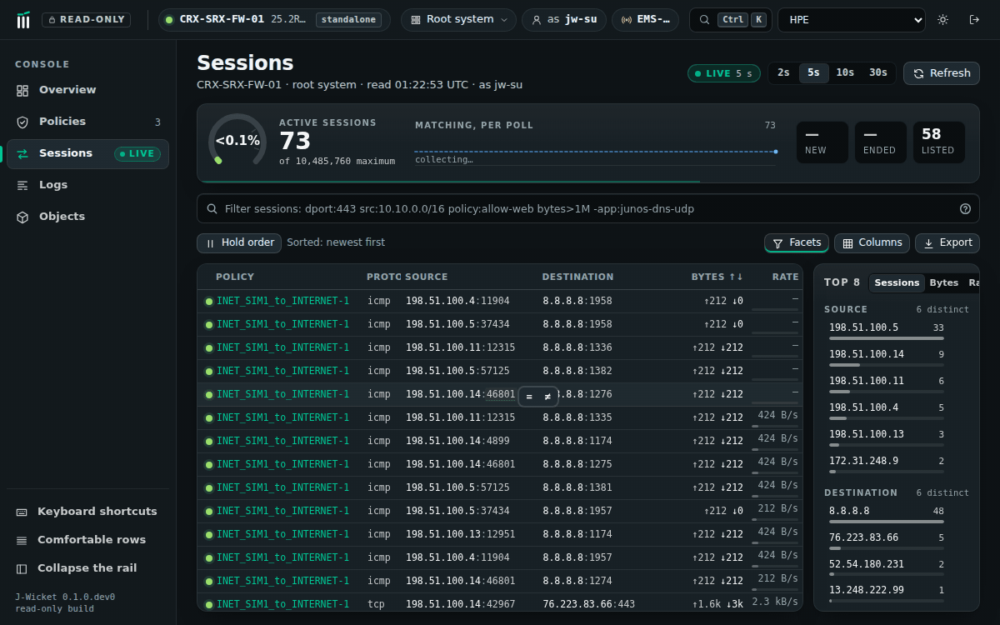1M is typed, the first term marked as run on the device and the other two in the browser, then a session's flow drawer opens showing the DNAT path from untrust to dmz">
</p>

*The Sessions view polling a real SRX every 5 s. `dport:443` and `proto:tcp` go into the session-table RPC (DEVICE chips), `nat:src` filters in the browser (BROWSER chip), then the drawer opens on a session that ended between polls, so it says ENDED and keeps the last values read. Live data from the project owner's lab SRX4100 (Junos 25.2R1-S1.4), 25 November 2026.*

In J-Web for SRX 24.4, no Monitor page lists live flow sessions; the log grids have a manual Refresh and no live tail, export at most 100 rows, and filter the system log on Event and Message with `=` only; security policies are inline grid rows with no policy wizard; and six paths commit at once with no review step ([catalog](docs/catalog.md#key-findings), [ledger](docs/parity/jweb-24.4.csv)). J-Wicket starts with the reads, each designed to run as your own Junos login and to make sense to someone who does not know Junos yet. Its configuration path (reviewed diffs, confirmed commits and a preview-only policy builder) is specified, not built ([Spec 002](docs/specs/002-change-protocol.md), [Spec 003](docs/specs/003-firewall-policy-builder.md)).

**Stage: foundation, not installable on a production SRX.**

- Everything here is read-only. **Tested on one lab SRX4100** (Junos 25.2R1-S1.4, Python 3.7.10, 24 November 2026): the bundle ran under Junos, served TLS on fxp0, signed in an operator over NETCONF and read that device's policies, live sessions and syslog ([evidence](docs/evidence/2026-11-24-srx4100-lab/README.md)). Nothing has run on a customer platform, no other platform or release has been tried, and the automated tests still use synthetic fixtures.
- It is a web server on the routing engine, so it has to earn trust: its security review and external penetration test have not happened yet ([governance](docs/governance.md#3-gates-g0-to-g5)).
- The prototype is not an installer, and the project does not ask anyone to enable a listener, disable J-Web or change a firewall.
- Watch or star the repository to follow the qualification gates; G1 is next.

Try it on a workstation. You need Python 3.7 or later, `make` and `git`; no packages and no device. CI runs on Linux; other operating systems are not tested in CI.

```sh
git clone https://github.com/robertsonc/jwicket.git && cd jwicket
make dev    # then open http://127.0.0.1:8080/ and sign in as admin, any non-empty password
```

**On this page:** [What it is for](#what-it-is-for) · [Highlights](#highlights) · [Try it](#try-it-without-a-firewall) · [Why J-Wicket](#why-j-wicket) · [Features](#features-and-functions) · [Query language](#query-language) · [How it works](#how-it-works) · [What it is not](#what-it-is-not) · [Status](#status-and-roadmap) · [Documentation map](#start-here) · [Contributing](#contributing) · [Security](#security) · [License](#license)

## What it is for

J-Wicket is a spec-driven project to replace J-Web for customers who want to manage an SRX on the firewall itself: a Junos-managed Python application with an offline-capable browser UI (nothing loads from the internet; [ADR 0007](docs/adr/0007-offline-capable-meaning.md)).

- **Success:** an authorized operator can complete the same tasks as on the reference release, J-Web for SRX Series 24.4, with better tools for reviewing scope, explaining policy decisions and recovering from changes. Progress is tracked row by row in the [parity ledger](docs/parity/README.md).
- **Usable without knowing Junos:** a binding design rule ([ADR 0010](docs/adr/0010-usable-without-knowing-junos.md)). Every screen explains the Junos concepts it shows and puts the matching command alongside, so operators learn Junos as they go. Parts exist today (decoded log lines, policy order spelled out, copyable `show` commands); in-place explanations of each concept are specified in [Spec 005](docs/specs/005-explain-junos-in-place.md) (Draft, not built). Installing J-Wicket still takes someone with Junos skills, once per device.
- **First slice:** a scoped, read-only policy inventory ([Spec 001](docs/specs/001-policy-inventory.md)).
- **First planned configuration wizard:** a preview-only Firewall Policy Builder ([Spec 003](docs/specs/003-firewall-policy-builder.md)), with brownfield, group ownership and recovery cases specified up front.
- **The owner's binding UI requirements** ([Spec 004](docs/specs/004-live-sessions-and-logs.md), read-only):
  - the UI must be as good to look at as it is to use;
  - log viewing with syntax highlighting of the log lines themselves (log syntax, not configuration syntax) is a must;
  - `show security flow session` output must be visible, with powerful inline, live filtering.

## Highlights

- **Watch the session table and narrow it as you type.** `show security flow session` as a live table: the part of your query Junos can filter goes into the RPC, the rest filters in the browser, and new and ended sessions are marked on every poll.
- **Read logs as log syntax, not as plain text.** Every line is tokenised and coloured (time, tag, addresses, ports, zones, policies, NAT, failure words); traffic logs decode into a session timeline; eleven event families carry live counts.
- **See the order Junos checks policies in.** Zone-pair policies, then global, then the default policy, with inactive rules shown as skipped, inherited rules shown with their group, and addresses and applications resolved. For a flow verdict J-Wicket builds the `show security match-policies` command, because the device decides, not J-Wicket.
- **Always know what you are looking at.** Device and HA mode, scope (root, logical or tenant system), read-as user, read time and any central manager detected ("managed from"), on every screen.
- **Denied means denied, never empty.** A panel your login class cannot read says so; sign in as the fixture user `auditor` to see it.
- **Nothing from the internet, nothing changed.** Every asset is served by J-Wicket under a strict Content-Security-Policy; only allowlisted read-only RPCs can be sent; the code has no write path.
- **One file for Junos.** Standard library plus the PyEZ that Junos ships, built into one reproducible, self-testing bundle.

## Try it without a firewall

You need Python 3.7 or later, `make`, `git` and a browser. The development server needs no packages and talks to no device; run it from the repository root, because the fixture path is relative.

```sh
git clone https://github.com/robertsonc/jwicket.git && cd jwicket
make dev
```

It starts with these lines (the timestamp at the start of each line left out):

```text
WARNING jwicket.devserver FIXTURE MODE: tests/fixtures/branch; users admin, auditor accept any non-empty password
WARNING jwicket TLS is off; listening on loopback only (127.0.0.1). Reach it through an SSH tunnel.
INFO jwicket listening on 127.0.0.1:8080 tls=False backend=fixture
INFO jwicket.audit {"backend": "fixture", "event": "start", "source": "local", "ts": "2026-11-24T16:40:48Z", "user": null, "version": "0.1.0.dev0"}
```

Open <http://127.0.0.1:8080/> and sign in as `admin` with any non-empty password (fixture mode only). Then try:

1. **Sessions:** type `dport:443 nat:dst bytes>1M` and watch the chips say which terms ran where; click any address or port to add it, Alt-click to exclude it.
2. **Logs:** pick `traffic-log`, type `ip:198.51.100.0/24 -dport:53`, then click a CLOSE line to decode it.
3. **Policies:** open `allow-web` to see its resolved addresses and applications, then press the "no match → 2 global → deny-all" button under its zone pair to see how Junos picks a policy.
4. **Ctrl+K**, type `deny`; or paste an address such as `10.10.3.4`.
5. **Sign out and sign in as `auditor`**, a fixture user whose simulated login class is denied the configuration read: panels say DENIED instead of showing empty tables.
6. **The cluster fixture:** stop the server, run `make dev DEV_FIXTURE=tests/fixtures/cluster-lsys` and sign in as `admin` or `lsys-a-admin` to see a two-node chassis cluster, a logical system and a deactivated tenant system in the scope picker.

Port 8080 taken? Run `PYTHONPATH=src python3 -m jwicket.devserver --fixture tests/fixtures/branch --port 8301`. Stop the server with Ctrl+C.

The same checks CI runs (Node 22 is needed only for the JavaScript tests):

```sh
python3 -m venv .venv && .venv/bin/pip install -r requirements-dev.txt   # ruff and mypy, pinned
make test                                  # Python unit and HTTP integration tests
make lint RUFF=.venv/bin/ruff              # ruff check src tests tools
make typecheck MYPY=.venv/bin/mypy         # mypy --strict, Python 3.8 target (oldest mypy accepts)
node --test tests/js/*.test.mjs            # query language and log parser, no packages
make bundle                                # build dist/jwicket.py, then self-test it isolated
```

## Why J-Wicket

Every cell comes from the [parity ledger](docs/parity/jweb-24.4.csv), the [charter](docs/charter.md), the [catalog](docs/catalog.md#key-findings), [Spec 004's J-Web 24.4 baseline](docs/specs/004-live-sessions-and-logs.md#2-problem) or the code. "Not assessed" means this project has not studied it.

| | J-Web for SRX 24.4 | Junos CLI | J-Wicket today |
| --- | --- | --- | --- |
| Where it runs | On the SRX, built in | On the SRX | Designed to run on the SRX as a Junos extension-service app; so far runs only on a workstation against fixtures |
| Live flow-session table | No Monitor page in the 24.4 guide lists it; the dashboard shows active and maximum sessions | `show security flow session` with filter options; no option caps how many sessions a list returns | Live table, device-side filters plus inline browser filtering, refuses lists over 5,000 matches `built` |
| Log viewing | Monitor > Logs grids with a manual Refresh (no live tail), CSV export of at most 100 rows; System log filter on Event and Message with `=` only | `show log <file>` as text; the underlying `get-log` returns the whole file | Live tail, log-syntax highlighting, typed query, decoded lines, export of every held line that matches the filter `built` |
| Explaining a policy decision | Rule grid with advanced search (AND, OR, `!=`, parentheses) | `show security match-policies` answers for one flow | Evaluation order per zone pair, inactive and inherited rules marked, addresses and applications resolved; builds the `match-policies` command for the device to answer `built` |
| Reviewing scope | Tenant & LSYS switcher in the banner | Per command | Device, HA mode, scope, read-as user and read time on every screen; denied reads shown as denied `built` |
| Changes and recovery | Commit menu with "View configuration changes" and "Commit the changes with autorollback" (semantics undocumented); Configuration Management > History; six paths, History Rollback among them, commit at once with no review step | `commit confirmed`, `rollback` | **None: read-only.** Reviewed diffs and confirmed commits are `specified` (Spec 002); the preview-only builder is `specified` (Spec 003) |
| Internet needed by the UI | Not assessed | n/a | None: every asset is served by J-Wicket under a CSP that allows only itself `built` |
| Security record | Advisories every year from 2023 to 2026; five 2023 CVEs in CISA KEV | CVE-2023-44182 also covered the CLI and NETCONF | No security review (Q-SEC-01) or penetration test (Q-SEC-02) yet |
| Production use | Ships with the SRX | Ships with the SRX | **Not installable on a production SRX.** No release |

Central managers (Security Director, Security Director Cloud and Mist) run off the box and manage many devices; this project has not compared them row by row. J-Wicket treats them as co-owners of the configuration and shows a detected one as "managed from" ([ADR 0009](docs/adr/0009-central-management-coexistence.md)).

**Use J-Web or the CLI on real devices today.** Use J-Wicket to evaluate the design on fixtures or to propose specs. The [lab procedure](docs/deploy-lab.md) describes how the first qualification run would be done on a disposable lab vSRX; running it is the lab owner's choice, not something this project asks for. That J-Wicket's tools for scope, explanation and recovery are better than J-Web's is the project's bet, not a measured result ([charter, section 1](docs/charter.md#1-the-problem-and-who-it-is-for)).

## Features and functions

| Status tag | Means |
| --- | --- |
| `built` | The code exists. The daemon, the query language and the log parser have automated tests that pass against synthetic fixtures. Browser-only views (for example the Overview, command palette, session drawer, histogram, themes and phone layout) have been exercised by hand on the development server, with no automated UI tests. Formal browser acceptance (AC-001-21, AC-004-20) is not signed off. The daemon, the Policies, Sessions and Logs reads, and sign-in have run once on a lab SRX4100 ([evidence](docs/evidence/2026-11-24-srx4100-lab/README.md)); that is not qualification. |
| `specified` | A spec covers it; nothing is built. |
| `planned` | On the roadmap, with no spec. |

Reply formats are J-Wicket's reading of Juniper documentation until recorded replies exist (Q-REL-01). Each area below opens with a summary, and a screenshot where one helps; expand its list for every feature.

### Live sessions

<picture>
  <source media="(prefers-color-scheme: dark)" srcset="docs/images/readme/sessions-filter-dark.webp">
  <source media="(prefers-color-scheme: light)" srcset="docs/images/readme/sessions-filter-light.webp">
  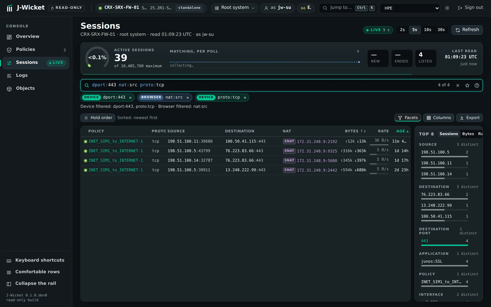1M split into device and browser filter chips, 66 of 70 sessions shown">
</picture>

*`dport:443 nat:src proto:tcp`: DEVICE chips went into the RPC, the BROWSER chip filtered what came back (4 sessions, each source-NATed to the interface address). The image follows your GitHub theme; HPE colour scheme. Live data from the project owner's lab SRX4100 (Junos 25.2R1-S1.4), 25 November 2026.*

`show security flow session` as a polled live table, with device-side filters, a guard that refuses lists over 5,000 matches, live diff and rate, a live session drawer, cluster-aware rows and stamped export.

<details>
<summary>All 10 live-session features, and the session drawer</summary>

- `built` **Live flow-session table** for the root system: reads `show security flow session` (RPC `get-flow-session-information`) on your own device session and re-reads every 2, 5, 10 or 30 s. "Live" is polling, never push; each poll costs two RPCs (one when the list is refused), plus one unfiltered summary for the gauge at most every 30 s while a device-side filter is set.
- `built` **Filters pushed to Junos:** positive, AND-ed terms on `src`, `dst`, `sport`, `dport`, `proto`, `app` and `iface` become RPC parameters, so the device does the narrowing. Chips show which terms ran on the device and which in the browser.
- `built` **A guard that fails closed:** a filtered summary is read first, and if more than 5,000 sessions match, J-Wicket lists none and offers narrowing filters instead (5,000 is J-Wicket's own threshold, [Spec 004 section 7.4](docs/specs/004-live-sessions-and-logs.md#74-cost-of-listing-and-the-refusal-threshold); cost on hardware is Q-LOAD-02). Rows are capped at 500 by default, 2,000 at most, with truncation stated.
- `built` **Live diff and rate:** new sessions wash gold, ended ones stay struck through for one poll; bytes per second is computed between polls, with an in-cell bar.
- `built` **Sixteen columns** (status, ID, policy, zones, protocol, source, destination, NAT, application, interfaces, bytes each way, packets, rate, age, idle timeout left, node), fitted to the width or chosen by hand; zones are derived from the policy inventory and marked when uncertain.
- `built` **Click any value to filter, Alt-click to exclude**; facets show the top 8 sources, destinations, ports, applications, policies and interfaces by sessions, bytes or rate.
- `built` **Session drawer that updates live:** a flow diagram (client, ingress zone and interface, SRX policy with "rule n of m", egress, server), the NAT translation in both directions, both wings, a traffic sparkline and the idle-timeout bar.
- `built` **Chassis cluster aware:** counts never summed across nodes, rows labelled with node and SPU, backup copies hidden by default with a count. Element names are inferred and no fixture serves cluster sessions yet (Q-HA-01).
- `built` **Explicit states instead of an empty table:** too many to list, count unknown, denied, unsupported, failed, no match on the device or in the browser.
- `built` **Export** the rows on screen as CSV or JSON, stamped with device, read time, user and query, with spreadsheet formula injection neutralised; **copy a link** that holds the view and its filters, never device data.

<p align="center">
  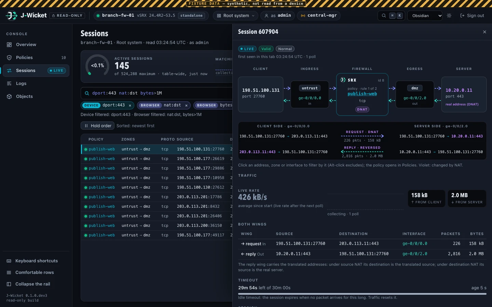
</p>

*The drawer for one source-NAT session: client, ingress zone and interface, the policy (rule 1 of 1), egress, server, both wings with the translated source in violet, and the idle timeout. Live data from the project owner's lab SRX4100 (Junos 25.2R1-S1.4), 25 November 2026.*

</details>

### Logs, with log-syntax highlighting

<p align="center">
  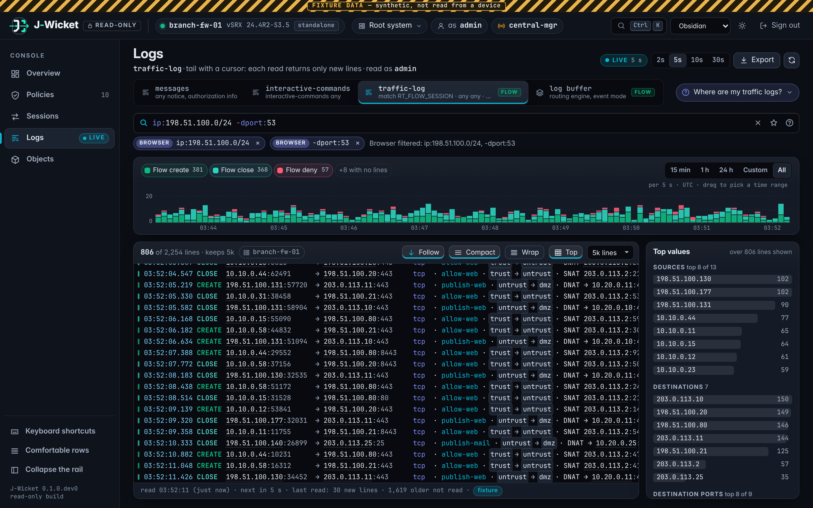
</p>

*A traffic log filtered by `ip:198.51.100.0/24 -dport:53` (CIDR-aware, DNS excluded): CREATE, CLOSE and DENY lines highlighted, a per-5 s histogram stacked by family, top values on the right. Synthetic fixture data. The lab SRX streams its traffic logs off the box (stream mode), so there is no on-box traffic log to show live.*

Syslog files, the on-box reporting database and the security log buffer, tailed with a cursor and highlighted as log syntax; traffic lines decode into a session timeline, and every held line can be exported.

**Highlighted log families** (live counts, click to show only one, Alt-click to hide one): Flow create · Flow close · Flow deny · Screen · IDP & threats (IDP, antivirus, web filtering, ATP, SecIntel, antispam, content filtering, UTM) · VPN (KMD/IKE) · Commit & CLI · Auth · SNMP · Chassis & HA · Other.

<details>
<summary>All 10 log features, and two more screenshots</summary>

- `built` **Log sources found in the configuration:** every configured `system syslog file`, the on-box reporting database (ten report types) and the routing engine's security log buffer, with the sources that hold traffic logs badged.
- `built` **"Where are my traffic logs?"** explains in one sentence where traffic logs go (security log mode, stream destinations, on-box reporting), using the documented default for the model and release when no mode is configured, instead of showing an empty pane.
- `built` **Tail with a cursor:** each poll returns only new lines from `show log <file>`, read on your own session, never by opening `/var/log` as the daemon; rotation and gaps are marked. Junos still returns the whole file on every read (`get-log` has no tail parameter; cost on a device is Q-LOAD-01).
- `built` **Highlighting as log syntax:** timestamp, host, process, pid, tag, priority, structured-data ID, keys and values, addresses, ports, protocols, zones, policies, interfaces, NAT addresses, numbers, strings, failure and success words, users. Zone, policy and interface names from the inventory are marked in free text, and the tokens always join back to the exact line (lossless, tested).
- `built` **Formats read:** RFC 5424 (with its structured-data quirks), BSD syslog, and security log buffer events. Times without a zone are read as UTC, and a clock note says so.
- `built` **Compact rows for traffic logs:** a CREATE, CLOSE, DENY or UPDATE badge, the aligned 5-tuple, policy, zones, NAT, close reason, bytes and duration first, the rest faint.
- `built` **Event-rate histogram** stacked by family: drag to set a time range, click a bar for its bucket; 15 min, 1 h, 24 h, custom and all presets.
- `built` **Decoded line panel:** a plain-sentence decode ("Session 365425 closed (TCP RST) after 36 s"), the flow, the CREATE-to-CLOSE timeline for that session, whether it is still in the last Sessions read, every parsed field, and a `show security match-policies` command built from the line.
- `built` **Hidden and direction-changing characters** in device text are shown as visible `U+XXXX` badges, and your own J-Wicket reads (`UI_NETCONF_CMD` lines for your user) are hidden by default with a counter.
- `built` **Export the filtered lines** as raw `.log`, CSV or JSON: every line held in the browser's 2,000 to 10,000-line window; J-Web 24.4 exports at most 100 rows ([ledger](docs/parity/jweb-24.4.csv), row MON-LOGS-SESSION-EXPORT).

<p align="center">
  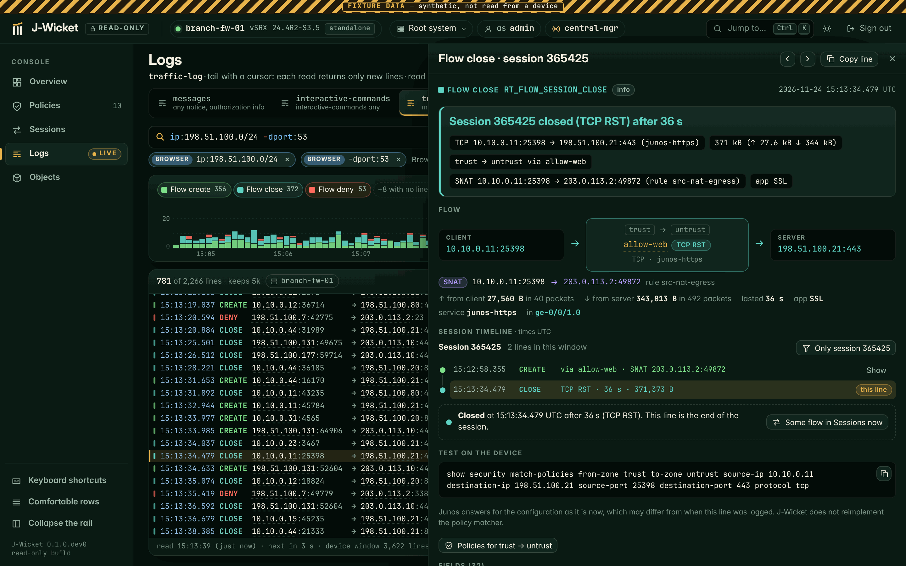
</p>

*One RT_FLOW_SESSION_CLOSE line decoded, with its session timeline and a command to test on the device. Synthetic fixture data. Fixture data for the same reason: the lab SRX keeps no traffic log on the box.*

<p align="center">
  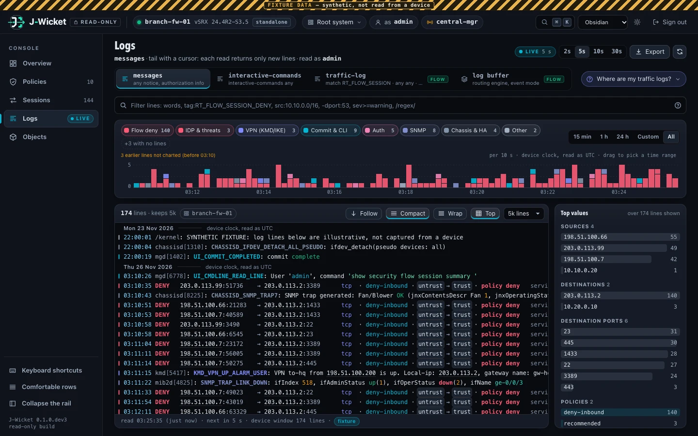
</p>

*The `messages` file, live: families counted and charted, every line highlighted, and the device's own answer to "where are my traffic logs?" (stream mode, sent to Security Director Cloud). Live data from the project owner's lab SRX4100 (Junos 25.2R1-S1.4), 25 November 2026.*

</details>

### Policy inventory and explanation

<p align="center">
  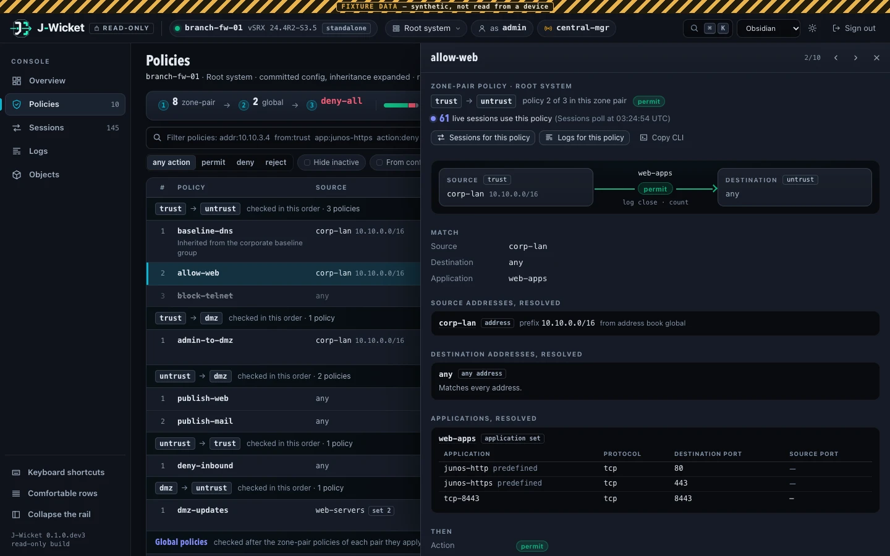
</p>

*Policies in the order Junos checks them (2 zone-pair, then 1 global, then the default policy) and the drawer for `INET_SIM1_to_INTERNET-1`: policy 1 of 1 in its zone pair, live sessions, addresses and applications resolved. Live data from the project owner's lab SRX4100 (Junos 25.2R1-S1.4), 25 November 2026.*

Each scope's policies from the committed configuration, in Junos evaluation order, with inactive and group-inherited rules marked, addresses and applications resolved, and a `match-policies` command built for the device to answer.

<details>
<summary>All 11 policy-inventory features</summary>

- `built` **Scopes never merged:** the root system, each logical system and each tenant system are separate inventories from the committed configuration. The scope lives in the URL, a non-root scope tints the top bar and prefixes every title, and a deactivated scope says its policies are not in effect.
- `built` **Junos evaluation order:** each zone pair's policies in configuration order, then the global policies, then the default policy (configured, or "not configured (Junos default)" with deny-all). J-Wicket shows the order; it never claims which policy a flow matches ([ADR 0006](docs/adr/0006-device-explains-policy-decisions.md)).
- `built` **Inactive configuration with its reason:** inactive policies keep their place, struck through, with the reason (the policy, its zone pair or global block, or a deactivated ancestor such as `[edit security policies]` or the logical system), and evaluation-order lists mark them "skipped: inactive".
- `built` **Group provenance:** which configuration group a policy or object came from, which parts were inherited, and a warning that a direct change to a group-owned object may be overridden ([ADR 0005](docs/adr/0005-committed-config-with-provenance.md)).
- `built` **Addresses and applications resolved** to their leaves through nested sets, following J-Wicket's reading of the Junos address-book lookup order (to be verified, Q-REL-01), with unresolved names and truncation (16 levels, 512 leaves) reported.
- `built` **Nothing dropped silently:** settings J-Wicket does not model are reported per policy ("settings not shown"), never mistaken for absent.
- `built` **"Explain a flow":** the three steps Junos takes, a form that builds a copyable `show security match-policies` command and a table filter ("a filter, not a match result").
- `built` **Zone-pair matrix and summary cards:** counts by action per pair, live sessions per pair, arrow-key navigation; selecting a cell filters the table.
- `built` **Live session count per policy** (root system) from the last Sessions poll in this tab, or one session-table read on request.
- `built` **Stamped JSON and CSV export** of a fresh read, file named by host, scope and UTC time, formula injection neutralised.
- `built` **Device facts:** host name, model, release, HA mode (standalone, chassis cluster with redundancy groups, Multinode High Availability, or unknown), and outbound-SSH central-management clients shown as "managed from" (that such a client means Security Director, Security Director Cloud or Mist is inferred, Q-MGMT-01; [ADR 0009](docs/adr/0009-central-management-coexistence.md)).

</details>

### Objects

Zones, address books and applications, each with where it is used, detail panels that open Policies, Sessions or Logs filtered by the object, and `used:no` to find unused ones.

<details>
<summary>All 5 object features</summary>

- `built` **Zones** with interfaces, screen and host-inbound system services and protocols at zone and interface level (exclusions and deactivated entries marked), and the policies that name each zone.
- `built` **Address books:** global, attached and legacy zone books, entries (prefix, range, DNS, wildcard, set) and "used by" counts, direct or through a set, or "unused".
- `built` **Applications and application sets** with protocol and ports, members (predefined `junos-*` marked) and usage. Predefined ports come from a table built into the UI, not from the device.
- `built` **Detail panels** that expand sets, list the policies that use an object, and open Policies, Sessions or Logs filtered by it, with a copyable `show configuration` command.
- `built` **A query bar per tab** with its own keys and validation; `used:no` finds unused objects.

</details>

### Console UX

<p align="center">
  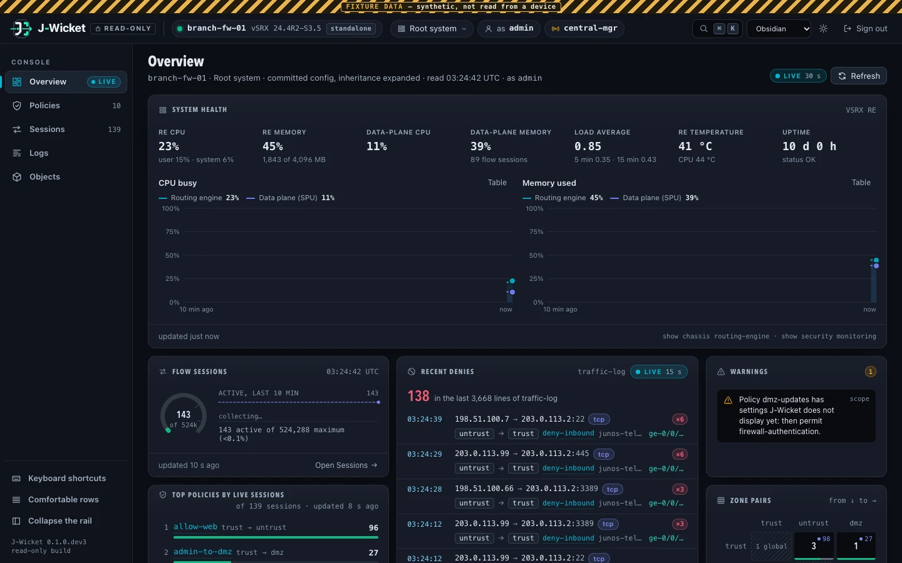
</p>

*The Overview after 10 minutes: system health (routing-engine CPU busy, memory, load, temperature, uptime, and the data plane) charted, then the session gauge and trend with valid and invalidated counts, top policies, recent denies, warnings and zone pairs. Live data from the project owner's lab SRX4100 (Junos 25.2R1-S1.4), 25 November 2026.*

An Overview with system health charts, a command palette, keyboard-first navigation, cross-links between every view, shareable URLs, three colour schemes in day and night, and a phone layout.

<details>
<summary>All 11 console features, and two more screenshots</summary>

- `built` **Overview** with a LIVE, PAUSED or RETRYING pill: system health (routing-engine and data-plane CPU and memory charted over 10 minutes, with load, temperature and uptime, from `show chassis routing-engine` and `show security monitoring`, read on a lab SRX4100), flow-session gauge and trend, recent denies (repeats folded into one row with ×N), top policies by live sessions, a zone-pair mini-matrix, warnings word for word, the device card and "jump to" links computed from what was read.
- `built` **Command palette** (Ctrl+K or Cmd+K): views, actions, incident presets, scopes, every policy and zone; paste an address, port or session ID to get the matching look-ups. Its footer says "Nothing here is sent anywhere."
- `built` **Keyboard first:** `g` then `o`, `p`, `s`, `l` or `b` for each view, `/` for the query bar, `j`/`k` and Enter, Space to pause live reads, `r` to refresh, `t` for the theme, `?` for the list.
- `built` **Query bar** coloured as you type, with autocomplete from the current rows and the inventory, errors that point at the column, built-in help, and up to 20 saved queries per view (query text only, never device data).
- `built` **Cross-links everywhere:** from a session to its policy and its logs, from a log line to the live session, from a policy or object to Sessions and Logs.
- `built` **Copyable read-only show commands** for policies, objects, sessions and logs, built from the Junos hierarchy for you to paste; J-Wicket never runs them.
- `built` **Shareable URLs** that keep view, query, selection and scope, so Back, Forward and copy-link land on the same view.
- `built` **Colour schemes:** HPE (the default), Obsidian & Phosphor for NOC screens, and Nordic Steel, colourblind-safe (allow is ice blue and deny magenta, never green against red); each in day and night, which follow the operating system until you pick one; every text colour measured at 4.5:1 or better. Dense or comfortable rows, and reduced motion honoured.
- `built` **Phone layout:** bottom tab bar, session and log cards, full-screen detail sheet. Checked in emulated Chrome only, not on a real phone.
- `built` **Accessibility aids:** skip link, throttled live announcements, ARIA listbox, combobox and grid roles, visible focus. Not tested with a screen reader and AA contrast not measured (UI-001-17 open), so no compliance is claimed.
- `built` **Quiet when unattended:** live reads pause on a hidden tab and before the idle timeout, so an unattended console stops polling and its session can end.

<p align="center">
  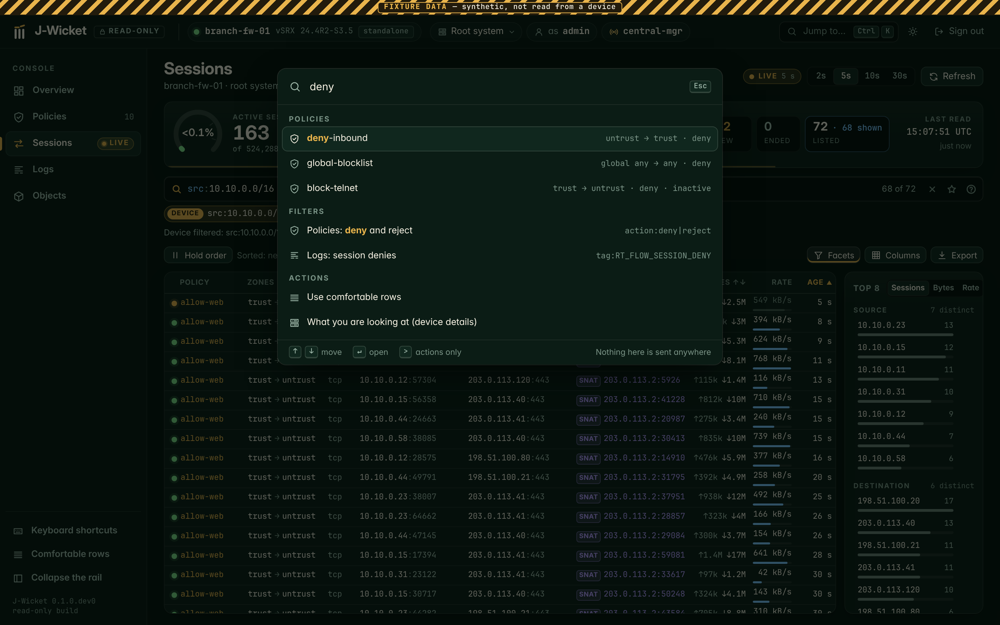
</p>

*Ctrl+K with `inet` typed: zones with their interfaces, policies, saved filters and actions. Live data from the project owner's lab SRX4100 (Junos 25.2R1-S1.4), 25 November 2026.*

<p align="center">
  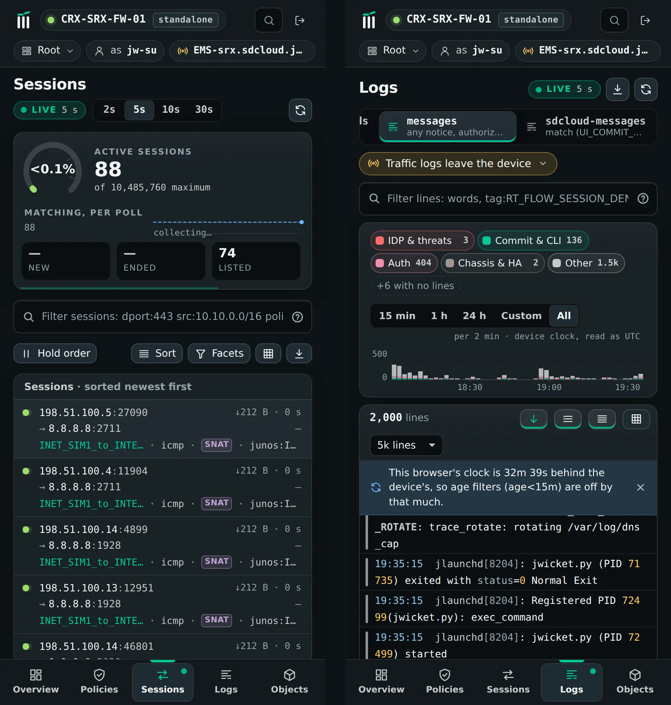
</p>

*Phone width (emulated, 390 × 844): live session cards and the `messages` log. Live data from the project owner's lab SRX4100 (Junos 25.2R1-S1.4), 25 November 2026.*

</details>

### Sign-in and security model

<p align="center">
  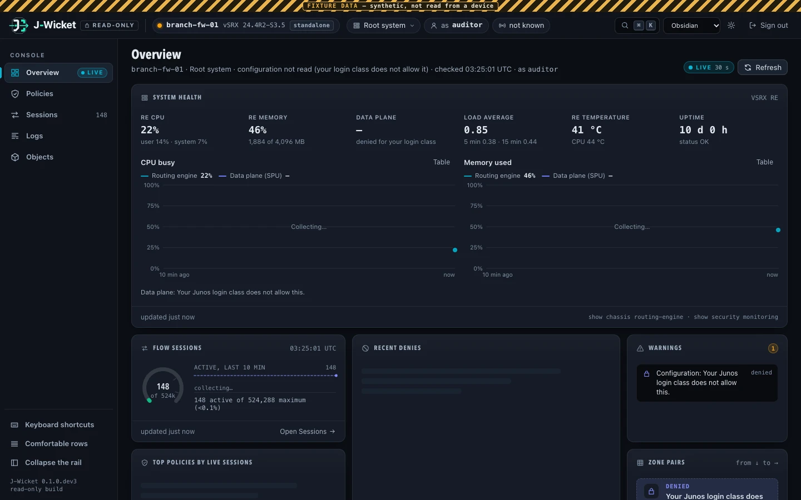
</p>

*Signed in as a lab account in Junos's predefined `read-only` class: Junos denies it the configuration, so those panels say DENIED; system health and live sessions still render, because `view` allows them. Live data from the project owner's lab SRX4100 (Junos 25.2R1-S1.4), 25 November 2026.*

Sign-in delegated to Junos, a read-only RPC allowlist, a bounded web server with a fixed CSP, and settings that refuse to start when anything is unsafe.

<details>
<summary>All 11 sign-in and security features, and the cluster fixture</summary>

- `built` **Sign-in delegated to Junos:** your user name and password go to Junos in a NETCONF session to the device's own loopback, so Junos applies its authentication order (local, RADIUS, TACACS+) and your login class to every read. J-Wicket stores no password and has no roles ([ADR 0002](docs/adr/0002-junos-delegated-sign-in.md)). Worked for a super-user account on a lab SRX4100; least-privilege and remote-authentication users not tried yet (Q-AUTH-01, Q-AUTH-02, Q-AUTH-03).
- `built` **Password only:** the daemon account's SSH keys and `~/.ssh/config` are never used; the NETCONF target must be a loopback address on a port below 1024.
- `built` **Read-only RPC allowlist:** 15 `get-*` RPCs plus a separate configuration read with three constant filters that never fetch the whole configuration (password hashes) or all of `[edit security]` (IKE pre-shared keys). A test requires every allowlisted name to start with `get-` and checks that write RPCs are absent.
- `built` **No request value becomes command text:** scopes, filters, log files, report expressions, times and cursors are validated before any read; session filters travel as RPC parameters.
- `built` **Bounded web server:** by default at most 8 connections, one 10 s deadline for the whole request and 8 KiB bodies (each setting can only be moved within a fixed range); 16 KiB of headers, fixed; GET and POST only, 11 routes, no upload route; the only POST routes are sign-in and sign-out.
- `built` **Browser hardening:** a fixed CSP (`default-src 'none'`, `'self'` only, Trusted Types required, no inline script or style), `nosniff`, `DENY` framing, `no-referrer`, `no-store`; `HttpOnly` `SameSite=Strict` cookie (`Secure` and `__Host-` under TLS); `Origin` must equal the page origin on sign-in and sign-out, and sign-out also needs the CSRF token header.
- `built` **Web sessions:** fresh random token per sign-in (only its SHA-256 kept), by default 15-minute idle and 8-hour absolute timeouts, at most 4 web sessions at once (a sign-in over that cap is refused) and 2 per Junos user (a third sign-in by the same user closes their oldest); ending a web session closes its device session.
- `built` **Sign-in throttling that only failed sign-ins count against:** limits per source address and user name and per source address, and by default at most 2 sign-ins checked by Junos at once, so requests that never reach Junos cannot lock anyone out.
- `built` **Audit trail** as JSON lines: credential fields dropped, failed sign-ins recorded under a keyed hash of the name, floods of refusals aggregated. Local only and not tamper-evident ([SECURITY.md, known gaps](SECURITY.md#known-gaps)).
- `built` **Fail-closed settings:** one INI file, unknown keys refuse the start, any non-loopback bind requires TLS 1.2 or later, and settings, token and key files must pass ownership and mode checks.
- `built` **Lab-token backend, lab only:** one shared token, loopback only, reads as the daemon's account and says so in amber on every screen. Not least privilege.

<p align="center">
  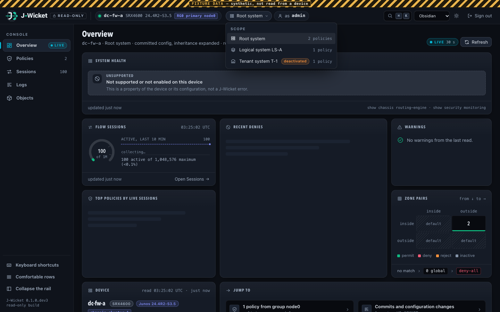
</p>

*The `cluster-lsys` fixture, with the RG0 primary node in the device chip and the scope picker open. This fixture serves no session table, so the session panels say unsupported. Synthetic fixture data. Fixture data: the lab SRX is standalone.*

</details>

How each control maps to the classes of J-Web advisories is in [architecture, section 14](docs/architecture.md#mapped-to-j-web-advisory-classes-2023-2025). None of it has had a security review yet.

### On-box runtime and packaging

Built and tested off the box; never started by Junos (Q-RT-01, Q-RT-02, Q-RT-03). One reproducible, self-testing file with only the standard library and the PyEZ that Junos ships.

<details>
<summary>All 6 runtime and packaging features</summary>

- `built` **One generated file:** `tools/bundle.py` writes `dist/jwicket.py` with every shipped module and UI file inside, because whether an unsigned Junos script may import sibling modules is unknown ([ADR 0001](docs/adr/0001-on-box-pure-python-single-file.md)). Development modules are never shipped.
- `built` **Reproducible:** two builds of the same tree are byte-identical; `--check` fails if a bundle differs from a fresh build. The header carries a SHA-256 over every embedded file, and CI publishes the file's SHA-256 (integrity, not authenticity: the code is unsigned).
- `built` **Self-test and probe:** `--bundle-self-test` imports every embedded module in isolation and verifies the digest; `--probe` reports the Python, OpenSSL and PyEZ modules present. In the spike Junos would not pass `--flag` arguments to an extension-service app (finding F1), so copies named `jwicket_selftest.py` and `jwicket_probe.py` run them instead.
- `built` **Import-path hardening:** the bundle removes its own directory from `sys.path` before any other import and serves only its embedded modules, so a `.py` file planted beside it cannot stand in for a standard-library or PyEZ module.
- `built` **No-argument start:** reads one fixed settings file, `/var/db/jwicket/jwicket.ini`; a refused start writes its reason to `startup-refused.txt` for `file show`.
- `built` **Standard library plus on-box PyEZ only:** no third-party packages, no C extensions of its own, no subprocess, no outbound connection other than NETCONF to the device it runs on.

</details>

### Developer tooling

A development server on synthetic fixtures with error injection and synthetic live traffic, Python and Node tests, and CI on every push.

<details>
<summary>All 5 developer-tooling features</summary>

- `built` **Development server** (`make dev`): the real server and UI on loopback, fed from a synthetic fixture, refusing any non-loopback bind, with a FIXTURE DATA banner on every page.
- `built` **Fixtures:** synthetic `branch/` (standalone branch firewall) and `cluster-lsys/` (two-node chassis cluster with a logical system and a deactivated tenant system), a CSV-injection case and a synthetic log sample, with addresses from RFC 1918 and RFC 5737 only; plus a parser corpus of log lines copied verbatim from Juniper documentation (`log-samples/juniper-docs.txt`), which also carries other addresses ([tests/fixtures/README.md](tests/fixtures/README.md), [log-samples/README.md](tests/fixtures/log-samples/README.md)).
- `built` **Error injection** per user and RPC (denied, unsupported, failed) and **deterministic synthetic live traffic** that follows the fixture's policies.
- `built` **Tests:** 441 Python `unittest` tests and 56 Node tests for the query language and log parser pass on 2026-11-24; static-asset tests ban `innerHTML`, `eval`, inline script and external URLs.
- `built` **CI:** ruff and strict mypy, tests plus an isolated bundle self-test on Python 3.7, 3.9, 3.11 and 3.13, Node tests on Node 22, and a reproducible bundle build with read-only permissions.

</details>

### Specified and planned, not built

| Status | Item | Where |
| --- | --- | --- |
| `specified` | Firewall Policy Builder, preview only: add, clone, edit, move or delete a rule and see the result; never commits. J-Web 24.4 has no security-policy wizard ([catalog, key findings](docs/catalog.md#key-findings)) | [Spec 003](docs/specs/003-firewall-policy-builder.md), gate G3 |
| `specified` | Shared change protocol for every future write: private candidate, diff, confirmed commit that Junos rolls back unless confirmed. Design only; the code has no write path | [Spec 002](docs/specs/002-change-protocol.md), gate G4 |
| `specified` | AA contrast in both themes and full keyboard reach; unmodelled settings shown on every object type, not only policies; close-reason badges | Specs 001 and 004 |
| `specified` | Explain Junos in place: each Junos concept explained where it appears, with the matching command alongside (read-only) | [ADR 0010](docs/adr/0010-usable-without-knowing-junos.md); [Spec 005](docs/specs/005-explain-junos-in-place.md) (Draft) |
| `planned` | Sessions and logs scoped to a logical or tenant system (root only today) | [Spec 004](docs/specs/004-live-sessions-and-logs.md) open questions |
| `planned` | More device-side session filters and single-session lookup; device-side report summaries for the histogram; stream files, archived and binary logs; PCAP download | Spec 004 out-of-scope table, ledger |
| `planned` | TLS certificate provisioning spec, then Q-TLS-01 on a lab vSRX | [governance, section 8](docs/governance.md#8-what-ships-next) |
| `planned` | The other J-Web dashboard widgets (alarms, resources, storage, interface and zone tops, NAT, IPsec) and the remaining read-only parity rows | [parity ledger](docs/parity/jweb-24.4.md) |

## Query language

One language for Policies, Sessions, Logs and Objects. It is the owner's "powerful inline, live filtering", and each term's chip says where it ran.

| You type | Meaning | Example |
| --- | --- | --- |
| `key:value`, `key=value` | field match | `proto:tcp`, `policy=allow-web` |
| a bare word | free text, case-insensitive; a bare address or prefix matches any address in the row or line | `telnet`, `10.10.0.0/16` |
| space, `AND`, `&&` | and (binds tighter than OR) | `dport:443 bytes>1M` |
| `OR`, `\|\|`, `\|` | or | `proto:udp \| proto:icmp` |
| `NOT`, `-`, `!` | exclude | `-dport:53`, `-inactive:yes` |
| `( )` | group, any nesting | `(dport:80 OR dport:443) -src:10.0.0.0/8` |
| `!=` `>` `>=` `<` `<=` | compare | `dport>=1024`, `sev>=warning`, `dur>5m` |
| `~`, `/regex/flags` | regular expression, smart case | `policy~^pub` |
| `v1\|v2` | any of | `dport:80\|443\|8443` |
| `"..."`, `'...'` | phrase | `reason:"TCP FIN"` |
| addresses | IPv4 and IPv6 addresses, prefixes, ranges `a-b`, wildcards `10.10.*`, globs `10.*.0.1`, compared as addresses | `src:10.10.0.0/16` |
| sizes, durations, times | `k M G T` (decimal, like Junos counters) or `KiB MiB`; `ms s m h d w` and `1h30m`; dates, date-times or `HH:MM`, read as UTC | `bytes>1M`, `age<15m`, `time>=2026-11-24T15:27:50` |

Where each term runs:

| View | Keys | Runs on the device side | Everything else |
| --- | --- | --- | --- |
| Sessions (24 keys) | `src dst sport dport proto app iface ingress egress policy zone from to nat natsrc natdst bytes pkts rate dur timeout state id node` | Positive, top-level, AND-ed `:` or `=` terms with one value on `src`, `dst` (address or prefix), `sport`, `dport`, `proto`, `app`, `iface` become parameters of `get-flow-session-information` | In the browser, over the rows Junos returned |
| Logs (31 keys) | `tag family daemon host sev src dst ip sport dport proto policy zone from to app service nested reason user iface session nat natsrc natdst bytes dur lsys time age msg` | Syslog file: up to four contains terms (plain words, or literal field values used as hints) and four excluded words, applied by the J-Wicket daemon on the box, not by Junos. On-box report: report keys become its `expression` (at most 256 bytes) and time terms its start and stop. Log buffer: `time>=` and `age<` set "since" | Terms not sent run in the browser. Field hints, address-like words, report terms and time bounds are checked again there; other plain words and excludes run once, on the box (a case-insensitive substring match) |
| Policies (17 keys) | `name from to zone src dst addr app port action group inactive log count kind seq desc` | Nothing: the configuration snapshot is already in the browser | `addr`, `src` and `dst` compare against resolved addresses; rows J-Wicket cannot decide stay listed and are marked |
| Objects | Own keys per tab (zones, address books, applications) | Nothing | `used:no` finds unused objects |

## How it works

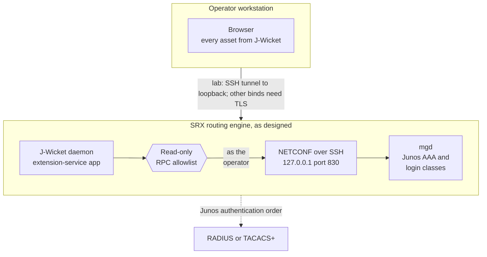

The routing-engine half has run once, on a lab SRX4100 ([evidence](docs/evidence/2026-11-24-srx4100-lab/README.md)); it is not qualified anywhere.

- **Who runs it:** one Python process on the routing engine, started and restarted by Junos as an extension-service application. J-Wicket's bundle ran that way on a lab SRX4100 (Q-RT-02, partial). Where fxp0 is in `mgmt_junos`, `[server] routing_instance` creates the listener there and keeps the NETCONF sessions in the default instance.
- **Who it reads as:** each operator signs in with their Junos user name and password, and J-Wicket opens one NETCONF session per operator to the device's own loopback, as that operator, so Junos decides who they are and what they may see.
- **What it may send:** only RPCs on a read-only allowlist; configuration is read through constant filters from the committed database, and no request value becomes CLI text.
- **The browser path:** the browser receives JSON and assets from J-Wicket alone; in the lab it reaches the loopback listener through an SSH tunnel.

Components, trust boundaries and known gaps: [architecture](docs/architecture.md).

## What it is not

- **Not a way to change a firewall.** There is no write path in the code; adding one before gate G4 is not accepted ([CONTRIBUTING.md](CONTRIBUTING.md#what-is-welcome-now)).
- **Not an installer, and not for production.** The only documented way onto a device is the [lab procedure](docs/deploy-lab.md): one disposable lab vSRX, a loopback bind, an SSH tunnel, every change made with `commit confirmed 5`. Even there, `set system scripts language python3` lets unsigned Python run on the routing engine, which is a security posture change in its own right.
- **Not a request.** The project does not ask anyone to enable a listener, disable J-Web or change a firewall.
- **Not proven safer than J-Web.** It is new code in the same position on the routing engine, with no security review yet; its [known gaps](SECURITY.md#known-gaps) are listed openly.
- **Not a multi-device manager.** It manages the device it runs on; Security Director, Security Director Cloud and Mist are treated as co-owners of the configuration.

## Status and roadmap

Version 0.1.0.dev0, unreleased: no release or tag yet. Expanding the parity inventory and proving least-privilege, TLS-protected on-box reads come before any live write path ([governance](docs/governance.md#3-gates-g0-to-g5)).

| Gate | Means | Status |
| --- | --- | --- |
| G0 spike | Unsigned Python runs under Junos, listens and reads the device | **Passed** on vSRX 24.4R2-S3.5, 2026-11-23, by the spike daemon, not J-Wicket's code |
| G1 foundation exit | Least-privilege, TLS-protected on-box reads proven (Q-RT-01 to Q-RT-03, Q-AUTH-01 to Q-AUTH-03, Q-TLS-01, Q-REL-01, Q-LOAD-01 to Q-LOAD-03, Q-SEC-01) | Not reached. On a lab SRX4100: Q-RT-01 passed; Q-RT-02, Q-AUTH-01 and Q-TLS-01 partial ([evidence](docs/evidence/2026-11-24-srx4100-lab/README.md)) |
| G2 read parity | Every P0 and P1 ledger row implemented and qualified; hardware and HA tests pass; SEs choose J-Wicket over J-Web for look-ups on real labs | Not reached |
| G3 preview-only builder | The Firewall Policy Builder ships; nothing that changes the device is sent | Not reached |
| G4 live writes | Spec 002 built, external penetration test passed, product sponsor named | Not reached |
| G5 customer production | Signed package, support statement, HA and upgrade qualified | Not reached |

**Parity ledger, 2026-11-24:** 881 J-Web 24.4 pages and operations tracked; 0 `implemented`, 0 `qualified`, 70 `specified`, 739 `planned`, 32 `replace` and 23 `out-of-scope` (each pending owner approval), 17 `unassessed` ([summary](docs/parity/jweb-24.4.md)). No row is `implemented` until its browser acceptance check passes, so no J-Web task is claimed at parity yet.

**Next, in order** ([governance, section 8](docs/governance.md#8-what-ships-next)): browser acceptance of the Specs 001 and 004 views (AC-001-21, AC-004-20); finish the lab runs started on the SRX4100 (Q-AUTH-01 with a read-only-class account, Q-RT-02's kill and memory checks, Q-RT-03) and add a vSRX 24.4 cell, with the first recorded replies (Q-REL-01); then TLS provisioning and the G1 security review.

## Start here

The documentation map: which document answers which question.

| For this decision | Read |
| --- | --- |
| What are we building, for whom, and what did the lab actually prove? | [Product charter and spike evidence](docs/charter.md) |
| What counts as J-Web parity? | [Release-scoped parity ledger](docs/parity/README.md): the method, with its [summary](docs/parity/jweb-24.4.md) and [data](docs/parity/jweb-24.4.csv) |
| Which workflows must the design support? | [Wizard and operations catalog](docs/catalog.md) |
| How do tenants, groups, HA, Junos AAA and central management fit? | [Architecture and trust boundaries](docs/architecture.md) |
| What does the policy inventory show, and how? | [Spec 001: scoped read-only policy inventory](docs/specs/001-policy-inventory.md) |
| What makes a config change safe to apply or undo? | [Spec 002: shared change protocol](docs/specs/002-change-protocol.md) |
| What will the first wizard do, and not do? | [Spec 003: Firewall Policy Builder, preview only](docs/specs/003-firewall-policy-builder.md) |
| What can I see live, and how are logs shown? | [Spec 004: live sessions and logs](docs/specs/004-live-sessions-and-logs.md) |
| How is each Junos concept explained on screen? | [Spec 005: explain Junos in place](docs/specs/005-explain-junos-in-place.md) |
| Who decides, and what ships next? | [Governance and qualification roadmap](docs/governance.md) |
| Why was each design decision made? | [Architecture decision records](docs/adr/README.md) |
| How would it be tried on a lab vSRX? | [Lab deployment procedure](docs/deploy-lab.md) (lab only, never production) |
| How do I propose or extend a feature? | [Contributor guide](CONTRIBUTING.md) and [spec template](docs/specs/000-template.md) |
| How do I report a vulnerability, and what is the threat model? | [Security policy and threat summary](SECURITY.md) |

| Path | What it is | State |
| --- | --- | --- |
| `src/jwicket/` | The daemon: bounded HTTP(S) server, Junos-delegated sign-in, read adapters (policy inventory, device facts, sessions, logs), JSON API | Built and tested on fixtures; run once on a lab SRX4100 |
| `src/jwicket/static/` | The browser UI: vanilla JavaScript and CSS, no build step, no packages | Built; browser acceptance pending |
| `tools/bundle.py` | Builds `dist/jwicket.py`, the single file Junos would run | Built and self-tested in CI |
| `tests/` | Python and Node tests; synthetic fixtures and a corpus of Juniper documentation log lines | CI on Python 3.7, 3.9, 3.11, 3.13 and Node 22 |
| `docs/` | Charter, parity ledger, catalog, architecture, specs, ADRs, governance, lab procedure | Living documents |
| `docs/evidence/` | The spike packet, unedited | Evidence, not product |

## Contributing

A feature starts as a spec, not as code: find or add its ledger row, copy the [spec template](docs/specs/000-template.md), and open a pull request ([how to propose a feature](CONTRIBUTING.md#propose-a-feature)). Setup and coding rules are in [CONTRIBUTING.md](CONTRIBUTING.md#set-up-and-run). Ways to help now:

- Run `make dev`, try the queries above, and open an issue or a pull request for anything that reads wrong to an SRX operator.
- New to Junos? Open an issue for any screen where you got lost, and say what you expected it to tell you.
- Know J-Web 24.4 or Junos well? Check a [ledger](docs/parity/jweb-24.4.csv) row or a spec claim against Juniper's documentation and send the correction with its source.
- Write specs for read-only parity rows, or code and tests for accepted specs.
- Recorded replies and qualification evidence from lab equipment are welcome. How the first qualification run would be done is in the [lab procedure](docs/deploy-lab.md) and [governance, section 8](docs/governance.md#8-what-ships-next); running it is the lab owner's choice, not something this project asks for.
- Star or watch the repository to follow the qualification gates; G1 is next.

## Security

Report vulnerabilities privately, as [SECURITY.md](SECURITY.md#report-a-vulnerability) describes; do not open a public issue. Test only against the development server or lab equipment you are allowed to change. The threat model is in [architecture, section 14](docs/architecture.md#14-threat-model).

## License

No license has been chosen yet; choosing one is the project owner's decision. This README does not name or imply one.
