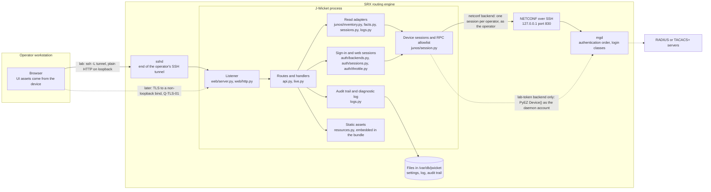
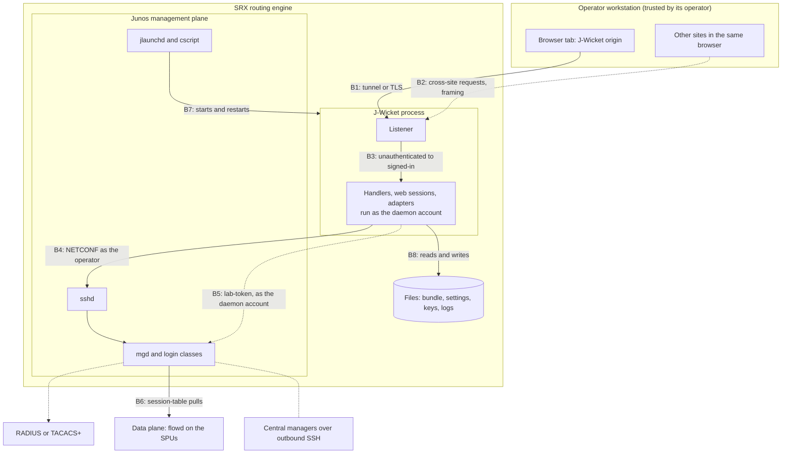
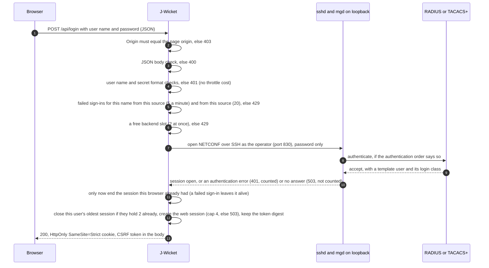
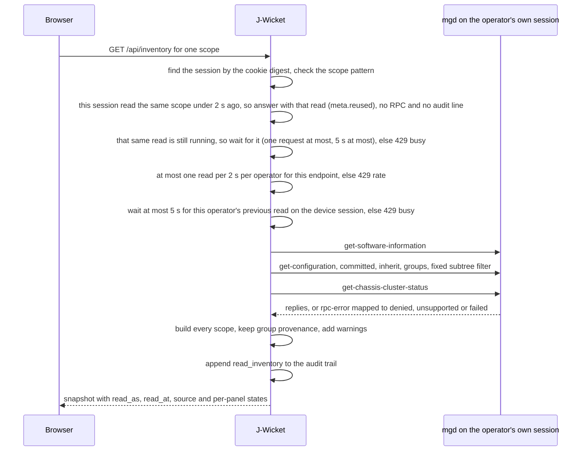
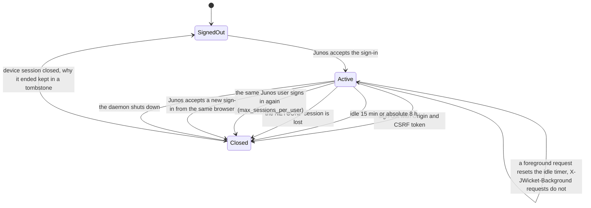
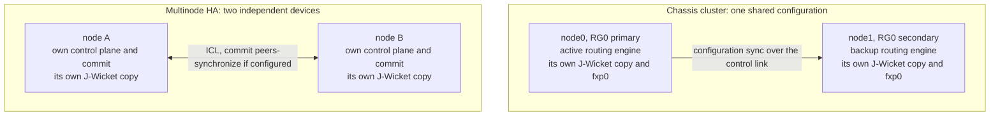
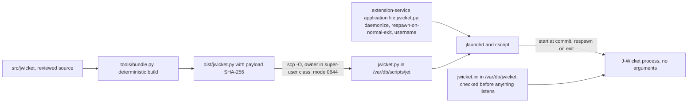

# Architecture and trust boundaries

Status: living document. Describes [`src/jwicket/`](../src/jwicket/) as of 2026-11-25. Decisions
are recorded as ADRs in [`docs/adr/`](adr/README.md); this page explains how they fit together and
what is still unproven.

J-Wicket is one Python process on the SRX routing engine. It serves a browser UI and a read-only
JSON API, and it reads the device through a NETCONF session that each operator opens **as
themselves**, so Junos (not J-Wicket) decides who they are and what they may see. Nothing in the
daemon's code can change the device; the lab installers ([section 1](#1-components)) are separate
tools that never ship in it. The whole program ships as one generated file that Junos starts and
restarts.

**J-Wicket has run on one lab device.** On 24 and 25 November 2026 its bundle ran on the owner's lab
SRX4100 (Junos 25.2R1-S1.4, Python 3.7.10). It served TLS on fxp0 through `mgmt_junos`, signed in
operators of the `read-only`, `operator` and `super-user` classes over NETCONF to loopback, and read
the policy inventory, the session table and the `messages` log; nine of its replies were recorded
there as fixtures (Q-REL-01, partial) ([evidence](evidence/2026-11-24-srx4100-lab/README.md)). The spike ran a different, single-file daemon on one
vSRX (Junos 24.4R2-S3.5). Least privilege, other platforms and releases, and the reply formats of
every other release remain unproven until the qualification tests named below pass and are
certified. Test IDs (`Q-...`) and gates (`G0`-`G5`) are defined in
[governance.md](governance.md).

Labels used on this page:

- **Verified**: a cited Juniper page, Juniper-maintained code or the spike record says it.
- **Inferred**: our reading of verified facts. It needs a lab test before anyone relies on it.
- **Unknown**: nobody has checked. The test that will settle it is named.
- **Implemented**: the code does it and its tests pass on synthetic fixtures. Not proven on a device.

On this page:

1. [Components](#1-components)
2. [Trust boundaries](#2-trust-boundaries)
3. [Request lifecycle](#3-request-lifecycle)
4. [Tenants: logical systems and tenant systems](#4-tenants-logical-systems-and-tenant-systems)
5. [Configuration groups](#5-configuration-groups)
6. [High availability](#6-high-availability)
7. [Junos AAA](#7-junos-aaa)
8. [Central management](#8-central-management)
9. [Security logging modes](#9-security-logging-modes)
10. [Deployment: one file under Junos supervision](#10-deployment-one-file-under-junos-supervision)
11. [Offline-capable](#11-offline-capable)
12. [Polling cost](#12-polling-cost)
13. [If per-operator sign-in fails (Q-AUTH-01)](#13-if-per-operator-sign-in-fails-q-auth-01)
14. [Threat model](#14-threat-model)
15. [Known gaps in the current code](#15-known-gaps-in-the-current-code)
16. [Where the product departs from the spike](#16-where-the-product-departs-from-the-spike)
17. [Sources](#17-sources)

## 1. Components

The process runs as the account named in the extension-service `username` statement, called the
**daemon account** below. With the `netconf` backend that account's login class never applies to an
operator's reads; with `lab-token` it applies to all of them.

| Component | Code | Job | State |
| --- | --- | --- | --- |
| Listener | [`web/server.py`](../src/jwicket/web/server.py), [`web/http.py`](../src/jwicket/web/http.py) | Bounded threaded HTTP(S) server: connection cap, socket timeouts, TLS handshake in the worker thread, body caps, Host allowlist, strict response headers on every response | Implemented |
| Routes and handlers | [`api.py`](../src/jwicket/api.py), [`live.py`](../src/jwicket/live.py) | Session status, sign-in, sign-out, policy inventory, export, flow sessions, log sources and lines, system health. Read-only. | Implemented |
| Sign-in backends | [`auth/backends.py`](../src/jwicket/auth/backends.py) | `netconf`: hand the operator's user name and password to Junos. `lab-token`: one shared token, reads as the daemon account, loopback only. | `netconf` run on the lab SRX4100 with `read-only`, `operator` and `super-user` accounts; the daemon-account SSH-key case not run (Q-AUTH-01) |
| Web sessions | [`auth/sessions.py`](../src/jwicket/auth/sessions.py) | Random cookie token (only its SHA-256 is kept) under a cookie name with a random per-start suffix, CSRF token, idle and absolute timeouts (idle counted from the last foreground request), a cap on concurrent sessions, two sessions per Junos user by default (`max_sessions_per_user`; a third sign-in by the same user closes that user's oldest); each web session owns one device session. A bounded list of tombstones, each holding only why and when a session ended, so a later request with that cookie can be told why ([section 3.4](#34-session-end)) | Implemented |
| Sign-in limits | [`auth/throttle.py`](../src/jwicket/auth/throttle.py) | Failed sign-ins per minute per (source address, user name) and per source address; sign-ins checked by the backend at once. Only sign-ins that reached Junos and failed count. | Implemented |
| Device sessions | [`junos/session.py`](../src/jwicket/junos/session.py) | The only code that talks to Junos. RPC allowlist, fixed configuration filters, committed database, one RPC at a time per operator (a request waits at most 5 s for it, then gets 429) | Implemented |
| Read adapters | [`junos/inventory.py`](../src/jwicket/junos/inventory.py), [`junos/facts.py`](../src/jwicket/junos/facts.py), [`junos/sessions.py`](../src/jwicket/junos/sessions.py), [`junos/logs.py`](../src/jwicket/junos/logs.py) | Turn replies into JSON-ready data. Match XML by local name. Never return raw XML. | Parsers written against documentation and synthetic fixtures, then run on nine replies recorded on the lab SRX4100, which found and fixed three mismatches (Q-REL-01, partial) |
| Error kinds | [`junos/errors.py`](../src/jwicket/junos/errors.py) | A closed set of failure kinds (`denied`, `unsupported`, `failed`, `rejected`, `unavailable`, `session-lost`) with operator-safe messages | Implemented; error texts unverified (Q-REL-01) |
| Audit trail and diagnostic log | [`logs.py`](../src/jwicket/logs.py) | Audit trail: one JSON object per line, who, from where, what, when; credential fields dropped; refusals of clients without a session aggregated; failed sign-ins recorded under a keyed hash of the name. Diagnostic log: control characters escaped in every message. | Implemented |
| Settings | [`settings.py`](../src/jwicket/settings.py), [`app.py`](../src/jwicket/app.py) | One INI file at a fixed path, validated completely before anything listens; unsafe values refuse the start | Implemented |
| Static assets | [`resources.py`](../src/jwicket/resources.py), [`static/`](../src/jwicket/static/) | Served from an in-memory manifest keyed by strict names; no filesystem path built from a request | Implemented |
| Bundle | [`tools/bundle.py`](../tools/bundle.py) | Generates `dist/jwicket.py`: every shipped module and asset in one deterministic file, which removes its own directory from `sys.path` before any other import | Built and self-tested in CI; started by Junos on one lab SRX4100 (Q-RT-02 met except idle memory) |
| Development server | [`devserver.py`](../src/jwicket/devserver.py), [`fixtures.py`](../src/jwicket/fixtures.py) | The real server and UI fed from synthetic fixtures, loopback only, "fixture data" banner. Excluded from the bundle. | Development only |

**Install tooling, outside the J-Wicket process.** [Spec 006](specs/006-installation.md) adds the
components below. None of their code ships in `dist/jwicket.py` or runs in the J-Wicket process, and
`ALLOWED_RPCS` is unchanged: the daemon stays read-only (a test,
`test_installer_code_is_not_in_the_daemon`, checks it). They write configuration and files on a lab
device as the operator's own account, under Spec 006's invariants, and only on a lab device
(lab-gated until G1, [ADR 0011](adr/0011-owner-decisions-lab-gated-install.md); the design is a
proposal, [ADR 0012](adr/0012-installer-design.md), except the three defaults the owner accepted on
2026-11-25: TLS access by default, root's one-time directory step, and lab hardware only with
`--lab-hardware` and a typed `lab only`). Of this tooling only the op script reaches
the device: a separate file with its own SHA-256 that the operator runs from the CLI.

| Component | Code | Job | State |
| --- | --- | --- | --- |
| Shared plan | [`plan.py`](../tools/jwicket_install/plan.py), [`state.py`](../tools/jwicket_install/state.py), [`render.py`](../tools/jwicket_install/render.py) | Every statement, file, mode, check and warning of an install, upgrade or uninstall, computed from the device's facts and prior state; standard library, no I/O | Built and tested on synthetic fixtures |
| Workstation installer (M1; the executor of M2 and M3) | [`tools/jwicket_install/`](../tools/jwicket_install/) (`cli.py`, `workstation.py`, `transport.py`, `hostkeys.py`, `health.py`, `provenance.py`, `receipt.py`, `tunnel.py`) | PyEZ over NETCONF on the SSH port, its own SSH client for copies and the veriexec read; host keys checked on every connection; provenance before any write. By default (`--access tls`) it makes the daemon's self-signed certificate in memory and checks the new build with an HTTPS read pinned to it; no check opens an SSH forwarding channel | Built against fakes; never run on a device (Q-INST-06) |
| On-box op script (M4, M4U) | [`op_template.py`](../tools/jwicket_install/op_template.py), [`build_op.py`](../tools/jwicket_install/build_op.py) | One generated op script that embeds the shared plan and the bundle's hash and runs the same stages through on-box PyEZ, on the box's Python 3.7 | Built against fakes; never run on a device |
| Deployment wrappers | [`deploy/`](../deploy/) | Ansible playbooks and a container image that run the workstation installer; a containerlab topology for a disposable vSRX | Checked in CI; never run against a device |
| Release tooling | [`release.yml`](../.github/workflows/release.yml), [`release_check.py`](../tools/release_check.py), [`release_record.py`](../tools/release_record.py), [`build_wheel.py`](../tools/build_wheel.py) | Lab pre-releases from a tag: reproducible assets, `SHA256SUMS`, attestations, and a release record on `main` | Never run; no tag exists |

## 2. Trust boundaries

The design rule: **Junos enforces identity, rights and scope; J-Wicket enforces transport, web
sessions, input shape and load.** J-Wicket never adds a right the operator's login class does not
have, and never widens a scope Junos set. The one exception is the loopback-only `lab-token`
backend, which reads as the daemon's own account and says so on every screen.

| Boundary | What crosses it | Enforced by the device (Junos) | Enforced by J-Wicket | Proven? |
| --- | --- | --- | --- | --- |
| **B1** Workstation to listener | HTTP requests and responses: the password once at sign-in, the session cookie, the CSRF token, device data | Lab path: sshd authenticates the tunnel user and decides whether TCP forwarding is allowed. A non-loopback bind would also need the zone's host-inbound services (spike: `webapi-ssl` admitted TCP 8443) or fxp0 reachability, and firewall filters. | Default bind `127.0.0.1`. Any other bind address needs a certificate and key; there is no plaintext switch ([ADR 0003](adr/0003-tls-off-loopback.md)). TLS 1.2 minimum, compression off, HSTS when TLS is on. Optional Host allowlist (HTTP 421 otherwise). | Tunnel: refused on the lab SRX4100 (Q-NET-03 fails there). TLS on the device: served on that SRX4100's fxp0, TLS 1.0 and 1.1 refused (Q-TLS-01, met except a provisioning path). Host-inbound by port: one observation on one release (spike T4). |
| **B2** Other origins in the same browser | Nothing should: cross-site requests, framing, injected script | Nothing | Content-Security-Policy `default-src 'none'`, scripts and styles from `'self'` only, Trusted Types required, `frame-ancestors 'none'`. Cookie `HttpOnly`, `SameSite=Strict`, `Secure` under TLS, named with a random suffix chosen at each start; cookies are not isolated by port, so other services on the same host can receive it ([gap 8](#15-known-gaps-in-the-current-code)). `Origin` must equal the page origin on both POST routes; sign-out also needs the `X-CSRF-Token` header. No CORS headers. `nosniff`, `no-referrer`, `Cache-Control: no-store`. | Implemented |
| **B3** Unauthenticated to signed-in | Request line and headers (at most 16 KiB together), query (at most 20 fields), body (at most 8 KiB, `Content-Length` required) | Nothing | Without a session a client can fetch only `/`, `/static/*`, `/healthz` and `GET /api/session`, and can call `POST /api/login` and `POST /api/logout`. Every other route refuses to read without a session (401, with a `reason` that says why when J-Wicket knows; [section 3.4](#34-session-end)). One checks a parameter first: `GET /api/export?format=xml` without a session is 400, not 401, with no device read either way. Connection cap (8); the TLS handshake and the whole request must arrive within the socket timeout (10 s); one request per connection; route and method allowlist; scope pattern, filter and log-parameter validation; read-rate floors; sign-in limits. | Implemented |
| **B4** J-Wicket to mgd, as the operator | User name and password once per sign-in. Allowlisted RPCs with validated parameters. Replies: the configuration subtrees J-Wicket parses (for the inventory, `[edit security]` `policies`, `zones` and `address-book`, plus `applications`, per scope; never all of `[edit security]`, which holds IKE pre-shared keys) and operational data. | Authentication (local password, RADIUS, TACACS+, in the configured authentication order). The operator's login class on every RPC and configuration hierarchy, including logical-system and tenant confinement. NETCONF `connection-limit` and `rate-limit`. Login retry options. Each RPC logged as `UI_NETCONF_CMD`. | NETCONF host must be a loopback address and the port below 1024 (settings refuse anything else). Password only: PyEZ is told not to offer the daemon account's SSH keys and not to read its `~/.ssh/config`. RPC allowlist; RPC names are constants, or come from a fixed list (`REPORT_TYPES`) selected by a checked parameter, and every name is checked against the allowlist; configuration filters are constants. Committed database only. One RPC in flight per operator. At most 4 signed-in operators (`max_sessions`), two sessions per Junos user by default. RPC timeout 30 s. No password stored by J-Wicket. | Q-AUTH-01 met except the SSH-key case on one lab SRX4100; Q-AUTH-02 not run; Q-AUTH-03 partial ([dev3 evidence](evidence/2026-11-26-srx4100-dev3/README.md)) |
| **B5** J-Wicket to mgd, as the daemon account (`lab-token` only) | Allowlisted RPCs and replies | Only the extension-service `username` account's login class. There is no per-operator identity. | Allowed only with a loopback bind. Token of at least 32 ASCII characters, from a mode-0600 file, compared in constant time. Every screen names the backend and the account. In the audit trail the `start` and `login` records name the backend; every record of a signed-in action names the account (`user`). | The PyEZ local path is verified by the spike (T5, as `jcluser`, class `j-super-user`). J-Wicket's use of it has not run on a device. |
| **B6** Routing engine to data plane | Session-table entries sent from the SPUs to the routing engine for a session list | Nothing limits the size of a list request; the CLI has no count option (verified) | Device-side filters are pushed into the RPC. A (filtered) summary is read first; rows are listed only when the match count is known to be at most 5,000 (`MAX_UNFILTERED`), or, for a filtered request with no count, when the active count is. At most 2,000 sessions per reply are kept after parsing; on a chassis cluster reply that counts sessions, not rows, so both nodes' copies of each kept session stay (the per-node reply layout is **inferred**, Q-REL-01). | Cost unmeasured (Q-LOAD-02). The guard used to fail open ([gap 1](#15-known-gaps-in-the-current-code), closed). |
| **B7** Junos supervision to the process | The bundle file, the `username` identity, start and restart | Veriexec blocks unsigned binaries; only Python under `system scripts language python3` runs. Script owner must be root or a super-user-class user, owner-only write (verified for commit, event, op and SNMP scripts; inferred for JET). `jlaunchd`/`cscript` start the app at commit and respawn it. | The bundle is deterministic with a published SHA-256; its importer serves only embedded modules. No arguments under Junos; settings from one fixed file. | Supervision verified by the spike for the spike daemon (T1, T6). J-Wicket's bundle: Q-RT-02, Q-RT-03. |
| **B8** Process to local files and other local accounts | Settings, lab token, TLS key and certificate, diagnostic log, audit trail | Unix ownership and modes | Settings, token and TLS files must be regular files, not symlinks, owned by the daemon account or root, not group- or world-writable; secrets mode 0600. Every directory from `/` down to each file must belong to root or the daemon account and must not be group- or world-writable unless sticky; a symbolic link on the way is followed only if root owns it, for at most 40 links. The settings file and the lab token are opened first (`O_NOFOLLOW`) and checked through the open file (`fstat`), and the name must still lead to the same device and inode. TLS files are checked, then loaded by path, because `ssl` takes only a path; the directory rule keeps other accounts from swapping them in between. `umask 077` for everything J-Wicket creates. A refused start writes its reason to `startup-refused.txt`. | Implemented; not run on a device |

Exports and the audit trail also carry data out of the process. Exports contain only modelled
fields, stamped with device, scope, user and read time; CSV cells that a spreadsheet would evaluate
are neutralised. The audit trail never holds a password, token, cookie, CSRF token or raw
configuration, and records a failed sign-in under a keyed hash of the submitted name, never the
name. The device's own error text goes to the diagnostic log (INFO, cut to 500 characters), never
to the browser. J-Wicket opens no outbound connection: its only sockets are the listener and the
NETCONF session to loopback.

**Assumptions.** Junos itself (sshd, mgd, the AAA path, veriexec) is trusted, and J-Wicket inherits
its bugs (CVE-2023-44182 affected the CLI, NETCONF and J-Web alike). The operator's workstation and
browser are trusted by that operator. Any account that can write the bundle or the settings
directory controls J-Wicket.

## 3. Request lifecycle

### 3.1 Every connection

1. **Accept.** The accept thread takes a connection slot from a non-blocking semaphore
   (`max_connections`, default 8). Over the cap, the connection is closed at once
   ([`JWicketServer.process_request`](../src/jwicket/web/server.py)).
2. **Worker.** One worker thread per connection sets the socket timeout (default 10 s) and starts
   one deadline of the same length for the whole request: the TLS handshake, request line, headers
   and body must all arrive before it, or the connection is shut down without an answer. A per-read
   timeout alone restarts with every byte, so a client sending one byte at a time could otherwise
   keep a slot. The deadline ends once the request is read; answering may take as long as the
   device read. With TLS, the handshake runs here, so a slow client cannot stall the accept thread.
3. **Parse.** The standard library parses the request line and headers, which together may be at
   most 16 KiB (`MAX_HEAD_BYTES`): a larger header block gets 431, and a request line alone over
   the cap gets 414. An HTTP/0.9 request line is refused with a normal, fully headed 400. Every
   error the standard library generates goes through the same response path, with the security
   headers and a JSON body.
4. **Gate.** Host allowlist (421), request target must start with `/` and hold no NUL (400). POST
   bodies need a `Content-Length` (chunked is 411) of at most `max_body_bytes` (413). The query may
   have at most 20 fields.
5. **Route.** Exact paths, plus the `/static/` prefix. A known path with the wrong method gets 405
   with `Allow`; PUT, DELETE, PATCH, OPTIONS, HEAD, TRACE and CONNECT are always 405. Anything else
   is 404. An exception in a handler becomes a 500 with no detail; the traceback goes only to the
   diagnostic log.
6. **Respond.** HTTP/1.0, one request per connection, then close. Every response carries the
   headers in [`BASE_HEADERS`](../src/jwicket/web/http.py), plus HSTS when TLS is on. No version in
   the `Server` header.

### 3.2 Sign-in

The code is [`api.login`](../src/jwicket/api.py), [`NetconfBackend`](../src/jwicket/auth/backends.py)
and [`PyEzUserSession.open`](../src/jwicket/junos/session.py). PyEZ opens the session with
`Device(host="127.0.0.1", port=830, user=..., passwd=..., look_for_keys=False, ssh_config=os.devnull)`.
Because the host is not the literal string `localhost`, ncclient takes its SSH path, not the local
on-box path (**verified** from PyEZ and ncclient source). The last two arguments keep the daemon
account's SSH keys and its `~/.ssh/config` (`Port`, `HostName`, `IdentityFile`, `ProxyCommand`)
out of the sign-in, so only the typed password can sign anyone in; both are `Device()` arguments in
PyEZ 2.7.4, and PyEZ ignores arguments it does not know. Whether all of this works on the box, and
whether a wrong password is refused even when the daemon account holds a key the user accepts, is
Q-AUTH-01.

**Sign-in limits** ([`auth/throttle.py`](../src/jwicket/auth/throttle.py)). Only a sign-in that
reached Junos and failed counts. A cross-origin request, bad JSON, an empty field, a user name that
fails the format check, an unreachable management service (`unavailable`) and a successful sign-in
cost nothing; a success clears that name's failures from that source. Limits, per minute:
`login_failures_per_user_per_min` (default 5) failures for one user name, compared case-insensitively,
from one source address; `login_failures_per_source_per_min` (default 20) failures from one source address over
all names. With `lab-token` there is no user name, so the first limit also applies per source. At
most `login_concurrent` (default 2) sign-ins are checked by the backend at once; more
get 429 "Other sign-ins are being checked. Try again in a moment." with `Retry-After: 2`. Every
429 sign-in body carries `retry_after_s` and a `reason`: `login-failures` or `login-busy`.

**Session limits.** The cap is checked only after Junos has accepted the password. If
`max_sessions` (default 4) sessions are open, the new device session is closed and sign-in is
refused with 503; no other user's session is evicted. The 503 body says how full J-Wicket is and
when a slot frees, and nothing about who holds the slots: no user name and no source address
([`api._session_limit`](../src/jwicket/api.py), computed under the store lock):

| Field | Meaning |
| --- | --- |
| `reason` | `session-limit` |
| `sessions` | `{open, max}`: the sessions open now, and `max_sessions` |
| `slot_free_by_s`, `slot_free_by` | Seconds until, and the UTC time when, the first open session reaches its absolute limit. A slot frees by then at the latest, because the absolute limit cannot be extended; another sign-in may still take it first. |
| `slot_may_free_in_s` | Seconds until the first open session would end if its user did nothing more (idle or absolute limit, whichever comes first) |

The 503 has no `Retry-After`, because an automatic retry would not help. Telling an operator whom
Junos has accepted how many sessions are open and when one must end is owner decision OD-13: the
default ships it, and the owner may veto it. The other sign-in 503, a management service that did
not answer, carries `reason: unavailable`.

One Junos user holds at most `max_sessions_per_user` (default 2) sessions: a sign-in beyond that
by the same name, compared case-insensitively, closes that user's oldest session first, and that
session's next request gets 401 with `reason: replaced`. The audit trail records
`session_replaced` with the old session's user and source and the new sign-in's source (`by`). The per-user limit does not apply to `lab-token` sessions, which all carry
the daemon account's name. Two accounts at the default can still fill `max_sessions`. The default
is 2, not 1, so that one person in two browsers, or two engineers sharing an account, do not keep
signing each other out; the owner may set 1 where accounts are strictly personal.

**What sign-in and session end write to the audit trail** ([`logs.AuditTrail`](../src/jwicket/logs.py)):

| Event | When | Fields besides time and source |
| --- | --- | --- |
| `login` | Junos accepted the sign-in | `user` (the name as typed), `backend` |
| `login_failed` | Junos refused it, or the backend failed | `user` null, `kind`, and for `netconf` `user_hash`: the first 16 hex characters of an HMAC-SHA256 of the case-folded name, under a random key made at each start. It correlates attempts on one name within one run and reveals nothing else. The plain name is recorded only after Junos accepts the sign-in, because the commonest wrong value in the user-name field is a password |
| `login_failed` with `reason: format` | A malformed user name or an empty secret, refused before Junos | `kind: rejected`; aggregated (below) |
| `login_refused` | `reason: cross-origin` (aggregated), or `reason: session-limit` with the accepted `user` | |
| `login_throttled` | `reason: failures` or `busy`; aggregated | |
| `session_replaced` | A second sign-in by the same user closed their older session | `user`, the old session's `source`, `by` (the new sign-in's source) |
| `logout` | The operator signed out | `user` |
| `logout` with `reason: new-sign-in` | Junos accepted a sign-in from a browser that still held a session, and that session was ended just before the new one was created | `user`: the ended session's user; `source`: the new sign-in's |
| `session_ended` | A session reached its idle or absolute limit (noticed by its next request or by the 30 s reaper), or the daemon shut down | `user`, the session's own `source`, `reason`: `idle`, `absolute` or `shutdown` |
| `session_lost` | The operator's device session was lost | `user`; `source` of the request that found it |

Aggregated refusals come from clients with no session. They are counted per (event, source,
fields) in 60 s windows: the first is written at once; repeats are written as one line with
`repeated` and `window_s: 60` when the window ends, which the 30 s reaper, a clean stop or the next
refusal notices. Beyond 64 aggregates in a window the source is recorded as `various`. So a client
without a session adds at most two lines a minute per aggregate, however many requests it sends.

### 3.3 A read

Each panel fails on its own: a denied configuration read leaves device facts and HA status intact
and produces no policy rows ([ADR 0004](adr/0004-no-sample-data.md)). A configuration reply with
no `<configuration>` element is a `failed` panel ("The device's reply could not be read."), not an
HTTP 500; the device and HA panels already read are kept. The live endpoints (`/api/sessions`,
`/api/logs/sources`, `/api/logs`) follow the same pattern with their own read floors and caches
([section 12](#12-polling-cost)). Every read endpoint answers 429 `{error: "Another read for your
session is still running. Try again shortly.", reason: "busy", retry_after_s: 2}` with
`Retry-After: 2` when the operator's previous read is still running after 5 s, so queued requests
do not hold connection slots for a whole RPC timeout. A read within the endpoint's floor answers
429 `{error: "Reading too often.", reason: "rate", retry_after_s, interval_s}`.

**A read just made, for the same session's other tabs**
([`api.reuse_or_wait`](../src/jwicket/api.py)). The read floors are per web session, so every tab
and window holding the same cookie shares them. A request identical to one this web session made
within the floor (2 s for the inventory, 1.5 s for flow sessions and logs) gets that read instead
of a 429: 200, the stored payload with its own `meta.read_at`, and `meta.reused: true`. It costs no
RPC and no read slot and writes no audit line (owner decision OD-06: the default, which the owner
may veto, is not to audit a reply that no device read produced). A request identical to a read
still running for the same web session waits for it, at most 5 s and only one request at a time
per endpoint (and log source); another gets the busy 429 at once, and so does the waiter when that
read ends without a result. Each web session keeps at most one stored read per endpoint (and log
source), never handed to another web session (login classes differ). A stored read is used for at
most 2 s after it began, then dropped at the session's next request, its next stored read or the
reaper's next pass (every 30 s), and with the session. Holding it that long is owner decision
OD-07: the default ships it, and the owner may veto it. An export never reuses a read, because it
promises a fresh one, and `/api/health` keeps none: a second tab within its 5 s floor gets the 429.

### 3.4 Session end

Every way out closes the operator's NETCONF session on the server. A lost device session signs the
operator out (401 with `signed_out: true`); J-Wicket keeps no password, so it cannot reconnect on
its own. A reaper thread removes expired sessions every 30 s. Idle, absolute and shutdown ends are
audited as `session_ended`; the others have their own events ([section 3.2](#32-sign-in)).

**Idle time counts the operator's activity, not polls.** A GET that carries
`X-JWicket-Background: 1` is answered as usual but leaves the session's idle clock where it was.
Every other request does reset it: a GET without the header or with any other value, and every
POST, whatever its headers ([`api.is_background`](../src/jwicket/api.py)). The browser sends the
header on every GET unless the operator used the keyboard, pointer, wheel or touch screen, or
brought the tab back into view, since its last foreground request. When such input has waited 60 s
without a foreground request to report it, the browser sends a keep-alive (`GET /api/session`), at
most once a minute ([`static/js/api.js`](../src/jwicket/static/js/api.js)). So a console left
polling ends 15 minutes after its operator's last input. The header can only shorten a session:
it skips one update of the idle clock and never moves a deadline later; an expired session is
refused whatever the header says; and a forged header affects only the sender's own session. The
server cannot tell a timer's poll from the operator's own request by itself, so this relies on the
browser marking its polls: a client that never sends the header can keep its own session alive up
to the absolute limit.

**Why a session ended.** When a session ends, the store keeps a tombstone under the digest of its
cookie token: the reason and the time, nothing else (no user name, source, CSRF token, token or
device data). A tombstone never authenticates anything. The store keeps at most
`max(64, 4 * max_sessions)` of them, drops the oldest when full, and drops any older than the
absolute limit. None is kept after a shutdown (the memory is gone) or after a new sign-in from the
same browser (its cookie is replaced). A request without a live session gets 401
`{error, reason, at}` from one helper, [`api.signin_required`](../src/jwicket/api.py); `at` (UTC) is
there only when a tombstone gave the reason. The texts below are those at the default limits:

| `reason` | When | `error` |
| --- | --- | --- |
| `replaced` | The same Junos user signed in again elsewhere, beyond `max_sessions_per_user` | You were signed out: the same Junos user signed in again elsewhere. |
| `idle` | The idle limit passed | Your session ended after 15 min without activity. |
| `absolute` | The absolute limit passed | Your session reached its 8 h limit. |
| `signed-out` | Sign-out, in this tab or another | You signed out in another tab or window. |
| `session-lost` | The device session was lost. The 401 of the request that found it also carries `signed_out: true` | Your device session ended. Sign in again. |
| `unknown` | A session cookie this process holds no tombstone for: dropped from the bounded list, older than the absolute limit, or a value it never issued | Your J-Wicket session has ended. |
| `none` | No session cookie. After a restart this is what every browser gets, because the cookie name changes at each start | sign-in required |

These 401s leave the cookie as it is, so every tab of the browser gets the same reason; the next
sign-in replaces it. `GET /api/session` without a live session adds `ended: {reason, at}` when the
cookie has a tombstone. The 401 does not say where a replacing sign-in came from: that is owner
decision OD-09, whose default is no (the audit trail's `session_replaced` already records `by`),
and which the owner may veto. A sign-in from a browser that still holds a session ends that
session only once Junos has accepted the new password, so a failed sign-in leaves it alive; the new
session always gets a new token, so a planted cookie still cannot fix a session.

### 3.5 How failures reach the screen

| Junos or PyEZ outcome | Kind | What the operator sees |
| --- | --- | --- |
| `ConnectAuthError` | `rejected` | Sign-in failed (401) |
| `ConnectRefusedError`, `ConnectTimeoutError`, `ConnectUnknownHostError`, `ConnectError` (these four class names exactly) | `unavailable` | The management service did not answer (503); not counted against the sign-in limits |
| `ConnectClosedError` | `session-lost` | Signed out; sign in again |
| Error text matching "permission denied", "not authorized", "authorization" | `denied` | The panel says the login class does not allow it |
| `RpcTimeoutError` | `failed` | The device took too long |
| Error text matching "not enabled", "syntax error", "unknown command", "not supported", "is not running" | `unsupported` | The device lacks or has not enabled the feature |
| A reply without the element the reader needs (no `<configuration>`) | `failed` | The device's reply could not be read |
| Anything else, including other PyEZ connect errors such as `ConnectNotMasterError` and `ProbeError` | `failed` | The device could not complete the request. At sign-in this is still a 503, but the audit kind is `failed` and the attempt counts against the sign-in limits |

The mapping is [`classify`](../src/jwicket/junos/errors.py). The exception class names are PyEZ's,
compared by exact name, not by class hierarchy, so a PyEZ subclass of `ConnectError` other than
those listed reads as `failed`. The error texts are **unverified** and deliberately narrow, so an
unexpected error reads as `failed`, never as data (Q-REL-01). The device's own error text, cut to
500 characters, is written to the diagnostic log at INFO by the `jwicket.api` logger, never to the
browser: `<what>: <kind>: <text>` when a read becomes a panel state, `sign-in from <ip> refused:
<kind>: <text>`, `device session for <user> lost: <text>`, and `chassis cluster status: ...`. A
failure served from a cache is not logged again. Lab runs use these lines to tune the patterns.

## 4. Tenants: logical systems and tenant systems

A logical system (LSYS) or tenant system (TSYS) is a **scope**. J-Wicket keeps scopes apart and
never merges them.

| Fact | Status | Source |
| --- | --- | --- |
| `logical-systems` and `tenants` are keyed lists at the top of the configuration, each with its own `security` and `applications` | Verified | 24.4R2 YANG ([yang]) |
| A login class can be bound to one: `set system login class <c> logical-system <ls>` or `... tenant <ts>` | Verified | [lsys-setup], [tsys] |
| Logical system administrators "cannot access any global configuration statements", and "command output is restricted to the context to which the logical system administrators are assigned" | Verified | [lsys-admin], [user-lsys] |
| For a user bound to an LSYS or TSYS, `<get-configuration>` returns that scope's configuration rooted as if it were the root, with no `<logical-systems>` wrapper | Inferred | [lsys-admin] ("as if you were in the root of a physical router"); not stated for NETCONF |
| `show security flow session` takes `logical-system`, `root-logical-system`, `tenant` and `all-logical-systems-tenants` options | Verified (CLI); XML element names unknown | [sfs] |
| `security log` can be set per logical system and per tenant | Verified | [log-mode] |
| In Multinode HA, logical and tenant system configurations are synchronized automatically | Verified | [mnha] |

**What J-Wicket does today** ([`list_scopes`](../src/jwicket/junos/inventory.py)):

- The inventory reads each logical system's and tenant system's name, its `security` `policies`,
  `zones` and `address-book`, and its `applications` in the same filtered configuration read as
  the root's. That Junos answers this filter with the name and only those children for every
  entry, with the entry's `inactive` attribute, is **inferred** (Q-REL-01). `meta.scopes` lists `root`, every `lsys:<name>` and every `tenant:<name>`, each with its
  policy count, whether it is deactivated, and whether J-Wicket can open it (`selectable`).
  `?scope=` selects one; the pattern is `root|lsys:<name>|tenant:<name>` with names of at most 63
  characters from `A-Z a-z 0-9 . _ -`. A logical or tenant system whose name falls outside it is
  listed and warned about, but cannot be opened: owner decision OD-12's default, which the owner
  may veto, keeps the pattern until the Junos character set for these names is verified.
- Each scope has its own zones, address books, applications, policies and default policy. Address
  names resolve only inside the scope's own books (`test_lsys_resolves_in_its_own_books`). A
  deactivated LSYS or TSYS is marked and warned (`test_inactive_tenant_is_marked_and_warned`).
- If the device rejects the full filter (for example a release without `tenants`), J-Wicket retries
  with the root's security policies, zones and address books and its applications only, and the
  snapshot says that logical systems, tenant systems, central-management connections, the
  configured time zone and Multinode HA settings are not shown.
- Flow sessions are root only: `/api/sessions` with any other scope is refused with 400. Whether an
  unscoped session list on a device with logical systems returns only the root logical system or
  all of them is **unknown** (Q-REL-01).
- Log sources read only the root `system syslog` and `security log`. Per-LSYS and per-TSYS security
  log settings are not read.

**A user bound to one scope.** Junos confines them (verified). J-Wicket shows whatever Junos
returns to that user, under their name in `read_as`. If the inference above holds, that reply looks
like a root configuration, and J-Wicket would label it "Root system", which is wrong. This is
[gap 6](#15-known-gaps-in-the-current-code). The fixture user `lsys-a-admin` in
`tests/fixtures/cluster-lsys/` does not model confinement: the fixture returns the full
configuration to every user. Q-AUTH-03 runs with an LSYS-bound and a TSYS-bound class and records
the root element of each reply.

## 5. Configuration groups

| Fact | Status | Source |
| --- | --- | --- |
| `inherit="inherit"` shows elements inherited from user-defined groups inside the elements that inherit them, and leaves out `<groups>`, `<apply-groups>` and `<apply-groups-except>` | Verified | [get-configuration], [groups-xml] |
| `groups="groups"` (with `inherit`) puts `junos:group="<name>"` on each inherited element and on each inherited descendant | Verified | [groups-xml] |
| `inherit="inherit"` does not include the hidden `junos-defaults` group; `inherit="defaults"` does | Verified | [get-configuration] |
| Names starting `junos-` are reserved; `junos-defaults` holds the predefined applications and cannot be named in `apply-groups` | Verified | [config-groups] |
| The `junos:` namespace URI contains the running release, for example `http://xml.juniper.net/junos/23.4R1.9/junos` | Verified | [netconf-oper] |
| Inactive configuration carries `inactive="inactive"` on the element | Verified | [json-mapping] |
| Commit scripts can make transient changes that are never copied to the candidate; plain `show` displays persistent changes only | Verified | [commit-scripts] |
| A committed read without `commit-scripts="apply"` therefore leaves out transient changes | Inferred | [commit-scripts], [get-configuration] |

**What J-Wicket does today** ([ADR 0005](adr/0005-committed-config-with-provenance.md)):

- Reads `<get-configuration database="committed" inherit="inherit" groups="groups">` with a fixed
  subtree filter, so what it shows is what the device enforces after inheritance, and nobody's
  uncommitted candidate edits.
- Matches element and attribute **local names**, so `junos:group` is found under any release URI
  and after PyEZ strips namespaces (`test_group_attribute_under_any_release_uri`,
  `test_plain_group_attribute_after_pyez_strips_namespaces`).
- Every policy, zone, interface, address, address set, address book and application carries
  `group` (where it came from), and policies also carry `inherited` (which child parts came from a
  different group) and `groups` (every group in the subtree). A policy with no group of its own
  takes its zone pair's group. Each scope counts policies per group.
- Per-node groups in a chassis cluster (`node0`, `node1`) show up as ordinary provenance
  (`test_group_named_like_a_node`).
- Inactive policies are shown and marked with the nearest deactivated statement as the reason:
  `policy`, `zone-pair` (or the `global` block), `policies`, `security`, or `scope` (the logical or
  tenant system). Deactivated parts of an active policy, including a deactivated global `from-zone`
  or `to-zone` value, are listed and kept out of the match lists. Deactivated statements are never
  treated as in effect anywhere: the default policy, `policy-rematch`, `pre-id-default-policy`,
  host-inbound services and protocols (and their `except` entries), address and application set
  members, address entries, address books and their `attach` zones, and applications. Each is
  listed apart (`*_inactive`, `inactive_members`, `inactive_attach`, `inactive_skipped`) with a
  warning.
- Statements a row's model does not show are listed per object (`unmodeled` on policies, zones,
  interfaces, address entries, address sets, address books, applications and application sets) and
  warned per scope, so "not shown" is never mistaken for "not there". Configuration comments
  (`annotate`, `junos:comment`) are never reported as unmodeled; they are attached to the statement
  they annotate (`comment`, `part_comments`, `pair_comment`).
- References to `junos-*` applications are labelled `predefined` and not expanded: their protocol and
  ports are not shown. Whether `inherit="defaults"` returns every predefined application or only
  those in use is **unknown**. `junos-defaults` in a policy's `match application` is not a
  predefined application but the unified-policy keyword for the dynamic application's own default
  ports and protocols, so it is its own kind, `dynamic-defaults`. A rule with a dynamic application
  and no application gets `junos-defaults`, or `any` when the dynamic application is `any`, marked
  `application_implicit` (**verified**, [unified-policies]: "the application junos-defaults is
  implicitly added").

**Ownership, for writes later.** Where an object is defined decides where it can be changed. Spec
002 must refuse to edit a group-owned object in place and name the group. Knowing *which*
`apply-groups` statement (including wildcard groups) brings a group in needs a second read without
`inherit`, which J-Wicket does not make yet (**inferred** from [get-configuration], which leaves
those elements out under `inherit`). `protect` (`protect="protect"`) is not modelled. Transient
commit-script changes are not shown, and nothing says so in the UI yet (Q-REL-01 records a device
with a commit script).

## 6. High availability

### Chassis cluster

| Fact | Status | Source |
| --- | --- | --- |
| "The node on which RG0 is primary determines which Routing Engine is active in the cluster"; the other node's routing engine is the backup | Verified | [cc-rg] |
| Preemption cannot be enabled for RG0; moving RG0 needs a manual failover, which restarts processes on the new primary | Verified | [cc-rg] |
| The configuration is synchronized between the nodes over the control link on each commit, whichever node it is entered on ("All commands are applied to both nodes regardless of from which device the command is configured"). The node0-to-node1 wording on the same page belongs to the cluster-creation steps only. | Verified | [cc-ap] |
| Per-node groups (`node0`, `node1`) applied with `apply-groups "${node}"` give each node its own host name and fxp0 address | Verified | [cc-ap] |
| Script synchronization covers commit, event, lib, op and SNMP scripts between routing engines; JET is not listed, and chassis cluster nodes are not mentioned | Verified | [script-sync] |
| The manual `request system scripts synchronize` command does list `jet` ("(all \| commit \| event \| jet \| lib \| op \| snmp)"); whether it reaches the other node of a chassis cluster is not stated | Verified (command); reach to the peer unknown (Q-HA-01) | [sync-cmd] |
| `jsd` (JET gRPC APIs) runs only on the primary routing engine | Verified; J-Wicket does not use `jsd` | [jet-guide] |
| In a session list, a session appears on both nodes, `Active` on one and `Backup` on the other; the backup copy shows zero packets and bytes | Verified (doc samples) | [sfs-node] |
| On-box reporting logs are stored on the node processing the traffic and are not synchronized to the peer | Verified | [syslog-sec] |

What follows, **inferred**: J-Wicket's file must be copied to and checked on each node by hand;
each node runs its own J-Wicket, reached through its own fxp0 or SSH; the UI must say which node it
is on and that node's RG0 role; future writes belong on the RG0 primary only. Whether J-Wicket on
the RG0-secondary node can read the configuration over NETCONF is **unknown** (Q-HA-01).

**What J-Wicket does today:**

- Reads `get-chassis-cluster-status` and shows the cluster ID and, per redundancy group, each node's
  priority and status. The parser accepts node fields grouped per node or as a flat sequence,
  because the reply layout is unverified ([`facts.cluster`](../src/jwicket/junos/facts.py)).
- `local_node` is always `null`: the reply does not say which node is serving the page (Q-HA-02).
- `get-software-information` replies per node are shown as a node list.
- A "not supported" error from the cluster RPC reads as standalone; any other error except denied
  and timeout reads as standalone *with the reason shown*, because the standalone error wording is
  undocumented.
- Session lists keep each node's copy apart (`id` is `node:session-id`), but the server does not
  de-duplicate `Active` and `Backup` copies and does not pass the `node` option, so a cluster most
  likely sends both copies (**inferred**). On a reply with more than one node, `limit` counts
  sessions, not rows: both copies of the first `limit` distinct session ids are kept
  (`sessions_returned` counts distinct ids, `returned` counts rows). The Sessions view marks a copy
  as a backup when the device says `Backup`, or, **inferred**, when it is the zero-counter copy of a
  session another node also lists, and hides backup copies unless the operator shows them. Whether
  both nodes report the same session id is **unknown**; the `cluster-lsys` fixture's two-node
  session table is synthetic.
- Session counts (the gauge's active and max, the matching count, the list's `device_count`) are the
  largest node's value after summing that node's SPUs. `failed` is not summed across nodes: with
  more than one node it is null, and each node's value is in the `nodes` array that the summary and
  the list then carry. Whether a node's count includes its `Backup` copies is **unknown**
  (Q-HA-01); before 2026-11-24 the counts were summed over nodes
  ([gap 2](#15-known-gaps-in-the-current-code), closed).

### Multinode High Availability (MNHA)

| Fact | Status | Source |
| --- | --- | --- |
| Two Junos firewalls "presenting themselves as independent nodes to the rest of the network" | Verified | [mnha] |
| For logical and tenant systems, "Each node in the high availability setup must have an identical configuration"; Juniper recommends configuration groups with `[edit system commit peers-synchronize]` | Verified (the sentence is in the page's logical and tenant systems section, not a general rule) | [mnha] |
| `get-chassis-high-availability-information` (`show chassis high-availability information`) exists in the 24.4R2 RPC model | Verified (YANG) | [yang] |
| Each node commits on its own | Inferred | [mnha] |

**What J-Wicket does today:** if the cluster RPC says standalone and the configuration has an active
(not deactivated) `chassis high-availability`, the HA panel says "Multinode High Availability is
configured"
([`api.read_snapshot`](../src/jwicket/api.py)). The MNHA status RPC is not on the allowlist, so
node role, peer state and SRG states are not shown. A change preview (Spec 002) must say which
node or nodes it will be committed on. Q-HA-03 settles detection and behaviour.

## 7. Junos AAA

### Login classes and what each feature needs

Predefined classes (**verified**, [login-classes]): `super-user` = all; `operator` = clear, network,
reset, trace, view; `read-only` = view; `unauthorized` = none. Permission flags are not cumulative.

| Feature | RPC | Permission the documentation names | Status |
| --- | --- | --- | --- |
| Any sign-in | NETCONF over SSH | `system services netconf ssh` must be configured; "If you do not include the netconf statement, NETCONF connections are not permitted." A class restricted with allow/deny-commands must also allow `xml-mode`, `netconf` and `need-trailer`. | Verified ([netconf-stmt], [access-priv]) |
| Device facts | `get-software-information` | Not researched | Unknown (inferred `view`) |
| Overview health | `get-route-engine-information`, `get-performance-summary-information` | Not researched | Unknown (inferred `view`); replies recorded on SRX4100 25.2R1-S1.4 |
| HA status | `get-chassis-cluster-status` | Not researched | Unknown |
| Policy inventory | `get-configuration` of `security`, `applications`, `logical-systems`, `tenants`, `system time-zone`, `system services outbound-ssh`, `chassis high-availability` | Viewing `[edit security policies]` needs `security` ([policies-stmt]). `view-configuration` "can view all of the configuration excluding secrets, system scripts, and event options" ([access-priv]). Which bit shows `system time-zone`, `system services outbound-ssh` and `chassis high-availability` is not documented in the pages read; that `time-zone` needs the same bit as `outbound-ssh` is inferred. Reading the `time-zone` leaf is owner decision OD-05: the default ships it (no new RPC), and the owner may veto it. | Verified for `security`; the minimum set is unknown (Q-AUTH-03) |
| Flow sessions | `get-flow-session-information` | `view` ("Required Privilege Level: view") | Verified ([sfs]) |
| Syslog files | `get-log` (`show log`) | `trace` | `trace` needed: verified ([show-log], [perm-trace]). Predefined `read-only` therefore denied: inferred (Q-AUTH-03). `operator` includes `trace`: verified ([login-classes]) |
| Security log buffer | `get-security-log-information` (`show security log`) | The CLI page says `view`; the permission-bit pages list it under `security` and `security-control`, not under `view` | Verified conflict ([cmd-log], [perm-security]); Q-AUTH-03 |
| On-box reports | `get-sec-log-report-detail-<type>` | The CLI pages say `view`; the report RPCs are on neither permission-bit page | Verified / unknown ([cmd-detail]); Q-AUTH-03 |
| Log sources | `get-configuration` of `system syslog` and `security log` | Viewing `[edit security log]` needs `security` | Verified for `security log`; `system syslog` unknown |

J-Wicket does not require any particular class. It reads with the operator's own session and shows
each panel as data or as `denied` ([ADR 0002](adr/0002-junos-delegated-sign-in.md)).
In the [dev3 lab trial](evidence/2026-11-26-srx4100-dev3/README.md), `security system trace view` could
list log sources but was denied root inventory at `chassis`. Adding `interface` enabled
inventory for that class on that device. Neither variant could read the contents of
`messages`; `trace` did not override file access. Q-AUTH-03 still needs to establish the
minimum for each view and test other classes, platforms and releases.

### Remote authentication and template users

| Fact | Status | Source |
| --- | --- | --- |
| RADIUS: the `Juniper-Local-User-Name` VSA names a local template user; the user "inherits the login class, access privileges, and effective user ID" from it; users without a local account or mapped template fall back to the `remote` template if it exists, else authentication fails | Verified | [radius] |
| TACACS+ uses `local-user-name`; allow/deny regexes from RADIUS or TACACS+ are merged with the local class | Verified | [tacacs], [access-priv] |
| On Junos OS, if RADIUS or TACACS+ servers are reachable and `password` is not in `authentication-order`, local passwords are not tried | Verified (search excerpt) | [auth-order] |
| A remote-authenticated user's NETCONF session gets the mapped class | Inferred | [radius], [netconf-ssh]; Q-AUTH-02 |

J-Wicket accepts user names of up to 64 characters including `.`, `@` and `-`, so realm-style
remote names pass the format check ([`validate_username`](../src/jwicket/auth/backends.py)). It
shows and audits the name the operator typed; the template name Junos mapped it to is not shown.
Multi-factor prompts (keyboard-interactive challenges) are not supported by this flow
([ADR 0002](adr/0002-junos-delegated-sign-in.md)).

**Lockout.** Junos applies its own login retry options to the NETCONF session (**inferred**).
J-Wicket's sign-in limits ([section 3.2](#32-sign-in)) exist so a browser endpoint cannot drive
those attempts, or RADIUS and TACACS+ load, at speed, without letting someone who cannot sign in
lock everyone else out: only failed sign-ins that reached Junos count, per user name and source (5
a minute) and per source (20 a minute), and at most 2 sign-ins are checked at once. Two lockouts
remain possible by design. Failing a named account's sign-in 5 times a minute blocks that account
from that source address, as Junos retry options can. Through the SSH tunnel every client address
is `127.0.0.1`, so the per-source budget is shared by every tunnel user: 20 failed sign-ins a minute
under any names delay everyone's sign-in for up to a minute, and each of those failures reached
Junos, which logs it ([gap 3](#15-known-gaps-in-the-current-code)). Q-AUTH-04 compares the J-Wicket
and Junos limits.

### Omit or refuse?

When a login class may not see part of the configuration, Junos can either return an error
(**refuse**) or quietly leave the part out (**omit**). An omitted subtree looks exactly like an
unconfigured one.

- **Verified:** for hierarchies in `deny-configuration-regexps`, "it is not visible to the users in
  that class" ([access-priv]). So Junos omits, at least for deny rules.
- **Unknown:** what `<get-configuration>` does when a class simply lacks a permission bit (for
  example `security`), and the exact error for a denied operational RPC.

What J-Wicket does with each case today:

| Case | What J-Wicket shows | Test |
| --- | --- | --- |
| Refused with an error that reads as permission denied | The configuration panel is `denied`; no policy rows | `test_auditor_is_denied_the_configuration`, `test_denied_configuration` |
| The whole `<security>` subtree is missing | A warning naming the user: either nothing is configured, or their class cannot view it | `test_missing_security_section_is_not_presented_as_empty` |
| Part of a subtree is missing (one zone pair, one logical system) | Nothing distinguishes it from "not configured" | None: this is [gap 7](#15-known-gaps-in-the-current-code) |

Q-AUTH-03 records both behaviours on a device and decides how the UI states "what your login class
lets Junos show you".

## 8. Central management

| Fact | Status | Source |
| --- | --- | --- |
| Security Director Cloud: a device changed outside it "becomes out of sync"; on the next deployment it "overwrites such device configurations with the original configuration" | Verified | [sdc-versions] |
| Security Director Cloud onboarding uses outbound SSH on TCP 7804 to a regional host name, for example `srx.sdcloud.juniperclouds.net` | Verified | [sdc-onboard] |
| Mist needs outbound TCP 2200 to `oc-term.mistsys.net` (Global 01) and regional equivalents; checked with `show system services outbound-ssh` | Verified | [mist-srx] |
| On-premises Security Director flags out-of-band changes as "Out of Sync" until the device is resynchronized | Inferred (search results only) | [sd-oob] |
| J-Web 24.4 has a flow to add the device to Security Director Cloud | Verified | [jweb244] |
| Management over plain inbound NETCONF leaves no trace in the configuration | Inferred | [ADR 0009](adr/0009-central-management-coexistence.md) |

**What J-Wicket does today** ([`facts.central_management`](../src/jwicket/junos/facts.py)): reads
the `system services outbound-ssh` clients in the root configuration and returns each client's
name, targets (address and port), services and whether the client is deactivated (`inactive`);
`managed` is true only when an active client exists (a deactivated client, or a deactivated
`outbound-ssh`, `services` or `system`, does not count). It never returns `secret` or `device-id`
(`test_secret_never_returned_even_when_shaped_like_a_target`). The top bar shows "managed from"
with the names of the clients in effect (a deactivated client is not named), and "managed from:
not known" when the configuration could not be read, or when the device rejected the full
configuration filter and J-Wicket fell back to the minimal one, which does not read central
management. The Overview lists deactivated clients as deactivated. It does not yet
tell Security Director Cloud from Mist from anything else; the host and port patterns above are
candidates for that, to be confirmed by Q-MGMT-01. When no client in effect is found the chip is
hidden; nothing on screen claims the device is unmanaged.

**Out-of-band changes.** J-Wicket keeps no copy of the configuration between reads (the per-session
caches hold only the log-source list for 60 s, a failed log-source read for 60 s if denied or
unsupported and 10 s otherwise, the device model and release for 10 minutes and the session gauge
for 30 s), so a change a manager pushes shows on the next read. The one exception: a web session's
identical request within 2 s of its own read gets that read, marked `meta.reused`
([section 3.3](#33-a-read)). A future J-Wicket write is itself an
out-of-band change for the manager: Spec 002 must show the warning, record an acknowledgement in the
audit trail and the commit comment, and may be blocked by a setting on managed devices ([ADR
0009](adr/0009-central-management-coexistence.md)). Commit history (`get-commit-information`), which
would show who committed last, is not on the allowlist yet.

## 9. Security logging modes

| Fact | Status | Source |
| --- | --- | --- |
| `security log mode (event \| stream \| stream-event)`: event processes logs in the control plane; stream in the forwarding plane; stream-event in both (since 20.2R1) | Verified | [log-mode] |
| Documented defaults: event on vSRX; stream on SRX1500 (since 15.1X49-D140), SRX4100/4200 and SRX5400/5600/5800; stream on SRX300/320/340/345/550/550M since 18.3R3 except four releases. Another page says "The default logging mode is stream mode." | Verified, and in conflict | [log-mode], [syslog-sec] |
| On-box reporting needs both `security log mode stream` and `security log report`; logs live on SSD, or on MFS (lost at reboot) when there is no SSD | Verified | [fe-8049], [syslog-sec] |
| On-box reporting platforms list vSRX, SRX300 line, SRX380, SRX1500, SRX1600/2300, SRX4100/4200/4120/4300/4600/4700. SRX5000 is not listed. | Verified (list); "not supported on SRX5000" inferred | [fe-8049] |
| J-Web 24.4's Session, Threats, Web Filtering, ATP, VPN and All Events log pages are "available on all the SRX Series Firewalls except the SRX5000 line of devices" | Verified | [jweb244] |
| Event mode sends logs through the routing engine, which "can overwhelm the Routing Engine under high traffic" | Verified, on the platform page for SRX1600, SRX4120 and SRX4300 only | [srx1600-log] |

**What J-Wicket does today** ([`logs.sources`](../src/jwicket/junos/logs.py)): reads `system
syslog` and `security log` from the committed configuration, takes the mode from it or, if unset
or deactivated, from the documented default for the exact model name and, where the default depends
on it, the release; it says which. Models the reference does not name (SRX380, SRX4600 and others)
and release-dependent models with an unknown release get no default. Deactivated statements
(`mode`, `report`, a stream, `security log` itself, a syslog file) are reported as deactivated,
never as configured; `security log disable` is reported and marks the on-box sources disabled. It
then offers:

| Effective mode | Where traffic logs are | Sources J-Wicket offers |
| --- | --- | --- |
| `event` | Through the routing engine: the security log buffer and any syslog file that takes them (**inferred**, Q-LOG-01) | Syslog files (`get-log`), the security log buffer (`get-security-log-information`); on-box reports if `security log report` is configured, with a note |
| `stream` | Sent off the device to the stream hosts (or a RADIUS destination). Kept on the box only by on-box reporting or a local stream `file` destination. | Syslog files; on-box reports whenever `security log report` is configured and active |
| `stream-event` | Both | Syslog files, the buffer, and on-box reports if configured, with a note |
| unset, model default undocumented | Unknown | Syslog files, with a message to check `show security log` on the device |

On-box reports are offered whenever `security log report` is configured and active, in any mode and
on any model, because hiding a configured database would make "not shown" look like "not there".
Where Feature Explorer 8049 does not cover the model or mode (event or stream-event mode; SRX5000
and other unlisted models) the source carries a `note` that reads may fail. Before Junos 23.1R1
("Command introduced in Junos OS Release 23.1R1" for `show security log report in-detail`,
**verified**, [cmd-detail]) it has `supported: false` and a note, and a report read answers
`unsupported` without an RPC. Stream destinations are listed by host, RADIUS server or local file
so the operator sees where logs went. A local stream file is named ("written to local stream
file(s) X on this device (J-Wicket cannot read stream files yet)") but not read. Log lines are
returned raw, without control characters; tokenising and highlighting happen in the browser, keeping CPU work off small
routing engines. Substring filters run in J-Wicket, never a regular expression from the browser.
Q-LOG-01 builds the source matrix per mode and platform.

## 10. Deployment: one file under Junos supervision

**Why one file.** Veriexec blocks unsigned binaries; the only on-box runtime open to unsigned code
is Python 3 under `set system scripts language python3` (**verified**, [jet-guide]). Whether an
unsigned script in `/var/db/scripts/jet/` may import sibling `.py` files was **unknown** until the
lab SRX4100 showed it can (`/var/db/scripts/jet` is first on `sys.path`, Q-RT-03, one release); that
makes the single file optional, not wrong, and it stays.
Juniper documents a packaged form with extra module files (`srcs`), which J-Wicket does not use yet
([jet-guide]). See [ADR 0001](adr/0001-on-box-pure-python-single-file.md).

**The bundle** ([`tools/bundle.py`](../tools/bundle.py)):

- Embeds every shipped module as source text and every file under `static/` as base64. Excludes
  `devserver`, `fixtures` and `__main__`.
- Deterministic: two builds of the same tree with the same `--source-ref` are byte-identical; CI
  rebuilds and compares. The header carries a payload SHA-256 that the bundle's self-test recomputes;
  CI publishes the file SHA-256.
- Its importer goes first on `sys.meta_path` and serves only embedded modules, so a `jwicket`
  directory elsewhere on `sys.path` cannot stand in for the checksummed code, and the excluded
  development modules cannot be imported at all.
- Run as a script, Python puts the script's directory first on `sys.path`, so a `json.py` or
  `hashlib.py` beside the bundle would replace the standard library. Before any other import the
  bundle removes that directory (and the directory a symbolic link to it points at, which is what
  CPython puts on `sys.path`), `''` and `.`, using built-in modules only; the generated file
  therefore no longer starts with `from __future__ import annotations`. The self-test reports
  `path_removed` and `foreign_modules` and fails if any loaded module's file is in that directory;
  the daemon then refuses to start with exit 2 and `jwicket: refusing to start: code was loaded from
  this file's directory: ...` on standard error. On the lab SRX4100 Junos started a JET app with
  `/var/db/scripts/jet` first on `sys.path` (Q-RT-03), so this scrub is what keeps a planted file
  there out.
- Copies named `jwicket_selftest.py` and `jwicket_probe.py` run the self-test and the interpreter
  probe (Q-RT-01) instead of the daemon, because Junos cannot pass `--flag` arguments (spike
  finding F1, [charter section 5](charter.md#5-spike-evidence)). Both ran on the lab SRX4100
  ([evidence](evidence/2026-11-24-srx4100-lab/README.md)).
- `[server] routing_instance` names a Junos routing instance for the listening socket only. With
  `system management-instance`, fxp0's address exists only in `mgmt_junos`, and a socket in the
  default instance can neither bind it nor answer through it. `app.routing_instance()` calls
  `jcs.set_routing_instance()` around creating the listener and then restores `"default"`, because
  the call is process-wide and NETCONF to `127.0.0.1:830` times out inside `mgmt_junos` (measured
  on 25.2R1-S1.4). The extension-service `routing-instance` statement did not have this effect.
- **Result files** (Spec 006 change D2). The two copies also write their JSON, exactly what they
  print, to `/var/db/jwicket/selftest-result.json` and `probe-result.json`, so an installer can read
  it with `file show` instead of the shell. Only when that directory is trusted: checked with
  `lstat` (a directory, not a link, owned by the running uid, not group- or other-writable), then
  opened `O_DIRECTORY | O_NOFOLLOW` and compared by `fstat`; the file is opened relative to it with
  `O_NOFOLLOW | O_NONBLOCK`, must be a regular file, mode 0600. Best effort: the exit status is
  unchanged, an absent directory creates nothing, and a stale file is never deleted by the bundle.
  The bundle runtime writes them, so `python -m jwicket --probe` from `src/` does not.
- **Build line** (Spec 006 change D3). The header carries `features: result-files,build-line`; the
  daemon's start line ends ` version=<v> payload=<first 16 hex of payload_sha256>` (`payload=none`
  from `src/`), the audit `start` record carries `payload_sha256`, and `GET /api/session` returns
  `build` (`null` from `src/`). The installers' health checks use these to prove the new build is
  the one listening. Neither change relaxes a rule of `settings.py`. Neither D2 nor D3 was in the
  build that ran on the lab SRX4100, so neither has run on a device.

**Supervision** (**verified** by the spike for the spike daemon, and by [jet-file]):
`daemonize` starts the app at commit; `respawn-on-normal-exit` restarts it after a clean exit as
well as a crash; committing a change to the app's statements restarts it; an app that keeps exiting
is marked "thrashing, not restarted"; a daemonized app cannot be started by hand. Without
`username` the app runs as `nobody`. The `file (JET)` statement also has a `checksum` option, which
the lab procedure does not use; the installers pin it (`checksum sha-256`, in the SRX schema at
23.2R1), and whether Junos enforces it at start and respawn is **unknown** (Q-INST-02).

**The process.** One Python process. Threads: the accept loop, one worker per connection (at most
8), and the session reaper. Each signed-in operator holds one NETCONF session (at most 4). SIGTERM
and SIGINT shut down cleanly and close every device session. The spike daemon's idle footprint was
about 22 MB resident on vSRX. J-Wicket's on the lab SRX4100: 54 MB resident with one signed-in
operator, 33 MB idle 11 s after a start (Q-RT-02); its footprint under load is unmeasured (Q-HW-01,
Q-LOAD-01).

**Files on the device:**

| Path | Owner and mode | Holds |
| --- | --- | --- |
| `/var/db/scripts/jet/jwicket.py` | a super-user-class account, `0644` | The bundle |
| `/var/db/jwicket/` | the daemon account, `0700` | Settings and logs. Made once by root and given to that account: a super-user-class account cannot create it (verified on the lab SRX4100), and no installer creates or removes it |
| `/var/db/jwicket/jwicket.ini` | the daemon account or root, not group- or world-writable (`0600` in the lab procedure) | Settings (fixed path, `DEFAULT_CONFIG_PATH`) |
| `/var/db/jwicket/jwicket.log`, `audit.jsonl` | the daemon account, created `0600` | Diagnostic log and audit trail, only when `[log] file` and `[log] audit_file` name them (the lab procedure does); rotated at 1 MB with 3 backups by default. With `audit_file` unset the audit trail goes to the diagnostic log, and with `file` unset that goes only to standard error. |
| `/var/db/jwicket/startup-refused.txt` | the daemon account, `0600` | Why the last start was refused |
| `/var/db/jwicket/selftest-result.json`, `probe-result.json` | the daemon account, `0600` | The last self-test and probe output, when the directory is trusted (D2 above) |
| `/var/db/jwicket/install-receipt.json` | the daemon account (the installing account), `0600` | The installers' advisory device receipt; the daemon's account can write it, so it never decides ownership ([Spec 006](specs/006-installation.md), INV-11) |
| `/var/db/jwicket/tls.key`, `tls.crt` | the daemon account, `0600` and `0644` | The listener's key and self-signed certificate, when `tls_cert` and `tls_key` name them (the lab procedure's TLS variant, and the installers' default `--access tls`) |

**Unknown until tested:** the bundle's idle footprint after ten minutes (Q-RT-02), survival across
reboot (Q-RT-04) and Junos upgrade (Q-RT-05), placement on both cluster nodes (Q-HA-01), and every device step of the installers
(Q-INST-06). The lab procedure is [deploy-lab.md](deploy-lab.md), and the lab-gated installers are in
[install.md](install.md); both are for lab devices only: a disposable vSRX, or lab hardware its
owner approves.

## 11. Offline-capable

"Offline-capable" means **no runtime internet dependency**
([ADR 0007](adr/0007-offline-capable-meaning.md)):

- Every asset comes from the device, embedded in the bundle. The CSP allows scripts, styles, images
  and connections from `'self'` only, fonts from nowhere. Tests fail the build on any external URL
  in HTML, JavaScript or CSS (`tests/test_static.py`).
- J-Wicket makes no outbound connection of its own: no update check, no telemetry, no CDN (from
  reading the code; no test enforces it).
- Device data is never written to browser storage. `localStorage` holds UI preferences and query
  text the operator explicitly saved (Spec 004 UI-004-05), never device replies; a test forbids
  `sessionStorage`, IndexedDB, the Cache API and service workers. Saved query text can still name
  addresses, policies and users on a shared workstation: Spec 004 open question 14, reviewed with
  Spec 001 open question 13 (query state in the URL hash) under Q-SEC-01.
- Review away from the device uses explicit exports (JSON, CSV), each stamped with device, scope,
  user and read time.

It does **not** mean the UI works while the device is unreachable; it says so instead.

## 12. Polling cost

"Live" in the browser is polling: there is no websockets library in the on-box runtime, and no push
RPC for these views. Every read costs the device something, and Junos logs every NETCONF RPC as
`UI_NETCONF_CMD`, facility LOG_AUTH, severity info (**verified**, [sle-netconf]).

| View | Server floor per operator | RPCs per request | Device-side cost |
| --- | --- | --- | --- |
| Inventory (`/api/inventory`) | 1 per 2 s | 3: `get-software-information`, `get-configuration` (filtered), `get-chassis-cluster-status` | Read on load, scope change and refresh; not polled |
| Export (`/api/export`) | 1 per 2 s, its own bucket | 3, the same read | On demand |
| Flow sessions (`/api/sessions`, the list) | 1 per 1.5 s | 2: a (filtered) summary, then the rows. With a filter, plus one unfiltered summary at most every 30 s. When the match count is not known to be at most 5,000 the rows are skipped and the poll costs 1 RPC, plus the gauge when due (B6). | A list makes the SPUs send every matching session to the routing engine. A 2015 community-forum reply quoting the title of Juniper KB28956 says a large pull can drive routing-engine CPU to zero idle ([kb28956-thread]; the KB itself was not read). |
| Session gauge (`/api/sessions?rows=none`, the Overview) | 1 per 1.5 s, its own bucket, so it never makes a Sessions poll answer 429 or the reverse | 1 unfiltered summary, or 0 when the gauge was read in the last 5 s; it takes no filters | A summary only; no session list |
| System health (`/api/health`, the Overview) | 1 per 5 s | 2: `get-route-engine-information`, `get-performance-summary-information` | Unmeasured |
| Log sources (`/api/logs/sources`) | No floor; bounded by its cache: a success for 60 s, a denied or unsupported read for 60 s, another failure for 10 s | 1 `get-configuration` on a cache miss, plus 1 `get-software-information` at most every 10 min | Small configuration subtrees |
| Log file (`/api/logs?source=file:...`) | 1 per 1.5 s per source; while the sources cannot be read, 1 per 1.5 s for all sources together | 1 `get-log`, plus the sources refresh: 1 `get-configuration` at most every 60 s and 1 `get-software-information` at most every 10 min | `get-log` returns the whole file; there is no offset or tail parameter (**verified**, [yang-log], [show-log]). Default file size is 1 MB before rotation ([syslog-ov]). |
| On-box report (`source=report`) | 1 per 1.5 s | 1 `get-sec-log-report-detail-<type>`, `count` at most 2,000 | A database query on the device |
| Security log buffer (`source=buffer`) | 1 per 1.5 s | 1 `get-security-log-information` with `newer-than` | Reads the routing engine's buffer |

Every log parameter is checked before any device read, so a malformed request costs no RPC and no
read slot. A request that waits more than 5 s for the operator's previous read gets 429 instead of
queuing. A request identical to one the same web session made within the floor (another tab, say;
not system health or export) gets that read instead, at no device cost ([section 3.3](#33-a-read)).
The server suggests a 5 s interval to the browser (`suggested_interval_s`; 10 s for health), and
the browser stops polling while its tab is hidden
([`static/js/api.js`](../src/jwicket/static/js/api.js)). The Overview reads the session gauge every
30 s and the session list every 120 s, 3 RPCs a minute, which is owner decision OD-10's default
(the owner may veto it; a faster gauge costs one RPC per read), and system health every 10 s.

**Worked estimate (inferred).** One operator on the session list with a filter at 5 s sends about
26 RPCs a minute, so about 26 `UI_NETCONF_CMD` lines a minute land in every syslog file that takes
LOG_AUTH at info. Four operators send about 100. One operator tailing a log file near its 1 MB
rotation size at 5 s moves up to about 12 MB a minute through mgd. These numbers decide whether real
events rotate out of `messages` sooner and whether a small routing engine keeps up; Q-LOAD-01,
Q-LOAD-02 (session pulls at 1k, 5k and 20k sessions, which validates the 5,000 cap) and Q-LOAD-03
(log volume from polling) measure them. The log viewer hides the operator's own J-Wicket reads by
default and says why.

## 13. If per-operator sign-in fails (Q-AUTH-01)

[ADR 0002](adr/0002-junos-delegated-sign-in.md) bets on a NETCONF-over-SSH session to loopback as
the operator. Q-AUTH-01 can fail in more than one way: the SSH transport (paramiko) may be missing
or unusable on the box (Q-RT-01 shows the modules), loopback NETCONF may be refused, or remote users
may not get their mapped class (Q-AUTH-02). The options, none chosen:

| Option | What it is | What it costs |
| --- | --- | --- |
| A. NETCONF on port 22 | Configure both `ssh` and `netconf ssh`; Juniper documents NETCONF on port 22 that way ([pyez-guide]). Settings already accept any port below 1024. | Helps only if port 830 is the problem |
| B. NETCONF over TLS with certificate-to-user mapping | `system services netconf tls` has `client-identity ... map-type` and `username` (**verified** syntax, [netconf-stmt]; untested) | Needs on-box `ssl` (Q-TLS-01) and a certificate per operator; changes the sign-in model |
| C. Daemon-account reads, scoped by J-Wicket | Generalise the `lab-token` path: PyEZ local `Device()` as the daemon account, with J-Wicket enforcing per-user scope | J-Wicket becomes the access-control system the project set out not to build; the daemon account's class is the ceiling for everyone. Needs its own ADR and a stronger security review. |
| D. Off the box | The same server and UI on a management host, NETCONF over SSH to the device | Gives up "on the firewall itself" |
| E. A signed JET package | Lifts the pure-Python limit; could carry its own SSH and NETCONF client | Needs a signing path inside Juniper engineering (G4, G5) |

The project owner decides, in an ADR that supersedes ADR 0002.

## 14. Threat model

**Assets:** operator passwords (in transit at sign-in), session tokens, the device configuration
(which also holds secrets J-Wicket must never read), routing-engine availability, and the audit
trail. **Actors:** someone on the network path; a hostile web page in the operator's browser; an
unauthenticated client that can reach the listener; a signed-in operator with a low-privilege class;
another local account on the device.

### Mapped to J-Web advisory classes, 2023-2025

J-Web's advisories from 2023 to 2025 fall into the classes below (**verified**, Juniper SIRT CVE
records via [cve-api]; five 2023 CVEs are in the CISA KEV catalog, [cisa-kev]). J-Wicket is a
hand-written web server in the same position on the routing engine, without a PSIRT behind it.

| J-Web class | J-Web advisories | J-Wicket's control | Code | Tests |
| --- | --- | --- | --- | --- |
| Unauthenticated file upload or read | CVE-2023-28962, -28963, -36846, -36847, -36851 | No upload route. The only POST routes are sign-in and sign-out, with JSON bodies of at most 8 KiB and a required `Content-Length`. Static files come from an in-memory manifest keyed by a strict name pattern; no filesystem path is built from a request; nothing is written to disk from a request. | [`api.build_router`](../src/jwicket/api.py), [`resources.py`](../src/jwicket/resources.py), [`web/server.py`](../src/jwicket/web/server.py) | `test_put_delete_options_patch_head_are_405`, `test_unknown_and_non_allowlisted_paths_are_404`, `test_body_over_the_limit_is_413`, `test_chunked_body_is_411`, `test_wrong_content_type_or_body_is_400` ([`test_http_server.py`](../tests/test_http_server.py)); `ResourceTests.test_anything_else_is_refused` ([`test_api_units.py`](../tests/test_api_units.py)) |
| Environment manipulation leading to code execution (PHP `PHPRC`) | CVE-2023-36844, -36845 | No CGI, no PHP, no subprocess, nothing from a request reaches the environment, an import or `exec`. Under Junos the daemon takes no arguments; settings come from one trusted file and unknown keys refuse the start. The bundle importer serves only embedded modules, and the bundle removes its own directory from `sys.path` before any other import, so files beside it cannot stand in for standard-library or PyEZ modules. | [`settings.py`](../src/jwicket/settings.py), [`app.py`](../src/jwicket/app.py), [`tools/bundle.py`](../tools/bundle.py) | `test_unknown_keys_refused`, `test_unknown_sections_refused`, `test_symlink_refused`, `test_wrong_owner_refused`, `test_read_trusted_text_reads_the_file_it_checked`, `test_owner_and_mode_come_from_the_opened_file`, `test_directory_owned_by_another_account_refused` ([`test_settings.py`](../tests/test_settings.py)); `BundleIsolationTests` ([`test_bundle.py`](../tests/test_bundle.py)); bundle self-test in CI (excluded modules not importable, payload digest, no module from the bundle's directory) |
| Cross-site scripting | CVE-2024-21620 | CSP with no inline script or style and Trusted Types required. The UI builds DOM with `createElement` and `textContent`; a test bans `innerHTML`, `outerHTML`, `insertAdjacentHTML`, `document.write`, `eval`, `new Function`, `DOMParser` and inline handlers. API responses are ASCII JSON with `nosniff`; errors are JSON too. | [`web/http.py`](../src/jwicket/web/http.py), [`static/`](../src/jwicket/static/) | `test_csp_is_strict`, `test_response_json_is_ascii` ([`test_api_units.py`](../tests/test_api_units.py)); `test_headers_on_every_response_including_errors` ([`test_http_server.py`](../tests/test_http_server.py)); `test_no_html_or_code_injection_apis`, `test_scripts_are_external_with_no_inline_body`, `test_no_inline_style_or_event_handlers` ([`test_static.py`](../tests/test_static.py)) |
| Missing authentication for a critical function; configuration left in temporary files | CVE-2023-36846, -36847, -36851; CVE-2024-21619 | Every API route except session status, sign-in and sign-out needs a session. Only modelled fields leave the read adapters; raw XML never does; outbound-SSH `secret` and `device-id` are never copied. No device data on disk: exports are built in memory; `Cache-Control: no-store` on every response. | [`api.py`](../src/jwicket/api.py), [`live.py`](../src/jwicket/live.py), [`junos/inventory.py`](../src/jwicket/junos/inventory.py) | `test_api_requires_a_session_cookie`, `test_planted_cookie_is_never_adopted`, `test_no_secret_in_any_response`, `test_audit_trail_never_holds_credentials` ([`test_http_server.py`](../tests/test_http_server.py)); `test_requires_sign_in` ([`test_live.py`](../tests/test_live.py)); `test_no_secret_or_device_id_in_serialised_inventory` ([`test_inventory.py`](../tests/test_inventory.py)); `test_inventory_filter_is_narrow` ([`test_session.py`](../tests/test_session.py)) |
| XPath or command injection, with an administrator's session reused after logout | CVE-2024-39565 | RPC names are constants, except the report reads, whose `<type>` suffix comes from a fixed list (`REPORT_TYPES`) after the request's value is checked against it; every name is checked against an allowlist of read-only calls. Configuration filters are constants, sent by a separate method. Session filters are validated (prefix, port, protocol, application and interface patterns). Log files must be configured syslog files. A report expression is limited in characters and length and sent as an RPC parameter value, never CLI text. Every operator has their own device session; sign-out, timeout and session loss close it on the server. | [`junos/session.py`](../src/jwicket/junos/session.py), [`junos/sessions.py`](../src/jwicket/junos/sessions.py), [`junos/logs.py`](../src/jwicket/junos/logs.py), [`auth/sessions.py`](../src/jwicket/auth/sessions.py) | `test_allowlist_is_read_only`, `test_disallowed_rpc_never_reaches_the_device`, `test_disallowed_rpc_refused_before_pyez_is_touched` ([`test_session.py`](../tests/test_session.py)); `test_bad_values_are_refused`, `test_log_file_allowlist_and_validation`, `test_expression_validation` ([`test_live.py`](../tests/test_live.py)); `test_malformed_scope_is_400`, `test_logout_needs_origin_and_csrf_and_clears_the_cookie` ([`test_http_server.py`](../tests/test_http_server.py)); `test_remove_drop_close_all_close_devices`, `test_idle_expiry_closes_device` ([`test_auth.py`](../tests/test_auth.py)) |
| Cross-site request forgery | None found: no 2023-2025 J-Web CVE is classed as CSRF in NVD ([nvd-jweb]) | Cookie `SameSite=Strict` and `HttpOnly`. `Origin` must equal the page origin on sign-in (which also stops login CSRF) and sign-out; sign-out also needs the CSRF token header. Every GET is read-only. | [`web/http.py`](../src/jwicket/web/http.py), [`api.py`](../src/jwicket/api.py) | `test_login_requires_same_origin`, `test_login_sets_a_strict_session_cookie`, `test_logout_needs_origin_and_csrf_and_clears_the_cookie` ([`test_http_server.py`](../tests/test_http_server.py)); `test_same_origin` ([`test_api_units.py`](../tests/test_api_units.py)) |

### Other classes in the same record

| Class | J-Web advisories | J-Wicket's control | Tests |
| --- | --- | --- | --- |
| Listener exposed on more interfaces than intended | CVE-2025-6549 | Binds one IP address, not a host name; default loopback; TLS required off loopback; NETCONF host loopback only; optional Host allowlist | `TransportRuleTests`, `AuthRuleTests` ([`test_settings.py`](../tests/test_settings.py)); `test_unexpected_host_is_421` ([`test_http_server.py`](../tests/test_http_server.py)) |
| Pre-authentication memory corruption | CVE-2024-21591 | Pure Python with no C extensions of its own; bounded inputs (connection cap, timeouts, body cap, 20 query fields). CPython's HTTP parser, `ssl` and OpenSSL remain underneath. | `test_stdlib_generated_errors_also_carry_security_headers`, `test_too_many_query_fields_is_a_clean_400`, `test_connections_over_the_cap_are_closed_promptly`, `test_idle_connections_time_out_and_free_their_slot` |
| Privilege-model error in Junos itself | CVE-2023-44182 (CLI, NETCONF and J-Web) | None beyond delegating to Junos: J-Wicket inherits it. Keep Junos current. | Q-AUTH-03 |
| Password guessing | (not a J-Web CVE class) | Failed sign-ins limited per user name and source and per source; at most 2 sign-ins checked at once; requests that never reach Junos cost nothing, so they cannot lock anyone out; session cap and two sessions per user by default; Junos retry options behind it | `ThrottleTests` ([`test_auth.py`](../tests/test_auth.py)), `test_login_is_throttled_with_retry_after`, `test_requests_that_never_reach_junos_do_not_lock_anyone_out`, `test_spraying_user_names_hits_the_per_source_cap`, `test_too_many_concurrent_sign_ins_is_429`, `test_one_account_cannot_hold_every_slot`, `test_session_cap_is_503_and_closes_the_new_device_session` |
| Session fixation | (not a J-Web CVE class) | A sign-in always issues a fresh token; a cookie the server did not issue is never adopted | `test_new_login_replaces_the_old_session`, `test_planted_cookie_is_never_adopted` |
| Audit-trail flushing by unauthenticated clients | (not a J-Web CVE class) | Refusals of clients without a session are aggregated per (event, source, reason) in 60 s windows, at most 64 sources apart; session polls are recorded only when their filters or outcome change | `RefusalAggregationTests` ([`test_audit.py`](../tests/test_audit.py)), `test_unauthenticated_refusals_cannot_flush_the_audit_trail`, `test_repeated_polls_are_audited_once` |
| Slow or oversized requests holding connection slots | (not a J-Web CVE class) | One deadline for the TLS handshake and the whole request; request line and headers capped at 16 KiB; a read waits at most 5 s for the operator's previous read; at most one request per web session and endpoint waits for an identical read in flight, and any other gets 429 at once | `SlowClientTests`, `TlsDeadlineTests`, `HeadSizeTests`, `test_only_one_request_waits_for_the_read_in_flight` ([`test_http_server.py`](../tests/test_http_server.py)), `test_busy_device_session_is_429_not_a_queue` ([`test_live.py`](../tests/test_live.py)) |
| Unattended sessions kept alive by polling | (not a J-Web CVE class) | A GET marked `X-JWicket-Background: 1` does not reset the idle clock; the header can only shorten a session, never extend it, and only the sender's own. Why a session ended is kept as a bounded tombstone holding only a reason and a time, which never authenticates ([section 3.4](#34-session-end)) | `BackgroundTouchTests`, `TombstoneTests` ([`test_auth.py`](../tests/test_auth.py)); `BackgroundRequestTests` ([`test_http_server.py`](../tests/test_http_server.py)) |
| Spreadsheet formula injection through exports | (not a J-Web CVE class) | CSV cells starting `=`, `+`, `-`, `@`, tab or carriage return are prefixed with `'`; file names sanitised | `CsvInjectionTests` ([`test_http_server.py`](../tests/test_http_server.py)), `test_formula_prefixes_are_neutralised` ([`test_api_units.py`](../tests/test_api_units.py)) |
| A filter pattern that freezes the operator's own tab (regular-expression denial of service), typed or arriving in a crafted link | (not a J-Web CVE class) | User patterns run in J-Wicket's linear-time matcher, never in the browser's backtracking engine, over at most 2,048 characters of each text and at most 768 NFA states; lookaround and back-references are refused; Logs keeps a refilter time budget. Browser only: no pattern reaches the device or the daemon ([ADR 0013](adr/0013-user-regexes-run-in-a-linear-time-matcher.md)) | [`regexvm.test.mjs`](../tests/js/regexvm.test.mjs), [`query.test.mjs`](../tests/js/query.test.mjs) |

The October 2026 advisories (JSA112187, JSA112188: pre-authentication CGI execution, root command
execution, a stack overflow, and J-Web's NETCONF session handling) have **no known workaround**
([jsa112187], [jsa112188], text from the CVE records). A replacement must assume J-Web's listener
is off. J-Wicket does not use `system services web-management`, and makes no outbound TLS
connection, so the 2026 certificate validation advisory for Security Director Cloud traffic
(CVE-2026-33779) has no counterpart here.

### Residual risks

- J-Wicket has had no security review against these classes (Q-SEC-01, G1) and no external
  penetration test (Q-SEC-02, G4).
- Authentication is checked in each handler, not centrally ([gap 4](#15-known-gaps-in-the-current-code)).
- Without a Host allowlist, a DNS-rebinding page in the operator's browser can reach the
  unauthenticated routes through the tunnel ([gap 5](#15-known-gaps-in-the-current-code)).
- The operator's password passes through the J-Wicket process, as it does through J-Web. J-Wicket
  keeps no copy; PyEZ's `Device` object holds it for the life of that operator's device session.
  Python cannot guarantee it is wiped.
- What the report `expression` language does with unusual input is unknown; the allowed characters
  exclude quotes and semicolons.
- `GET /api/session` tells an unauthenticated client the J-Wicket version and sign-in backend,
  and, from a bundle, `build`, the first 16 hex characters of its payload digest (Spec 006 change
  D3; the digest names public code), and, to a client presenting the cookie of a session that
  ended, why and when it ended (the 401s say the same). Nothing else about that session.
- An operator whom Junos accepted but the session cap refused learns how many sessions are open and
  when one must end, without names or sources (owner decision OD-13's default).
- A web session's last read per endpoint (the inventory snapshot, a sessions reply, a log file's
  lines) stays in J-Wicket's memory after the read, for that session's other tabs. It is used for at
  most 2 s and dropped at the session's next request or the reaper's next pass, within about 30 s
  more (owner decision OD-07's default). It is never handed to another web session.
- The audit trail is local. By default (`[log] audit_file` unset) it is written to the diagnostic
  log, which by default goes only to standard error; where a daemonized JET app's standard error
  goes is unknown (Q-RT-02). With `audit_file` set it is a rotated file of `max_bytes` times
  (`backups` + 1), about 4 MB at the defaults. It is not tamper-evident and not forwarded off the
  device, and its retention is unmeasured ([SECURITY.md, known gap 9](../SECURITY.md#known-gaps)).
  Junos's own `UI_NETCONF_CMD` records are the device-side trail.
- The session cookie is not isolated by port ([gap 8](#15-known-gaps-in-the-current-code)).
- A named account can be locked out on purpose by failing its sign-in, and behind the tunnel 20
  failed sign-ins a minute delay every operator's sign-in ([section 7](#7-junos-aaa)).
- `language python3` lets unsigned Python run on the routing engine, which is a posture change in
  its own right.

## 15. Known gaps in the current code

Each is an observation from reading the code on 2026-11-24, for the owners of those files and the
Q-SEC-01 review, checked again against the code on 2026-11-25 after the UI follow-up. Gaps 1 and 2
were closed in the code on 2026-11-24 and gap 3 was narrowed; they keep their numbers, with what
changed, so that links to them still lead here.

1. **Closed: the session-list guard failed open.** It used to pull the rows with no 5,000-session
   check when the summary read failed or a filtered summary had no match count. Now
   [`live._guard`](../src/jwicket/live.py) fails closed: a denied or unsupported summary gives that
   state with no list RPC, or, for a filtered request whose unfiltered gauge reads fine,
   `filter-rejected`, which names the filters the device did not accept; an unknown match count
   gives `count-unknown` with a `reason` (`summary-failed`, `no-count-over-limit` or `no-count`) and
   no list, except for a filtered request whose active count (from the gauge) is at most 5,000
   (`SessionGuardTests` in [`test_live.py`](../tests/test_live.py)).
2. **Closed: cluster counts could double.** [`parse_summary`](../src/jwicket/junos/sessions.py) used
   to sum counts across nodes. It now sums the SPUs of each node and takes the largest node's value,
   and lists the nodes in `nodes`. `failed` is summed only within one node: on a reply with more
   than one node it is null, and each node's own value stays in `nodes`, because whether each node
   counts its own failures is **unknown**. Whether one node's count includes its `Backup` copies is
   still **unknown** (Q-HA-01, Q-LOAD-02).
3. **Narrowed: one sign-in budget behind the tunnel.** The throttle used to count every attempt,
   successful or malformed, per client address, so five bad requests a minute from anyone who could
   open a tunnel locked every operator out. Now only failed sign-ins that reached Junos count, per
   user name and source and per source, and concurrency is capped instead of a daemon-wide budget
   ([section 3.2](#32-sign-in)). What remains: behind the tunnel the per-source budget (20 failures a
   minute) is shared by every operator, and a named account can be locked out from one address by
   failing its sign-in ([section 7](#7-junos-aaa)).
4. **Authentication is per handler.** Each route calls the session check itself; tests list the
   protected paths by hand. A new route that forgets the check would not be caught. The 401 body now
   comes from one helper ([`api.signin_required`](../src/jwicket/api.py)), but each route still
   decides to call it. A test that walks the router and expects 401 on every non-public route would
   close this.
5. **No Host allowlist by default.** `allowed_hosts` is empty unless set, so any `Host` is accepted.
   [deploy-lab.md](deploy-lab.md) sets it; the default does not ([`settings.py`](../src/jwicket/settings.py)).
6. **Confined users' scope label.** [`list_scopes`](../src/jwicket/junos/inventory.py) always
   labels the top of the reply "Root system". For an LSYS- or TSYS-bound user that label would be
   wrong if Junos roots their reply at their scope ([section 4](#4-tenants-logical-systems-and-tenant-systems)).
7. **Partial omission is invisible.** A configuration part hidden by a deny rule cannot be told from
   one that is not configured ([section 7](#omit-or-refuse)).
8. **The session cookie is not isolated by port.** Cookies do not separate services by port
   ([RFC 6265, section 8.5][rfc6265-85]): any other web service the operator's browser reaches on the
   same host name receives the J-Wicket cookie. Through a tunnel that is any service on
   `127.0.0.1` on the workstation, including another SSH tunnel's far end; under TLS, where the
   cookie is `Secure`, it is any HTTPS service on the same host name. The random per-start suffix in the cookie name
   ([`web/http.py`](../src/jwicket/web/http.py)) only stops two J-Wicket daemons from overwriting
   each other's cookie; it hides nothing. The plain-HTTP tunnel is for lab use
   ([deploy-lab.md](deploy-lab.md)).

## 16. Where the product departs from the spike

The spike packet is kept unedited in
[`docs/evidence/2026-11-23-vsrx-spike/`](evidence/2026-11-23-vsrx-spike/README.md). Its daemon,
`wicket_spike.py`, made choices that were right for a one-night test and wrong for a product.

| Spike | J-Wicket | Why | Recorded in |
| --- | --- | --- | --- |
| Bound `0.0.0.0` over plain HTTP with `--allow-plaintext`; the token crossed the internet in clear text | Default `127.0.0.1`; TLS required off loopback; no plaintext switch; SSH tunnel for lab access | Clear text off the box exposes credentials; the spike token is treated as burned | [ADR 0003](adr/0003-tls-off-loopback.md) |
| One shared token; every request ran as `jcluser`, class `j-super-user` | A NETCONF session per operator, as the operator; the token survives only on loopback and says so | Least privilege must come from Junos | [ADR 0002](adr/0002-junos-delegated-sign-in.md) |
| Panels fell back to rows tagged "sample data" | Device data or an explicit `denied`, `unsupported`, `failed`, `session-lost` | A plausible table that is not the device's is worse than an empty one | [ADR 0004](adr/0004-no-sample-data.md) |
| Options as `--flag` arguments, later read from `/var/tmp/wicket.args` | No arguments; one settings file at a fixed path, validated before anything listens | Spike finding F1 | [`settings.py`](../src/jwicket/settings.py) |
| Read the whole configuration as JSON, without inheritance | Filtered subtrees of the committed configuration as XML, with inheritance and group annotations | The whole configuration holds secrets; inherited policies were invisible | [ADR 0005](adr/0005-committed-config-with-provenance.md) |
| `ThreadingHTTPServer` with no thread limit; TLS wrapped around the listening socket | Connection cap; TLS handshake in the worker thread with a timeout | Unbounded threads on a small routing engine; one slow handshake stalled every client | [`web/server.py`](../src/jwicket/web/server.py) |
| CSP with `'unsafe-inline'` for script and style | No inline script or style; Trusted Types required | XSS is one of J-Web's advisory classes | [`web/http.py`](../src/jwicket/web/http.py) |

## 17. Sources

Spike packet: [`docs/evidence/2026-11-23-vsrx-spike/`](evidence/2026-11-23-vsrx-spike/README.md).
`www.juniper.net/documentation/...` URLs now redirect (HTTP 301) to the same path on
`networkingdocs.hpe.com`.

- JET and Python on the device: [jet-file], [jet-guide], [py-overview], [py-req], [script-sync]
- PyEZ and ncclient code paths: [pyez-device], [ncclient-manager], [pyez-guide]
- NETCONF: [netconf-ssh], [netconf-stmt], [netconf-oper]
- Configuration reads and groups: [get-configuration], [groups-xml], [config-groups], [json-mapping], [commit-scripts], [policies-stmt], [yang], [unified-policies]
- AAA: [login-classes], [access-priv], [perm-trace], [perm-security], [radius], [tacacs], [auth-order]
- Logical and tenant systems: [lsys-admin], [user-lsys], [lsys-setup], [tsys]
- HA: [cc-rg], [cc-ap], [mnha]
- Flow sessions: [sfs], [sfs-node], [kb28956-thread]
- Logs: [log-mode], [syslog-sec], [srx1600-log], [fe-8049], [cmd-log], [cmd-detail], [show-log], [yang-log], [syslog-ov], [sle-netconf]
- Cookies: [rfc6265-85]
- Central management: [sdc-versions], [sdc-onboard], [mist-srx], [sd-oob]
- J-Web: [jweb244], [web-mgmt]; advisories: Juniper SIRT CVE records ([cve-api], one per CVE), [nvd-jweb], [jsa112187], [jsa112188], [cisa-kev]

[jet-file]: https://networkingdocs.hpe.com/documentation/us/en/software/junos/cli-reference/topics/ref/statement/file-edit-system-jet.html
[jet-guide]: https://networkingdocs.hpe.com/documentation/us/en/software/junos/jet-developer/jet-developer.pdf
[py-overview]: https://networkingdocs.hpe.com/documentation/us/en/software/junos/automation-scripting/topics/concept/junos-script-automation-python-scripts-overview.html
[py-req]: https://networkingdocs.hpe.com/documentation/us/en/software/junos/automation-scripting/topics/concept/junos-script-automation-python-scripts-requirements-for-executing.html
[script-sync]: https://networkingdocs.hpe.com/documentation/us/en/software/junos/automation-scripting/topics/concept/junos-script-automation-script-synchronizing-routing-engines-overview.html
[sync-cmd]: https://networkingdocs.hpe.com/documentation/us/en/software/junos/cli-reference/topics/ref/command/request-system-scripts-synchronize-command.html
[pyez-device]: https://pyez.readthedocs.io/en/latest/_modules/jnpr/junos/device.html
[ncclient-manager]: https://raw.githubusercontent.com/ncclient/ncclient/master/ncclient/manager.py
[pyez-guide]: https://networkingdocs.hpe.com/documentation/en_US/junos-pyez/information-products/pathway-pages/junos-pyez-developer-guide.pdf
[netconf-ssh]: https://networkingdocs.hpe.com/documentation/us/en/software/junos/netconf/topics/topic-map/netconf-ssh-connection.html
[netconf-stmt]: https://networkingdocs.hpe.com/documentation/us/en/software/junos/cli-reference/topics/ref/statement/netconf-edit-system-services.html
[netconf-oper]: https://networkingdocs.hpe.com/documentation/us/en/software/junos/netconf/topics/task/netconf-requesting-operational-information.html
[get-configuration]: https://networkingdocs.hpe.com/documentation/us/en/software/junos/junos-xml-protocol/topics/ref/tag/junos-xml-protocol-get-configuration.html
[groups-xml]: https://networkingdocs.hpe.com/documentation/us/en/software/junos/junos-xml-protocol/topics/task/junos-xml-protocol-requesting-configuration-information-output-format-groups-ranges.html
[config-groups]: https://networkingdocs.hpe.com/documentation/us/en/software/junos/cli/topics/topic-map/configuration-groups-usage.html
[json-mapping]: https://networkingdocs.hpe.com/documentation/us/en/software/junos/junos-xml-protocol/topics/concept/junos-xml-protocol-configuration-mapping-to-json.html
[commit-scripts]: https://networkingdocs.hpe.com/documentation/us/en/software/junos/automation-scripting/topics/concept/junos-script-automation-generating-persistent-and-transient-changes-overview.html
[policies-stmt]: https://networkingdocs.hpe.com/documentation/us/en/software/junos/cli-reference/topics/ref/statement/security-edit-policies.html
[unified-policies]: https://networkingdocs.hpe.com/documentation/us/en/software/junos/security-policies/topics/topic-map/configuring-unified-policies.html
[yang]: https://github.com/Juniper/yang/tree/master/24.4/24.4R2/native/conf-and-rpcs/junos-es
[login-classes]: https://networkingdocs.hpe.com/documentation/us/en/software/junos/user-access/topics/topic-map/junos-os-login-class-overview.html
[access-priv]: https://networkingdocs.hpe.com/documentation/us/en/software/junos/user-access/topics/topic-map/junos-os-access-privileges.html
[perm-trace]: https://networkingdocs.hpe.com/documentation/us/en/software/junos/user-access/topics/concept/access-privilege-permission-bits-trace.html
[perm-security]: https://networkingdocs.hpe.com/documentation/us/en/software/junos/user-access/topics/concept/access-privilege-permission-bits-security.html
[radius]: https://networkingdocs.hpe.com/documentation/us/en/software/junos/user-access/topics/topic-map/user-access-radius-authentication.html
[tacacs]: https://networkingdocs.hpe.com/documentation/us/en/software/junos/user-access/topics/topic-map/user-access-tacacs-authentication.html
[auth-order]: https://networkingdocs.hpe.com/documentation/us/en/software/junos/user-access/topics/topic-map/junos-os-authentication-order.html
[lsys-admin]: https://networkingdocs.hpe.com/documentation/us/en/software/junos/logical-systems/topics/topic-map/logical-systems-admin.html
[user-lsys]: https://networkingdocs.hpe.com/documentation/us/en/software/junos/logical-system-security/topics/topic-map/user-logical-system-overview.html
[lsys-setup]: https://networkingdocs.hpe.com/documentation/us/en/software/junos/logical-system-security/topics/topic-map/setting-up-logical-system.html
[tsys]: https://networkingdocs.hpe.com/documentation/us/en/software/junos/logical-system-security/topics/topic-map/tenant-systems-overview.html
[cc-rg]: https://networkingdocs.hpe.com/documentation/us/en/software/junos/chassis-cluster-security-devices/topics/topic-map/security-chassis-cluster-redundancy-groups.html
[cc-ap]: https://networkingdocs.hpe.com/documentation/us/en/software/junos/chassis-cluster-security-devices/topics/topic-map/security-chassis-cluster-active-passive-deployments.html
[mnha]: https://networkingdocs.hpe.com/documentation/us/en/software/junos/high-availability/topics/topic-map/mnha-introduction.html
[sfs]: https://networkingdocs.hpe.com/documentation/us/en/software/junos/cli-reference/topics/ref/command/show-security-flow-session.html
[sfs-node]: https://networkingdocs.hpe.com/documentation/us/en/software/junos/cli-reference/topics/ref/command/show-security-flow-session-extensive-node.html
[kb28956-thread]: https://community.networking.hpe.com/discussion/info-over-logs
[log-mode]: https://networkingdocs.hpe.com/documentation/us/en/software/junos/cli-reference/topics/ref/statement/security-edit-mode-security-logging.html
[syslog-sec]: https://networkingdocs.hpe.com/documentation/us/en/software/junos/network-mgmt/topics/topic-map/system-logging-for-a-security-device.html
[srx1600-log]: https://networkingdocs.hpe.com/documentation/us/en/software/platform/srx1600-srx4120-srx4300-configuration-essentials/topics/concept/srx1600-srx4120-srx4300-logging-snmp-telemetry.html
[fe-8049]: https://apps.juniper.net/feature-explorer/feature/8049
[cmd-log]: https://networkingdocs.hpe.com/documentation/us/en/software/junos/cli-reference/topics/ref/command/show-security-log.html
[cmd-detail]: https://networkingdocs.hpe.com/documentation/us/en/software/junos/cli-reference/topics/ref/command/show-security-log-report-in-detail.html
[show-log]: https://networkingdocs.hpe.com/documentation/us/en/software/junos/cli-reference/topics/ref/command/show-log.html
[syslog-ov]: https://networkingdocs.hpe.com/documentation/us/en/software/junos/network-mgmt/topics/topic-map/system-logging.html
[sle-netconf]: https://apps.juniper.net/syslog-explorer/messageDetails?msg=UI_NETCONF_CMD
[sdc-versions]: https://networkingdocs.hpe.com/documentation/us/en/software/sd-cloud/sd-cloud-user-guide/user-guide/topics/topic-map/configuration-versions.html
[sdc-onboard]: https://networkingdocs.hpe.com/documentation/us/en/software/sd-cloud/sd-cloud-user-guide/user-guide/topics/task/brownfield-onboarding.html
[mist-srx]: https://networkingdocs.hpe.com/documentation/us/en/software/mist/mist-wan/topics/topic-map/tm-mist-wan-srx-troubleshoot.html
[sd-oob]: https://www.juniper.net/documentation/us/en/software/nm-apps24.1/junos-space-security-director/topics/concept/junos-space-sd-out-of-band-overview.html
[jweb244]: https://networkingdocs.hpe.com/documentation/us/en/software/jweb-srx24.4/jweb-srx/
[web-mgmt]: https://networkingdocs.hpe.com/documentation/us/en/software/junos/cli-reference/topics/ref/statement/web-management-edit-system.html
[cve-api]: https://cveawg.mitre.org/api/cve/CVE-2024-39565
[cisa-kev]: https://www.cisa.gov/sites/default/files/feeds/known_exploited_vulnerabilities.json
[nvd-jweb]: https://services.nvd.nist.gov/rest/json/cves/2.0?keywordSearch=J-Web
[jsa112187]: https://supportportal.juniper.net/JSA112187
[jsa112188]: https://supportportal.juniper.net/JSA112188
[yang-log]: https://github.com/Juniper/yang/blob/master/24.4/24.4R2/native/conf-and-rpcs/junos-es/rpc/models/junos-es-rpc-log@2024-01-01.yang
[rfc6265-85]: https://www.rfc-editor.org/rfc/rfc6265#section-8.5
