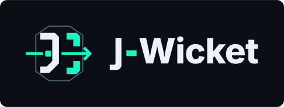
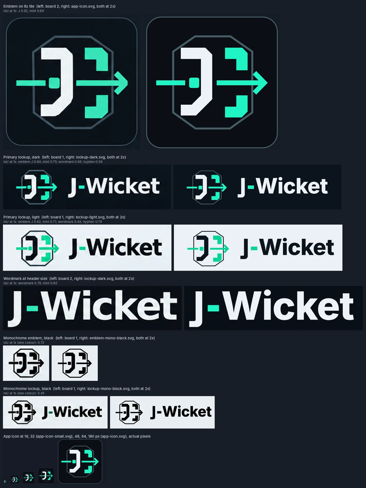

# J-Wicket brand

The J-Wicket logo is the **Sentinel Gate** emblem with the wordmark **J-Wicket**. It replaces the
earlier cricket-wicket mark (three stumps and two bails) everywhere. The SVG files in this folder are
the source of truth. Use them as they are, and change them here first.

| On dark | On light |
| --- | --- |
|  |  |

The two previews show [`lockup-dark.svg`](lockup-dark.svg) and [`lockup-light.svg`](lockup-light.svg)
on the backgrounds they are made for, with the clear space around them, so they read in either page
theme. The lockup files themselves are transparent; use those, not the previews.

**On this page:** [The mark](#the-mark) · [Files](#files) · [Rules](#rules) · [Colours](#colours) ·
[UI colour schemes](#ui-colour-schemes) · [Wordmark](#wordmark) · [Geometry](#geometry) ·
[Fidelity](#fidelity) · [Provenance](#provenance)

## The mark

- **Emblem:** an octagonal frame, the gate. Inside it are a white **J** with chamfered corners and two
  mint bracket pieces. A mint line with a rounded dot passes through the gate and leaves it as an
  arrow: traffic that is inspected and let through.
- **Wordmark:** "J-Wicket" in a heavy sans-serif with a mint hyphen. The J drops below the baseline.
- **Lockup:** the emblem on the left and the wordmark on the right. **There is no tagline.**

## Files

| File | What it is | Use it for |
| --- | --- | --- |
| [`lockup-dark.svg`](lockup-dark.svg) | Emblem and wordmark, for dark backgrounds | Headers, dark-mode README, slides and pages on dark backgrounds |
| [`lockup-light.svg`](lockup-light.svg) | Emblem and wordmark, for light backgrounds | The same, on white or light backgrounds |
| [`emblem-dark.svg`](emblem-dark.svg) | Emblem alone, transparent, for dark backgrounds | Small spaces, avatars, and places where the name is already written next to it |
| [`emblem-light.svg`](emblem-light.svg) | Emblem alone, transparent, for light backgrounds | The same, on light backgrounds |
| [`app-icon.svg`](app-icon.svg) | Emblem on a rounded-square Obsidian tile with a faint edge | App and touch icons from 48 px up (180 px touch icon, 192 and 512 px web-app icons) |
| [`app-icon-small.svg`](app-icon-small.svg) | The app icon with a heavier frame (12 units instead of 4) | Favicons at 16 to 32 px only |
| [`emblem-mono-black.svg`](emblem-mono-black.svg), [`emblem-mono-white.svg`](emblem-mono-white.svg) | Emblem in one colour | One-colour print, engraving and overlays where only black or white is possible |
| [`lockup-mono-black.svg`](lockup-mono-black.svg), [`lockup-mono-white.svg`](lockup-mono-white.svg) | Lockup in one colour | The same, with the name |
| [`source/asset-board.webp`](source/asset-board.webp), [`source/brand-guide.webp`](source/brand-guide.webp) | The owner's two brand boards | Reference only (see [Provenance](#provenance)) |

The UI does not load these files. It draws the emblem inline (`src/jwicket/static/js/brand.js`, the
same points as in `index.html`) and sets the wordmark as live text (see [Wordmark](#wordmark)). Its
favicon, `src/jwicket/static/logo.svg`, is a copy of `app-icon-small.svg`. `tests/test_static.py`
checks that all of them, and every SVG file here, draw the same emblem in the colours below.

## Rules

These come from the boards ("Approved direction", "Usage notes", "Clear space & minimum size"):

- **No tagline.** Put nothing in the lockup apart from the emblem and the wordmark. The sign-in page has none either (owner decision, 2026-11-25).
- **Use the emblem alone at small sizes.** If the lockup would be narrower than its minimum width,
  use the emblem. At favicon size, use the app icon.
- **Clear space:** keep a clear area of **X** on every side, where X is the height of the wordmark's
  J from the baseline to its top (its cap height). In the files X is 88 units, which is 46% of the
  lockup's height (the lockup is as tall as the octagon). For the emblem used alone, X is the same
  46% of the octagon's height. Measure X from the artwork, not from the edge of the file: the emblem
  files have 22 units of margin above and below the octagon and 4 to 5 units at the sides.
- **Minimum size:** the lockup at **120 px** wide on screen (32 mm in print) and the emblem at
  **32 px** (8 mm in print). Below 32 px, use only `app-icon-small.svg`, and only as a favicon.
- **One exception, inside the UI** (J-Wicket's own rule, not the boards'): the console draws the
  lockup at 120 px wide or more (the top bar: a 36 px emblem next to an 18 px wordmark; the sign-in:
  80 px next to 40 px) and the emblem alone at 32 px or more (the boot screen at 48 px, the top bar on
  a narrow screen at 36 px), except at 18 px inside the flow diagram's SRX box, where it marks the
  firewall rather than names the product. At every UI size the frame is drawn as a 1 px line that
  does not scale (`app.css`, section "logo mark"), so the gate does not fade the way the 4-unit frame
  would.
- **Do not** recolour, outline, stretch, rotate or add effects to the logo; set the wordmark in
  another font; or move the emblem's parts. Use the dark files on dark backgrounds and the light files
  on light ones, and the one-colour files where only one colour can be reproduced.

## Colours

The logo's colours were measured from the pixels of the boards (board 2's standalone emblem and board
1's lockups):

| Part | On dark backgrounds | On light backgrounds |
| --- | --- | --- |
| J and wordmark | `#ECF2F6` | `#0C141D` |
| Mint: line, dot, arrow, brackets, hyphen | `#1FF3C3` | `#08D496` |
| Frame | `#475D68` | `#0C141D` |
| App-icon tile | `#0B0E14` (Obsidian), edge `#475D68` | n/a |
| One colour | `#FFFFFF` (`*-mono-white.svg`) | `#000000` (`*-mono-black.svg`) |

- **The mint is the logo's accent**, as drawn on the boards. This was the owner's decision on
  2026-11-25. Use the deeper `#08D496` on light backgrounds, as the boards' light lockups do.
  `#06B6D4`, which the boards print as the accent, is the cyan accent of the Obsidian & Phosphor UI
  scheme and is not a logo colour.
- **The boards' printed hex labels do not match their own swatches.** Board 1's "Phosphor (Accent)"
  swatch is mint (`#23F5C5` sampled), but its label says `#06B6D4`. Its "Muted Text" swatch samples as
  `#6D829C` against a label of `#64748B`, and the other swatches are off by a few levels too. These
  files follow the pixels, not the labels.
- On the boards the wordmark samples as `#EEF2F6` (dark) and `#080D10` (light), and the hyphen as
  `#1EF3C5` and `#0CD397`. These are within a few levels of the emblem's colours, so each file uses
  one ink and one mint.
- Logos are exempt from contrast minimums for text. Do not use the mint for text on light backgrounds,
  where its contrast is low.

## UI colour schemes

The UI has three colour schemes, each with a night (dark) and a day (light) variant. **Obsidian &
Phosphor** (id `obsidian`) is the default from the first paint. **HPE** and **Nordic Steel** can still
be selected. The schemes' tokens are in [`src/jwicket/static/css/app.css`](../../src/jwicket/static/css/app.css)
(section "colour schemes"), and the list of schemes is in `src/jwicket/static/js/brand.js` (`SCHEMES`).

Scheme colours are UI colours, used for text, surfaces and status. They are not logo colours, and
this guide does not list them. The logo keeps the colours above in every scheme: in `app.css`
(section "logo mark") the `--logo-*` tokens set the J, the wordmark, the frame and the mint to the
values in the table, by night and by day, and no scheme overrides them. They change with night or day
only. The app-icon tile uses the Obsidian canvas colour, `#0B0E14`.

The mark and the colours on this page are J-Wicket's own, and the logo claims no affiliation with any
other company. Board 2 has a panel headed "Brand & Diagramming Palette (HPE / Aruba-inspired)". That
panel names another company's colours, is not part of this brand, and none of its names or values are
used here.

## Wordmark

In the standalone files, the wordmark is drawn as outlines so that it looks the same everywhere:

- **Font:** [Inter](https://rsms.me/inter/) **ExtraBold** (the text family, not Inter Display),
  version 4.000, © 2016 The Inter Project Authors. It is licensed under the
  [SIL Open Font License 1.1](https://openfontlicense.org). The licence says that its requirement for
  fonts to remain under it "does not apply to any document created using the fonts or their
  derivatives". The files contain outlines only, not font software.
- **Why ExtraBold:** on the boards, stem width divided by cap height is 0.22 to 0.24 (Inter Bold
  0.20, ExtraBold 0.23, Black 0.27), and the height of the c (x-height with overshoot) is 0.77 to
  0.81 of cap height. Inter (0.78) is closer on that than Inter Display (0.74). Fitted to the four
  renderings of the wordmark on the boards, Inter ExtraBold and Inter Display ExtraBold tie on
  overlap. Display fits only by making the capitals 4 to 6% taller than measured on three of the four;
  on those three, Inter ExtraBold lands within 1%.
- **Setting:** tracking −1.5% (−0.015 em), the mean of the four renderings (the two primary lockups
  −1.7% and −2.9%, the two board headers −1.1% and −0.5%). Contextual alternates are off, because
  Inter would otherwise raise the hyphen to cap height between two capitals; on the boards it is
  centred on the x-height.
- **The hyphen is redrawn.** On the boards it is shorter and thicker than Inter's: 0.38 to 0.41 of the
  cap height wide and 0.20 to 0.23 tall on the four primary renderings, against Inter ExtraBold's 0.46
  and 0.18. The files draw it as a bar 0.40 × 0.22 cap (35 × 19.7 units, x 365 to 400 and y 119.9 to
  139.6), centred on the x-height and placed between the J and the W where the boards put it, a
  little past halfway from the J's stem to the W (56% in the files, 54 to 59% on the boards).
- **The J is redrawn** (kept by the owner's decision of 2026-11-25 over plain Inter). On the boards the J drops about a quarter of its cap height below the
  baseline and ends in a short, square foot. No Inter J does this. The files keep Inter ExtraBold's J
  stem and replace the curved bowl with that foot. In Inter's units (2048 per em, cap height 1490):
  the stem is x 744 to 1092 from the cap line down, the foot runs from x 412 to the stem between
  y −68 and −378, and its outer corner has a radius of 286 and its inner corner a radius of 68.
  Against the boards, the J alone overlaps at 0.85 to 0.89 IoU (Inter's own J: 0.45 to 0.54).
- **In the UI** the wordmark is live text in the UI font (`--font-ui` in `app.css`), weight 800, with
  the hyphen in a mint span (`.wm-dash`). It does not have the redrawn J or hyphen. That is expected:
  only the standalone files carry the drawn wordmark. The UI sets the emblem and the wordmark in the
  lockup's proportions: the wordmark's cap height is about 0.6 of the brackets' height, and the arrow
  tip is about 0.4 of it from the J.

## Geometry

All files share one coordinate system, the emblem's 236-unit square (`viewBox="15 13 236 236"`). The
emblem was traced from board 2's standalone emblem. It is the same set of points as the UI's emblem,
so change both together.

- **Emblem:** frame stroke 4, J and brackets filled, a line and arrow 10 units thick. The arrow tips
  run from x 20 to 247 and the frame from y 35 to 227.
- **Lockup** (`viewBox="20 35 797 192"`): the emblem at its own coordinates, with the wordmark's
  baseline at y 165.3, a cap height of 87.8, and the J's left edge at x 308 (61 units after the arrow
  tip). These numbers are the means of board 1's two primary lockups: cap height measured 87.7 and
  88.0 there, baseline 164.3 and 166.4, and arrow-to-J gap 66 and 55. The two lockups disagree with
  each other by about 4 px at the board's size.
- **One colour:** the same geometry, with the frame at 6 units. Board 1's monochrome panel draws the
  frame heavier than the colour version, and 6 fits its black and white icons best together. Where
  the J's corners meet the frame, a 3-unit gap (an SVG mask) keeps the letter from fusing with the
  gate. In the colour versions, colour does that job. The line and arrow still cross the frame, as
  drawn. The panel's lockups keep a mint hyphen, which a one-colour file cannot do, so the files draw
  it in the same colour; use the colour lockups when a second colour is available. The panel also
  sets the wordmark closer to the emblem; the files keep the primary spacing so that all lockups share
  one layout.
- **App icon** (`viewBox="0 0 268 268"`): a tile with corner radius 30 (11%), filled `#0B0E14` with a
  2-unit `#475D68` edge. The emblem is centred on it and its arrow spans 85% of the tile's width, as on
  board 2. **`app-icon-small.svg`** is the same icon with a 12-unit frame. At 16 px the 4-unit frame
  is 0.24 px wide and all but disappears, and at 32 px it is 0.48 px. At 12 units it is 0.7 px and
  1.4 px, so the gate still reads.
- **The boards disagree on small icons.** Board 1's favicon row (16 to 512 px) keeps the octagonal
  frame at every size. Board 2's "Emblem / Favicon" panel draws its 16 to 64 px icons without it: the
  J, the dot, the line, the arrow and the brackets on the tile, and no octagon. These files follow
  board 1 and keep the frame, made heavier in `app-icon-small.svg` so that it still reads. A frameless
  small favicon, as on board 2, is the other choice; it is left to the owner and not drawn here.

## Fidelity

Each file was rendered with Chromium next to the matching crop of the boards, at the boards' size and
at 2×, and compared by per-colour pixel overlap (IoU of the J or ink pixels and of the mint pixels):

| Comparison | J or ink | Mint |
| --- | --- | --- |
| `emblem-dark.svg` against board 2's standalone emblem, 1×, crop as traced | 0.92 | 0.89 |
| The same with a sub-pixel fit, 1× (2×) | 0.93 (0.94) | 0.88 (0.91) |
| `app-icon.svg` against board 2's emblem tile, 1× | 0.92 | 0.89 |
| `lockup-dark.svg` against board 1's dark lockup, 1×: emblem; wordmark | 0.84; 0.69 | 0.75; hyphen 0.59 |
| `lockup-light.svg` against board 1's light lockup, 1×: emblem with frame; wordmark | 0.62; 0.44 | 0.71; hyphen 0.79 |
| Wordmark against board 2's header wordmark, 1× | 0.79 | hyphen 0.80 |
| `emblem-mono-black.svg` and `emblem-mono-white.svg` against board 1's icons, 1× | 0.72 and 0.74 | n/a |
| `lockup-mono-black.svg` and `lockup-mono-white.svg` against board 1's one-colour logos, 1× | 0.45 and 0.40 | n/a |

The one-colour lockups score lowest. A one-colour file cannot keep the panel's mint hyphen, and the
panel sets the wordmark closer to the emblem than the primary lockups do, while the files keep the
primary spacing (see [Geometry](#geometry)); the emblems alone score 0.72 and 0.74.

At the lockups' size, the wordmark's strokes are about 7 px wide, so a shift of 1 to 2 px costs a lot
of overlap. Placed for one lockup alone, the wordmark reaches 0.82 on board 1's dark lockup and 0.81
on its light one, but each placement scores below 0.4 on the other lockup, because the two disagree.
The light lockup's frame on board 1 is also drawn heavier than on board 2, and the files keep the one
4-unit frame. Side by side, at the boards' size and at 2×:

## Provenance

The logo comes from **the owner's brand boards, adopted on 2026-11-25**:

- [`source/asset-board.webp`](source/asset-board.webp): "Asset board / design pack"
- [`source/brand-guide.webp`](source/brand-guide.webp): "Visual brand guide"

The boards are generated artwork. They are kept here only as the reference these files were measured
from, saved as WebP at quality 85 (about 140 KB each, full 1448 × 1086 size). **The SVG files are the
source of truth.** Where the boards disagree with each other or with the files, the files win.

These parts of the boards are not part of the brand:

- the printed hex labels;
- the "Brand & Diagramming Palette (HPE / Aruba-inspired)" panel;
- the typography samples and the UI mockups, including the example web address in the browser mockup.
