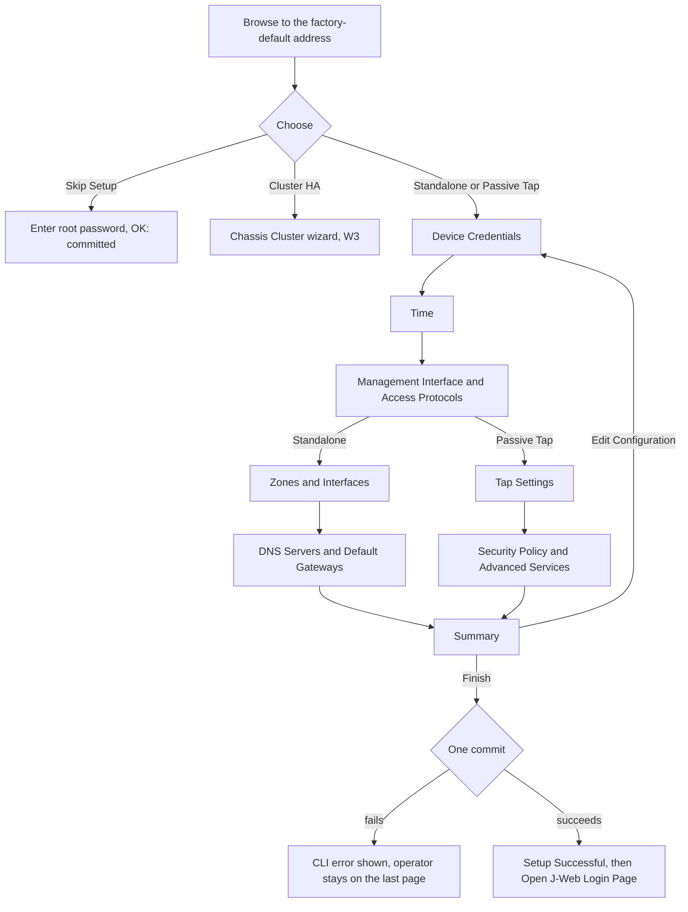
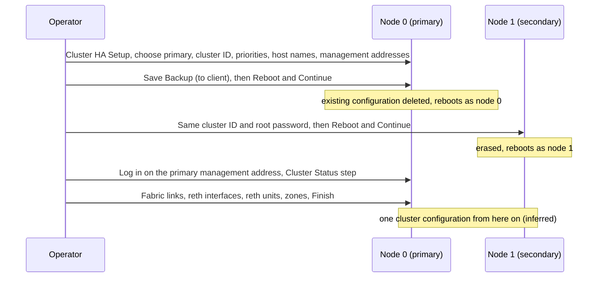
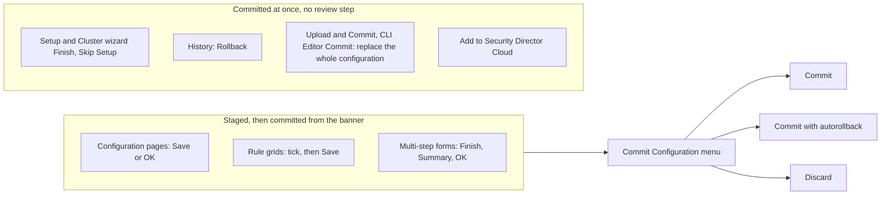
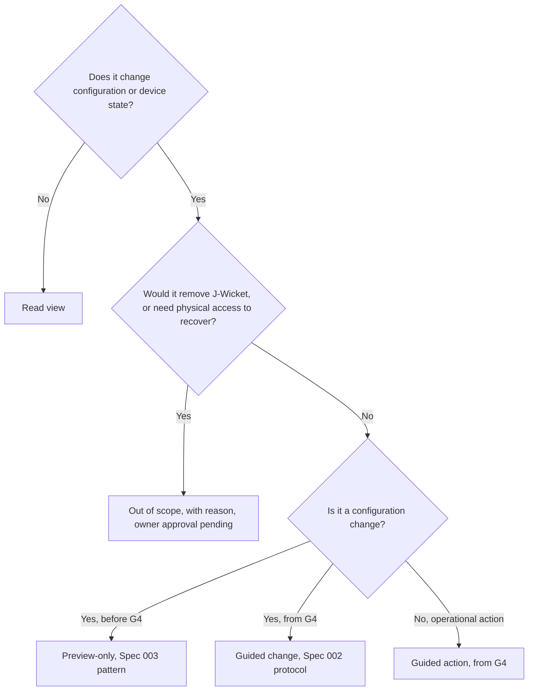
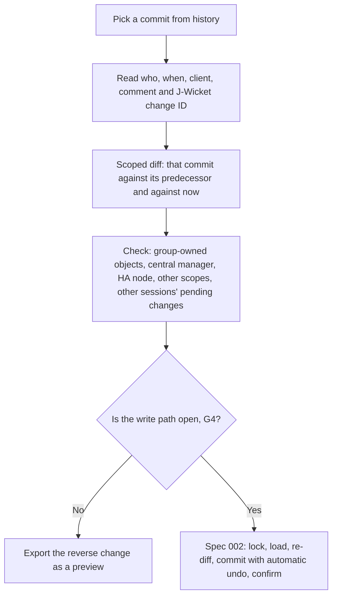

# Wizard and operations catalog

This catalog lists every guided flow and every device-wide operation in the reference release,
**J-Web for SRX Series 24.4**. For each it records the entry point, the steps, what it does to the
Junos configuration or device state, how it commits, how it fails and where it is limited. It then
says which J-Wicket workflow shape each one needs, and which brownfield, group-ownership, HA,
tenant/logical-system and central-management cases the design must handle. The last part lists the
workflows J-Wicket adds that J-Web lacks.

It is design input for [Spec 002](specs/002-change-protocol.md) (shared change protocol),
[Spec 003](specs/003-firewall-policy-builder.md) (preview-only Firewall Policy Builder),
[Spec 004](specs/004-live-sessions-and-logs.md) (live sessions and logs) and the
[parity ledger](parity/README.md). It does not set priorities. The priorities below are
proposals; the ledger ([`parity/jweb-24.4.csv`](parity/jweb-24.4.csv)) is authoritative where the
two differ, and the project owner decides scope and out-of-scope rows ([governance](governance.md)).

## Key findings

1. **J-Web 24.4 has no security-policy wizard and no Multinode High Availability (MNHA) flow.**
   Security policy and NAT rules are inline grid rows. The 24.4 guide names four "workflow
   wizards" (Setup, Chassis Cluster, PPPoE, NAT); two of them (PPPoE, NAT) have no documented steps.
   A preview-only Firewall Policy Builder therefore goes beyond parity. (verified, section 1.0)
2. **Six J-Web paths commit at once, with no review step:** History Rollback, Upload and Commit,
   CLI Editor Commit, Setup and Cluster wizard Finish, Skip Setup, and Add to Security Director
   Cloud. Upload and CLI Editor replace the whole configuration. (verified, section 2.1; for the
   Cluster wizard the commit at Finish is implied by its failure note)
3. **The Commit Configuration menu is documented by name only.** The autorollback timer, the diff
   format, the "preferred way" options and whether J-Web shares the candidate with other sessions
   are not in the guide. (unknown; settled only by observing J-Web on a reference device)
4. **Juniper documents brownfield hazards in J-Web itself.** Editing a VPN deletes a predefined
   IKE proposal-set, and J-Web shows only the first custom proposal when several exist. (verified,
   W6)
5. **Several flows would remove or restart J-Wicket.** Reset Configuration, the Cluster wizard
   (erases both units), software install and rollback, and reboot all act on the device J-Wicket
   runs on. They need a reason-backed scope decision, not a port. (inferred, section 3.2)
6. **J-Wicket today is read-only.** The scope banner, policy evaluation order, live session reads
   with device-side filters and log tailing exist in [`src/jwicket/`](../src/jwicket/) and pass
   tests on synthetic fixtures. The code has no write path. Nothing has run on a customer
   platform; the spike ran on one vSRX ([evidence](evidence/2026-11-23-vsrx-spike/README.md)).

## How to read this catalog

- **verified**: the cited page or file says it. **inferred**: reasoning from verified facts or
  general Junos knowledge; not stated by the source. **unknown**: not found; do not build on it.
- **Junos statements are inferred unless marked verified.** The J-Web guide describes form fields,
  not the statements it writes. Where this page names a hierarchy or command, it is a pointer for
  research. Code must take element names from recorded device replies and the device schema
  (Q-REL-01), never from this page.
- **Sources.** `G/` is the 24.4 guide topic base,
  `https://networkingdocs.hpe.com/documentation/us/en/software/jweb-srx24.4/jweb-srx/topics/`.
  "p." is the printed page of the 24.4 PDF,
  `https://networkingdocs.hpe.com/documentation/us/en/software/jweb-srx24.4/jweb-srx/jweb-srx.pdf`
  (published 2025-09-18). `G212/` is the same path for release 21.2. `C/` is the Junos CLI command
  reference, `https://networkingdocs.hpe.com/documentation/us/en/software/junos/cli-reference/topics/ref/command/`.
  `X/` is the Junos XML protocol guide,
  `https://networkingdocs.hpe.com/documentation/us/en/software/junos/junos-xml-protocol/topics/`.
  Every `juniper.net/documentation/...` URL now returns 301 to the same path on
  `networkingdocs.hpe.com`. All sources were read on 2026-11-24.
- **IDs.** `W1`–`W12` (wizards), `O1`–`O41` (operations) and `N1`–`N5` (J-Wicket-native
  workflows) are catalog IDs, not ledger row IDs.

---

## Part 1. Wizards and guided flows

### 1.0 Summary

| ID | Flow | Entry point (24.4) | Writes configuration | How it commits | Platform limits | Status |
| --- | --- | --- | --- | --- | --- | --- |
| W1 | Setup Wizard (Standalone, Cluster (HA), Passive (Tap)), plus Skip Setup | First HTTPS access to a factory-default device; also after W2 | Yes | One commit at **Finish**; Skip Setup commits the root password | Passive (Tap) not on SRX5000 line, SRX4600, vSRX | verified |
| W2 | Reset Configuration and Rerun Setup Wizard | Device Administration > Reset Configuration | Yes: resets, then runs W1 or W3 | Reset method unknown; 21.2 kept a backup and **Cancel** rolled back | Menu exists only if Standalone mode was chosen at setup | verified (24.4 steps); 21.2 semantics |
| W3 | Chassis Cluster wizard | Setup Wizard > Cluster (HA); W2; Device Administration > Cluster Management > Cluster Configuration > Cluster (HA) Setup | Yes; **erases and reboots both units** | Per-node **Reboot and Continue**, then **Finish** | Active/passive (RG1) only; control-port fields only on SRX5600/SRX5800 | verified |
| W4 | PPPoE wizard | Not documented in 24.4 (21.2: Network > Connectivity > PPPoE) | unknown | unknown | SRX300 line only | name verified; flow unknown |
| W5 | NAT wizard | Network > NAT > Proxy ARP/ND > **Launch Wizard** | inferred yes | unknown | SRX300 line only | launch verified; steps unknown |
| W6 | VPN create flows: Site to Site, Remote Access (Juniper Secure Connect, NCP Exclusive Client), Dynamic VPN wizard | Network > VPN > IPsec VPN > **Create VPN**; Network > VPN > Dynamic VPN > **Launch Wizard** | Yes | **Save**, then the Commit menu (inferred) | Dynamic VPN: SRX300 line only | verified (Site to Site, JSC); NCP and Dynamic VPN steps unknown |
| W7 | Create Antivirus Profiles wizard | Security Services > Content Security > Antivirus Profiles > **+** | Yes | **OK** saves; commit from the banner Commit menu | Licence needed; Avira engine not on SRX300/320/340/345/380 | verified |
| W8 | Add Device to Juniper Security Director Cloud | Banner icon | Yes: configuration received from the Cloud API | Commits at once | SRX4700 not listed on the page | verified |
| W9 | ATP Cloud enrollment | Device Administration > ATP Management > Enrollment | Yes, through a Junos op script | Refuses to start while uncommitted changes exist | Enhanced-services mode on SRX300/320/340/345 | verified |
| W10 | Device certificate creation (seven methods) and CA certificates | Device Administration > Certificate Management > Certificates > **Create** | Yes (PKI objects and requests) | **OK** | ACME cannot be used while J-Web listens on port 80 | verified (Let's Encrypt); other methods TOC only |
| W11 | Other multi-step forms: Web Filtering, Content Filtering, Content Security policy, JIMS, Add Logical System, Add Tenant | Their pages, **+** | Yes | **Finish** or **OK**, then commit | LSYS/tenant on multitenancy-capable models | verified |
| W12 | Generate Report | Monitor > Reports | No; produces a file | n/a | Not on SRX5000 line | verified |

**Not in the 24.4 guide** (verified absent from the 24.4 table of contents,
`https://networkingdocs.hpe.com/documentation/us/en/software/jweb-srx24.4/jweb-srx/__toc.js`):
a security-policy wizard, any MNHA topic, a NAT wizard task topic, and a PPPoE topic.

**Not wizards** (verified): adding a security policy rule (G/`task/j-web-security-polices-rules-adding.html`)
or a source NAT rule (G/`task/j-web-security-policy-source-nat-rule-adding.html`) opens an inline
grid row. The operator clicks the tick icon, then **Save** or **Discard**, and the policy page says
"You must perform Step 3 and Step 4 before performing any further actions in the J-Web UI."

### W1. Setup Wizard

- **Entry point.** Browse to `https://` plus the factory-default address. "As the device is running
  a factory default configuration, the J-Web Setup Wizard screen opens." The access page has a
  per-model table of factory-default addresses; vSRX uses fxp0 with no DHCP. **Skip Setup** asks for
  the root password: "The password is committed to the device and the J-Web login page appears."
  Also reached after W2. (verified, G/`topic-map/j-web-security-starting.html`, pp. 3–9)
- **Modes.** Standalone ("device credentials, time, management interface, zones and interfaces,
  and DNS servers and default gateways"), Cluster (HA) (hands over to W3), Passive (Tap) ("passively
  monitor traffic flows"). "You cannot configure Standalone or Passive mode when your device is in
  the HA mode." (verified, G/`topic-map/j-web-setup-wizard.html`, pp. 9–41)
- **Steps** (verified; the worked example is based on 21.3R1):
  1. Choose a mode, **Start**.
  2. **Device Credentials**: device name (up to 255 characters), root password (mandatory, at
     least 6 characters), "SSH for root user", an admin account.
  3. **Time**: time zone; NTP servers, computer time ("only during the setup") or manual.
  4. **Management Interface**: fxp0, a revenue port or None (Standalone only); IPv4/IPv6 address,
     static route and next hop; an **Access Protocols** tab (HTTPS and SSH on by default, Ping,
     DHCP, NETCONF on ports other than fxp0). Changing the address warns that the operator must use
     the new address and "may lose the connectivity".
  5. Standalone: **Zones & Interfaces**: a trust-to-untrust policy (default "permits all traffic
     from the trust zone to the untrust zone"); trust-zone interfaces (Switching family creates an
     IRB unit, VLAN and optional DHCP pool; Routing family sets interface, unit and VLAN ID);
     untrust-zone interfaces with address mode DHCP Client, PPPoE (PAP), PPPoE (CHAP) or Static IP.
     "For standalone mode, trust and untrust zones are created by default even if these zones are
     not available in the factory default settings." Then **DNS Servers & Default Gateways**.
     Passive (Tap): **Tap Settings** (Tap interface, IP-IP and GRE tunnel inspection) and
     **Security Policy & Advanced Services** (Content Security licence and profiles, IPS licence
     and offline signature package, ATP Cloud, Security Intelligence, User Firewall with an AD
     domain controller). The management port is mandatory in Passive mode.
  6. **Summary**: **Edit Configuration** or **Finish**. Then a push-status page, "Setup
     Successful" and **Open J-Web Login Page**.
- **Junos configuration produced** (inferred; the guide lists no statements):
  `[edit system]` (host-name, root-authentication, login user, services ssh/web-management/netconf,
  time-zone, ntp, name-server, DHCP local server), management `[edit interfaces]`,
  `[edit routing-options static]`, `[edit security zones]` (trust, untrust, host-inbound-traffic,
  application-tracking, source-identity-log), `[edit security policies]`, `[edit vlans]` and IRB
  units (Switching family), `[edit access address-assignment]`, a PPPoE interface for the PPPoE
  address modes. Passive mode adds `[edit security utm]`, `[edit security idp]`,
  `[edit services advanced-anti-malware]`, `[edit services security-intelligence]` and
  `[edit services user-identification]`. The Tap-interface and tunnel-inspection statements are
  unknown. Whether the admin account gets `super-user` is unknown.
- **How it commits.** "Review the configuration details ... click Finish. Wait till the
  configuration is committed." One commit. Whether it uses `commit confirmed` is unknown.
  (verified)
- **Failure behaviour.** "If the commit fails, J-Web displays you the error message received from
  CLI and you remain on the wizard's last page." The wizard "Flags any missing required
  configuration when you attempt to leave a page." (verified)
- **Platform limits** (verified): Passive (Tap) is not supported on the SRX5000 line, SRX4600 or
  vSRX. The Switching family is only on the SRX300 Series, SRX550M, SRX1500 and SRX1600. PPPoE
  address modes are not on the SRX5000 line or in Passive mode. In Passive mode the SRX300 line and
  SRX550M reboot if ATP Cloud or Security Intelligence is enabled. IPS, web filtering, ATP Cloud
  and Security Intelligence need internet access. Junos-FIPS devices do not support
  `web-management` at `[edit system services]`, so J-Web does not run there at all.
- **Status.** verified, with the configuration mapping inferred.

### W2. Reset Configuration and Rerun Setup Wizard

- **Entry point.** Device Administration > Reset Configuration. "This menu is only available if you
  have selected Standalone mode when configuring device factory default settings using the J-Web
  Setup Wizard." (verified, G/`task/j-web-security-setup-wizard-configuring.html`, p. 392)
- **Steps.** **Reset**, a "Reconfigure Setup Wizard" warning, **Proceed to Launch**, then W1 (or W3
  for Cluster (HA)). (verified)
- **Junos effect.** Resets the configuration; the method is unknown (a factory-default load is
  inferred).
- **How it commits and fails.** Not stated in 24.4. In 21.2: "launching the Setup wizard resets
  the device to the factory default configuration after saving a backup of the current committed
  configuration to the local file system. If you click Cancel during the setup, the device rolls
  back to its previous committed state." (verified for 21.2,
  G212/`task/j-web-security-setup-wizard-configuring.html`; whether 24.4 behaves the same is
  unknown)
- **Status.** verified (24.4 steps); semantics unknown for 24.4.

### W3. Chassis Cluster wizard

- **Entry point.** Setup Wizard > Cluster (HA) on a factory-default device; W2; or Device
  Administration > Cluster Management > Cluster Configuration > Cluster (HA) Setup. Whether Cluster
  (HA) Setup is its own side-menu item or an action on Cluster Configuration is unknown.
  (verified, G/`task/j-web-security-cluster-setup-configuring.html`, pp. 167–182)
- **Preconditions** (verified): physical access to both devices; "You must configure the two
  devices separately"; same hardware and software; "both units are erased and rebooted, after which
  all existing data is irretrievable. You have the option to save a backup copy of your
  configuration before rebooting."
- **Steps** (verified):
  1. **Cluster (HA) Setup**; **Proceed**, or disconnect back-to-back ports and **Refresh**.
  2. "Yes, this is the primary unit (Node 0)" or "No, this is the secondary unit (Node 1)".
  3. Primary: cluster ID (1–255), node priorities (default 200/100), host names, root SSH,
     per-node management IPv4/IPv6 with static route, root password, control ports (SRX5600/5800),
     **Save Backup (to client)**. "When restarting the primary unit, J-Web deletes the existing
     configuration to configure chassis cluster." **Reboot and Continue**.
  4. Secondary: matching cluster ID, root password, control ports, backup. **Reboot and Continue**.
  5. Log in on the primary management address, open Cluster (HA) Setup again. **Cluster Status**:
     "J-Web uses `show chassis cluster status` to verify control link status"; link colours green,
     red, orange (one of two links up), grey (fabric not configured).
  6. Fabric links (optionally dual), **Configure Link**; redundant Ethernet (reth) interfaces with
     node 0 members, LACP, VLAN tagging and redundancy group; reth logical units; zones (trust and
     untrust shown by default). **Finish**.
- **Junos configuration produced** (inferred): the operational `set chassis cluster cluster-id ...
  node ... reboot` (an operational command, not configuration); node groups `node0`/`node1` with
  host name and fxp0 address and `apply-groups "${node}"` (corroborated only by search snippets of
  Juniper cluster examples); `[edit chassis cluster]` (redundancy groups and priorities, control
  ports, reth count); fabric and reth interfaces under `[edit interfaces]`; `[edit security zones]`.
- **How it commits.** No summary page. Each node is rebooted with **Reboot and Continue**
  (verified). The fabric, reth and zone settings are applied at **Finish**; that this is a commit is
  implied by the failure note below (inferred).
- **Failure behaviour.** "If the chassis cluster configuration fails after you click Finish, then
  edit the configuration as required and commit the changes again." Deleting a default zone fails
  at commit because "the default zones are referenced in the security policies". If the cluster is
  not connected, "all possible failure reasons will be displayed". (verified)
- **Platform limits.** "In the J-Web cluster (HA) setup, you can only configure active/passive mode
  (RG1)." SRX300, SRX320, SRX320-POE, SRX340, SRX345 and SRX380 in factory default show a warning
  to disconnect the ports between nodes. (verified)
- **Status.** verified; configuration mapping inferred.

### W4. PPPoE wizard

- **Entry point.** Not documented in 24.4. The Explore page still says: "J-Web contains assisting
  workflow wizards ... These include Setup wizard, Chassis Cluster wizard, PPPoE wizard, and NAT
  wizard" and "PPPoE and NAT Wizards are available only in the SRX300 line of Firewalls."
  (verified, G/`topic-map/j-web-security-exploring.html`, pp. 52–53)
- **History.** In 21.2: "This menu is available only for SRX300 lines of devices and SRX550M device.
  You are here: Network > Connectivity > PPPoE ... The PPPoE wizard guides you to set up a PPPoE
  client over the Ethernet connection." Limits then: load/save to a client file omits port details;
  connections made outside the wizard cannot be edited in it; it "cannot be launched if the backend
  file is corrupted". (verified for 21.2, G212/`task/j-web-security-pppoe-configuring.html`) The
  topic is absent from the 21.4 PDF and from the 22.2+ tables of contents. (verified)
- **What survives in 24.4.** PPPoE (PAP) and PPPoE (CHAP) as untrust-interface address modes inside
  W1. (verified)
- **Steps, configuration, commit, failure.** unknown. Whether the 24.4 UI still has the wizard is
  unknown; text carried forward unchanged is a plausible explanation (inferred).
- **Status.** name verified; flow unknown.

### W5. NAT wizard

- **Entry point.** Network > NAT > Proxy ARP/ND: "Launch NAT wizard. To do this, click Launch Wizard
  option at the upper-right corner of the page. The NAT wizard leads you through the basic required
  steps to configure NAT for the SRX Series security device." (verified,
  G/`concept/j-web-security-about-proxy-arp-nd-nat-page.html`, p. 520) Whether the button appears on
  other NAT pages is unknown.
- **Steps, configuration, commit, failure.** unknown. No release from 20.4 to 24.4 has a task topic
  for it. It writes `[edit security nat]` (inferred).
- **Platform limits.** SRX300 line only (verified, Explore page).
- **Status.** launch point verified; everything else unknown.

### W6. VPN create flows

**Site to Site** (verified, G/`task/j-web-security-ipsec-vpn-creating.html`, p. 650):

- **Entry and steps.** Network > VPN > IPsec VPN > **Create VPN > Site to Site**. The form is a
  topology drawing: click Remote Gateway, Local Gateway, and IKE and IPsec Settings. "The VPN
  connectivity will change from grey to blue line in the topology to show that the configuration is
  complete." Then **Save** or Cancel.
- **Choices.** Routing mode: Traffic Selector (Auto Route Insertion, default), Static Routing,
  Dynamic Routing OSPF, Dynamic Routing BGP ("For each topology, J-Web auto generates the relevant
  CLIs"). Pre-shared key or certificate authentication. Up to five remote external addresses.
  Protected networks come from the global address book. **Auto-create Firewall Policy** creates a
  policy in each direction between the internal zone and the tunnel-interface zone. **Add** creates
  a new st0 unit.
- **Junos configuration produced** (inferred): `[edit security ike]`, `[edit security ipsec]`,
  `[edit interfaces st0]`, `[edit security zones]`, `[edit security address-book global]`,
  `[edit security policies]` (auto-create), and `[edit routing-options static]`,
  `[edit protocols ospf]` or `[edit protocols bgp]` by routing mode.
- **How it commits.** **Save** stages. The "Establish Tunnel" option says IKE is activated "after a
  VPN is configured and the configuration changes are committed", so the commit is the banner
  menu's (inferred).
- **Brownfield hazards** (verified quotes): "J-Web supports only one custom IKE proposal and does not
  support the predefined proposal-set. Upon edit and save, J-Web deletes the predefined proposal set
  if configured." "Upon edit, J-Web shows the first custom IKE and IPsec proposal when more than one
  custom proposal is configured."
- **Platform limits.** ECDSA-521 signatures only on SRX5000 with SPC3 and junos-ike. VPN Monitor is
  not available in Traffic Selector mode. (verified)

**Remote Access, Juniper Secure Connect** (verified,
G/`task/j-web-security-ipsec-remote-access-vpn-juniper-secure-connect-creating.html`, p. 667):
Create VPN > Remote Access > Juniper Secure Connect. Topology of Remote User, Local Gateway,
IKE/IPsec; routing mode fixed to Traffic Selector. The description "will be used for the IKE and
IPsec proposals, policies, remote access profile, client configuration, and NAT rule set", which
shows the objects the flow writes (verified). **Save** "to complete Secure Connect VPN
Configuration and associated policy if you have selected the auto policy creation option".
Hierarchies (inferred): `[edit security remote-access]`, `[edit access profile]`,
`[edit access address-assignment]`, `[edit security nat source]`, plus IKE and IPsec as above.
"Starting in Junos OS Release 23.2R1 ... the ike-user-type is group-ike-id if the Junos-ike package
is already installed ... not supported for SRX300 line." (verified)

**Remote Access, NCP Exclusive Client**: TOC topic only
(G/`task/j-web-security-ipsec-remote-access-vpn-ncp-client-creating.html`, p. 690); steps not read.
(unknown)

**Dynamic VPN wizard**: Network > VPN > Dynamic VPN: "Launch VPN wizard. To do this, click Launch
Wizard available on the upper right corner of the Dynamic VPN table. Follow the guided steps to
configure the VPN wizard." "This menu is available only for SRX300 line of Firewalls." (verified,
G/`concept/j-web-security-about-ipsec-vpn-dynamic-page.html`, pp. 705–706) Steps, configuration and
commit are unknown.

### W7. Create Antivirus Profiles wizard

- **Entry point.** Security Services > Content Security > Antivirus Profiles > **+**. (verified,
  G/`task/j-web-security-content-security-antivirus-profile-adding.html`, pp. 858–863)
- **Steps** (verified): "The Create Antivirus Profiles wizard appears, displaying brief instructions";
  **Next**; complete the fields; **Finish**; "The Summary page is displayed"; **Edit** link or
  **Back** to change; **OK** to save, Cancel to discard. Fields: General (name, up to 29
  characters; URL allowlist; MIME allowlist with an inline **Create New MIME List**; exception MIME
  allowlist), Fallback Options (content size, engine error, trickling timeout, out of resources,
  decompress layer, too many requests, default action; each Block or Log and Permit, with Block
  the default wherever the page states one), Notification Options (fallback deny, fallback
  non-deny, virus detection; notification type None, Protocol or Message; custom subject up to 255
  and message up to 512 characters).
- **What it does not set.** The scan engine is chosen in Content Security > Default Configuration,
  not in the wizard. The worked example's first step is "Configure the Sophos engine in Default
  Configuration", and it notes "You must configure DNS servers before creating the antivirus
  profiles." (verified, G/`topic-map/j-web-security-utm-antivirus-example.html`, pp. 867–886)
- **Junos configuration produced.** The worked example's sample output shows the profile at
  `[edit security utm]` as `feature-profile { anti-virus { profile <name> { notification-options
  ... } } }`, with the engine under `default-configuration anti-virus type` (verified, p. 885). The
  statements behind the fallback options and the inline MIME list are not shown (inferred to be
  under the profile and `custom-objects`). The profile takes effect only when a Content Security
  policy references it and a security policy references that (`then permit application-services
  utm-policy <name>`, verified in the same sample, p. 886).
- **How it commits.** **OK** saves the profile; the worked example then says "Click the commit icon
  (at the right side of the top banner) and select Commit." (verified, p. 882)
- **Failure behaviour.** Not documented. (unknown)
- **Platform limits.** On-device antivirus is "a separately licensed subscription service"; the
  Avira engine is not supported on SRX300, SRX320, SRX340, SRX345 or SRX380. (verified, p. 867)
- **Status.** verified.

### W8. Add Device to Juniper Security Director Cloud

- **Entry point.** Banner icon, upper right (the Explore page labels it "Add Device to Juniper
  Security Cloud"; the task page says "...Security Director Cloud"). (verified,
  G/`task/j-web-security-sd-cloud-device-adding.html`, pp. 55–56)
- **Steps** (verified): select a location, enter the Security Director Cloud account email and
  password, **Next**; select an organization (admin permission), **Proceed**; a progress bar.
- **Junos effect.** "your device gets added to the Juniper Security Director Cloud and commits the
  received configuration from the Cloud API." (verified) Which statements arrive is unknown. Security
  Director Cloud's own onboarding uses outbound SSH on TCP 7804 to a regional host (verified,
  `https://networkingdocs.hpe.com/documentation/us/en/software/sd-cloud/sd-cloud-user-guide/user-guide/topics/task/brownfield-onboarding.html`);
  that the J-Web flow writes the same is inferred.
- **How it commits and fails.** Commits at once; no review step. Failure behaviour is not
  documented. (verified; unknown)
- **After.** The label changes to "Manged by Juniper Security Director Cloud" (sic) and is stale
  after removal or network problems until the next login. "You can only delete your device from
  Juniper Security Director Cloud and not from the J-Web GUI." (verified)
- **Platform limits.** The page lists SRX1600/2300 (23.4R1) and SRX4300 (24.2R1); SRX4700 is not
  listed, meaning unknown. (verified)

### W9. ATP Cloud enrollment

- **Entry point and steps.** Device Administration > ATP Management > Enrollment. Optional proxy
  profile (**Create Proxy**, **Apply Proxy**); **Enroll**; create a realm or use an existing one
  (location, email, password, company, realm); progress and errors in-page; **Diagnostics**;
  **UnEnroll**. (verified, G/`task/j-web-security-sky-atp-enrolling.html`, p. 309)
- **Junos effect.** "ATP uses a Junos OS operation (op) script" that downloads and installs CAs,
  creates and enrolls local certificates and applies basic ATP configuration. The script name is
  unknown. Prerequisite quoted by the page: "configure set security forwarding-process
  enhanced-services-mode on your SRX300, SRX320, SRX340, and SRX345". (verified)
- **How it commits.** "If there are any existing configuration changes, a message appears for you to
  commit the changes and then to proceed with the enrollment process." (verified)
- **Failure behaviour.** Errors shown in-page; duplicate enrollment is validated by the CLI and the
  portal, and "You cannot check for the duplicate validation through J-Web." (verified)
- **Limits.** Routing Engine and PFE need internet access; TCP 80, 8080 and 443 open. (verified)

### W10. Device certificates and certificate authorities

- **Entry point.** Device Administration > Certificate Management > Certificates > **Create** >
  Device Certificate: Let's Encrypt, Local Self-Signed, SCEP, ACME, CMPv2, CSR, or Load Signed
  Device Certificate (Externally Generated). Also Add CA Certificate, Export, Re-Enroll, Load and
  Reload CA Certificate; Trusted Certificate Authority (CA group) import, add, edit, delete.
  (verified, G/`concept/j-web-security-about-certificates-page.html`, p. 256; TOC)
- **Let's Encrypt form** (verified, G/`task/j-web-security-lets-encrypt-device-certificate-creating.html`,
  p. 259): accept terms; CA certificate; RSA 1024/2048/4096 (default 2048); name and contact email;
  auto re-enrollment trigger (default 65 days, maximum 85); regenerate key pair; up to five SAN
  domain names; **OK**.
- **Junos effect** (verified to exist on the Junos PKI pages; that J-Web uses them is inferred):
  `[edit security pki ca-profile]`, `[edit security pki auto-re-enrollment]`, and operational
  `request security pki ...` commands, including ACME enrollment with Let's Encrypt.
- **How it commits.** **OK**. Whether a commit is also needed per method is unknown.
- **Limits.** The Junos PKI enrollment topic states that "ACME cannot be used when J-Web listens to
  port 80" and that Let's Encrypt must reach the firewall on TCP 80 (verified,
  `https://networkingdocs.hpe.com/documentation/us/en/software/junos/pki/topics/topic-map/enroll-certificates.html`).
  J-Web cannot edit Juniper Bundle CAs. (verified)
- **Related.** J-Web's own HTTPS certificate and port are set in Device Administration > Basic
  Settings (verified, G/`task/j-web-security-basic-settings-configuring.html`).

### W11. Other multi-step forms

Each writes configuration through **Finish** or **OK** and a separate commit (verified for the
forms; the commit path inferred). Failure behaviour is not documented (unknown).

| Form | Entry point | Steps | Source |
| --- | --- | --- | --- |
| Web Filtering profile | Security Services > Content Security > Web Filtering Profiles > + | Tabs; **Finish** saves, **Back**, **Cancel** | G/`task/j-web-security-content-security-web-filtering-profile-adding.html` |
| Content Filtering profile | ... > Content Filtering Profiles > + | Pages, **Finish**, Summary, **OK** | G/`task/j-web-security-content-security-content-filtering-profile-adding.html` |
| Content Security policy | ... > Content Security Policies > + | Per-protocol profile pages, **Finish**, Summary, **OK** | G/`task/j-web-security-content-security-policy-adding.html` |
| JIMS profile | Security Services > Firewall Authentication > JIMS > + | General page, **Next**, Advanced Settings, **Finish** | G/`task/j-web-security-user-firewall-identity-management-profile-adding.html` |
| Add Logical System | Device Administration > Multi Tenancy > Logical Systems > + | Form, **Finish** (multi-page unknown) | G/`task/j-web-security-multitenancy-logic-system-adding.html` (p. 231) |
| Add Tenant | Device Administration > Multi Tenancy > Tenants > + | Form | G/`task/j-web-security-multitenancy-tenants-adding.html` (p. 246) |

### W12. Generate Report

Monitor > Reports: select one or more of 34 predefined reports, **Generate Report**, fill the
Report Title window (name, customer name, time span, sorting), **Save**. Output is HTML. No
configuration write. Not on the SRX5000 line; logical-system and tenant reports only on SRX1500,
SRX1600, SRX2300, SRX4100, SRX4200, SRX4300, SRX4600 and SRX4700. (verified,
G/`topic-map/j-web-security-reporting.html`, pp. 133–145) The data comes from on-box reporting
(inferred).

---

## Part 2. Device-wide operations

### 2.1 How J-Web stages and commits changes

**Verified:**

- Most pages stage with **Save** or **OK** and apply with a separate **Commit**. Basic Settings has
  "Save—Saves all the basic settings configuration" and "Commit—Commits all the basic settings
  configuration"; leaving a page with unsaved edits shows a pop-up. CLI Viewer, CLI Editor and Point
  and Click CLI each have **Commit Options > Commit**. (G/`task/j-web-security-basic-settings-configuring.html`;
  pp. 382–385)
- J-Web commits appear in Configuration History with client `junoscript`: "Commit operations
  performed by users through the J-Web interface are identified in this way." (p. 327)
- Point and Click CLI has **Refresh** ("changes ... made by other users") and **Discard** (from "the
  candidate configuration"). (G/`topic-map/j-web-security-cli-configuring.html`)

**Inferred:** SRX J-Web works on the shared candidate configuration, so its Commit and Discard can
include or wipe other sessions' uncommitted edits. This is documented for the EX J-Web application
package ("Commits the candidate configuration of the current user session, along with changes from
other user sessions",
`https://networkingdocs.hpe.com/documentation/us/en/software/jweb-ex/jweb-ex-application-package/topics/task/ex-series-commit-options-using-j-web.html`)
and for legacy J-Web on Junos 13.2, not for SRX 24.4.

**Unknown:** whether SRX J-Web ever uses `configure private` or `configure exclusive` or takes a
lock; whether it supports a commit comment or commit check; how it behaves while a CLI user holds
`configure exclusive`.

### 2.2 Commit Configuration menu and per-page commits (O1–O6)

Source for O1–O5: Explore J-Web, top pane table (verified, G/`topic-map/j-web-security-exploring.html`,
pp. 44–47). The menu sits to the right of the device details icon. The guide gives names only.

| ID | Operation | What it does | Junos effect | Commit and failure | Status |
| --- | --- | --- | --- | --- | --- |
| O1 | Commit ("Commit your configurations") | Commits staged changes | `commit` (inferred) | Error display not documented | name verified; semantics unknown |
| O2 | View configuration changes | Shows pending changes. The Roles page uses "Commit > View Configuration Changes" to preview the CLI a role produces (G/`concept/j-web-security-about-roles-page.html`) | `show \| compare` (inferred) | Read only | name verified; diff format unknown |
| O3 | Commit with autorollback | Commit that undoes itself unless confirmed | `commit confirmed` (inferred); Junos default 10 minutes, range 1–65,535 (verified, X/`ref/tag/junos-xml-protocol-commit-configuration.html`) | J-Web's timer and how the operator confirms are unknown | name verified; semantics unknown |
| O4 | Discard your configuration | Drops staged changes | Discard the candidate (inferred) | Whether it also discards other sessions' edits is unknown for SRX; EX J-Web does (verified, EX page above) | name verified; semantics unknown |
| O5 | Commit the changes in your preferred way | unknown. EX J-Web offers "Validate and commit configuration changes" or "Validate configuration changes" (single accumulated commit, default) (verified for EX only) | unknown | unknown | name verified; unknown |
| O6 | Per-page Save and Commit | Basic Settings Save/Cancel/Commit; grid tick then Save or Discard; Commit Options > Commit on CLI pages | as the page | Unsaved-change pop-up on navigation | verified |

### 2.3 Configuration management (O7–O11)

| ID | Operation and entry | Steps | Junos effect | Commit and failure | Limits; source; status |
| --- | --- | --- | --- | --- | --- |
| O7 | Upload: Device Administration > Configuration Management > Upload | File path or **Browse**, **Upload and Commit**; "The device checks the configuration for the correct syntax before committing it." | Replaces the whole configuration (verified: "The file configuration replaces the existing configuration"); `load override` plus commit (inferred); History logs "Imported upload [filename]" (verified) | Commits at once. "If any errors occur when the file is loading or committing, J-Web displays the error and restores the previous configuration." (verified) | None stated. G/`task/j-web-security-upload-config-files-managing.html`, p. 324. verified |
| O8 | History list, view, download: ... > Configuration Management > History | Table: Number, Date/Time, User, Client (cli, junoscript, snmp, button, autoinstall, other), Comment, Log Message, Action; **Download** saves ASCII | `show system commit` (inferred; command verified, C/`show-system-commit.html`) | Read only | G/`task/j-web-security-config-history-managing.html`, pp. 325–329. verified |
| O9 | History compare | Select two versions, **Compare**: changed lines green side by side; newer-only lines red on the left; older-only lines blue on the right | `show system rollback N compare M` (inferred) | Read only | same source. verified |
| O10 | History rollback | **Rollback** on a version. "Click Rollback to load the device and download the selected configuration. This behavior is different from entering the rollback configuration mode command from the CLI, where the configuration is loaded, but not committed." | `rollback N` plus commit (inferred); logged "Rolled back via user-interface" (verified) | **Commits at once, no preview.** Failure display not documented | same source. verified |
| O11 | Rescue: ... > Configuration Management > Rescue | **View**, **Set** (the current running configuration becomes the rescue configuration), **Delete**, each with OK | `request system configuration rescue save` / `delete`, `rollback rescue` (exist per the Junos rescue topic; J-Web use inferred) | Operational; no commit. The chassis CONFIG button loads and commits the rescue configuration (verified) | G/`task/j-web-security-config-rescue-managing.html`, p. 329. verified |

Reset Configuration is W2.

### 2.4 Maintenance (O12–O16)

| ID | Operation and entry | Steps | Junos effect | Commit and failure | Limits; source; status |
| --- | --- | --- | --- | --- | --- |
| O12 | Reboot and halt: Device Administration > Operations > Reboot | Reboot immediately, in N minutes or at hh:mm; Halt immediately; Reboot from media (internal/usb); message; **Schedule**, confirm; **Cancel Reboot** for a scheduled one | `request system reboot` / `halt` / `clear system reboot` (inferred) | Operational | Halt and Reboot From Media not on SRX4600. G/`task/j-web-security-reboot-schedule-maintaining.html`, p. 318. verified |
| O13 | Snapshot: ... > Operations > Snapshot | Target media (not the active boot device), Partition, Factory, **Snapshot**, OK | `request system snapshot` with `partition`, `media`, `factory` (the Junos snapshot topic shows this command with the same options; J-Web use inferred) | Operational | G/`task/j-web-security-system-snapshots-maintaining.html`, p. 320. verified |
| O14 | Software upload and install: Device Administration > Software Management > Upload Package | Local file; Reboot If Required; Do not save backup; Format and re-partition; **Upload and Install Package**; active after reboot | `request system software add` with options (inferred; option mapping uncertain) | Operational; failure display not documented (unknown) | Format and re-partition not on SRX4600. G/`task/j-web-security-software-package-upload-maintaining.html`, p. 322. verified |
| O15 | Software rollback: ... > Software Management > Rollback | **Rollback** to the previously installed version; "You cannot stop the process once the rollback operation is requested"; reboot required | `request system software rollback` (inferred) | Operational | G/`task/j-web-security-software-version-rollback-maintaining.html`, p. 323. verified |
| O16 | Install Package from URL (FTP/HTTP, user, password; "Fetch and Install Package") | 23.4 guide only; absent from the 24.4 guide | (inferred) software add from URL | — | Whether the 24.4 UI still has it is unknown. 23.4: `https://networkingdocs.hpe.com/documentation/us/en/software/jweb-srx23.4/jweb-srx/topics/task/j-web-security-software-package-install-maintaining.html` |

### 2.5 File management (O17)

| ID | Operation and entry | Steps | Junos effect | Commit and failure | Limits; source; status |
| --- | --- | --- | --- | --- | --- |
| O17 | Files: Device Administration > Operations > Files | **Clean Up Files** (rotates logs; deletes non-active files in /var/log, /var/tmp files older than 2 days, /var/crash, /var/sw/pkg *.tgz) with a preview of freed space, then OK. Per category **Download** or **Delete**: /var/log, /var/tmp, /var/jail/tmp, /var/sw/pkg, /var/crash, /var/db | `request system storage cleanup` (inferred) | Operational; deletes are permanent | G/`topic-map/j-web-security-device-files-managing.html`, p. 315. verified |

### 2.6 CLI tools (O18–O21)

| ID | Operation and entry | Steps | Junos effect | Commit and failure | Limits; source; status |
| --- | --- | --- | --- | --- | --- |
| O18 | CLI Terminal: Device Administration > Tools > CLI Terminal | Interactive Junos CLI; Space completes, Tab does not | Full CLI over SSH | Whatever the operator types | Needs SSH, and the page says the browser "must support Java applets" (JRE 1.4+), likely stale (inferred). G/`topic-map/j-web-security-cli-accessing.html`, p. 380. verified |
| O19 | CLI Viewer | Shows the configuration; "Uncommitted configuration changes will also be listed." OK, Commit Options > Commit, Cancel | `show configuration` (inferred) | Can commit pending changes | G/`topic-map/j-web-security-cli-configuration-viewing.html`, p. 382. verified |
| O20 | CLI Editor | Edit the configuration as text; **Commit** "load[s] and commit[s] the configuration. This saves the edited configuration, which replaces the existing configuration"; comments not placed before a statement are removed | Whole-configuration replace plus commit (inferred); History logs "Imported via paste" (verified) | Commits at once; "If any errors occur ... the previous configuration is restored" (verified) | G/`topic-map/j-web-security-cli-configuration-editing.html`, p. 383. verified |
| O21 | Point and Click CLI | Tree over the top-level hierarchies (access through wlan); Configure, Edit, Delete; **Refresh**, **Commit**, **Discard** | The configuration hierarchy directly | Staged; Commit or Discard | "options change per device". G/`topic-map/j-web-security-cli-configuring.html`, p. 385. verified |

### 2.7 Diagnostics (O22–O27)

| ID | Operation and entry | Steps | Junos effect | Commit and failure | Limits; source; status |
| --- | --- | --- | --- | --- | --- |
| O22 | Ping Host: Device Administration > Tools > Ping Host | Remote host; advanced: no-resolve, interface, count, DF, record route, ToS, routing instance, interval, size, source, TTL, bypass routing; **Start**; OK stops | `ping` (inferred) | Operational, sends traffic | G/`topic-map/j-web-security-ping-host-troubleshooting.html`, p. 356. verified |
| O23 | Ping MPLS | Expand one option: RSVP LSP, LDP LSP, L3VPN prefix, L2VPN; then start | `ping mpls` (inferred) | Operational | G/`topic-map/j-web-security-ping-mpls-troubleshooting.html`, pp. 360–361. verified (option list); details not read |
| O24 | Traceroute | Host plus advanced options; results | `traceroute` (inferred) | Operational | G/`topic-map/j-web-security-traceroute-troubleshooting.html`, p. 366. verified |
| O25 | Control Plane Packet Capture | "inspection of control traffic (not transient traffic)"; interface (default management port), detail, 1–1000 packets (default 10), address/protocol/port filters; **Start**, **Stop Capturing**; optional PCAP written to /var/tmp with prefix `jweb-pcap` | `monitor traffic interface ... write-file` (inferred) | Operational; writes a file | G/`topic-map/j-web-security-packet-capture-troubleshooting.html`, p. 369. verified |
| O26 | Data Plane Packet Capture | Protocol, multitenancy type (interface, tenant, LSYS), source/destination filters, file and packet limits; **Start Packet Capture** (page becomes read-only), **Stop Packet Capture** auto-downloads the PCAP from /var/log; "Capture the packet information from the operational mode without committing the configurations"; "You can only request one packet capture at a time" | `request packet-capture start` / `stop` (command verified to exist with matching options; J-Web use inferred, `https://networkingdocs.hpe.com/documentation/us/en/software/junos/network-mgmt/topics/ref/command/request-packet-capture-start.html`) | Operational | **SRX4600 and SRX5000 line only, since 23.1R1.** The Junos command page, as read for this catalog, says to run it from the primary node in a cluster; J-Web's behaviour on a cluster is unknown. G/`concept/j-web-security-transient-packet-capture-troubleshooting.html`, p. 376. verified |
| O27 | RPM: Device Administration > RPM > Setup RPM / View RPM | Setup: probe owners and tests; View: running tests and results | Setup writes RPM configuration (inferred hierarchy); View reads results | Setup staged (inferred) | G/`task/j-web-security-setup-rpm-troubleshooting.html` (p. 341), G/`task/j-web-security-view-rpm-troubleshooting.html` (p. 350). verified (page list); details not read |

### 2.8 Certificates (O28–O29)

| ID | Operation and entry | Steps | Junos effect | Commit and failure | Limits; source; status |
| --- | --- | --- | --- | --- | --- |
| O28 | Certificates: Device Administration > Certificate Management > Certificates | View by device certificate, CA or all; Detailed View; create (W10); **Export** (PEM/DER, optionally with key pair and password); Edit CA; Delete; Renew, **Re-enroll**, **Load**, **Reload** from the status column | `[edit security pki]` and `request security pki ...` (exist; J-Web use inferred) | Mixed configuration and operational; not documented per action (unknown) | Cannot edit Juniper Bundle CAs. G/`concept/j-web-security-about-certificates-page.html`, p. 256. verified |
| O29 | Trusted Certificate Authority (CA group) | Import a CA group (.pem only); add, edit, delete groups of 1–20 CA profiles | CA group statement name unknown | unknown | G/`concept/j-web-security-about-certificate-authority-group-page.html`. verified |

### 2.9 Users and roles (O30–O31)

| ID | Operation and entry | Steps | Junos effect | Commit and failure | Limits; source; status |
| --- | --- | --- | --- | --- | --- |
| O30 | Users: Device Administration > Users & Roles > Users | Add, edit, delete local users; authentication method and order (Password, RADIUS, TACACS+, drag to reorder); RADIUS and TACACS+ servers; password settings (minimum reuse 1–20, maximum lifetime 30–365 days, minimum lifetime 1–30 days); **Save**, **Cancel** | `[edit system login user]`, `authentication-order`, `radius-server`, `tacplus-server`, `login password` (exist with the same ranges; J-Web use inferred) | Staged (inferred) | Role scope Default, Tenant or Logical System only on multitenancy-capable SRX. G/`concept/j-web-security-about-user-management-page.html`, p. 193. verified |
| O31 | Roles: ... > Users & Roles > Roles | Predefined `super-user` and "device-read-only", "a J-Web specific read-only predefined role"; custom roles grant Full, Read-only or No access per main menu and first-level submenu, "Commit Configuration" included; scope Default, Tenant or Logical System | CLI behind custom roles unknown; login-class permissions and allow/deny configuration inferred | Previewed with Commit > View Configuration Changes | Only user admins, super admins or holders of the create-role permission can create roles. G/`concept/j-web-security-about-roles-page.html`, p. 201. verified |

### 2.10 Licences and security packages (O32–O33)

| ID | Operation and entry | Steps | Junos effect | Commit and failure | Limits; source; status |
| --- | --- | --- | --- | --- | --- |
| O32 | Licences: Device Administration > License Management | Table: Feature, Licenses Used, Installed, Needed, Expires; **Add** by licence-file URL or pasted key; **Delete**; **Update**; **Update Trial**; **Display Keys**; **Download Keys** | `request system license update [trial]`, `show system license` (exist; J-Web use inferred); add, delete and keys inferred | Operational | G/`topic-map/j-web-security-license-managing.html`, p. 290. verified |
| O33 | Security Package Management (IPS Signatures, Application Signatures, URL Categories tabs) | Install or upload packages; settings; Manage URL Categorization; Check URL Recategorization Status | unknown | Operational (inferred) | G/`concept/j-web-security-about-security-package-management-page.html`, p. 294. verified (TOC and page) |

### 2.11 Logs, alarms and monitor actions (O34–O38)

| ID | Operation and entry | Steps | Junos effect | Commit and failure | Limits; source; status |
| --- | --- | --- | --- | --- | --- |
| O34 | Log grids: Monitor > Logs > Session, Threats, Web Filtering, ATP, VPN, All Events | Time range, Refresh, Show/Hide Columns, filter bar (`=`, `!=`, `>=`, `<=`, AND, nested and/or, netmask since 23.1R1), Save and Load Filter, **Export to CSV (at most 100 rows)**, Detailed Log View, PCAP download where captured | Data from the on-box reporting database (inferred, strong evidence; needs stream mode with `security log report`) | Read only | **Not on the SRX5000 line.** G/`concept/j-web-security-session-log-monitoring.html` and siblings, pp. 73–104. verified |
| O35 | System log: Monitor > Logs > System | Select a syslog file, duration (default last hour), Refresh, filter with `=` on Event and Message only, Detailed View; syslog files "cannot be configured in J-Web" | `show log <file>` (inferred) | Read only | New in 23.2R1; SRX300 line from 23.4R2. G/`concept/j-web-security-system-log-monitoring.html`, p. 105. verified |
| O36 | Alarms: Monitor > Logs > Alarms; Device Administration > Alarm Management > Chassis Alarm / System Alarm | View and filter alarms; create, edit, delete alarm definitions | `show system alarms`, `show chassis alarms` (inferred); alarm definitions write configuration (inferred) | View read only; definitions staged (inferred) | G/`concept/j-web-security-alerts-alarms-monitoring.html` (p. 107), G/`topic-map/j-web-security-chassis-alarm-monitoring.html` (p. 330). verified |
| O37 | Monitor clear actions | Clear interface statistics; clear DHCP bindings; Clear All or Selected IKE/IPsec SAs; clear IPsec statistics; clear ATP and SecIntel statistics; clear PCAP counters; **Delete PCAP Files** (all, permanent) | `clear interfaces statistics`, `clear dhcp server binding`, `clear security ike security-associations`, `clear security ipsec security-associations`, `clear security ipsec statistics` (pages exist; J-Web use inferred) | Operational; clearing SAs tears down tunnels (inferred) | Monitor > Network and Monitor > Statistics pages, pp. 65–132. verified |
| O38 | Reports | see W12 | | | |

### 2.12 Context and identity (O39–O41)

| ID | Operation and entry | Behaviour | Junos effect | Limits; source; status |
| --- | --- | --- | --- | --- |
| O39 | Tenant & LSYS switcher (banner) | Root-logical-system context only; shows counts since 23.1R1 (for example "Tenant (5)"); select a name to enter; Exit Tenant / Exit Logical System; data refreshes "once the configuration cache synchronizes" | unknown whether it is a Junos CLI context change at all | Devices that support tenants or logical systems. G/`topic-map/j-web-security-exploring.html`. verified (behaviour); mechanism unknown |
| O40 | Mode indicator (banner) | Shows standard, chassis cluster (HA) or passive | HA from `show chassis cluster status` (inferred for the banner; verified for the Cluster wizard); passive detection unknown | same source. verified |
| O41 | Launch pad and device details | Read-only splash after login: model, serial, hostname, version, time, uptime, active users, interfaces up/down; not shown in factory default | `show version`, `show chassis hardware`, `show system uptime`, `show system users` (inferred) | same source. verified |

---

## Part 3. J-Wicket workflow shapes and the cases they must handle

### 3.1 The four shapes

| Shape | What it means | Earliest gate | Built on |
| --- | --- | --- | --- |
| **Read view** | Shows device data read with the operator's own Junos session. Changes nothing. Every panel is device data or an explicit `denied`, `unsupported`, `failed` or `session-lost` state ([ADR 0004](adr/0004-no-sample-data.md)). | G1 (foundation) for the slice; G2 for read parity | [Spec 001](specs/001-policy-inventory.md), [Spec 004](specs/004-live-sessions-and-logs.md) |
| **Preview-only** | The [Spec 003](specs/003-firewall-policy-builder.md) pattern: build the proposed change from the committed configuration J-Wicket read, with group provenance; show it and its effect; list ownership and reference conflicts; export it. Nothing that changes the device is sent (a device preview into the operator's private copy is allowed only if the owner and the security reviewer decide D5 that way; otherwise the preview is local only). | G3 | Spec 003 |
| **Guided change** | A write through the [Spec 002](specs/002-change-protocol.md) protocol. This catalog also puts **guided actions** here: operational commands that change device state but not configuration (reboot, clears, captures, certificate enrollment). Whether Spec 002 covers them or a separate spec does is an open question for Spec 002. | G4 (live writes) | Spec 002 |
| **Out of scope** | Not provided, with a reason. Every such row is "owner approval pending" until the project owner records a decision ([governance](governance.md)). | owner decision | ledger row |

### 3.2 Design cases that apply across the catalog

| Case | What the evidence says | What J-Wicket must do | Settled by |
| --- | --- | --- | --- |
| **Brownfield** | J-Web rewrites what it does not model: VPN edit deletes a predefined proposal-set and shows only the first custom proposal (verified, W6). Deleting a default zone fails at commit because policies reference it (verified, W3). The Setup Wizard creates trust and untrust zones even when absent (verified, W1). | Read the committed configuration and keep everything it does not model, listed per object ([ADR 0005](adr/0005-committed-config-with-provenance.md), implemented in [`junos/inventory.py`](../src/jwicket/junos/inventory.py) as `unmodeled` and scope warnings). Never rewrite a set the UI shows only in part. Check references before a delete (policy to zone, Content Security policy to antivirus profile, policy to address). | Spec 003 cases; Spec 002 Q-CHG tests; Q-REL-01 |
| **Group ownership** | Brownfield SRX configurations use `apply-groups`, wildcard groups and, in clusters, `node0`/`node1` groups (ADR 0005; node groups corroborated by search snippets only). Commit scripts can add transient changes that never appear in the candidate (verified, `https://networkingdocs.hpe.com/documentation/us/en/software/junos/automation-scripting/topics/concept/junos-script-automation-generating-persistent-and-transient-changes-overview.html`). | Show where each object comes from (implemented: `group`, `inherited` per object, read with `inherit="inherit" groups="groups"`). Refuse to edit a group-owned object in place and name the group. Show the change as written and the effective result after inheritance and commit scripts, and flag a difference. | Spec 002; Q-REL-01 (attribute behaviour) |
| **Chassis cluster** | One configuration shared by both nodes (inferred). "The node on which RG0 is primary determines which Routing Engine is active in the cluster" (verified, `https://networkingdocs.hpe.com/documentation/us/en/software/junos/chassis-cluster-security-devices/topics/topic-map/security-chassis-cluster-redundancy-groups.html`). J-Web's Cluster wizard erases both units (verified, W3). Script synchronization covers commit, event, lib, op and SNMP scripts between Routing Engines and does not mention JET or chassis cluster nodes (verified, `https://networkingdocs.hpe.com/documentation/us/en/software/junos/automation-scripting/topics/concept/junos-script-automation-script-synchronizing-routing-engines-overview.html`). | Show cluster ID, redundancy groups and node priorities (implemented in [`junos/facts.py`](../src/jwicket/junos/facts.py)). Show which node serves the page (not yet: `local_node` is `None` until Q-HA-02). Allow writes only where Junos accepts them, expected on the RG0 primary (inferred). Name the node a reboot or capture targets. | Q-HA-01, Q-HA-02 |
| **MNHA** | For logical and tenant systems, "Each node in the high availability setup must have an identical configuration" (the sentence is scoped to that section of the page, not a general rule); Juniper recommends configuration groups with `[edit system commit peers-synchronize]` (verified, `https://networkingdocs.hpe.com/documentation/us/en/software/junos/high-availability/topics/topic-map/mnha-introduction.html`). The 24.4 J-Web guide has no MNHA topic (verified absence). | Detect MNHA (implemented: an active `chassis high-availability` in the configuration reports mode `mnha`; a deactivated one does not). Never present two nodes as one device. A change preview must say which node it commits on and whether peer synchronization is configured. | Q-HA-03 |
| **Tenant and logical system** | J-Web's switcher works only in root context; roles carry a Default, Tenant or Logical System scope (verified, O31, O39). Data Plane Packet Capture filters by tenant and LSYS (verified, O26). Logical-system and tenant reports exist only on some models (verified, W12). | Keep scopes apart: root, each logical system and each tenant are separate inventories (implemented; scope `root`, `lsys:<name>`, `tenant:<name>` in [`api.py`](../src/jwicket/api.py)). Scope comes from the operator's Junos identity and is never widened. Device-wide operations (Part 2: history, rescue, reboot, software, files, licences) are offered only to root-scope operators (inferred). Sessions for non-root scopes are refused today ([`live.py`](../src/jwicket/live.py) returns 400). | Q-AUTH-03 |
| **Central management** | Security Director Cloud flags local changes as out of sync and "overwrites such device configurations with the original configuration" on redeploy (verified, `https://networkingdocs.hpe.com/documentation/us/en/software/sd-cloud/sd-cloud-user-guide/user-guide/topics/topic-map/configuration-versions.html`). W8 hands the device to Security Director Cloud. | Show "also managed from" with the outbound-SSH client names and targets, never the secret (implemented, `central_management` in `facts.py`; detection is a heuristic, [ADR 0009](adr/0009-central-management-coexistence.md)). Before any write or rollback: warn, require an acknowledgement recorded in the audit trail and the commit comment, and allow a setting to block writes on managed devices. | Q-MGMT-01 |
| **Login-class visibility** | Junos hides hierarchies matched by `deny-configuration-regexps` (verified, access privileges, `https://networkingdocs.hpe.com/documentation/us/en/software/junos/user-access/topics/topic-map/junos-os-access-privileges.html`); whether a missing permission bit hides or refuses is unknown (Q-AUTH-03). | Never present an empty read as "nothing configured" (implemented: a reply with no security section produces a warning in `read_snapshot`). Hide operations the class cannot perform, and still handle the denial when Junos refuses. | Q-AUTH-03 |
| **J-Wicket on the device it changes** | J-Wicket is a Junos-supervised JET application ([ADR 0001](adr/0001-on-box-pure-python-single-file.md)). Its extension-service configuration, its file under `/var/db/scripts/jet/` and its process are all subject to the operation (inferred). | Operations that erase the configuration, reinstall software or halt the device remove J-Wicket or cut the operator off. Reboot ends every session; J-Wicket must say so and come back. | Q-RT-04 (reboot), Q-RT-05 (upgrade) |
| **Secrets in whole-configuration reads** | J-Wicket reads only filtered subtrees, never the whole configuration, because the rest holds password hashes and secrets (ADR 0005; `INVENTORY_FILTER` in [`junos/session.py`](../src/jwicket/junos/session.py)). J-Web's History download, Rescue view, CLI Viewer and CLI Editor all show the whole configuration (verified, O8, O11, O19, O20). | Any read view of a whole configuration needs a new ADR that says how secrets are handled. Until then, history and rescue views show metadata and scoped diffs only. | ADR (to be written); Q-AUTH-03 |

### 3.3 Wizards and guided flows mapped

| ID | J-Wicket shape | Proposed priority | Cases the design must handle |
| --- | --- | --- | --- |
| W1 Setup Wizard, first boot | Out of scope (proposed). J-Wicket runs from Junos configuration (extension-service, Python, NETCONF), so it cannot exist on a factory-default device. Factory setup stays with the console, J-Web or ZTP. | — | — |
| W1 Day-one settings on an installed device (host name, time, DNS, management, zones) | Guided change, as separate pages, not one wizard | P3 | Brownfield (zones already exist; trust/untrust may be absent); management-address change can cut off the operator's own session; cluster node groups own host name and fxp0 |
| W2 Reset and rerun | Out of scope (proposed): the reset removes J-Wicket's own configuration | — | J-Wicket on the device it changes |
| W3 Chassis Cluster wizard | Out of scope (proposed): erases and reboots both units; needs physical access; JET files are not synchronized to the peer. Read view of cluster status: backend built in part on fixtures (banner). | Read: P1; wizard: — | Chassis cluster; Q-HA-01..02 |
| W4 PPPoE wizard | Out of scope until a 24.4 lab shows the wizard exists (proposed); PPPoE interface settings as a read view | Read: P4; wizard: — | SRX300 line only |
| W5 NAT wizard | Replace: NAT read views first, then a NAT builder on the Spec 003 pattern | Read: P1; builder: P4 | Rule-set order; pools and proxy ARP references; group ownership; LSYS/tenant NAT |
| W6 Site to Site, Secure Connect, NCP | Read view of IKE/IPsec configuration and SA state; later a VPN builder on the Spec 003 pattern, then guided change | Read: P1; builder: P4 | Brownfield: preserve proposal-sets and every custom proposal (J-Web's documented hazards); st0 unit and zone references; auto-created policies; MNHA SRG1 for IPsec (inferred) |
| W6 Dynamic VPN wizard | Out of scope (proposed): SRX300 line only, steps undocumented | — | — |
| W7 Antivirus profile wizard | Preview-only profile builder, then guided change; read view of profiles and the policies that reach them | Read: P1; builder: P4 | References (profile to Content Security policy to security policy); engine set elsewhere; licence and platform state shown as `unsupported` |
| W8 Add to Security Director Cloud | Out of scope (proposed): onboarding hands configuration ownership to a cloud service and passes cloud credentials through the device. Read view of "also managed from": backend built on fixtures. | Read: P0 | Central management; Q-MGMT-01 |
| W9 ATP Cloud enrollment | Guided action (proposed): needs internet access and cloud credentials; runs a Junos op script | Read status: P1; action: P4 | Refuse while uncommitted changes exist, as J-Web does; cluster and MNHA node targeting |
| W10 Certificates | Read view of certificates and expiry; guided action for create, enroll and re-enroll | Read: P1; actions: P3 | J-Wicket's own TLS certificate (Q-TLS-01); ACME needs port 80, which collides with any web listener on 80; private-key export treated as a secret |
| W11 Other multi-step forms | Read views; builders on the Spec 003 pattern case by case | Read: P1; builders: P4 | LSYS and tenant creation are root-only (inferred) |
| W12 Generate Report | Read view, with export stamped with device, scope, user and read time ([ADR 0007](adr/0007-offline-capable-meaning.md)) | P3 | Not on SRX5000; LSYS/tenant only on listed models; Q-LOG-01 |

### 3.4 Device-wide operations mapped

| ID | J-Wicket shape | Proposed priority | Cases the design must handle |
| --- | --- | --- | --- |
| O1 Commit | Replace: Spec 002 commit, with comment and change ID | P2 | Other sessions' uncommitted changes; exclusive locks; central-management acknowledgement; HA node |
| O2 View configuration changes | Read view inside Spec 002 (the diff the operator approves); a "pending changes by other sessions" indicator | P2 | Reading the shared candidate is outside ADR 0005, which reads only the committed database; Spec 002 must decide |
| O3 Commit with autorollback | Replace: Spec 002 commit with automatic undo | P2 | "The confirmed-commit operation is not available for a private copy" (verified, `https://networkingdocs.hpe.com/documentation/en_US/junos/topics/task/configuration/junos-xml-protocol-configuration-committing-private-copy.html`); behaviour across a reboot or on a cluster is unknown (Q-CHG-*, Q-HA-01) |
| O4 Discard | Replace: J-Wicket discards only its own private copy or its own load under its own lock, never the shared candidate ([Spec 002 section 2.2](specs/002-change-protocol.md#22-what-j-web-244-offers-and-what-replaces-it)) | P2 | Another user's work in the shared candidate |
| O5 Commit preferences | Out of scope (proposed): one commit model, Spec 002's | — | — |
| O6 Per-page Save/Commit | Replace: every J-Wicket change goes through one Spec 002 review | P2 | — |
| O7 Upload | Replace: upload becomes a whole-configuration diff to review, applied only through Spec 002 | P4 | Secrets in the file and the diff; group and commit-script expansion; central management |
| O8 History list | Read view: who, when, client, comment | P1 | Needs `get-commit-information` on the RPC allowlist (exists per X/`task/junos-xml-protocol-configuration-committing-with-message.html`; reply tags unknown, Q-REL-01) |
| O8 History download | Out of scope until the whole-configuration ADR exists | — | Secrets |
| O9 History compare | Read view, scoped to the hierarchies the operator may read | P1 | Secrets; login-class visibility |
| O10 History rollback | Replace: "Recover from a change" (N5) | P2 | Every case in 3.2; a rollback can undo a central-management push |
| O11 Rescue view / set / delete | View: read view of metadata only; set and delete: guided actions | View: P1; set: P3; delete: P4 | Secrets; HA (rescue per node, unknown) |
| O12 Reboot | Guided action | P3 | Ends every J-Wicket session and J-Wicket itself (Q-RT-04); on a cluster, which node and the RG0 failover it causes (inferred) |
| O12 Halt | Out of scope (proposed): recovery needs physical access | — | — |
| O13 Snapshot | Guided action | P4 | Media present; per node on HA |
| O14 Software install | Out of scope (proposed): J-Wicket would take a large upload through its bounded HTTP server and then upgrade the system it runs on. Five of J-Web's 2023 advisories were unauthenticated file upload or read (for example CVE-2023-28962 and CVE-2023-36846; Juniper CNA records at `https://cveawg.mitre.org/api/cve/CVE-2023-36846`) | — | Q-RT-05 |
| O15 Software rollback | Out of scope (proposed), as O14 | — | Q-RT-05 |
| O16 Install from URL | Out of scope (proposed); not in the 24.4 guide | — | — |
| O17 Files | List and download logs: read view (through Spec 004 for logs); clean-up and delete: guided action | Read: P1; delete: P3 | Reads run with the operator's own session, never the daemon's account |
| O18 CLI Terminal | Out of scope (proposed): operators already have SSH; a browser shell widens the attack surface | — | — |
| O19 CLI Viewer | Replace: scoped configuration views with provenance (Spec 001 pattern) | P1 | Secrets; groups |
| O20 CLI Editor | Replace: a text change becomes a Spec 002 diff | P4 | Whole-configuration replace; comments lost; secrets |
| O21 Point and Click CLI | Replace: purpose-built pages | — | — |
| O22, O24 Ping, Traceroute | Read view with operator-supplied, validated parameters (sends traffic; no state change) | P3 | Routing instance per scope; LSYS/tenant |
| O23 Ping MPLS | Planned later | P4 | — |
| O25 Control plane capture | Guided action | P3 | Writes /var/tmp; RE load; one capture at a time (inferred) |
| O26 Data plane capture | Guided action | P4 | SRX4600/SRX5000 only; the primary node on a cluster, per the Junos command page; tenant and LSYS filters |
| O27 RPM | View: read view; setup: guided change | View: P3; setup: P4 | Routing instances |
| O28, O29 Certificates, CA groups | View: read view; create/enroll/load: guided action; export with private key: guided action with secret handling | View: P1; actions: P3; export: P4 | J-Wicket's own TLS certificate; Q-TLS-01; Q-NET-02 (port collisions) |
| O30 Users | View: read view without password material; edit: guided change | View: P1; edit: P3 | Reading `[edit system login]` touches secrets; RADIUS/TACACS+ templates (Q-AUTH-02) |
| O31 Roles | Replace: J-Wicket has no roles of its own; it shows the operator's Junos login class ([ADR 0002](adr/0002-junos-delegated-sign-in.md)). A login-class editor would be a guided change | View: P1; edit: P4 | Tenant and LSYS scope of classes |
| O32 Licences | View: read view; add, delete, update: guided action | View: P1; actions: P3 | Needs internet for updates |
| O33 Security packages | View: read view; install and update: guided action | View: P1; actions: P3 | Needs internet or an offline package upload |
| O34 Log grids | Read view (Spec 004); see N4 | View, time range, Refresh, filter and Detailed Log View: P0 (the ATP page: P1); export, Save and Load Filter: P1; Show/Hide Columns and PCAP: P3 | Log mode decides where logs are; that SRX5000 has no on-box reporting is inferred (Feature Explorer 8049 does not list it; Q-LOG-01) |
| O35 System log | Read view (Spec 004); backend built on fixtures, view not yet checked in a browser (AC-004-20) | P0 | Own NETCONF reads appear as UI_NETCONF_CMD lines (Q-LOAD-03) |
| O36 Alarms | View: read view; definitions: guided change | View: P1; definitions: P4 | — |
| O37 Monitor clear actions | Guided action; Delete PCAP Files treated as destructive | P3 | Clearing SAs drops tunnels; MNHA SRG1 |
| O38 Reports | as W12 | P3 | — |
| O39 Tenant & LSYS switcher | Replace: J-Wicket's scope selector (backend built on fixtures for the inventory) | P0 | Scope from the Junos identity |
| O40 Mode indicator | Read view, in the scope banner (backend built on fixtures: standalone, chassis cluster, MNHA) | P0 | Q-HA-02, Q-HA-03 |
| O41 Launch pad, device details | Read view, in the scope banner (backend built on fixtures: host name, model, release per node) | P0 | — |

### 3.5 What this catalog asks of Spec 002 and Spec 003

These are requirements drawn from the evidence above. The specs decide how to meet them.

1. **Never commit or discard another session's work.** J-Web's Commit and Discard act on a
   candidate other sessions share (inferred for SRX). In Junos, taking the configuration lock fails
   when the candidate already has uncommitted changes (verified,
   X/`task/junos-xml-protocol-configuration-locking-unlocking.html`). The protocol must detect
   them, show them and stop.
2. **Give every immediate-commit path a review step.** Rollback, upload, text edit and wizard
   finish all commit at once in J-Web (verified, 2.1).
3. **Treat whole-configuration replacement as a diff the operator approves**, never a silent
   override (O7, O20).
4. **Commit with automatic undo is a confirmed commit on the shared candidate under a lock**
   (inferred from two verified facts: a confirmed commit is not available for a private copy, see
   O3, and the lock keeps other commits out of the window). The timeout is in minutes (verified). What
   happens after a reboot during the window, or on a cluster, is unknown and must be tested
   (Q-CHG-*, Q-HA-01).
5. **Record each change with a comment and change ID.** A commit comment can be up to 512
   characters, and from 24.2R1 Junos can require one (`force-commit-log` at `[edit system commit]`)
   (verified,
   `https://networkingdocs.hpe.com/documentation/us/en/software/junos/cli/topics/topic-map/junos-configuration-commit.html`).
   The History client field cannot separate J-Web from other XML clients (N5), so a change ID in
   the comment is how J-Wicket finds its own commits.
6. **Bind approval to the diff that is committed.** Re-read the diff after taking the lock and
   immediately before committing (inferred; another commit, groups or commit scripts can change it).
7. **Refuse in-place edits of group-owned objects and name the group** (ADR 0005).
8. **Preserve what is not modelled.** Do not repeat J-Web's VPN proposal-set deletion (W6).
9. **Require a recorded acknowledgement on centrally managed devices** (ADR 0009).
10. **Name the HA node** a change or action targets; on MNHA, say whether peer synchronization is
    configured.
11. **Offer device-wide operations only to root-scope operators.**
12. **Say whether guided actions (operational commands) are in Spec 002**, and if so how they are
    confirmed and audited without a configuration diff.

For Spec 003's pattern, the builders proposed here (NAT, VPN, antivirus profile) reuse the Firewall
Policy Builder's inputs and outputs: committed configuration with provenance in, a proposed change
with its references, ownership conflicts and effect out, and no device write before G4.

---

## Part 4. Workflows J-Wicket adds

Each entry says what J-Web 24.4 offers, what J-Wicket does today (from the code), its status and
what is still unknown. "Implemented" here means the backend is built and tested on synthetic
fixtures only. The ledger's `implemented` is stricter: it also needs the browser check, so the rows
behind N1 to N4 are `specified` today ([ledger summary, gap 4](parity/jweb-24.4.md#owner-decisions)).

### N1. Review scope before acting

- **J-Web 24.4.** A Mode indicator (standard, chassis cluster, passive) and a Tenant & LSYS
  switcher that refreshes "once the configuration cache synchronizes" (verified, O39–O40). The
  IPsec VPN monitor reads configuration "from a cache" that refreshes only after a commit and
  reopening the page (verified, G/`concept/ipsec-vpn-monitoring.html`). The guide documents no view
  of who else has uncommitted changes, which node serves the page, or whether a central manager
  also writes the configuration (inferred from absence).
- **J-Wicket today.** Every read returns one snapshot: device host name, model and release (per
  node on a cluster), HA mode (standalone, chassis cluster with redundancy groups, or MNHA), central
  management ("also managed from", from outbound-SSH clients), the operator it was read as, the
  read time, and the source (committed database, inheritance expanded, groups annotated). Scopes
  are root, each logical system and each tenant, never merged. A reply with no security section is
  flagged as "nothing configured, or your login class cannot view it". Code:
  [`api.py` `read_snapshot`](../src/jwicket/api.py), [`junos/facts.py`](../src/jwicket/junos/facts.py),
  [`junos/inventory.py`](../src/jwicket/junos/inventory.py). Status: backend implemented on
  fixtures (Spec 001); its ledger rows stay `specified` until AC-001-21 passes.
- **Before a write (planned, Spec 002).** The same scope review becomes the first page of every
  change: device and node, scope, owning groups, co-managers, other sessions' uncommitted changes,
  and the operator's login class.
- **Unknown.** Which node serves the page (Q-HA-02); MNHA reply formats (Q-HA-03); manager
  signatures (Q-MGMT-01); what a restricted class can read (Q-AUTH-03).

### N2. Explain a policy decision

- **J-Web 24.4.** The Security Policies grid has Seq and Hits columns, Advanced Search and
  drag-and-drop reorder within a zone context (verified, G/`concept/j-web-security-about-rules-page.html`).
  The guide has no security-policy match tool; "Test a Policy" is under Network > Routing >
  Policies and concerns routing policy (verified title; absence of a security tool inferred).
- **By evaluation order (backend implemented on fixtures).** Inventory rows carry Junos evaluation order for a scope:
  the zone-pair policies in configuration order, then the global policies, then the default policy,
  with inactive rules shown as skipped and the reason given. Address names are expanded with the
  book each came from (zone legacy book, then attached books, then `global`; J-Wicket's reading of
  the documentation, listed for verification in Spec 001). The UI offers the exact
  `show security match-policies ...` command for a zone pair, pre-filled from the policy where it
  can be ([`static/js/views/policies.js` `matchPoliciesCli`](../src/jwicket/static/js/views/policies.js);
  the v2 view has not passed its browser check yet, AC-001-21). Code:
  [`junos/inventory.py`](../src/jwicket/junos/inventory.py). Status: backend implemented on
  fixtures (Spec 001); its ledger rows stay `specified` until AC-001-21 passes.
- **By device lookup (planned).** The device's own answer comes from the `match-firewall-policies`
  RPC (`show security match-policies`; name and inputs verified in Juniper's 24.4R2 YANG,
  `https://github.com/Juniper/yang/blob/master/24.4/24.4R2/native/conf-and-rpcs/junos-es/rpc-with-extensions/models/junos-es-rpc-security@2024-01-01.yang`).
  It needs from-zone, to-zone, source and destination address and port, and protocol. It joins the
  allowlist only after its reply is recorded (Q-REL-01), per
  [ADR 0006](adr/0006-device-explains-policy-decisions.md). Hit counts
  (`get-security-policies-hit-count`) and shadowed rules (`shadow-firewall-policies`) are
  candidates from the same YANG (names verified; not on the allowlist).
- **Rule.** A local evaluator may preview proposed rules in Spec 003 only, labelled as J-Wicket's
  model, never as the device's answer (ADR 0006).

### N3. Live sessions with filtering pushed to the device

- **J-Web 24.4.** Monitor > Logs > Session is built from session logs, not the live session table;
  CSV export stops at 100 rows; not on the SRX5000 line (verified, O34). The guide has no live view
  of `show security flow session` (inferred from absence).
- **Why pushdown matters.** Listing sessions sends every matching session from the SPUs to the
  Routing Engine. A 2015 community-forum reply (SRX3600, 12.1X44) quotes the title of Juniper
  KB28956, "[SRX] Control Plane CPU is high ("Idle 0 percent") after "show security flow session"
  command is issued" (`https://community.networking.hpe.com/discussion/info-over-logs`; the KB
  itself was not retrieved, and that it applies to current releases is inferred). So filters must
  go to the device (inferred).
- **J-Wicket today.** `GET /api/sessions` validates source and destination prefix, ports,
  protocol, application and interface, and sends them as parameters of
  `get-flow-session-information`. It reads the filtered summary first. If more than 5,000 sessions
  match, it refuses to pull rows and asks for a narrower filter; if it cannot tell how many match,
  it pulls nothing either (`count-unknown`). It returns at most 500 rows by
  default (2,000 maximum) and says how many were dropped. Reads are limited to one per 1.5 s per
  operator, and the server suggests a 5 s poll interval. The audit trail records each change of
  filters or outcome, not every poll. Root scope only for now.
  Code: [`live.py`](../src/jwicket/live.py), [`junos/sessions.py`](../src/jwicket/junos/sessions.py).
  Status: backend built and tested on fixtures; the Sessions view is built in the working tree,
  not yet committed, not yet checked in a browser (Spec 004, AC-004-20).
- **Unknown.** Reply element names per release (Q-REL-01); whether 5,000 is safe on small
  platforms (Q-LOAD-02); the cost of polling in UI_NETCONF_CMD log volume (Q-LOAD-03).

### N4. Live logs with syntax highlighting and session timelines

- **J-Web 24.4.** Six log grids with a filter language and 100-row CSV export, and the six grids
  are not on the SRX5000 line (verified, O34); that they read the on-box reporting database is
  inferred (O34). A System log page filters only on Event and Message with `=`; the guide states no
  SRX5000 limit for it (verified, O35).
- **J-Wicket today.** `GET /api/logs/sources` says where logs are, from the configuration: syslog
  files, the security log mode (stream mode sends traffic logs off the box and says so), stream
  hosts, RADIUS destinations and local stream files, deactivated statements and `security log
  disable`, and whether on-box reporting (offered whenever it is configured, with a note where the
  documentation does not cover the model or mode) or the event-mode buffer is available. `GET
  /api/logs` checks every parameter before any device read, then tails
  a configured syslog file with a cursor, so each poll returns only new lines, and reports rotation
  as a reset. Substring include and exclude terms are applied by J-Wicket on the device, before
  lines cross the network; a regular expression from a browser never runs on the Routing Engine.
  It also reads the on-box reporting database (ten report types, with the device's own filter
  expression and a time window) and the event-mode buffer. Lines come back raw; tokenising and
  highlighting run in the browser. J-Wicket's own NETCONF reads appear as UI_NETCONF_CMD lines and
  the viewer hides them by default. Code:
  [`live.py`](../src/jwicket/live.py), [`junos/logs.py`](../src/jwicket/junos/logs.py).
  Status: backend built and tested on fixtures; the Logs view with highlighting is built in the
  working tree, not yet committed, not yet checked in a browser (Spec 004, AC-004-20).
- **Session timelines (designed, not built).** Session create, close and deny logs carry a session
  ID. It is written `session-id-32` in many documentation samples and `session-id` in the Junos
  Syslog Explorer attribute lists and newer samples (verified,
  `https://apps.juniper.net/syslog-explorer/messageDetails?msg=RT_FLOW_SESSION_CREATE` and
  C/`show-security-log-report-in-detail.html`), so a parser must accept both. A timeline groups the
  lines with one ID into create, close (with the close reason and byte counts) and deny events, and
  links a live session row from N3 to its create and close lines. All of it works on lines already returned to the browser; no extra device read.
  Spec 004 owns its acceptance.
- **Unknown.** Which sources exist per log mode and platform (Q-LOG-01); report reply format per
  release (Q-REL-01).

### N5. Recover from a change

- **J-Web 24.4.** History lists commits and compares two versions; Rollback loads and commits at
  once; Rescue can be set, viewed and deleted; Commit with autorollback exists with undocumented
  semantics (verified, O3, O8–O11). History shows J-Web commits as client `junoscript`, the same
  value it defines for any "Junos XML management protocol client" (verified, p. 327), so the client
  field alone cannot tell J-Web, J-Wicket or another automation tool apart (inferred).
- **J-Wicket (planned).** First a read view (P1): the commit list with user, client and comment,
  and a scoped diff of any commit against its predecessor and against now. Then, from G4, the undo
  itself through Spec 002: the reverse change is previewed like any other change, with every case
  in 3.2 checked, and applied with automatic undo. J-Wicket's own commits carry a change ID in the
  commit comment, so they can be found and reversed exactly.
- **Junos building blocks** (verified to exist; not on the allowlist): `get-commit-information`
  (commit history), `get-rollback-information` (compare two rollbacks), `<load-configuration
  rollback="N">` and `<load-configuration rescue="rescue">` (X/`ref/tag/junos-xml-protocol-load-configuration.html`).
  Junos keeps the last 50 committed configurations (verified, C/`rollback.html`).
- **Unknown.** Commit-history reply tags (Q-REL-01); behaviour across a reboot or cluster failover
  during the undo window (Q-CHG-*, Q-HA-01); how a central manager reacts to a local rollback
  (Q-MGMT-01).

---

## Unknowns and what settles them

| Unknown | Where | Settled by |
| --- | --- | --- |
| Commit menu semantics: autorollback timer, confirm step, diff format, preferences; shared or private candidate; behaviour under a CLI exclusive lock | O1–O5 | Observing J-Web 24.4 on the qualification lab device (no Q-ID assigned; proposed for [governance](governance.md)) |
| Whether the PPPoE and NAT wizards exist in the 24.4 UI, and their steps | W4, W5 | Same lab observation |
| Setup Wizard Tap-mode statements; Reset method; SD Cloud configuration pushed | W1, W2, W8 | Same lab observation |
| Which cluster node serves the page; commits and confirmed commits on a cluster | 3.2 | Q-HA-01, Q-HA-02, Q-CHG-* |
| MNHA detection and per-node commit behaviour | 3.2 | Q-HA-03 |
| Central-management signatures and out-of-band behaviour | W8, 3.2, N5 | Q-MGMT-01 |
| What restricted login classes can read; whether hidden configuration is omitted or refused | 3.2, N1 | Q-AUTH-03 |
| Reply formats for every RPC named in Part 4 | N1–N5 | Q-REL-01 |
| Session-pull cost and the 5,000 threshold | N3 | Q-LOAD-02 |
| Log sources per mode and platform | N4 | Q-LOG-01 |
| J-Wicket surviving reboot and upgrade | O12, O14 | Q-RT-04, Q-RT-05 |
| J-Wicket's TLS certificate path; port collisions with web-management and ACME | W10, O28 | Q-TLS-01, Q-NET-02 |

## Sources

J-Web 24.4 guide topics (all under `G/`, read 2026-11-24): `topic-map/j-web-setup-wizard.html`,
`topic-map/j-web-security-starting.html`, `topic-map/j-web-security-exploring.html`,
`task/j-web-security-setup-wizard-configuring.html`, `task/j-web-security-cluster-setup-configuring.html`,
`concept/j-web-security-about-proxy-arp-nd-nat-page.html`, `task/j-web-security-ipsec-vpn-creating.html`,
`task/j-web-security-ipsec-remote-access-vpn-juniper-secure-connect-creating.html`,
`concept/j-web-security-about-ipsec-vpn-dynamic-page.html`,
`task/j-web-security-content-security-antivirus-profile-adding.html`,
`topic-map/j-web-security-utm-antivirus-example.html`, `task/j-web-security-sd-cloud-device-adding.html`,
`task/j-web-security-sky-atp-enrolling.html`, `concept/j-web-security-about-certificates-page.html`,
`task/j-web-security-lets-encrypt-device-certificate-creating.html`,
`task/j-web-security-polices-rules-adding.html`, `task/j-web-security-policy-source-nat-rule-adding.html`,
`task/j-web-security-basic-settings-configuring.html`, `task/j-web-security-config-history-managing.html`,
`task/j-web-security-upload-config-files-managing.html`, `task/j-web-security-config-rescue-managing.html`,
`task/j-web-security-reboot-schedule-maintaining.html`, `task/j-web-security-system-snapshots-maintaining.html`,
`task/j-web-security-software-package-upload-maintaining.html`,
`task/j-web-security-software-version-rollback-maintaining.html`,
`topic-map/j-web-security-device-files-managing.html`, `topic-map/j-web-security-cli-accessing.html`,
`topic-map/j-web-security-cli-configuration-viewing.html`, `topic-map/j-web-security-cli-configuration-editing.html`,
`topic-map/j-web-security-cli-configuring.html`, `topic-map/j-web-security-ping-host-troubleshooting.html`,
`topic-map/j-web-security-traceroute-troubleshooting.html`, `topic-map/j-web-security-packet-capture-troubleshooting.html`,
`concept/j-web-security-transient-packet-capture-troubleshooting.html`, `topic-map/j-web-security-license-managing.html`,
`concept/j-web-security-about-user-management-page.html`, `concept/j-web-security-about-roles-page.html`,
`concept/j-web-security-session-log-monitoring.html`, `concept/j-web-security-system-log-monitoring.html`,
`concept/ipsec-vpn-monitoring.html`, `topic-map/j-web-security-reporting.html`; the 24.4 PDF and
table of contents named above.

Older and other-product pages: G212/`task/j-web-security-pppoe-configuring.html`,
G212/`task/j-web-security-setup-wizard-configuring.html`; the 23.4 Install Software Packages topic;
the EX J-Web commit-options page (section 2.1).

Junos and related references: X/`ref/tag/junos-xml-protocol-commit-configuration.html`,
X/`task/junos-xml-protocol-configuration-committing-with-confirmation.html`,
X/`task/junos-xml-protocol-configuration-locking-unlocking.html`,
X/`task/junos-xml-protocol-configuration-committing-with-message.html`,
X/`ref/tag/junos-xml-protocol-load-configuration.html`, C/`rollback.html`, C/`show-system-commit.html`,
the Junos commit topic, the commit-script transient-changes overview, the access-privileges page,
the Junos PKI enrollment topic, the `request packet-capture start` reference, the Security Director
Cloud configuration-versions and brownfield-onboarding pages, and Juniper's 24.4R2 YANG RPC module
for security (URLs inline above).

Repository: [`src/jwicket/`](../src/jwicket/), [ADRs](adr/README.md), and the spike evidence in
[`evidence/2026-11-23-vsrx-spike/`](evidence/2026-11-23-vsrx-spike/README.md).
