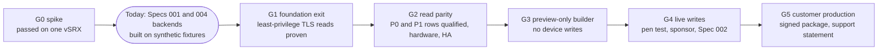

# Product charter and spike evidence

Status: living document. Owner: the project owner (Corey Robertson). Last reviewed 2026-11-24.
Changes to the goals, non-goals and principles below are owner decisions, recorded as ADRs in
[`docs/adr/`](adr/README.md).

J-Wicket is a spec-driven project to replace J-Web for customers who want to manage an SRX on the
firewall itself. It is a Junos-managed Python application with a browser UI that needs nothing from
the internet. It succeeds when an authorized operator can complete the same tasks as on J-Web for
SRX Series 24.4, with better tools for reviewing scope, explaining policy decisions and recovering
from changes.

**Stage: foundation, not installable on a production SRX.** One lab spike showed that Junos will
supervise an unsigned Python web UI and that the UI can read the device. None of J-Wicket's own
code has run on a device, and nothing in this repository has run on a customer platform; only the
spike daemon in [`docs/evidence/`](evidence/2026-11-23-vsrx-spike/README.md) ran, on one vSRX. The
project does not ask anyone to enable a listener, disable J-Web or change a firewall.

On this page:

1. [The problem and who it is for](#1-the-problem-and-who-it-is-for)
2. [What success means](#2-what-success-means)
3. [Principles](#3-principles)
4. [Goals and non-goals](#4-goals-and-non-goals)
5. [Spike evidence](#5-spike-evidence)
6. [From "a branch admin's normal week" to release-scoped parity](#6-from-a-branch-admins-normal-week-to-release-scoped-parity)
7. [Constraints](#7-constraints)
8. [Risks](#8-risks)
9. [Open questions for the owner](#9-open-questions-for-the-owner)
10. [Where the repository stands](#10-where-the-repository-stands)
11. [Sources](#11-sources)

Labels used on this page: **verified** means a cited source or the spike record says it.
**Inferred** means our reading of verified facts. **Unknown** means nobody has checked; the
qualification test that will settle it is named. Test IDs (`Q-...`) and gates (`G0`-`G5`) are
defined in [governance.md](governance.md).

## 1. The problem and who it is for

### The problem

J-Web is the SRX's built-in browser UI. Operators who manage the firewall on the box, rather than
from Security Director, Security Director Cloud or Mist, depend on it or on the CLI.

The owner's reason for the project is that J-Web is too thin for real work on the box: too little
of what an operator needs is there, or usable. What the J-Web 24.4 guide documents bears that out
in specific places (**verified**, [catalog, key findings](catalog.md#key-findings) and the
[parity ledger](parity/jweb-24.4.md)):

- Security policy and NAT rules are inline grid rows. There is no security-policy wizard, and of
  the four "workflow wizards" the guide names (Setup, Chassis Cluster, PPPoE, NAT), two have no
  documented steps.
- Six paths commit at once with no review step: History Rollback, Upload and Commit, CLI Editor
  Commit, Setup and Cluster wizard Finish, Skip Setup, and Add to Security Director Cloud. Upload
  and CLI Editor replace the whole configuration.
- No Monitor page lists live flow sessions; the dashboard widget shows active and maximum session
  counts.
- The Monitor > Logs grids have a manual Refresh and no live tail, and export at most 100 rows; the
  System log filter matches Event and Message with `=` only.

Separately, J-Web's security record gives customers a reason to turn it off. This is not why the
project exists, but it shapes what an alternative has to prove:

- Juniper published J-Web advisories every year from 2023 to 2026. Most were exploitable without
  signing in, and six were rated 9.8 by Juniper (CVSS 3.1): CVE-2023-36845, CVE-2024-21591 and the
  four October 2026 CVEs (CVE-2026-101954, -101956, -101983, -101986). NVD's own score also puts
  CVE-2023-28962 at 9.8, where Juniper scores it 5.3. Five 2023 CVEs
  (CVE-2023-36844, -36845, -36846, -36847, -36851) were added to CISA's Known Exploited
  Vulnerabilities catalog on 2023-11-13. **Verified** (CVE records from Juniper SIRT; CISA KEV
  feed; see [Sources](#11-sources)).
- For the 2023 and January 2024 J-Web advisories, Juniper's workaround was "Disable J-Web, or limit
  access to only trusted hosts" (CVE-2024-21620 adds "and users"). JSA73149 (CVE-2023-44182,
  October 2023), which also covers the CLI and NETCONF, states "There are no known workarounds for
  this issue." So do the October 2026 advisories (JSA112187, JSA112188). **Verified** (CVE
  records).
- A customer who follows that advice and has no central manager is left with the CLI.
  **Inferred.**

The project's premise, set by the owner, is that an on-box UI can also do more than reproduce
J-Web's forms: show the operator exactly what scope they are looking at, explain why a policy
decision comes out the way it does, and make every change easy to review and undo. That premise is
a product bet: the gaps above are documented, but that J-Wicket fills them better is not yet
measured. J-Web 24.4 already has a commit menu with
"Commit the changes with autorollback" ("Explore J-Web") and a Device Administration >
Configuration Management > History page (**verified**, J-Web 24.4 guide).

Replacing J-Web with new code on the routing engine does not reduce risk by itself. J-Wicket is
also a web server on the routing engine, and it has to earn trust through the security review
(Q-SEC-01) and an external penetration test (Q-SEC-02). See [Risks](#8-risks).

### Who it is for

| Audience | What they need from J-Wicket | When they can use it |
| --- | --- | --- |
| Customers who manage an SRX on the box (the destination) | The J-Web 24.4 tasks, done safely, with the login class they already have | Not before G5: signed package, support statement, HA and upgrade qualified |
| Systems engineers (SEs) and labs (first, while J-Wicket is unqualified) | Read-only look-ups and demos on lab devices | Now on synthetic fixtures (`make dev`); on a disposable lab vSRX only through [deploy-lab.md](deploy-lab.md) for qualification; real-lab use is a G2 exit criterion |
| Operators new to Junos (a rule that applies to every audience in this table) | To use each screen without knowing Junos: concepts explained where they appear, the matching Junos command alongside | A design rule from [ADR 0010](adr/0010-usable-without-knowing-junos.md) on; the explain-in-place layer is [Spec 005](specs/005-explain-junos-in-place.md) (Draft, not built) |
| Operators with restricted login classes (auditors, read-only staff) | To see exactly what Junos lets them see, with denied reads shown as denied | A design rule from Spec 001 on; proven on a device by Q-AUTH-03 (G1) |
| The named security reviewer and the qualification lab owner | Evidence they can check | G1 and G4 sign-off; certification of every `qualified` ledger row |

SEs and labs come first because J-Wicket is unqualified. That ordering is about risk, not about who
the product is for. Installing J-Wicket takes someone with Junos skills, an SE or an administrator,
once per device; J-Wicket does not remove that step ([ADR 0010](adr/0010-usable-without-knowing-junos.md)).

## 2. What success means

**Release-scoped parity.** An authorized operator can complete the same tasks as on the reference
release, J-Web for SRX Series 24.4. The [parity ledger](parity/README.md) lists one row per J-Web
page or operation, with its menu path, source URL, the Junos hierarchy it touches, J-Wicket status,
covering spec and priority ([ADR 0008](adr/0008-release-scoped-parity.md)). A row counts as done
only when its acceptance test passes on a qualified platform (status `qualified`). No platform is
qualified today, so no row can be `qualified` yet.

The size of the target is known. The J-Web User Guide for SRX Series Firewalls, release 24.4, has
six top-level menus (Dashboard, Monitor, Device Administration, Network, Security Policies &
Objects, Security Services), plus Getting Started (Setup Wizard) and "Add SRX Series Firewall to
Security Director Cloud". Its table of contents has 453 topics and its PDF has 1156 pages.
**Verified** (guide TOC and PDF).

**Better tools**, defined concretely so they can be tested:

| Goal | What it means in J-Wicket | Where it is specified |
| --- | --- | --- |
| Reviewing scope | Every screen states the device, its node and role in a cluster (the role waits on Q-HA-02), the logical system or tenant, the signed-in user, the time of the read, and any central manager detected ("also managed from"). Denied reads show as denied, never as empty. Exports carry the same stamp. | [Spec 001](specs/001-policy-inventory.md), [ADR 0004](adr/0004-no-sample-data.md), [ADR 0009](adr/0009-central-management-coexistence.md) |
| Explaining policy decisions | For a zone pair, the evaluation order: zone-pair policies, then the global policies that apply, then the default policy, with inactive rules shown as skipped and inherited rules shown with the group they came from. Flow-level answers come from the device's own lookup, not from a J-Wicket matcher. | [Spec 001](specs/001-policy-inventory.md), [ADR 0005](adr/0005-committed-config-with-provenance.md), [ADR 0006](adr/0006-device-explains-policy-decisions.md) |
| Usable without knowing Junos | Each Junos concept on a screen (for example zones, screens, host-inbound traffic, source and destination NAT, global and default policies) is explained where it appears, in plain words, with the matching Junos command alongside; log lines and states are decoded into sentences. Read-only. | [ADR 0010](adr/0010-usable-without-knowing-junos.md); [Spec 005](specs/005-explain-junos-in-place.md) (Draft) |
| Recovering from changes | Every change is a reviewed diff, committed with automatic rollback, attributed to the operator, refused in place when a configuration group owns the object, and acknowledged when a central manager also owns the device. | [Spec 002](specs/002-change-protocol.md) (specified, not built) |

**The owner's binding additions.** The UI must be as good to look at as it is to use. Log viewing
with syntax highlighting is a must. `show security flow session` output must be visible, with
powerful inline, live filtering. These are [Spec 004](specs/004-live-sessions-and-logs.md), and they
are read-only.

**How progress is measured:** ledger rows by status and priority
([jweb-24.4.md](parity/jweb-24.4.md)), gates passed ([governance.md](governance.md)), and, at G2,
SEs choosing J-Wicket over J-Web for look-ups on real labs (the spike report's own test for its
"See everything" phase).

## 3. Principles

| Principle | What it means in practice | Recorded in |
| --- | --- | --- |
| Read before write | Least-privilege, TLS-protected on-box reads are proven (G1) and read parity is reached (G2) before any live write path exists (G4). The first configuration wizard is preview-only (G3). | [governance.md](governance.md), README |
| Junos is the authority for identity, rights and configuration | Sign-in is delegated to Junos through a NETCONF session per operator; J-Wicket stores no password and has no roles of its own. Reads use the committed configuration with inheritance. The device, not J-Wicket, answers "which policy matches this flow". | [ADR 0002](adr/0002-junos-delegated-sign-in.md), [ADR 0005](adr/0005-committed-config-with-provenance.md), [ADR 0006](adr/0006-device-explains-policy-decisions.md) |
| Least privilege | Every read runs with the operator's own login class. The daemon's own account is used only by the loopback-only lab-token backend, which says so on every screen. Only allowlisted RPCs can be sent, and only the configuration subtrees a feature needs are read. | [ADR 0002](adr/0002-junos-delegated-sign-in.md), [`src/jwicket/junos/session.py`](../src/jwicket/junos/session.py) |
| Usable without knowing Junos | Every view and state can be used by an operator new to Junos. Junos is explained and shown, not hidden, so the operator learns the commands as they go. An explanation of Junos behaviour is sourced, or it is not shipped. | [ADR 0010](adr/0010-usable-without-knowing-junos.md) |
| No sample data | A panel shows device data or one of `denied`, `unsupported`, `failed`, `session-lost`. Fixture data appears only in the development server, under a banner. | [ADR 0004](adr/0004-no-sample-data.md) |
| Offline-capable, as ADR 0007 defines it | No runtime internet dependency: every asset comes from the device and the Content Security Policy allows only the device. It does **not** mean the UI works while the device is unreachable, and device data is never cached in the browser. Review away from the device uses explicit, stamped exports. | [ADR 0007](adr/0007-offline-capable-meaning.md) |
| One device only | J-Wicket manages the device it runs on and nothing else. Multi-device management belongs to Security Director, Security Director Cloud and Mist, which J-Wicket detects and treats as co-owners. | [ADR 0009](adr/0009-central-management-coexistence.md) |
| Every change reviewable and reversible | No direct writes. A change is a diff in a candidate configuration, committed with automatic rollback, with the operator named in the commit comment and the audit trail. | [Spec 002](specs/002-change-protocol.md) |

## 4. Goals and non-goals

### Goals

1. Parity with J-Web for SRX Series 24.4, tracked row by row in the [parity ledger](parity/README.md).
2. The three "better tools" in [section 2](#2-what-success-means), each with acceptance tests.
3. Read paths first: the scoped, read-only policy inventory (Spec 001) and live sessions and logs
   (Spec 004).
4. A preview-only Firewall Policy Builder ([Spec 003](specs/003-firewall-policy-builder.md)) with
   brownfield, group-ownership and recovery cases specified up front, before any live write.
5. A UI that operators prefer to J-Web: fast, legible, and clear about partial data.
6. Qualification evidence a security reviewer can check: recorded replies, test results per
   platform and release, and a published checksum for every build.

### Non-goals

| Non-goal | Why |
| --- | --- |
| Managing more than one device | Security Director, Security Director Cloud and Mist do this. Staying on one box keeps J-Wicket simple. (Spike report, "Never" row.) |
| A user database or roles of J-Wicket's own | Junos already has users, login classes, RADIUS and TACACS+ ([ADR 0002](adr/0002-junos-delegated-sign-in.md)). |
| A policy matcher that claims to be the device's answer | A confident wrong answer is the failure that matters ([ADR 0006](adr/0006-device-explains-policy-decisions.md)). A local evaluator may preview uncommitted rules in Spec 003, labelled as J-Wicket's model. |
| Keeping device data in the browser, or working while the device is unreachable | [ADR 0007](adr/0007-offline-capable-meaning.md). |
| A production installer, or asking anyone to open a listener, disable J-Web or change a production firewall, at this stage | Stage: foundation. Lab procedure only ([deploy-lab.md](deploy-lab.md)). |
| Live configuration writes before G4 | Read before write. |
| Junos-FIPS mode devices (proposed; owner approval pending) | J-Web itself is not supported there, and an unsigned app is the wrong fit. See [section 7](#junos-fips-mode). |
| Serving the device's other web-management functions (firewall web authentication, Juniper Secure Connect) (proposed; owner approval pending) | Those depend on Junos's own `web-management` service (**verified**, J-Web 24.4 guide). J-Wicket replaces the management UI only. |

Pages the spike report left out (long-term reporting, IDP, content security, advanced threat
features, software upgrade from the UI) are **not** non-goals under parity. Each is a ledger row
with a priority, or `replace` / `out-of-scope` with a reason the owner approves
([section 6](#6-from-a-branch-admins-normal-week-to-release-scoped-parity)).

## 5. Spike evidence

The spike ran on the night of 23 November 2026 (24 November UTC) in a Juniper vLabs sandbox: one
vSRX on Junos 24.4R2-S3.5, veriexec enforcing, wired to three vMX hosts. AWS was the first choice
but the account could not subscribe to the vSRX Marketplace listing. The packet is kept unedited in
[`docs/evidence/2026-11-23-vsrx-spike/`](evidence/2026-11-23-vsrx-spike/README.md). The daemon was
`wicket_spike.py`, a single file using the Python standard library and on-box PyEZ.

Short names for the two documents in the packet:
**report** = [spike report and product plan](evidence/2026-11-23-vsrx-spike/docs/J-Wicket-spike-report-and-product-plan.md);
**notebook** = [concept brief and lab notebook](evidence/2026-11-23-vsrx-spike/docs/Wicket-concept-brief-and-spike-plan.md).
Times are UTC on 2026-11-24, as the notebook records them.

### What the spike tested

The planned tests T0-T8 are in the notebook's [spike scope](evidence/2026-11-23-vsrx-spike/docs/Wicket-concept-brief-and-spike-plan.md#spike-scope).
T1, T2 and T5 were kill tests: a failure in any of them would have ended the on-box design.

| Test | Result | Evidence | What it did not prove |
| --- | --- | --- | --- |
| Pre-check: veriexec enforcing | `security.mac.veriexec.state: loaded active enforce` | [notebook, results](evidence/2026-11-23-vsrx-spike/docs/Wicket-concept-brief-and-spike-plan.md#spike-results-so-far) | That hardware behaves the same as this vSRX (Q-HW-01) |
| T0: interpreter and module probe | Partial. `http.server` imported: the script ran to its startup check. PyEZ was exercised later, by T5. Running Python directly from the shell was refused (`/usr/bin/python3: Operation not permitted`; the kernel logged a veriexec denial), as expected. | [notebook, results](evidence/2026-11-23-vsrx-spike/docs/Wicket-concept-brief-and-spike-plan.md#spike-results-so-far) | The Python version and the `ssl` module were not recorded. **Inferred:** Python is 3.7 or later, because the spike imports `http.server.ThreadingHTTPServer`, which first appeared in 3.7. Settled by Q-RT-01. |
| T1: runs as a Junos-supervised app | Pass. `jlaunchd` started it; `cscript` logged that an unsigned Python script was executed. In daemon mode (`daemonize`, no `arguments`) Junos started it at commit, launched as `cscript -mjet -Q3 -j -f wicket_spike.py -Jjcluser`. | [notebook, results and supervision](evidence/2026-11-23-vsrx-spike/docs/Wicket-concept-brief-and-spike-plan.md#spike-results-so-far), [`junos/baseline.set`](evidence/2026-11-23-vsrx-spike/junos/baseline.set) | That J-Wicket's own bundle runs the same way (Q-RT-02); whether an unsigned script may import sibling modules (Q-RT-03) |
| T2: binds a TCP port | Pass. `listening on 0.0.0.0:3000`, after `delete system services rest`, because vLabs forwards only ports 22, 443, 830 and 3000 and the REST API held 3000. Later moved to 8443. | [notebook, results](evidence/2026-11-23-vsrx-spike/docs/Wicket-concept-brief-and-spike-plan.md#spike-results-so-far) | Whether 8443 collides with the Junos REST API or web-management on a real box (Q-NET-02) |
| T3: reachable through the management port | Pass. Three of three requests from the internet returned `{"status": "ok"}` with `Server: wicket-spike/0.1`; `/api/version` without a token returned 401. | [notebook, results](evidence/2026-11-23-vsrx-spike/docs/Wicket-concept-brief-and-spike-plan.md#spike-results-so-far) | The path went through vLabs port forwarding, in clear text. Nothing about fxp0 on hardware (Q-NET-01) |
| T4: reachable through a revenue interface in a security zone | Pass. From a vMX host to ge-0/0/0 in zone `spike`: no host-inbound statement failed; `system-services all` did not admit the custom port; `any-service` did (too broad to ship). At 04:18, on TCP 8443 with only `system-services webapi-ssl` allowed, `/healthz` returned 200. | [notebook, results](evidence/2026-11-23-vsrx-spike/docs/Wicket-concept-brief-and-spike-plan.md#spike-results-so-far), [`junos/zone-access.set`](evidence/2026-11-23-vsrx-spike/junos/zone-access.set) | That host-inbound filtering is port-based in general: one observation on one release (**inferred**). Revenue ports on hardware. In the J-Web 24.4 guide's Table 1 (factory defaults, [topic-map/j-web-security-starting.html](https://networkingdocs.hpe.com/documentation/us/en/software/jweb-srx24.4/jweb-srx/topics/topic-map/j-web-security-starting.html)), SRX300 and SRX320 are managed through ge-0/0/1 to ge-0/0/6, and SRX340, SRX345 and SRX380 through MGMT/fxp0. That SRX300 and SRX320 have no dedicated management port at all is **inferred** from that table (Q-NET-01) |
| T5: reads device state from mgd | Pass. Two authenticated requests at 03:59 and 04:00 returned 200; mgd answered `get-software-information` over a local session as user `jcluser`, class `j-super-user`. | [notebook, results](evidence/2026-11-23-vsrx-spike/docs/Wicket-concept-brief-and-spike-plan.md#spike-results-so-far) | Any per-operator identity: every request ran with the daemon account's super-user rights (Q-AUTH-01, Q-AUTH-02, Q-AUTH-03) |
| T6: restart after a stop, a crash, a reboot | Pass for `kill` and `kill -9`, with `respawn-on-normal-exit`; without it a clean stop left the app down. Committing a change to the app's configuration restarted it. Reboot not tested. | [notebook, supervision](evidence/2026-11-23-vsrx-spike/docs/Wicket-concept-brief-and-spike-plan.md#spike-results-so-far) | Reboot (Q-RT-04) and Junos upgrade (Q-RT-05) |
| T7: idle and load footprint | Idle only: about 22 MB resident, 36 MB virtual. Load not run. | [notebook, supervision](evidence/2026-11-23-vsrx-spike/docs/Wicket-concept-brief-and-spike-plan.md#spike-results-so-far) | Load, routing-engine CPU and mgd impact (Q-LOAD-01); SRX300-class resources (Q-HW-01) |
| T8: TLS | Not run. The script supports TLS; it was never switched on. | [report, what is not proven](evidence/2026-11-23-vsrx-spike/docs/J-Wicket-spike-report-and-product-plan.md#what-is-not-proven) | Anything about on-box TLS (Q-TLS-01) |
| Browser UI served from the device | At 04:30 the daemon served a 13.7 KB read-only page with a restrictive Content-Security-Policy; `/api/dashboard` returned 401 without a token. | [notebook, results](evidence/2026-11-23-vsrx-spike/docs/Wicket-concept-brief-and-spike-plan.md#spike-results-so-far) | Which panels showed device data: the page fell back to rows tagged "sample data", and no one checked which. [`images/ui-preview-mock-data.png`](evidence/2026-11-23-vsrx-spike/images/ui-preview-mock-data.png) is rendered against stand-in data and is **not** a device screenshot. |

The design findings the spike produced are the report's five "What we learned" items
([report, what we learned](evidence/2026-11-23-vsrx-spike/docs/J-Wicket-spike-report-and-product-plan.md#what-we-learned)).
Other documents cite them as **spike findings F1 to F5**, in the report's order:

| Finding | What the report says |
| --- | --- |
| F1 | Junos cannot pass `--flag` options to a JET app: its script runner exits with "missing script filename". The product reads a settings file and takes no arguments |
| F2 | A clean shutdown is not restarted unless `respawn-on-normal-exit` is set |
| F3 | Host-inbound filtering is by port number: `webapi-ssl` alone admitted TCP 8443 (one observation; see the [note below](#notes-on-the-evidence)) |
| F4 | The app acts as one configured user: the `username` account and its login class |
| F5 | A daemonized app cannot be started by hand; remove `daemonize` to debug |

PyEZ also logs every RPC reply at INFO level (one of the report's "smaller notes"), so J-Wicket
turns that logger down.

### What the spike did not prove

The spike proved a mechanism on one virtual box. Each gap below has a qualification test or a
decision that settles it.

| Not proven | Settled by |
| --- | --- |
| Any SRX hardware, in particular the SRX300 class | Q-HW-01 |
| Any release other than 24.4R2-S3.5; reply formats on other releases | Q-REL-01 |
| The on-box Python version and modules (`ssl`, `paramiko`) | Q-RT-01 |
| J-Wicket's bundle as a daemonized app with no arguments; sibling-module imports; reboot; upgrade | Q-RT-02, Q-RT-03, Q-RT-04, Q-RT-05 |
| Per-operator sign-in; remote (RADIUS/TACACS+) users; least privilege; lockout behaviour | Q-AUTH-01, Q-AUTH-02, Q-AUTH-03, Q-AUTH-04 |
| TLS, and how a certificate gets onto the device | Q-TLS-01 |
| Reachability on hardware; the 8443 collision; SSH forwarding for lab access | Q-NET-01, Q-NET-02, Q-NET-03 |
| Load, session-table pull cost, log volume from polling | Q-LOAD-01, Q-LOAD-02, Q-LOAD-03 |
| Chassis cluster and Multinode High Availability | Q-HA-01, Q-HA-02, Q-HA-03 |
| Coexistence with Security Director, Security Director Cloud, Mist | Q-MGMT-01 |
| Where security logs are, per log mode and platform | Q-LOG-01 |
| Security of a hand-written web server on the routing engine | Q-SEC-01 (G1), Q-SEC-02 (G4) |
| Any configuration write | Spec 002 and its Q-CHG tests (G4) |
| Whether Juniper support and customers' security teams accept unsigned on-box Python | An owner and product decision, required at G4 and G5 |

The lab token crossed the internet in clear text during the spike and is treated as burned.

### Notes on the evidence

The packet is not edited. Corrections and clarifications are recorded here, dated.

- **2026-11-24. "Junos cannot pass `--flag` options to a JET app" is narrower than it reads.** The
  spike saw `cscript` fail with `error: missing script filename` when the `arguments` statement held
  double-dash options. Juniper's JET Developer Guide documents `arguments` with single-dash values
  (`arguments "-arg1 jet -arg2 application"`). Those were not tried. The design does not change:
  J-Wicket takes no arguments and reads a fixed settings file
  ([`src/jwicket/settings.py`](../src/jwicket/settings.py)).
- **2026-11-24. T0 was only partly recorded.** The report says every test that could have ended the
  idea passed. That holds for the kill tests (T1, T2, T5) and for T4. The probe's output, including
  the Python version and `ssl`, is not in the record.
- **2026-11-24. "Host-inbound filtering is by port number" is an inference** from one observation
  (`webapi-ssl` admitted TCP 8443 on 24.4R2-S3.5). It is likely, and it is what
  `junos/zone-access.set` relies on, but it is not a documented rule.
- **2026-11-24. The extension-service statements are documented.** The notebook marked `daemonize`,
  `respawn-on-normal-exit`, `username` and `arguments` as "Likely". The commit accepted them on
  24.4R2-S3.5, and Juniper's `file (JET)` statement page documents all four. That page also says an
  application with no `username` runs as user `nobody`.

## 6. From "a branch admin's normal week" to release-scoped parity

**What the spike report recommended.** "Matching J-Web screen for screen is the wrong goal." Its
target was "everything a branch firewall admin does in a normal week, done well, with every change
safe to undo" ([report, what fully featured should mean](evidence/2026-11-23-vsrx-spike/docs/J-Wicket-spike-report-and-product-plan.md#what-fully-featured-should-mean)).

**What the owner decided.** The bar is parity: an authorized operator can complete the same tasks as
on the reference J-Web release. [ADR 0008](adr/0008-release-scoped-parity.md) makes that testable.
The reference is one named release, J-Web for SRX Series 24.4, the release line the spike ran on.
Every page and operation is a ledger row. Moving the reference release is a governance decision,
recorded with a diff of the two ledgers.

**Why.** "Parity" without a named release and an itemised list cannot be tested and will drift. The
report's concern was real: J-Web is large. The ledger answers it by making the size visible and
ordering the work, rather than by declaring most of J-Web out of scope.

**How the spike's scope survives: as priority.** The report's phases map onto the ledger's priority
levels. The ledger ([`jweb-24.4.csv`](parity/jweb-24.4.csv)) holds the row-by-row assignments; this
table shows the intent.

| Spike report scope | Ledger priority |
| --- | --- |
| Phase 1, Foundation, and the "Secure" row: sign in with Junos accounts, per-user rights, TLS, audit trail | `P0` foundation and first slices, together with the read-only policy inventory (Spec 001) and live sessions and logs (Spec 004) |
| Phase 2, "See everything": dashboard, interfaces, zones, policies, NAT, VPN tunnels, live sessions, routes, alarms, recent logs | `P1` see everything, read-only |
| Phase 3, "Change safely": policies, address and application objects, NAT, zones, interface addressing, host-inbound services, static routes; diff, commit with automatic rollback | `P2` change safely |
| Phase 4, "Operate and set up": ping, traceroute, policy match test, restore earlier configurations, first-run guide | `P3` operate and set up |
| "Left out, and why": long-term reporting, IDP, content security and advanced threat features, software upgrades from the UI | `P4` later or maybe, or `replace` / `out-of-scope` with the reason, each pending owner approval |
| "Never": managing more than one device | A non-goal, unchanged |

What did not change: the order. Nothing writes to a firewall until sign-in, encryption and review
are done. The report's assumption that the first users are SEs and labs also stands, as an ordering
of risk.

What changed in the gates: the report made "the same tests pass on SRX300 hardware" the gate that
ends the spike phase. The current roadmap records G0 as passed on vSRX 24.4R2-S3.5 and carries the
hardware test forward as Q-HW-01, an exit criterion for G2 ([governance.md](governance.md)). Until
Q-HW-01 runs, nothing is known about SRX300-class hardware.

## 7. Constraints

These bound the product. Each is marked verified, inferred or unknown.

### Veriexec and unsigned Python

- Veriexec lets only fingerprinted executables run. Unsigned JET applications can only be written in
  Python, and need `set system scripts language python3`. **Verified** (Juniper veriexec overview
  and JET Developer Guide, as cited in the notebook; the spike's pre-check and T0 direct-run
  refusal).
- So: the Python standard library plus the PyEZ, ncclient and lxml that Junos ships. No
  third-party packages, no C extensions, no build step on the device
  ([ADR 0001](adr/0001-on-box-pure-python-single-file.md)). That rules out a websockets library or
  an async framework, so J-Wicket's live views poll.
- Juniper documents only "Python 3.x" for JET. Q-RT-01 recorded **Python 3.7.10** on Junos
  25.2R1-S1.4 (SRX4100), and the 26.2R1-S2.3 image carries 3.7 too
  ([evidence](evidence/2026-11-24-srx4100-lab/README.md)). Code stays Python 3.7-compatible; CI
  tests 3.7, 3.9, 3.11 and 3.13.
- Whether an unsigned script may import sibling `.py` files from `/var/db/scripts/jet/` is
  **unknown** (Q-RT-03). J-Wicket therefore ships as one generated file, `dist/jwicket.py`, built by
  [`tools/bundle.py`](../tools/bundle.py).
- `language python3` lets unsigned Python run on the routing engine. That is a change to the
  device's security posture in its own right, on a lab box as much as a production one.

### JET supervision

- The app is registered under `[edit system extensions extension-service application file ...]` with
  `daemonize`, `respawn-on-normal-exit` and `username`. **Verified** (spike baseline; Juniper
  `file (JET)` statement page).
- `respawn-on-normal-exit` is required, or a clean stop leaves the app down. Committing a change to
  the app's statements restarts it. A daemonized app cannot be started by hand; debugging means
  removing `daemonize` and running `request extension-service start`. **Verified** (spike).
- The app runs as the `username` account, or as `nobody` if none is set. A no-argument PyEZ
  `Device()` session inherits that account's login class. **Verified** (spike T5; Juniper statement
  page). This is why per-operator sign-in needs its own NETCONF session
  ([ADR 0002](adr/0002-junos-delegated-sign-in.md)), unproven until Q-AUTH-01.

### No flags to JET apps

- `--flag` options in the `arguments` statement made `cscript` exit (`missing script filename`,
  exit status 2, then "thrashing, not restarted"). **Verified** on 24.4R2-S3.5 for double-dash
  options; see the
  [note on the evidence](#notes-on-the-evidence) about single-dash arguments.
- J-Wicket takes no arguments under Junos and reads `/var/db/jwicket/jwicket.ini`. Every setting
  fails closed: a value that would weaken the listener stops the daemon at startup with a message
  naming the setting ([`src/jwicket/settings.py`](../src/jwicket/settings.py),
  [`src/jwicket/app.py`](../src/jwicket/app.py)).

### Junos-FIPS mode

- The J-Web 24.4 guide says: "The Junos-FIPS devices do not support web-management statement at
  [edit system services] hierarchy level ... Junos-FIPS mode does not support applications that
  depend on the web-management CLI such as J-Web, Firewall Authentication, and Juniper Secure
  Connect." **Verified** (J-Web 24.4 guide; the note appears in several topics, including "Access
  the J-Web User Interface" and the Setup Wizard, and is not in the 23.4 guide).
- What that implies for J-Wicket, **inferred**:
  - J-Wicket does not use `web-management`, so the restriction does not name it. That is a
    technicality, not a permission.
  - On a FIPS-mode device there is no J-Web to replace. The operator's organization has chosen a
    posture without on-box web management.
  - An unsigned, unevaluated web server on the routing engine is unlikely to be acceptable in a
    FIPS-evaluated configuration. Whether Junos-FIPS mode permits `system scripts language python3`
    or unsigned JET applications at all is **unknown**; no source has been read and no
    qualification test covers it.
  - J-Wicket must not be offered as a way to restore a web UI on FIPS-mode devices. The proposed
    position is a non-goal until a signed package exists and the platform's FIPS Evaluated
    Configuration Guide has been checked. Owner approval pending
    ([section 9](#9-open-questions-for-the-owner)).

### Chassis cluster and Multinode High Availability

- **Chassis cluster:** the node where redundancy group 0 (RG0) is primary has the active routing
  engine, and the other node's routing engine is the backup. Preemption cannot be enabled for RG0,
  so moving the primary role takes a manual failover. The configuration is shared: it is
  synchronized between the nodes over the control link on each commit, whichever node it is
  entered on, with per-node groups (`node0`, `node1`) giving each node its own fxp0 address.
  **Verified** (Juniper chassis cluster pages: redundancy groups; active/passive deployments).
- **Multinode High Availability (MNHA):** two firewalls "presenting themselves as independent
  nodes to the rest of the network". For logical and tenant systems, each node must have an
  identical configuration, and Juniper recommends keeping configuration in step with configuration
  groups and `commit peers-synchronize`. **Verified** (Juniper MNHA page; the identical-configuration
  sentence is in its logical and tenant systems section). Each node commits on its own: **inferred**.
- Junos script synchronization between routing engines covers commit, event, lib, op and SNMP
  scripts. JET is not listed. **Verified** (Juniper script synchronization page).
- What follows, **inferred**: J-Wicket's file must be placed and checked on each node by hand; each
  node runs its own J-Wicket; the UI must say which node it is on and that node's role; in a chassis
  cluster, changes belong on the RG0 primary; in MNHA, a change preview must say which node(s) it
  will be committed on. Settled by Q-HA-01 (script placement, serving node, RG0 failover), Q-HA-02
  (identify the local node) and Q-HA-03 (MNHA detection and behaviour). Today the code reads
  `get-chassis-cluster-status` but cannot yet tell which node is serving the page
  ([`src/jwicket/junos/facts.py`](../src/jwicket/junos/facts.py)).

### Central management by Security Director, Security Director Cloud and Mist

- J-Web 24.4 itself includes a flow to add the device to Security Director Cloud. **Verified** (J-Web
  24.4 guide).
- A change made on the box is an out-of-band change to any central manager. J-Wicket reads the
  `system services outbound-ssh` clients and shows them as "also managed from"; a future write flow
  must show the warning and record an acknowledgement
  ([ADR 0009](adr/0009-central-management-coexistence.md)).
- Detection is a heuristic. Management over plain inbound NETCONF leaves no trace in the
  configuration, so the banner says "detected", never "not managed". The exact signature of each
  manager is **unknown** until Q-MGMT-01.

## 8. Risks

| Risk | Why it matters | What the design does now | Settled or measured by |
| --- | --- | --- | --- |
| **Attack surface on the routing engine** | J-Web's 2023-2025 advisories show the failure classes: unauthenticated file upload and read (CVE-2023-28962, -28963, -36846, -36847, -36851), PHP environment manipulation leading to remote code execution (CVE-2023-36844, -36845), pre-authentication memory corruption (CVE-2024-21591), configuration left in temporary files (CVE-2024-21619), reflected XSS (CVE-2024-21620), XPath injection that reuses an administrator's session even after logout (CVE-2024-39565), a listener exposed on extra interfaces (CVE-2025-6549), and a privilege-model error shared by the CLI, NETCONF and J-Web (CVE-2023-44182). J-Wicket is a hand-written HTTP server in the same position, without a PSIRT behind it. | Default bind `127.0.0.1`; TLS required off loopback, no plaintext switch ([ADR 0003](adr/0003-tls-off-loopback.md)). Without a session, a client can fetch only the page, its static assets, `/healthz` and the session status, and can sign in; the only POST routes are sign-in and sign-out; there is no upload path ([`src/jwicket/api.py`](../src/jwicket/api.py)). Sign-out closes the web session and its device session on the server. Strict Content-Security-Policy with no inline script ([`src/jwicket/web/http.py`](../src/jwicket/web/http.py)). RPCs from an allowlist; RPC names are constants or come from a fixed list selected by a checked parameter, and configuration filters are constants. Delegating to Junos does not make J-Wicket immune to Junos's own bugs (CVE-2023-44182 touched NETCONF). | Q-SEC-01 at G1 (internal review against these classes); Q-SEC-02 at G4 (external penetration test). [SECURITY.md](../SECURITY.md) holds the threat summary. |
| **Small routing engines** | SRX300-class boxes have far less memory and CPU than the vSRX the spike used. A persistent Python process and one NETCONF session per signed-in operator compete with the control plane. If the class cannot run J-Wicket, the audience shrinks to vSRX and larger platforms. | One process; signed-in operators capped (`max_sessions`, default 4); sessions closed on idle and absolute timeouts; log tokenising and highlighting done in the browser. The spike daemon's idle footprint on vSRX was about 22 MB resident; J-Wicket's own is unmeasured. | Q-HW-01, Q-LOAD-01 |
| **Release drift** | Reply formats, field names, available RPCs and the Python version can differ by release. Every adapter today parses synthetic fixtures modelled on documentation, not recorded replies. | Tolerant parsers that match local names; unknown configuration listed, never dropped; release recorded in every snapshot; Python 3.7 floor in CI, matching the on-box Python recorded on 25.2. | Q-REL-01 (at least three releases, two platforms), Q-RT-01, Q-RT-05 |
| **Supportability of unsigned on-box code** | `language python3` permits unsigned Python on the device. How Juniper support (JTAC) and customers' security teams treat that is **unknown**; the spike report's next step to ask SRX product management is still open. Without a signed package and a support statement, J-Wicket cannot go to customers. | Lab-only procedure; a reproducible bundle with a SHA-256 per build; no production installation asked of anyone. | Owner and product decision at G4 (signed-package and support positions) and G5 (signed package, support statement) |
| **Polling cost, visible as `UI_NETCONF_CMD`** | Junos has a system log message, `UI_NETCONF_CMD`, for a user running a command through the NETCONF API, logged at info level to the authorization facility (**verified**, Juniper System Log Explorer). Each J-Wicket read is such a command, so each live poll adds lines to any syslog file that records authorization messages at info level (**inferred**), pushing real events out of rotated files sooner. A full session-table pull makes the data plane send every session to the routing engine and can drive routing-engine CPU to zero idle (a 2015 community-forum reply quoting the title of Juniper KB28956; the KB was not read). `show log` returns the whole file; there is no tail parameter (**verified**, XML API). | Live views poll: two RPCs per sessions poll, plus one unfiltered summary at most every 30 s when a filter is set; one `get-log` per log poll plus a sources refresh (a configuration read at most every 60 s, a software read at most every 10 minutes); default 5 s in the browser, server floor 1.5 s per endpoint per operator, also while the log sources cannot be read; a read waits at most 5 s for the operator's previous read, then gets 429 ([`src/jwicket/live.py`](../src/jwicket/live.py)). Rows are listed only when at most 5,000 sessions are known to match the request, filtered or not (`MAX_UNFILTERED`, [`src/jwicket/junos/sessions.py`](../src/jwicket/junos/sessions.py)); when the count is unknown nothing is listed ([architecture, gap 1](architecture.md#15-known-gaps-in-the-current-code), closed). The log viewer hides the operator's own J-Wicket reads by default and says why ([`src/jwicket/junos/logs.py`](../src/jwicket/junos/logs.py)). | Q-LOAD-02 (session pulls at 1k, 5k, 20k sessions; validates the 5,000 cap), Q-LOAD-03 (log volume from polling), Q-LOG-01 (where logs are per mode and platform) |
| **Credentials in process memory** | With per-operator sign-in, the operator's password passes through the J-Wicket process, as it does through J-Web. Python cannot guarantee it is wiped. Multi-factor prompts are not supported by this flow. | Never logged or written to disk. J-Wicket hands it to PyEZ at sign-in and keeps no copy of its own; PyEZ's `Device` object keeps it for the life of that operator's device session, which ends on sign-out or timeout ([ADR 0002](adr/0002-junos-delegated-sign-in.md), [`src/jwicket/junos/session.py`](../src/jwicket/junos/session.py)). | Q-AUTH-01, Q-AUTH-04, Q-SEC-01 |
| **Scope pressure from parity** | The J-Web 24.4 guide has 453 topics. Chasing them in menu order would delay the read paths and the change protocol that make the rest safe. | Priorities in the ledger; read before write; a row is done only when qualified. | Owner priority decisions ([governance.md](governance.md)) |

## 9. Open questions for the owner

The spike report ended with three questions that change the plan. Here they are again, with what
has been answered since.

1. **Who is this for?** The report asked: SEs and demos, or customers running production firewalls?
   *Answered in part.* The owner's framing names the destination: customers who want to manage an
   SRX on the box. SEs and labs come first while J-Wicket is unqualified. *Still open:* whether the
   project commits to reaching customers. That commitment needs the penetration test, a signed
   package and a support answer (G4, G5). Without it, the project can deliver read parity (G2) and
   the preview-only builder (G3) for SEs and labs and stop there.
2. **Which hardware matters?** *Open.* The report warned that if the SRX300 class cannot run
   J-Wicket, it becomes a vSRX and SRX1500-and-up tool. Since then: the hardware test has moved from
   the end of the spike phase to G2 (Q-HW-01); J-Web 24.4 documents its Session, Threats, Web
   Filtering, ATP, VPN and All Events log pages as unavailable on the SRX5000 line (**verified**,
   J-Web 24.4 guide), which shapes Spec 004 there (Q-LOG-01); chassis cluster and MNHA both need
   Q-HA-01 to Q-HA-03. *Decision needed:* the platform and release list the qualification lab must cover,
   and whether clusters and MNHA are required for G2 or can follow.
3. **Is this a side project or a proposal to the product team?** *Open.* Parity raises the stakes:
   J-Web parity includes configuration writes, and writes need a product sponsor (G4). A side
   project can stop at G3 with no device writes. A proposal needs a sponsor, a signing path inside
   Juniper engineering, and a support position before G4.

Also pending an owner decision, raised by this charter:

- Confirm Junos-FIPS mode devices as a non-goal for the unsigned app ([section 7](#junos-fips-mode)).
- Confirm that J-Wicket replaces the management UI only, not the firewall web-authentication or
  Juniper Secure Connect functions of `web-management` ([section 4](#non-goals)).

## 10. Where the repository stands

As of 2026-11-24. J-Wicket's own bundle has run on one device: the owner's lab SRX4100, Junos
25.2R1-S1.4 ([evidence](evidence/2026-11-24-srx4100-lab/README.md)). There it signed in a super-user operator over NETCONF and read
the policy inventory, the session table and a syslog file. Nothing in this repository has run on
a customer platform. The earlier spike daemon in
[`docs/evidence/`](evidence/2026-11-23-vsrx-spike/README.md) ran on one vSRX. All fixtures are
synthetic.

| Area | State | Evidence |
| --- | --- | --- |
| Spec 001, scoped read-only policy inventory | Backend built against synthetic fixtures: scope banner, zone-pair order, group provenance, denied reads, stamped JSON and CSV exports. The v2 Policies and Objects views are built and committed and have been exercised by hand on the development server; browser acceptance (AC-001-21) is not signed off | [`src/jwicket/junos/inventory.py`](../src/jwicket/junos/inventory.py), [`src/jwicket/api.py`](../src/jwicket/api.py), [`tests/test_inventory.py`](../tests/test_inventory.py) |
| Spec 004, live sessions and logs (read-only) | Backend and browser engines built against synthetic fixtures: filtered session lists with the 5,000 cap, syslog file tailing with a cursor, on-box report and event-buffer readers; browser-side highlighting and filtering. The Sessions and Logs views are built and committed and have been exercised by hand on the development server; browser acceptance (AC-004-20) is not signed off | [`src/jwicket/live.py`](../src/jwicket/live.py), [`src/jwicket/junos/sessions.py`](../src/jwicket/junos/sessions.py), [`src/jwicket/junos/logs.py`](../src/jwicket/junos/logs.py), [`tests/test_live.py`](../tests/test_live.py) |
| Sign-in | Per-operator NETCONF backend written. On a lab SRX4100 (25.2R1-S1.4) a super-user account signed in over NETCONF to loopback, and a wrong password was refused by Junos; the read-only-class half of Q-AUTH-01 has not run ([evidence](evidence/2026-11-24-srx4100-lab/README.md)). Loopback-only lab-token backend runs as the daemon's account and says so. | [`src/jwicket/auth/backends.py`](../src/jwicket/auth/backends.py), [`src/jwicket/junos/session.py`](../src/jwicket/junos/session.py) |
| Specs 002 and 003 | Documents only. There is no write path in the code. | [Spec 002](specs/002-change-protocol.md), [Spec 003](specs/003-firewall-policy-builder.md) |
| Bundle | CI builds `dist/jwicket.py` twice and fails if the builds differ, then runs the bundle's self-test isolated from the source tree. Started by Junos as a daemonized JET application on a lab SRX4100; self-test digest matched the build (Q-RT-02 partial). | [`tools/bundle.py`](../tools/bundle.py), [`.github/workflows/ci.yml`](../.github/workflows/ci.yml) |
| Tests | Unit and HTTP integration tests, all against synthetic fixtures. CI runs them on Python 3.7, 3.9, 3.11 and 3.13, and the Node tests (`tests/js/`) on Node 22, for every pull request and every push to `main`. Run `make test` and the Node command in [CONTRIBUTING.md](../CONTRIBUTING.md#set-up-and-run) rather than rely on a count here. | [`tests/`](../tests/), [`tests/fixtures/README.md`](../tests/fixtures/README.md) |
| Development server | Real server and UI on loopback, fed from fixtures, with a "fixture data" banner on every page | `make dev`, [`src/jwicket/devserver.py`](../src/jwicket/devserver.py) |
| Lab procedure | Written for a disposable vSRX. Run once, on 24 November 2026, on the owner's lab SRX4100 (hardware, Junos 25.2R1-S1.4), with deviations recorded: TLS on fxp0 through `mgmt_junos` instead of the SSH tunnel, which 25.2 refused | [deploy-lab.md](deploy-lab.md), [evidence](evidence/2026-11-24-srx4100-lab/README.md) |
| Qualification | On one lab SRX4100 (25.2R1-S1.4): Q-RT-01 passed; Q-RT-02, Q-AUTH-01, Q-TLS-01 and the fxp0 part of Q-NET-01 partial. The policy inventory, session table and `messages` log were read from the device as the signed-in operator. No recorded device replies exist (Q-REL-01). Nothing qualified; G1 not reached. | [governance.md](governance.md) |
| Parity ledger | Release 24.4 rows. No row is `implemented` or `qualified` yet: 38 Spec 001 and 004 rows pass their backend criteria on fixtures and are held at `specified` until their browser checks pass | [parity/README.md](parity/README.md), [summary](parity/jweb-24.4.md) |

The next deliverables are in [governance section 8](governance.md#8-what-ships-next): the UI v2
views, then the first lab qualification run on a disposable vSRX, then TLS. The spike report put
SRX300 hardware first; that test is now Q-HW-01 at G2.

## 11. Sources

Spike packet (unedited): [`docs/evidence/2026-11-23-vsrx-spike/`](evidence/2026-11-23-vsrx-spike/README.md).

Juniper documentation. `www.juniper.net/documentation/...` URLs now redirect (HTTP 301) to the same
path on `networkingdocs.hpe.com`.

- J-Web User Guide for SRX Series Firewalls, release 24.4:
  <https://networkingdocs.hpe.com/documentation/us/en/software/jweb-srx24.4/jweb-srx/>
  (PDF: <https://networkingdocs.hpe.com/documentation/us/en/software/jweb-srx24.4/jweb-srx/jweb-srx.pdf>;
  "Explore J-Web":
  <https://networkingdocs.hpe.com/documentation/us/en/software/jweb-srx24.4/jweb-srx/topics/topic-map/j-web-security-exploring.html>;
  add to Security Director Cloud:
  <https://networkingdocs.hpe.com/documentation/us/en/software/jweb-srx24.4/jweb-srx/topics/task/j-web-security-sd-cloud-device-adding.html>)
- `file (JET)` statement:
  <https://networkingdocs.hpe.com/documentation/us/en/software/junos/cli-reference/topics/ref/statement/file-edit-system-jet.html>
- JET Developer Guide (PDF):
  <https://networkingdocs.hpe.com/documentation/us/en/software/junos/jet-developer/jet-developer.pdf>
- Python scripts overview (Python 3 for JET from 20.2R1; Python 2.7 removed in 21.1R1):
  <https://networkingdocs.hpe.com/documentation/us/en/software/junos/automation-scripting/topics/concept/junos-script-automation-python-scripts-overview.html>
- Script synchronization between routing engines:
  <https://networkingdocs.hpe.com/documentation/us/en/software/junos/automation-scripting/topics/concept/junos-script-automation-script-synchronizing-routing-engines-overview.html>
- Chassis cluster redundancy groups:
  <https://networkingdocs.hpe.com/documentation/us/en/software/junos/chassis-cluster-security-devices/topics/topic-map/security-chassis-cluster-redundancy-groups.html>
- Multinode High Availability:
  <https://networkingdocs.hpe.com/documentation/us/en/software/junos/high-availability/topics/topic-map/mnha-introduction.html>
- System Log Explorer, `UI_NETCONF_CMD`:
  <https://apps.juniper.net/syslog-explorer/messageDetails?msg=UI_NETCONF_CMD>
- Session-table pull cost, community thread quoting KB28956 (KB itself behind the support portal):
  <https://community.networking.hpe.com/discussion/info-over-logs>

J-Web advisories. Juniper's JSA pages are a JavaScript application; the text was read from Juniper
SIRT's own CVE records at `https://cveawg.mitre.org/api/cve/<CVE-ID>`.

| Published | Advisory | CVEs |
| --- | --- | --- |
| 2023-04 | [JSA70587](https://supportportal.juniper.net/JSA70587) | CVE-2023-28962, CVE-2023-28963 |
| 2023-08, 2023-09 | [JSA72300](https://supportportal.juniper.net/JSA72300) | CVE-2023-36844, -36845, -36846, -36847, -36851 (all in CISA KEV, added 2023-11-13) |
| 2023-10 | [JSA73149](https://supportportal.juniper.net/JSA73149) | CVE-2023-44182 |
| 2024-01 | [JSA75729](https://supportportal.juniper.net/JSA75729) | CVE-2024-21591 |
| 2024-01 | [JSA76390](https://supportportal.juniper.net/JSA76390) | CVE-2024-21619, CVE-2024-21620 |
| 2024-07 | [JSA83023](https://supportportal.juniper.net/JSA83023) | CVE-2024-39565 |
| 2025-07 | [JSA100098](https://supportportal.juniper.net/JSA100098) | CVE-2025-6549 |
| 2026-04 | [JSA107823](https://supportportal.juniper.net/JSA107823) | CVE-2026-33779 (certificate validation for traffic to Security Director Cloud, J-Web component) |
| 2026-10 | [JSA112187](https://supportportal.juniper.net/JSA112187), [JSA112188](https://supportportal.juniper.net/JSA112188) | CVE-2026-101954, -101983, -101986, -101956 (IDs as the CVE API returns them); no known workaround |

CISA Known Exploited Vulnerabilities feed:
<https://www.cisa.gov/sites/default/files/feeds/known_exploited_vulnerabilities.json>
