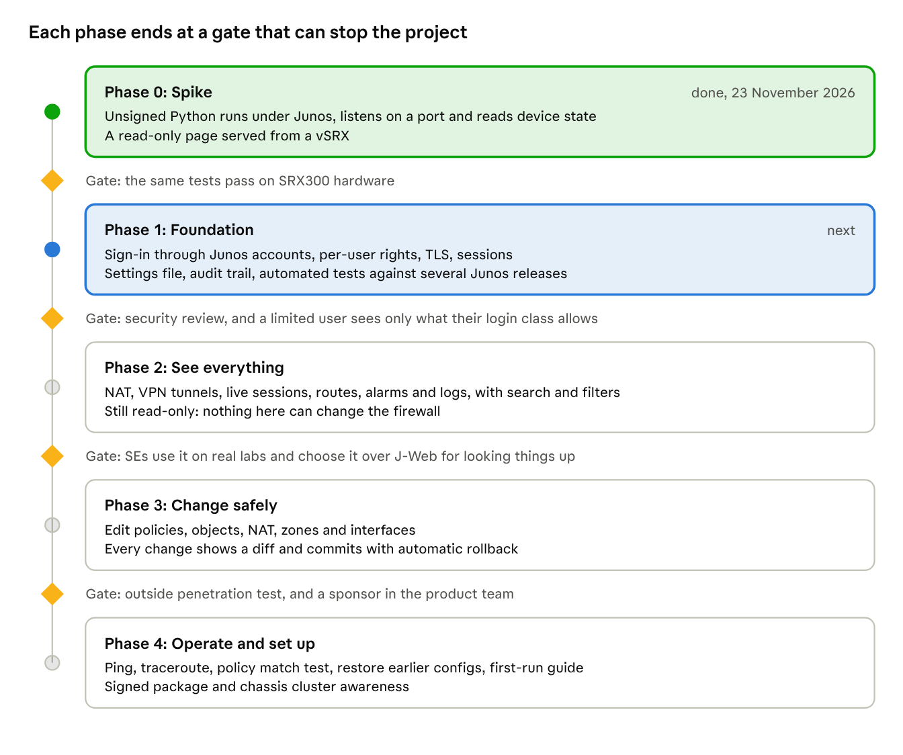

# J-Wicket: spike report and product plan

Nov 23, 2026 · Corey Robertson

Live version: https://claude.ai/artifact/Q1AdLJ8vubuxkGS5WsWzqJ

J-Wicket works. On the night of 23 November 2026, an unsigned Python app ran on a vSRX with veriexec enforcing, supervised by Junos, and served a live web UI built from the device's own state. Every test that could have ended the idea passed. The plan below turns that into a usable product in five phases, and argues that "fully featured" should mean the daily tasks of a branch firewall admin, not parity with J-Web.

## What we tested

The question was whether a web UI can run on the SRX itself, in place of J-Web, without signed code. The answer is yes on a virtual SRX, with one platform still to test.

The lab was a Juniper vLabs sandbox: one vSRX on Junos 24.4R2-S3.5, wired to three vMX hosts. AWS was the first choice, but the account could not subscribe to the vSRX Marketplace listing, so nothing was built there.

| Test | Result | What we saw |
| --- | --- | --- |
| Veriexec is enforcing | Yes | `security.mac.veriexec.state: loaded active enforce` |
| Junos runs unsigned Python as a managed app | Pass | `jlaunchd` started it; `cscript` logged that an unsigned Python script was executed |
| The app can listen on a TCP port | Pass | `listening on 0.0.0.0:3000` |
| Reachable through the management port (fxp0) | Pass | Requests from the internet returned 200 from `wicket-spike/0.1` |
| Reachable through a revenue port in a security zone | Pass | From a vMX host to ge-0/0/0 in zone `spike`, with one named host-inbound service |
| The app can read device state from mgd | Pass | Hostname, model and Junos version returned as JSON |
| Junos restarts it after a stop or a crash | Pass | New process within seconds after `kill` and `kill -9` |
| A browser UI served from the device | Pass | Single page, read-only, live data, about 14 KB |
| Memory use when idle | About 22 MB | Resident size of the `cscript` process |
| Running Python directly from the shell | Blocked, as expected | `Operation not permitted`; the kernel logged a veriexec denial |
| TLS, load, reboot survival | Not run | See "What is not proven" |

The full command-by-command record is in the lab notebook, [Wicket: concept brief and vSRX spike plan](Wicket-concept-brief-and-spike-plan.md).

## How it works

J-Wicket is one Python file that Junos launches and supervises. It needs no database, no second service and nothing off the box.

- **One process.** Junos starts `wicket_spike.py` through its own script runner (`cscript`) as a JET application and restarts it if it stops.
- **A small web server.** The file uses only Python's standard library to listen on a TCP port. It serves the page, a health check and a JSON API.
- **A local line to mgd.** For device state it uses the PyEZ library that ships with Junos, opening a local session and calling ordinary RPCs. The UI reads operational state (interfaces, sessions, routing engine) and the configuration as JSON (zones, policies, services).
- **The page itself.** A single self-contained HTML file embedded in the Python file: no external scripts, fonts or images. It asks for a token, then polls the API every 15 seconds.
- **Settings in a file.** Options are read from `/var/tmp/wicket.args`, because Junos cannot pass them on the command line.

The Junos configuration that runs it:

```
set system scripts language python3
set system extensions extension-service application file wicket_spike.py daemonize
set system extensions extension-service application file wicket_spike.py respawn-on-normal-exit
set system extensions extension-service application file wicket_spike.py username jcluser
```

To allow it through a security zone on port 8443, one more line:

```
set security zones security-zone <zone> host-inbound-traffic system-services webapi-ssl
```

## What we learned

Five platform behaviors were not in any document I read beforehand. Each one changes the design.

1. **Junos cannot pass `--flag` options to a JET app.** Its script runner tries to parse them itself and exits with "missing script filename". The product must read a config file and take no arguments.
2. **A polite shutdown is not restarted by default.** Without `respawn-on-normal-exit`, a plain `kill` left the app down. With it, Junos restarted the app after both a clean stop and a hard kill.
3. **Host-inbound filtering is by port number.** `system-services all` did not admit a custom port. `any-service` did, but opens every port on the routing engine. Binding to 8443 and allowing only `webapi-ssl` worked, which gives a one-line, least-privilege zone setting.
4. **The app acts as one configured user.** The local session to mgd opened as the user named in the `username` statement, with that user's login class. Every web user would share those rights unless the product authenticates people itself.
5. **A daemonized app cannot be started by hand.** To debug, remove `daemonize` and use `request extension-service start`, which prints errors to the terminal.

Two smaller notes. PyEZ writes every RPC reply to the log at INFO level, so that logger must be turned down. And macOS needs `scp -O` to copy files to this vSRX, because SFTP is off by default.

## What is not proven

The spike proved the mechanism on one virtual box. It did not prove a product, and the gaps below are real.

- **No hardware.** Nothing ran on an SRX300-class device. Those have far less memory and CPU, and I have not confirmed they ship the same Python and JET runtime. This is the largest open risk.
- **One release.** Everything is from Junos 24.4R2-S3.5. The XML and JSON field names the UI reads may differ on other releases.
- **No real authentication.** Access was a single shared token, and during the test it crossed the internet unencrypted. Every request ran with super-user rights.
- **No TLS.** The script supports it, but it was never switched on, so the on-box `ssl` module is untested.
- **Read-only.** Nothing wrote configuration. The whole change path (lock, diff, commit confirmed, rollback) is still to design.
- **UI panels unverified one by one.** The page falls back to rows tagged "sample data" when a panel cannot read its source. Which panels showed live data has not been checked against a screenshot.
- **No load, reboot or upgrade test.** Behavior under many requests, across a restart, and across a Junos upgrade is unknown.
- **No chassis cluster.**
- **No security review.** A hand-written web server on a firewall's routing engine is exactly the kind of surface that made J-Web a liability.
- **Support status unknown.** `language python3` permits unsigned Python on the device. How JTAC and customers' security teams treat that has not been asked.

## What fully featured should mean

Matching J-Web screen for screen is the wrong goal. J-Web has hundreds of screens, most of them rarely opened, and chasing them would take years and reproduce what people dislike about it. The target I recommend is narrower: everything a branch firewall admin does in a normal week, done well, with every change safe to undo.

| Area | In scope | Left out, and why |
| --- | --- | --- |
| See | Dashboard, interfaces, zones, policies, NAT, VPN tunnels, live sessions, routes, alarms and recent logs | Long-term reporting and analytics: needs storage the device should not spend |
| Change | Security policies, address and application objects, NAT rules, zones, interface addressing, host-inbound services, static routes | IDP, content security and advanced threat features: large, licensed, and better served by central management |
| Operate | Review a diff, commit with automatic rollback, browse and restore earlier configs, ping and traceroute, "which policy would match this flow" | Software upgrades from the UI: high blast radius, add only after everything else is trusted |
| Set up | A first-run guide for a new device: addresses, zones, internet access, admin user | Zero-touch provisioning: already exists elsewhere |
| Secure | Sign in with Junos accounts, per-user rights, TLS, audit trail | Its own user database: Junos already has one |
| Never | | Managing more than one device. That is Security Director and Mist territory, and it is what makes an on-box tool simple |

Assumptions behind this scope, still unconfirmed: the first users are SEs and lab or demo environments, the target hardware is the SRX300 class plus vSRX, and chassis clusters come late.

## Roadmap

Five phases, in an order chosen so that nothing can change a firewall until sign-in, encryption and review are done. I have not put dates on it: the pace depends on whether this stays a side project, which is one of the open questions at the end.



| Phase | What ships | Gate that ends it |
| --- | --- | --- |
| 0. Spike (done, 23 November 2026) | Unsigned Python runs under Junos, listens on a port and reads device state. A read-only page served from a vSRX. | The same tests pass on SRX300 hardware |
| 1. Foundation (next) | Sign-in through Junos accounts, per-user rights, TLS, sessions. Settings file, audit trail, automated tests against several Junos releases. | Security review, and a limited user sees only what their login class allows |
| 2. See everything | NAT, VPN tunnels, live sessions, routes, alarms and logs, with search and filters. Still read-only. | SEs use it on real labs and choose it over J-Web for looking things up |
| 3. Change safely | Edit policies, objects, NAT, zones and interfaces. Every change shows a diff and commits with automatic rollback. | Outside penetration test, and a sponsor in the product team |
| 4. Operate and set up | Ping, traceroute, policy match test, restore earlier configs, first-run guide. Signed package and chassis cluster awareness. | |

Phases 1 and 2 are safe to build as a side project, because the tool stays read-only. Phase 3 is where it starts writing firewall configuration, and it should not begin without the penetration test and a sponsor. If the hardware gate after phase 0 fails, the project continues only for vSRX and larger platforms.

## The hard problems

Authentication is the hardest and comes first, because every later feature inherits whatever it decides. The recommendations below are design proposals. None has been tested on a device yet.

| Problem | Recommendation | Test this first |
| --- | --- | --- |
| Sign-in and per-user rights | Let Junos do it. At sign-in, open a NETCONF session to the device's own address as that user, with their password. Junos checks the password (local, RADIUS or TACACS+), and every action then runs with that user's login class. J-Wicket stores no passwords and invents no roles. | Can on-box Python open a NETCONF session to localhost with a username and password? The library is present (`ncclient` appeared in the logs). |
| TLS | Generate a key and self-signed certificate on first start, as J-Web does, and let an admin supply their own. | Does the on-box `ssl` module load, and can a key be generated without calling an outside program? |
| Port and privilege | Ship on 8443 with `webapi-ssl`, port configurable. | Does 8443 collide with Juniper's own web API when that is enabled? Is port 443 reachable at all for an app that is not root? |
| Safe changes | Every change goes into a candidate config, shows a diff, and commits with automatic rollback and a visible countdown. The commit comment names the web user. No direct writes, ever. | Lock contention with someone in the CLI. A change that cuts the UI's own access path, which the rollback timer should rescue. |
| Web security | Session cookies, CSRF protection, sign-in rate limits, strict content policy (already in place), nothing sensitive in logs. An outside penetration test before anyone beyond the team uses it. | Review the current server against the J-Web advisories of 2023. |
| Small hardware | One process, a capped number of signed-in users, sessions that close when idle. | Memory and CPU on an SRX300 with the UI open and refreshing. |
| Release differences | One adapter per data source, tested against recorded replies from at least three Junos releases. | Capture the RPC replies the UI uses from two more releases. |
| Packaging and upgrades | Today: one file and four config lines. Later: a signed JET package, which lifts the pure-Python limit and should survive upgrades. | Whether a signing path exists for this project inside Juniper engineering. |
| A growing front end | Keep the server pure Python. Add a small build step that produces static files once the page count passes what one file can hold. | Flash space on the smallest target device. |

## Next steps

The next three tests decide the shape of everything after them: hardware, sign-in through Junos, and TLS.

- [ ] Screenshot the live UI and note which panels show real data and which are tagged "sample data"
- [ ] Put `wicket_spike.py` and both documents in a private repository before the sandbox expires
- [ ] Find an SRX300, SRX320 or SRX345 and repeat the spike on it
- [ ] Test sign-in through a local NETCONF session, with a non-super-user account
- [ ] Test TLS on the device
- [ ] Ask SRX product management how they view unsigned on-box Python, and whether a signing path exists
- [ ] Treat the lab token as burned; generate a new one for any further test

Three questions only Corey can answer, each of which changes the plan:

1. **Who is this for?** SEs and demos, or customers running production firewalls? The second needs the penetration test, the signed package and a support answer before anyone installs it.
2. **Which hardware matters?** If the SRX300 class cannot run it, the project becomes a vSRX and SRX1500-and-up tool, which is a much smaller audience.
3. **Is this a side project or a proposal to the product team?** A side project can ship phase 2 and stop. A product needs a sponsor before phase 3, because writing firewall config from unsupported code is where the risk becomes real.

## Sources

- Lab notebook: [Wicket: concept brief and vSRX spike plan](Wicket-concept-brief-and-spike-plan.md)
- [Develop on-device JET applications](https://juniper.net/documentation/us/en/software/junos/jet-developer/topics/topic-map/jet-on-device-applications.html), Juniper
- [Veriexec overview](https://www.juniper.net/documentation/us/en/software/junos/junos-install-upgrade/topics/concept/veriexec.html), Juniper
- [Rapid7 analysis of the 2023 J-Web vulnerability chain](https://www.rapid7.com/blog/post/ra-cve-2023-36844-analysis/)
