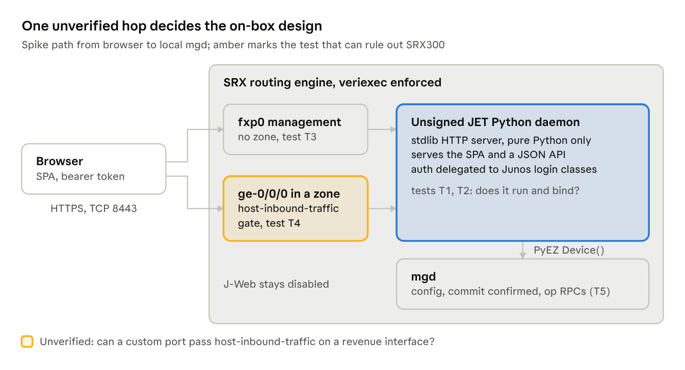

# Wicket: concept brief and vSRX spike plan

Nov 23, 2026 · Corey Robertson

Live version: https://claude.ai/artifact/93quaNnfG8cqDCjNV8sKeJ

This is the lab notebook. It was written before the spike and updated as each test ran, so earlier sections describe the plan (including an AWS lab that was never built) and "Spike results so far" records what happened. For the finished account, read the spike report.

## Summary

Wicket is a small web UI that runs on the SRX itself, beside a disabled J-Web, and covers a handful of daily workflows. It cannot be a drop-in J-Web replacement: veriexec blocks unsigned binaries, so the only on-box runtime open to us is pure Python under JET.

The spike answers one question. Can an unsigned Python JET daemon listen on a TCP port, be reached from a browser through both fxp0 and a revenue interface, and call local mgd RPCs? If yes, the on-box design is viable. If no, the product moves off-box.

Working assumptions, not yet confirmed by Corey:

- Lab and demo use first, not a customer-shippable product.
- Targets are vSRX and SRX300-class boxes. No chassis cluster in phase 1.
- First workflows: security policy view and edit, NAT, VPN status, session view, commit confirmed with diff.
- Wicket is the codename: the small door set inside a larger gate. It replaces the earlier working title, SRX Essentials.

## Verified vs unverified

The docs confirm the runtime exists. They say nothing about whether it can serve inbound network traffic, which is the whole design.

| Claim | Status | Basis or how to settle |
| --- | --- | --- |
| Veriexec lets only fingerprinted executables run | Verified | [Veriexec overview](https://www.juniper.net/documentation/us/en/software/junos/junos-install-upgrade/topics/concept/veriexec.html) |
| Unsigned JET apps must be Python; C/C++ needs a signed package | Verified | [On-device JET applications](https://juniper.net/documentation/us/en/software/junos/jet-developer/topics/topic-map/jet-on-device-applications.html) (read in full) |
| Unsigned Python needs `set system scripts language python3`; Python 2.7 is gone since 21.1R1 | Verified | Same page |
| JET scripts live in `/var/db/scripts/jet/` | Verified | Same page |
| On-box PyEZ reaches local mgd with `Device()` and no arguments | Verified | [RPCs in event scripts](https://www.juniper.net/documentation/us/en/software/junos/automation-scripting/topics/concept/automation-using-rpcs-and-operational-mode-commands-in-event-scripts.html) |
| `extension-service application file X daemonize`, `respawn-on-normal-exit`, `username`, `arguments` | Likely | Seen in a public [JET app repo](https://github.com/kazubu/jet_v6mig_autoconfig), not in the Juniper page I read. Confirm with `?` in the CLI. |
| REST API listens on 3000 (HTTP) and 3443 (HTTPS) | Verified | [Configuring the REST API](https://www.juniper.net/documentation/us/en/software/junos/rest-api/topics/task/rest-api-configuring.html) |
| A JET daemon can bind a listening TCP socket | Unverified | Spike test T2 |
| That socket is reachable through a zone with `host-inbound-traffic` | Unverified | Spike test T4. Make-or-break for SRX300, which has no fxp0. |
| On-box Python 3 ships `http.server` and `ssl` | Unverified | Spike test T0 (`--probe`) |
| vSRX 3.0 on AWS enforces veriexec the same way hardware SRX does | Unverified | Check `sysctl security.mac.veriexec.state` on the instance |
| REST API offers CORS for a browser SPA | Unverified | No CORS statement found. Not needed if the daemon serves the SPA itself. |
| Script and daemon survive a Junos upgrade and sync across a chassis cluster | Unverified | Out of spike scope; phase 2 |

## Architecture

The design is one Python process on the routing engine that serves the SPA and translates JSON calls into local mgd RPCs. There is no second service, no database and no off-box dependency.



A browser reaches the daemon through fxp0 or through a revenue interface. The fxp0 path only has to clear the AWS security group. The revenue path also has to clear `host-inbound-traffic`, which lists named services and may not admit a custom port. The daemon then calls mgd through on-box PyEZ, so every change is an ordinary Junos commit with commit confirmed and rollback.

## Spike scope

Nine tests, run in order, each with a binary result. T1, T2 and T5 are kill tests: one failure ends the on-box design. The daemon is `wicket_spike.py` (stdlib plus on-box PyEZ, about 230 lines). It exposes `/healthz` without auth and `/api/version` behind a bearer token.

| ID | Test | Pass means | If it fails |
| --- | --- | --- | --- |
| T0 | Run `--probe` as an op-style invocation | `http.server`, `ssl`, `jnpr.junos`, `lxml` all import; Python is 3.7 or later | Missing `ssl`: TLS must come from elsewhere. Missing `http.server`: write a raw socket server or stop. |
| T1 | Start as a JET daemon via `extension-service application` | Process stays up, visible in `show system processes` | Kill. No daemon, no product. |
| T2 | Daemon binds TCP 8443 | Log shows `listening on`; no `cannot bind` error | Kill. Record the errno. |
| T3 | `curl /healthz` to the fxp0 Elastic IP | HTTP 200 from outside the VPC | Check security group, then any lo0 filter. |
| T4 | `curl /healthz` to the ge-0/0/0 address, zone with `host-inbound-traffic` | HTTP 200. Record which statement was needed. | On-box works for fxp0 platforms only. SRX300-class is out. |
| T5 | `curl /api/version` with the token | JSON with hostname, model, version from local mgd | Kill. Record the PyEZ exception. |
| T6 | `kill` the process, then reboot the instance | Daemon respawns both times without operator action | Needs an event-script watchdog. Not fatal. |
| T7 | Idle and 10 requests/s for 5 minutes | Record RSS and CPU of the Python process and RE load | Sets the floor for SRX300 sizing. Not fatal on vSRX. |
| T8 | Restart with `--cert` and `--key` | TLS 1.2+ handshake succeeds | Ties to T0 `ssl` result. |

T4 has three variants to try, in this order, so we learn the narrowest setting that works: no host-inbound statement, `system-services any-service`, then `system-services all`. If none works, look at flow traces before giving up.

What the spike does not cover: authentication against Junos login classes, any config write, the SPA, chassis cluster, hardware SRX. Those are design work that only matters if the kill tests pass.

## Spike results so far

The on-box mechanism works: on 2026-11-24 an unsigned Python JET app bound TCP 3000 on a veriexec-enforcing vSRX and answered HTTP requests from the internet. The lab is a Juniper vLabs sandbox (vSRX, Junos 24.4R2-S3.5), used after AWS Marketplace refused the subscription.

| Test | Result | Evidence |
| --- | --- | --- |
| Pre-check: veriexec | Enforced | `security.mac.veriexec.state: loaded active enforce` |
| T0 imports | Pass for `http.server`; `ssl` and PyEZ not yet exercised | Script ran to its own startup check |
| T0 direct run from shell | Refused, as expected | `/usr/bin/python3: Operation not permitted`; kernel logged `MAC/veriexec: attempted direct execution` |
| T1 runs under Junos | Pass in foreground; daemon mode still to re-test | `jlaunchd` started it; `cscript` logged "unsigned python script ... is executed" |
| T2 binds a TCP port | Pass | `listening on 0.0.0.0:3000` |
| T3 reachable through fxp0 | Pass | Three of three external requests returned `{"status": "ok"}` with `Server: wicket-spike/0.1`; `/api/version` without a token returned 401 |
| T4 revenue interface | Pass, with a broad setting | 04:15 UTC: from Host1 (vMX, 10.99.0.2) to vSRX ge-0/0/0 (10.99.0.1, zone spike), TCP 3000 connected and /healthz returned 200. Needed host-inbound-traffic system-services any-service; no host-inbound setting failed |
| T5 local mgd RPC | Pass | Two authenticated requests returned 200 at 03:59 and 04:00 UTC; mgd replied with software-information over a local session as user jcluser, class j-super-user |

Findings that change the design:

- **Junos cannot pass `--flag` options to a JET app.** `cscript` tries to parse them itself and fails with `error: missing script filename` (exit status 2, then "thrashing, not restarted"). The daemon now reads its options from `/var/tmp/wicket.args`. The product should read a config file and take no arguments.
- **A daemonized app cannot be started by hand.** `request extension-service start` returns "Can't start daemonize app". Remove `daemonize` to debug in the foreground, where stderr prints to the terminal.
- **The `extension-service application file ... daemonize / username / arguments` statements are valid** on 24.4R2-S3.5. The commit accepted all of them.
- **vLabs forwards only 22, 443, 830 and 3000 to the vSRX**, and the lab ships with the REST API on 3000. Wicket took over port 3000 after `delete system services rest`.
- **Juniper ships its own JET Python apps** in `/var/db/scripts/jet/` (`nc_grpc_app`, `bps_device_monitor`).

All three kill tests (T1, T2, T5) have now passed, so the on-box design survives. T4 decides whether it reaches SRX300-class hardware.

Further findings from T5:

- **The daemon's RPC rights are those of the configured `username`.** The local session opened as jcluser with class j-super-user. Per-user authorization in the product cannot come from this alone; it needs its own design.
- **PyEZ logs every RPC reply at INFO level** through ncclient. The daemon must set that logger to WARNING, or the log fills with device data.
- **Small fixes owed in the spike script:** end JSON responses with a newline, and accept a trailing slash on paths.

Daemon supervision (T1 and T6), tested at 04:05 to 04:09 UTC:

- **Daemon mode works.** With `daemonize` and no `arguments` statement, Junos started the app at commit and it answered external requests with no terminal attached.
- **`respawn-on-normal-exit` is required.** Without it, a plain `kill` (clean shutdown) left the daemon down and port 3000 closed. With it, Junos restarted the daemon within seconds after both `kill` and `kill -9`.
- **Committing a change to the app's config restarts it.** Adding the respawn statement relaunched the daemon without a manual start.
- **Idle footprint is about 22 MB resident** (36 MB virtual), launched as `cscript -mjet -Q3 -j -f wicket_spike.py -Jjcluser`.
- **Not tested:** survival across a reboot, and load (T7).

Baseline config that works on 24.4R2-S3.5:

```
set system scripts language python3
set system extensions extension-service application file wicket_spike.py daemonize
set system extensions extension-service application file wicket_spike.py respawn-on-normal-exit
set system extensions extension-service application file wicket_spike.py username jcluser
```

Revenue-interface access (T4):

- **A custom port is reachable through a security zone**, so the design is not limited to fxp0 platforms.
- **`any-service` is too broad to ship.** It opens every routing-engine port to the zone. The `system-services all` setting does not admit port 3000 (confirmed by Corey), so it covers only Junos's named services.
- **Open experiment:** bind Wicket to the port of a named host-inbound service (for example `webapi-ssl`) and allow only that service. If the filter is port-based, that gives a one-line least-privilege zone config.

Named-port result, 04:18 UTC: with Wicket moved to TCP 8443 and the zone set to `host-inbound-traffic system-services webapi-ssl`, Host1 connected and `/healthz` returned 200 from `wicket-spike/0.1`. Host-inbound filtering is therefore port-based, not tied to the Junos service itself, and Wicket can ship with a one-line least-privilege zone setting. Confirmed: the zone config output shows `webapi-ssl` as the only service allowed, on interface ge-0/0/0.0.

Follow-up question: the same approach on TCP 443 with `system-services https` would put Wicket in J-Web's own slot, but an unprivileged daemon cannot bind a port below 1024.

First UI, 04:30 UTC: the daemon now serves a single-page, read-only interface (working name J-Wicket) from the vSRX itself. An external request to `/` returned 200 with the 13.7 KB page and a restrictive Content-Security-Policy, and `/api/dashboard` returned 401 without a token. The page shows a zone-to-zone policy grid, device facts, interfaces, host-inbound services per zone and the policy table, read from local mgd through operational RPCs and the JSON configuration. Panels that cannot read their data fall back to rows tagged "sample data". Which panels show real data on this release still needs confirming from a screenshot.

## vSRX on AWS lab setup

Planned but never built: the AWS account could not subscribe to the vSRX Marketplace listing, so the spike ran in Juniper vLabs. Kept here for a future run.

One throwaway vSRX with two ENIs is enough: fxp0 for T3 and one revenue interface for T4. Build it in its own VPC with no peering, so nothing here can touch a real network.

1. Launch vSRX from AWS Marketplace into a new VPC. Take the instance type from the supported list in the [vSRX on AWS guide](https://www.juniper.net/documentation/us/en/software/vsrx/vsrx-aws/vsrx-aws.pdf). I recall c5.large as the smallest, but have not confirmed it for current releases.
2. Subnet A (management): first ENI, which Junos maps to fxp0. Attach an Elastic IP.
3. Subnet B (revenue): second ENI, which maps to ge-0/0/0. Attach a second Elastic IP for T4.
4. Security groups on both ENIs: TCP 22 and TCP 8443 from your own /32 only. Nothing from 0.0.0.0/0.
5. Record the Junos release and the output of `sysctl security.mac.veriexec.state` from the shell. A vSRX without veriexec enforcement would make every result here meaningless for hardware.
6. Copy `wicket_spike.py` to `/var/db/scripts/jet/`. Only the owner may have write permission on it.
7. Create the token off-box (`python3 -c "import secrets;print(secrets.token_urlsafe(32))"`), place it in `/var/tmp/wicket_token`, mode 0600, owned by the user the daemon runs as. T1 shows which user that is.
8. Run T0 first: `--probe`. If `ssl` imports, create a self-signed cert off-box, copy cert and key over, and start with `--cert` and `--key` from the first run (this folds T8 into T1). Use `--allow-plaintext` only if `ssl` is missing, and then test only `/healthz` from outside so the token never crosses in clear.

Candidate Junos config, as first drafted. Note that the `arguments` statement below does NOT work (see the `cscript` finding above); use `/var/tmp/wicket.args` instead:

```
set system scripts language python3
set system login class wicket-spike permissions view
set system login user wicket class wicket-spike
set system extensions extension-service application file wicket_spike.py arguments "--bind 0.0.0.0 --port 8443 --token-file /var/tmp/wicket_token --cert /var/tmp/wicket.crt --key /var/tmp/wicket.key --log-file /var/tmp/wicket-spike.log"
set system extensions extension-service application file wicket_spike.py daemonize
set system extensions extension-service application file wicket_spike.py respawn-on-normal-exit
set system extensions extension-service application file wicket_spike.py username wicket
set security zones security-zone spike interfaces ge-0/0/0.0
```

For T4, add the host-inbound variants one at a time under `security-zone spike`, each in its own commit, and note which one first returns HTTP 200:

```
set security zones security-zone spike host-inbound-traffic system-services any-service
set security zones security-zone spike host-inbound-traffic system-services all
```

Open points in this setup: whether `permissions view` is enough for `get-software-information` under the daemon's user, and whether `/var/tmp` is the right home for the token and key. Both are fine for a throwaway instance and wrong for anything that lasts.

## Risks and open questions

The largest risk is not technical. A home-grown HTTP server on the routing engine of a firewall recreates the attack surface that made J-Web a liability, without a PSIRT behind it.

- **Attack surface.** [Rapid7's analysis of CVE-2023-36844](https://www.rapid7.com/blog/post/ra-cve-2023-36844-analysis/) describes an unauthenticated chain through J-Web to code execution. Our daemon must never do its own password handling. Auth has to delegate to Junos login classes, and how to do that from a JET daemon is an open design question.
- **vSRX is not an SRX300.** The spike proves the mechanism, not the fit. Branch boxes have far less RE memory and CPU, and a persistent Python process competes with the control plane. T7 gives a floor, and a hardware test must follow.
- **Pure Python only.** No C extensions means no fast JSON, no async frameworks, no websockets library. Live session views will be polling, not streaming, unless the package gets signed.
- **Signing.** A signed JET package lifts the pure-Python limit and is the only credible path to anything customers run. Whether that is reachable inside HPE for a side project is unknown.
- **Chassis cluster.** Script sync to both nodes, which node serves the UI, and behavior on RG0 failover are all untested.
- **Upgrades.** Whether `/var/db/scripts/jet/` content and the daemon registration survive a Junos upgrade is unverified.
- **Supportability.** `language python3` permits unsigned Python on the box. Some customers and JTAC will treat that as a posture change in its own right.
- **Scope creep.** J-Web has hundreds of screens. Anything past the five named workflows needs a reason.

Open questions for Corey: target platforms and whether clusters matter, who the audience is, and which workflows come first.

## Next steps

The spike result picks one of three paths.

| Spike outcome | Next step |
| --- | --- |
| T1, T2, T5 pass and T4 passes | On-box design is viable everywhere. Design auth against Junos login classes, then build one read-only workflow (security policy view) end to end and repeat T7 on an SRX300. |
| T1, T2, T5 pass but T4 fails | On-box works only where fxp0 exists (vSRX, SRX1500 and up). Decide whether that market is worth it, or go off-box. |
| Any of T1, T2, T5 fails | On-box is dead for unsigned code. Choose between a signed JET package and an off-box container that speaks NETCONF, with the same SPA. |

Outcome reached: the first row. T1, T2, T5 and T4 all passed.

## Sources

- [Veriexec overview](https://www.juniper.net/documentation/us/en/software/junos/junos-install-upgrade/topics/concept/veriexec.html) (search excerpt)
- [Develop on-device JET applications](https://juniper.net/documentation/us/en/software/junos/jet-developer/topics/topic-map/jet-on-device-applications.html) (read in full)
- [RPCs and operational commands in event scripts](https://www.juniper.net/documentation/us/en/software/junos/automation-scripting/topics/concept/automation-using-rpcs-and-operational-mode-commands-in-event-scripts.html) (search excerpt)
- [Configuring the REST API](https://www.juniper.net/documentation/us/en/software/junos/rest-api/topics/task/rest-api-configuring.html) (search excerpt)
- [vSRX deployment guide for AWS](https://www.juniper.net/documentation/us/en/software/vsrx/vsrx-aws/vsrx-aws.pdf) (table of contents only)
- [kazubu/jet_v6mig_autoconfig](https://github.com/kazubu/jet_v6mig_autoconfig) (example of the daemonize statements)
- [Rapid7 on CVE-2023-36844](https://www.rapid7.com/blog/post/ra-cve-2023-36844-analysis/) (search excerpt)
