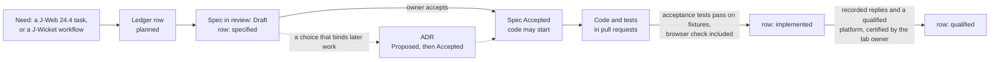
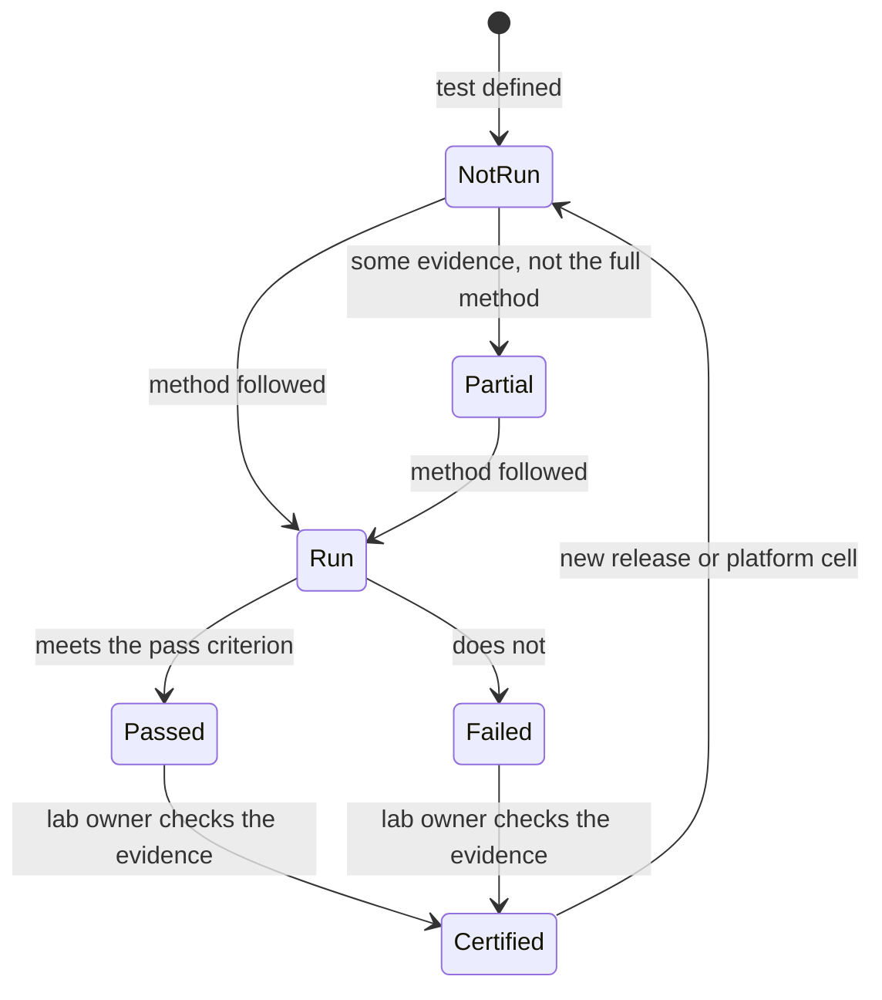
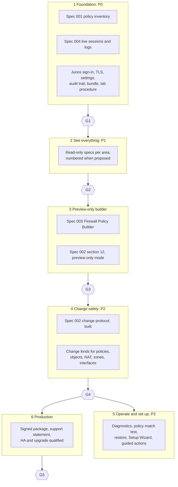

# Governance and qualification roadmap

Status: living document. Owner: the project owner (Corey Robertson). Last reviewed 2026-11-26.
The gates and decision rights on this page are the owner's. Anything marked **proposed** is a
contributor proposal that waits for an owner decision; each one is listed in
[section 2.5](#25-decisions-pending).

**Where the project stands.** G0, the spike, passed on one vSRX (Junos 24.4R2-S3.5) on 2026-11-23
(24 November UTC). On 2026-11-24 and 25 J-Wicket's own bundle ran by hand on one lab SRX4100 (Junos
25.2R1-S1.4), following deploy-lab.md ([evidence](evidence/2026-11-24-srx4100-lab/README.md)):
Q-RT-01 passed; Q-RT-02 and Q-AUTH-01 are met except one criterion each; Q-RT-03 works; Q-TLS-01
is met except a provisioning path; Q-AUTH-03 has early observations; the fxp0 part of Q-NET-01 is
met; Q-NET-03 fails. Nine replies were recorded there as fixtures (Q-REL-01, partial), and the
parsers' tests read them.
On 2026-11-26, [dev3 on the same SRX4100](evidence/2026-11-26-srx4100-dev3/README.md) added partial
Q-AUTH-03 evidence: a custom restricted class read policies and log sources, while Junos
denied the contents of a listed log. The same day, a
[lab follow-up on two vSRXs](evidence/2026-11-26-vsrx-vlab/README.md) (Junos 24.4R2-S3.5) used an
uncommitted, lab-only build derived from dev3, not J-Wicket's own released bundle. It recorded
partial observations for Q-RT-02, Q-TLS-01, Q-NET-01, Q-NET-03, Q-AUTH-01 and Q-AUTH-03, five
session and log replies that the tests replay (Q-REL-01 stays partial, now on two platforms and
releases), and a Q-HA-03 detection gap. By owner decision D20 (2026-11-26), those observations
count as partial vSRX statuses for that proof build only, each labelled as such; they say nothing
about J-Wicket's own bundle, which has not run on a vSRX. Every other reply the tests parse is
synthetic. G1 remains open.
None of these results is certified, and nothing is qualified
([section 3.2](#32-what-qualified-platform-means)).
The installers of [Spec 006](specs/006-installation.md) are built against fakes only, are
lab-gated until G1, and have not run on any device ([section 3](#3-gates-g0-to-g5)).

**What comes next.** G1: least-privilege, TLS-protected on-box reads, proven on a device. Nothing
writes to a device before G4. The next three deliverables are in
[section 8](#8-what-ships-next).

Labels used on this page: **verified** means a cited source or the spike record says it.
**Inferred** means our reading of verified facts. **Unknown** means nobody has checked; the test
that will settle it is named. **Proposed** means a design or process choice waiting for the owner.

On this page:

1. [Decision rights](#1-decision-rights)
2. [How decisions are made and recorded](#2-how-decisions-are-made-and-recorded)
3. [Gates G0 to G5](#3-gates-g0-to-g5)
4. [Qualification test catalogue](#4-qualification-test-catalogue)
5. [Qualification matrix](#5-qualification-matrix)
6. [Evidence rules](#6-evidence-rules)
7. [Roadmap](#7-roadmap)
8. [What ships next](#8-what-ships-next)
9. [Risk register](#9-risk-register)
10. [Sources](#10-sources)

## 1. Decision rights

### Roles

| Role | Who | What the role decides |
| --- | --- | --- |
| Project owner | Corey Robertson | Scope, priorities, the reference release, gate approvals and `out-of-scope` rows. Anything this table does not assign |
| Security reviewer | **Not yet named** ([D1](#25-decisions-pending)) | Signs off G1 and G4. Runs the internal review (Q-SEC-01). Reviews changes that touch a security control |
| Qualification lab owner | **Not yet named** ([D2](#25-decisions-pending)) | Certifies qualification evidence. Owns the lab equipment and [deploy-lab.md](deploy-lab.md) |
| Product sponsor | **None yet** | Required before G4. Represents the product organization, whose answer the signed-package and support positions need |
| Contributors | Anyone with a pull request | Propose through specs and ADRs in pull requests. Run tests and record evidence |

An approval counts only when the person holding the role gives it in the pull request or in a
recorded ADR. A contributor's or a tool's approval never stands in for one of these roles.

### Who decides what

| Decision | Decides | Must also review or sign | Recorded in |
| --- | --- | --- | --- |
| Goals, non-goals, principles | Owner | | [Charter](charter.md) and an ADR |
| Priority of a ledger row (`P0` to `P4`) | Owner | | [`parity/jweb-24.4.csv`](parity/jweb-24.4.csv) |
| A row marked `out-of-scope` or `replace` | Owner | | The ledger row's reason, approved in the pull request. Until then the row says "owner approval pending". An ADR when the reason is a principle (for example Junos-FIPS mode) |
| The reference release, and moving it | Owner | | A new ADR superseding [ADR 0008](adr/0008-release-scoped-parity.md)'s reference, with a diff of the two ledgers ([2.3](#23-the-parity-reference-release)) |
| Accepting a spec | Owner | Security reviewer, for any spec that touches sign-in, transport, the RPC allowlist, secrets or writes | The spec's Status field, in the accepting pull request ([2.2](#22-spec-reviews)) |
| An architecture decision | Owner | Security reviewer, when a trust boundary or a security control changes | An ADR ([2.1](#21-architecture-decision-records)) |
| Adding a read RPC to `ALLOWED_RPCS` | Owner, with the spec that needs it | Security reviewer. A recorded reply from a lab device (Q-REL-01) | [`junos/session.py`](../src/jwicket/junos/session.py), the spec's data-sources table, the pull request |
| Any RPC that changes the device, sent by J-Wicket itself (the lab installers' writes are lab-procedure changes, below) | Owner, not before G4 | Security reviewer | The write-model ADR that [Spec 002](specs/002-change-protocol.md) open question 1 asks for, and the G4 record |
| A setting default or rule that weakens a control (bind, TLS, file trust, throttles) | Owner | Security reviewer | An ADR |
| Gate approval G0 to G5 | Owner | Security reviewer signs G1 and G4. Lab owner certifies the evidence for every gate | The gate log ([2.4](#24-gate-log)) |
| A qualification result is valid | Lab owner | | The evidence record and this page's catalogue ([section 6](#6-evidence-rules)) |
| Pass criteria and budgets of a qualification test, before it runs | Owner | Lab owner for the method; security reviewer for Q-AUTH, Q-TLS and Q-SEC tests | This page |
| The platform and release list the lab must cover | Owner | Lab owner, on what the lab can get | The [qualification matrix](#5-qualification-matrix) |
| A vulnerability fix and its disclosure | Owner | Security reviewer | Private, as [SECURITY.md](../SECURITY.md) says |
| Changes to the lab procedure | Lab owner | Security reviewer, when a step changes the device's security posture | [deploy-lab.md](deploy-lab.md); for the lab installers, [Spec 006](specs/006-installation.md) |
| Signed package, support statement, product sponsor | Owner, with the product organization | Security reviewer | ADRs at G4 (positions decided) and G5 (package and statement exist) |
| Development tooling pins and CI | Contributors | One reviewer other than the author | [`requirements-dev.txt`](../requirements-dev.txt), [`.github/workflows/ci.yml`](../.github/workflows/ci.yml) |
| A release tag, and the repository settings releases rely on | Owner. The first tag waits for the owner's go ([ADR 0011](adr/0011-owner-decisions-lab-gated-install.md)); a tag ruleset letting only the owner create `v*` tags is **proposed** ([ADR 0012](adr/0012-installer-design.md), D14) | Security reviewer, for the settings (**proposed**) | The tag; [`.github/workflows/release.yml`](../.github/workflows/release.yml); the release record under [`docs/releases/`](releases/README.md) |

## 2. How decisions are made and recorded

Every decision lands in the repository through a pull request: a spec for what to build, an ADR for
a choice that constrains later work, a ledger row for parity scope, and an evidence record for what
a device did. [CONTRIBUTING.md](../CONTRIBUTING.md) is the step-by-step version.

### 2.1 Architecture decision records

ADRs live in [`docs/adr/`](adr/README.md), one decision per file, numbered `NNNN-short-title.md`.

- **Shape.** Context (what forced a choice), Decision, Consequences (what it costs) and, whenever
  a qualification test could overturn the decision, "Would be proven wrong by", naming that test
  (ADRs 0001 to 0003 have one).
- **Life.** An ADR is opened in a pull request as `Status: Proposed`. The owner accepts it, and the
  status becomes `Accepted (YYYY-MM-DD)`. An accepted ADR is not edited afterwards. A later ADR
  supersedes it and says so; only the earlier one's status line changes, to `Superseded by NNNN`.
  The index in [`adr/README.md`](adr/README.md) is updated in the same pull request.
- **Today.** ADRs 0001 to 0009 were written and committed by a contributor on 2026-11-24 with the
  status "Accepted", but no owner acceptance is recorded in the repository. They therefore read
  `Status: Proposed` until the owner accepts each one in a pull request (D11). ADRs 0010 and 0011
  record owner decisions and start as Accepted; ADR 0011 holds only the owner's installation
  decisions of 2026-11-24 and 2026-11-25, and every other design choice made to carry them out is in
  [ADR 0012](adr/0012-installer-design.md), which reads Proposed (D11) except the three installer
  defaults the owner accepted on 2026-11-25 (TLS access by default, root's one-time directory step,
  lab hardware only with `--lab-hardware` and a typed `lab only`).
  [ADR 0015](adr/0015-verified-installer-profiles.md), accepted by the owner
  on 2026-11-26 with its security review pending (D1), supersedes ADR 0011 decision 4 item 2 and
  ADR 0012 decision 4 for its offered account-owned state directory only; because the default
  stands, neither earlier record's status line changes. Nothing in ADR 0015 is built.
- **When a test contradicts an ADR.** If a qualification result proves an ADR wrong (for example
  Q-AUTH-01 failing would overturn [ADR 0002](adr/0002-junos-delegated-sign-in.md)), the result is
  recorded first. A superseding ADR must be accepted before any code relies on the new behaviour.
  [Architecture section 13](architecture.md#13-if-per-operator-sign-in-fails-q-auth-01) lists the
  options already known for that case.
- **ADRs requested and not yet written:** the write model (Spec 002 open question 1), the secrets
  handling of whole-configuration diffs ([catalog](catalog.md), Spec 002 open question 10), and,
  if Q-AUTH-01 fails, the successor to ADR 0002.

### 2.2 Spec reviews

A spec says what a feature does, what it rests on and how it is tested. Code follows an accepted
spec. Specs live in [`docs/specs/`](specs/), numbered `NNN-short-name.md`, and start from
[`000-template.md`](specs/000-template.md).

**Spec status and ledger status move together.** Specs 001, 002 and 004 write their status in
free text (Spec 002 says "Design only"); Spec 003 already starts with "Draft", from the vocabulary
below. New specs, and existing ones when next revised, start their Status field with one of these
words (**proposed** vocabulary):

| Spec status | Means | Ledger rows it covers |
| --- | --- | --- |
| Draft | Open for review. Nothing may be built against it except throwaway prototypes | `specified` (a spec covers the row) |
| Accepted | The owner accepted the design; for security-relevant specs, the security reviewer reviewed it. Code may start | `specified` |
| Implemented on fixtures | Its acceptance tests pass against synthetic fixtures. Say which parts, if not all | `implemented` for each row whose criteria all pass, the browser check included for an operation done in the browser; the others stay `specified` ([ledger method, section 5](parity/README.md#5-statuses)) |
| Qualified on *cells* | Its acceptance tests pass against recorded replies, and on the qualified platform cells named ([3.2](#32-what-qualified-platform-means)) | `qualified`, for those cells |
| Superseded by *NNN* | Replaced | as the new spec says |

Today: Spec 001 and Spec 004 are implemented on fixtures for their backends and browser engines;
their UI views are built and committed and have been exercised by hand on the development server,
but not signed off (AC-001-21, AC-004-20 not met), so their ledger rows stay `specified`. They are the first slices the
owner named. Spec 002 is design
only. Spec 003, the first planned configuration wizard, is specified and preview-only.
[Spec 005](specs/005-explain-junos-in-place.md), explaining Junos in place, is Draft: nothing is
built, and it has no ledger rows (catalog N6). No spec records the owner's acceptance in its
Status field yet, and none is qualified.

**What a reviewer checks.**

1. The problem is grounded in named J-Web 24.4 pages, with source URLs, and the ledger rows it
   covers are listed.
2. Every claim about Junos is labelled verified (with a source), inferred or unknown. No CLI, RPC
   name, XML element or J-Web menu name appears without a source. Each unknown names the
   qualification test that settles it.
3. Every RPC and configuration subtree the feature reads is listed, with its allowlist impact. Any
   new RPC follows the allowlist rule in [CONTRIBUTING.md](../CONTRIBUTING.md).
4. Panels show device data or an explicit state ([ADR 0004](adr/0004-no-sample-data.md)); nothing
   is cached in the browser ([ADR 0007](adr/0007-offline-capable-meaning.md)).
5. Security considerations cover input validation, secrets, error text, load on the routing engine
   and the browser rules.
6. Acceptance criteria have IDs (`AC-NNN-xx`), each with the tests that prove it and an honest
   status. The last criteria say what must pass against recorded replies and in a browser.
7. Open questions name who decides and what settles them.
8. Nothing writes to a device unless the spec is Spec 002 or builds on it, and nothing that writes
   ships before G4.
9. Every view and state is usable by an operator who does not know Junos: the Junos concepts it
   shows are explained where they appear, with the matching command alongside
   ([ADR 0010](adr/0010-usable-without-knowing-junos.md)).

**Changing an accepted spec.** Edit it in a pull request and add a dated line to its Status
section saying what changed. If the change reverses a decision recorded in an ADR, write the ADR
first.

### 2.3 The parity reference release

**The reference is J-Web for SRX Series 24.4**, as documented in the J-Web User Guide for SRX
Series Firewalls, release 24.4 ([ADR 0008](adr/0008-release-scoped-parity.md)). Parity means an
authorized operator can complete the same tasks as on that release. The ledger
([method](parity/README.md), [data](parity/jweb-24.4.csv), [summary](parity/jweb-24.4.md)) has
one row per page or operation.

**Two different release questions.** The *reference release* says what parity means. The
*qualified releases* say which Junos releases J-Wicket has been shown to run on
([section 5](#5-qualification-matrix)). Moving one does not move the other. J-Wicket can be
qualified on 22.4 while measuring parity against J-Web 24.4.

**Why the reference stays pinned.** J-Web's structure changes between releases. The 25.2 guide's
table of contents has 276 topics against 24.4's 453 (each counted as unique topic URLs, without
`index.html` and the PDF), adds a "Shared Objects and Identity" section, and has no top-level
"Security Policies and Objects" or "Security Services" section (**verified**, the 25.2 and 24.4
guide tables of contents, `__toc.js`, read 2026-11-24). A ledger keyed
to a moving target cannot measure progress.

**How it changes.** Only the owner moves the reference, and only through these steps:

1. A pull request adds a new ledger, `parity/jweb-<release>.csv`, built by the same method. The
   24.4 ledger stays.
2. The pull request includes a diff of the two ledgers: rows added, removed, renamed or moved to a
   different menu, and rows whose page changed behaviour, each with the spec it affects.
3. Status carries over only where the page and the Junos hierarchy it touches are unchanged.
   Anything else drops to `specified` or `planned`, and the diff says which.
4. A new ADR supersedes the reference choice in ADR 0008, linking the diff. The owner accepts it.
5. The README, the charter, the ledger summary and this page are updated in the same pull request.

### 2.4 Gate log

Append-only. A gate is passed when the owner approves its entry here, with the sign-offs and
evidence its row in [section 3](#3-gates-g0-to-g5) requires.

| Gate | Date | Decision | Evidence | Sign-offs |
| --- | --- | --- | --- | --- |
| G0 spike | 2026-11-23 (24 November UTC) | Passed on vSRX 24.4R2-S3.5, as recorded in the owner's framing. The kill tests T1, T2 and T5 passed, and T4 passed | [Spike packet](evidence/2026-11-23-vsrx-spike/README.md); [notebook, results](evidence/2026-11-23-vsrx-spike/docs/Wicket-concept-brief-and-spike-plan.md#spike-results-so-far) | Owner. G0 needs no security or lab sign-off |

The spike report made "the same tests pass on SRX300 hardware" the gate that ends the spike phase
([report, roadmap](evidence/2026-11-23-vsrx-spike/docs/J-Wicket-spike-report-and-product-plan.md#roadmap)).
The current roadmap records G0 as passed on vSRX and carries the hardware test forward as
Q-HW-01, an exit criterion of G2 ([charter, section 6](charter.md#6-from-a-branch-admins-normal-week-to-release-scoped-parity)).

### 2.5 Decisions pending

These block a gate or a qualification run. Each is the owner's unless the row says otherwise.

| ID | Decision | Blocks | Raised in |
| --- | --- | --- | --- |
| D1 | Name the security reviewer | Q-SEC-01, G1 sign-off | This page |
| D2 | Name the qualification lab owner, and give them lab equipment | Every certified result; the first lab run ([section 8](#8-what-ships-next)) | This page |
| D3 | Confirm the platform and release list (the [matrix](#5-qualification-matrix) is a proposal), the release set for Q-REL-01, and whether chassis cluster and MNHA are required at G2 or can follow | Q-REL-01, G2 | [Charter, open question 2](charter.md#9-open-questions-for-the-owner) |
| D4 | Side project, or a proposal to the product team? A side project can stop at G3 with no device writes | Whether G4 and G5 are pursued | [Charter, open question 3](charter.md#9-open-questions-for-the-owner) |
| D5 | Does preview-only mode (a load into the operator's private copy and a commit check) count as "no device writes" for G3? If not, Spec 003 at G3 uses J-Wicket's local model only. Owner with the security reviewer | G3 scope | [Spec 002, open question 2](specs/002-change-protocol.md#20-open-questions) |
| D6 | Confirm Junos-FIPS mode devices as a non-goal for the unsigned app, and that J-Wicket replaces the management UI only, not firewall web authentication or Juniper Secure Connect | Ledger rows; charter non-goals | [Charter, section 7](charter.md#junos-fips-mode) |
| D7 | Place the tests that the gate definitions do not name ([3.1](#31-tests-the-gate-definitions-do-not-place)), and accept or reject the **proposed** additions to the exit criteria in [section 3](#3-gates-g0-to-g5): the Spec 001 and 004 acceptance criteria at G1, the `out-of-scope` and `replace` clauses at G2, and the G2 check with operators new to Junos that [ADR 0010](adr/0010-usable-without-knowing-junos.md) proposes | G1, G2 planning | This page |
| D8 | Does G5 require the `P2` and `P3` rows, or can a read-only J-Wicket reach customer production after G2 with a signed package and a support statement? | G5 scope | This page |
| D9 | Set the budgets for Q-HW-01 and Q-LOAD-01 to Q-LOAD-03 before they run | Those tests | This page |
| D10 | Adopt the J-Web 24.4 reference observation as a qualification item ([4.12](#412-proposed-additions)), and the installer tests Q-INST-01 to Q-INST-06 that Spec 006 proposes | Spec 002 open question 16; catalog unknowns; every device step of the installers | [Catalog, unknowns](catalog.md#unknowns-and-what-settles-them); [Spec 006, section 18](specs/006-installation.md#18-qualification-needed) |
| D11 | Accept, amend or reject ADRs 0001 to 0009. A contributor wrote and committed them on 2026-11-24 as "Accepted", but no owner acceptance is recorded, so they read "Proposed" ([2.1](#21-architecture-decision-records)). Also ADR 0012, Spec 006's installer design, with the security reviewer. [ADR 0015](adr/0015-verified-installer-profiles.md), verified installer profiles, and the adaptive preflight it points to, [Spec 006 section 7.12](specs/006-installation.md#712-adaptive-preflight), were accepted by the owner on 2026-11-26 ("Accept"; see D19); the security reviewer's review of them is still pending (D1), and nothing in them is built | Any ADR-based claim that a decision is settled | [ADR index](adr/README.md) |
| D12 | Approve a hardware variant of the lab procedure. [deploy-lab.md](deploy-lab.md) is written for a disposable virtual SRX, or lab hardware whose owner approves the run, with a loopback bind and an SSH tunnel and a TLS-on-fxp0 variant; it was followed on the owner's lab SRX4100 (24 and 25 November 2026) at the owner's direction, with its deviations recorded. It is not a hardware procedure: the hardware runs and the revenue-zone part of Q-NET-01 need their own. Lab owner, with the security reviewer | Every further hardware run; Q-NET-01 | [Section 4](#4-qualification-test-catalogue) |
| D13 | What replaces the installers' lab gate between G1, when the owner's decision lifts it, and G5, before which production installs stay out: the typed host name, R-MODEL, the production signs and the "LAB ONLY" wording. Proposed: the typed name kept as a neutral change confirmation, production refused in words until G5 | Lifting the installer gate at G1 | [Spec 006, open question 1](specs/006-installation.md#21-open-questions-owner-decisions); [ADR 0011](adr/0011-owner-decisions-lab-gated-install.md) |
| D14 | The release repository settings required before the first pre-release (immutable releases; a tag ruleset letting only the owner create `v*` tags; branch protection with review on `main`; environment `lab-prerelease`; variable `JWICKET_IMMUTABLE_RELEASES=true`), the tag and attestation rules (open question 8), and the go for the first tag, `v0.1.0.dev1`, which only the owner gives | The first pre-release | [Spec 006, section 11.2](specs/006-installation.md#112-repository-settings-required-before-the-first-pre-release); [ADR 0012](adr/0012-installer-design.md) |
| D15 | Keep or veto the R-PENDING exception for the installer's own unconfirmed bootstrap (built as designed, cut C5; open question 10). Whether the security reviewer must review the installers, and the lab owner approve the [deploy-lab.md](deploy-lab.md) changes, before their first lab run (open question 9). Owner, with the security reviewer | The installers' first lab run (Q-INST-06) | [Spec 006, section 7.7](specs/006-installation.md#77-the-bootstrap) |
| D16 | The daemon's account: accept the installing super-user-class account as a recorded G1 least-privilege gap ([R-17](#9-risk-register)), or commission a dedicated minimal-class account, which needs a settings-trust change and an ADR; whether Junos runs a JET app under a `username` outside the super-user class is unknown (open question 13). Owner, with the security reviewer | G1 sign-off | [Spec 006, section 7.5](specs/006-installation.md#75-files-the-directory-and-the-daemons-account) |
| D17 | The installers' refusals and gate wording, proposals in ADR 0012: an override stamped "not qualification evidence" or a hard refusal when veriexec is not enforcing, and the one fixed shell read (open question 4); refusing chassis cluster, MNHA and dual routing engines until Q-HA-01 and Q-HA-03 (5); `--ack-managed` and `--ack-commit-scripts` (6); no host name before the prompt, the production signs, and whether a lab marker that only the lab owner sets is wanted (14) | The installers' first lab run | [Spec 006, section 8.11](specs/006-installation.md#811-refusals) |
| D18 | Confirm the lead engineer's scope cuts C1 to C3 (setup mode D1 deferred, no `serve` mirror, ZTP documented only; open question 29), and accept the bundle changes D2 and D3 (open question 3; with the security reviewer, as new surface for Q-SEC-01) | Spec 006 acceptance | [Spec 006, section 4.1](specs/006-installation.md#41-scope-cuts-in-this-change) |
| D19 | The other open questions of Spec 006 (2, 7, 11, 12, 15 to 19, 21 to 27 and 31), each with a proposed answer recorded in ADR 0012. Open questions 20, 28 and 30 (R-MODEL with `--lab-hardware` and a typed `lab only`; root's one-time directory step; `--access tls` by default) were decided by the owner on 2026-11-25 ([ADR 0011](adr/0011-owner-decisions-lab-gated-install.md), decision 4). [ADR 0015](adr/0015-verified-installer-profiles.md) and [Spec 006 section 7.12](specs/006-installation.md#712-adaptive-preflight), accepted by the owner on 2026-11-26 (Spec 006 open question 32, decided; security review pending, D1; not built), keep the decided defaults and offer an account-owned state directory, an exact-interface listener and a same-device pinned operator NETCONF address as alternatives, from the [vSRX lab follow-up](evidence/2026-11-26-vsrx-vlab/README.md). Open question 28 is superseded for the offered alternative only: ADR 0015 supersedes ADR 0011 decision 4 item 2 and ADR 0012 decision 4 for it, and the default `/var/db/jwicket` stays preferred. Open question 30 is not reopened: the default listener is unchanged, as ADR 0015 states | Spec 006 acceptance | [Spec 006, section 21](specs/006-installation.md#21-open-questions-owner-decisions); [ADR 0015](adr/0015-verified-installer-profiles.md) |
| D20 | **Decided** (owner, 2026-11-26, in the owner's words: "Yes, with notes/documentation"). Results from the [vSRX lab follow-up](evidence/2026-11-26-vsrx-vlab/README.md) of 2026-11-26 may change a status cell. Its runs used an uncommitted, lab-only build derived from dev3 (account-owned settings path, HelperVM-only HTTPS listener, provisioned ECDSA pin, on-box SSH and NETCONF compatibility code), not J-Wicket's own released bundle, so its results apply to that build only ([evidence rule 2](#6-evidence-rules)). The rule: a cell that counts it, and its status bullet, say it is the proof build (uncommitted, lab-only, dev3-derived, not J-Wicket's own released bundle), cite its SHA-256 as the lab record gives it, and link the record ([4.1](#41-how-to-read-an-entry)). Applied on 2026-11-26 to Q-RT-02, Q-TLS-01, Q-AUTH-01, Q-AUTH-03, Q-NET-01 and Q-NET-03, each now **partial** on vSRX 24.4R2-S3.5, and to the vSRX part of Q-REL-01 (partial). Certification is still the lab owner's (D2, [evidence rule 6](#6-evidence-rules)) | Nothing now (decided) | [Section 4](#4-qualification-test-catalogue); [section 6](#6-evidence-rules) |
| D21 | **Decided** (owner, 2026-11-26, in the owner's words: "yes"): a native Junos confirmed-commit timeout, observed with no J-Wicket write path, counts toward Q-CHG-03. Applied to the one the vSRX lab follow-up recorded, which makes Q-CHG-03 **partial** on vSRX 24.4R2-S3.5 ([4.11](#411-change-protocol-q-chg-01-to-q-chg-16); [Spec 002, Q-CHG-03](specs/002-change-protocol.md#q-chg-03-rollback-correctness)). It does not stand in for the J-Wicket protocol, the other undo modes or certification (lab owner, D2) | Nothing now (decided) | [Section 4.11](#411-change-protocol-q-chg-01-to-q-chg-16) |

## 3. Gates G0 to G5

The order is the point: nothing writes to a firewall until sign-in, encryption, review and read
parity are proven, and the first configuration wizard is preview-only.

```mermaid
flowchart LR
  G0["G0 spike<br/>passed, one vSRX"] --> F(["Foundation"])
  F --> G1["G1 foundation exit<br/>least-privilege TLS reads proven"]
  G1 --> S(["See everything"])
  S --> G2["G2 read parity<br/>P0 and P1 qualified, hardware, HA"]
  G2 --> P(["Preview-only builder"])
  P --> G3["G3 builder shipped<br/>no device writes"]
  G3 --> C(["Change safely"])
  C --> G4["G4 live writes<br/>Spec 002, pen test, sponsor"]
  G4 --> O(["Operate and set up;<br/>production readiness"])
  O --> G5["G5 customer production<br/>signed package, support statement"]
```

| Gate | Means | Entry: true before work toward it starts | Exit: all true to pass | Signs off | Status |
| --- | --- | --- | --- | --- | --- |
| **G0** spike | Unsigned Python runs under Junos, listens, and reads the device | A lab with veriexec enforcing | Kill tests T1, T2, T5 pass; T4 decides platform reach | Owner | **Passed** on vSRX 24.4R2-S3.5, 2026-11-23 ([gate log](#24-gate-log)) |
| **G1** foundation exit | Least-privilege, TLS-protected on-box reads are proven | G0 passed. Specs 001 and 004 written. Lab procedure written | Q-RT-01, Q-RT-02, Q-RT-03, Q-AUTH-01, Q-AUTH-02, Q-AUTH-03, Q-TLS-01, Q-REL-01, Q-LOAD-01, Q-LOAD-02, Q-LOAD-03 and Q-SEC-01 pass and are certified. **Proposed** (D7): Spec 001 and Spec 004 acceptance criteria are met, including the recorded-reply criteria AC-001-22 and AC-004-21, with AC-004-21's replies required only on the non-cluster, single-SPU cells; its cluster and multi-SPU part moves to G2 | Security reviewer and owner; lab owner certifies the evidence | **Not reached.** Some of its tests have run on one lab SRX4100, none is certified, and Q-SEC-01 has not started ([5](#5-qualification-matrix)) |
| **G2** read parity | An operator can do every `P0` and `P1` task read-only, on real hardware | G1 passed | Every `P0` and `P1` ledger row is `implemented` and `qualified`. **Proposed** (D7): a row `out-of-scope` with owner approval also counts, and a `replace` row counts when its replacement is implemented and qualified; the cluster and multi-SPU part of AC-004-21 is met. Q-HW-01, Q-HA-01, Q-HA-02, Q-HA-03, Q-LOG-01 and Q-MGMT-01 pass. SEs use J-Wicket on real labs and choose it over J-Web for look-ups (the spike report's test; the owner names the SEs and labs, and each records dated notes under `docs/evidence/`) | Owner; lab owner certifies | Not reached |
| **G3** preview-only builder shipped | The Firewall Policy Builder shows a proposed change and its effect; nothing that changes the device is sent | G2 passed. [Spec 003](specs/003-firewall-policy-builder.md) and Spec 002's preview-only mode (section 12) accepted. D5 decided | Spec 003's AC-003-01 to AC-003-29 met, and its evaluator agreement check (AC-003-31) run on the lab vSRX. A preview-only build cannot reach a write RPC (Spec 002 AC-002-01, AC-002-18). Q-SEC-01 repeated over the builder's routes and preview mode. Only if D5 allows the device preview: AC-003-30, Q-CHG-08 and Q-CHG-09 pass | Owner; lab owner certifies | Not reached |
| **G4** live writes | J-Wicket may commit configuration, through Spec 002 only | G3 passed. The write-model ADR accepted. A product sponsor named | Spec 002 built, AC-002-01 to AC-002-20 met. Q-CHG-01 to Q-CHG-16 pass. Q-SEC-02 (external penetration test) passed. Signed-package and support positions decided and recorded as ADRs | Security reviewer and owner; lab owner certifies | Not reached |
| **G5** customer production | A customer may install J-Wicket on a production SRX | G4 passed (unless D8 decides a read-only route) | A signed package exists. A support statement is published. HA qualified: Q-HA-01 to Q-HA-03 on hardware pairs, and Q-CHG-05 and Q-CHG-12 for writes. Upgrade and restart qualified: Q-RT-05 and Q-RT-04 on every platform offered. Every platform and release offered to customers is a qualified cell | Owner, with the product organization | Not reached |

Until G5, J-Wicket is not installable on a production SRX, and the project asks no one to enable a
listener, disable J-Web or change a production firewall. The reference way to run it on a device is
[deploy-lab.md](deploy-lab.md), on a disposable lab vSRX or owner-approved lab hardware: a loopback bind
behind an SSH tunnel where the release allows forwarding, or TLS on fxp0 (the SRX4100 run, where
the tunnel was refused, and the installers' default `--access tls`).

**Installers are lab-gated until G1** (owner decision, 2026-11-24,
[ADR 0011](adr/0011-owner-decisions-lab-gated-install.md)). The installers of
[Spec 006](specs/006-installation.md) automate deploy-lab.md's steps on a lab device only: a dry run
by default, the plan's diff, the posture warning and the production signs they read, then the
operator types the device's host name, and every change is a `commit confirmed` that they confirm
only after a health check. Their design is a proposal ([ADR 0012](adr/0012-installer-design.md)),
except three defaults the owner accepted on 2026-11-25 (ADR 0011, decision 4): TLS on the management
address by default, root's one-time step for `/var/db/jwicket` printed and checked, never run by an
installer, and lab hardware only with `--lab-hardware` and a typed `lab only`. They are built
against fakes; none has run on a device, and every device step is unverified until Q-INST-06
([4.12](#412-proposed-additions)). The owner decided the lab gate lifts when G1 passes; that does not
make J-Wicket installable on a production SRX, which stays out until G5. What the lab gate becomes
between G1 and G5 is D13. CI pre-releases are lab-only and unsupported; none has been published, and
the first tag waits for the owner's go (D14).

### 3.1 Tests the gate definitions do not place

The gate definitions name 21 of the 25 tests from Q-RT to Q-SEC by ID (G5 names Q-RT-04 and
Q-RT-05). Four have no gate: Q-AUTH-04, Q-NET-01, Q-NET-02 and Q-NET-03. Q-RT-04 is also proposed
earlier than G5. **Proposed** placement, for the owner (D7):

| Test | Proposed gate | Why |
| --- | --- | --- |
| Q-NET-03 SSH local forwarding | G1 | Every G1 lab test reaches the UI through the tunnel ([ADR 0003](adr/0003-tls-off-loopback.md)); this is a precondition, not a feature |
| Q-RT-04 survives reboot | G2 (G5 already names it) | SEs' lab devices reboot. G5 requires it in any case |
| Q-AUTH-04 lockout versus throttle | G2 | Before several SEs share a lab device; behind the tunnel every operator shares one per-source failure budget, and a named account can be locked out deliberately ([architecture, gap 3](architecture.md#15-known-gaps-in-the-current-code)) |
| Q-NET-01 reachability on hardware | G2 | Needed before any non-loopback listener on hardware; the tunnel needs none |
| Q-NET-02 8443 collision | G2 | Before 8443 is relied on as the default port on hardware |

### 3.2 What "qualified platform" means

The ledger's `qualified` status needs "a qualified platform". **Proposed** definition (D3, D7):

- A **cell** is one platform class and one release line from the [matrix](#5-qualification-matrix),
  for example "vSRX, 24.4". The evidence names the exact model and build (for example
  24.4R2-S3.5).
- A cell is **qualified** when the lab owner has certified passing results on it for Q-RT-01,
  Q-RT-02, Q-RT-03, Q-NET-03, Q-AUTH-01, Q-AUTH-03, Q-TLS-01 and Q-LOAD-01, plus Q-HW-01 for the
  SRX300 class, and recorded replies (Q-REL-01) exist on it for every RPC in `ALLOWED_RPCS`.
- A ledger row is **`qualified` on a cell** when its spec's acceptance tests pass against that
  cell's recorded replies, and its UI requirements were checked on a device of that cell.
- No cell is qualified today.

### 3.3 Rules at every gate

- A gate is passed only by an entry in the [gate log](#24-gate-log). Passing tests do not pass a
  gate by themselves.
- Evidence that is not certified does not count ([section 6](#6-evidence-rules)).
- A failed test is a result. It is recorded the same way as a pass, and it may change the plan:
  the charter and the risk register say what each failure would mean.
- A gate's exit criteria change only by owner decision, recorded on this page with the date.

## 4. Qualification test catalogue

Each test has a purpose, a method, a pass criterion, the platforms it runs on, the gate that needs
it, and a status with evidence. IDs are referenced from code, specs and the architecture; do not
renumber them. Every test runs on lab equipment only, never on a production firewall, following
[deploy-lab.md](deploy-lab.md) unless its method says otherwise. Configuration changes are made
with `commit confirmed 5`.

deploy-lab.md is written for a disposable virtual SRX, or lab hardware whose owner approves the run,
with a loopback bind and an SSH tunnel, and a TLS-on-fxp0 variant for a release that refuses the
tunnel (the lab SRX4100 runs of 2026-11-24 and 25 used it, with the deviations their evidence record
lists). It is not a hardware procedure, and it never binds a revenue interface or changes a
security zone. So every run on
hardware (any platform other than vSRX in a test's Platforms line: for example the "one hardware
platform" runs of Q-RT-03, Q-AUTH-01 and Q-NET-03, Q-HW-01, and the hardware pairs of Q-HA-01) and
all of Q-NET-01, which binds to fxp0 and a revenue zone, need a hardware variant of the procedure. That
variant is not written. The lab owner writes it and the security reviewer approves it (D12). Until
then a hardware run happens only at the owner's direction, as the SRX4100 runs did, following
deploy-lab.md with every deviation recorded; deploy-lab.md itself is not widened into a hardware
procedure.

### 4.1 How to read an entry

Status is one of these states, or "spike-equivalent" (explained below the diagram):

Status is per cell of the [matrix](#5-qualification-matrix). "Spike-equivalent" means the spike's
daemon, `wicket_spike.py`, did what the test asks on vSRX 24.4R2-S3.5. Results without that
word are J-Wicket's own bundle, first run on a lab SRX4100 on 24 November 2026
([evidence](evidence/2026-11-24-srx4100-lab/README.md)). "Spike-equivalent partial" means it met some of the pass criteria, and the entry lists which
it met and which it did not. No test is spike-equivalent in full today. Spike-equivalent evidence
is not certified and does not qualify a cell.

Entries marked **proof build** come from the
[vSRX lab follow-up](evidence/2026-11-26-vsrx-vlab/README.md) of 26 November 2026, which ran an
uncommitted, lab-only build derived from dev3. They are neither spike-equivalent nor J-Wicket's own
released bundle. By owner decision D20 (2026-11-26) they may change a status cell, provided the
cell and its status bullet say it is the proof build (uncommitted, lab-only, dev3-derived, not
J-Wicket's own released bundle), cite its SHA-256 as the lab record gives it, and link the record.
The record gives one bundle SHA-256, for the final proof bundle, `b5ff7500f248662313c041c021614b120b7feb744eec516c3b541e653df0d5eb` (payload
`18208dbfc1f8fdb961fedd020162b9a8606cd512e2f3eebf38cc576228ea6218`); it says the later runs used
distinct proof builds and gives no digest for the earlier ones, so an entry says when an
observation came from an earlier trial. A proof-build status applies to that build only
([evidence rule 2](#6-evidence-rules)), says nothing about J-Wicket's own bundle, and is not
certified until the lab owner checks it (rule 6). The method words still hold: a proof-build
result that did not follow the method is **partial**, never passed or failed.

A pass criterion that depends on a budget (memory, CPU, log volume) needs that budget written into
its entry before the test runs (D9). A test run without one records numbers; it cannot pass.

### 4.2 Summary

| ID | Test | Gate | Status (all cells "not run" unless stated) |
| --- | --- | --- | --- |
| [Q-RT-01](#q-rt-01-runtime-probe) | Runtime probe | G1 | **Pass** on SRX4100 25.2R1-S1.4 (Python 3.7.10, every module `ok`); **partial** on vSRX 24.4R2-S3.5 (spike T0, T5) |
| [Q-RT-02](#q-rt-02-daemonized-bundle-respawn-and-idle-footprint) | Daemonized bundle, respawn, idle footprint | G1 | **Met except idle memory** on SRX4100 25.2R1-S1.4 (daemonized, digest matched, refused start, restart after `kill -9` in 1.3 s and SIGTERM in 6.2 s, memory with one operator); **spike-equivalent partial** on vSRX 24.4R2-S3.5 (`wicket_spike.py`); **partial** on the same release with the **proof build** (uncommitted, lab-only, derived from dev3, not J-Wicket's own released bundle; final bundle SHA-256 `b5ff7500f248662313c041c021614b120b7feb744eec516c3b541e653df0d5eb`): ten-minute idle memory, one signed-in operator's memory, and recovery after SIGTERM and SIGKILL recorded ([vSRX lab follow-up](evidence/2026-11-26-vsrx-vlab/README.md#ten-minute-idle-and-jet-supervisor-recovery); counted by D20) |
| [Q-RT-03](#q-rt-03-sibling-module-imports) | Sibling-module imports | G1 | **Works** on SRX4100 25.2R1-S1.4 (`/var/db/scripts/jet` is first on `sys.path`) |
| [Q-RT-04](#q-rt-04-survives-reboot) | Survives reboot | G2 (proposed) | Not run |
| [Q-RT-05](#q-rt-05-survives-a-junos-upgrade) | Survives a Junos upgrade | G5 | Not run |
| [Q-AUTH-01](#q-auth-01-per-operator-netconf-to-loopback) | Per-operator NETCONF to loopback | G1 | **Met except the SSH-key case** on SRX4100 25.2R1-S1.4 (read-only, operator and super-user accounts; RPCs attributed to the operator; sign-out, replacement and cap checked); **partial** on vSRX 24.4R2-S3.5 with the **proof build** (uncommitted, lab-only, derived from dev3, not J-Wicket's own released bundle; final bundle SHA-256 `b5ff7500f248662313c041c021614b120b7feb744eec516c3b541e653df0d5eb`): loopback NETCONF on TCP 830 did not answer, and a pinned sign-in to an interface address, outside this test's loopback method, was observed ([vSRX lab follow-up](evidence/2026-11-26-vsrx-vlab/README.md#test-results); counted by D20) |
| [Q-AUTH-02](#q-auth-02-radius-and-tacacs-template-users) | RADIUS and TACACS+ template users | G1 | Not run |
| [Q-AUTH-03](#q-auth-03-least-privilege) | Least privilege | G1 | **Partial, not certified.** Predefined-class observations and a [dev3 restricted-class trial](evidence/2026-11-26-srx4100-dev3/README.md) on SRX4100 25.2R1-S1.4; **partial, not certified,** on vSRX 24.4R2-S3.5 with the **proof build** (uncommitted, lab-only, derived from dev3, not J-Wicket's own released bundle; final bundle SHA-256 `b5ff7500f248662313c041c021614b120b7feb744eec516c3b541e653df0d5eb`): restricted-class log denial, sign-out and attribution observed ([vSRX lab follow-up](evidence/2026-11-26-vsrx-vlab/README.md#test-results); counted by D20) |
| [Q-AUTH-04](#q-auth-04-junos-lockout-and-j-wickets-throttle) | Junos lockout and J-Wicket's throttle | G2 (proposed) | Not run |
| [Q-TLS-01](#q-tls-01-on-box-tls) | On-box TLS | G1 | **Met except a provisioning path** on SRX4100 25.2R1-S1.4 (1.2 and 1.3 served, 1.0 and 1.1 refused, `__Host-` Secure cookie, HSTS, bad key mode refused); **partial** on vSRX 24.4R2-S3.5 with the **proof build** (uncommitted, lab-only, derived from dev3, not J-Wicket's own released bundle; final bundle SHA-256 `b5ff7500f248662313c041c021614b120b7feb744eec516c3b541e653df0d5eb`): certificate-verified HTTPS to an internal lab client on fxp0 observed, the method's checks not run ([vSRX lab follow-up](evidence/2026-11-26-vsrx-vlab/README.md#test-results); counted by D20) |
| [Q-NET-01](#q-net-01-reachability-through-fxp0-and-a-revenue-zone) | Reachability through fxp0 and a revenue zone | G2 (proposed) | **fxp0 part met** on SRX4100 25.2R1-S1.4 (TLS, through `mgmt_junos`); **vSRX part spike-equivalent partial** (`wicket_spike.py`: clear text, one port checked); vSRX part also **partial** on 24.4R2-S3.5 with the **proof build** (uncommitted, lab-only, derived from dev3, not J-Wicket's own released bundle; final bundle SHA-256 `b5ff7500f248662313c041c021614b120b7feb744eec516c3b541e653df0d5eb`): TLS on the fxp0 address reached from an internal lab client, outside the method's hardware set-up ([vSRX lab follow-up](evidence/2026-11-26-vsrx-vlab/README.md#test-results); counted by D20); revenue zone on hardware not run |
| [Q-NET-02](#q-net-02-port-8443-collisions) | Port 8443 collisions | G2 (proposed) | Not run |
| [Q-NET-03](#q-net-03-ssh-local-forwarding) | SSH local forwarding | G1 (proposed) | **Fails** on SRX4100 25.2R1-S1.4 (`administratively prohibited`; the documented statement is a syntax error); **partial** on vSRX 24.4R2-S3.5: forwarding refused under default settings (`administratively prohibited`), to an existing device service, not the full method; recorded in the lab follow-up that ran the **proof build** (uncommitted, lab-only, derived from dev3, not J-Wicket's own released bundle; final bundle SHA-256 `b5ff7500f248662313c041c021614b120b7feb744eec516c3b541e653df0d5eb`), though this check used no J-Wicket code ([vSRX lab follow-up](evidence/2026-11-26-vsrx-vlab/README.md#test-results); counted by D20) |
| [Q-HW-01](#q-hw-01-srx300-class-runtime-and-resources) | SRX300-class runtime and resources | G2 | Not run |
| [Q-LOAD-01](#q-load-01-sustained-ui-load) | Sustained UI load | G1 | Not run |
| [Q-LOAD-02](#q-load-02-session-list-pull-cost) | Session-list pull cost | G1 | Not run |
| [Q-LOAD-03](#q-load-03-log-volume-from-polling) | Log volume from polling | G1 | Not run |
| [Q-REL-01](#q-rel-01-recorded-replies) | Recorded replies | G1 | **Partial**: nine replies on SRX4100 25.2R1-S1.4 and five session and log replies on [vSRX 24.4R2-S3.5](evidence/2026-11-26-vsrx-vlab/README.md#synthetic-policy-and-log-reply-capture); the replay tests pass; of three vSRX mismatches, two are fixed in the parser (`sess-state` now fills `state` when `session-state` is absent; wing `tunnel` falls back to `tunnel-id` and other wing fields are kept as extras, [Spec 004 section 5.2](specs/004-live-sessions-and-logs.md)) and one is open (the full inventory filter rejected at `tenants`); coverage incomplete (vSRX part counted by owner decision D20, 2026-11-26) |
| [Q-HA-01](#q-ha-01-chassis-cluster) | Chassis cluster | G2 | Not run |
| [Q-HA-02](#q-ha-02-identify-the-local-node) | Identify the local node | G2 | Not run |
| [Q-HA-03](#q-ha-03-multinode-high-availability) | Multinode High Availability | G2 | **Partial** on vSRX 24.4R2-S3.5: MNHA not detected by J-Wicket (dev3 inventory logic, run off-box against live NETCONF, returned `standalone` on both nodes); J-Wicket was not run on each node as the method says. Native unencrypted SRG0 peering and cold sync observed as preconditions only ([lab record](evidence/2026-11-26-vsrx-vlab/README.md#mnha-peer-and-cold-sync-retest)) |
| [Q-MGMT-01](#q-mgmt-01-central-management-signatures) | Central-management signatures | G2 | Not run |
| [Q-LOG-01](#q-log-01-log-source-matrix) | Log source matrix | G2 | Not run |
| [Q-SEC-01](#q-sec-01-internal-security-review) | Internal security review | G1 (repeated for G3) | Not run |
| [Q-SEC-02](#q-sec-02-external-penetration-test) | External penetration test | G4 | Not run |
| [Q-CHG-01 to Q-CHG-16](#411-change-protocol-q-chg-01-to-q-chg-16) | Change protocol | G4 (Q-CHG-08, Q-CHG-09 also G3) | Not run, except Q-CHG-03: **partial** on vSRX 24.4R2-S3.5 from one native Junos confirmed-commit timeout, no J-Wicket protocol (counted by owner decision D21, 2026-11-26) |

### 4.3 Runtime

#### Q-RT-01 Runtime probe

- **Purpose:** record the on-box Python version, and whether each module J-Wicket needs imports,
  for each platform and release. It settles the Python floor, 3.7 since this test's first run
  ([ADR 0001](adr/0001-on-box-pure-python-single-file.md)), whether `ssl` exists for Q-TLS-01,
  and whether `paramiko` exists for Q-AUTH-01. Juniper documents only "Python 3.x" for JET
  (**verified**, Python scripts overview); the minor version is **unknown**.
- **Method:** [deploy-lab.md](deploy-lab.md) step 4. Copy the bundle as `jwicket_probe.py`, register
  it without `daemonize`, and run `request extension-service start jwicket_probe.py`. The probe
  ([`app.probe`](../src/jwicket/app.py)) prints JSON with the J-Wicket version, the Python and
  OpenSSL versions, and `ok` or `missing: <reason>` for each module in `PROBE_MODULES`:
  `http.server`, `ssl`, `json`, `hmac`, `threading`, `jnpr.junos`, `lxml`, `ncclient`, `paramiko`.
  It exits non-zero if any is missing. Keep the whole output. The `--probe` argument form under
  Junos is unverified, and spike finding F1 ([charter, section 5](charter.md#5-spike-evidence))
  suggests it fails; record it if tried.
- **Pass:** Python 3.7 or later, and every module `ok`. (The first version of this criterion said
  3.9; [ADR 0001](adr/0001-on-box-pure-python-single-file.md#revision) records why it moved.) A missing module is recorded and fails the
  test; the owner then decides (missing `ssl` changes [ADR 0003](adr/0003-tls-off-loopback.md);
  missing `paramiko` triggers [architecture section 13](architecture.md#13-if-per-operator-sign-in-fails-q-auth-01)).
- **Platforms:** every cell of the matrix.
- **Status:** **partial** on vSRX 24.4R2-S3.5. The spike's script ran to its own startup check, so
  `http.server` imported; its T5 reads worked through PyEZ, so `jnpr.junos` imported and worked;
  `ncclient` appeared in the logs. The Python version, `ssl` and `paramiko` were not recorded.
  Running Python directly from the shell was refused by veriexec, as expected. Evidence:
  [notebook, results](evidence/2026-11-23-vsrx-spike/docs/Wicket-concept-brief-and-spike-plan.md#spike-results-so-far);
  [charter, notes on the evidence](charter.md#notes-on-the-evidence).
- **Status, SRX4100 25.2R1-S1.4:** **pass**, 24 November 2026. Python 3.7.10, OpenSSL 1.1.1zb,
  every module `ok`; the copy-by-name mechanism (`jwicket_probe.py`) worked. The first bundle,
  built for 3.9, failed to import `typing.Protocol`; the code was changed for 3.7 and the probe
  re-run. The Junos 26.2R1-S2.3 install image also carries only `python3.7` (read from the image,
  not run). Evidence: [SRX4100 lab record](evidence/2026-11-24-srx4100-lab/README.md), [`probe.json`](evidence/2026-11-24-srx4100-lab/probe.json).

#### Q-RT-02 Daemonized bundle, respawn and idle footprint

- **Purpose:** show that J-Wicket's own bundle, `dist/jwicket.py`, runs as a daemonized JET
  application with no arguments, that Junos restarts it, and what it costs at rest.
- **Method:** [deploy-lab.md](deploy-lab.md) steps 1 to 6. Build the bundle and record its SHA-256
  and `payload_sha256`. Run the `jwicket_selftest.py` copy; its `payload_sha256` must match the
  build. Register `jwicket.py` with the four baseline statements and `commit confirmed 5`. Check
  `/var/db/jwicket/jwicket.log` for `listening on 127.0.0.1:8443 tls=False backend=...`, then
  confirm. The line now ends ` version=<v> payload=<first 16 hex of payload_sha256>` (Spec 006
  change D3); **proposed**: check that it names the build under test. Stop the process with `kill`, then with `kill -9`, and time each restart. Commit a change
  to the application's statements and check it restarts. Start once with a bad settings file and
  check `startup-refused.txt` and Junos's "thrashing, not restarted". Record where a daemonized
  app's standard error goes, because with `[log] file` and `[log] audit_file` unset (the defaults)
  the diagnostic log and the audit trail go only there. Record resident and virtual memory after
  ten idle minutes, and with one signed-in operator.
- **Pass:** the daemon listens with no arguments; it restarts without operator action after both
  kills; a refused start writes its reason where `file show` can read it; the self-test digest
  matches the build; idle memory is recorded (the budget for small routing engines is Q-HW-01's).
- **Platforms:** lab vSRX on each release; hardware under Q-HW-01.
- **Status:** **spike-equivalent partial** on vSRX 24.4R2-S3.5 for `wicket_spike.py`.
  - Met by the spike daemon: it listened with no `arguments` statement (with `daemonize`, Junos
    started it at commit; it read its options from a file); it restarted without operator action
    after `kill` and `kill -9` with `respawn-on-normal-exit` (without it, a clean stop left it
    down); committing a change to its statements restarted it; idle memory was recorded, about
    22 MB resident and 36 MB virtual.
  - Not met: no refused start was tried, so nothing shows a reason written where `file show` can
    read it; there was no bundle, so no self-test digest was compared with a build; memory with a
    signed-in operator was not recorded; restart times were not timed. Evidence:
  [notebook, daemon supervision](evidence/2026-11-23-vsrx-spike/docs/Wicket-concept-brief-and-spike-plan.md#spike-results-so-far),
  [report, what we tested](evidence/2026-11-23-vsrx-spike/docs/J-Wicket-spike-report-and-product-plan.md#what-we-tested),
  [`junos/baseline.set`](evidence/2026-11-23-vsrx-spike/junos/baseline.set). The spike daemon read
  options from `/var/tmp/wicket.args`; J-Wicket reads `/var/db/jwicket/jwicket.ini`.
- **Status, vSRX 24.4R2-S3.5, proof build (26 November 2026):** **partial**, counted toward the
  vSRX status by owner decision D20 (2026-11-26), beside the spike result above. It is the proof
  build: uncommitted, lab-only, derived from dev3, not J-Wicket's own released bundle; the lab
  record gives the final proof bundle's SHA-256 as `b5ff7500f248662313c041c021614b120b7feb744eec516c3b541e653df0d5eb`. The result applies to that build only.
  - Met by the proof build: it started as a JET app with no arguments and answered an internal lab
    client over certificate-verified HTTPS; after SIGTERM and SIGKILL, JET started a new supervised
    PID with no manual start, and HTTPS answered again in 1.62 s and 6.28 s (timings include the
    verification poll); idle memory was recorded with nobody signed in, one PID throughout: 30,924
    KiB resident and 48,600 KiB virtual at the first sample, then 30,624 KiB resident and 54,032 KiB
    virtual at each one-minute sample from 60 s to 600.16 s; in a separate run of the same payload,
    one signed-in operator refreshing Sessions and the system-log tail nine times over 81 s used
    48,984 to 52,168 KiB resident and 79,484 to 81,688 KiB virtual across five samples
    ([one signed-in operator](evidence/2026-11-26-vsrx-vlab/README.md#one-signed-in-operator)).
  - Not met as written: the bundle passed its workstation self-test and its on-box SHA-256 matched,
    but an on-box `jwicket_selftest.py` digest comparison is not recorded; no refused start and no
    restart after a committed statement change are recorded; the one-operator run was a scripted
    client with bounded read refreshes, not a browser or sustained run; where standard error goes is not recorded; the stock installer and J-Wicket's own
    released bundle were not used.
  - Not certified: the lab owner has not checked it (D2). Evidence:
    [lab record](evidence/2026-11-26-vsrx-vlab/README.md#ten-minute-idle-and-jet-supervisor-recovery).
- **Status, SRX4100 25.2R1-S1.4:** **met except idle memory**, J-Wicket's own bundle.
  - Met: it listened as a daemonized app with no arguments; the self-test's `payload_sha256`
    matched the build; a refused start (an address the default instance cannot bind) wrote its
    reason to `startup-refused.txt`, readable with `file show`, and Junos logged "jwicket.py is
    thrashing, not restarted"; after `kill` (SIGTERM) it restarted without operator action; with one
    signed-in operator it used 54 MB resident and 86 MB virtual.
  - Met on 25 November: after `kill -9` it answered again in 1.3 s; after SIGTERM, which shuts down
    cleanly first, in 6.2 s.
  - Not met: the ten-minute idle reading was not taken (on 25 November, 11 s after a start with
    nobody signed in, it used 33 MB resident and 55 MB virtual); where a daemonized app's standard
    error goes not recorded (the run set `[log] file`).
    Evidence: [SRX4100 lab record](evidence/2026-11-24-srx4100-lab/README.md).

#### Q-RT-03 Sibling-module imports

- **Purpose:** decide whether the one-file bundle is required. Before the SRX4100 run, whether an
  unsigned script in `/var/db/scripts/jet/` may import a sibling `.py` file was **unknown** (see
  Status); no Juniper page allows or forbids it. The unsigned JET package format documents extra module files (`srcs`) (**verified**,
  JET Developer Guide; not tried).
- **Method:** with lab-only test files (not J-Wicket): an entry script that imports a sibling
  module, then one that imports a module from a subdirectory package, each owned and moded as
  deploy-lab.md step 2 requires. Register each without `daemonize` and run it with
  `request extension-service start`. Record the output, any veriexec line in the kernel log, and
  `cscript` messages. If the lab owner has the tooling, also try the unsigned package form.
  Also record `sys.path` as Junos starts the app (`cscript -mjet ... -f <file>`, spike evidence):
  whether the script's directory is on it. The bundle removes that directory before any other
  import and refuses to start if a module was loaded from it; its self-test reports
  `path_removed` and `foreign_modules`, so run the `jwicket_selftest.py` copy with a harmless
  lab-only `json.py` beside it and record both fields.
- **Pass:** a recorded answer, with the exact error if imports fail. Either answer passes. "Imports
  work" makes the bundle optional, not wrong ([ADR 0001](adr/0001-on-box-pure-python-single-file.md)).
  The self-test with a planted `json.py` reports no foreign module.
- **Platforms:** lab vSRX on each release; one hardware platform.
- **Status:** **works** on SRX4100 25.2R1-S1.4 (25 November 2026). An unsigned JET app,
  `jwsibtest.py`, imported `jwsibmod.py` from the same directory; `sys.path` began with
  `/var/db/scripts/jet`, then `/var/run/scripts/jet/`. Per ADR 0001 the bundle becomes optional, not
  wrong; it stays, because it is one file to checksum and the foreign-module refusal depends on
  nothing else being importable from that directory. Evidence: [SRX4100 lab record](evidence/2026-11-24-srx4100-lab/README.md).

#### Q-RT-04 Survives reboot

- **Purpose:** J-Wicket comes back after a device reboot with no operator action, with its files
  and settings intact.
- **Method:** with the Q-RT-02 set-up running, reboot the device from the CLI. After boot, check the
  process, the log, and the bundle's presence, owner, mode and SHA-256, and the settings
  directory's modes. On hardware, repeat with a power cycle. Record the time from boot to
  `listening on`.
- **Pass:** listening after boot without operator action; files byte-identical; permissions
  unchanged; the audit trail shows the stop and the start.
- **Platforms:** lab vSRX; each hardware platform; the Q-HA-01 cluster pair.
- **Status:** not run. The spike did not test reboot (T6 covered `kill` and `kill -9` only).

#### Q-RT-05 Survives a Junos upgrade

- **Purpose:** record what happens to `/var/db/scripts/jet/`, `/var/db/jwicket/` and the
  extension-service statements across an upgrade. No Juniper page read says (**unknown**). The
  `file (JET)` statement page describes `respawn-on-normal-exit` as restarting an app "after you
  exit the application normally, such as when you upgrade the JET application" (**verified**,
  [`file (JET)`](https://networkingdocs.hpe.com/documentation/us/en/software/junos/cli-reference/topics/ref/statement/file-edit-system-jet.html));
  that is an upgrade of the app, not of Junos, and says nothing about Junos upgrades.
- **Method:** with J-Wicket running on release N, upgrade to N+1 by the platform's documented
  procedure, recorded verbatim. After the reboot, check the files, owner, mode, SHA-256, the
  configuration statements and the daemon; run Q-RT-01 on the new release. Repeat a downgrade.
- **Pass:** after the upgrade, either J-Wicket runs with unchanged files, or it does not start and
  the documented recovery restores it. In no case does a changed file run unnoticed: the bundle
  self-test or the JET `checksum` option (**verified** to exist on the `file (JET)` statement;
  not used yet) detects it.
- **Platforms:** lab vSRX and each hardware platform, across each release step in the matrix.
- **Status:** not run.

### 4.4 Authentication and authorization

#### Q-AUTH-01 Per-operator NETCONF to loopback

- **Purpose:** prove [ADR 0002](adr/0002-junos-delegated-sign-in.md): on-box Python opens a
  NETCONF-over-SSH session to the device's own loopback as another local user, with that user's
  password, and every RPC on it runs with that user's login class.
- **Method:** [deploy-lab.md](deploy-lab.md) steps 5 to 7: `set system services netconf ssh`,
  backend `netconf`, the SSH tunnel. Sign in once with a super-user account and once with a
  lab-only account in a read-only class. For each, record the J-Wicket audit records, the device's
  `UI_NETCONF_CMD` lines, and what the UI shows. Sign in with a wrong password. Then give the
  daemon account an SSH key that the lab account accepts (in its `~/.ssh`, and named in its
  `~/.ssh/config`) and sign in as that account with a wrong password: J-Wicket tells PyEZ not to
  offer keys or read the SSH config (`look_for_keys=False`, `ssh_config` set to `/dev/null`), but
  PyEZ ignores keyword arguments it does not know, so only this test shows that the on-box PyEZ
  honours them. Remove the key afterwards. Sign out, let a session time out, and check each time
  that the device session is gone. Sign in three times as the same account and check that the first
  session is closed (`max_sessions_per_user`, default 2, `session_replaced`). Fill the session cap
  (`max_sessions`) with distinct accounts.
- **Pass:** both accounts sign in; the device attributes every J-Wicket RPC to the signed-in
  operator, not to the daemon's account; a wrong password is refused by Junos and shown as an
  operator-safe message, also when the daemon account holds an accepted key; sign-out, timeout and
  a second sign-in by the same account end the device session; no password appears in any
  J-Wicket file, and a failed sign-in appears in the audit trail as `user_hash`, not as the name.
- **Platforms:** lab vSRX on each release; one hardware platform.
- **Status:** **met except the SSH-key case** on SRX4100 25.2R1-S1.4 (24 and 25 November 2026). A super-user account signed
  in through J-Wicket; the device logged `Accepted password for root from 127.0.0.1`, and J-Wicket
  read the policy inventory, the session table and the `messages` log as that account. A wrong
  password was refused by Junos (`SSHD_LOGIN_FAILED ... from host '127.0.0.1'`), shown as an
  operator-safe message, and audited as `user_hash`. On 25 November, lab-only accounts in the
  `read-only` and `operator` classes signed in too; the device attributed every RPC to the signed-in
  user (`UI_NETCONF_CMD: User 'jw-op' used NETCONF client to run command
  'get-route-engine-information'`), sign-out sent `close-session` (`UI_LOGOUT_EVENT`), a third
  sign-in by one user closed that user's oldest session, and a fifth sign-in over the cap was
  refused (503) with nobody signed out. Not run: the daemon-account SSH-key case, and an idle
  timeout observed on the device. Evidence: [SRX4100 lab record](evidence/2026-11-24-srx4100-lab/README.md). The spike's reads ran as the daemon's
  account (`jcluser`, class `j-super-user`) through a no-argument local `Device()` session; that is
  not this test.
- **Status, vSRX 24.4R2-S3.5, proof build (26 November 2026):** **partial**, counted toward the
  vSRX status by owner decision D20 (2026-11-26), and largely outside this test's method, which
  signs in to loopback. It is the proof build: uncommitted, lab-only, derived from dev3, not
  J-Wicket's own released bundle; the lab record gives the final proof bundle's SHA-256 as
  `b5ff7500f248662313c041c021614b120b7feb744eec516c3b541e653df0d5eb`, and no digest for the earlier pinned trials below. In the JET diagnostic, TCP 830
  did not answer on either IP loopback, while the device's interface addresses answered. The proof
  build instead opened operator NETCONF to an address on the same device: it compared the full
  provisioned ECDSA host key before password authentication, signed in a restricted operator,
  performed bounded reads and signed out, and Junos attributed the committed reads, `get-log` and
  `close-session` to that user. A wrong password was rejected in an earlier pinned trial; a
  nonmatching key and a SHA-1 host signature stopped other trials before password authentication.
  Not recorded: loopback sign-in, super-user and read-only class sign-ins, the operator-safe message
  and `user_hash` audit for the wrong password, the SSH-key case, timeout, replacement and the cap.
  The working sign-in does not show the loopback path ADR 0002 relies on. Not certified (D2).
  Evidence: [lab record](evidence/2026-11-26-vsrx-vlab/README.md#test-results).

#### Q-AUTH-02 RADIUS and TACACS+ template users

- **Purpose:** remote-authenticated users get their mapped class over NETCONF, so what they see in
  J-Wicket is what their class allows. That the template supplies the class for NETCONF is
  **inferred**; no Juniper page read says it for NETCONF in so many words.
- **Method:** lab RADIUS and TACACS+ servers. Users mapped to local templates with different
  classes, through the RADIUS `Juniper-Local-User-Name` attribute and the TACACS+ `local-user-name`
  attribute (**verified**, Juniper RADIUS and TACACS+ pages); a user with no mapping, to exercise
  the `remote` template fallback; a user given allow or deny configuration regexps by the server.
  Sign in to J-Wicket as each and compare with what the same user sees on the CLI.
- **Pass:** each user's J-Wicket reads equal their CLI reads; regexps behave over NETCONF as on the
  CLI, or the difference is recorded; the fallback behaves as documented.
- **Platforms:** lab vSRX on each release.
- **Status:** not run.

#### Q-AUTH-03 Least privilege

- **Purpose:** each login class sees exactly what Junos allows; a denied read renders as denied,
  never as empty; and it settles whether Junos omits configuration a class cannot see or refuses
  the read ([architecture section 7](architecture.md#omit-or-refuse)).
- **Method:** classes: predefined `read-only` and `operator`; a custom class with `view`,
  `view-configuration` and `security`; one without `security`; one with deny-configuration regexps
  over part of `security policies`; a logical-system-bound and a tenant-bound class. For each, sign
  in and read every J-Wicket endpoint (inventory, sessions, log sources, log tail, report, buffer),
  and capture each RPC's raw reply or error with lab-only tooling. Compare with the CLI as the same
  user.
- **Pass:** every class sees what it may and nothing more; every refused read shows `denied` with
  the operator-safe message; every omitted subtree is recorded and the UI warns instead of showing
  "nothing configured"; the minimum class for each view is recorded; for scope-bound classes, the
  reply's root is recorded and the scope label is right (Spec 001 open question 7).
- **Platforms:** lab vSRX on each release; a platform that supports logical systems and tenant
  systems (the set-up Q-CHG-13 shares).
- **Status:** **early observations** on SRX4100 25.2R1-S1.4 (25 November 2026), for the
  predefined `read-only` and `operator` classes: both read device facts, the session summary and
  list, and both health RPCs; both were denied the configuration (`error: permission denied`,
  `bad_element: security`), so policies, the central-management card and the log sources showed
  `denied`. The sources read failed before `operator` could read `messages`
  ([first SRX4100 run](evidence/2026-11-24-srx4100-lab/README.md)).
  In the [dev3 follow-up](evidence/2026-11-26-srx4100-dev3/README.md) on 26 November, adding `interface`
  to a custom class with `security system trace view` moved root policy inventory from
  `denied` to `ok`. Both variants listed `messages` but its contents returned `denied`
  (AC-004-06). These are **partial, uncertified observations**. The complete custom-class
  and CLI comparison, raw replies, regexp-limited classes, and both scope-bound classes
  remain open.
- **Status, vSRX 24.4R2-S3.5, proof build (26 November 2026):** **partial, not certified**,
  counted toward the vSRX status by owner decision D20 (2026-11-26). It is the proof build:
  uncommitted, lab-only, derived from dev3, not J-Wicket's own released bundle; the lab record
  gives the final proof bundle's SHA-256 as `b5ff7500f248662313c041c021614b120b7feb744eec516c3b541e653df0d5eb`. A temporary class with `interface security system trace view` signed in through
  the pinned device-local NETCONF path. The root configuration and log sources reported `ok`;
  `messages` was listed but its contents returned `denied` and zero lines (AC-004-06). Sign-out
  returned HTTP 200 and the next inventory request 401. Junos attributed the committed reads,
  `get-log` and `close-session` to that user. In the separate reply capture, a temporary restricted
  class received Junos's file-open permission denial for a synthetic log, stored as a recorded reply
  ([`get-log-denied.xml`](../tests/fixtures/recorded-vsrx-24.4R2-S3.5/SOURCE.md)). Not done: a
  minimum-privilege recipe, write denial, the full class matrix and CLI comparison, regexp-limited
  and scope-bound classes, and a browser rendering check. Evidence:
  [lab record](evidence/2026-11-26-vsrx-vlab/README.md#test-results).

#### Q-AUTH-04 Junos lockout and J-Wicket's throttle

- **Purpose:** J-Wicket's sign-in limits and Junos's own login retry and lockout options interact
  predictably. By default J-Wicket counts only failed sign-ins that reached Junos: 5 a minute for
  one user name from one source address (`login_failures_per_user_per_min`), 20 a minute from one source
  address over all names (`login_failures_per_source_per_min`), with at most 2 sign-ins checked at once
  (`login_concurrent`) ([architecture section 3.2](architecture.md#32-sign-in)). Behind the tunnel
  every source is `127.0.0.1`, so the per-source budget is shared, and a named account can be
  locked out on purpose by failing its sign-in, as Junos retry options allow.
- **Method:** configure Junos's login retry options under `[edit system login]` (the exact
  statements are recorded from the device with `?`). From one tunnel, then from two operators on
  the same tunnel, send wrong passwords for one account, then for many names. Send requests that
  never reach Junos (bad JSON, empty fields, a cross-origin `Origin`) and check they cost nothing.
  Record J-Wicket's 429 responses (with `retry_after_s`), Junos's lockout, the error a locked
  account's NETCONF sign-in returns, and the message J-Wicket shows.
- **Pass:** the interaction is recorded; requests that never reach Junos lock nobody out; failures
  for one account do not block another account's sign-in from a different name, except through
  the shared per-source budget, which is recorded; each case shows an operator-safe message; the
  defaults are confirmed or changed from the record.
- **Platforms:** lab vSRX.
- **Status:** not run.

### 4.5 Transport and network

#### Q-TLS-01 On-box TLS

- **Purpose:** prove [ADR 0003](adr/0003-tls-off-loopback.md) on a device: the on-box `ssl` module
  serves TLS 1.2 or later with a key the daemon's account can read, and a certificate provisioning
  path exists.
- **Method:** after Q-RT-01 shows `ssl`: create a key and certificate off the device; place them as
  the settings file rules require (owned by the daemon's account or root, key mode `0600`); set
  `tls_cert` and `tls_key` with the bind still on loopback; connect through the tunnel with a TLS
  client on the workstation and record the protocol versions offered and refused, compression and
  handshake time. Then try the candidate on-device paths (the Junos PKI local certificate store,
  and a certificate J-Wicket generates). Record the settings refusals for wrong owner and mode.
- **Pass:** TLS 1.2 handshakes succeed (TLS 1.3 recorded if the on-box OpenSSL offers it); TLS 1.0
  and 1.1 are refused; the `Secure` cookie, the `__Host-jwicket-<8 hex>` cookie name and HSTS are
  present; bad file modes, and a directory above a TLS file that another account owns or can
  write, refuse the start; one provisioning path is documented, and a spec chooses it.
- **Platforms:** lab vSRX on each release; hardware under Q-HW-01 for handshake cost.
- **Status:** **partial** on SRX4100 25.2R1-S1.4. A self-signed RSA-2048 certificate generated on
  the box (`openssl req` in the shell, key `0600` owned by the daemon account) loaded; from a lab
  workstation TLS 1.2 (`ECDHE-RSA-AES256-GCM-SHA384`) and TLS 1.3 (`TLS_AES_256_GCM_SHA384`)
  handshakes succeeded on fxp0, not through a tunnel (Q-NET-03 failed). On 25 November, TLS 1.0 and
  1.1 offered by a permissive client were refused by the server (alert 70); the cookie was
  `__Host-jwicket-<8 hex>` with `Secure`, `HttpOnly` and `SameSite=Strict`; HSTS was
  `max-age=31536000`; and a key at mode 0644 refused the start with a message naming the file.
  Not done: compression, handshake time, a directory-owner refusal, and a provisioning path. Evidence:
  [SRX4100 lab record](evidence/2026-11-24-srx4100-lab/README.md). The spike's T8 (TLS) was not run.
- **Status, vSRX 24.4R2-S3.5, proof build (26 November 2026):** **partial**, counted toward the
  vSRX status by owner decision D20 (2026-11-26); the method was not followed. It is the proof
  build: uncommitted, lab-only, derived from dev3, not J-Wicket's own released bundle; the lab
  record gives the final proof bundle's SHA-256 as `b5ff7500f248662313c041c021614b120b7feb744eec516c3b541e653df0d5eb`. The HelperVM, an internal lab client, got HTTP 200 from `/` and
  `/api/session` on fxp0 TCP 9443, with the certificate and its IP SAN checked; the listener served
  only that client. Not recorded: the protocol versions offered and refused, the cookie and HSTS
  checks, compression, handshake time, the settings refusals for wrong owner and mode, and a
  provisioning path. IPv6 HTTP and other ingress paths were not tested, and the run did not use the
  tunnel (Q-NET-03). Not certified (D2). Evidence: [lab
  record](evidence/2026-11-26-vsrx-vlab/README.md#test-results).

#### Q-NET-01 Reachability through fxp0 and a revenue zone

- **Purpose:** a TLS listener off loopback is reachable through the management port and through a
  revenue interface in a security zone that allows only `webapi-ssl`, on hardware.
- **Method:** on lab hardware with Q-TLS-01 passed: bind to the fxp0 address where the model has
  one; then bind to a revenue interface in a zone with only
  `host-inbound-traffic system-services webapi-ssl` ([`junos/zone-access.set`](evidence/2026-11-23-vsrx-spike/junos/zone-access.set)).
  Test from a host in that zone; confirm it fails with no host-inbound statement; record what else
  the setting admits. Record per model whether it has a dedicated management port. The J-Web
  24.4 guide's Table 1 (factory defaults,
  [j-web-security-starting.html](https://networkingdocs.hpe.com/documentation/us/en/software/jweb-srx24.4/jweb-srx/topics/topic-map/j-web-security-starting.html))
  gives SRX300 and SRX320 management through ge-0/0/1 to ge-0/0/6, and SRX340, SRX345 and SRX380
  through MGMT/fxp0 (**verified** as factory defaults); that SRX300 and SRX320 have no dedicated
  management port at all is **inferred** from that table. The spike notebook treats the whole
  SRX300 class as having no fxp0, which the table contradicts for SRX340, SRX345 and SRX380.
  **Proposed** by [Spec 003](specs/003-firewall-policy-builder.md#15-qualification-needed): also
  record whether security policies with `to-zone junos-host` affect management access through fxp0
  or a revenue zone, and J-Wicket's own loopback NETCONF session.
- **Pass:** reachable with exactly `webapi-ssl` and not without it; no other port opened by the
  setting; the result recorded per model.
- **Platforms:** each hardware platform in the matrix.
- **Status:** **vSRX part spike-equivalent partial**, on vSRX 24.4R2-S3.5. T3: three of three
  requests from the internet reached the daemon through vLabs port forwarding to fxp0. T4: from a
  vMX host to ge-0/0/0 in zone `spike`, no host-inbound statement failed,
  `system-services all` did not admit the custom port, `any-service` did (too broad to ship), and
  on TCP 8443 `webapi-ssl` alone admitted it. That filtering is by port is **inferred** from that
  one observation.
  - Met for the revenue zone on that vSRX: reachable on TCP 8443 with exactly `webapi-ssl`.
    "Not without a host-inbound statement" was observed on TCP 3000 only (notebook, T4 at 04:15);
    it is not recorded for 8443.
  - Not met: the listener was clear text, not TLS (Q-TLS-01 has not run); the daemon bound
    `0.0.0.0`, not the fxp0 address, and reached fxp0 only through vLabs forwarding; only TCP 8443
    was checked, so whether `webapi-ssl` opens any other port is not known; nothing was recorded on
    hardware or per model. Evidence:
  [notebook, results](evidence/2026-11-23-vsrx-spike/docs/Wicket-concept-brief-and-spike-plan.md#spike-results-so-far).
- **Status, SRX4100 25.2R1-S1.4:** **fxp0 part met**, revenue zone not run. The model has a
  dedicated fxp0. With `system management-instance` the fxp0 address is in `mgmt_junos`; the
  listener reached it only with `[server] routing_instance = mgmt_junos`
  ([architecture](architecture.md)); TLS on TCP 9443 answered from a lab workstation, and a foreign
  `Host` got 421. No host-inbound statement was involved: fxp0 is not in a security zone.
  Evidence: [SRX4100 lab record](evidence/2026-11-24-srx4100-lab/README.md).
- **Status, vSRX 24.4R2-S3.5, proof build (26 November 2026):** vSRX part **partial**, counted by
  owner decision D20 (2026-11-26), from an observation outside the method: the method runs on lab
  hardware with Q-TLS-01 passed, and neither holds. It is the proof build: uncommitted, lab-only,
  derived from dev3, not J-Wicket's own released bundle; the lab record gives the final proof bundle's SHA-256
  as `b5ff7500f248662313c041c021614b120b7feb744eec516c3b541e653df0d5eb`. JET's
  bind-only diagnostic refused `127.0.0.1` but could bind `::1`, the address on `lo0.0` and the
  address on `fxp0.0`. Bound to the fxp0 address, the listener answered an internal lab client over
  TLS on TCP 9443 (HTTP 200, certificate and IP SAN checked). The proof's source check is not a
  Junos ingress filter. Not tested: a revenue zone, `webapi-ssl`, other ports and IPv6 HTTP. Not
  certified (D2). Evidence: [lab
  record](evidence/2026-11-26-vsrx-vlab/README.md#test-results).

#### Q-NET-02 Port 8443 collisions

- **Purpose:** J-Wicket's default port, 8443, does not collide with a Junos service that may listen
  on it, and a collision is caught at startup.
- **Method:** on a lab device, enable in turn the REST API (`system services rest`; its documented
  default ports are 3000 and 3443, **verified** in the J-Web 24.4 Basic Settings topic), J-Web's
  `system services web-management https` with and without a port, and the Web API service
  (`system services webapi`; that the `webapi-ssl` host-inbound name stands for its HTTPS port is
  **inferred**). Start J-Wicket on 8443 each time and record which process
  holds the port and J-Wicket's startup refusal.
- **Pass:** every collision refuses the start with a message naming the port; if a Junos service
  defaults to 8443, the J-Wicket default changes by ADR.
- **Platforms:** lab vSRX; one hardware platform; each release.
- **Status:** not run. On the SRX4100 run J-Wicket used 9443, and 8443 refused connections
  normally with nothing listening. A listener in the wrong routing instance makes a port look
  filtered (the SYN arrives, the reply leaves through the wrong table), which is not a collision.

#### Q-NET-03 SSH local forwarding

- **Purpose:** the lab access path, `ssh -L 8443:127.0.0.1:8443 <user>@<device>`, works, and any
  configuration it needs is known ([ADR 0003](adr/0003-tls-off-loopback.md)).
- **Method:** [deploy-lab.md](deploy-lab.md) step 7 on a box with default SSH settings, with a
  super-user account and a read-only-class account. If the tunnel reports "administratively
  prohibited", check the statement deploy-lab.md names (unverified) with `?`, and record it.
- **Pass:** the tunnel carries the UI; any statement it needed is recorded verbatim with the
  release; whether forwarding depends on the login class is recorded.
- **Platforms:** lab vSRX on each release; one hardware platform.
- **Status:** **fails** on SRX4100 25.2R1-S1.4 with a super-user account: the tunnel reported
  `channel 1: open failed: administratively prohibited`, and `set system services ssh
  tcp-forwarding` is a syntax error on that release. The SRX configuration schema (junos-es YANG
  23.2R1, `conf-system`) marks `tcp-forwarding` and `no-tcp-forwarding` deprecated and has a leaf
  `allow-tcp-forwarding` ("Allow forwarding TCP connections via SSH"): `set system services ssh
  allow-tcp-forwarding` is the schema's candidate, not tried on the box (**unverified**). The run
  reached the UI directly over TLS instead. Evidence:
  [SRX4100 lab record](evidence/2026-11-24-srx4100-lab/README.md). Because of this, the installers
  default to TLS on the management address (`--access tls`), and none of their health checks opens
  an SSH forwarding channel ([Spec 006](specs/006-installation.md), revision 4).
- **Status, vSRX 24.4R2-S3.5 (26 November 2026):** **partial**, counted toward the vSRX status by
  owner decision D20 (2026-11-26); the method was not followed in full. It comes from the lab
  follow-up that ran the proof build (uncommitted, lab-only, derived from dev3, not J-Wicket's own
  released bundle; final bundle SHA-256 `b5ff7500f248662313c041c021614b120b7feb744eec516c3b541e653df0d5eb` in the lab record), though this
  check used no J-Wicket code. With the device's default SSH settings, SSH authenticated and the
  workstation opened its local socket, but vSRX1 rejected the forwarding channel as
  `administratively prohibited`. The remote target was an existing device service, not J-Wicket's
  listener. The statement deploy-lab.md names was not checked with `?`, the account's login class is
  not recorded, and a second class was not tried; no SSH policy was changed. Not certified (D2).
  Evidence: [lab record](evidence/2026-11-26-vsrx-vlab/README.md#test-results).

### 4.6 Hardware and load

#### Q-HW-01 SRX300-class runtime and resources

- **Purpose:** whether J-Wicket can run on the smallest target routing engine, and at what cost.
  The spike report calls this "the largest open risk". If the class cannot run it, J-Wicket becomes
  a vSRX and larger-platform tool.
- **Method:** on the smallest SRX300-class model the lab can get (record the model and its memory):
  run Q-RT-01, Q-RT-02, Q-AUTH-01 and Q-TLS-01. Then measure J-Wicket's memory and CPU, and the
  routing engine's CPU and memory, at idle; with one and with four (`max_sessions`) signed-in
  operators; while parsing a large lab configuration (thousands of policies); with Sessions
  polling 2,000 rows and Logs tailing a 1 MB file (Spec 004 section 11). Record flash space used.
  Repeat Q-LOAD-01 there.
- **Pass:** every measurement within the budget the owner writes into this entry before the run
  (D9). None is set yet.
- **Platforms:** SRX300 class, each release in the matrix.
- **Status:** not run. Nothing in this project has run on SRX hardware.

#### Q-LOAD-01 Sustained UI load

- **Purpose:** J-Wicket's cost to the routing engine and to mgd under sustained use, and whether it
  slows other administrators.
- **Method:** on a lab device with a large configuration: four operators for an hour, each with
  Policies, Sessions and Logs open at their default intervals; then the spike's planned T7, ten
  requests per second for five minutes. Record J-Wicket's memory and CPU, routing-engine CPU and
  memory, mgd CPU, NETCONF sessions and response times. Time a CLI `show` and `commit check` before
  and during the load.
- **Pass:** within the budget set before the run (D9); J-Wicket's memory does not grow over the
  hour; no errors other than designed 429 responses; the CLI timings recorded.
- **Platforms:** lab vSRX (G1); SRX300 class with Q-HW-01 (G2).
- **Status:** not run. The spike measured idle only.

#### Q-LOAD-02 Session-list pull cost

- **Purpose:** validate `MAX_UNFILTERED = 5000` in
  [`junos/sessions.py`](../src/jwicket/junos/sessions.py). A full session-table pull makes the data
  plane send every session to the routing engine (a 2015 community-forum reply quoting the title
  of Juniper KB28956; the KB was not read).
- **Method:** drive 1,000, 5,000 and 20,000 sessions through the lab device from lab-only hosts.
  For each, measure routing-engine CPU, mgd and time for the summary and list reads exactly as
  J-Wicket sends them, at the default poll interval, with and without device-side filters. On a
  cluster, record each node's counts and whether a node's count includes its Backup copies
  (J-Wicket now takes the largest node's count; [architecture, gap 2](architecture.md#15-known-gaps-in-the-current-code)).
  Record what happens when the summary read fails (J-Wicket now lists nothing: `count-unknown`).
- **Pass:** at 5,000 matching sessions the list read at the default interval stays within the
  budget (D9); above the threshold J-Wicket refuses before pulling; the threshold is confirmed or
  changed per platform class.
- **Platforms:** lab vSRX; SRX300 class; a multi-SPU platform (the SRX5000 line is the likely
  candidate, **inferred**); a chassis cluster.
- **Status:** not run.

#### Q-LOAD-03 Log volume from polling

- **Purpose:** measure the system log lines J-Wicket's reads add. Junos logs `UI_NETCONF_CMD` when
  a user runs a command through the NETCONF API, at info level, to the authorization facility
  (**verified**, Juniper System Log Explorer). That every J-Wicket RPC produces one is
  **inferred**.
- **Method:** with a syslog file that records authorization messages at info level, open one view
  at a time at 2, 5, 10 and 30 second intervals and count lines per minute; count lines per
  inventory read; work out how soon `messages` rotates at its default size.
- **Pass:** lines per view per minute recorded; the one-line-per-RPC inference confirmed or
  corrected; default intervals confirmed or changed so that one open view stays within the budget
  (D9).
- **Platforms:** lab vSRX on each release; SRX300 class.
- **Status:** not run.

### 4.7 Release coverage

#### Q-REL-01 Recorded replies

- **Purpose:** replace synthetic fixtures with recorded replies for every allowlisted RPC, on at
  least three releases and two platforms, and show the parsers pass on them. Every adapter today
  parses fixtures written from documentation and YANG, not from a device.
- **Method:** for every RPC in `ALLOWED_RPCS` and every configuration filter (`INVENTORY_FILTER`,
  `INVENTORY_FILTER_MINIMAL`, `LOGS_FILTER`, read from the committed database with inheritance and
  group annotations), capture the reply over NETCONF as a lab account, and the error each returns
  when denied or unsupported. Record the CLI form of each filtered read with `| display xml rpc`.
  Cover the specifics [Spec 001](specs/001-policy-inventory.md#11-qualification-needed) and
  [Spec 004](specs/004-live-sessions-and-logs.md#11-qualification-needed) list (namespaces,
  `junos:group` placement, `default-policy` encoding, cluster `device-stats` layout, the standalone
  cluster error, session list and summary on a branch device, a cluster and a multi-SPU platform,
  `get-log` encoding, the report wrapper, where an SPU label sits in a per-SPU session list, whether
  the narrowed inventory filter returns only the selected `[edit security]` children and each
  logical or tenant system's key and `inactive` attribute, where `junos:comment` elements sit),
  and what
  [Spec 003](specs/003-firewall-policy-builder.md#15-qualification-needed) lists for its ownership
  read. **Proposed** (Spec 001 open question 1, Spec 003 section 15): record
  `show security match-policies` and `show security shadow-policies` for the lab rule base, so the
  displayed order and the builder's local evaluator can be compared with the device's answers.
  Store each set under
  `tests/fixtures/recorded-<platform>-<release>/` with a `SOURCE.md`
  ([fixtures README](../tests/fixtures/README.md)), and run the parser acceptance tests on it
  (AC-001-22, AC-004-21).
- **Pass:** recorded replies for every allowlisted RPC on at least three releases and two
  platforms; the acceptance tests pass on all of them; every difference from the synthetic
  fixtures is either fixed in a parser or recorded as a release difference.
- **Platforms:** proposed (D3): vSRX and SRX300 class on 22.4, 23.4 and 24.4, plus a chassis
  cluster and a multi-SPU platform for Spec 004. "Each qualified release" in Spec 002 section 19
  means this release set.
- **Status:** **partial** on SRX4100 25.2R1-S1.4 (25 November 2026) and vSRX 24.4R2-S3.5 (26 November 2026).
  Nine replies were recorded over NETCONF as a super-user-class account, with J-Wicket's exact
  requests (the RPC names, and `INVENTORY_FILTER`, `LOGS_FILTER` and `CONFIG_OPTIONS` for the
  configuration): `get-software-information`, `get-chassis-cluster-status` (an error reply: not a
  cluster), the flow-session summary and list, `get-route-engine-information`,
  `get-performance-summary-information`, the inventory and logs configuration reads and
  `get-security-log-information`, stored in
  [`tests/fixtures/recorded-srx4100-25.2R1-S1.4/`](../tests/fixtures/recorded-srx4100-25.2R1-S1.4/SOURCE.md)
  and parsed by `tests/test_recorded.py` and `tests/test_health.py`. Three mismatches with the
  synthetic fixtures on SRX4100 were found and fixed: a standalone device's cluster status is an `xnm:error`
  in the reply body; the outbound-SSH `services` is a text value; `active-sessions` counts
  invalidated sessions too. Not recorded on SRX4100: `get-log` or the `get-sec-log-report-detail-*` reports,
  `INVENTORY_FILTER_MINIMAL`, the error replies of denied reads (seen on the device for Q-AUTH-03,
  not stored), the `| display xml rpc` forms, the cluster and multi-SPU cases, the proposed
  `match-policies` and `shadow-policies` records. The spike called `get-software-information` and the flow-session summary as
  the daemon's account and recorded neither reply. Evidence:
  [SRX4100 lab record](evidence/2026-11-24-srx4100-lab/README.md). The vSRX run added
  a filtered session list, filtered and unfiltered summaries, and both successful and
  denied `get-log` replies. Those five replies are sanitized and
  [replayed by tests](../tests/fixtures/recorded-vsrx-24.4R2-S3.5/SOURCE.md)
  (`tests/test_recorded_vsrx.py`), which pass. Three mismatches were found on vSRX; the first two
  are fixed in the parser ([`junos/sessions.py`](../src/jwicket/junos/sessions.py)):
  - the list rows carry the state as `sess-state`, not `session-state` (both recorded platforms);
    `state` now reads `session-state` when present, else `sess-state`. What `sess-state` means
    beyond the recorded `Valid` is inferred, not documented (Spec 004 section 5.2);
  - each `flow-information` wing carries fields the model does not name, among them `tunnel-id`,
    `tunnel-type` and, on the outbound wing, `tunnel-info`; `tunnel` now reads
    `tunnel-information` when present, else `tunnel-id`, and the other scalar wing fields are kept
    in the wing's `extra` instead of being dropped. That `tunnel-id` names the wing's tunnel is
    inferred;
  - in the baseline reads on both vSRXs, Junos rejected the full `INVENTORY_FILTER` at `tenants`
    and accepted `INVENTORY_FILTER_MINIMAL` ([`junos/session.py`](../src/jwicket/junos/session.py)),
    so J-Wicket falls back to a filter that reads no system or chassis settings (the Q-HA-03
    detection gap). This one is not fixed. Neither inventory reply was stored as a fixture.

  This is not full RPC, topology or approved release-set coverage. The captures sit beside runs
  of the uncommitted proof build; they count toward this status by owner decision D20
  (2026-11-26). Evidence:
  [vSRX lab record](evidence/2026-11-26-vsrx-vlab/README.md#synthetic-policy-and-log-reply-capture).

### 4.8 High availability

#### Q-HA-01 Chassis cluster

- **Purpose:** script placement, which node serves the UI, and behaviour on RG0 failover. Junos
  script synchronization covers commit, event, lib, op and SNMP scripts and does not list JET
  (**verified**, Juniper script synchronization page), so the file must be placed on each node
  (**inferred**). **Proposed** (Spec 006): the manual `request system scripts synchronize jet` does
  list JET (**verified**, CLI Reference), so the method also records whether it reaches the other
  chassis-cluster node (**unknown**); the installers refuse a cluster (R-CLUSTER) until this test
  passes.
- **Method:** on a lab chassis-cluster pair: place the bundle on each node by hand; record what each
  node's daemon does with the shared configuration and with or without its own file; read the
  inventory and sessions on each node; perform a manual RG0 failover (the CLI recorded) and record
  what each node's J-Wicket does to signed-in operators; record `get-chassis-cluster-status` and
  the session Active and Backup copies on each node for Q-REL-01.
- **Pass:** a verified placement procedure written into the lab procedure; each node's J-Wicket runs
  or fails closed; after failover, operators can sign in on the new primary; whether one node's
  session count includes its Backup copies settled (J-Wicket takes the largest node's count).
- **Platforms:** a lab chassis-cluster pair (vSRX if the lab supports it); a hardware pair before
  G5.
- **Status:** not run.

#### Q-HA-02 Identify the local node

- **Purpose:** the scope banner says which node is serving the page and its RG0 role. Today
  `ha.local_node` is always empty: the cluster status reply does not say which node answered
  ([`junos/facts.py`](../src/jwicket/junos/facts.py)).
- **Method:** on the Q-HA-01 pair, find a read that identifies the local node, from replies
  recorded on each node before and after failover. Any new RPC follows the allowlist rule.
- **Pass:** `ha.local_node` is right on both nodes before and after failover, from a recorded reply,
  never guessed.
- **Platforms:** the Q-HA-01 pair.
- **Status:** not run.

#### Q-HA-03 Multinode High Availability

- **Purpose:** detect Multinode High Availability (MNHA) and define J-Wicket's behaviour on each
  node. MNHA is two firewalls "presenting themselves as independent nodes to the rest of the
  network", and Juniper recommends configuration groups with `commit peers-synchronize`
  (**verified**, Juniper MNHA page). J-Wicket detects MNHA from the presence of an active (not
  deactivated) `chassis high-availability` only (**inferred** to be enough).
- **Method:** on a lab MNHA pair: capture the `chassis high-availability` configuration and, with
  lab-only tooling, `get-chassis-high-availability-information` (not allowlisted); run J-Wicket on
  each node; record session fields, and whether `commit peers-synchronize` is configured.
- **Pass:** MNHA detected on both nodes; the UI says it is one node of two independent devices; any
  RPC added goes through the allowlist rule with its recorded reply.
- **Platforms:** a lab MNHA pair (record the platform).
- **Status, vSRX 24.4R2-S3.5 lab pair (26 November 2026):** partial, not certified.
  - Against the criterion: MNHA was not detected by J-Wicket. J-Wicket dev3's inventory logic, run
    off-box against live NETCONF replies from both nodes, returned `standalone` with a warning that
    the MNHA settings had not been read, while a separate narrow committed read found
    `chassis high-availability` on both. Junos rejected the full inventory filter at `tenants`, and
    the minimal fallback does not request the chassis subtree.
  - Why partial, not a full run: the method says to run J-Wicket on each node; it was run off-box
    only, so no on-box daemon or UI was exercised, and session fields were not recorded.
    Configuration synchronization was not enabled in the configuration trial.
  - Preconditions observed, not the criterion: after a scoped change that allowed BFD, the HA
    service and diagnostic ICMP on the two direct-link interfaces, and sequential reboots, both
    nodes reported BFD up, Junos peer connection UP, local SRG0 ONLINE and cold sync COMPLETE, over
    an unencrypted ICL. No SRG1, traffic failover or encrypted ICL was exercised
    ([lab record](evidence/2026-11-26-vsrx-vlab/README.md#mnha-peer-and-cold-sync-retest);
    [earlier trial and reboot follow-up](evidence/2026-11-26-vsrx-vlab/README.md#paired-mnha-configuration-trial)).

### 4.9 Coexistence and logs

#### Q-MGMT-01 Central-management signatures

- **Purpose:** record how Security Director, Security Director Cloud and Mist appear in a device's
  configuration, and what each does after a change made on the box
  ([ADR 0009](adr/0009-central-management-coexistence.md)). That an outbound-SSH client means one
  of them is **inferred**.
- **Method:** one lab device per manager. Capture the `system services outbound-ssh` clients and
  any other configuration the manager adds (secrets redacted). Check J-Wicket's "also managed
  from" banner. Make a CLI change as a stand-in for a future J-Wicket change and record how each
  manager reacts. Shares a set-up with Q-CHG-06.
- **Pass:** a signature per manager recorded and the detection rules updated; the banner names each
  correctly; each manager's out-of-band behaviour recorded, and Spec 002's acknowledgement text
  corrected to match; what detection cannot see (management over plain inbound NETCONF) stated.
- **Platforms:** one device each for Security Director, Security Director Cloud and Mist.
- **Status:** not run.

#### Q-LOG-01 Log source matrix

- **Purpose:** know where security logs are for each security log mode and platform, so the Logs
  view never shows an unexplained empty pane ([Spec 004](specs/004-live-sessions-and-logs.md),
  [architecture section 9](architecture.md#9-security-logging-modes)). The on-box reporting platform
  list does not include the SRX5000 line, and J-Web 24.4's six log grids (not its System log page)
  are "available on all the SRX Series Firewalls except the SRX5000 line" (**verified**); that
  on-box reporting is absent there is **inferred**. J-Wicket still offers a configured report there,
  and in event mode, with a note.
- **Method:** for each cell: record the effective default mode (the vSRX default is documented two
  ways, Spec 004 open question 12), what lands in the routing-engine buffer in event mode, whether
  on-box reporting exists, which report types accept `expression`, how `count` orders records with
  and without `descending` (J-Wicket sends `descending` on a first read, on the inference that the
  default is oldest first), and the time zone of report times. Compare with J-Wicket's sources
  card.
- **Pass:** the matrix is recorded; the sources card matches it on every cell; the default-mode
  table in [`junos/logs.py`](../src/jwicket/junos/logs.py) is corrected from it.
- **Platforms:** every platform in the matrix, the SRX5000 line in particular.
- **Status:** not run.

### 4.10 Security

#### Q-SEC-01 Internal security review

- **Purpose:** review J-Wicket against the failure classes of J-Web's 2023 to 2025 advisories
  ([architecture section 14](architecture.md#14-threat-model)) before least-privilege reads are
  called proven.
- **Method:** the security reviewer reviews a tagged commit and its bundle SHA-256: the threat
  model, every control and its tests ([SECURITY.md](../SECURITY.md)), the
  [known code gaps](architecture.md#15-known-gaps-in-the-current-code), and the open questions
  assigned to the security reviewer (Spec 001 questions 8 and 13; Spec 004 questions 1, 7, 9 and
  14). Spec 001 question 13 and Spec 004 question 14 are one browser-side pair: query state in the
  URL hash, and saved query text in `localStorage`.
  Targeted testing against the development server and a lab vSRX. Findings are reported
  privately, as SECURITY.md says. Repeated for G3 to cover preview-only mode (Spec 002 section 17).
- **Pass:** a written review; no open finding the reviewer rates high or critical; every accepted
  residual risk recorded in SECURITY.md.
- **Platforms:** the code, the development server, a lab vSRX.
- **Status:** not run. No reviewer is named (D1).

#### Q-SEC-02 External penetration test

- **Purpose:** an independent test before any live write path ships.
- **Method:** an external tester, scoped by the owner and the security reviewer: the bundle on lab
  equipment with TLS on a non-loopback listener, and the write path under G4 conditions.
- **Pass:** report delivered; no unresolved finding rated high or critical; fixes retested; the
  security reviewer signs off.
- **Platforms:** lab vSRX and one hardware platform.
- **Status:** not run.

### 4.11 Change protocol: Q-CHG-01 to Q-CHG-16

Defined, with purpose, method, pass criterion and platforms, in
[Spec 002 section 19](specs/002-change-protocol.md#19-qualification-tests-q-chg-01-to-q-chg-16).
All are G4 tests; Q-CHG-08 and Q-CHG-09 also decide G3 if the owner allows a device preview (D5).
No J-Wicket Q-CHG test has run, and none can until Spec 002 is built. One native Junos
observation is recorded, and by owner decision D21 (2026-11-26) it counts toward Q-CHG-03, which is
**partial** on vSRX 24.4R2-S3.5 and not certified: on vSRX 24.4R2-S3.5, a description-only change
to a lab policy, committed over NETCONF on a 90-second timer under an exclusive lock, was left
unconfirmed; Junos logged `UI_COMMIT_NOT_CONFIRMED` and completed the automatic rollback, and an
exact committed comparison found no difference. It was native Junos: no J-Wicket protocol ran and
no J-Wicket write path was used. It did not cut management access (Q-CHG-02) and tested no other
undo mode. Its limits stand: the comparison covered that policy subtree only, not the whole
committed configuration; commit-history entries are not reported; no raw replies or syslog lines
are filed ([lab record](evidence/2026-11-26-vsrx-vlab/README.md#native-description-only-rollback);
[Spec 002, Q-CHG-03](specs/002-change-protocol.md#q-chg-03-rollback-correctness)).

| ID | Test |
| --- | --- |
| Q-CHG-01 | Lock and candidate contention with CLI and J-Web users |
| Q-CHG-02 | Commit confirmed rescues a change that cuts the management path |
| Q-CHG-03 | Rollback correctness |
| Q-CHG-04 | Group-owned and protected edits refused |
| Q-CHG-05 | Chassis cluster commit and synchronize |
| Q-CHG-06 | Out-of-band conflict with Security Director and Security Director Cloud |
| Q-CHG-07 | Permission-denied and partial loads |
| Q-CHG-08 | Commit scripts and groups altering the result |
| Q-CHG-09 | Private copy semantics |
| Q-CHG-10 | Device reboot or power loss during the confirm window |
| Q-CHG-11 | Session loss, J-Wicket restart and other commits during the window |
| Q-CHG-12 | MNHA per-node commits and peers-synchronize |
| Q-CHG-13 | Logical-system and tenant-bound operators |
| Q-CHG-14 | Commit comments, history and syslog attribution |
| Q-CHG-15 | Stale preview detection |
| Q-CHG-16 | Commit duration and RPC timeouts |

### 4.12 Proposed additions

Raised by other documents, with no ID yet. The owner decides whether each becomes a test (D10).
Additions to an existing test's method are written into that test, marked **proposed** (Q-NET-01,
Q-REL-01).

| Item | Why | Raised in |
| --- | --- | --- |
| **J-Web 24.4 reference observation** on the lab device: what the Commit Configuration menu's options do (the autorollback timer, the confirm step, the diff format, "preferred way", shared or private candidate, behaviour under a CLI exclusive lock); whether the PPPoE and NAT wizards exist and their steps; the Setup Wizard's Tap-mode statements; whether Software Management > Install Package still appears | The 24.4 guide documents these by name only, and parity is measured against what J-Web does | [Catalog, unknowns](catalog.md#unknowns-and-what-settles-them); [Spec 002, open question 16](specs/002-change-protocol.md#20-open-questions) |
| **Junos-FIPS mode**: whether unsigned JET applications may run at all | No test covers it; the charter proposes a non-goal instead (D6) | [Charter, section 7](charter.md#junos-fips-mode) |

**Proposed installer tests (Spec 006).** [Spec 006](specs/006-installation.md#18-qualification-needed)
marks every device step of its installers unverified and names the test that settles each, so these
six carry IDs already. Each is a proposal: the owner decides whether it becomes a test (D10), the lab
owner certifies its results, and none has run. They belong to no gate: G1 needs nothing from them
directly. Also **proposed** there: Q-RT-02's method stays as written until Q-INST-06 is certified;
then, with the lab owner's approval, it runs through the workstation installer (M1) and keeps the
installer's transcript, so that installer faults cannot mix with runtime results in G1 evidence.

#### Q-INST-01 Install RPCs, file semantics and reply shapes

- **Purpose:** record what the installers' fakes assume: the request form of every command they
  send, the commit-history fields, and who owns a file each transfer or Junos file command leaves
  behind. Every fixture under `tests/fixtures/install/` is synthetic until then.
- **Method:** on a lab vSRX 24.4: `| display xml rpc` for every command of [Spec 006, section
  12](specs/006-installation.md#12-rpcs-and-commands-the-installers-send), which prints the request
  without running the command (**verified** method); `get-commit-information` with a pending
  confirmed commit, a `commit at` and a `commit prepare` (the `commit-confirmed` text; where a
  comment lands); `commit confirmed 5 comment` and `commit comment` under `force-commit-log`;
  owner and mode after `scp -O`, the `scp` library (`tls.key` at 0600 among them), remote and
  on-device `file copy` and refresh-from; whether `file-copy` and `file-rename` overwrite;
  `ls -ld / /var /var/db` (deploy-lab step 3); the standalone cluster reply; `file-list` and
  `file-show` errors for an absent path; the vSRX `product-model`; where the serial is read; text and
  XML `compare` samples per stage, for the golden fixtures.
- **Pass:** a recorded answer for each item.
- **Platforms:** lab vSRX 24.4.
- **Status:** proposed (D10); not run. One item is answered by the SRX4100 run (by hand,
  25.2R1-S1.4, [evidence](evidence/2026-11-24-srx4100-lab/README.md)): a super-user-class account
  cannot create `/var/db/jwicket` (`mkdir` and `file make-directory` both `Permission denied`), and
  root can make it and `chown` it to the account (the `-m 700` of the printed step is inferred to give
  mode 0700; the run did not record root's command line). The installers therefore never create the directory: root
  makes it once, and they refuse (R-STATEDIR) until it is there. Who owns `/var` and `/var/db` is
  still unrecorded.

#### Q-INST-02 JET checksum enforcement on SRX

- **Purpose:** whether `checksum sha-256` on an extension-service file is enforced at start and
  respawn. It is in the SRX schema at 23.2R1 (**verified**); enforcement is **unknown**. An enforced
  checksum would narrow [SECURITY.md](../SECURITY.md#known-gaps) known gap 7.
- **Method:** commit `checksum sha-256` on a JET stanza; start the application with matching and
  with mismatching bytes; record respawn on a mismatch and the error text of a refused statement.
- **Pass:** recorded; the installers' `jet_checksum` default and their R-UPGRADE-NOCHECKSUM refusal
  confirmed or changed.
- **Platforms:** lab vSRX 24.4.
- **Status:** proposed (D10); not run.

#### Q-INST-03 Confirmed-commit lifecycle of a JET app

- **Purpose:** what a rolled-back or deleted stanza does to a running daemon, and what ending a
  session does to a pending confirmed commit. The installers' rollback, revert and uninstall paths,
  and the rule that the operator keeps the bootstrap's CLI session open, rest on these.
- **Method:** does a rolled-back runtime stage restart or stop the daemon; does a deleted stanza stop
  it; does `request extension-service stop` stop a daemonized application; a stanza whose file is
  absent, with and without `optional`; a NETCONF session closed (not `kill-session`), and a CLI
  session that exits or drops, while a confirmed commit is pending: does Junos roll back at once; a
  second `commit confirmed` while one is pending: what the rollback restores;
  `request extension-service restart-daemonize-app`; whether a commit by another user or on another
  session (NETCONF or the op script, while the `commit confirmed` came from the operator's CLI)
  confirms a pending commit confirmed (inferred today); whether Junos rolls a confirmed commit back at
  its deadline while the issuing session still holds the exclusive lock (unknown; the installer waits
  under the lock, Spec 006 section 13.4).
- **Pass:** recorded; Spec 006 sections 9.4, 9.5 and 13 updated.
- **Platforms:** lab vSRX 24.4.
- **Status:** proposed (D10); not run. Answered in part by the SRX4100 run (by hand, CLI only):
  `commit confirmed 5`, a check, then a confirming commit worked for every change, and a commit left
  unconfirmed rolled back by itself (`UI_COMMIT_NOT_CONFIRMED ... automatic rollback complete`).
  After `kill` (SIGTERM) the daemon restarted on its own. Nothing about other sessions or users, or
  NETCONF, was tried.

#### Q-INST-04 Group layout

- **Purpose:** whether J-Wicket's statements behave the same inside a configuration group
  (`groups jwicket` with `apply-groups`) as written directly, so the installers could move from
  direct statements to the group layout (Spec 006 section 7.4).
- **Method:** install with `--layout group`; check that `daemonize`, `respawn-on-normal-exit`,
  `username` and `checksum` behave as direct statements; record what `set apply-groups jwicket`
  does to an existing list and what `delete apply-groups jwicket` removes; uninstall.
- **Pass:** identical behaviour, or the difference recorded and the layout kept direct.
- **Platforms:** lab vSRX 24.4.
- **Status:** proposed (D10); not run.

#### Q-INST-05 Transports and outputs

- **Purpose:** the transports, prompts and outputs that the installers and the on-box op script use
  and that nobody has recorded.
- **Method:** `extension-service-start`'s `output` over NETCONF; NETCONF on port 22 with both
  statements; `op url` against a GitHub release URL (redirect, HTTPS) and a local path;
  `jcs.get_input` under `op` and `op url`; `sysctl`, `openssl` and an HTTPS connection to the listen
  address from an op script (M4's TLS pair and check C8); `file copy https://` against an untrusted
  certificate and a GitHub asset URL; refresh-from with an unconfigured name and an absent file;
  removing `netconf ssh` under an open session; the host-key fingerprint in the CLI; the CLI's
  prompts, pager and errors (for the deferred SSH-CLI driver); `load set <file>` with a relative
  path; a J-Web 24.4 CLI terminal.
- **Pass:** each recorded.
- **Platforms:** lab vSRX 24.4.
- **Status:** proposed (D10); not run. Answered by the SRX4100 run (by hand, 25.2R1-S1.4): the CLI's
  `request extension-service start` printed the self-test and probe JSON (the NETCONF reply is still
  unrecorded); with `system management-instance`, NETCONF to `127.0.0.1:830` works from the default
  instance and times out from inside `mgmt_junos`, so the daemon moves only its listener there (the
  item dropped from the method); SSH local forwarding is refused (`administratively prohibited`,
  Q-NET-03), so no installer check uses an SSH channel.

#### Q-INST-06 End-to-end per method

- **Purpose:** the run that lets `DEVICE_STATUS` ("This installer has not yet run on any device.
  Every device step is unverified until lab test Q-INST-06 is certified.") change: each built
  installer method on a lab device, from bootstrap to uninstall.
- **Method:** M1, M2, M3, M4, M4U, the M5 pull options and M6 (the paste units, both with `--host` and
  offline) on a lab vSRX 24.4: the dry run's R-STATEDIR before root's one-time directory step, then
  bootstrap, dry run, install with each access mode (`tls`: the certificate, its fingerprint in the
  browser and check C8; `tunnel` where the release allows SSH forwarding), idempotent re-run, induced
  failure and revert, upgrade to a second pre-release, uninstall (the directory left for root); the
  touched configuration (`show configuration | display set` of those subtrees), the commit history
  and the file listings compared before and after. If the lab owner approves, M1 once on attested lab
  hardware (`--lab-hardware`, `lab only`).
- **Pass:** Spec 006's AC-006-42; each "unverified" mark it covers updated; `DEVICE_STATUS` changed
  by the lab owner.
- **Platforms:** lab vSRX 24.4; lab hardware only with `--lab-hardware` and the lab owner's
  approval, since the hardware procedure (D12) is not written.
- **Status:** proposed (D10); not run. Needs a lab owner (D2) and a decision on D15.

## 5. Qualification matrix

Rows are platform classes, columns are release lines. The list is the owner's to confirm (D3); it
is also the release set for Q-REL-01. A cell holds the status of the qualification tests on that
platform and release, and is "qualified" only as [3.2](#32-what-qualified-platform-means) defines.

| Platform | 22.4 | 23.4 | 24.4 | 25.2 |
| --- | --- | --- | --- | --- |
| vSRX | not run | not run | **Spike-equivalent on 24.4R2-S3.5**, all by `wicket_spike.py`: Q-RT-01, Q-RT-02 and the vSRX part of Q-NET-01 partial ([4.3](#43-runtime), [4.5](#45-transport-and-network) list the criteria met and not met). [24.4R2-S3.5 lab follow-up](evidence/2026-11-26-vsrx-vlab/README.md), two standalone vSRXs, with an uncommitted, lab-only **proof build** derived from dev3, not J-Wicket's own released bundle (final bundle SHA-256 `b5ff7500f248662313c041c021614b120b7feb744eec516c3b541e653df0d5eb`): Q-RT-02, Q-TLS-01, Q-AUTH-01, Q-AUTH-03, Q-NET-03 and the vSRX part of Q-NET-01 partial, for that build only (counted by owner decision D20, 2026-11-26); five recorded replies for Q-REL-01 (partial); Q-HA-03 partial (dev3 inventory logic run off-box did not detect MNHA); Q-CHG-03 partial from one native Junos rollback observation, no J-Wicket protocol (counted by owner decision D21, 2026-11-26). J-Wicket's own bundle: not run. Every other test: not run. Not qualified |
| SRX300 class | not run | not run | not run | not run |
| SRX1500 | not run | not run | not run | not run |
| SRX4100 | not run | not run | not run | **J-Wicket's own bundle on 25.2R1-S1.4**: Q-RT-01 pass; Q-RT-02 and Q-AUTH-01 met except one criterion each; Q-RT-03 works; Q-TLS-01, Q-REL-01 partial; Q-NET-01 fxp0 part met; Q-NET-03 fails ([evidence](evidence/2026-11-24-srx4100-lab/README.md)). [Dev3 follow-up](evidence/2026-11-26-srx4100-dev3/README.md): Q-AUTH-03 partial (restricted-class inventory and log denial). Not qualified |
| SRX4600 | not run | not run | not run | not run |
| SRX5000 line | not run | not run | not run | not run |

Notes on the cells:

- **vSRX, 24.4:** the evidence is the [spike packet](evidence/2026-11-23-vsrx-spike/README.md): one
  Juniper vLabs sandbox, veriexec enforcing (`loaded active enforce`), 23 to 24 November 2026. The
  spike's lab token crossed the internet in clear text and is treated as burned.
  The [lab follow-up of 26 November](evidence/2026-11-26-vsrx-vlab/README.md) ran on two
  standalone vSRXs on 24.4R2-S3.5 in a temporary Juniper vLab, veriexec enforcing on both; they are
  one cell, not two, and its runs used the proof build ([4.1](#41-how-to-read-an-entry)).
- **25.2 column and SRX4100 row:** added for the first device run, on the owner's lab SRX4100
  (hardware, standalone, veriexec enforcing, Security Director Cloud attached). The owner directed
  the run; the separate hardware procedure (D12) is not written, so it followed
  [deploy-lab.md](deploy-lab.md) with its deviations recorded. Neither is in the proposed matrix
  yet (D3).
- **SRX300 class:** Q-HW-01 runs here. Record the exact model; the spike report names the SRX300,
  SRX320 and SRX345 as candidates.
- **SRX5000 line:** on-box reporting is not on its platform list; Q-LOG-01 records what is there.
- **Clusters and MNHA** are set-ups on these platforms, not separate rows: Q-HA-01 and Q-HA-02 need
  a chassis-cluster pair, and Q-HA-03 an MNHA pair, on a platform the lab owner names.
- **Release lines:** a column covers its release line; each evidence record names the exact build.
  Python 3 for JET exists from 20.2R1 (**verified**, Python scripts overview), so all three columns
  are in range; the minor version per release is Q-RT-01's to record.

## 6. Evidence rules

What counts as qualification evidence:

1. **Lab equipment only.** A disposable or dedicated lab device, never a production firewall.
2. **Pinned build.** The commit, the bundle's file SHA-256 and its `payload_sha256` are recorded.
   A result applies to that build; the lab owner decides whether a later build needs a re-run.
3. **Method as written.** The test's method on this page (or in Spec 002 for Q-CHG tests) was
   followed, and every deviation is written down.
4. **Raw output kept.** Probe and self-test JSON, J-Wicket's log and audit trail, the device's
   syslog lines, CLI transcripts and captured replies, with secrets redacted and the redaction
   described.
5. **Filed in the repository.** Results go in a dated directory under `docs/evidence/`, next to the
   spike record. Recorded replies go under `tests/fixtures/recorded-<platform>-<release>/` with a
   `SOURCE.md`. [CONTRIBUTING.md](../CONTRIBUTING.md#add-a-qualification-result) gives the layout.
6. **Certified.** The lab owner checks the evidence against the method and the pass criterion in
   the pull request that adds it. Only then does this page's status change to certified.
7. **Never edited.** Evidence directories are not edited after they merge, as with the spike
   packet. Corrections are dated notes added beside them.

## 7. Roadmap

Six phases, each ending at a gate, mapped to the ledger priorities and specs. No dates: the pace
depends on D4.

| Phase | What ships | Specs | Ledger priority | Ends at | State on 2026-11-24 |
| --- | --- | --- | --- | --- | --- |
| 1. Foundation | Scoped, read-only policy inventory; live sessions and logs with filtering and highlighting; sign-in through Junos; TLS; settings file; audit trail; reproducible bundle; lab procedure | [001](specs/001-policy-inventory.md), [004](specs/004-live-sessions-and-logs.md); a TLS and certificate-provisioning spec (not yet written; [ADR 0003](adr/0003-tls-off-loopback.md) asks for it) | `P0` | G1 | Backends and browser engines built on synthetic fixtures; UI v2 views built and committed, exercised by hand, browser acceptance not signed off; nothing run on a device |
| 2. See everything | The rest of the read-only parity rows the ledger lists: dashboard, interfaces, zones, NAT, VPN, routes, alarms and more, including the policy Hits column (Spec 001 open question 10) | One read spec per area, numbered when proposed | `P1` | G2 | Not started; the ledger lists the rows |
| 3. Preview-only builder | The Firewall Policy Builder: a proposed change built from the committed configuration with group provenance, its effect, its ownership and reference conflicts, and an export. Nothing that changes the device is sent (a device preview into the operator's private copy is allowed only if the owner and the security reviewer decide D5 that way; otherwise the preview is local only) | [003](specs/003-firewall-policy-builder.md); [002](specs/002-change-protocol.md) section 12 | `P2`: the preview half of J-Web 24.4's rule add, edit, clone, move and delete. A guided builder goes beyond parity: J-Web 24.4 has no security-policy wizard ([catalog, key findings](catalog.md#key-findings)) | G3 | Specified; nothing built |
| 4. Change safely | Spec 002's lifecycle: private preview, diff, confirmed commit, confirmation from the browser, rollback; the first change kinds | [002](specs/002-change-protocol.md); change-kind specs, starting from 003's | `P2` | G4 | Design only; the code has no write path |
| 5. Operate and set up | Ping and traceroute, the policy match test answered by the device's own lookup ([ADR 0006](adr/0006-device-explains-policy-decisions.md)), restoring earlier configurations, the Setup Wizard; a spec for guided actions (operational commands with no configuration diff, Spec 002 open question 3) | To be written | `P3` | No gate of its own. Read-only items may ship after G2; anything that writes, after G4 | Not started |
| 6. Production | Signed package, support statement, HA and upgrade qualified | ADRs at G4 and G5 | all offered rows | G5 | Not started; owner and product decisions (D4, D8) |

`P4` rows (later, or maybe) have no roadmap phase. A `P4` row can be `planned` once its shape is
known; work on it starts only when the owner raises its priority.

The spike report's five phases map onto these: its phase 1 is phase 1, its "See everything" is
phase 2, its "Change safely" is phase 4, and its "Operate and set up" is phase 5. The preview-only
builder (phase 3) and production (phase 6) are new, and the hardware gate moved to G2
([charter, section 6](charter.md#6-from-a-branch-admins-normal-week-to-release-scoped-parity)).

## 8. What ships next

Three deliverables, in order. Each is read-only. None asks anyone to change a production firewall.

| # | Deliverable | Done when | Needs | Moves |
| --- | --- | --- | --- | --- |
| 1 | **UI v2 views** for Specs 001 and 004: Policies, Objects, Sessions and Logs | AC-001-21 and AC-004-20 met: the UI requirements checked in a browser against the development server with the `branch` and `cluster-lsys` fixtures, as `admin` and `auditor`, with no console errors or CSP violations; `make test` green, including the static-asset safety tests | Views built and committed, exercised by hand on the development server; AC-001-21 and AC-004-20 not signed off | The 38 Spec 001 and 004 rows held at `specified` move to `implemented` ([ledger summary, gap 4](parity/jweb-24.4.md#owner-decisions)) |
| 2 | **Finish the first lab qualification cells**: the rest of the SRX4100 run and a disposable vSRX 24.4, through [deploy-lab.md](deploy-lab.md) | On the SRX4100 (25.2R1-S1.4, run on 24 and 25 November 2026, [evidence](evidence/2026-11-24-srx4100-lab/README.md)): Q-AUTH-01's daemon-account SSH-key case and Q-RT-02's ten-minute idle reading. On the vSRX 24.4: evidence filed under `docs/evidence/` for Q-RT-01, Q-RT-02, Q-RT-03, Q-NET-03 and Q-AUTH-01, its recorded replies in `tests/fixtures/recorded-vsrx-<build>/` (Q-REL-01 asks for three releases and two platforms), and early Q-AUTH-03 observations | The lab owner's SRX4100 again; a lab vSRX (D2); `set system services netconf ssh` on each lab box | First certified G1 results; ADR 0002 tested on a second platform and release |
| 3 | **TLS and the G1 security work** | A TLS and certificate-provisioning spec accepted; Q-TLS-01 run on the lab vSRX; the [known code gaps](architecture.md#15-known-gaps-in-the-current-code) fixed or accepted, so that Q-SEC-01 reviews a stable target | A named security reviewer (D1); Q-RT-01 showing `ssl` | Q-TLS-01 and Q-SEC-01 can start |

Not in the next three: any write path, building Spec 003, and non-loopback listeners on hardware. Spec 003's
review, the expansion of the parity ledger and [Spec 005](specs/005-explain-junos-in-place.md),
explaining Junos in place (read-only, [ADR 0010](adr/0010-usable-without-knowing-junos.md)),
continue in parallel, as documents. After these three: SRX300-class hardware (Q-HW-01) and a
second and third release for Q-REL-01.

## 9. Risk register

Product and technical risks are explained in the [charter, section 8](charter.md#8-risks); this
register tracks them, with the delivery risks, to the test or decision that settles each. All are
open.

| ID | Risk | If it happens | Mitigation now | Settled or measured by | Owner |
| --- | --- | --- | --- | --- | --- |
| R-01 | On-box Python cannot open a NETCONF session to loopback as the operator (`paramiko` missing, loopback NETCONF refused) | Per-operator sign-in, the base of least privilege, falls | Options A to E recorded ([architecture section 13](architecture.md#13-if-per-operator-sign-in-fails-q-auth-01)); the probe checks `paramiko` | Q-RT-01, Q-AUTH-01; an ADR superseding ADR 0002 | Owner |
| R-02 | SRX300-class routing engines cannot run J-Wicket | The audience shrinks to vSRX and larger platforms | One process; four signed-in operators by default; idle and absolute timeouts; parsing and highlighting in the browser | Q-HW-01, Q-LOAD-01 | Owner, lab owner |
| R-03 | No usable on-box `ssl`, or no workable certificate path | No listener off loopback; access by SSH tunnel only | Loopback by default; TLS required off loopback ([ADR 0003](adr/0003-tls-off-loopback.md)) | Q-RT-01, Q-TLS-01 | Security reviewer |
| R-04 | A target release ships Python older than the floor | ADR 0001 is wrong for that release; code changes | **Happened** with a 3.9 floor: Junos 25.2 ships 3.7.10. Now a 3.7 floor in CI and 3.7 syntax rules | Q-RT-01 | Contributors |
| R-05 | Reply formats differ from the synthetic fixtures, or between releases | Parsers misread device data, possibly without an error | Local-name matching; unknown configuration listed, never dropped; explicit states; release in every snapshot | Q-REL-01 | Contributors |
| R-06 | A hand-written web server on the routing engine has J-Web-class vulnerabilities | A firewall compromised through its management UI | Controls and tests per advisory class ([SECURITY.md](../SECURITY.md)); loopback default; no upload route; RPC allowlist | Q-SEC-01 (G1), Q-SEC-02 (G4) | Security reviewer |
| R-07 | Polling loads the routing engine or mgd, or floods syslog | Control-plane impact; real events rotate out of logs sooner | Poll floors; one RPC at a time per operator; session cap; the 5,000-session refusal | Q-LOAD-01, Q-LOAD-02, Q-LOAD-03 | Contributors |
| R-08 | No security reviewer or lab owner is named | Gates cannot be signed; no result can be certified | Listed as D1 and D2 | Owner decision | Owner |
| R-09 | No lab equipment: the vLabs sandbox expires; AWS could not subscribe to the vSRX listing; no SRX300-class device found | Qualification stalls at G1 or G2 | The lab procedure assumes only a disposable vSRX | D2 | Owner, lab owner |
| R-10 | No signing path and no support position for unsigned on-box Python | G4 and G5 cannot be reached; the project stops at G3 | Lab-only procedure; reproducible bundle with a published checksum; nobody asked to install it in production | Owner and product decisions at G4 and G5 (D4) | Owner |
| R-11 | Synthetic fixtures give false confidence | Something "passes" that has never met a device | Every status says "on fixtures"; `implemented` is not `qualified`; fixtures labelled synthetic | Q-REL-01 and the qualified-platform rule ([3.2](#32-what-qualified-platform-means)) | Everyone |
| R-12 | Parity scope (453 topics in the 24.4 guide) delays the read paths and the change protocol | The foundation never finishes | Ledger priorities; read before write; a row is done only when qualified | Owner priority decisions | Owner |
| R-13 | The reference drifts: later J-Web guides restructure the menus | Parity loses meaning | Pinned to 24.4; the change procedure in [2.3](#23-the-parity-reference-release) | Owner decision | Owner |
| R-14 | Files, registration or daemon behaviour lost on reboot, upgrade or cluster failover | J-Wicket silently gone, or a changed file running | Placement and checksum checks in the lab procedure; self-test with payload digest | Q-RT-04, Q-RT-05, Q-HA-01 | Lab owner |
| R-15 | `language python3` is itself a security-posture change on the device | Customers' security teams refuse it, even on labs | Said plainly in the lab procedure and SECURITY.md; signed package at G5 | G5 | Owner |
| R-16 | Pace and staffing undecided | Gates slip without anyone deciding to slip them | Everything is in the repository; specs before code; the next three deliverables are small | D4 | Owner |
| R-17 | G1 least-privilege gap: the daemon runs as the installing super-user-class account ([Spec 006, section 7.5](specs/006-installation.md#75-files-the-directory-and-the-daemons-account)) | A compromise of J-Wicket is a compromise of the device: the account can commit configuration. G1's least privilege covers operators' reads (the `netconf` backend), not the daemon's own account | The installers refuse `root` and print `ROOT_BLAST_RADIUS` in every plan and receipt; loopback bind; lab devices only | D16; Q-AUTH-03; an ADR if the account changes | Owner, security reviewer |

## 10. Sources

Project records:

- Spike packet, unedited: [`docs/evidence/2026-11-23-vsrx-spike/`](evidence/2026-11-23-vsrx-spike/README.md),
  in particular the
  [notebook's results](evidence/2026-11-23-vsrx-spike/docs/Wicket-concept-brief-and-spike-plan.md#spike-results-so-far)
  and the [report's roadmap](evidence/2026-11-23-vsrx-spike/docs/J-Wicket-spike-report-and-product-plan.md#roadmap).
- [Charter](charter.md), [architecture](architecture.md), [catalog](catalog.md), the
  [ADRs](adr/README.md), [Spec 001](specs/001-policy-inventory.md),
  [Spec 002](specs/002-change-protocol.md), [Spec 004](specs/004-live-sessions-and-logs.md),
  [deploy-lab.md](deploy-lab.md), [SECURITY.md](../SECURITY.md).

Juniper documentation, read 2026-11-24. `www.juniper.net/documentation/...` URLs redirect (HTTP 301)
to the same path on `networkingdocs.hpe.com`.

- J-Web User Guide for SRX Series Firewalls, 24.4, and its table of contents:
  <https://networkingdocs.hpe.com/documentation/us/en/software/jweb-srx24.4/jweb-srx/> and
  <https://networkingdocs.hpe.com/documentation/us/en/software/jweb-srx24.4/jweb-srx/__toc.js>
- The 25.2 guide's table of contents:
  <https://networkingdocs.hpe.com/documentation/us/en/software/jweb-srx25.2/jweb-srx/__toc.js>
- Python scripts overview (Python 3 for JET from 20.2R1):
  <https://networkingdocs.hpe.com/documentation/us/en/software/junos/automation-scripting/topics/concept/junos-script-automation-python-scripts-overview.html>
- `file (JET)` statement:
  <https://networkingdocs.hpe.com/documentation/us/en/software/junos/cli-reference/topics/ref/statement/file-edit-system-jet.html>
- JET Developer Guide (PDF):
  <https://networkingdocs.hpe.com/documentation/us/en/software/junos/jet-developer/jet-developer.pdf>
- Script synchronization between routing engines:
  <https://networkingdocs.hpe.com/documentation/us/en/software/junos/automation-scripting/topics/concept/junos-script-automation-script-synchronizing-routing-engines-overview.html>
- RADIUS authentication:
  <https://networkingdocs.hpe.com/documentation/us/en/software/junos/user-access/topics/topic-map/user-access-radius-authentication.html>;
  TACACS+ authentication:
  <https://networkingdocs.hpe.com/documentation/us/en/software/junos/user-access/topics/topic-map/user-access-tacacs-authentication.html>
- Multinode High Availability:
  <https://networkingdocs.hpe.com/documentation/us/en/software/junos/high-availability/topics/topic-map/mnha-introduction.html>
- J-Web 24.4 Basic Settings (REST API ports):
  <https://networkingdocs.hpe.com/documentation/us/en/software/jweb-srx24.4/jweb-srx/topics/task/j-web-security-basic-settings-configuring.html>
- System Log Explorer, `UI_NETCONF_CMD`:
  <https://apps.juniper.net/syslog-explorer/messageDetails?msg=UI_NETCONF_CMD>
- Session-table pull cost, a 2015 community-forum reply quoting the title of KB28956 (the KB itself
  was not read):
  <https://community.networking.hpe.com/discussion/info-over-logs>
