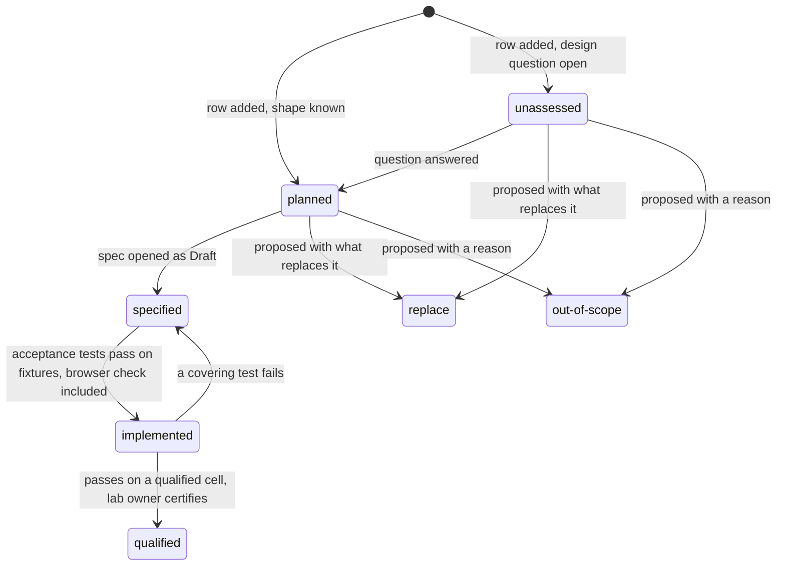

# Parity ledger: method

J-Wicket measures parity against one named release: **J-Web for SRX Series 24.4**. The ledger has
one row per J-Web page or operation. A row is done only when its acceptance tests pass on a
qualified platform, and today no row is: nothing has run on a customer platform, and no row is even
`implemented` yet. The Spec 001 and Spec 004 backends pass on synthetic fixtures, but their rows
wait at `specified` for the browser checks (section 5).

| File | What it is |
| --- | --- |
| [`jweb-24.4.csv`](jweb-24.4.csv) | The ledger. Authoritative |
| [`jweb-24.4.md`](jweb-24.4.md) | Summary: counts by menu, status, priority and spec; the `P0` and `P1` rows; the `replace` and `out-of-scope` rows with their reasons; open gaps |
| This page | What parity means, the columns and vocabularies, how rows move, how the ledger is checked |

## 1. What parity means here

The charter's bar: an authorized operator can complete the same tasks as on the reference J-Web
release ([charter](../charter.md), [ADR 0008](../adr/0008-release-scoped-parity.md)).

- **Same tasks, not same screens.** A row is met when J-Wicket lets the operator do what the J-Web
  operation does. J-Wicket may do it differently: a `replace` row says how, and the owner approves
  it.
- **One row per documented operation**, keyed to the J-Web 24.4 guide. List, search, detail, add,
  edit, clone, delete, move and each wizard step are separate rows when the guide documents them
  separately.
- **Done means qualified.** `implemented` (fixtures) is not done. The G2 gate counts a `P0` or `P1`
  row only when it is `implemented` and `qualified`. Governance also counts an `out-of-scope` row
  with owner approval, and a `replace` row once its replacement is implemented and qualified; those
  two clauses are **proposed** additions to the gate (D7,
  [governance, gates](../governance.md#3-gates-g0-to-g5)).
- **Beyond parity has no row.** J-Wicket workflows with no J-Web equivalent (the preview-only
  Firewall Policy Builder, the [catalog's](../catalog.md) N1 to N5) are not rows. Their specs say
  "beyond parity" ([spec template](../specs/000-template.md)), and the closest row's notes point to
  them.

## 2. Why release-scoped

[ADR 0008](../adr/0008-release-scoped-parity.md) records the choice (Proposed until the owner
accepts it, [governance D11](../governance.md#25-decisions-pending)). "Parity" without a named
release and an itemised list cannot be tested and will drift. J-Web's structure moves between releases: the
25.2 guide's table of contents has 276 topics against 24.4's 453 (both counted as unique topic URLs,
without `index.html` and the PDF), adds a "Shared Objects and Identity" section and has no top-level
"Security Policies and Objects" or "Security Services" section (**verified**, as recorded in
[governance 2.3](../governance.md#23-the-parity-reference-release)). A ledger keyed to a moving
target cannot measure progress.

The spike report's narrower "branch admin's normal week" scope survives as **priority**, not as the
definition of done ([charter, section 6](../charter.md#6-from-a-branch-admins-normal-week-to-release-scoped-parity)).

The reference release says what parity means. The qualified releases say which Junos releases
J-Wicket runs on. They are separate: J-Wicket can be qualified on 22.4 while parity is measured
against J-Web 24.4 ([governance 2.3](../governance.md#23-the-parity-reference-release)).

## 3. The reference release and its sources

**J-Web User Guide for SRX Series Firewalls, release 24.4.** The spike ran on vSRX 24.4R2-S3.5,
the same release line. Juniper's documentation URLs now redirect to networkingdocs.hpe.com. All
**verified** on 2026-11-24.

| Source | URL | Used for |
| --- | --- | --- |
| Guide, canonical landing page | <https://networkingdocs.hpe.com/documentation/us/en/software/jweb-srx24.4/jweb-srx/index.html> | Release and title (`<meta name="release" content="jweb-srx 24.4">`) |
| Guide, juniper.net path | <https://www.juniper.net/documentation/us/en/software/jweb-srx24.4/jweb-srx/> | Answers `301 Moved Permanently` to the canonical page |
| Machine-readable table of contents | <https://networkingdocs.hpe.com/documentation/us/en/software/jweb-srx24.4/jweb-srx/__toc.js> | 453 topics with URLs: the page list and the row order within a menu |
| PDF | <https://networkingdocs.hpe.com/documentation/us/en/software/jweb-srx24.4/jweb-srx/jweb-srx.pdf> | 1,156 pages, published 2025-09-18. Its "You are here" lines give the UI breadcrumbs used as `menu_path`; its tables give fields and columns |
| Explore J-Web topic | <https://networkingdocs.hpe.com/documentation/us/en/software/jweb-srx24.4/jweb-srx/topics/topic-map/j-web-security-exploring.html> | The top-level menus, the banner elements and the wizard list |

**Menus in scope**, in ledger order: Dashboard, Monitor, Device Administration, Network, Security
Policies & Objects, Security Services (the side pane, per Explore J-Web), then the cross-cutting
areas: Getting Started (including the Setup Wizard), "Add SRX Series Firewall to Security Director
Cloud", and the banner (top pane). The UI spells "Security Policies & Objects"; the guide's table of
contents spells "Security Policies and Objects". The ledger uses the UI spelling.

**Limit.** The ledger is built from the guide, so it is only as complete as the guide. Pages the
24.4 UI has but the guide does not document are unknown until a J-Web 24.4 reference observation on
a lab device ([governance 4.12](../governance.md#412-proposed-additions)).

## 4. Columns

The header is fixed, in this order:
`id,menu_path,page,operation,junos_hierarchy,source_url,source_status,platform_notes,jwicket_status,priority,spec,jwicket_notes`.

| Column | Content | Rules |
| --- | --- | --- |
| `id` | Stable key: `<MENU>-<PAGE>-<OP>`, capitals, digits and hyphens, for example `SPO-SECPOL-VIEW` | Unique. Never reused or renumbered. The prefix names the menu (table below). Page slugs never end in two digits, so an id cannot be mistaken for a Q-test id such as `Q-NET-01` |
| `menu_path` | The UI breadcrumb, `>`-separated, for example `Network > NAT > Pools` | The first element is a menu from section 3, spelled as there. From the PDF's "You are here" lines where the guide has one |
| `page` | The page, tab, dialog or wizard step as the guide names it | A guide workflow topic that spans pages is named `Workflow: <title>` |
| `operation` | What the operator does, in the guide's words where possible | One operation per row. Granularity differs between menus today ([summary, gap 22](jweb-24.4.md#data-quality)) |
| `junos_hierarchy` | The configuration hierarchy (`[edit ...]`) or operational command the operation reads or writes; `n/a (<reason>)` when the operation has no Junos hierarchy of its own | Each entry carries its own marker word, in brackets (`[inferred]`, `[CLI-ref verified]`, `[doc]`, `[unknown]`), in parentheses, or in the text: `verified` (including `CLI-ref verified` and `verified, guide example`), `doc`, `inferred`, `unknown`, or `exists`. `exists` (also written "statement exists") means the CLI reference shows the statement or command exists; that J-Web's operation uses it is inferred unless the cell says more. Two forms need no marker word: `n/a (<reason>)`, and `as <ID>`, which takes the named row's mapping. [`tests/test_docs.py`](../../tests/test_docs.py) checks every cell. Never invent a statement, command or RPC: write unknown and name the Q-test (usually Q-REL-01) |
| `source_url` | The 24.4 guide topic that documents the operation: the task topic when one exists, else the page's About topic | `https://` on networkingdocs.hpe.com, or the juniper.net path that redirects there. `local:jweb-srx.pdf#page=<n>` cites a page of the 24.4 PDF when no topic page carries the fact (no row uses it today). A `verified` row must cite the 24.4 guide; a row whose existence in 24.4 is `unknown` may cite an earlier guide and say so (`DA-SW-INSTALL` cites 23.4) |
| `source_status` | `verified`: the 24.4 guide documents the page and operation as described. `inferred`: read from indirect evidence. `unknown`: whether the 24.4 UI has it is not known | About the J-Web side only. The Junos mapping has its own markers |
| `platform_notes` | Model, release, licence and mode limits the guide states, and guide defects, each marked | May be empty. Guide defects are recorded here, not copied as behaviour |
| `jwicket_status` | One of the statuses in section 5 | |
| `priority` | One of the priorities in section 6 | A proposal until the owner approves it |
| `spec` | The covering spec's three-digit number, for example `001` for [`docs/specs/001-policy-inventory.md`](../specs/001-policy-inventory.md); empty when none | Required for `implemented`, `qualified` and `specified`. For `replace`, the spec that delivers the alternative, if one exists. One number per row |
| `jwicket_notes` | What J-Wicket does or will do, with evidence: code paths, acceptance-criterion ids (`AC-NNN-xx`), UI requirement ids, Q-test ids | For `implemented`, what remains before `qualified`. For `specified`, the criteria that already pass and the one that holds the row back (for example a browser check not met). For `replace`, what replaces the operation; for `out-of-scope`, the reason. Both end "Owner approval pending." until the owner approves |

| `id` prefix | Menu |
| --- | --- |
| `DASH` | Dashboard |
| `MON` | Monitor |
| `DA` | Device Administration |
| `NET` | Network |
| `SPO` | Security Policies & Objects |
| `SVC` | Security Services |
| `GS` | Getting Started |
| `SDC` | Add SRX Series Firewall to Security Director Cloud |
| `BAN` | Banner (top pane) |

**File format.** UTF-8, LF line ends, RFC 4180 quoting. Write it with a CSV library, not by hand:
`junos_hierarchy` often contains commas and `|`. Rows are sorted by menu in the order above; within
a menu they follow the guide's table of contents.

## 5. Statuses

| Status | Means | Needs |
| --- | --- | --- |
| `implemented` | A spec covers the row and its acceptance tests pass on fixtures, the browser check included when the operation is done in the browser. Not yet on a qualified device | `spec`; notes name the criteria and what is still missing |
| `qualified` | Passes on a qualified platform cell ([governance 3.2](../governance.md#32-what-qualified-platform-means)). None yet | `spec`; notes name the cells and the evidence record |
| `specified` | A spec covers it (Draft or Accepted); not built, or built but not every acceptance criterion passes on fixtures | `spec`; notes say which criteria pass, if any |
| `planned` | On the roadmap, no spec. Its shape is known from the catalog's decision tree: read view, preview-only then guided change, or guided action ([catalog 3.1](../catalog.md#31-the-four-shapes)) | |
| `replace` | J-Wicket offers a different, better way; the notes say what | Notes; owner approval |
| `out-of-scope` | Not offered; the notes give the reason | Notes; owner approval |
| `unassessed` | A design question is open (an upload, a conversion, an unknown source or command); the notes say which | |

**Status and priority are independent.** Status says how far the work has got; priority says when it
matters. A `P4` row can be `planned` once its shape is known, even though `P4` has no roadmap phase;
work on it starts only when the owner raises its priority ([governance section 7](../governance.md#7-roadmap)).

**UI criteria count.** Most rows are operations an operator does in the browser. Such a row is
`implemented` only when its spec's browser check passes too (AC-001-21 for Spec 001, AC-004-20 for
Spec 004). Until then it stays `specified`, and its notes name the backend criteria that pass. On
2026-11-24 that holds 38 rows back ([summary, gap 4](jweb-24.4.md#owner-decisions)). Counting them as
`implemented` before the browser check would need the owner to redefine the status here and in
governance.

**Never overclaim.** When J-Wicket covers only some of a J-Web element, split the row so that the
built part can move ahead of the rest (for example `DASH-W-SYSID-IDENTITY` and
`DASH-W-SYSID-OTHER`). Code without a spec stays below `implemented`: sign-in and sign-out are built
and tested but `planned`, because no numbered spec owns them yet.

## 6. Priorities

Priorities follow the spike report's phases, as the charter maps them
([charter, section 6](../charter.md#6-from-a-branch-admins-normal-week-to-release-scoped-parity)), and
the roadmap phases in [governance section 7](../governance.md#7-roadmap). The owner decides each
row's priority ([decision rights](../governance.md#1-decision-rights)); until then it is a proposal.

| Priority | Means | Roadmap phase | Gate where it matters |
| --- | --- | --- | --- |
| `P0` | Foundation and first slices: sign-in through Junos, TLS, the scope banner, the read-only policy inventory (Spec 001), live sessions and logs (Spec 004) | 1. Foundation | G1 for the foundation; G2 needs the rows qualified |
| `P1` | See everything, read-only | 2. See everything | G2 |
| `P2` | Change safely: policies and objects, NAT, interface addressing, static routes; the commit protocol | 3. Preview-only builder, 4. Change safely | G3 (preview half), G4 |
| `P3` | Operate and set up: ping, traceroute, policy match test, restore, setup; niche read views | 5. Operate and set up | Read-only items after G2; writes after G4 |
| `P4` | Later, or maybe: rare or high-risk operations, content security, IDP and advanced threat features | None | None until the owner raises it |

## 7. How a row moves from planned to qualified

| Step | Who | What changes in the row | Evidence |
| --- | --- | --- | --- |
| Add a row | Contributor | New row in menu order, with `menu_path`, `page`, `operation`, `source_url`, `source_status`; status `planned` or `unassessed` | The guide topic ([CONTRIBUTING](../../CONTRIBUTING.md), step 1) |
| `planned` to `specified` | Contributor, in the spec's pull request | `spec` set; status `specified` | The spec at Status "Draft"; the spec lists the rows it covers |
| `specified` to `implemented` | Contributor, in the code pull request | Status `implemented`; notes name the `AC-NNN-xx` criteria that pass and what is still open | The spec's acceptance table shows the row's criteria met on fixtures, including the browser check for a browser operation |
| `implemented` to `qualified` | Lab owner certifies | Status `qualified`; notes name the cells (for example "vSRX, 24.4") and the evidence record | Recorded replies (Q-REL-01) and an evidence record under [`docs/evidence/`](../evidence/), per [governance section 6](../governance.md#6-evidence-rules) |
| Back down | Whoever finds it | A failing covering test, or a spec change that drops the row, moves it back in the same pull request | The failing test or the spec diff |
| `replace` or `out-of-scope` | Contributor proposes; owner decides | Notes give the alternative or the reason and end "Owner approval pending." On approval that sentence becomes "Owner approved YYYY-MM-DD in #<pull request>." | The pull request; an ADR when the reason is a principle |
| Priority | Contributor proposes; owner decides | `priority` | The pull request |

`qualified` is per cell. A row qualified on vSRX 24.4 is not qualified on SRX300; the notes say
which cells.

## 8. Changing the reference release

Only the owner moves it, through the steps in
[governance 2.3](../governance.md#23-the-parity-reference-release):

1. A pull request adds `jweb-<release>.csv`, built by this method. The 24.4 ledger stays.
2. The pull request includes a diff of the two ledgers: rows added, removed, renamed or moved to a
   different menu, and rows whose page changed behaviour, each with the spec it affects.
3. Status carries over only where the page and the Junos hierarchy it touches are unchanged.
   Anything else drops to `specified` or `planned`, and the diff says which.
4. A new ADR supersedes the reference choice in ADR 0008, linking the diff. The owner accepts it.
5. The project README, the charter, the ledger summary, this page and governance are updated in the
   same pull request, and [`tests/test_parity_ledger.py`](../../tests/test_parity_ledger.py) is
   pointed at the new ledger.

## 9. How the ledger is checked

[`tests/test_parity_ledger.py`](../../tests/test_parity_ledger.py) runs with the rest of the suite
(`make test`, and CI on every pull request). It uses the standard library only. It checks that:

- the CSV parses, the header is exactly the one in section 4, and every row has the required fields
  (`id`, `menu_path`, `page`, `operation`, `source_url`, `source_status`, `jwicket_status`,
  `priority`);
- ids are unique, well formed, and their prefix matches the row's menu;
- rows are sorted by menu in the ledger order, and every menu is one of section 3's;
- every `jwicket_status`, `priority` and `source_status` is in its vocabulary;
- every `source_url` is `https://` on networkingdocs.hpe.com or juniper.net, or
  `local:jweb-srx.pdf#page=<n>`, and every `verified` row cites the 24.4 guide;
- every non-empty `spec` names exactly one file under [`docs/specs/`](../specs/), and every
  `implemented`, `qualified` and `specified` row names one;
- every `replace` and `out-of-scope` row has notes that say "Owner approval pending" or "Owner
  approved";
- every count table and row list in [`jweb-24.4.md`](jweb-24.4.md) matches the CSV. A table is
  found by the `<!-- ledger-table: ... -->` or `<!-- ledger-rows: ... -->` comment above it. On a
  mismatch the failure prints the expected table, ready to paste.

[`tests/test_docs.py`](../../tests/test_docs.py) adds one ledger check: every `junos_hierarchy` cell
carries a marker (section 4).

It does not check that a status is true. Reviewers check each status against the spec's acceptance
table and the code. It does not fetch URLs (tests make no network calls), and it cannot check a
Junos mapping: Q-REL-01 does that.

**When you edit the CSV:** keep the menu order, run `make test`, and update the tables and lists in
`jweb-24.4.md` from the failure messages. Update the summary's prose (the point, the gaps) by hand.
