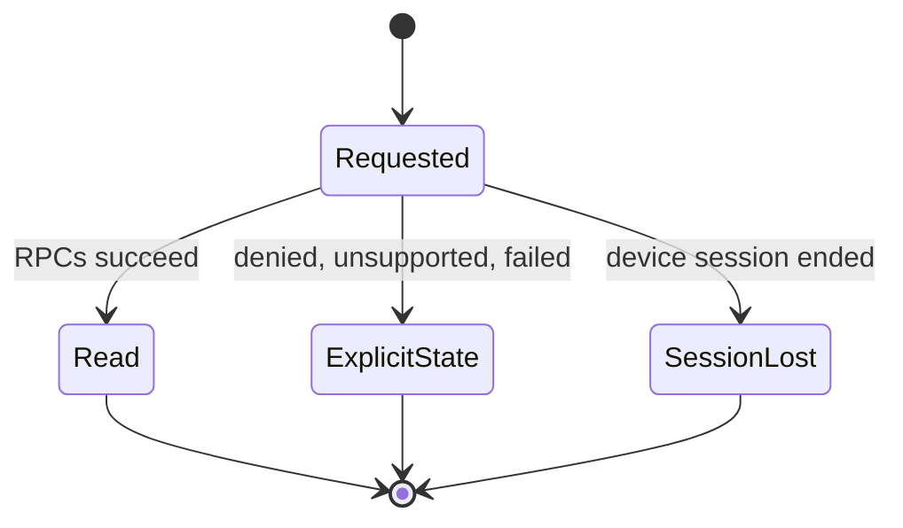

# Spec NNN: Title in plain words

<!--
How to use this template. Delete this comment block in a real spec.

1. Copy this file to docs/specs/NNN-short-name.md, with the next free three-digit number. Never
   reuse a number, even for a withdrawn spec.
2. Open it in a pull request with Status "Draft". The project owner accepts a spec; the security
   reviewer also reviews any spec that touches sign-in, transport, the RPC allowlist, secrets or
   writes (docs/governance.md, sections 1 and 2.2).
3. Keep every section below that applies, in this order. Sections marked "(optional)" are for
   specs that need them: Spec 002 used most of them; Specs 001 and 004 used none. Number the
   sections you keep consecutively, and their sub-sections to match. Without the optional
   sections the numbering is the one Specs 001 and 004 use: 5 Behaviour, 6 Data sources,
   7 Junos semantics, 8 UI requirements, 9 Security considerations, 10 Acceptance tests,
   11 Qualification needed, 12 Open questions. Delete the guidance text (the paragraphs in
   italics) as you fill each section.
4. Writing rules: lead with the point; short sentences; plain words; tables where they help;
   Mermaid diagrams (```mermaid fences) for flows, state machines and trust boundaries.
5. Labels. Mark every claim about Junos, J-Web or a device:
   - **verified**: a cited source (URL, or a file in docs/evidence/) says it;
   - **inferred**: your reading of verified facts; it needs a lab test before anyone relies on it;
   - **unknown**: nobody has checked; name the qualification test (Q-...) that will settle it;
   - **proposed**: a design choice this spec makes, for the owner or the reviewer to accept.
   Never invent Junos CLI, RPC names, XML element names, J-Web menu names or behaviour. If you are
   not sure, write "unknown" and name the test.
6. Describe implemented behaviour from the code, not from memory, and link the file paths.
   Fixtures are synthetic: a test that passes on them shows what the code does, not what a device
   does. Say so wherever it matters.
-->

| Field | Value |
| --- | --- |
| Status | **Draft.** *One of: Draft; Accepted; Implemented on fixtures (say which parts); Qualified on (cells); Superseded by NNN. Follow it with one honest sentence, for example "Nothing is built. Never run on a device. Nothing qualified."* |
| Parity priority | *`P0` to `P4`, as the [parity ledger](../parity/jweb-24.4.csv) assigns; or "beyond parity" for a J-Wicket workflow J-Web 24.4 does not have (name the [catalog](../catalog.md) entry, for example N2)* |
| Gate | *The gate this spec is part of, and the gate at which its ledger rows can reach `qualified` ([governance](../governance.md#3-gates-g0-to-g5)). Anything that writes to a device: G4, through [Spec 002](002-change-protocol.md)* |
| Decides scope | *Project owner. Add the sign-offs the gate needs, for example "G1 sign-off: the named security reviewer"* |
| Code | *Links to the modules that implement it, or "None" (for a design-only spec, say what in the code guarantees it cannot run, as Spec 002 does)* |
| Tests | *Links to the test files, or "None yet", pointing to the Acceptance tests section* |
| Decisions it rests on | *The ADRs in [`docs/adr/`](../adr/README.md) this spec depends on, and any new ADR it needs (open question)* |

## 1. Status

*Lead with the point: one paragraph that says what this feature lets an operator do, and how much
of that is true today. Then a table of its parts. Never claim more than the evidence shows: "on
synthetic fixtures only" is the normal state until Q-REL-01 has recorded replies for it.*

The point: *what an operator can do with this, in one or two sentences.*

| Part | State | Evidence |
| --- | --- | --- |
| *Backend, parser, endpoint* | *Not built / Implemented / Qualified on (cell)* | *Test names that pass, with the file* |
| *UI* | *Not built / Built* | *The browser check (acceptance criterion) or "not met"* |
| On a device | **Not run.** | *What the spike did or did not show, with a link to [the evidence](../evidence/2026-11-23-vsrx-spike/README.md)* |

*Say how the fixtures were made (by hand, from YANG or documentation, or recorded), and what a
passing test therefore proves. Say which ledger status the spec's rows have today (`planned`,
`specified`, `implemented`).*

## 2. Problem

*What the operator needs to know or do, and what goes wrong today. Write it as the operator's
questions where you can. Then the J-Web 24.4 baseline: the page or operation in the reference
release, its menu path, and what the guide says it does, each **verified** with a URL from the
[J-Web 24.4 guide](https://networkingdocs.hpe.com/documentation/us/en/software/jweb-srx24.4/jweb-srx/).
Name the ledger rows this spec covers. If the owner set a binding requirement for this area, quote
it.*

*If the problem has several distinct failure modes (as change has, in Spec 002), use numbered
sub-sections.*

## 3. Users and jobs

*Who uses this and for what. One row per job. Include the least-privileged user (auditor,
read-only class) and say what they see.*

| User | Job | What this spec gives them |
| --- | --- | --- |
| *Operator during an incident* | *"The question, in their words."* | *The feature that answers it* |
| *Auditor or read-only operator* | *"Am I seeing everything my class allows, and only that?"* | *Denied reads shown as denied* |

## 4. Scope and non-scope

**In scope:**

- *Each capability, as a short bullet. Mark "(implemented)" where it is.*

**Not in scope:**

| Not here | Why, and where it goes |
| --- | --- |
| *A capability someone will expect* | *The reason, and the spec, ADR or ledger row that owns it* |

*Name what is deliberately left out, so nobody assumes it was forgotten: writes (Spec 002),
"which policy matches" answered by J-Wicket ([ADR 0006](../adr/0006-device-explains-policy-decisions.md)),
candidate configuration ([ADR 0005](../adr/0005-committed-config-with-provenance.md)), logical
systems and tenants if not covered, cluster or MNHA details.*

## 5. Principles (optional)

*For a protocol or a cross-cutting spec (Spec 002 section 5). Rules the design must keep, each
with its basis. Leave this out for a single feature.*

| # | Principle | What it means in practice | Basis |
| --- | --- | --- | --- |
| P1 | *Short name* | *The concrete rule* | *ADR, verified source, or **proposed*** |

## 6. Behaviour

*What the code does, precisely enough to test. Use sub-sections. The usual ones are below; keep
those that apply.*

### 6.1 Endpoints

*Every route: method, path, parameters with their validation (patterns end in `\Z`, with length
bounds), the result. Then the errors.*

| Request | Result |
| --- | --- |
| `GET /api/<name>?param=<value>` | *200 and the response (6.3). Parameter rules* |

| Status | When | Extra fields |
| --- | --- | --- |
| 400 | *Malformed parameter* | |
| 401 | *No valid session* | *`signed_out: true` when the device session was lost* |
| 429 | *Read again within the floor* | *`retry_after_s`, and a `Retry-After` header* |

*State which failures are not HTTP errors: a failed device read is a 200 response whose panel
carries an explicit state ([ADR 0004](../adr/0004-no-sample-data.md)).*

### 6.2 Read sequence or lifecycle

*The order of RPCs for one request, and what happens when each fails. For anything with states (a
change, a session, a poll), draw the state machine:*



### 6.3 Response shape

*The JSON, field by field, with types and meanings. Include the scope stamp every response carries
(device, node and role, scope, read-as user and backend, source, read time, fixture flag, central
managers detected).*

### 6.4 Explicit states and warnings

*Which panels can be `denied`, `unsupported`, `failed` or `session-lost`, the operator-safe message
for each, and the warnings this feature raises. Empty must never mean "could not read".*

### 6.5 Rate limits and device cost

*How often this can reach the device: per-operator floors, RPCs per request, caps, refusals. Say
what one read costs on the routing engine, mgd and the system log (`UI_NETCONF_CMD`), and which
Q-LOAD test measures it.*

### 6.6 Export (if any)

*What leaves the device, how it is stamped, and how it is made safe (for example CSV formula
neutralising).*

### 6.7 Audit

*The audit events this feature writes, with their fields. The audit trail never holds passwords,
tokens, cookies, CSRF values or raw configuration. A change spec gives audit its own section
(Spec 002 section 11).*

## 7. Cases the design must handle (optional)

*For any spec that builds or previews a change, and for read specs where the cases change what is
shown. One table row per case, with an ID (Spec 003 uses `BF-`, `GO-` and `RC-` for brownfield,
group ownership and recovery), the expected behaviour, and the acceptance criterion that tests
it. When there are many, give each kind its own numbered sub-section, as Spec 003 does in 7.1 to
7.6. The cross-cutting cases are in the
[catalog, section 3.2](../catalog.md#32-design-cases-that-apply-across-the-catalog):*

- *brownfield: configuration J-Wicket does not model is kept and listed, never rewritten;*
- *group ownership: an object inherited from a configuration group is refused in place, naming
  the group ([ADR 0005](../adr/0005-committed-config-with-provenance.md));*
- *recovery: how the operator undoes the result, and what happens if the path to J-Wicket is cut;*
- *high availability: which chassis-cluster node or MNHA node the feature acts on, and its role;*
- *logical systems and tenant systems: scope kept apart, scope-bound operators;*
- *central management: a detected manager shown, and acknowledged before any write
  ([ADR 0009](../adr/0009-central-management-coexistence.md)).*

## 8. Checks, concurrency, recovery, high availability, failure messages (optional)

*For a spec that changes device state. Spec 002 is the model: checks before anything is staged
(section 7); concurrency with other Junos sessions and other J-Wicket operators (8); recovery:
timeout rollback, roll back now, session loss, restart, reboot (9); chassis cluster and MNHA
behaviour (10); a preview-only mode (12); and the operator message for each failure (13). Use one
numbered section for each that applies. A spec that builds on Spec 002 names the sections it
reuses instead of restating them.*

## 9. Data sources

*Every read: the RPC (from `ALLOWED_RPCS` in
[`junos/session.py`](../../src/jwicket/junos/session.py)) or the configuration subtree, its
options, the login-class permission it needs, and how sure each fact is. Read the narrowest subtree
the feature needs; never the whole configuration, and never `system login` or other secret-bearing
hierarchies.*

| Read | RPC and options | Filter | Permission | Status |
| --- | --- | --- | --- | --- |
| *Device identity* | *`rpc-name` with options* | *none, or the filter constant* | ***verified** with a source, or **unknown** (Q-AUTH-03)* | *RPC and elements **verified** (source) / **inferred** / **unknown** (Q-REL-01)* |

*Then the element names the parser reads:*

| Path | Used for | Status |
| --- | --- | --- |
| *`hierarchy/element/child`* | *What it feeds* | ***verified** (YANG release, or a recorded reply) / **inferred*** |

*Allowlist impact: list every RPC this spec adds to `ALLOWED_RPCS`. A new RPC needs a recorded
reply from a lab device and the security reviewer's review ([CONTRIBUTING.md](../../CONTRIBUTING.md)).
Only read-only RPCs before G4; `test_allowlist_is_read_only` enforces it today through the `get-`
prefix. No RPC name, attribute, filter or configuration text may be built from request input. A
spec whose reads are part of a flow may list them with the flow's steps instead, as Spec 002 does
in its lifecycle table (6.2), and collect the allowlist impact in a section of its own (Spec 002
section 14).*

## 10. Junos semantics this feature depends on

*Each thing about Junos the design assumes (evaluation order, inheritance, inactive configuration,
scopes, release differences, permissions), one sub-section each: what J-Wicket assumes, how sure
that is, the source, and the test that would settle it. This is where a reader checks whether the
feature is right, not only whether the code matches the spec.*

### 10.1 *Topic*

*Assumption. **Verified** / **inferred** / **unknown**, with the source or the Q-test.*

## 11. What is verified, inferred and unknown, in one place (optional)

*Recommended when the spec relies on many facts of mixed certainty (Spec 002 section 15). One row
per claim the design rests on.*

| Claim the design relies on | Status | Settled by |
| --- | --- | --- |
| *A behaviour of Junos* | ***Verified** / **Inferred** / **Unknown*** | *— or the Q-test* |

## 12. UI requirements

*Requirements, not screen descriptions. Number them `UI-NNN-01`, `UI-NNN-02` and so on, with a
status. These hold for every view:*

- *the scope banner (device, release, HA mode and role, scope, read-as user with the `lab-token`
  variant, source, read time, "also managed from" worded as detected);*
- *the full-width fixture banner whenever `meta.fixture` is true;*
- *every panel is device data or an explicit state card with the server's message;*
- *no device data in `localStorage`, `sessionStorage` or IndexedDB; UI preferences only;*
- *all text through `textContent`; no `innerHTML`; the strict CSP and Trusted Types hold;*
- *keyboard reachable; AA contrast in both themes.*

| ID | Requirement | Status |
| --- | --- | --- |
| UI-NNN-01 | *One testable requirement* | *open / built / checked in a browser* |

## 13. Security considerations

*One bullet per concern, each with the control and the test that proves it: input validation;
least privilege (the operator's own class; the `lab-token` backend's limits); secrets (what is read,
what never leaves the parser); hidden versus empty; error text (operators see fixed messages,
device text stays in the diagnostic log); exports; load on mgd and the routing engine; browser
rules; anything this feature adds to the attack surface (a route, a parameter, an RPC, a setting).
Say which Q-SEC-01 questions it raises.*

## 14. Acceptance tests

*What must be true for the spec's ledger rows to be `implemented`, each with the tests that prove
it and an honest status. A row whose operation is done in the browser needs the browser criterion
too; until it passes, the row stays `specified` ([ledger method](../parity/README.md#5-statuses)). Number them `AC-NNN-01` and so on. Test names are `Class.method` in the
linked file. "Met (fixtures)" means the named tests pass against synthetic fixtures; "Met (unit)"
means a pure module passes its unit tests. Nothing is met on a device until Q-REL-01 and the
qualified-platform rule say so.*

*If the criteria need new fixtures, list them first in a sub-section (Spec 003 section 14.1):
which directory, what each shows, and that it is synthetic. Say where each criterion runs: in CI
against fake device sessions, in a browser, or on lab equipment.*

| ID | Criterion | Tests | Status |
| --- | --- | --- | --- |
| AC-NNN-01 | *One behaviour, stated so it can fail* | *`test_file.py`: `Class.method`* | *Not met / Met (fixtures) / Met (unit)* |
| AC-NNN-xx | UI requirements UI-NNN-01 to UI-NNN-xx in a browser against the development server (name the fixtures and users), with no console errors or CSP violations | *Browser check* | *Not met* |
| AC-NNN-yy | The criteria above pass against recorded replies from a qualified platform | Q-REL-01 recorded fixtures (`tests/fixtures/recorded-<platform>-<release>/`) | **Not met** |

## 15. Qualification needed

*Which qualification tests this spec depends on, and what each settles for it. Definitions,
methods and pass criteria are in [governance.md](../governance.md#4-qualification-test-catalogue).*

| Test | What it settles for this spec |
| --- | --- |
| Q-REL-01 | *The replies to record: RPCs, options, the platforms and set-ups (cluster, multi-SPU), the error shapes* |
| Q-AUTH-03 | *What a restricted class sees here, and whether hidden data is omitted or refused* |

*If this spec owns a family of new tests (as Spec 002 owns Q-CHG), define each one here with
purpose, method, pass criterion and platforms, and add the family to the governance catalogue in
the same pull request. Do not reuse or renumber an existing ID. To ask for an addition to an
existing test's method, write "Proposed addition to its method" in its row, as Spec 003 does.
End with what the gate needs from this spec, for governance to confirm.*

## 16. What this spec needs from other specs (optional)

*When the spec builds on others (Spec 003 needs Spec 001's model and Spec 002's preview-only
mode), list each dependency: the section, what it must provide, and whether it exists yet. A
missing dependency is also an open question in the other spec.*

## 17. Open questions

*Everything not decided. Each names who decides (project owner, security reviewer, lab owner,
contributors) and what settles it (a Q-test, an ADR, a unit test, a ledger decision).*

| # | Question | Who decides | Settled by |
| --- | --- | --- | --- |
| 1 | *The question, with enough context to answer it* | *Owner* | *Q-..., an ADR, a unit test* |

## Sources

*Every page you relied on, with the date you read it. `juniper.net/documentation` paths now
redirect (HTTP 301) to the same path on `networkingdocs.hpe.com`; cite the HPE host. Reference-style
links keep tables readable:*

[jweb-244]: https://networkingdocs.hpe.com/documentation/us/en/software/jweb-srx24.4/jweb-srx/
