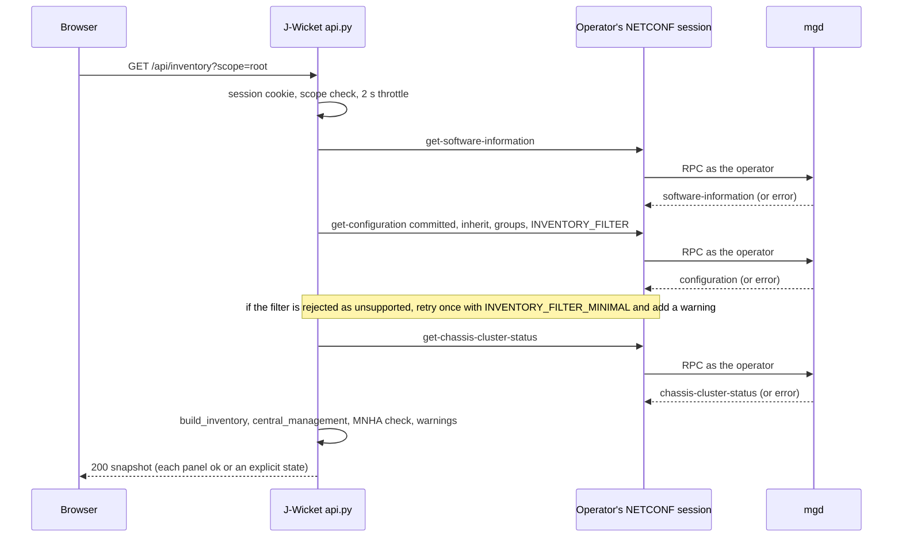
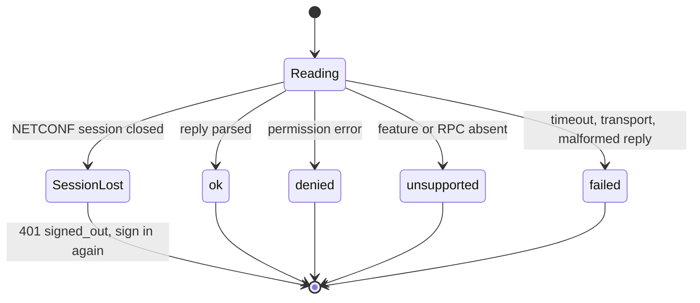
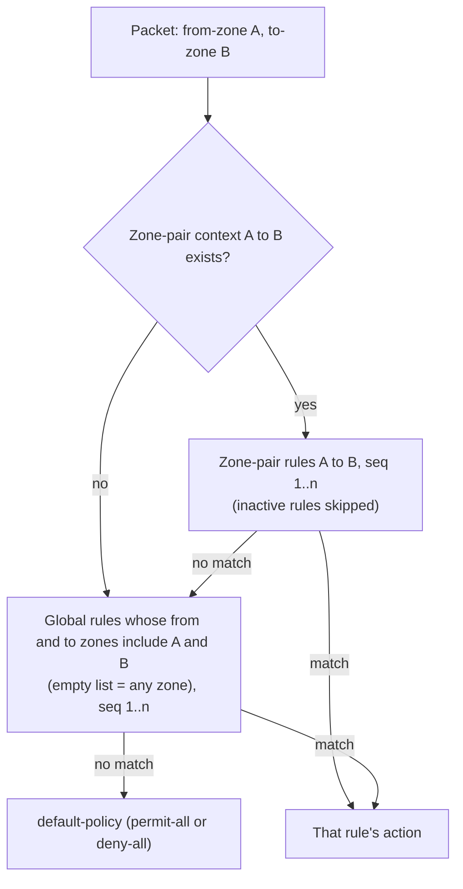

# Spec 001: Scoped read-only policy inventory

| Field | Value |
| --- | --- |
| Status | **Backend implemented on synthetic fixtures. UI v2 views built in the working tree, not yet committed, not yet checked in a browser. Never run on a device. Nothing qualified.** |
| Parity priority | `P0` (first vertical slice) |
| Gate | Part of G1 (foundation exit); its ledger rows reach `qualified` only at G2 |
| Decides scope | Project owner. G1 sign-off: the named security reviewer |
| Code | [`junos/inventory.py`](../../src/jwicket/junos/inventory.py), [`junos/facts.py`](../../src/jwicket/junos/facts.py), [`junos/session.py`](../../src/jwicket/junos/session.py), [`junos/xmlutil.py`](../../src/jwicket/junos/xmlutil.py), [`junos/errors.py`](../../src/jwicket/junos/errors.py), [`api.py`](../../src/jwicket/api.py) |
| Tests | [`test_inventory.py`](../../tests/test_inventory.py), [`test_facts.py`](../../tests/test_facts.py), [`test_api_units.py`](../../tests/test_api_units.py), [`test_http_server.py`](../../tests/test_http_server.py), [`test_session.py`](../../tests/test_session.py), [`test_xmlutil.py`](../../tests/test_xmlutil.py), [`test_errors.py`](../../tests/test_errors.py), [`test_live.py`](../../tests/test_live.py) (`SnapshotVisibilityTests`), [`tests/js/query.test.mjs`](../../tests/js/query.test.mjs) |
| Decisions it rests on | [ADR 0002](../adr/0002-junos-delegated-sign-in.md), [0004](../adr/0004-no-sample-data.md), [0005](../adr/0005-committed-config-with-provenance.md), [0006](../adr/0006-device-explains-policy-decisions.md), [0007](../adr/0007-offline-capable-meaning.md), [0009](../adr/0009-central-management-coexistence.md) |

## 1. Status

The point: J-Wicket can read a committed SRX configuration and show every security policy of one
scope in Junos evaluation order, with the group each rule came from, its inactive state and its
resolved addresses and applications, and it says plainly what it could not read. All of that is
true **on synthetic fixtures only**. No recorded device reply has been parsed yet.

| Part | State | Evidence |
| --- | --- | --- |
| Configuration parser and resolver | Implemented | `test_inventory.py`, `test_xmlutil.py`: pass on fixtures |
| Device facts (identity, HA, central management) | Implemented | `test_facts.py`, `test_api_units.py`: pass on fixtures |
| Read path, explicit states, read throttle, audit | Implemented | `test_api_units.py`, `test_http_server.py`, `test_live.py` (`SnapshotVisibilityTests`): pass |
| JSON and CSV export | Implemented | `test_http_server.py` (`InventoryTests`, `CsvInjectionTests`), `test_api_units.py` (`CsvTests`): pass |
| UI v1 (`static/app.js`, as committed at `276f9a6`) | Built: evaluation-order sections, provenance badges, detail panel, CLI templates, matrix | Superseded by v2, which replaces it in the working tree |
| UI v2 Policies and Objects views | **Built in the working tree, not yet committed, not yet checked in a browser** (AC-001-21 not met) | The shared query engine for policies is unit-tested: `tests/js/query.test.mjs` passes |
| On a device | **Not run.** The spike read the configuration as JSON without inheritance, as the daemon's account; this parser has never seen a real reply | [Spike report](../evidence/2026-11-23-vsrx-spike/docs/J-Wicket-spike-report-and-product-plan.md), "What is not proven" |

The fixtures in [`tests/fixtures/`](../../tests/fixtures/README.md) are written by hand. Their
element names come from Juniper's published YANG for 24.4R2 and from Juniper documentation, so a
passing test shows that the parser agrees with J-Wicket's reading of the schema, not that it
agrees with a device. Q-REL-01 closes that gap.

In parity-ledger terms the 12 rows this backend covers stay `specified`. The backend and
query-engine criteria pass on fixtures and in unit tests (AC-001-01 to AC-001-20), but each row is
an operation done in the browser, and AC-001-21, the browser check, has not passed. A row becomes
`implemented` only when its criteria pass, the browser check included
([ledger method, section 5](../parity/README.md#5-statuses)).

## 2. Problem

An operator who wants to know what an SRX enforces has to answer five questions before reading a
single rule, and J-Wicket must answer them on screen:

1. **Which configuration?** Junos has a shared candidate database, and a default read can return
   other users' uncommitted edits. Only the committed configuration is in effect.
2. **Which scope?** A device can hold a root system, logical systems and tenant systems, each with
   its own zones, address books and policies. Mixing them is wrong.
3. **In which order?** Rules are evaluated per zone pair in configuration order, then global
   policies, then the default policy (J-Wicket's reading of the documentation; section 7.1). A
   list sorted by name hides that.
4. **Where did it come from?** Brownfield configurations inherit rules and objects from
   configuration groups. The spike read JSON without inheritance, so inherited policies were
   invisible ([ADR 0005](../adr/0005-committed-config-with-provenance.md)). Spec 002 cannot edit
   safely without knowing which group owns an object.
5. **Am I seeing everything?** A login class may not be allowed to read a hierarchy, and Junos may
   omit it rather than refuse. Empty must never be presented as "nothing configured".

The reference page is J-Web 24.4 **Security Policies & Objects > Security Policies**: a rule table
grouped by zone context with columns Seq, Hits, Rule Name, Source Zone, Source Address, Source
Identity, Destination Zone, Destination Address, Dynamic Application, Services, URL Category,
Action, Advanced Security, Rule Options and Schedule, and a Global Policy toggle in the editor
(**verified**, [J-Web 24.4 rules page](https://networkingdocs.hpe.com/documentation/us/en/software/jweb-srx24.4/jweb-srx/topics/concept/j-web-security-about-rules-page.html)).
Spec 001 covers the read side of that page and of Zone Addresses, Global Addresses and the
application objects. It does not cover Hits (section 4).

## 3. Users and jobs

| User | Job | What Spec 001 gives them |
| --- | --- | --- |
| SE or lab engineer (first users, while J-Wicket is unqualified) | "Show me what this box allows from trust to untrust, in the order it is checked." | Evaluation-order sections per zone pair, global policies that apply, default policy |
| Same | "Check this flow on the device." | The exact `show security match-policies` command for the pair, pre-filled only with values the rule names unambiguously |
| Operator preparing a change (Spec 002/003) | "Who owns this rule: the box or a configuration group?" | `group`, `inherited` and `groups` per policy and per object |
| Operator during an incident | "Is this rule even in effect?" | `inactive` with a reason (`policy` or `zone-pair`), deactivated parts listed, scope-level deactivation warned |
| Same | "What does address set `dmz-servers` actually contain?" | Resolved leaves with the address book they came from, truncation and unresolved names stated |
| Auditor or read-only operator | "Am I seeing everything my class allows, and only that?" | Reads run as the operator; denied reads show as denied; a missing `security` section is warned, not shown as empty |
| Anyone | "Which device, release, cluster role and scope is this, and does something else manage it?" | Scope banner fields in every snapshot, including outbound-SSH clients ("also managed from") |
| Reviewer away from the device | "Give me this inventory to review offline." | JSON and CSV export stamped with device, scope, user and read time |

## 4. Scope and non-scope

**In scope (implemented):**

- Scopes: the root system, every `logical-systems <name>` and every `tenants <name>` in the
  configuration the operator can read. Each is a separate inventory, never merged.
- Security policies: zone-pair policies and global policies, with match fields, action, log,
  count, scheduler, application services (tags only), IPsec tunnel name, description.
- Policy-level settings: `default-policy`, `policy-rematch`, presence of `pre-id-default-policy`.
- Zones: interfaces, host-inbound services and protocols (zone and interface level), screen name,
  description.
- Address books: named books with `attach zone`, the book named `global`, and legacy zone address
  books; addresses (prefix, DNS name, range, wildcard) and address sets.
- Applications and application sets defined in the configuration.
- Name resolution for policy addresses and applications, with limits.
- Device facts: hostname, model, release (per node in a cluster), HA classification, outbound-SSH
  clients.
- Warnings for anything not modeled, deactivated, or possibly hidden.
- JSON and CSV export; per-operator read throttle; audit records.

**Out of scope (not in this spec; each has a home):**

| Not here | Why, and where it goes |
| --- | --- |
| Any change to the device | Spec 002 (change protocol), Spec 003 (preview-only builder) |
| "Which policy matches this flow?" answered by J-Wicket | [ADR 0006](../adr/0006-device-explains-policy-decisions.md): the device answers through `show security match-policies` once that RPC is allowlisted in a later spec. Spec 001 gives the CLI to run |
| Hit counts (J-Web's Hits column) | Needs `get-security-policies-hit-count` on the allowlist; runtime data with its own read time. Not specified yet |
| Contents of predefined `junos-*` applications | Shown as `predefined`, not expanded ([ADR 0005](../adr/0005-committed-config-with-provenance.md)) |
| NAT, screen options contents, schedulers, IDP/content-security profiles named in `application-services`, dynamic-application and URL-category resolution | Later read specs; see the [parity ledger](../parity/jweb-24.4.csv) |
| `protect` markers, commit metadata (`junos:commit-user`) | Open questions 12 and 9 |
| Candidate (uncommitted) configuration | Never shown ([ADR 0005](../adr/0005-committed-config-with-provenance.md)) |
| Multinode HA details | `get-chassis-high-availability-information` is not allowlisted; MNHA is detected from configuration only (Q-HA-03) |
| Policies of a logical system read by an LSYS-scoped login class | Reply shape unknown (Q-AUTH-03); see open question 7 |

## 5. Behaviour

### 5.1 Endpoints

| Request | Result |
| --- | --- |
| `GET /api/inventory?scope=<id>` | 200 snapshot (5.3). `scope` defaults to `root`; must match `root`, `lsys:<name>` or `tenant:<name>` with name `[A-Za-z0-9._-]{1,63}` |
| `GET /api/export?scope=<id>&format=json\|csv` | 200 attachment `jwicket-<host>-<scope>-<YYYYMMDDTHHMMSSZ>.<fmt>`; JSON is the snapshot, CSV is described in 5.8 |

Errors, all `{"error": "<operator-safe message>", ...}`:

| Status | When | Extra fields |
| --- | --- | --- |
| 400 | Malformed `scope`; `format` not `json` or `csv` | |
| 401 | No valid session cookie | `signed_out: true` when the operator's device session was lost during this read (the web session is dropped and audited as `session_lost`) |
| 404 | `scope` is well formed but not in the configuration read | `scopes`: the scope summaries that do exist |
| 429 | The same operator read the same endpoint less than 2 s ago (`MIN_READ_INTERVAL_S`) | `retry_after_s`, plus a `Retry-After` header rounded up to whole seconds. Inventory and export have separate buckets, so "load page, then export" works |

A failed device read is **not** an HTTP error. The snapshot is 200 and the failed panel carries
its state (5.4).

### 5.2 Read sequence

One snapshot is one consistent read for one operator, holding that operator's session lock so two
tabs cannot interleave RPCs on one NETCONF session. Every inventory GET reads the device again;
nothing is cached between reads.



Three RPCs per read, four when the filter falls back. Junos logs NETCONF RPCs as
`UI_NETCONF_CMD`, so each read can add lines to the device's own logs (section 7.10).

### 5.3 Snapshot shape

`meta.schema` is `jwicket.inventory/1`. Keys below are exactly what
[`api.read_snapshot`](../../src/jwicket/api.py) and
[`inventory._scope_inventory`](../../src/jwicket/junos/inventory.py) return.

```json
{
  "meta": {
    "schema": "jwicket.inventory/1",
    "read_at": "2026-11-24T06:00:00Z",
    "scope": "root",
    "scopes": [{"id": "root", "label": "Root system", "policies": 10, "inactive": false}],
    "read_as": {"user": "alice", "backend": "netconf"},
    "source": {"database": "committed", "inheritance": true, "groups_annotated": true},
    "fixture": false,
    "generator": "jwicket <version>"
  },
  "device": {"status": "ok", "hostname": "fw1", "model": "vsrx", "version": "24.4R2-S3.5", "nodes": []},
  "ha": {"status": "ok", "mode": "standalone"},
  "management": {"status": "ok", "clients": [{"client": "central-mgr", "targets": ["192.0.2.10:7804"], "services": ["netconf"]}], "managed": true},
  "config": {"status": "ok"},
  "scope": {
    "id": "root", "label": "Root system", "inactive": false,
    "policies": {
      "status": "ok", "rows": ["<policy row>"],
      "default_policy": "deny-all", "default_policy_group": null,
      "policy_rematch": false, "pre_id_default_policy": false,
      "zone_pairs": [{"from": "trust", "to": "untrust", "count": 3, "inactive": 1, "permit": 2, "deny": 0, "reject": 0}],
      "global_count": 2
    },
    "zones": {"status": "ok", "rows": [{"name": "trust", "interfaces": [{"name": "ge-0/0/1.0", "services": ["ssh"], "protocols": [], "group": null}], "services": [], "protocols": [], "screen": null, "description": null, "group": null, "inactive": false}]},
    "address_books": {"status": "ok", "rows": [{"name": "global", "attach": [], "legacy_zone": null, "addresses": [{"name": "h1", "kind": "prefix", "value": "192.0.2.1/32", "description": null, "group": null, "inactive": false}], "sets": [{"name": "s1", "addresses": ["h1"], "sets": [], "description": null, "group": null, "inactive": false}], "group": null, "inactive": false}]},
    "applications": {"status": "ok", "rows": [{"name": "tcp-8443", "kind": "application", "protocol": "tcp", "destination_port": "8443", "source_port": null, "terms": 0, "members": [], "sets": [], "description": null, "group": null, "inactive": false}]},
    "groups": [{"name": "corp-baseline", "policies": 2}],
    "warnings": ["Policy dmz-updates has settings J-Wicket does not display yet: then permit firewall-authentication."]
  },
  "warnings": []
}
```

(Values are illustrative; `"<policy row>"` stands for the object below.)

Field notes:

- `device.nodes` lists `{node, hostname, model, version}` per routing engine only when the reply
  has more than one `multi-routing-engine-item`; the top-level fields are the first node's.
- `ha` is one of: `{status: ok, mode: standalone}`; the same with a `message` when the cluster RPC
  failed in a way that is neither denied nor a timeout; `{status: ok, mode: chassis-cluster,
  cluster_id, redundancy_groups: [{id, nodes: [{name, priority, status}]}], local_node: null}`;
  `{status: ok, mode: mnha, message}`; `{status: ok, mode: unknown, message}` for an unrecognised
  reply; or a panel error. `local_node` is always `null` today: which node serves the page is
  Q-HA-02.
- `management` shares the configuration's fate: if the configuration read failed, it carries the
  same state.
- `scope` is `null` when the configuration could not be read. All sub-panel `status` values are
  `ok` today because they come from one configuration read.
- Address `kind` is `prefix`, `dns`, `range`, `wildcard` or `unknown`. Address-book `name` for a
  legacy zone book is `zone <zone-name>`, with `legacy_zone` set and `attach` = `[zone-name]`.
- Application `terms` is the number of `term` entries; `protocol` and ports are the top-level
  values and are `null` for a term-only application.

**Policy row** (every key is asserted by `test_snapshot_shape_keys`):

| Key | Meaning |
| --- | --- |
| `id` | `<scope>\|zone\|<from>><to>\|<name>` or `<scope>\|global\|global\|<name>`; unique within a snapshot |
| `scope`, `kind` | Scope id; `zone` or `global` |
| `seq` | 1-based position within its zone-pair context (or within `global`), in configuration order |
| `from`, `to` | Zone lists. One zone each for a zone-pair policy. For a global policy, its `match from-zone` / `to-zone` values; empty means any zone |
| `name`, `description` | As configured |
| `match` | `source`, `destination`, `application`, `source_identity`, `dynamic_application`, `url_category`, `source_end_user_profile` (active values only), `source_excluded`, `destination_excluded` (flags) |
| `action` | `permit`, `deny`, `reject` or `unknown` (no recognised, active action) |
| `application_services` | Child tag names under `then permit application-services` (for example `idp-policy`); contents not read |
| `tunnel` | `then permit tunnel ipsec-vpn` name |
| `log` | `{init, close}` for `session-init` / `session-close` |
| `count`, `scheduler` | `then count` flag; `scheduler-name` |
| `inactive`, `inactive_reason` | `true` with `policy` (the rule is deactivated) or `zone-pair` (its zone-pair context, or the `global` container, is deactivated); otherwise `false`, `null` |
| `inactive_parts` | Deactivated parts of an active rule, for example `match source-address h2`, `then log`. Not in effect, so not in the match lists |
| `group` | Group the rule came from, else the group of its zone-pair context (or `global` container), else `null` |
| `inherited` | Child element names, one level down, that came from a group other than the rule's own |
| `groups` | Every group that contributed anything to the rule's subtree, first-seen order |
| `unmodeled` | Configuration under the rule that J-Wicket does not display, as paths (`then permit firewall-authentication`) |
| `resolved` | `source`, `destination`: `[{name, kind: any\|address\|set\|unresolved, book, leaves: [{name, kind, value}], truncated, unresolved: [names]}]`; `application`: `[{name, kind: any\|application\|set\|predefined\|unresolved, leaves: [{name, protocol, destination_port, source_port, terms} \| {name, predefined: true}], unresolved}]` |

### 5.4 Explicit states

No panel is ever filled with anything but device data ([ADR 0004](../adr/0004-no-sample-data.md)).
Each panel is independent: a denied software read does not hide the policies.

| Panel | States | How each arises |
| --- | --- | --- |
| `device` | `ok`, `denied`, `unsupported`, `failed` | From `get-software-information`; `failed` also when the reply holds no `software-information` |
| `config` (and `scope`, `management`) | `ok`, `denied`, `unsupported`, `failed` | From `get-configuration`; `scope` is `null` and `meta.scopes` is `[]` unless `ok` |
| `ha` | modes above, or `denied` / `failed` | `unsupported` from the cluster RPC means standalone; `denied` and timeouts stay errors; other errors read as standalone with a message saying why |
| Whole response | 401 `signed_out: true` | `session-lost` on any of the three RPCs ends the read and the web session |

Errors are classified by [`errors.classify`](../../src/jwicket/junos/errors.py) into a closed set
(`denied`, `unsupported`, `failed`, `rejected`, `unavailable`, `session-lost`). Each carries a
fixed operator-safe `message`; device error text goes to the diagnostic log only. The text
patterns that map a Junos error to `denied` or `unsupported` are J-Wicket's guesses, deliberately
narrow, until recorded errors exist (Q-REL-01, Q-AUTH-03).



### 5.5 Warnings

Warnings are strings, shown, never dropped. Snapshot level (`warnings`):

- The full filter was rejected, so logical systems, tenant systems, central-management connections
  and Multinode HA settings are not shown (fallback to `INVENTORY_FILTER_MINIMAL`).
- The configuration has no `security` section: "Either nothing is configured, or `<user>`'s login
  class cannot view it (Junos may leave it out rather than refuse)."
- Development server only: a fixture notice.

Scope level (`scope.warnings`):

- The scope (a logical or tenant system) is deactivated; nothing in it is in effect.
- Policy `<name>` has settings J-Wicket does not display yet: `<paths>`.
- Policy `<name>` has deactivated parts (not in effect): `<parts>`.
- Policy `<name>` has no permit, deny or reject action J-Wicket recognises.
- Policy settings J-Wicket does not display yet (children of `security policies` other than
  `policy`, `global`, `default-policy`, `pre-id-default-policy`, `policy-rematch`).
- A pre-ID default policy is configured; J-Wicket shows its presence but not its contents.

### 5.6 Resolution rules (as implemented)

Addresses ([`AddressResolver`](../../src/jwicket/junos/inventory.py)):

1. `any`, `any-ipv4`, `any-ipv6` resolve to kind `any` with no leaves.
2. Lookup chain for a zone-pair policy: the zone's legacy address book, then books attached to the
   zone, then the book named `global`. Sources use the from-zone, destinations the to-zone.
3. Global policies use the `global` book only.
4. An address set's members are looked up only in the book that holds the set.
5. Expansion stops at depth 16 or 512 leaves; `truncated: true` says so. Cycles terminate. Names
   not found anywhere are listed in `unresolved` and the entry's kind is `unresolved`.

Applications ([`ApplicationResolver`](../../src/jwicket/junos/inventory.py)): `any` is kind
`any`; a name defined in the scope's `applications` resolves to its leaves (sets recursively); an
undefined `junos-*` name is `predefined` and not expanded; anything else is `unresolved`.

Rules 2 to 4 are J-Wicket's reading of the documentation, not verified behaviour (section 7.4).

### 5.7 Zone pairs and groups

`zone_pairs` counts rules per zone-pair context in order of first appearance: total, inactive, and
active rules by action. `groups` counts, per configuration group, the policies whose subtree
carries that group.

### 5.8 Export

- JSON: the snapshot itself, with `Content-Disposition: attachment`.
- CSV: first row `# J-Wicket policy inventory, read <read_at> from the committed configuration of
  <hostname> as <user>; scope <scope>`; then a header row `scope, kind, seq, from, to, name,
  action, source, destination, application, inactive, group, inherited, log_init, log_close,
  count, scheduler, description`; then one row per policy. The `inactive` column holds the reason.
  Lists are space-joined. A cell starting with `=`, `+`, `-`, `@`, tab or CR is prefixed with `'`
  so a spreadsheet does not evaluate it. With no readable scope the CSV has the two header rows
  only.
- The filename's host and scope parts keep only `[A-Za-z0-9._-]`.

### 5.9 Audit

`read_inventory` (user, source address, scope, policy count, config status) on every successful
read; `export` (user, source, scope, format) on every export; `session_lost` when the device
session ends mid-read. The audit trail never holds passwords, tokens, cookies or CSRF values
([`logs.AuditTrail`](../../src/jwicket/logs.py)).

## 6. Data sources

All reads run on the signed-in operator's own NETCONF session to the device's loopback
([ADR 0002](../adr/0002-junos-delegated-sign-in.md)); with the loopback-only `lab-token` backend
they run as the daemon's account and `meta.read_as.backend` says `lab-token`. RPCs outside
`ALLOWED_RPCS` in [`session.py`](../../src/jwicket/junos/session.py) cannot be sent. The
configuration read is a separate method with constant filters; no RPC name or filter is built
from request input.

| Read | RPC and options | Filter | Permission | Status |
| --- | --- | --- | --- | --- |
| Device identity | `get-software-information` | none | not recorded (Q-AUTH-03) | RPC and `host-name`, `product-model`, `junos-version` **verified** in the 24.4R2 RPC YANG. Per-node `multi-routing-engine-item/re-name` wrapping on clusters **inferred** |
| Configuration | `get-configuration` with `database="committed" inherit="inherit" groups="groups"` (sent through PyEZ `rpc.get_config(filter_xml, options)`) | `INVENTORY_FILTER`: `security`, `applications`, `logical-systems`, `tenants`, `system/services/outbound-ssh`, `chassis/high-availability`. Fallback `INVENTORY_FILTER_MINIMAL`: `security`, `applications` | `security` bit to view `[edit security policies]` (**verified**, [security policies statement](https://networkingdocs.hpe.com/documentation/us/en/software/junos/cli-reference/topics/ref/statement/security-edit-policies.html)); the rest **unknown**. Denied versus silently omitted: **unknown** (Q-AUTH-03) | Attributes **verified** ([get-configuration](https://networkingdocs.hpe.com/documentation/us/en/software/junos/junos-xml-protocol/topics/ref/tag/junos-xml-protocol-get-configuration.html), [groups output](https://networkingdocs.hpe.com/documentation/us/en/software/junos/junos-xml-protocol/topics/task/junos-xml-protocol-requesting-configuration-information-output-format-groups-ranges.html)). Behaviour of the fallback trigger (which error a release without `tenants` returns) **unknown** |
| HA | `get-chassis-cluster-status` | none | not recorded | RPC and `cluster-id`, `redundancy-group/{redundancy-group-id, device-stats/{device-name, device-priority, redundancy-group-status}}` **verified** in YANG. Whether `device-stats` repeats per node or holds flat repeated fields: **unknown**, so the parser accepts both. Reply on a standalone device: **unknown** (Q-REL-01, Q-HA-01) |
| MNHA | none (configuration) | `chassis/high-availability` presence | as configuration | Presence-only detection, **inferred**. Q-HA-03 |
| Central management | none (configuration) | `system/services/outbound-ssh/client` | as configuration | Statement **verified** to exist; that a client means Security Director, SDC or Mist is **inferred** (Q-MGMT-01) |

**Configuration element names the parser reads.** Names are local names (namespaces ignored, see
7.6). Source for the tree: Juniper YANG 24.4R2 `junos-es-conf-security`, `-applications`,
`-logical-systems`, `-tenants` ([Juniper/yang](https://github.com/Juniper/yang/tree/master/24.4/24.4R2/native/conf-and-rpcs/junos-es)).

| Path | Used for | Status |
| --- | --- | --- |
| `security/policies/policy` keyed by `from-zone-name`, `to-zone-name`; child `policy` keyed by `name` with `description`, `match`, `then`, `scheduler-name` | Zone-pair rules | **verified** (YANG) |
| `match/{source-address, destination-address, application, source-identity, dynamic-application, url-category}` leaf-lists; `source-address-excluded`, `destination-address-excluded` flags; `source-end-user-profile` | Match lists | **verified** (YANG), except `source-end-user-profile`: YANG shows a container (with `source-end-user-profile-name`) where J-Wicket reads a leaf-list (open question 5, Q-REL-01) |
| `then/{permit, deny, reject, log/{session-init, session-close}, count}`; `permit/{application-services, tunnel/ipsec-vpn}` | Action and options | **verified** (YANG) |
| `security/policies/global/policy` with `match/from-zone`, `match/to-zone` | Global rules | **verified** (YANG) |
| `security/policies/default-policy` with child `permit-all` or `deny-all` | Default action | **inferred**: YANG models it as an enumeration leaf `default-action`; native XML as an empty element is from a non-Juniper source. J-Wicket does not read `default-action` (open question 4) |
| `policy-rematch`, `pre-id-default-policy` | Presence | **verified** (YANG) |
| `security/address-book` keyed by `name`: `address` (`ip-prefix` \| `dns-name/name` \| `range-address/name` + `to/range-high` \| `wildcard-address/name`), `address-set` (`address/name`, `address-set/name`), `attach/zone/name` | Books and objects | **verified** (YANG). YANG also has an `address-range` form that J-Wicket reports as kind `unknown` (open question 5) |
| `security/zones/security-zone` keyed by `name`: `address-book`, `interfaces` (`host-inbound-traffic/{system-services, protocols}`), `host-inbound-traffic`, `screen`, `description` | Zones and legacy books | **verified** (YANG) |
| `applications/application` (`protocol`, `destination-port`, `source-port`, `term`); `applications/application-set` (`application/name`, `application-set/name`) | Applications | **verified** (YANG) |
| `logical-systems` / `tenants` keyed by `name`, each with its own `security` and `applications` | Scopes | **verified** (YANG) |
| `system/services/outbound-ssh/client` keyed by `name`; targets are keyed children with `name` and optional `port`; `services` children | Management | Shape of a target entry **inferred**; `secret` and `device-id` are skipped by name |
| Attribute `inactive="inactive"` | Inactive | **verified** ([JSON/XML mapping](https://networkingdocs.hpe.com/documentation/us/en/software/junos/junos-xml-protocol/topics/concept/junos-xml-protocol-configuration-mapping-to-json.html)) |
| Attribute `junos:group="<group>"` on inherited elements and their inherited descendants | Provenance | **verified** (groups output page) |

## 7. Junos semantics this feature depends on

Each item says what J-Wicket assumes, and how sure that is.

### 7.1 Evaluation order

J-Wicket shows, for a zone pair (A, B): the zone-pair policies of context A→B in configuration
order, then the global policies that apply to (A, B) in configuration order, then the default
policy. Inactive rules stay in place, marked as skipped.

- Both policy lists are `ordered-by user` in YANG: **verified** (YANG 24.4R2). That XML document
  order is therefore the configured order: **inferred**. The parser keeps document order per
  context and lists all zone-pair
  rows before all global rows, whatever their position in the XML
  (`test_zone_pairs_in_config_order_then_global_regardless_of_xml_position`).
- Zone-pair rules before global rules before the default policy: **inferred**. The only source
  found so far is a search-engine summary of Juniper's
  [global policies page](https://networkingdocs.hpe.com/documentation/us/en/software/junos/security-policies/topics/topic-map/security-global-policies.html),
  which was not fetched. To be confirmed on the lab vSRX with `show security match-policies`
  (open question 1).
- The first matching rule decides; later rules are not consulted: **inferred**, and not modelled
  (ADR 0006).



This is the order J-Wicket displays, not a matcher it runs.

### 7.2 Global policies

- `security policies global policy <name>` with optional `match from-zone` and `match to-zone`
  leaf-lists: **verified** (YANG; J-Web 24.4 rule editor "Global Policy" toggle).
- An empty `from-zone` or `to-zone` list means any zone, and a global rule applies to (A, B) when
  each list is empty or contains the zone: **inferred**. The browser query engine and the UI apply
  that rule; the server returns the lists as configured.

### 7.3 Default policy, pre-ID default policy, rematch

- `default-policy (deny-all | permit-all)`: **verified** (CLI reference). The YANG default is
  `deny-all`: **verified**. When the statement is absent J-Wicket returns `default_policy: null`;
  the UI must say "not configured (Junos default: deny-all)" and must not print `deny-all` as if it
  were configured.
- `pre-id-default-policy` exists: **verified**. Its role in evaluation (before application
  identification completes) is not modelled; J-Wicket reports its presence and warns.
- `policy-rematch` presence: **verified**; its `extensive` option is not read.

### 7.4 Address book lookup and set membership

- Global address books (`security address-book <name>` with `attach zone`), the book named
  `global`, and legacy zone books (`security zones security-zone <z> address-book`): all
  **verified** to exist. A zone may be attached to only one book; otherwise commit fails with
  "Security zone must be unique in address books" (**verified**,
  [J-Web Global Addresses page](https://networkingdocs.hpe.com/documentation/us/en/software/jweb-srx24.4/jweb-srx/topics/concept/j-web-security-about-global-addresses-page.html)).
- The lookup chain (legacy zone book, then attached book, then `global`), global policies using
  only `global`, and set members resolving only in the set's own book: **inferred**. Another
  reading of the documentation is that any unattached book applies to all zones, where J-Wicket
  treats only the book *named* `global` that way. Whether legacy and global books can coexist: **unknown**. Open
  question 2.
- `any`, `any-ipv4`, `any-ipv6` as reserved names: **inferred** (common usage; no page found so
  far defines them).

### 7.5 Inactive configuration

- `inactive="inactive"` marks a deactivated element: **verified**.
- An inactive ancestor makes its whole subtree ineffective: **inferred**. J-Wicket applies it to:
  a rule, its zone-pair context, the `global` container, a logical or tenant system (scope
  warning), and inactive leaf values and flags inside an active rule (`inactive_parts`).
- **Not applied yet:** an inactive address, address set, address book or zone does not mark the
  policies that use it, and the resolver still expands inactive address entries into leaves.
  Open question 3.

### 7.6 Configuration groups and inheritance

- With `inherit="inherit"`, inherited statements appear in place and `<groups>` / `<apply-groups>`
  are left out; `junos-defaults` is excluded unless `inherit="defaults"`: **verified**.
- With `groups="groups"`, inherited elements and their inherited descendants carry
  `junos:group`: **verified**. The namespace URI contains the release
  (`http://xml.juniper.net/junos/<release>/junos`): **verified**
  ([NETCONF operational replies](https://networkingdocs.hpe.com/documentation/us/en/software/junos/netconf/topics/task/netconf-requesting-operational-information.html)).
  PyEZ normally strips namespaces, which turns `junos:group` into `group`. J-Wicket matches local
  names for elements and attributes, so both forms work (`test_xmlutil.py`).
- What `inherited` means: a child one level down whose group differs from the parent's. It does
  not describe deeper mixtures beyond that; `groups` lists every group in the subtree.
- A group named like a node (`node0`) is just a group name (`test_group_named_like_a_node`).
- The raw group structure (`apply-groups`, wildcards) is not read. Spec 002 needs a second read
  without `inherit` for ownership decisions.

### 7.7 Scopes

- Logical systems and tenant systems each hold their own `security` and `applications`:
  **verified** (YANG).
- An LSYS- or TSYS-scoped login class sees only its own system, "as if you were in the root of a
  physical router": **verified** for routing logical systems
  ([logical systems admin](https://networkingdocs.hpe.com/documentation/us/en/software/junos/logical-systems/topics/topic-map/logical-systems-admin.html)).
  Whether such a user's `get-configuration` reply is rooted at their system without a
  `logical-systems` wrapper: **unknown**. If it is, today's code would label that system "Root
  system". Open question 7, Q-AUTH-03.

### 7.8 Applications and `junos-defaults`

- Predefined applications live in the hidden, immutable `junos-defaults` group, and `junos-` names
  are reserved: **verified**
  ([configuration groups](https://networkingdocs.hpe.com/documentation/us/en/software/junos/cli/topics/topic-map/configuration-groups-usage.html)).
- `inherit="inherit"` does not include them: **verified**. So an undefined `junos-*` name is shown
  as `predefined`, unexpanded.

### 7.9 Committed versus candidate

- `get-configuration` reads the candidate by default; `database="committed"` reads what was last
  committed: **verified**. A shared candidate can hold other users' uncommitted edits: **verified**
  (`configure` reference). So J-Wicket never shows uncommitted work.
- The ephemeral database is not part of a committed static read: **inferred**.

### 7.10 Cost of a read on the device

Each read sends three RPCs on the operator's session. Junos has a `UI_NETCONF_CMD` message,
"User '`<username>`' used NETCONF client to run command '`<command>`'" (**verified**,
[System Log Explorer](https://apps.juniper.net/syslog-explorer/)); that every RPC produces one is
**inferred**. How much log volume and mgd load the reads add is Q-LOAD-01 and Q-LOAD-03. The 2 s
per-operator throttle and the session cap (`max_sessions`, default 4) bound it.

## 8. UI requirements

The UI is being rebuilt as UI v2. These are requirements, not a description of screens. Status
is as of 2026-11-24: "v1" means the superseded `static/app.js` (as committed at `276f9a6`) did it; "engine" means the shared
`static/js/query.js` does it and is unit-tested; "open" means not yet confirmed in v2. The v2 views
are built in the working tree, not yet committed, and no requirement has been checked in a browser
(AC-001-21).

| ID | Requirement | Status |
| --- | --- | --- |
| UI-001-01 | Every view shows the scope banner: device hostname, model and release; HA mode with cluster role when known (for example `RG0 primary node0`); scope (root, logical system, tenant); the Junos user the data was read as, with a distinct amber variant for `lab-token` ("as `<daemon account>`"); source (committed database, inheritance expanded); read time; "also managed from `<client>`" when outbound-SSH clients exist, worded as detected, never "not managed" | v1; open in v2 |
| UI-001-02 | A full-width fixture banner whenever any response has `meta.fixture: true` | Shell (v2) |
| UI-001-03 | Policies default to evaluation-order sections per zone pair: zone-pair rows by `seq`, then the global rows that apply to that pair, then the default policy row. Another sort is allowed only as a visible, labelled choice that one action undoes; the UI never re-sorts silently | v1; open in v2 |
| UI-001-04 | Inactive rows stay in place, visibly skipped, with the reason (`policy` or `zone-pair`); deactivated parts listed on the row's detail | v1; open in v2 |
| UI-001-05 | Provenance badges: `group`, `inherited` parts, all `groups`; on every object type, not only policies | v1; open in v2 |
| UI-001-06 | Unmodeled settings shown on the row and in a warnings list; scope and snapshot warnings shown verbatim | v1; open in v2 |
| UI-001-07 | Detail panel per rule: match lists with resolved leaves and the book each came from, `truncated` and `unresolved` stated; the exact `show configuration ...` path; the `show security match-policies from-zone A to-zone B source-ip X destination-ip Y source-port P destination-port Q protocol T` command, with LSYS/tenant option when scoped, pre-filled only with unambiguous values (a /32 or /128 host, a numeric destination port) and placeholders otherwise | v1; open in v2 |
| UI-001-08 | `default_policy: null` reads "not configured (Junos default: deny-all)" | open |
| UI-001-09 | A zone-pair matrix from `zone_pairs`, linking into each pair's section | v1; open in v2 |
| UI-001-10 | Query bar over policies with keys `name from to zone src dst app action group inactive addr log count`; `addr`/`src`/`dst` match resolved leaves CIDR-aware; parse errors inline with position. Policies have no device-side filtering, and the explain line says so | engine |
| UI-001-11 | Objects view: Zones, Address books, Applications with the same table, provenance and detail patterns | open |
| UI-001-12 | Cross-links: "N live sessions use this policy" from the last Sessions poll if one exists; "Sessions for this policy" and "Logs for this policy" (Spec 004) | open |
| UI-001-13 | Every panel is data or an explicit state card (`denied`, `unsupported`, `failed`) with the server's message; `config: denied` shows no rows and says the login class did not allow the read; the "no security section" warning is prominent, not a footnote | v1; open in v2 |
| UI-001-14 | 401 returns to sign-in with the server's message (`signed_out: true` means the device session ended); 429 honours `Retry-After` | Shell (v2) |
| UI-001-15 | Export buttons for JSON and CSV call `/api/export`; the user sees the stamp (device, scope, user, read time) before downloading | v1; open in v2 |
| UI-001-16 | No device data in `localStorage`, `sessionStorage` or IndexedDB; only UI preferences (theme) and query text the operator explicitly saved (shared with Spec 004 UI-004-05; Spec 004 open question 14). All text through `textContent`; no `innerHTML`; CSP and Trusted Types hold with no violations | Checked by `test_static.py`; enforced by the CSP |
| UI-001-17 | Keyboard reachable, AA contrast in both themes, `role="grid"` with row counts for virtualised tables | open |

## 9. Security considerations

- **No write path.** Every allowlisted RPC starts with `get-`; configuration-changing,
  shell and reboot RPCs are refused before PyEZ is touched (`test_allowlist_is_read_only`,
  `test_disallowed_rpc_never_reaches_the_device`). The configuration read is a fixed method with
  constant filters. `scope` only selects among scopes already parsed.
- **Least privilege from Junos.** With the `netconf` backend every read runs with the operator's
  login class (pending Q-AUTH-01, Q-AUTH-02). The `lab-token` backend runs as the daemon's account,
  is allowed only on a loopback bind, and is labelled in every snapshot.
- **Secrets.** The filter never reads `system login` or other secret-bearing system hierarchies.
  Only modeled fields are copied out of the XML, so the outbound-SSH `secret` and `device-id` never
  leave the parser and raw XML is never returned (`test_no_secret_in_any_response`). The
  `security` subtree is read whole, though, and it contains secret-bearing statements such as IKE
  pre-shared keys; they pass through the daemon's memory and are discarded. Open question 8 asks
  whether to narrow the filter.
- **Hidden versus empty.** A missing `security` section is warned, never shown as "no policies".
- **Exports leave the device.** They carry no secrets but do carry addresses, names and rules.
  They are stamped and audited. CSV cells are neutralised against formula injection and filenames
  are sanitised (`CsvInjectionTests`).
- **Error text.** Operators see fixed messages; device error text stays in the diagnostic log
  (`test_public_message_does_not_echo_device_text`, `test_each_panel_fails_on_its_own`).
- **Load on mgd.** Per-operator 2 s throttle, one read at a time per operator, session cap.
  Sustained-load effects are Q-LOAD-01.
- **Browser.** Strict CSP with Trusted Types; no device data in browser storage
  ([ADR 0007](../adr/0007-offline-capable-meaning.md)). The v2 shell keeps query state in the URL
  hash, which puts policy and object names into browser history on a shared workstation (open
  question 13).
- **Central management is a heuristic.** Management over plain inbound NETCONF leaves no trace in
  the configuration, so the banner says "detected" ([ADR 0009](../adr/0009-central-management-coexistence.md)).

## 10. Acceptance tests

"Met (fixtures)" means the named tests pass against synthetic fixtures and fake devices. No
criterion is met on a device. Test names are `Class.method` in the linked file.

| ID | Criterion | Tests | Status |
| --- | --- | --- | --- |
| AC-001-01 | Zone-pair rules in configuration order per context, then global rules in order; `seq` per context; ids unique | [`test_inventory.py`](../../tests/test_inventory.py): `BranchFixtureTests.test_evaluation_order_zone_pairs_then_global`, `.test_row_identity_and_zones`, `.test_zone_pairs_summary`, `EvaluationOrderTests.test_zone_pairs_in_config_order_then_global_regardless_of_xml_position` | Met (fixtures) |
| AC-001-02 | Default policy (present, absent, from a group), `policy-rematch`, pre-ID presence | `EvaluationOrderTests.test_default_policy_absent_and_group`, `.test_policy_rematch_and_pre_id`, `ClusterLsysFixtureTests.test_default_policy_present_and_absent` | Met (fixtures) |
| AC-001-03 | Actions (including `reject` and `unknown`), log, count, scheduler, application services | `BranchFixtureTests.test_actions_log_count_scheduler`, `EvaluationOrderTests.test_reject_and_unknown_actions` | Met (fixtures) |
| AC-001-04 | Inactive with reason; deactivated parts not shown as active; deactivated scopes warned | `BranchFixtureTests.test_inactive_policy`, `InactiveReasonTests.test_policy_vs_zone_pair`, `.test_inactive_match_entry_is_not_shown_as_active`, `ClusterLsysFixtureTests.test_inactive_tenant_is_marked_and_warned`, `LsysTenantInlineTests.test_scopes_never_merge_and_inactive_lsys` | Met (fixtures) |
| AC-001-05 | Group provenance, partial and full inheritance, namespaced and stripped `group` attribute | `BranchFixtureTests.test_group_provenance`, `ProvenanceTests.test_policy_inherits_group_from_zone_pair`, `.test_partial_inheritance`, `.test_fully_inherited_policy`, `.test_plain_group_attribute_after_pyez_strips_namespaces`, `ClusterLsysFixtureTests.test_group_named_like_a_node`; [`test_xmlutil.py`](../../tests/test_xmlutil.py): `ProvenanceTests.*`, `LocalNameTests.test_group_attribute_under_any_release_uri` | Met (fixtures) |
| AC-001-06 | Nothing dropped silently: unmodeled settings reported per level | `BranchFixtureTests.test_unmodeled_permit_option_reported`, `UnmodeledTests.test_each_level_is_reported`, `.test_policies_level_settings_are_warned`, `.test_modeled_policy_has_no_unmodeled`, `.test_children_of_modeled_containers_are_not_dropped_silently`, `.test_match_fields_are_copied` | Met (fixtures) |
| AC-001-07 | Address resolution: chain order, nested sets, own-book members, any, unresolved, limits, cycles | `BranchFixtureTests.test_address_resolution_nested_sets_and_attached_book`, `.test_address_kinds`, `.test_every_resolved_address_has_the_documented_keys`, `AddressResolutionTests.*` (8 tests), `ExpansionLimitTests.*` (6 tests) | Met (fixtures), against the **inferred** order in 7.4 |
| AC-001-08 | Application resolution: any, predefined, unresolved, terms, nested sets with cycles | `BranchFixtureTests.test_application_resolution`, `.test_applications_panel`, `ApplicationResolutionTests.*` (5 tests) | Met (fixtures) |
| AC-001-09 | Scopes kept apart; LSYS resolves in its own books; unknown scope 404 with list; malformed scope 400 | `BranchFixtureTests.test_only_root_scope`, `.test_scope_summaries`, `ClusterLsysFixtureTests.test_scopes_are_separate`, `.test_lsys_resolves_in_its_own_books`; [`test_api_units.py`](../../tests/test_api_units.py): `ReadSnapshotTests.test_lsys_scope_and_unknown_scope`; [`test_http_server.py`](../../tests/test_http_server.py): `InventoryTests.test_unknown_scope_is_404_with_scopes`, `.test_malformed_scope_is_400`, `.test_scope_with_trailing_newline_is_malformed`, `ClusterHttpTests.test_cluster_scopes_and_ha` | Met (fixtures) |
| AC-001-10 | Snapshot shape and stamp (`meta` fields, read-as, source, fixture flag) | `BranchFixtureTests.test_snapshot_shape_keys`, `InventoryTests.test_inventory_snapshot_shape`, `ReadSnapshotTests.test_ok_snapshot` | Met (fixtures) |
| AC-001-11 | Each panel fails on its own with an explicit state; denied configuration shows no rows; hidden `security` section warned; cluster errors classified | `ReadSnapshotTests.test_each_panel_fails_on_its_own`, `.test_denied_configuration`, `InventoryTests.test_auditor_is_denied_the_configuration`; [`test_live.py`](../../tests/test_live.py): `SnapshotVisibilityTests.test_missing_security_section_is_not_presented_as_empty`, `.test_unexpected_cluster_error_reads_as_standalone_with_reason`, `.test_denied_cluster_status_stays_denied`; [`test_errors.py`](../../tests/test_errors.py): `ClassifyTests.*` | Met (fixtures). Real error wording: Q-REL-01, Q-AUTH-03 |
| AC-001-12 | Narrow filter, committed with inheritance; fallback to the minimal filter with a warning; denied does not fall back | [`test_session.py`](../../tests/test_session.py): `FilterTests.*`, `OpenConfigTests.*`, `UserSessionTests.test_get_configuration_reads_committed_inherited`; `ReadSnapshotTests.test_filter_fallback_warning_reaches_the_snapshot` | Met (fixtures) |
| AC-001-13 | No secret or device id in any inventory, export or response | `BranchFixtureTests.test_no_secret_or_device_id_in_serialised_inventory`, `InventoryTests.test_no_secret_in_any_response`, [`test_facts.py`](../../tests/test_facts.py): `ManagementTests.test_secret_never_returned_even_when_shaped_like_a_target` | Met (fixtures) |
| AC-001-14 | Device identity per node; cluster status in both layouts; unrecognised reply is `unknown`; MNHA from configuration | `SoftwareTests.*`, `ClusterTests.*`, `ReadSnapshotTests.test_mnha_detected_when_cluster_rpc_unsupported`, `ClusterHttpTests.test_cluster_scopes_and_ha` | Met (fixtures). Layout: Q-REL-01, Q-HA-01..03 |
| AC-001-15 | Central management detected from outbound-SSH clients, without the secret | `ManagementTests.test_branch_outbound_ssh_client_without_secret`, `.test_unmanaged`, `.test_mnha_configured` | Met (fixtures). Signatures: Q-MGMT-01 |
| AC-001-16 | Exports: attachment, CSV layout, formula neutralising, filename sanitising, own throttle bucket | `InventoryTests.test_export_json_is_an_attachment`, `.test_export_csv`, `.test_export_bad_format_and_sign_in`, `.test_export_is_rate_limited`, `.test_export_right_after_loading_the_page_is_allowed`, `CsvInjectionTests.*`, `CsvTests.*` | Met (fixtures) |
| AC-001-17 | Read throttle per operator with `Retry-After` | `InventoryTests.test_reading_again_within_two_seconds_is_429`, `.test_rate_limit_is_per_operator`, `ReadThrottleTests.test_retry_after_rounds_up` | Met (fixtures) |
| AC-001-18 | Lost device session signs the operator out and closes the device session | `SessionLostTests.test_lost_device_session_signs_the_operator_out`, `.test_session_lost_mid_snapshot_closes_the_device_session` | Met (fixtures) |
| AC-001-19 | Only allowlisted read-only RPCs can be sent | `AllowlistTests.test_allowlist_is_read_only`, `.test_check_rpc`, `UserSessionTests.test_disallowed_rpc_never_reaches_the_device`, `LocalSessionTests.test_disallowed_rpc_refused_before_pyez_is_touched` | Met (fixtures) |
| AC-001-20 | Policies query: CIDR-aware resolved addresses, names, flags; no device filtering for policies | [`tests/js/query.test.mjs`](../../tests/js/query.test.mjs): "policies: names, CIDR-aware resolved addresses, ports, flags", "policies have no device filtering" | Met (unit) |
| AC-001-21 | UI requirements UI-001-01 to UI-001-17 in the v2 shell, checked in a browser against the development server (`branch` and `cluster-lsys` fixtures, `admin` and `auditor`), no console errors or CSP violations | Browser check against the development server, by hand or driven by an external, development-only browser tool ([CONTRIBUTING, browser rules](../../CONTRIBUTING.md#browser)); static rules in [`test_static.py`](../../tests/test_static.py) | **Not met**: the v2 views are built in the working tree, not yet committed, and not yet checked in a browser. The static-asset tests are being updated with the v2 build |
| AC-001-22 | AC-001-01 to -19 pass against recorded replies from a qualified platform | Q-REL-01 recorded fixtures (`tests/fixtures/recorded-<platform>-<release>/`) | **Not met**: no recorded reply exists |

## 11. Qualification needed

Definitions, methods and pass criteria are in [governance.md](../governance.md).

| Test | What it settles for Spec 001 |
| --- | --- |
| Q-REL-01 | Recorded replies for `get-software-information`, `get-configuration` (committed, inherit, groups) and `get-chassis-cluster-status` on at least three releases and two platforms: namespaces, `junos:group` placement, `default-policy` encoding, `source-end-user-profile` shape, cluster `device-stats` layout, the standalone cluster error, the error a release returns for an unknown filter element. Parsers pass on them |
| Q-AUTH-01 | Reads actually run as the signed-in operator over loopback NETCONF |
| Q-AUTH-02 | RADIUS/TACACS+ template users get their mapped class, so the inventory they see is their class's |
| Q-AUTH-03 | A class without the `security` bit: refused or silently omitted; an LSYS/TSYS-scoped class: reply root and wrapper; denied reads render as denied |
| Q-HA-01, Q-HA-02, Q-HA-03 | Cluster status layout and per-node software replies; which node serves the page (`local_node`); MNHA detection |
| Q-MGMT-01 | Which outbound-SSH clients correspond to Security Director, Security Director Cloud and Mist |
| Q-LOAD-01, Q-LOAD-03 | mgd load of repeated committed-configuration reads; `UI_NETCONF_CMD` volume per read |
| Q-HW-01 | Parse time and memory for a large configuration on an SRX300-class routing engine |
| Q-SEC-01 | Internal review of the read path, export and error handling |
| Q-TLS-01 | Needed before any non-loopback use of this view |

## 12. Open questions

| # | Question | Who decides | Settled by |
| --- | --- | --- | --- |
| 1 | Confirm the displayed order (zone-pair, then global, then default) and global zone matching (empty = any) on a device. No qualification test names this check; propose adding a `show security match-policies` comparison to Q-REL-01's method | Owner (governance) | Lab vSRX |
| 2 | Address-book lookup: does an unattached book other than `global` apply to all zones? Can legacy zone books and global books coexist? Are set members limited to the set's own book? | Contributors, then lab owner certifies | Lab vSRX, `show security policies detail` |
| 3 | Propagate inactive addresses, sets, books and zones to the policies that use them, and stop expanding inactive address entries. Today they are marked on the object only | Contributors (spec change, then code) | Unit tests, then Q-REL-01 |
| 4 | Read the YANG `default-action` form if a release emits it; render `null` as "not configured (Junos default: deny-all)" | Contributors | Q-REL-01 |
| 5 | Parse the YANG `address-range` address form (today kind `unknown`). If `match source-end-user-profile` is a container (as YANG shows) rather than a leaf, today's parser drops its value without a warning, because the tag is on the known list | Contributors | Q-REL-01 |
| 6 | Application expansion stops at the same limits as addresses but has no `truncated` flag, so a cut is silent. Add the flag | Contributors | Unit test |
| 7 | For an LSYS- or TSYS-scoped login class, how does the reply look, and how should the scope be labelled? Today it would read as "Root system" | Owner, after Q-AUTH-03 | Q-AUTH-03 |
| 8 | Narrow `<security/>` in `INVENTORY_FILTER` to the subtrees the inventory parses (`policies`, `zones`, `address-book`), so IKE/IPsec secrets are never read at all | Security reviewer | Q-SEC-01 |
| 9 | Show `junos:commit-user` and commit time from the `<configuration>` element as the inventory's revision stamp, next to the read time | Owner | Q-REL-01 (attribute presence) |
| 10 | Hit counts (J-Web's Hits column): allowlist `get-security-policies-hit-count` in a new read spec? | Owner | Parity ledger |
| 11 | Expand predefined `junos-*` applications (needs a `junos-defaults` read or a per-release catalog)? | Owner | Q-REL-01 |
| 12 | Surface `protect` markers ("locked" badge)? Spec 002 will need them | Contributors with Spec 002 | Q-REL-01 |
| 13 | Is query state in the URL hash (policy names in browser history) acceptable on shared workstations? | Security reviewer | Q-SEC-01 |
