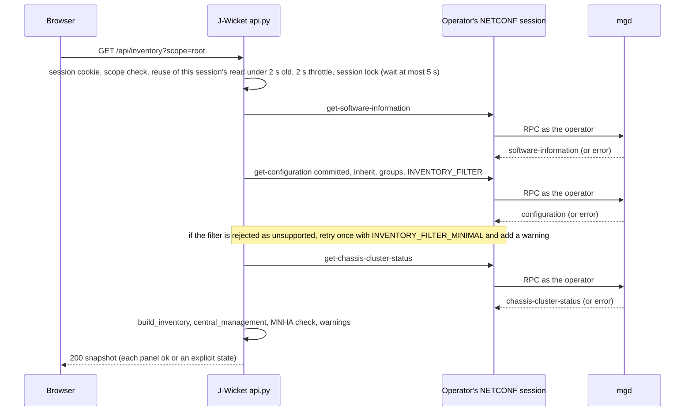
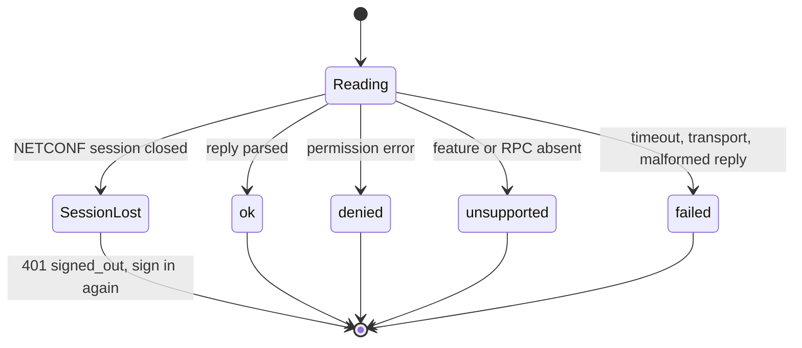
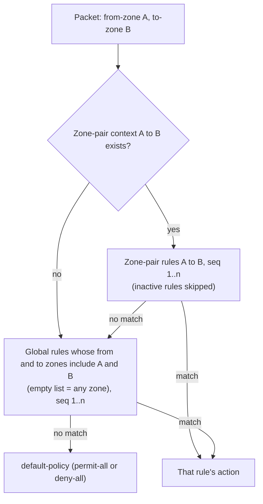

# Spec 001: Scoped read-only policy inventory

| Field | Value |
| --- | --- |
| Status | **Backend implemented on synthetic fixtures. UI v2 views built and committed, exercised by hand on the development server; browser acceptance (AC-001-21) not signed off. The inventory read ran once on a lab SRX4100, Junos 25.2R1-S1.4, as a signed-in super-user ([evidence](../evidence/2026-11-24-srx4100-lab/README.md)); no reply recorded. Nothing qualified.** |
| Parity priority | `P0` (first vertical slice) |
| Gate | Part of G1 (foundation exit); its ledger rows reach `qualified` only at G2 |
| Decides scope | Project owner. G1 sign-off: the named security reviewer |
| Code | [`junos/inventory.py`](../../src/jwicket/junos/inventory.py), [`junos/facts.py`](../../src/jwicket/junos/facts.py), [`junos/session.py`](../../src/jwicket/junos/session.py), [`junos/xmlutil.py`](../../src/jwicket/junos/xmlutil.py), [`junos/errors.py`](../../src/jwicket/junos/errors.py), [`api.py`](../../src/jwicket/api.py) |
| Tests | [`test_inventory.py`](../../tests/test_inventory.py), [`test_facts.py`](../../tests/test_facts.py), [`test_api_units.py`](../../tests/test_api_units.py), [`test_http_server.py`](../../tests/test_http_server.py), [`test_session.py`](../../tests/test_session.py), [`test_xmlutil.py`](../../tests/test_xmlutil.py), [`test_errors.py`](../../tests/test_errors.py), [`test_live.py`](../../tests/test_live.py) (`SnapshotVisibilityTests`), [`tests/js/query.test.mjs`](../../tests/js/query.test.mjs) |
| Decisions it rests on | [ADR 0002](../adr/0002-junos-delegated-sign-in.md), [0004](../adr/0004-no-sample-data.md), [0005](../adr/0005-committed-config-with-provenance.md), [0006](../adr/0006-device-explains-policy-decisions.md), [0007](../adr/0007-offline-capable-meaning.md), [0009](../adr/0009-central-management-coexistence.md) |

## 1. Status

The point: J-Wicket can read a committed SRX configuration and show every security policy of one
scope in Junos evaluation order, with the group each rule came from, its inactive state and its
resolved addresses and applications, and it says plainly what it could not read. All of that is
true **on synthetic fixtures only**. No recorded device reply has been parsed yet.

| Part | State | Evidence |
| --- | --- | --- |
| Configuration parser and resolver | Implemented | `test_inventory.py`, `test_xmlutil.py`: pass on fixtures |
| Device facts (identity, HA, central management, configured time zone) | Implemented | `test_facts.py`, `test_api_units.py`: pass on fixtures |
| Read path, explicit states, read throttle, audit | Implemented | `test_api_units.py`, `test_http_server.py`, `test_live.py` (`SnapshotVisibilityTests`): pass |
| A second tab of the same web session gets a read made under 2 s ago instead of a 429 (5.2) | Implemented (2026-11-25) | `test_http_server.py` (`ReuseHttpTests`): pass |
| JSON and CSV export (22 CSV columns; 409 when the configuration was not read) | Implemented | `test_http_server.py` (`InventoryTests`, `CsvInjectionTests`), `test_api_units.py` (`CsvTests`): pass |
| Snapshot fields added 2026-11-25 for honest wording in the UI: comments around policy settings, deactivated parts and provenance of objects, the filter used, scopes J-Wicket cannot address, the configured time zone (5.3) | Implemented | `test_inventory.py` (`DeactivatedStatementTests`, `CommentTests`, `ScopeTests`, `BranchEdgeFixtureTests` on the new `branch-edge` fixture), `test_facts.py` (`TimeZoneTests`), `test_api_units.py` (`ReadSnapshotTests`): pass |
| UI v1 (`static/app.js`, as committed at `276f9a6`) | Built: evaluation-order sections, provenance badges, detail panel, CLI templates, matrix | Superseded by v2, which replaces it in the working tree |
| UI v2 Policies and Objects views | **Built and committed; exercised by hand on the development server** (AC-001-21 not signed off). The UI follow-up of 2026-11-25 built the rows of section 8 marked "Built (fixtures)" | The shared query engine for policies is unit-tested: `tests/js/query.test.mjs` passes |
| On a device | **Read once, not checked.** On a lab SRX4100 (Junos 25.2R1-S1.4) a super-user account read the inventory through J-Wicket (3 policies, configuration `ok`); no reply was recorded and no criterion was checked. That build predates the 2026-11-25 changes in this spec, which have run on fixtures only. Before that, the spike read the configuration as JSON without inheritance, as the daemon's account | [SRX4100 lab evidence](../evidence/2026-11-24-srx4100-lab/README.md), [spike report](../evidence/2026-11-23-vsrx-spike/docs/J-Wicket-spike-report-and-product-plan.md), "What is not proven" |

The fixtures in [`tests/fixtures/`](../../tests/fixtures/README.md) are written by hand. Their
element names come from Juniper's published YANG for 24.4R2 and from Juniper documentation, so a
passing test shows that the parser agrees with J-Wicket's reading of the schema, not that it
agrees with a device. Q-REL-01 closes that gap.

In parity-ledger terms the 12 rows this backend covers stay `specified`. The backend and
query-engine criteria pass on fixtures and in unit tests (AC-001-01 to AC-001-20), but each row is
an operation done in the browser, and AC-001-21, the browser check, has not passed. A row becomes
`implemented` only when its criteria pass, the browser check included
([ledger method, section 5](../parity/README.md#5-statuses)).

## 2. Problem

An operator who wants to know what an SRX enforces has to answer five questions before reading a
single rule, and J-Wicket must answer them on screen:

1. **Which configuration?** Junos has a shared candidate database, and a default read can return
   other users' uncommitted edits. Only the committed configuration is in effect.
2. **Which scope?** A device can hold a root system, logical systems and tenant systems, each with
   its own zones, address books and policies. Mixing them is wrong.
3. **In which order?** Rules are evaluated per zone pair in configuration order, then global
   policies, then the default policy (J-Wicket's reading of the documentation; section 7.1). A
   list sorted by name hides that.
4. **Where did it come from?** Brownfield configurations inherit rules and objects from
   configuration groups. The spike read JSON without inheritance, so inherited policies were
   invisible ([ADR 0005](../adr/0005-committed-config-with-provenance.md)). Spec 002 cannot edit
   safely without knowing which group owns an object.
5. **Am I seeing everything?** A login class may not be allowed to read a hierarchy, and Junos may
   omit it rather than refuse. Empty must never be presented as "nothing configured".

The reference page is J-Web 24.4 **Security Policies & Objects > Security Policies**: a rule table
grouped by zone context with columns Seq, Hits, Rule Name, Source Zone, Source Address, Source
Identity, Destination Zone, Destination Address, Dynamic Application, Services, URL Category,
Action, Advanced Security, Rule Options and Schedule, and a Global Policy toggle in the editor
(**verified**, [J-Web 24.4 rules page](https://networkingdocs.hpe.com/documentation/us/en/software/jweb-srx24.4/jweb-srx/topics/concept/j-web-security-about-rules-page.html)).
Spec 001 covers the read side of that page and of Zone Addresses, Global Addresses and the
application objects. It does not cover Hits (section 4).

## 3. Users and jobs

| User | Job | What Spec 001 gives them |
| --- | --- | --- |
| SE or lab engineer (first users, while J-Wicket is unqualified) | "Show me what this box allows from trust to untrust, in the order it is checked." | Evaluation-order sections per zone pair, global policies that apply, default policy |
| Same | "Check this flow on the device." | The exact `show security match-policies` command for the pair, pre-filled only with values the rule names unambiguously |
| Operator preparing a change (Spec 002/003) | "Who owns this rule: the box or a configuration group?" | `group`, `inherited` and `groups` per policy and per object |
| Operator during an incident | "Is this rule even in effect?" | `inactive` with the nearest reason (`policy`, `zone-pair`, `policies`, `security` or `scope`), deactivated parts listed, scope-level deactivation warned |
| Same | "What does address set `dmz-servers` actually contain?" | Resolved leaves with the address book they came from, truncation and unresolved names stated |
| Auditor or read-only operator | "Am I seeing everything my class allows, and only that?" | Reads run as the operator; denied reads show as denied; a missing `security` section is warned, not shown as empty |
| Anyone | "Which device, release, cluster role and scope is this, and does something else manage it?" | Scope banner fields in every snapshot, including outbound-SSH clients ("also managed from") |
| Reviewer away from the device | "Give me this inventory to review offline." | JSON and CSV export stamped with device, scope, user and read time |

## 4. Scope and non-scope

**In scope (implemented):**

- Scopes: the root system, every `logical-systems <name>` and every `tenants <name>` in the
  configuration the operator can read. Each is a separate inventory, never merged.
- Security policies: zone-pair policies and global policies, with match fields, action, log,
  count, scheduler, application services (tags only), IPsec tunnel name, description.
- Policy-level settings: `default-policy`, `policy-rematch`, presence of `pre-id-default-policy`,
  each with whether it is deactivated.
- Zones: interfaces, host-inbound services and protocols (zone and interface level, with `except`
  entries and deactivated entries apart), screen name, description.
- Address books: named books with `attach zone`, the book named `global`, and legacy zone address
  books; addresses (prefix, DNS name, range, wildcard) and address sets.
- Applications and application sets defined in the configuration.
- Name resolution for policy addresses and applications, with limits.
- Device facts: hostname, model, release (per node in a cluster), HA classification, outbound-SSH
  clients, the configured time zone.
- Warnings for anything not modeled (per object: policies, zones, interfaces, address entries, sets
  and books, applications and application sets), deactivated, or possibly hidden. Configuration
  comments (`annotate`) are attached to what they annotate, never reported as unmodeled.
- JSON and CSV export; per-operator read throttle; audit records.

**Out of scope (not in this spec; each has a home):**

| Not here | Why, and where it goes |
| --- | --- |
| Any change to the device | Spec 002 (change protocol), Spec 003 (preview-only builder) |
| "Which policy matches this flow?" answered by J-Wicket | [ADR 0006](../adr/0006-device-explains-policy-decisions.md): the device answers through `show security match-policies` once that RPC is allowlisted in a later spec. Spec 001 gives the CLI to run |
| Hit counts (J-Web's Hits column) | Needs `get-security-policies-hit-count` on the allowlist; runtime data with its own read time. Not specified yet |
| Contents of predefined `junos-*` applications | Shown as `predefined`, not expanded ([ADR 0005](../adr/0005-committed-config-with-provenance.md)) |
| NAT, screen options contents, schedulers, IDP/content-security profiles named in `application-services`, dynamic-application and URL-category resolution | Later read specs; see the [parity ledger](../parity/jweb-24.4.csv) |
| `protect` markers, commit metadata (`junos:commit-user`) | Open questions 12 and 9 |
| Candidate (uncommitted) configuration | Never shown ([ADR 0005](../adr/0005-committed-config-with-provenance.md)) |
| Multinode HA details | `get-chassis-high-availability-information` is not allowlisted; MNHA is detected from configuration only (Q-HA-03) |
| Policies of a logical system read by an LSYS-scoped login class | Reply shape unknown (Q-AUTH-03); see open question 7 |

## 5. Behaviour

### 5.1 Endpoints

| Request | Result |
| --- | --- |
| `GET /api/inventory?scope=<id>` | 200 snapshot (5.3). `scope` defaults to `root`; must match `root`, `lsys:<name>` or `tenant:<name>` with name `[A-Za-z0-9._-]{1,63}` (a scope whose name has other characters is listed with `selectable: false`, 5.3) |
| `GET /api/export?scope=<id>&format=json\|csv` | 200 attachment `jwicket-<host>-<scope>-<YYYYMMDDTHHMMSSZ>.<fmt>`; JSON is the snapshot, CSV is described in 5.8. When the configuration was not read, CSV is 409 and the JSON filename ends `-config-<status>` (5.8) |

Errors, all `{"error": "<operator-safe message>", ...}`:

| Status | When | Extra fields |
| --- | --- | --- |
| 400 | Malformed `scope`; `format` not `json` or `csv` | |
| 401 | No live web session | `reason` (and `at`) saying why: `none`, `replaced`, `idle`, `absolute`, `signed-out`, `session-lost` or `unknown` ([Spec 004, section 5.1](004-live-sessions-and-logs.md#51-endpoints)). `signed_out: true` and `reason: "session-lost"` when the operator's device session was lost during this read (the web session is dropped and audited as `session_lost`) |
| 404 | `scope` is well formed but not in the configuration read | `scopes`: the scope summaries that do exist |
| 409 | `format=csv` when the configuration was not read (`config.status` not `ok`) | `{error: "The configuration was not read (<status>: <message>), so there are no policies to export as CSV.", config: {status, message}}`, no `Content-Disposition` |
| 429 | The same operator read the same endpoint less than 2 s ago (`MIN_READ_INTERVAL_S`) for another scope, or exported again | `reason: "rate"`, `retry_after_s`, `interval_s: 2.0`, plus a `Retry-After` header rounded up to whole seconds. Inventory and export have separate buckets, so "load page, then export" works. The same scope again within 2 s is answered from that read (5.2) |
| 429 | Another read on the same operator's device session (another tab, the Sessions or Logs view) is still running after 5 s (`SESSION_WAIT_S`) | `{error: "Another read for your session is still running. Try again shortly.", reason: "busy", retry_after_s: 2}` and `Retry-After: 2` |

A failed device read is **not** an HTTP error. The snapshot is 200 and the failed panel carries
its state (5.4).

### 5.2 Read sequence

One snapshot is one consistent read for one operator, holding that operator's session lock so two
tabs cannot interleave RPCs on one NETCONF session. A request waits at most 5 s for the lock, then
gets 429 rather than queuing for a whole RPC timeout. Every inventory GET reads the device again,
with one exception for the same web session's other tabs: a GET for the same scope within 2 s of
that session's last read of it gets that read (200, its own `meta.read_at`, `meta.reused: true`),
and a GET that arrives while that same read is running waits for it (at most 5 s, one request at a
time) instead of getting a 429. Nothing else is kept between reads, a reused read is never handed
to another web session, and an export always reads the device. Holding the snapshot that long is
owner decision OD-07, shipped as its default, which the owner may veto
([Spec 004, section 5.5](004-live-sessions-and-logs.md#55-rate-limits-and-device-cost)).



Three RPCs per read, four when the filter falls back, none for a reused read. Junos logs NETCONF
RPCs as `UI_NETCONF_CMD`, so each read can add lines to the device's own logs (section 7.10).

### 5.3 Snapshot shape

`meta.schema` is `jwicket.inventory/1`. Keys below are exactly what
[`api.read_snapshot`](../../src/jwicket/api.py) and
[`inventory._scope_inventory`](../../src/jwicket/junos/inventory.py) return.

```json
{
  "meta": {
    "schema": "jwicket.inventory/1",
    "read_at": "2026-11-24T06:00:00Z",
    "scope": "root",
    "scopes": [{"id": "root", "label": "Root system", "policies": 10, "inactive": false, "selectable": true}],
    "read_as": {"user": "alice", "backend": "netconf"},
    "source": {"database": "committed", "inheritance": true, "groups_annotated": true},
    "fixture": false,
    "generator": "jwicket <version>"
  },
  "device": {"status": "ok", "hostname": "fw1", "model": "vsrx", "version": "24.4R2-S3.5", "nodes": []},
  "ha": {"status": "ok", "mode": "standalone"},
  "management": {"status": "ok", "clients": [{"client": "central-mgr", "targets": ["192.0.2.10:7804"], "services": ["netconf"], "inactive": false}], "managed": true},
  "config": {"status": "ok", "filter": "full"},
  "clock": {"status": "ok", "time_zone": "Europe/Paris", "configured": true, "deactivated": null, "source": "configuration"},
  "scope": {
    "id": "root", "label": "Root system", "inactive": false,
    "security_present": true, "applications_present": true,
    "policies": {
      "status": "ok", "rows": ["<policy row>"],
      "default_policy": "deny-all", "default_policy_inactive": null, "default_policy_inactive_reason": null,
      "default_policy_group": null, "default_policy_comment": null,
      "policy_rematch": false, "policy_rematch_inactive": false, "policy_rematch_extensive": false,
      "policy_rematch_comment": null,
      "pre_id_default_policy": false, "pre_id_default_policy_inactive": false, "pre_id_default_policy_comment": null,
      "ancestor_inactive": null, "global_trailing_comment": null,
      "zone_pairs": [{"from": "trust", "to": "untrust", "count": 3, "inactive": 1, "permit": 2, "deny": 0, "reject": 0, "comment": null, "trailing_comment": null}],
      "global_count": 2
    },
    "zones": {"status": "ok", "rows": [{"name": "trust", "interfaces": [{"name": "ge-0/0/1.0", "services": ["ssh"], "protocols": [], "services_except": [], "protocols_except": [], "inactive_services": [], "inactive_protocols": [], "host_inbound": "active", "services_present": true, "protocols_present": false, "host_inbound_group": null, "group": null, "inherited": [], "groups": [], "inactive": false, "inactive_parts": [], "comment": null, "unmodeled": []}], "services": [], "protocols": [], "services_except": [], "protocols_except": [], "inactive_services": [], "inactive_protocols": [], "host_inbound": "absent", "services_present": false, "protocols_present": false, "host_inbound_group": null, "screen": null, "description": null, "group": null, "inherited": [], "groups": [], "inactive": false, "inactive_parts": [], "comment": null, "part_comments": [], "unmodeled": []}], "unmodeled": []},
    "address_books": {"status": "ok", "rows": [{"name": "global", "attach": [], "inactive_attach": [], "legacy_zone": null, "addresses": [{"name": "h1", "kind": "prefix", "value": "192.0.2.1/32", "description": null, "group": null, "inherited": [], "groups": [], "inactive": false, "inactive_parts": [], "comment": null, "unmodeled": []}], "sets": [{"name": "s1", "addresses": ["h1"], "sets": [], "inactive_members": [], "inactive_addresses": [], "inactive_sets": [], "description": null, "group": null, "inherited": [], "groups": [], "inactive": false, "comment": null, "part_comments": [], "unmodeled": []}], "description": null, "group": null, "inherited": [], "groups": [], "inactive": false, "comment": null, "part_comments": [], "unmodeled": []}]},
    "applications": {"status": "ok", "rows": [{"name": "tcp-8443", "kind": "application", "protocol": "tcp", "destination_port": "8443", "source_port": null, "terms": 0, "members": [], "sets": [], "inactive_members": [], "inactive_applications": [], "inactive_sets": [], "description": null, "group": null, "inherited": [], "groups": [], "inactive": false, "inactive_parts": [], "comment": null, "part_comments": [], "unmodeled": []}]},
    "groups": [{"name": "corp-baseline", "policies": 2}],
    "warnings": ["Policy dmz-updates has settings J-Wicket does not display yet: then permit firewall-authentication."]
  },
  "warnings": []
}
```

(Values are illustrative; `"<policy row>"` stands for the object below.)

Field notes:

- `device.nodes` lists `{node, hostname, model, version}` per routing engine only when the reply
  has more than one `multi-routing-engine-item`; the top-level fields are the first node's.
- `ha` is one of: `{status: ok, mode: standalone}`; the same with a `message` when the cluster RPC
  failed in a way that is neither denied nor a timeout; `{status: ok, mode: chassis-cluster,
  cluster_id, redundancy_groups: [{id, nodes: [{name, priority, status}]}], local_node: null}`;
  `{status: ok, mode: mnha, message}`; `{status: ok, mode: unknown, message}` for an unrecognised
  reply; or a panel error. `local_node` is always `null` today: which node serves the page is
  Q-HA-02.
- `management` shares the configuration's fate: if the configuration read failed, it carries the
  same state. Each client carries `inactive`; `managed` is true only when an active client exists
  (a deactivated client, or a deactivated `outbound-ssh`, `services` or `system`, does not count).
- `ha.mode` is `mnha` only when the cluster RPC says standalone and `chassis high-availability` is
  configured and active.
- `scope` is `null` when the configuration could not be read. All sub-panel `status` values are
  `ok` today because they come from one configuration read.
- Address `kind` is `prefix`, `dns`, `range`, `wildcard` or `unknown`. Address-book `name` for a
  legacy zone book is `zone <zone-name>`, with `legacy_zone` set and `attach` = `[zone-name]`.
- Application `terms` is the number of `term` entries; `protocol` and ports are the top-level
  values and are `null` for a term-only application, and for a leaf that is deactivated (then
  listed in `inactive_parts`, for example `destination-port 2121`).
- Deactivated statements are never shown as in effect. `default_policy` is `null` when
  `default-policy`, its `permit-all` or `deny-all` child, or an ancestor is deactivated, and
  `default_policy_inactive` names the deactivated action. `policy_rematch` and
  `pre_id_default_policy` are `false` when deactivated, with `policy_rematch_inactive` and
  `pre_id_default_policy_inactive` set. Each of these adds a warning (5.5).
- Zones and interfaces: `services` and `protocols` hold only entries in effect. Entries with
  `except` (for system services it "can be included only along with 'system-services all'", 24.4R2
  YANG) are in `services_except` / `protocols_except`;
  deactivated entries in `inactive_services` / `inactive_protocols`; interfaces carry `inactive`.
- Address sets and application sets list members in effect only (`addresses`, `sets`, `members`);
  deactivated members are in `inactive_members`. Address books carry `description`, and `attach`
  holds only active zones; deactivated ones are in `inactive_attach`.
- `comment` on address entries, address sets, books, applications, application sets, zones and
  interfaces, and on rows and `zone_pairs[]`: the configuration comment written with `annotate`
  (`junos:comment`) on that statement.
- `unmodeled` on address entries, address sets, books, applications, application sets, zones
  (including unknown `host-inbound-traffic` children) and interfaces: statements that object has
  and J-Wicket does not display yet, for example `icmp-type`, `application-protocol`,
  `inactivity-timeout` on an application, `tcp-rst` on a zone. A configuration comment is never
  listed there.

Fields added on 2026-11-25 (present wherever their parent object is, unless a condition is named):

- `config.filter` is `full` or `minimal` (the fallback, 5.2) when `config.status` is `ok`. With
  the minimal filter, `management` is `{status: "unsupported", message: "Central management was not
  read: the device rejected the configuration filter that includes it."}` with no `clients` or
  `managed`, `clock` is `{status: "unsupported", message: "The time zone was not read: the device
  rejected the configuration filter that includes it."}`, and a standalone `ha.message` gains
  "Multinode HA settings were not read (the device rejected the full configuration filter).",
  after any message it already had.
- `clock` is the configured `system time-zone`
  ([`facts.time_zone`](../../src/jwicket/junos/facts.py), 6): `{status: "ok", time_zone,
  configured, deactivated, source: "configuration"}`. `time_zone: null` with `configured: false`
  means not configured, so the Junos default, UTC, applies (**verified**, 6). A deactivated
  statement gives `configured: false` and the written value in `deactivated`. A value that is not
  1 to 64 of `A-Z a-z 0-9 _ + - /` gives `{status: "failed", message: "The configured time zone is
  not a value J-Wicket recognises."}`. When the configuration was not read, `clock` carries the
  configuration's state and message: J-Wicket never assumes UTC then. It is the configured zone,
  never "the zone in effect": a change takes effect for all processes only after a reboot
  (**verified**, 6).
- `meta.scopes[].selectable` is false for a logical or tenant system whose name J-Wicket cannot
  put in a `scope` parameter (anything outside `[A-Za-z0-9._-]{1,63}`), with `reason: "J-Wicket
  cannot address this name yet (it accepts letters, digits, dot, underscore and hyphen, up to 63
  characters)."` and a snapshot warning. The accepted characters are unchanged until the Junos
  character set for those names is verified (owner decision OD-12, whose default keeps them, and
  which the owner may veto).
- `scope.security_present` and `scope.applications_present` say whether the scope's configuration
  has a `<security>` or `<applications>` element at all.
- `scope.policies`: `policy_rematch_extensive` (an active `extensive` under an in-effect
  `policy-rematch`); `ancestor_inactive` (`null`, `policies`, `security` or `scope`: the nearest
  deactivated ancestor of `[edit security policies]`); `default_policy_inactive_reason` (`null`,
  `self` when `default-policy` or its action is itself deactivated, or the ancestor);
  `default_policy_comment`, `policy_rematch_comment` and `pre_id_default_policy_comment` (the
  configuration comment before each); `global_trailing_comment` and `zone_pairs[].trailing_comment`
  (a comment after the last rule of the global section or of the pair).
- Zones and interfaces: `screen` is `null` when the `screen` statement is deactivated (it is then
  in `inactive_parts`); `inactive_parts`, `inherited` and `groups` as on policies; `host_inbound`
  is `absent`, `active` or `inactive` (the object's own `host-inbound-traffic`, and whether it is
  deactivated); `services_present` and `protocols_present` say whether any entry is written, active
  or not; `host_inbound_group` is the group of `host-inbound-traffic`, else of its first entry.
  Zones also carry `part_comments`. `zones.unmodeled` is `["functional-zone management"]` when that
  is configured (with a scope warning; it is not shown as a zone).
- Address books carry `inherited`, `groups` and `part_comments`, and a legacy zone book its
  `comment`; address entries carry `inactive_parts`, `inherited` and `groups`; address sets carry
  `inherited`, `groups`, `part_comments`, and `inactive_addresses` and `inactive_sets`, whose union
  is `inactive_members`. Application and application-set rows carry `inactive_parts`, `inherited`,
  `groups` and `part_comments`, and `inactive_applications` and `inactive_sets`, whose union is
  `inactive_members` (both are `[]` on an application; a set's deactivated members are listed there,
  not in its `inactive_parts`).

**Policy row** (every key is asserted by `test_snapshot_shape_keys`):

| Key | Meaning |
| --- | --- |
| `id` | `<scope>\|zone\|<from>><to>\|<name>` or `<scope>\|global\|global\|<name>`; unique within a snapshot |
| `scope`, `kind` | Scope id; `zone` or `global` |
| `seq` | 1-based position within its zone-pair context (or within `global`), in configuration order |
| `from`, `to` | Zone lists. One zone each for a zone-pair policy. For a global policy, its active `match from-zone` / `to-zone` values; a deactivated value is dropped and listed in `inactive_parts`; empty means any zone, also when every value was deactivated |
| `name`, `description` | As configured |
| `match` | `source`, `destination`, `application`, `source_identity`, `dynamic_application`, `url_category`, `source_end_user_profile` (active values only), `source_excluded`, `destination_excluded` (flags), `application_implicit`. A unified-policy rule with an active dynamic application and no active application gets `application: ["junos-defaults"]`, or `["any"]` when the dynamic application is `any`, with `application_implicit: true` (**verified**, [unified policies](https://networkingdocs.hpe.com/documentation/us/en/software/junos/security-policies/topics/topic-map/configuring-unified-policies.html): "the application junos-defaults is implicitly added"). The CSV `application` column shows the implicit value |
| `action` | `permit`, `deny`, `reject` or `unknown` (no recognised, active action) |
| `application_services` | Child tag names under `then permit application-services` (for example `idp-policy`); contents not read |
| `tunnel` | `then permit tunnel ipsec-vpn` name |
| `log` | `{init, close}` for `session-init` / `session-close` |
| `count`, `scheduler` | `then count` flag; `scheduler-name` |
| `inactive`, `inactive_reason` | `true` with the nearest deactivated statement: `policy` (the rule), `zone-pair` (its zone-pair context, or the `global` container), `policies` (`[edit security policies]`), `security` (`[edit security]`) or `scope` (the logical or tenant system); otherwise `false`, `null`. Inactive rows are counted in `zone_pairs[].inactive`, never in `permit`, `deny` or `reject` |
| `inactive_parts` | Deactivated parts of an active rule, for example `match source-address h2`, `then log`. Not in effect, so not in the match lists |
| `group` | Group the rule came from, else the group of its zone-pair context (or `global` container), else `null` |
| `inherited` | Child element names, one level down, that came from a group other than the rule's own |
| `groups` | Every group that contributed anything to the rule's subtree, first-seen order |
| `unmodeled` | Configuration under the rule that J-Wicket does not display, as paths (`then permit firewall-authentication`). Configuration comments are never listed |
| `comment`, `part_comments`, `pair_comment` | The rule's configuration comment; comments inside it as `[{before, text}]` (`before` names the statement the comment precedes, or is `null` at the end of a block); its zone-pair context's comment |
| `resolved` | `source`, `destination`: `[{name, kind: any\|address\|set\|unresolved, book, leaves: [{name, kind, value}], truncated, unresolved: [names], inactive_skipped: ["book:name"]}]`; `application`: `[{name, kind: any\|application\|set\|predefined\|dynamic-defaults\|unresolved, leaves: [{name, protocol, destination_port, source_port, terms, unmodeled} \| {name, predefined: true}], unresolved, inactive_skipped: [names]}]`. `inactive_skipped`, always present, lists deactivated entries that resolution passed over; `unresolved` lists only names with no entry at all, active or deactivated (5.6) |

### 5.4 Explicit states

No panel is ever filled with anything but device data ([ADR 0004](../adr/0004-no-sample-data.md)).
Each panel is independent: a denied software read does not hide the policies.

| Panel | States | How each arises |
| --- | --- | --- |
| `device` | `ok`, `denied`, `unsupported`, `failed` | From `get-software-information`; `failed` also when the reply holds no `software-information` |
| `config` (and `scope`, `management`) | `ok`, `denied`, `unsupported`, `failed` | From `get-configuration`; `failed` also when the reply holds no `<configuration>` element ("The device's reply could not be read."), with the device and HA panels kept; `scope` is `null` and `meta.scopes` is `[]` unless `ok` |
| `ha` | modes above, or `denied` / `failed` | `unsupported` from the cluster RPC means standalone; `denied` and timeouts stay errors; other errors read as standalone with a message saying why |
| Whole response | 401 `signed_out: true`, `reason: "session-lost"` | `session-lost` on any of the three RPCs ends the read and the web session |

Errors are classified by [`errors.classify`](../../src/jwicket/junos/errors.py) into a closed set
(`denied`, `unsupported`, `failed`, `rejected`, `unavailable`, `session-lost`). Each carries a
fixed operator-safe `message`. The device's own error text, cut to 500 characters, goes to the
diagnostic log only, at INFO, from the `jwicket.api` logger: `<what>: <kind>: <text>` (for
example `inventory configuration read: denied: ...`), and `chassis cluster status: ...` for a
cluster error read as standalone. The text patterns that map a Junos error to `denied` or
`unsupported` are J-Wicket's guesses, deliberately narrow, until recorded errors exist (Q-REL-01,
Q-AUTH-03); these log lines are how a lab run records the real wording.



### 5.5 Warnings

Warnings are strings, shown, never dropped. Snapshot level (`warnings`):

- The full filter was rejected, so logical systems, tenant systems, central-management connections,
  Multinode HA settings and the time zone are not shown (fallback to `INVENTORY_FILTER_MINIMAL`).
- `<Logical system|Tenant system> <name> cannot be opened in J-Wicket: its name has characters
  J-Wicket does not accept in a scope yet.` (5.3, `selectable`)
- The configuration has no `security` section: "The configuration J-Wicket read has no security
  section (policies, zones or address books). Either nothing is configured, or `<user>`'s login
  class cannot view it (Junos may leave it out rather than refuse)." J-Wicket reads only those
  three subtrees of `[edit security]`, so other security settings do not count.
- Development server only: a fixture notice.

Scope level (`scope.warnings`):

- The scope (a logical or tenant system) is deactivated; nothing in it is in effect.
- In `<scope>`, `[edit security policies]` (or `[edit security]`) is deactivated: none of its
  security policies is in effect.
- Policy `<name>` has settings J-Wicket does not display yet: `<paths>`.
- Policy `<name>` has deactivated parts (not in effect): `<parts>`.
- Policy `<name>` has no permit, deny or reject action J-Wicket recognises.
- Policy settings J-Wicket does not display yet (children of `security policies` other than
  `policy`, `global`, `default-policy`, `pre-id-default-policy`, `policy-rematch`).
- A deactivated default policy, worded by `default_policy_inactive_reason`: `The default policy
  <action> is deactivated in the configuration (not in effect).` (`self`), or `The default policy
  <action> is not in effect because [edit security policies] is deactivated.` (likewise for
  `[edit security]` and for the logical or tenant system). The Junos default, deny-all, is
  **verified** (7.3); that a deactivated statement does not take effect is **verified** (7.5); that
  deny-all then decides is **inferred**.
- `policy-rematch` is configured but deactivated (not in effect); `policy-rematch extensive is
  configured but deactivated (not in effect).`; a pre-ID default policy is configured but
  deactivated (not in effect).
- Any child of `policy-rematch` other than `extensive` is named in `Policy settings J-Wicket does
  not display yet: policy-rematch <child>.`
- `Functional zone management is configured; J-Wicket does not display it yet.`
- `<Zone|Interface|Address|Application> <name> has deactivated parts (not in effect): <parts>.`
  (for example a deactivated `screen` or `destination-port`).
- A pre-ID default policy is configured; J-Wicket shows its presence but not its contents.
- Per object, `<Object> <name> has settings J-Wicket does not display yet: <statements>.`, for
  address books, addresses, address sets, applications, application sets, zones and zone
  interfaces.
- Deactivated members or zones: `Address set <name> in book <book> has deactivated members (not in
  effect): ...`, the same for application sets, and `Address book <name> has deactivated attach
  zones (not in effect): ...`.
- Host-inbound exceptions and deactivated entries, for example `Zone untrust: host-inbound system
  services all, except telnet.` and `Zone untrust has deactivated host-inbound protocols (not in
  effect): ospf.`

### 5.6 Resolution rules (as implemented)

Addresses ([`AddressResolver`](../../src/jwicket/junos/inventory.py)):

1. `any`, `any-ipv4`, `any-ipv6` resolve to kind `any` with no leaves.
2. Lookup chain for a zone-pair policy: the zone's legacy address book, then books attached to the
   zone, then the book named `global`. Sources use the from-zone, destinations the to-zone.
3. Global policies use the `global` book only.
4. An address set's members are looked up only in the book that holds the set.
5. Expansion stops at depth 16 or 512 leaves; `truncated: true` says so. Cycles terminate. An
   entry with no active definition has kind `unresolved`. The `unresolved` list names only what has
   no entry at all, active or deactivated, in the books it is looked up in: a name whose only entry
   there is deactivated is in `inactive_skipped`, not listed twice.
6. Only what is in effect is used: a deactivated address book is skipped, and so is a book's
   deactivated `attach` (or a deactivated zone in it); a deactivated address entry or set is passed
   over in favour of the next book in the chain and recorded in `inactive_skipped` as
   `book:name`; a set's deactivated members are not expanded.

Applications ([`ApplicationResolver`](../../src/jwicket/junos/inventory.py)): `any` is kind
`any`; `junos-defaults` is kind `dynamic-defaults` (the dynamic application's own default ports and
protocols, not a predefined application; 7.8); a name defined, and active, in the scope's
`applications` resolves to its leaves (sets recursively, active members only; each application
leaf carries its `unmodeled` list); an undefined `junos-*` name is `predefined` and not expanded;
anything else is `unresolved`. A deactivated application or set, whether the name itself, a
member or a nested set, is not used and is named in `inactive_skipped` (always present, `[]` when
nothing was skipped), not in `unresolved`, which names only what has no definition at all. Kind
`unresolved` still means no active definition.

Rules 2 to 4 are J-Wicket's reading of the documentation, not verified behaviour (section 7.4).

### 5.7 Zone pairs and groups

`zone_pairs` counts rules per zone-pair context in order of first appearance: total, inactive, and
active rules by action. `groups` counts, per configuration group, the policies whose subtree
carries that group.

### 5.8 Export

- JSON: the snapshot itself, with `Content-Disposition: attachment`. When the configuration was
  not read, the JSON is still 200 (its body states `config.status`) and the filename gets
  `-config-<status>` before the extension.
- CSV: first row `# J-Wicket policy inventory, read <read_at> from the committed configuration of
  <hostname> as <user>; scope <scope>`; then a header row of 22 columns, `scope, kind, seq, from,
  to, name, action, source, destination, application, inactive, group, inherited, log_init,
  log_close, count, scheduler, description, application_implicit, dynamic_application, comment,
  pair_comment`; then one row per policy. The `inactive` column holds the reason; the `application`
  column shows an implicit `junos-defaults` or `any` (5.3), and `application_implicit` is `true`
  or `false`. `comment` is the rule's comment, then each comment inside it as `before <statement>:
  <text>` (or `at the end: <text>`), joined by ` | `; `pair_comment` is its zone-pair context's.
  Lists are space-joined. A cell starting with `=`, `+`, `-`, `@`, tab or CR is prefixed with `'`
  so a spreadsheet does not evaluate it. Other characters, control characters included, are
  written as they are on the device, so the export is exact (owner decision OD-08, whose default
  this is, and which the owner may veto in favour of writing them as `<U+XXXX>`).
- CSV when the configuration was not read (`config.status` not `ok`): 409 `{error, config:
  {status, message}}` and no file, because an empty CSV would read as "no policies" (5.1).
- The filename's host and scope parts keep only `[A-Za-z0-9._-]`.

### 5.9 Audit

`read_inventory` (user, source address, scope, policy count, config status) on every successful
read; `export` (user, source, scope, format, config status) on every export, the CSV 409
included; `session_lost` when the device session ends mid-read. A snapshot answered from a read
just made (5.2) writes no `read_inventory` line, because no device read happened (owner decision
OD-06, whose default this is, and which the owner may veto in favour of recording it as reused).
The audit trail never holds passwords, tokens, cookies or CSRF values
([`logs.AuditTrail`](../../src/jwicket/logs.py)).

## 6. Data sources

All reads run on the signed-in operator's own NETCONF session to the device's loopback
([ADR 0002](../adr/0002-junos-delegated-sign-in.md)); with the loopback-only `lab-token` backend
they run as the daemon's account and `meta.read_as.backend` says `lab-token`. RPCs outside
`ALLOWED_RPCS` in [`session.py`](../../src/jwicket/junos/session.py) cannot be sent. Every RPC name
in this spec is a constant. The configuration read is a separate method (`get_configuration`,
`get-configuration` is not in `ALLOWED_RPCS`) that takes only the constant filters below; no
filter is built from request input. (Spec 004's report reads are the one place an RPC name is
completed from a checked, fixed list.)

| Read | RPC and options | Filter | Permission | Status |
| --- | --- | --- | --- | --- |
| Device identity | `get-software-information` | none | not recorded (Q-AUTH-03) | RPC and `host-name`, `product-model`, `junos-version` **verified** in the 24.4R2 RPC YANG. Per-node `multi-routing-engine-item/re-name` wrapping on clusters **inferred** |
| Configuration | `get-configuration` with `database="committed" inherit="inherit" groups="groups"` (sent through PyEZ `rpc.get_config(filter_xml, options)`) | `INVENTORY_FILTER`: `security/{policies, zones, address-book}`, `applications`, `logical-systems` and `tenants` each narrowed to `name`, `security/{policies, zones, address-book}` and `applications`, `system/time-zone` (one leaf, added 2026-11-25), `system/services/outbound-ssh`, `chassis/high-availability`. Fallback `INVENTORY_FILTER_MINIMAL`: `security/{policies, zones, address-book}`, `applications`. That Junos answers with the key and only the selected children of every list entry, with the entry's `inactive` attribute, is **inferred** (RFC 6241 subtree filtering as Junos implements it; Q-REL-01) | `security` bit to view `[edit security policies]` (**verified**, [security policies statement](https://networkingdocs.hpe.com/documentation/us/en/software/junos/cli-reference/topics/ref/statement/security-edit-policies.html)); the rest **unknown**. Denied versus silently omitted: **unknown** (Q-AUTH-03) | Attributes **verified** ([get-configuration](https://networkingdocs.hpe.com/documentation/us/en/software/junos/junos-xml-protocol/topics/ref/tag/junos-xml-protocol-get-configuration.html), [groups output](https://networkingdocs.hpe.com/documentation/us/en/software/junos/junos-xml-protocol/topics/task/junos-xml-protocol-requesting-configuration-information-output-format-groups-ranges.html)). Behaviour of the fallback trigger (which error a release without `tenants` returns) **unknown** |
| HA | `get-chassis-cluster-status` | none | not recorded | RPC and `cluster-id`, `redundancy-group/{redundancy-group-id, device-stats/{device-name, device-priority, redundancy-group-status}}` **verified** in YANG. Whether `device-stats` repeats per node or holds flat repeated fields: **unknown**, so the parser accepts both. Reply on a standalone device: **unknown** (Q-REL-01, Q-HA-01) |
| MNHA | none (configuration) | `chassis/high-availability` presence, not deactivated | as configuration | Presence-only detection, **inferred**. Q-HA-03 |
| Central management | none (configuration) | `system/services/outbound-ssh/client` | as configuration | Statement **verified** to exist; that a client means Security Director, SDC or Mist is **inferred** (Q-MGMT-01) |
| Time zone | none (configuration) | `system/time-zone` | as configuration; the same `system` view permission the outbound-SSH part relies on is **inferred** | `time-zone` under `[edit system]`, default UTC, and "To have the time zone change take effect for all processes running on the router or switch, you must reboot" **verified** ([time-zone statement](https://networkingdocs.hpe.com/documentation/us/en/software/junos/cli-reference/topics/ref/statement/time-zone-edit-system.html)). That a deactivated statement leaves the default in effect is **inferred**. Reading it adds one leaf to the existing configuration read and no RPC: owner decision OD-05, shipped as its default, which the owner may veto (the time-zone row of the device facts and the Logs view's device-zone option would go with it) |

**Configuration element names the parser reads.** Names are local names (namespaces ignored, see
7.6). Source for the tree: Juniper YANG 24.4R2 `junos-es-conf-security`, `-applications`,
`-logical-systems`, `-tenants` ([Juniper/yang](https://github.com/Juniper/yang/tree/master/24.4/24.4R2/native/conf-and-rpcs/junos-es)).

| Path | Used for | Status |
| --- | --- | --- |
| `security/policies/policy` keyed by `from-zone-name`, `to-zone-name`; child `policy` keyed by `name` with `description`, `match`, `then`, `scheduler-name` | Zone-pair rules | **verified** (YANG) |
| `match/{source-address, destination-address, application, source-identity, dynamic-application, url-category}` leaf-lists; `source-address-excluded`, `destination-address-excluded` flags; `source-end-user-profile` | Match lists | **verified** (YANG), except `source-end-user-profile`: YANG shows a container (with `source-end-user-profile-name`) where J-Wicket reads a leaf-list (open question 5, Q-REL-01) |
| `then/{permit, deny, reject, log/{session-init, session-close}, count}`; `permit/{application-services, tunnel/ipsec-vpn}` | Action and options | **verified** (YANG) |
| `security/policies/global/policy` with `match/from-zone`, `match/to-zone` | Global rules | **verified** (YANG) |
| `security/policies/default-policy` with child `permit-all` or `deny-all` | Default action | **inferred**: YANG models it as an enumeration leaf `default-action`; native XML as an empty element is from a non-Juniper source. J-Wicket does not read `default-action` (open question 4) |
| `policy-rematch`, `pre-id-default-policy` | Presence | **verified** (YANG) |
| `security/address-book` keyed by `name`: `address` (`ip-prefix` \| `dns-name/name` \| `range-address/name` + `to/range-high` \| `wildcard-address/name`), `address-set` (`address/name`, `address-set/name`), `attach/zone/name` | Books and objects | **verified** (YANG). YANG also has an `address-range` form that J-Wicket reports as kind `unknown` (open question 5) |
| `security/zones/security-zone` keyed by `name`: `address-book`, `interfaces` (`host-inbound-traffic/{system-services, protocols}`), `host-inbound-traffic`, `screen`, `description`; `system-services` and `protocols` entries keyed by `name` with an optional `except` | Zones and legacy books | **verified** (YANG; `except`: "Type of incoming system-service traffic to disallow") |
| `applications/application` (`protocol`, `destination-port`, `source-port`, `term`); `applications/application-set` (`application/name`, `application-set/name`) | Applications | **verified** (YANG) |
| `logical-systems` / `tenants` keyed by `name`, each with its own `security` and `applications` | Scopes | **verified** (YANG) |
| `system/services/outbound-ssh/client` keyed by `name`; targets are keyed children with `name` and optional `port`; `services` children | Management | Shape of a target entry **inferred**; `secret` and `device-id` are skipped by name |
| Attribute `inactive="inactive"` | Inactive | **verified** ([JSON/XML mapping](https://networkingdocs.hpe.com/documentation/us/en/software/junos/junos-xml-protocol/topics/concept/junos-xml-protocol-configuration-mapping-to-json.html)) |
| Attribute `junos:group="<group>"` on inherited elements and their inherited descendants | Provenance | **verified** (groups output page) |
| `junos:comment` elements (configuration comments written with `annotate`) | `comment`, `part_comments`, `pair_comment` | That a comment precedes, as a sibling, the statement it annotates is J-Wicket's reading, **inferred** (Q-REL-01) |

## 7. Junos semantics this feature depends on

Each item says what J-Wicket assumes, and how sure that is.

### 7.1 Evaluation order

J-Wicket shows, for a zone pair (A, B): the zone-pair policies of context A→B in configuration
order, then the global policies that apply to (A, B) in configuration order, then the default
policy. Inactive rules stay in place, marked as skipped.

- Both policy lists are `ordered-by user` in YANG: **verified** (YANG 24.4R2). That XML document
  order is therefore the configured order: **inferred**. The parser keeps document order per
  context and lists all zone-pair
  rows before all global rows, whatever their position in the XML
  (`test_zone_pairs_in_config_order_then_global_regardless_of_xml_position`).
- Zone-pair rules before global rules: **verified**. Juniper's
  [global policies page](https://networkingdocs.hpe.com/documentation/us/en/software/junos/security-policies/topics/topic-map/security-global-policies.html)
  says "policies are checked in the following order: intra-zone (trust-to-trust), inter-zone
  (trust-to-untrust), then global", and "Each policy is processed in the order that it is defined
  within a context". The default policy coming last is **inferred**: neither page cited here says
  so. To be confirmed on the lab vSRX with `show security match-policies` (open question 1).
- The first matching rule decides; later rules are not consulted: **verified**. The global
  policies page: "the first matched policy is applied to the traffic"; the
  [`show security match-policies`](https://networkingdocs.hpe.com/documentation/us/en/software/junos/cli-reference/topics/ref/command/show-security-match-policies.html)
  page: "The first enabled policy in the list is the policy that is applied to all matching
  traffic." J-Wicket does not model it (ADR 0006). Unified policies (with a dynamic application)
  are the documented exception: before the application is identified "a policy search might return
  a list of policies instead of a fixed policy"
  ([unified policies](https://networkingdocs.hpe.com/documentation/us/en/software/junos/security-policies/topics/topic-map/configuring-unified-policies.html)),
  so for them configuration order is the order of candidates.



This is the order J-Wicket displays, not a matcher it runs.

### 7.2 Global policies

- `security policies global policy <name>` with optional `match from-zone` and `match to-zone`
  leaf-lists: **verified** (YANG; J-Web 24.4 rule editor "Global Policy" toggle).
- An empty `from-zone` or `to-zone` list means any zone, and a global rule applies to (A, B) when
  each list is empty or contains the zone: **inferred**. The browser query engine and the UI apply
  that rule; the server returns the lists as configured.

### 7.3 Default policy, pre-ID default policy, rematch

- `default-policy (deny-all | permit-all)`: **verified** (CLI reference). The YANG default is
  `deny-all`: **verified**. When the statement is absent J-Wicket returns `default_policy: null`;
  the UI must say "not configured (Junos default: deny-all)" and must not print `deny-all` as if it
  were configured.
- `pre-id-default-policy` exists: **verified**. Its role in evaluation (before application
  identification completes) is not modelled; J-Wicket reports its presence and warns.
- `policy-rematch` presence: **verified**. Its `extensive` option (`policy-rematch <extensive>`,
  **verified**, [policy-rematch statement](https://networkingdocs.hpe.com/documentation/us/en/software/junos/cli-reference/topics/ref/statement/security-edit-policy-rematch.html))
  is read since 2026-11-25 as `policy_rematch_extensive`: true only when it is active under an
  in-effect `policy-rematch`. A deactivated `extensive` is warned and not shown as in effect; any
  other child is reported as a setting not displayed (5.5).

### 7.4 Address book lookup and set membership

- Global address books (`security address-book <name>` with `attach zone`), the book named
  `global`, and legacy zone books (`security zones security-zone <z> address-book`): all
  **verified** to exist. A zone may be attached to only one book; otherwise commit fails with
  "Security zone must be unique in address books" (**verified**,
  [J-Web Global Addresses page](https://networkingdocs.hpe.com/documentation/us/en/software/jweb-srx24.4/jweb-srx/topics/concept/j-web-security-about-global-addresses-page.html)).
- "A zone can use two address books at a time—the global address book and the address book that
  the zone is attached to", and "Addresses in a user-defined address book have a higher lookup
  priority than addresses in the global address book": **verified**
  ([address books and address sets](https://networkingdocs.hpe.com/documentation/us/en/software/junos/security-policies/topics/topic-map/security-address-books-sets.html)).
  So an attached book before `global` is verified. The legacy zone book coming first, global
  policies using only `global`, and set members resolving only in the set's own book: **inferred**.
- "Address sets can only contain address names that belong to the same security zone":
  **verified** (same page). That J-Wicket looks members up in the set's own book is its reading of
  that rule, not a statement of it.
- Conflict: the [address-book statement page](https://networkingdocs.hpe.com/documentation/us/en/software/junos/security-policies/topics/ref/statement/security-edit-address-book.html)
  says global entries "are available to all security zones that are not attached to address
  books" (**verified**), which reads as if an attached zone did not use `global`; the topic page
  above says it uses both. J-Wicket follows the topic page. Another reading of the documentation is
  that any unattached book applies to all zones, where J-Wicket treats only the book *named*
  `global` that way. Whether legacy and global books can coexist: **unknown**. Open question 2.
- "Address names any, any-ipv4 and any-ipv6 are reserved; you cannot use them to create any
  addresses": **verified** (the address books page above).

### 7.5 Inactive configuration

- `inactive="inactive"` marks a deactivated element: **verified**.
- Deactivated statements and identifiers "do not take effect when you issue the commit command",
  and "you can only deactivate identifiers or complete one-liner statements. You cannot deactivate
  just parts of a one-liner": **verified**
  ([deactivating statements and identifiers](https://networkingdocs.hpe.com/documentation/en_US/junos13.1/topics/task/configuration/junos-software-configuration-statements-identifiers-deactivating-reactivating.html),
  a Junos 13.1 page). That `screen <name>;` and `destination-port <n>;` are such one-liners, so
  J-Wicket lists them in `inactive_parts`, is **inferred**.
- An inactive ancestor makes its whole subtree ineffective: **inferred**. J-Wicket applies it to:
  a rule, its zone-pair context, the `global` container, `[edit security policies]`,
  `[edit security]`, a logical or tenant system (rows marked, scope warning), inactive leaf values
  and flags inside an active rule (`inactive_parts`), including global `from-zone` / `to-zone`
  values; the default policy, `policy-rematch` (and its `extensive`) and `pre-id-default-policy`;
  host-inbound entries; deactivated parts of zones, interfaces, address entries and applications
  (a deactivated `screen` or application port or protocol is `null`, not shown as configured); and
  set members, address entries, address books, `attach` zones and applications during resolution
  (5.6).
- **Not applied yet:** an inactive zone does not mark the policies that name it, and an inactive
  object referenced by a rule does not mark the rule itself (the resolution shows what was skipped).
  Open question 3.

### 7.6 Configuration groups and inheritance

- With `inherit="inherit"`, inherited statements appear in place and `<groups>` / `<apply-groups>`
  are left out; `junos-defaults` is excluded unless `inherit="defaults"`: **verified**.
- With `groups="groups"`, inherited elements and their inherited descendants carry
  `junos:group`: **verified**. The namespace URI contains the release
  (`http://xml.juniper.net/junos/<release>/junos`): **verified**
  ([NETCONF operational replies](https://networkingdocs.hpe.com/documentation/us/en/software/junos/netconf/topics/task/netconf-requesting-operational-information.html)).
  PyEZ normally strips namespaces, which turns `junos:group` into `group`. J-Wicket matches local
  names for elements and attributes, so both forms work (`test_xmlutil.py`).
- What `inherited` means: a child one level down whose group differs from the parent's. It does
  not describe deeper mixtures beyond that; `groups` lists every group in the subtree.
- A group named like a node (`node0`) is just a group name (`test_group_named_like_a_node`).
- The raw group structure (`apply-groups`, wildcards) is not read. Spec 002 needs a second read
  without `inherit` for ownership decisions.

### 7.7 Scopes

- Logical systems and tenant systems each hold their own `security` and `applications`:
  **verified** (YANG).
- An LSYS- or TSYS-scoped login class sees only its own system, "as if you were in the root of a
  physical router": **verified** for routing logical systems
  ([logical systems admin](https://networkingdocs.hpe.com/documentation/us/en/software/junos/logical-systems/topics/topic-map/logical-systems-admin.html)).
  Whether such a user's `get-configuration` reply is rooted at their system without a
  `logical-systems` wrapper: **unknown**. If it is, today's code would label that system "Root
  system". Open question 7, Q-AUTH-03.

### 7.8 Applications and `junos-defaults`

- Predefined applications live in the hidden, immutable `junos-defaults` group, and `junos-` names
  are reserved: **verified**
  ([configuration groups](https://networkingdocs.hpe.com/documentation/us/en/software/junos/cli/topics/topic-map/configuration-groups-usage.html)).
- `inherit="inherit"` does not include them: **verified**. So an undefined `junos-*` name is shown
  as `predefined`, unexpanded.
- `match application junos-defaults` (from 18.2R1) means the dynamic application's own default
  ports and protocols; it "must be configured along with a dynamic application". With a dynamic
  application and no `application`, Junos adds `junos-defaults` implicitly, or `any` when the
  dynamic application is `any`: **verified**
  ([unified policies](https://networkingdocs.hpe.com/documentation/us/en/software/junos/security-policies/topics/topic-map/configuring-unified-policies.html)).
  J-Wicket shows it as kind `dynamic-defaults`, not as a predefined application.

### 7.9 Committed versus candidate

- `get-configuration` reads the candidate by default; `database="committed"` reads what was last
  committed: **verified**. A shared candidate can hold other users' uncommitted edits: **verified**
  (`configure` reference). So J-Wicket never shows uncommitted work.
- The ephemeral database is not part of a committed static read: **inferred**.

### 7.10 Cost of a read on the device

Each read sends three RPCs on the operator's session. Junos has a `UI_NETCONF_CMD` message,
"User '`<username>`' used NETCONF client to run command '`<command>`'" (**verified**,
[System Log Explorer](https://apps.juniper.net/syslog-explorer/)); that every RPC produces one is
**inferred**. How much log volume and mgd load the reads add is Q-LOAD-01 and Q-LOAD-03. The 2 s
per-operator throttle and the session cap (`max_sessions`, default 4) bound it.

### 7.11 Zones and host-inbound traffic

- Host-inbound traffic can be set on a zone or on its interfaces, and "Interface configuration
  overrides that of the zone": **verified**
  ([security zones](https://networkingdocs.hpe.com/documentation/us/en/software/junos/security-policies/topics/topic-map/security-zone-configuration.html)).
  The server returns both levels as configured; the Objects view applies the override.
- "except can only be used if all has been defined": **verified** on the Junos ES 9.3
  [system-services page](https://networkingdocs.hpe.com/documentation/software/junos-es/junos-es93/junos-es-swcmdref/system-services.html),
  matching the 24.4R2 YANG note in 5.3.
- `functional-zone management` exists as a hierarchy level: **verified** in the Junos ES 9.3
  reference; its presence in 24.4 is **inferred**. J-Wicket reports it (5.5) and does not show it
  as a zone.

## 8. UI requirements

The UI is being rebuilt as UI v2. These are requirements, not a description of screens. Status
is as of 2026-11-25: "v1" means the superseded `static/app.js` (as committed at `276f9a6`) did it; "engine" means the shared
`static/js/query.js` does it and is unit-tested; "open" means not yet confirmed in v2; "built
(fixtures)" means the UI follow-up of 2026-11-25 built it in v2 against the development server's
fixtures (`branch`, `branch-edge`, `cluster-lsys`; `admin` and `auditor`), which is not a sign-off
and not qualification. The v2 views are built and committed and have been exercised by hand on the
development server, but no requirement has been signed off against AC-001-21 yet.

| ID | Requirement | Status |
| --- | --- | --- |
| UI-001-01 | Every view shows the scope banner: device hostname, model and release; HA mode with cluster role when known (for example `RG0 primary node0`); scope (root, logical system, tenant); the Junos user the data was read as, with a distinct amber variant for `lab-token` ("as `<daemon account>`"); source (committed database, inheritance expanded); read time; "also managed from `<client>`" when outbound-SSH clients exist, worded as detected, never "not managed" | v1; built (fixtures) in v2, not signed off. The device facts add the configured time zone (5.3 `clock`, "not known" when the configuration was not read); the subtitle says "configuration not read" instead of naming a source when it was not; a deactivated management client is listed but not counted, and "managed from: not known" when the filter fell back; the HA chip reads `standalone?`, with the server's reason in its tooltip, when the standalone answer carries a message (the cluster status read failed, or the Multinode HA settings were not read) |
| UI-001-02 | A full-width fixture banner whenever any response has `meta.fixture: true` | Shell (v2) |
| UI-001-03 | Policies default to evaluation-order sections per zone pair: zone-pair rows by `seq`, then the global rows that apply to that pair, then the default policy row. Another sort is allowed only as a visible, labelled choice that one action undoes; the UI never re-sorts silently | v1; open in v2 |
| UI-001-04 | Inactive rows stay in place, visibly skipped, with the reason (`policy`, `zone-pair`, `policies`, `security` or `scope`); deactivated parts listed on the row's detail; a deactivated default policy, rematch or pre-ID setting is never shown as in effect | v1 (policy and zone-pair only); built (fixtures, `branch-edge`) in v2 for every reason, not signed off. A deactivated ancestor gets a banner; a reference that resolution skipped because it is deactivated is tagged `deactivated`, not "not found" |
| UI-001-05 | Provenance badges: `group`, `inherited` parts, all `groups`; on every object type, not only policies | v1; built (fixtures) in v2 on policies and every object type, not signed off |
| UI-001-06 | Unmodeled settings shown on the row or object (policies, zones, interfaces, addresses, sets, books, applications) and in a warnings list; configuration comments shown as comments; scope and snapshot warnings shown verbatim | v1 (policies only); built (fixtures, `branch-edge`) in v2, not signed off. Configuration comments on rules, inside them, on zone pairs and the global section, on the default policy, rematch and pre-ID settings, and on objects are shown verbatim as comments, never as settings; hidden and direction-changing characters are badged, and no CLI command is offered for a name with a line break or control character |
| UI-001-07 | Detail panel per rule: match lists with resolved leaves and the book each came from, `truncated` and `unresolved` stated; the exact `show configuration ...` path; the `show security match-policies from-zone A to-zone B source-ip X destination-ip Y source-port P destination-port Q protocol T` command, with LSYS/tenant option when scoped, pre-filled only with unambiguous values (a /32 or /128 host, a numeric destination port) and placeholders otherwise | v1; open in v2 |
| UI-001-08 | `default_policy: null` reads "not configured (Junos default: deny-all)" | Built (fixtures) in v2, not signed off. A deactivated default policy reads as the Junos default with the configured action marked deactivated, and the reason when an ancestor is deactivated |
| UI-001-09 | A zone-pair matrix from `zone_pairs`, linking into each pair's section | v1; open in v2 |
| UI-001-10 | Query bar over policies with keys `name from to zone src dst app action group inactive addr log count`; `addr`/`src`/`dst` match resolved leaves CIDR-aware; parse errors inline with position. Policies have no device-side filtering, and the explain line says so | engine. The engine also has `port`, `kind`, `seq` and `desc`, and since 2026-11-25 `comment` (configuration comments, substring), `dynapp`, `url`, `identity` and `profile`; `inactive` takes the reasons `policy`, `zone-pair`, `policies`, `security` and `scope`. Free text also searches comments and those match lists |
| UI-001-11 | Objects view: Zones, Address books, Applications with the same table, provenance and detail patterns | Built (fixtures, `branch`, `branch-edge`, `cluster-lsys`), not signed off. Deactivated objects, attach zones, members, interfaces and host-inbound entries are shown as written but not in effect; only active policies are counted as uses |
| UI-001-12 | Cross-links: "N live sessions use this policy" from the last Sessions poll if one exists; "Sessions for this policy" and "Logs for this policy" (Spec 004) | open |
| UI-001-13 | Every panel is data or an explicit state card (`denied`, `unsupported`, `failed`) with the server's message; `config: denied` shows no rows and says the login class did not allow the read; the "no security section" warning is prominent, not a footnote | v1; built (fixtures, `auditor`) in v2, not signed off. A read that has to wait for another one on the same session waits instead of failing |
| UI-001-14 | 401 returns to sign-in with the server's message (`signed_out: true` means the device session ended); 429 honours `Retry-After` | Shell (v2) |
| UI-001-15 | Export buttons for JSON and CSV call `/api/export`; the user sees the stamp (device, scope, user, read time) before downloading | v1; built (fixtures) in v2, not signed off: after the read and before the file is saved, a toast shows the file name, host, scope, read time and user with Save and Cancel; the CSV 409 is shown as its message |
| UI-001-16 | No device data in `localStorage`, `sessionStorage` or IndexedDB; only UI preferences (theme) and query text the operator explicitly saved (shared with Spec 004 UI-004-05; Spec 004 open question 14). All text through `textContent`; no `innerHTML`; CSP and Trusted Types hold with no violations | Checked by `test_static.py`; enforced by the CSP |
| UI-001-17 | Keyboard reachable, AA contrast in both themes, `role="grid"` with row counts for virtualised tables | open |

## 9. Security considerations

- **No write path.** Every allowlisted RPC starts with `get-`; configuration-changing,
  shell and reboot RPCs are refused before PyEZ is touched (`test_allowlist_is_read_only`,
  `test_disallowed_rpc_never_reaches_the_device`). The configuration read is a fixed method with
  constant filters. `scope` only selects among scopes already parsed.
- **Least privilege from Junos.** With the `netconf` backend every read runs with the operator's
  login class (pending Q-AUTH-01, Q-AUTH-02). The `lab-token` backend runs as the daemon's account,
  is allowed only on a loopback bind, and is labelled in every snapshot.
- **Secrets.** The filter never reads `system login` or other secret-bearing system hierarchies
  (from `[edit system]` it asks only for the `time-zone` leaf and `services outbound-ssh`),
  and within `[edit security]` it asks only for `policies`, `zones` and `address-book`, never the
  rest (which holds IKE pre-shared keys); each logical or tenant system is narrowed the same way
  instead of being read whole (`test_inventory_filter_is_narrow`, `test_minimal_filter`). That
  Junos returns only the selected children is **inferred** (Q-REL-01). Only modeled fields are
  copied out of the XML, so the outbound-SSH `secret` and `device-id` never leave the parser and
  raw XML is never returned (`test_no_secret_in_any_response`).
- **Hidden versus empty.** A missing `security` section is warned, never shown as "no policies".
- **Exports leave the device.** They carry no secrets but do carry addresses, names and rules.
  They are stamped and audited. CSV cells are neutralised against formula injection and filenames
  are sanitised (`CsvInjectionTests`).
- **Error text.** Operators see fixed messages; device error text, cut to 500 characters, goes to
  the diagnostic log at INFO, where control characters are escaped
  (`test_public_message_does_not_echo_device_text`, `test_each_panel_fails_on_its_own`,
  `test_device_error_text_goes_to_the_diagnostic_log_only`).
- **Load on mgd.** Per-operator 2 s throttle, one read at a time per operator (waiting at most
  5 s), session cap; a second tab asking for the same scope within 2 s gets that read, not another
  three RPCs (5.2). Sustained-load effects are Q-LOAD-01.
- **Reads held for other tabs.** That reuse keeps a snapshot in the daemon's memory, on the web
  session that made it: usable for 2 s, dropped within about 30 s after that at the latest, one per
  endpoint, never handed to another web session (login classes differ), and dropped with the
  session.
- **Browser.** Strict CSP with Trusted Types; no device data in browser storage
  ([ADR 0007](../adr/0007-offline-capable-meaning.md)). The v2 shell keeps query state in the URL
  hash, which puts policy and object names into browser history on a shared workstation (open
  question 13).
- **Central management is a heuristic.** Management over plain inbound NETCONF leaves no trace in
  the configuration, so the banner says "detected" ([ADR 0009](../adr/0009-central-management-coexistence.md)).

## 10. Acceptance tests

"Met (fixtures)" means the named tests pass against synthetic fixtures and fake devices. No
criterion is met on a device. Test names are `Class.method` in the linked file.

| ID | Criterion | Tests | Status |
| --- | --- | --- | --- |
| AC-001-01 | Zone-pair rules in configuration order per context, then global rules in order; `seq` per context; ids unique | [`test_inventory.py`](../../tests/test_inventory.py): `BranchFixtureTests.test_evaluation_order_zone_pairs_then_global`, `.test_row_identity_and_zones`, `.test_zone_pairs_summary`, `EvaluationOrderTests.test_zone_pairs_in_config_order_then_global_regardless_of_xml_position` | Met (fixtures) |
| AC-001-02 | Default policy (present, absent, from a group, deactivated), `policy-rematch`, pre-ID presence, each deactivated form warned and not shown as in effect | `EvaluationOrderTests.test_default_policy_absent_and_group`, `.test_policy_rematch_and_pre_id`, `ClusterLsysFixtureTests.test_default_policy_present_and_absent`, `DeactivatedStatementTests.test_deactivated_default_policy_rematch_and_pre_id`, `.test_active_settings_are_unchanged` | Met (fixtures) |
| AC-001-03 | Actions (including `reject` and `unknown`), log, count, scheduler, application services | `BranchFixtureTests.test_actions_log_count_scheduler`, `EvaluationOrderTests.test_reject_and_unknown_actions` | Met (fixtures) |
| AC-001-04 | Inactive with the nearest reason (`policy`, `zone-pair`, `policies`, `security`, `scope`); deactivated parts, global zone values, host-inbound entries, set members, entries, books and `attach` zones not shown or used as active; deactivated scopes warned | `BranchFixtureTests.test_inactive_policy`, `InactiveReasonTests.test_policy_vs_zone_pair`, `.test_inactive_match_entry_is_not_shown_as_active`, `ClusterLsysFixtureTests.test_inactive_tenant_is_marked_and_warned`, `LsysTenantInlineTests.test_scopes_never_merge_and_inactive_lsys`, `DeactivatedStatementTests.*` (15 tests) | Met (fixtures) |
| AC-001-05 | Group provenance, partial and full inheritance, namespaced and stripped `group` attribute | `BranchFixtureTests.test_group_provenance`, `ProvenanceTests.test_policy_inherits_group_from_zone_pair`, `.test_partial_inheritance`, `.test_fully_inherited_policy`, `.test_plain_group_attribute_after_pyez_strips_namespaces`, `ClusterLsysFixtureTests.test_group_named_like_a_node`; [`test_xmlutil.py`](../../tests/test_xmlutil.py): `ProvenanceTests.*`, `LocalNameTests.test_group_attribute_under_any_release_uri` | Met (fixtures) |
| AC-001-06 | Nothing dropped silently: unmodeled settings reported per policy level and per object (zones, interfaces, address entries, sets, books, applications, application sets); configuration comments attached, never reported as unmodeled | `BranchFixtureTests.test_unmodeled_permit_option_reported`, `UnmodeledTests.test_each_level_is_reported`, `.test_policies_level_settings_are_warned`, `.test_modeled_policy_has_no_unmodeled`, `.test_children_of_modeled_containers_are_not_dropped_silently`, `.test_match_fields_are_copied`, `ObjectUnmodeledTests.test_application_settings`, `.test_zone_interface_and_address_settings`, `.test_branch_fixture_has_no_object_warnings`, `CommentTests.test_comments_on_rules_contexts_and_objects` | Met (fixtures) |
| AC-001-07 | Address resolution: chain order, nested sets, own-book members, any, unresolved, limits, cycles | `BranchFixtureTests.test_address_resolution_nested_sets_and_attached_book`, `.test_address_kinds`, `.test_every_resolved_address_has_the_documented_keys`, `AddressResolutionTests.*` (8 tests), `ExpansionLimitTests.*` (6 tests) | Met (fixtures), against the **inferred** order in 7.4 |
| AC-001-08 | Application resolution: any, predefined, `dynamic-defaults`, the implicit unified-policy application, unresolved, terms, nested sets with cycles | `BranchFixtureTests.test_application_resolution`, `.test_applications_panel`, `ApplicationResolutionTests.*` (7 tests), `UnifiedPolicyTests.*` (3 tests) | Met (fixtures) |
| AC-001-09 | Scopes kept apart; LSYS resolves in its own books; unknown scope 404 with list; malformed scope 400 | `BranchFixtureTests.test_only_root_scope`, `.test_scope_summaries`, `ClusterLsysFixtureTests.test_scopes_are_separate`, `.test_lsys_resolves_in_its_own_books`; [`test_api_units.py`](../../tests/test_api_units.py): `ReadSnapshotTests.test_lsys_scope_and_unknown_scope`; [`test_http_server.py`](../../tests/test_http_server.py): `InventoryTests.test_unknown_scope_is_404_with_scopes`, `.test_malformed_scope_is_400`, `.test_scope_with_trailing_newline_is_malformed`, `ClusterHttpTests.test_cluster_scopes_and_ha` | Met (fixtures) |
| AC-001-10 | Snapshot shape and stamp (`meta` fields, read-as, source, fixture flag) | `BranchFixtureTests.test_snapshot_shape_keys`, `InventoryTests.test_inventory_snapshot_shape`, `ReadSnapshotTests.test_ok_snapshot` | Met (fixtures) |
| AC-001-11 | Each panel fails on its own with an explicit state; denied configuration shows no rows; a reply with no `<configuration>` is a failed panel; device error text reaches the diagnostic log only; hidden `security` section warned; cluster errors classified | `ReadSnapshotTests.test_each_panel_fails_on_its_own`, `.test_denied_configuration`, `.test_reply_without_configuration_is_a_failed_panel`, `.test_device_error_text_goes_to_the_diagnostic_log_only`, `ConfigurationRootTests.test_no_configuration_is_a_failed_read`, `InventoryTests.test_auditor_is_denied_the_configuration`; [`test_live.py`](../../tests/test_live.py): `SnapshotVisibilityTests.test_missing_security_section_is_not_presented_as_empty`, `.test_unexpected_cluster_error_reads_as_standalone_with_reason`, `.test_denied_cluster_status_stays_denied`; [`test_errors.py`](../../tests/test_errors.py): `ClassifyTests.*` | Met (fixtures). Real error wording: Q-REL-01, Q-AUTH-03 |
| AC-001-12 | Narrow filter (within `[edit security]` only `policies`, `zones` and `address-book`; logical and tenant systems narrowed the same way), committed with inheritance; fallback to the minimal filter with a warning; denied does not fall back | [`test_session.py`](../../tests/test_session.py): `FilterTests.*`, `OpenConfigTests.*`, `UserSessionTests.test_get_configuration_reads_committed_inherited`; `ReadSnapshotTests.test_filter_fallback_warning_reaches_the_snapshot` | Met (fixtures) |
| AC-001-13 | No secret or device id in any inventory, export or response | `BranchFixtureTests.test_no_secret_or_device_id_in_serialised_inventory`, `InventoryTests.test_no_secret_in_any_response`, [`test_facts.py`](../../tests/test_facts.py): `ManagementTests.test_secret_never_returned_even_when_shaped_like_a_target` | Met (fixtures) |
| AC-001-14 | Device identity per node; cluster status in both layouts; unrecognised reply is `unknown`; MNHA from configuration | `SoftwareTests.*`, `ClusterTests.*`, `ReadSnapshotTests.test_mnha_detected_when_cluster_rpc_unsupported`, `ClusterHttpTests.test_cluster_scopes_and_ha` | Met (fixtures). Layout: Q-REL-01, Q-HA-01..03 |
| AC-001-15 | Central management detected from active outbound-SSH clients, without the secret; a deactivated client is listed but does not count; deactivated MNHA is not reported | `ManagementTests.test_branch_outbound_ssh_client_without_secret`, `.test_unmanaged`, `.test_mnha_configured`, `.test_deactivated_client_is_listed_but_does_not_manage`, `.test_deactivated_mnha_is_not_configured` | Met (fixtures). Signatures: Q-MGMT-01 |
| AC-001-16 | Exports: attachment, CSV layout, formula neutralising, filename sanitising, own throttle bucket | `InventoryTests.test_export_json_is_an_attachment`, `.test_export_csv`, `.test_export_bad_format_and_sign_in`, `.test_export_is_rate_limited`, `.test_export_right_after_loading_the_page_is_allowed`, `CsvInjectionTests.*`, `CsvTests.*` | Met (fixtures) |
| AC-001-17 | Read throttle per operator with `Retry-After`; a read that waits more than 5 s for the operator's device session gets 429 | `InventoryTests.test_reading_again_within_two_seconds_is_429`, `.test_rate_limit_is_per_operator`, `ReadThrottleTests.test_retry_after_rounds_up`; [`test_live.py`](../../tests/test_live.py): `SessionGuardTests.test_busy_device_session_is_429_not_a_queue` | Met (fixtures) |
| AC-001-18 | Lost device session signs the operator out and closes the device session | `SessionLostTests.test_lost_device_session_signs_the_operator_out`, `.test_session_lost_mid_snapshot_closes_the_device_session` | Met (fixtures) |
| AC-001-19 | Only allowlisted read-only RPCs can be sent | `AllowlistTests.test_allowlist_is_read_only`, `.test_check_rpc`, `UserSessionTests.test_disallowed_rpc_never_reaches_the_device`, `LocalSessionTests.test_disallowed_rpc_refused_before_pyez_is_touched` | Met (fixtures) |
| AC-001-20 | Policies query: CIDR-aware resolved addresses, names, flags; no device filtering for policies | [`tests/js/query.test.mjs`](../../tests/js/query.test.mjs): "policies: names, CIDR-aware resolved addresses, ports, flags", "policies have no device filtering" | Met (unit) |
| AC-001-21 | UI requirements UI-001-01 to UI-001-17 in the v2 shell, checked in a browser against the development server (`branch` and `cluster-lsys` fixtures, `admin` and `auditor`), no console errors or CSP violations | Browser check against the development server, by hand or driven by an external, development-only browser tool ([CONTRIBUTING, browser rules](../../CONTRIBUTING.md#browser)); static rules in [`test_static.py`](../../tests/test_static.py) | **Not met**: the v2 views are built and committed and have been exercised by hand on the development server, but this check has not been run against the requirement list and signed off. The static-asset tests cover the v2 build |
| AC-001-22 | AC-001-01 to -19 pass against recorded replies from a qualified platform | Q-REL-01 recorded fixtures (`tests/fixtures/recorded-<platform>-<release>/`) | **Not met**: no recorded reply exists |

## 11. Qualification needed

Definitions, methods and pass criteria are in [governance.md](../governance.md).

| Test | What it settles for Spec 001 |
| --- | --- |
| Q-REL-01 | Recorded replies for `get-software-information`, `get-configuration` (committed, inherit, groups) and `get-chassis-cluster-status` on at least three releases and two platforms: namespaces, `junos:group` placement, `default-policy` encoding, `source-end-user-profile` shape, cluster `device-stats` layout, the standalone cluster error, the error a release returns for an unknown filter element, whether the narrowed subtree filter returns the key, the selected children and the `inactive` attribute of every logical or tenant system, where `junos:comment` sits. Parsers pass on them |
| Q-AUTH-01 | Reads actually run as the signed-in operator over loopback NETCONF |
| Q-AUTH-02 | RADIUS/TACACS+ template users get their mapped class, so the inventory they see is their class's |
| Q-AUTH-03 | A class without the `security` bit: refused or silently omitted; an LSYS/TSYS-scoped class: reply root and wrapper; denied reads render as denied |
| Q-HA-01, Q-HA-02, Q-HA-03 | Cluster status layout and per-node software replies; which node serves the page (`local_node`); MNHA detection |
| Q-MGMT-01 | Which outbound-SSH clients correspond to Security Director, Security Director Cloud and Mist |
| Q-LOAD-01, Q-LOAD-03 | mgd load of repeated committed-configuration reads; `UI_NETCONF_CMD` volume per read |
| Q-HW-01 | Parse time and memory for a large configuration on an SRX300-class routing engine |
| Q-SEC-01 | Internal review of the read path, export and error handling |
| Q-TLS-01 | Needed before any non-loopback use of this view |

## 12. Open questions

| # | Question | Who decides | Settled by |
| --- | --- | --- | --- |
| 1 | Zone-pair before global and first match are documented (7.1). Confirm on a device that the default policy comes last and that global zone matching treats an empty list as any zone. No qualification test names this check; propose adding a `show security match-policies` comparison to Q-REL-01's method | Owner (governance) | Lab vSRX |
| 2 | Address-book lookup: does an unattached book other than `global` apply to all zones? Can legacy zone books and global books coexist? Are set members limited to the set's own book? Two Juniper pages disagree on whether a zone attached to an address book still uses `global`: the address books topic says a zone "can use two address books at a time—the global address book and the address book that the zone is attached to", while the address-book statement says global entries "are available to all security zones that are not attached to address books" (both **verified** as quoted, 7.4). J-Wicket follows the topic page (attached book, then `global`) | Contributors, then lab owner certifies | Lab vSRX, `show security policies detail` |
| 3 | Resolution now skips inactive members, entries, books, `attach` zones and applications (5.6). Still open: should a rule that names an inactive zone or object be marked on the rule itself? | Contributors (spec change, then code) | Unit tests, then Q-REL-01 |
| 4 | Read the YANG `default-action` form if a release emits it; render `null` as "not configured (Junos default: deny-all)". The rendering is built (UI-001-08); reading `default-action` is still open | Contributors | Q-REL-01 |
| 5 | Parse the YANG `address-range` address form (today kind `unknown`). If `match source-end-user-profile` is a container (as YANG shows) rather than a leaf, today's parser drops its value without a warning, because the tag is on the known list | Contributors | Q-REL-01 |
| 6 | Application expansion stops at the same limits as addresses but has no `truncated` flag, so a cut is silent. Add the flag | Contributors | Unit test |
| 7 | For an LSYS- or TSYS-scoped login class, how does the reply look, and how should the scope be labelled? Today it would read as "Root system" | Owner, after Q-AUTH-03 | Q-AUTH-03 |
| 8 | **Done in the code (2026-11-24):** `INVENTORY_FILTER` and `INVENTORY_FILTER_MINIMAL` ask only for `policies`, `zones` and `address-book` within `[edit security]`, also per logical and tenant system. Open: confirm on a device that the reply holds no other subtree | Security reviewer | Q-REL-01, Q-SEC-01 |
| 9 | Show `junos:commit-user` and commit time from the `<configuration>` element as the inventory's revision stamp, next to the read time | Owner | Q-REL-01 (attribute presence) |
| 10 | Hit counts (J-Web's Hits column): allowlist `get-security-policies-hit-count` in a new read spec? | Owner | Parity ledger |
| 11 | Expand predefined `junos-*` applications (needs a `junos-defaults` read or a per-release catalog)? | Owner | Q-REL-01 |
| 12 | Surface `protect` markers ("locked" badge)? Spec 002 will need them | Contributors with Spec 002 | Q-REL-01 |
| 13 | Is query state in the URL hash (policy names in browser history) acceptable on shared workstations? | Security reviewer | Q-SEC-01 |
