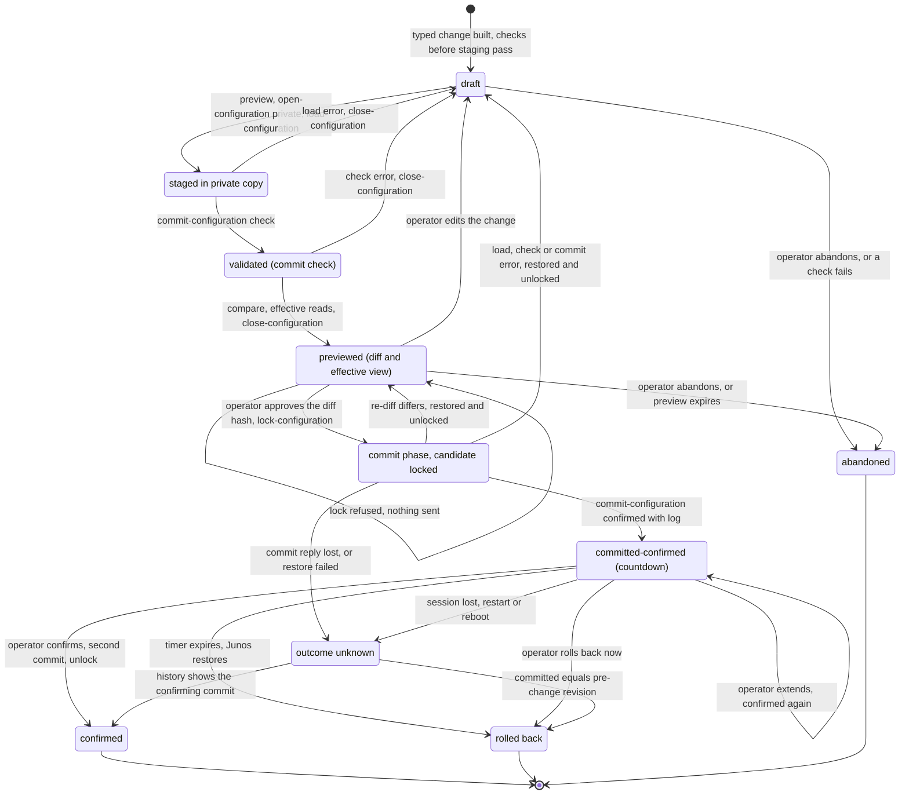
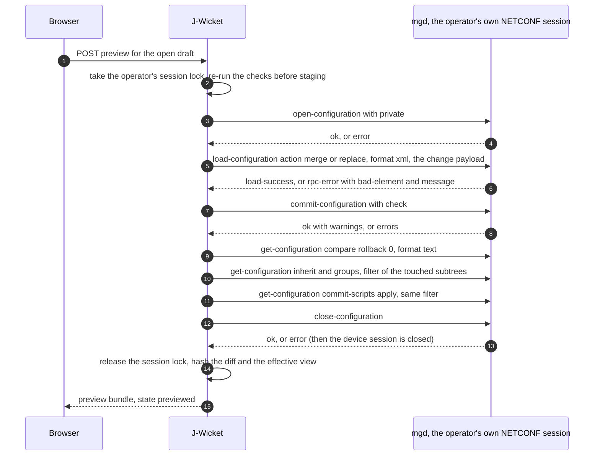
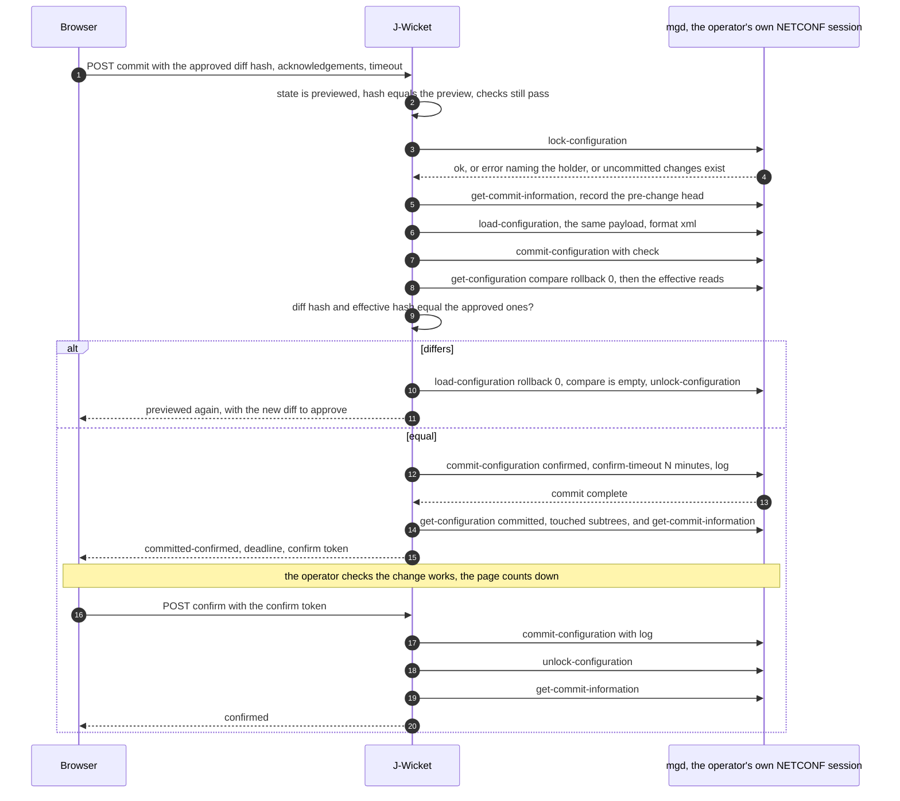

# Spec 002: Shared change protocol

| Field | Value |
| --- | --- |
| Status | **Design only. Nothing is built. The code has no write path. Nothing qualified.** |
| Parity priority | `P2` (change safely). Preview-only mode (section 12) is needed earlier, by Spec 003 |
| Gate | Preview-only mode: G3 (with [Spec 003](003-firewall-policy-builder.md)). The full protocol: G4 (live writes), which also needs Q-SEC-02, a product sponsor, every Q-CHG test in section 19, and decided signed-package and support positions |
| Decides scope | Project owner. G4 sign-off: the named security reviewer. Q-CHG evidence: the qualification lab owner certifies it |
| Code | None. [`junos/session.py`](../../src/jwicket/junos/session.py) `ALLOWED_RPCS` holds only `get-` RPCs, and [`test_session.py`](../../tests/test_session.py) `AllowlistTests.test_allowlist_is_read_only` fails the build if `load-configuration`, `commit-configuration`, `lock-configuration` or `open-configuration` is added |
| Tests | None yet. Acceptance criteria in section 18; qualification tests Q-CHG-01 to Q-CHG-16 in section 19 |
| Decisions it rests on | [ADR 0002](../adr/0002-junos-delegated-sign-in.md), [0004](../adr/0004-no-sample-data.md), [0005](../adr/0005-committed-config-with-provenance.md), [0009](../adr/0009-central-management-coexistence.md). It needs at least one new ADR (open question 1) |

## 1. Status

The point: every J-Wicket configuration change, from any future wizard or recovery flow, goes
through one protocol. The operator's own Junos session builds the change in a private copy,
Junos checks it, the operator sees the diff and the effective result, and only then is it applied,
as a confirmed commit that Junos undoes by itself unless the operator confirms it from the browser.

None of this exists. This document is the design that the first write path must implement and
that Spec 003's preview must reuse. It is grounded in Juniper documentation and in J-Web 24.4's
documented behaviour; no step has been run on a device, and several steps depend on behaviour
that Juniper does not document. Each such step names the Q-CHG test that settles it.

Labels, as in [architecture.md](../architecture.md): **verified** (a cited Juniper page says it),
**inferred** (our reading of verified facts; needs a lab test), **unknown** (nobody has checked;
the test is named), **proposed** (a design choice this spec makes, for the owner or reviewer to
accept).

## 2. Problem

### 2.1 What can go wrong with a change on an SRX

1. **Someone else's work rides along.** Junos has one shared candidate. "If you and another user
   make changes and the other user commits changes, your changes are committed as well"
   (**verified**, [configure command][cfg-cmd]). Over NETCONF, "a commit operation applies to all
   changes in the candidate configuration" (**verified**, [NETCONF locking][nc-lock]).
2. **What you reviewed is not what is enforced.** Configuration groups add inherited statements,
   and commit scripts can add persistent changes and transient changes that "are not copied to
   the candidate configuration" (**verified**, [commit scripts][commit-scripts]). A candidate diff
   can therefore differ from the effective configuration.
3. **The change locks you out.** A change to zones, filters, interfaces or services can cut the
   path the operator uses to reach the device, including the path to J-Wicket itself.
4. **The undo is not what you think.** Rollback indexes shift with every commit; another commit can
   land between review and apply; a central manager may overwrite or flag the change.
5. **Nobody can tell who did it.** Junos commit history records the user and client method; the
   method lists values such as `CLI` and `Junos XML protocol` (**verified**,
   [show system commit][show-commit]), which most likely cannot separate J-Web, J-Wicket and other
   XML clients (**inferred**). J-Web's History page documents J-Web's own commits as client
   `junoscript` (**verified**, [J-Web History][jweb-history]).

### 2.2 What J-Web 24.4 offers, and what replaces it

The reference release's banner has a Commit Configuration menu with five options: "Commit your
configurations", "View configuration changes", "Commit the changes with autorollback", "Discard
your configuration" and "Commit the changes in your preferred way" (**verified**,
[Explore J-Web][jweb-explore]; the 24.4 PDF has the same list). The guide has no topic that
defines their semantics: the rollback timer, the diff format and the preferences are **unknown**.

| J-Web 24.4 | What the documentation says | Spec 002 |
| --- | --- | --- |
| Commit | No SRX statement. EX J-Web: "Commits the candidate configuration of the current user session, along with changes from other user sessions" (**verified** for EX, [EX commit options][ex-commit]); legacy J-Web: "all changes made by all users take effect" (**verified**, [J-Web 13.2][jweb-13-2]). SRX J-Web on the shared candidate: **inferred** | Commit only what this operator previewed, under an exclusive lock that fails if anyone else has uncommitted changes. Never commit another session's work |
| View configuration changes | Menu item exists ("Commit > View Configuration Changes", Roles page) | The preview: the device diff **and** the effective view after inheritance and commit scripts, bound by hash to what is committed |
| Commit with autorollback | Menu item exists; timeout and confirm step undocumented | Every commit is a confirmed commit. Confirmation is a second, explicit commit from the browser |
| Discard | EX J-Web: "Discards the candidate configuration of your current session, along with changes from other user sessions" (**verified** for EX) | J-Wicket discards only its own private copy or its own load under its own lock. It never discards the shared candidate |
| Commit preferences | Undocumented for SRX 24.4. EX: "Validate and commit configuration changes" or "Validate configuration changes", the default (**verified** for EX) | One commit model, this one |
| Per-page Save, then Commit; policy grid "tick, then Save or Discard" | **Verified**, [rules page][jweb-rules] | Every J-Wicket change is one typed change with one review |
| History > Rollback | "Click Rollback to load the device and download the selected configuration. This behavior is different from ... the CLI, where the configuration is loaded, but not committed" (**verified**, [J-Web History][jweb-history]) | Rollback is a change like any other: previewed, then committed with automatic undo (section 9.4) |
| Upload, CLI Editor | Replace the whole configuration and restore the previous one on error (**verified**, [Upload][jweb-upload], [CLI Editor][jweb-cli-editor]) | Not in this spec. When they come (catalog O7, O20, `P4`), they are whole-configuration diffs through this protocol |
| ATP enrollment | "If there are any existing configuration changes, a message appears for you to commit the changes" before enrolling (**verified**, [ATP enrollment][jweb-atp]) | The same rule applies to every J-Wicket change, through the lock |

## 3. Users and jobs

| User | Job | What Spec 002 gives them |
| --- | --- | --- |
| Operator making a change (through Spec 003 or a later wizard) | "Show me exactly what will change, including what groups and scripts add." | The device diff, the effective view, and every difference between them flagged |
| Same | "Make sure nobody else's half-finished edit goes in with mine." | Exclusive lock; refusal with the holder's login when the candidate is not clean |
| Same, after the change | "If this breaks my access, undo it without me." | Junos confirmed commit; J-Wicket never confirms, extends or rolls back on its own |
| Operator during an incident | "Undo that change." | Roll back now during the window; a previewed rollback afterwards (section 9.4) |
| Another administrator, on the CLI or J-Web | "Don't trample my work." | J-Wicket never commits, discards or kills another session's work |
| Auditor | "Who changed what, when, from where, and did they acknowledge the central manager?" | Change ID and user in the Junos commit comment; J-Wicket audit events for every transition |
| Security Director or SD Cloud owner | "Tell me when someone changed the box locally." | A recorded acknowledgement before any write on a detected managed device; a setting to block writes |
| Spec 003 author | "Preview my change on the device without committing." | Preview-only mode (section 12) |

## 4. Scope and non-scope

**In scope:**

- The lifecycle of one configuration change: draft, private preview, commit check, diff,
  effective view, approval, locked re-staging, confirmed commit, confirmation, rollback.
- The checks before anything is staged: write path enabled, backend, scope, visibility, group
  ownership, `protect`, central management, HA role, one change per operator.
- Concurrency with other Junos sessions (CLI, J-Web, NETCONF, central managers) and with other
  J-Wicket operators.
- Recovery: timeout rollback, roll back now, rollback to a revision, rescue load, session loss,
  J-Wicket restart and device reboot during the window.
- Chassis cluster and Multinode HA behaviour of a change.
- Audit records on J-Wicket and on Junos; the commit comment.
- Preview-only mode for Spec 003.
- Failure semantics and operator messages; qualification tests Q-CHG-01 to Q-CHG-16.

**Not in scope:**

| Not here | Why, and where it goes |
| --- | --- |
| Any specific change (a policy, an address, a zone) | Change kinds belong to the specs that build them: [Spec 003](003-firewall-policy-builder.md) first |
| Guided actions: operational commands that change device state but not configuration (reboot, clears, captures, certificate enrollment, rescue save) | **Proposed:** a separate spec. They have no diff and no confirmed-commit undo. They reuse sections 7 (checks), 10 (HA node), 11 (audit) and 13 (messages). Answers catalog requirement 12 (open question 3) |
| Whole-configuration upload and text editing | Catalog O7, O20 (`P4`). They need the whole-configuration secrets ADR the catalog asks for |
| Ephemeral databases, `configure dynamic`, `configure batch` | Not used. Confirmed commit is not available for an ephemeral instance (**verified**, [commit-configuration][commit-cfg]) |
| Scheduled commits (`<at-time>`) | Not used. "If the software fails before the changes activate, all changes are lost", and no commit is possible while one is pending (**verified**, [commit][commit-cli]) |
| Changes to J-Wicket's own runtime configuration (`system extensions`, `system scripts`, `system services netconf`, `system services ssh`, filters on the loopback) | **Proposed:** refused by every change kind in this protocol (section 7, check 9). Committing the app's own statements restarts it ([architecture.md](../architecture.md), section 10) |
| Writes with the `lab-token` backend | Never. It runs as the daemon's account, not the operator ([ADR 0002](../adr/0002-junos-delegated-sign-in.md)) |

## 5. Principles

| # | Principle | What it means in practice | Basis |
| --- | --- | --- | --- |
| P1 | **The operator's own session** | Every RPC of a change runs on the signed-in operator's NETCONF session, with their login class. J-Wicket adds no right and widens no scope. The `lab-token` backend never stages, previews on the device, or commits | [ADR 0002](../adr/0002-junos-delegated-sign-in.md) |
| P2 | **Private candidate for preview** | Staging, commit check and diff run in a private copy (`<open-configuration><private/>`) opened and closed inside one serialized preview run. It touches neither the shared candidate nor the active configuration, and Junos discards it on close or session end | **Verified**: private copy, close discards it ([locking][xml-lock]) |
| P3 | **Nothing reaches the shared candidate or the active configuration without a shown diff** | The only things loaded before the operator has seen a diff are loads into the disposable private copy that produce that diff. The commit phase reloads the same payload under a lock, re-reads the diff, and refuses to commit unless its hash equals the one the operator approved | **Proposed**; that the diff can go stale between preview and commit is **inferred** (6.4) |
| P4 | **Commit confirmed by default, and here the only option** | Every commit is `<commit-configuration><confirmed/><confirm-timeout>`. A plain commit is used only to confirm, or to restore the pre-change configuration (roll back now). Offering an unconfirmed commit would need an ADR | **Verified** mechanism ([commit confirmed][commit-confirm]). Confirmed commit is not available for a private copy (**verified**, [private commit][private-commit]), so the commit phase must use the shared candidate under a lock (**inferred**) |
| P5 | **Junos's timer is the only automatic rescue** | J-Wicket never confirms, extends or rolls back without an operator request that arrives from the browser after the commit. A dead browser path therefore always ends in Junos's own rollback | **Proposed** |
| P6 | **The commit comment names the J-Wicket user and the change ID** | `<log>` on every commit, at most 512 characters, one line (section 6.5) | **Verified**: `<log>`, 512 characters ([commit][commit-cli], [commit with message][commit-log]) |
| P7 | **One change at a time per operator** | At most one change per operator between `draft` and a final state. Junos's lock serializes commits across all sessions | **Proposed** |
| P8 | **Never touch another session's work** | No commit or discard of the shared candidate when it holds others' changes; no `<kill-session/>`; no `force-synchronize`; no lock breaking | **Proposed**; lock refusal on uncommitted changes **verified** ([locking][xml-lock]). Juniper documents one way the lock itself breaks P8: unlocking rolls back other users' uncommitted `configure private` work (section 8, open question 17) |
| P9 | **Edit only what you can see and what you own** | Targets must be visible in the operator's own committed read and not owned by a group or protected, unless the change is made in the owning group with its blast radius shown | [ADR 0005](../adr/0005-committed-config-with-provenance.md); deny hides (**verified**, [access privileges][access-priv]) |
| P10 | **Co-owners are told and acknowledged** | A detected central manager is shown, acknowledged, recorded in the audit trail and the commit comment, or writes are blocked by setting | [ADR 0009](../adr/0009-central-management-coexistence.md) |

## 6. The change lifecycle

### 6.1 State machine



`staged` and `validated` exist only inside one preview run (6.3): the private copy is opened and
closed by the same request, holding the operator's session lock, so no other read or RPC on that
session can interleave. This matters because, once `<open-configuration>` has been issued,
`<get-configuration>` "returns data from the open database" (**verified**,
[get-configuration][get-cfg]): a Spec 001 read sent while a private copy is open would show
uncommitted data. If `<close-configuration/>` fails, J-Wicket closes the whole device session
(the operator is signed out) rather than risk serving the private copy as committed data.

Preview-only mode (section 12) stops at `previewed`. A preview expires after 15 minutes
(**proposed**), so that nobody approves a stale diff from a tab left open overnight.

`outcome unknown` stays until J-Wicket has evidence. If none is found, the operator is shown the
comparison of the committed configuration against the pre-change revision and decides; J-Wicket
takes no action on its own.

### 6.2 Transitions and the RPCs each sends

All RPCs are Junos XML protocol operations on the operator's NETCONF session. J-Wicket uses the
Junos `<commit-configuration>` RPC, whose timeout is in **minutes**, not the standard NETCONF
`:confirmed-commit` capability, which RFC 6241 counts in seconds and whose Junos support is
not verified. `<open-configuration>` needs the device to advertise
`http://xml.juniper.net/netconf/junos/1.0` (**verified**, [open-configuration][open-cfg]);
J-Wicket checks the capability at sign-in and reports the change path `unsupported` without it.

| Transition | Trigger | RPCs, in order | Verified | Inferred or unknown |
| --- | --- | --- | --- | --- |
| start → `draft` | A change kind (Spec 003 builder, recovery flow) builds a typed change; section 7 checks pass | None beyond Spec 001 committed reads | — | — |
| `draft` → `staged` | Operator asks for a preview | `<open-configuration><private/></open-configuration>`; `<load-configuration action="merge" format="xml"><configuration>…</configuration></load-configuration>` (or `action="replace"`, or element attributes `delete="delete"`, `insert="before"`/`"after"`, `replace="replace"`) | RPCs and attributes ([open-configuration][open-cfg], [load-configuration][load-cfg], [XML attributes][xml-attrs]); reordering only in Junos XML, not text or JSON ([reordering][reorder]) | Loads go to the open private copy (**inferred**: stated for reads only). Whether opening is refused when the shared candidate holds others' changes: **unknown** (Q-CHG-09) |
| `staged` → `validated` | Automatic | `<commit-configuration><check/></commit-configuration>` | "Syntax and semantic check without committing" ([commit-configuration][commit-cfg]) | Whether check runs commit scripts and returns their warnings: **unknown** (Q-CHG-08) |
| `validated` → `previewed` | Automatic | `<get-configuration compare="rollback" rollback="0" format="text"/>`; `<get-configuration inherit="inherit" groups="groups">` with a filter of the touched subtrees; the same with `commit-scripts="apply"`; then `<close-configuration/>` | Compare semantics, text patch output, `inherit`, `groups`, `commit-scripts="apply"` ([comparison][compare], [get-configuration][get-cfg]); reads go to the open database ([get-configuration][get-cfg]) | That `compare` diffs the *private* copy against the active configuration: **inferred** (Q-CHG-09). Whether `commit-scripts="apply"` runs scripts on an uncommitted copy: **unknown** (Q-CHG-08) |
| `staged` or `validated` → `draft` | Load or check returned an error | `<close-configuration/>` | Close discards the private copy ([locking][xml-lock]) | Whether a load with a denied element applied the rest: **unknown** (Q-CHG-07); irrelevant here because the copy is discarded |
| `previewed` → `abandoned` | Operator abandons; preview expires | None (the private copy is already closed) | — | — |
| `previewed` → `previewed` | Lock refused: another session holds it, or the candidate has uncommitted changes | `<lock-configuration/>` only; nothing loaded | Both refusal causes ([locking][xml-lock]) | Exact error texts: **unknown** (Q-CHG-01) |
| `previewed` → `commit phase` | Operator approves, sending the diff hash shown; acknowledgements recorded | `<lock-configuration/>`; `<get-commit-information/>` (pre-change head); `<load-configuration …>` with the same payload; `<commit-configuration><check/>`; compare and effective reads as above, now on the shared candidate | Lock fails when another session holds it (the error reports the login) or when uncommitted changes exist ([locking][xml-lock]); `<get-commit-information/>` ([commit with message][commit-log]) | The lock keeps other commits out until unlock: **inferred** from "equivalent to `configure exclusive`", where other users cannot commit (verified for the CLI, [commit][commit-cli]) |
| commit phase → `previewed` | Re-read diff or effective view differs from the approved hashes | `<load-configuration rollback="0"/>`; compare returns no difference; `<unlock-configuration/>` | `load rollback` ([load-configuration][load-cfg]) | That `rollback="0"` under the lock restores exactly the pre-load candidate: **inferred**, because the lock guaranteed the candidate was clean (Q-CHG-03) |
| commit phase → `draft` | Load, check or commit error under the lock (the device rejects the change itself) | `<load-configuration rollback="0"/>`; compare returns no difference; `<unlock-configuration/>` | NETCONF: "If the session ends before a commit, the changes are automatically discarded" ([NETCONF locking][nc-lock]) | Whether `<unlock-configuration/>` alone discards loaded changes: **unknown**, so J-Wicket restores explicitly |
| commit phase → `outcome unknown` | The commit RPC timed out or its reply was lost; or the restore did not leave an empty compare | None more. J-Wicket keeps the lock if it still has it, so nobody commits an unknown candidate, then reads `<get-commit-information/>` for its change ID | — | Q-CHG-03, Q-CHG-16 |
| commit phase → `committed-confirmed` | Hashes equal | `<commit-configuration><confirmed/><confirm-timeout>N</confirm-timeout><log>…</log></commit-configuration>`; then a committed read of the touched subtrees (Spec 001 path, `commit-scripts="apply"` added) and `<get-commit-information/>` | Range 1 to 65,535 minutes, default 10; `<log>` combines with `<confirmed/>` ([commit-configuration][commit-cfg], [commit with message][commit-log]); `show system commit` lists `rollback pending` ([show system commit][show-commit]) | Reply tags of `<commit-information>`: **unknown** (Q-REL-01, Q-CHG-14) |
| `committed-confirmed` → itself | Operator extends | `<commit-configuration><confirmed/><confirm-timeout>M</confirm-timeout><log>…</log></commit-configuration>` | Re-sending `<confirmed/>` delays the rollback, "indefinitely" if repeated ([commit confirmed][commit-confirm]) | — |
| `committed-confirmed` → `confirmed` | Operator confirms from the browser, with the confirm token (6.4) | `<commit-configuration><log>…</log></commit-configuration>`; `<unlock-configuration/>`; `<get-commit-information/>`; committed re-read | An empty `<commit-configuration/>` before the deadline cancels the rollback ([commit confirmed][commit-confirm]) | `<log>` on the confirming commit: **inferred**; needed where `force-commit-log` (24.2R1+) requires a comment on every commit (Q-CHG-14) |
| `committed-confirmed` → `rolled back` (timer) | Deadline passes with no confirmation | None from J-Wicket. Afterwards: `<get-commit-information/>`, a committed compare against the pre-change revision, `<unlock-configuration/>` (may fail) | On timeout "the device automatically loads and commits (rolls back to) the previously committed configuration" ([commit confirmed][commit-confirm]); CLI: the exclusive lock is removed and "access has been revoked" ([configure command][cfg-cmd]) | Lock revocation for an XML lock: **inferred**. Rollback target when another commit landed in the window: **unknown** (Q-CHG-11) |
| `committed-confirmed` → `rolled back` (now) | Operator asks to roll back now | `<load-configuration configuration-revision="…"/>` of the pre-change revision (or `rollback="1"`); compare shows the inverse of the approved diff; `<commit-configuration><log>…</log></commit-configuration>`; `<unlock-configuration/>` | `configuration-revision` loads (20.4R1) and `rollback` ([load-configuration][load-cfg]); any commit before the deadline cancels the pending rollback ([commit confirmed][commit-confirm]) | That the compare equals the exact inverse: **inferred** (Q-CHG-03) |
| `committed-confirmed` → `outcome unknown` | Device session lost, J-Wicket restarted, or device rebooted | None possible. After the next sign-in: `<get-commit-information/>` and a committed compare against the pre-change revision | If another application kills the session during a pending confirmed commit, the server "restores the configuration to its state before the confirmed commit" ([commit confirmed][commit-confirm]) | A session that simply drops, and a reboot in the window: **unknown** (Q-CHG-10, Q-CHG-11) |

### 6.3 The preview transaction

One HTTP request, one serialized run on the operator's session. Nothing else uses that session
until the private copy is closed.



The preview bundle holds (**proposed**):

- **Change as written**: the payload exactly as loaded, in Junos XML.
- **Device diff**: the compare output, `+` and `-` lines (**verified** format,
  [comparison][compare]).
- **Effective view**: the touched subtrees after inheritance, each element with its `junos:group`,
  and the same after commit scripts.
- **Server-side expansion**: every element present in the effective view but absent from the
  change as written (inherited from a group, added by a commit script), flagged. A wildcard group
  that reaches a new policy shows here (**inferred** from [commit scripts][commit-scripts]: scripts
  see "the postinheritance view").
- **Check result**: warnings verbatim; the commit-script situation (section 7, check 14).
- **Scope review** (section 7) and hashes: `payload_sha256`, `diff_sha256`, `effective_sha256`.

Transient commit-script changes never appear in a candidate diff (**verified**). If the
`commit-scripts="apply"` read on the private copy turns out not to run scripts (Q-CHG-08), the
preview must say "commit scripts are configured and were not evaluated; the committed result may
differ", and the post-commit re-read (6.4) is the first place the operator sees their effect.

### 6.4 The commit phase



Rules for this phase (**proposed** unless marked):

- The lock is held from step 3 until the change is confirmed or rolled back. That keeps other
  commits out of the confirm window (**inferred**, 6.2). It also blocks every other administrator
  and central-manager push for that long, so windows are short (6.5) and extensions limited.
- Re-staging uses the identical payload bytes. The diff is re-read **after** the lock, because
  another session may have committed since the preview, and because Junos merges a private copy
  into the *current* candidate (**verified**, [private commit][private-commit]), which is why
  the preview's diff cannot simply be committed.
- A mismatch is never resolved automatically. The operator sees the new diff and approves again.
- The confirm token is a random value returned with the `committed-confirmed` response, after the
  post-commit re-read. The confirm request must carry it. A request queued before the commit, or a
  script that confirms blindly before the operator has seen the committed result, cannot confirm.
- `<commit-configuration>` gets its own RPC timeout (`commit_rpc_timeout_s`, default 300 s), not
  the 30 s read default ([`settings.py`](../../src/jwicket/settings.py) `rpc_timeout_s`). A
  timeout on the commit RPC is not a failure: the state becomes `outcome unknown` and J-Wicket
  reads commit history for its change ID (Q-CHG-16).
- J-Wicket refuses to start a commit when the web session's absolute lifetime
  (`session_absolute_s`) would end inside the confirm window plus five minutes.

### 6.5 Change record and commit comment

A change ID is `jw-<UTC yyyymmddThhmmssZ>-<6 lowercase hex>`, for example
`jw-20261124T061500Z-3f9a1c` (**proposed**). It contains only `[a-z0-9TZ-]`, so it is safe in a
commit comment, a file name and a log line.

The change record J-Wicket keeps (in memory, and in the change journal of section 11):

```json
{
  "id": "jw-20261124T061500Z-3f9a1c",
  "kind": "policy.add",
  "scope": "root",
  "operator": {"user": "alice", "backend": "netconf", "source": "127.0.0.1"},
  "device": {"hostname": "fw1", "node": null, "ha": "standalone"},
  "state": "committed-confirmed",
  "created_at": "2026-11-24T06:15:00Z",
  "payload_sha256": "…",
  "preview": {"read_at": "2026-11-24T06:15:04Z", "diff_sha256": "…", "effective_sha256": "…", "expansion": 2, "check_warnings": []},
  "acks": [{"kind": "central-management", "clients": ["central-mgr"], "at": "2026-11-24T06:16:10Z"}],
  "commit": {"timeout_min": 10, "committed_at": "2026-11-24T06:16:12Z", "deadline_estimate": "2026-11-24T06:26:12Z", "pre_change": {"revision": "…", "time": "…", "user": "…"}, "extensions": 0},
  "outcome": null
}
```

(Values illustrative. The `pre_change` fields come from `<get-commit-information/>`; their tag
names are **unknown** until Q-REL-01 and Q-CHG-14 record a reply.)

Commit comments (**proposed** format; the 512-character, single-line limit is **verified**,
[commit][commit-cli]):

| Commit | `<log>` text |
| --- | --- |
| Confirmed commit | `J-Wicket jw-20261124T061500Z-3f9a1c by alice [root]: add policy allow-web trust>untrust` |
| … on a managed device | the same, then `; ack central-management: central-mgr` |
| Extension | `J-Wicket jw-… extended by alice` |
| Confirmation | `J-Wicket jw-… confirmed by alice` |
| Roll back now | `J-Wicket jw-… rolled back by alice` |

- The user is the name the operator signed in with. Junos's own history records the user Junos
  assigned; for a RADIUS or TACACS+ template user the two can differ (**inferred**, Q-AUTH-02), and
  the comment keeps the name the operator typed.
- Printable ASCII only; `"`, `\` and control characters are removed; the summary is cut so the
  whole comment fits in 512 characters. A comment cannot be added to `commit check`
  (**verified**, [commit][commit-cli]), so check RPCs carry none.
- The `J-Wicket <change-id>` prefix is how J-Wicket finds its own commits in history (catalog
  requirement 5).

Confirm window (**proposed**): default 10 minutes (the Junos default, **verified**); J-Wicket
accepts 1 to 30; at most two extensions, each up to the same limit, each an explicit operator
request and audited. These numbers are owner decisions after Q-CHG-02 (open question 6).

### 6.6 Endpoints (proposed)

All POST routes require the `Origin` check and the `X-CSRF-Token` header that sign-out uses today
([`api.py`](../../src/jwicket/api.py) `logout`), a valid web session with the `netconf` backend,
and a JSON body within `max_body_bytes`. No route accepts configuration text.

| Request | Result |
| --- | --- |
| `POST /api/changes` | Create a draft from `{kind, scope, params}`; 409 if the operator already has an open change; section 7 refusals as 403 or 409 with a reason code |
| `GET /api/changes/current` | The operator's open change, its state and, in the window, the deadline |
| `POST /api/changes/<id>/preview` | Run 6.3; 200 with the preview bundle, or the draft with device errors |
| `GET /api/changes/<id>/export` | The preview bundle as a stamped attachment (device, scope, user, read time), as Spec 001 exports are |
| `POST /api/changes/<id>/commit` | `{diff_sha256, effective_sha256, acks, timeout_min}`; runs 6.4 to `committed-confirmed`, or returns the new preview |
| `POST /api/changes/<id>/confirm` | `{confirm_token}`; confirms |
| `POST /api/changes/<id>/extend` | `{confirm_token, timeout_min}` |
| `POST /api/changes/<id>/rollback` | `{confirm_token}`; roll back now |
| `POST /api/changes/<id>/abandon` | Before the commit phase only |

## 7. Checks before staging

Run when the draft is created and again at the start of every preview and commit. A failed check
means nothing is sent to the device beyond the committed reads that the check itself needs.

| # | Check | Data | Result when it fails | Status |
| --- | --- | --- | --- | --- |
| 1 | The write path exists and is enabled | Build (G3: preview RPC set only; G4: write RPC set) and setting `[changes] mode = off \| preview \| write`, default `off` | Refused. Before G4 the write RPCs are absent from the code, not merely switched off | **Proposed** |
| 2 | Backend is `netconf` | Web session | Refused for `lab-token`, including device preview | P1 |
| 3 | No other open change for this operator | J-Wicket state | 409 with the open change's ID and state | P7 |
| 4 | Scope | The change's scope equals the scope the operator selected; the payload touches exactly one scope: root as `<configuration><security>…`, a logical system for a root operator as `<configuration><logical-systems><name>X</name>…` | Refused on mismatch. Operators whose login class is bound to a logical system or tenant: refused until Q-CHG-13 and Q-AUTH-03 record how their replies and loads are rooted | Wrapper for a root operator **inferred** from YANG ([yang]); confinement of bound classes **verified** ([architecture.md](../architecture.md), section 4) |
| 5 | Visibility | Every object the change edits or references is present in the operator's own committed read (Spec 001 path) | Refused: "not visible to your login class". Junos hides hierarchies matched by `deny-configuration-regexps` (**verified**, [access privileges][access-priv]), so an absent object may exist; whether a missing permission bit hides or refuses is **unknown** (Q-AUTH-03) | **Proposed** |
| 6 | Group ownership | `junos:group` on the target or any element the payload writes, from the `inherit="inherit" groups="groups"` read ([ADR 0005](../adr/0005-committed-config-with-provenance.md)) | In-place edit refused, naming the group. The change kind may offer the same change **inside the group**, with its blast radius: every element in J-Wicket's read annotated with that group, plus "and anything outside the subtrees J-Wicket reads". Per-node groups (`node0`, `node1`) say which node they reach. `junos-defaults` is never editable: it is "hidden and immutable" (**verified**, [configuration groups][config-groups]) | Annotation **verified**; that a local statement next to an inherited one shadows or merges with it is **inferred**, which is why in-place edits are refused (Q-CHG-04) |
| 7 | `protect` | `protect="protect"` on the target or an ancestor (**verified** attribute, [JSON/XML mapping][json-mapping]) | Refused. J-Wicket never sends `unprotect="unprotect"` | Spec 001 does not read `protect` yet (Spec 001 open question 12): a prerequisite. Semantics of a protected element under load: **inferred** (Q-CHG-04) |
| 8 | Inactive target | `inactive="inactive"` on the target or an ancestor | Warning: the change will not take effect while the element is inactive | **Verified** attribute |
| 9 | Hierarchy allowlist | Every top-level path the payload writes is in the change kind's fixed list; never `system login`, `system extensions`, `system scripts`, `system services`, or firewall filters applied to `lo0` | Refused. Change kinds that may cut the access path (zones' host-inbound traffic, interfaces, routing, filters) carry an "access path at risk" flag that the preview shows (9.2) | **Proposed** |
| 10 | Central management | `system services outbound-ssh` clients from the committed read ([`facts.central_management`](../../src/jwicket/junos/facts.py)) | Warning naming each client and what the manager may do (overwrite on redeploy, out-of-sync); an acknowledgement is required, recorded in the audit trail and the commit comment. With `[changes] managed_device_writes = block`, refused | [ADR 0009](../adr/0009-central-management-coexistence.md); SDC behaviour **verified** ([SDC versions][sdc-versions]); signatures Q-MGMT-01. Default `acknowledge` **proposed** (open question 5) |
| 11 | HA role | Section 10 | Chassis cluster: refused unless J-Wicket knows it runs on the RG0 primary (needs Q-HA-02). MNHA: refused until Q-CHG-12 passes | **Proposed** |
| 12 | Login class | — | J-Wicket does not pre-evaluate the class. What the device applies (**verified**, [access privileges][access-priv]): `configure` to enter configuration mode and commit, `security-control` to change `[edit security]`; `allow-configuration` wins over `deny-configuration`, but for the `-regexps` forms deny wins unless `regex-additive-logic` is set; allow and deny statements win over permission bits; regexps from RADIUS or TACACS+ are merged with the local class. J-Wicket cannot compute that merge, and reading `system login` touches secrets, so the device decides at load time (check 5 already covers denied hierarchies, which are hidden) | Whether NETCONF loads honour the regexps exactly as the CLI does: **unknown** (Q-CHG-07) |
| 13 | Other sessions' uncommitted changes | Optional early warning: `<get-configuration compare="rollback" rollback="0">` on the shared candidate, reduced to the `[edit …]` hierarchy names it touches, never the contents | Warning in preview: "uncommitted changes from another session exist under …; commit will be refused until they are committed or discarded". The commit-phase lock is the real check | Reading the shared candidate is outside ADR 0005: **proposed**, needs the owner's decision (open question 4). `[edit …]` banners in this output: **inferred** |
| 14 | Commit scripts | `system scripts commit` in the committed read | Shown: "commit scripts configured: their effect is included / not evaluated" (6.3). `view-configuration` excludes "system scripts" (**verified**, [access privileges][access-priv]), so for many classes the answer is "unknown to your login class", and the preview says so | **Proposed** |
| 15 | Rescue configuration | `<get-rescue-information>` (exists, **verified**, [rollback comparison][compare-rb]) | Information only: whether a rescue configuration exists | Reply format **unknown** (Q-REL-01) |

## 8. Concurrency

| Situation | What Junos does | What J-Wicket does |
| --- | --- | --- |
| Another CLI, J-Web or NETCONF session has uncommitted changes in the shared candidate | The lock fails with an error (**verified**, [locking][xml-lock], [NETCONF locking][nc-lock]). Opening a private copy in that state: **unknown** (Q-CHG-09) | Stops before loading anything. "The shared candidate has uncommitted changes from another session. J-Wicket will not commit or discard them. Ask that administrator to commit or discard, then try again." The preview may already have warned (check 13) |
| A CLI user holds `configure exclusive` | Lock fails; the error reports that login (**verified**). A private copy cannot be committed meanwhile (**verified**, [configure][configure-ref]) | Stops, naming the holder. Preview may still run, since the private copy is never committed; if Junos refuses it, the preview says why |
| A CLI user is in `configure private` with uncommitted changes | Their changes are not in the shared candidate, so J-Wicket's lock succeeds (**inferred**). Their own private commit fails while the candidate is locked (**verified**, [private commit][private-commit]). "When one user exits configure exclusive mode while another user is in configure private mode, Junos OS rolls back any uncommitted changes in the private mode session" (**verified** for the CLI, [configure command][cfg-cmd]). `<lock-configuration/>` is "equivalent to the CLI configure exclusive command", and "The restrictions on, and interactions between, operations on the locked regular candidate configuration and a private copy are the same as for the CLI configure exclusive and configure private commands" (**verified**, [locking][xml-lock]). So `<unlock-configuration/>` rolling back that user's private work is strongly supported but still **inferred** until Q-CHG-01; for the NETCONF `<lock>` and `<unlock>` family it is **inferred** (open question 12) | **Known risk to P8.** By Juniper's documentation, J-Wicket's unlock destroys a CLI user's uncommitted private work. The mitigation is a design decision before G4, not a reaction to Q-CHG-01: detect private sessions before locking (method **unknown**, open question 17), or the owner accepts the risk and J-Wicket shows a warning the operator must acknowledge before it locks. Q-CHG-01 records what actually happens |
| Two J-Wicket operators | Previews run in independent private copies (**verified**: each user gets "a private candidate configuration", [configure command][cfg-cmd]). Only one can hold the lock | The second operator's commit stops at the lock, naming the first operator's login. Every J-Wicket page shows "change jw-… by alice awaits confirmation until hh:mm" while J-Wicket holds a window |
| Another commit between preview and commit | Allowed (no lock during preview) | Detected by the re-diff under the lock; back to `previewed` (Q-CHG-15) |
| Another session tries to commit during the confirm window | Refused while J-Wicket holds the lock (**inferred**, 6.2). Legacy J-Web: "you cannot commit a configuration until the user has committed" (**verified**, [J-Web 13.2][jweb-13-2]) | Holds the lock until confirm or rollback; keeps the window short |
| A central manager pushes during the window | Its commit should fail at the lock (**inferred**) | The acknowledgement text says a deployment may fail during the window. Q-CHG-06 records what each manager reports |
| The lock is lost during the window (session ends, J-Wicket restarts) | Pending confirmed commit continues; whether another session's commit now confirms it, and what the timeout then restores: **unknown**: no Juniper page read covers it | `outcome unknown` until evidence (9.3). After sign-in, history shows any commits by others inside the window, and the operator is told the rollback target is not certain |
| A pending scheduled commit (`commit at`) exists | Commits fail (**verified**, [commit][commit-cli]) | Message names the cause; J-Wicket never schedules or clears it |
| J-Wicket's own reads during a change | — | Reads never share a session with an open private copy (6.1). During the window, reads use `database="committed"` and no private copy is open |

J-Wicket never sends `<kill-session/>`, never uses `force-synchronize`, and never breaks a lock.

## 9. Recovery

### 9.1 Automatic rollback on timeout

Junos loads and commits the previous configuration when the window ends without confirmation, and
every logged-in user gets a broadcast message (**verified**, [commit confirmed][commit-confirm],
[commit][commit-cli]). Junos logs `UI_COMMIT_NOT_CONFIRMED` (template "Commit was not confirmed;
`<message>`") and, if the rollback itself fails, `UI_COMMIT_ROLLBACK_FAILED` (template "Automatic
rollback failed") (**verified** message catalogue, [System Log Explorer][sle], 24.4R1).

After the deadline J-Wicket (**proposed**):

1. Reads `<get-commit-information/>` and looks for an entry after its own commit that is not its
   confirming commit.
2. Compares the committed configuration with the pre-change revision recorded at lock time
   (`<get-configuration database="committed" compare="configuration-revision" …>`, **verified**
   attributes, [get-configuration][get-cfg]; filtering a compare to subtrees: **unknown**,
   Q-CHG-03). An empty comparison means restored.
3. Sends `<unlock-configuration/>`; an error here is expected if Junos revoked the lock.
4. Records `rolled back (timeout)` with the evidence, or `outcome unknown` if the comparison is not
   empty, and tells the operator which.

J-Wicket does not need the browser for this: it runs on the next request from any J-Wicket page of
that operator, or at the next sign-in.

### 9.2 A change that cuts J-Wicket's own access path

Three paths can break, with different consequences (**inferred**, from
[architecture.md](../architecture.md) sections 1 and 10):

| Path cut | Example cause | What happens |
| --- | --- | --- |
| Browser to J-Wicket | SSH removed from the zone's host-inbound services or fxp0 filter (the lab tunnel); the TLS listener's port no longer admitted | J-Wicket keeps its NETCONF session and the lock, but the operator cannot confirm. P5: J-Wicket does nothing. Junos rolls back at the deadline; the path returns; the operator's page reconnects and shows `rolled back (timeout)`. This is the case the timer exists for (Q-CHG-02) |
| J-Wicket to mgd | `system services netconf ssh` removed; sshd restarted | The NETCONF session drops and the lock goes with it. Junos either restores at once (if it treats the drop like `kill-session`, **verified** only for `kill-session`) or at the deadline (**inferred**). The operator is signed out (`session-lost`) and, on signing in again, sees `outcome unknown` resolved from history. These hierarchies are refused by check 9 |
| J-Wicket itself | Its extension-service or script statements changed: committing the app's own statements restarts it ([architecture.md](../architecture.md), section 10) | As above, plus a restart. Refused by check 9 |

The preview flags changes that may cut a path ("access path at risk") and, for those, the approve
step asks the operator to type the device's host name (**proposed**). The countdown says, in
device time: "If this page stops updating, Junos will undo this change at hh:mm:ss."

Confirming from the browser proves only that **this** operator's path still works. Other
administrators' paths are not tested; the preview says so.

### 9.3 Session loss, J-Wicket restart, device reboot during the window

| Event | Known | J-Wicket behaviour (**proposed**) |
| --- | --- | --- |
| Operator signs out | — | Sign-out during a window asks first: confirm, roll back now, or leave it to the timer. Leaving it closes the NETCONF session (as 9.2, second row) |
| Web session idle timeout | 15 minutes by default (`session_idle_s`) | The countdown page polls, which keeps the session alive; closing the tab leaves the change to the timer |
| J-Wicket process restarts | Its NETCONF sessions end; Junos outcome as in 9.2 | The change journal (section 11) survives. At the operator's next sign-in J-Wicket resolves the state from `<get-commit-information/>` and the pre-change comparison |
| Device reboots or loses power in the window | **Unknown.** No Juniper page read says what happens | No promise. After J-Wicket is back (Q-RT-04), the change is `outcome unknown` until history and the comparison resolve it. Q-CHG-10 records the real outcome per platform |

### 9.4 Roll back now, rollback to a revision, rescue

- **Roll back now** (during the window): restores the pre-change revision under the still-held lock
  and commits it with a comment (6.2). This is a plain commit, the deliberate exception to P4: it
  loads the same configuration Junos would load at the deadline (open question 7).
- **Rollback to an earlier revision** (after the window, catalog N5, `P2`): a change kind
  `recovery.rollback`. The payload is `<load-configuration configuration-revision="…"/>` or
  `rollback="N"` (0 to 49; Junos keeps 50 commits, **verified**, [rollback][rollback]). It goes
  through the whole protocol: private preview, diff, lock, re-diff, confirmed commit.
  - Rollback indexes shift with every commit, so J-Wicket binds to the revision ID (20.4R1 and
    later, **verified**) or, if none, re-resolves the index from history under the lock by time,
    user and comment.
  - A rollback replaces the whole candidate with the chosen file and marks the changed objects, as
    `load update` does (**verified**, [rollback][rollback]). The preview lists every commit after
    the target that will also be undone, with user and comment, and marks commits by central
    managers or other administrators.
  - Undoing one J-Wicket change when others committed after it: a targeted inverse only where the
    change kind defines one (for example Spec 003's "add rule" inverts to "delete rule"); otherwise
    the whole-configuration rollback with that warning (open question 11).
- **Rescue configuration**: `recovery.rescue`, `<load-configuration rescue="rescue"/>`
  (**verified**), the same flow as a rollback. Saving a rescue configuration is a guided action,
  not in this spec.
- **When J-Wicket cannot help**: if the device is unreachable and J-Wicket is down, recovery is the
  console. `rollback` accepts `rescue` (**verified**, [rollback][rollback]). J-Wicket states this
  rather than implying it can always recover.

Whole-configuration rollback and rescue diffs can contain secret-bearing statements. They wait on
the whole-configuration secrets ADR that the catalog asks for (open question 10).

## 10. High availability

| Mode | Known | Protocol (**proposed**) |
| --- | --- | --- |
| Standalone | — | As specified |
| Chassis cluster | One configuration; "The node on which RG0 is primary determines which Routing Engine is active in the cluster" (**verified**, [redundancy groups][cc-rg]). `<synchronize/>` on "dual control plane systems" copies, checks and commits on both (**verified**, [commit-configuration][commit-cfg]); if one RE is locked, synchronization fails and `force` overrides (**verified** for dual REs). Whether SRX chassis cluster needs `<synchronize/>` or syncs implicitly, and how a confirmed commit and its rollback behave on the other node: **unknown** | Writes only from J-Wicket on the RG0 primary, which needs Q-HA-02 (local node) first. The preview names both nodes and the RG0 role. `<synchronize/>` is added or not according to Q-CHG-05. Never `force-synchronize`. RG0 failover inside the window: `outcome unknown`, Q-CHG-05 |
| Multinode HA | Two firewalls "presenting themselves as independent nodes to the rest of the network"; for logical and tenant systems, "Each node in the high availability setup must have an identical configuration"; Juniper recommends configuration groups with `[edit system commit peers-synchronize]` (**verified**, [MNHA][mnha]; the identical-configuration sentence is in the page's logical and tenant systems section). Each node commits on its own (**inferred**). Confirmed commit with peer synchronization: **unknown** | Refused until Q-CHG-12. Then: the preview says "this commit applies to `<host>` only" or "Junos will also push it to the peer (`peers-synchronize` configured)"; without peer synchronization, the operator acknowledges that the peer now differs. Spec 001 must add `system commit` to its read filter to know |

## 11. Audit

What is recorded, where:

| Where | What | Status |
| --- | --- | --- |
| J-Wicket audit trail ([`logs.AuditTrail`](../../src/jwicket/logs.py), JSON lines, rotated, file set by `audit_file`) | One event per transition: `change_draft`, `change_refused` (check number), `change_preview` (hashes, expansion count, check warnings count), `change_export`, `change_ack` (kind, client names), `change_lock_refused` (holder login if reported), `change_rediff_mismatch`, `change_commit_confirmed` (timeout, deadline estimate, comment), `change_extend`, `change_confirm`, `change_rollback_now`, `change_rolled_back_timeout`, `change_outcome_unknown`, `change_abandoned`. Each carries user, source, scope, device, node, change ID | Trail implemented; events **proposed**. The trail keeps its rule: no passwords, tokens, cookies, CSRF values or raw configuration |
| J-Wicket change journal, `/var/db/jwicket/changes/<id>.json`, mode 0600 (`umask 077` is implemented in [`app.py`](../../src/jwicket/app.py)) | The change record (6.5), the payload, the diff and the effective view, so a restart can resolve the state and the operator can review what was applied | **Proposed**. Holds configuration fragments; retention (last 50 changes) and secrets are open question 9 |
| Junos commit history (`show system commit`, `<get-commit-information/>`) | Number, time, user, method, comment; `rollback pending` for a pending confirmed commit; last 50 (**verified**, [show system commit][show-commit]) | The durable, on-device record; the comment carries the change ID |
| Junos syslog | `UI_NETCONF_CMD` for every RPC; `UI_LOAD_EVENT`, `UI_COMMIT`, `UI_COMMIT_COMPLETED`, `UI_COMMIT_CONFIRMED_REMINDER`, `UI_COMMIT_NOT_CONFIRMED`, `UI_COMMIT_ROLLBACK_FAILED`, and `UI_CFG_AUDIT_*` for set and delete (**verified** message catalogue, [System Log Explorer][sle], 24.4R1) | Which of these a NETCONF load and commit emit, with which text: **unknown** (Q-CHG-14). Spec 004's log viewer shows them |
| Junos rollback files | `juniper.conf` and `.1` to `.3` in `/config`, `.4` to `.49` in `/var/db/config` (**verified**, [rollback][rollback]) | The configuration itself, kept by Junos |
| Central manager | SD Cloud marks the device out of sync (**verified**, [SDC versions][sdc-versions]); on-premises Security Director flags out-of-band changes (search results only, [SD out-of-band][sd-oob]) | Observed by Q-CHG-06 |

## 12. Preview-only mode (used by Spec 003)

Everything up to and including `previewed`; never the commit phase. It is the G3 deliverable that
Spec 003's Firewall Policy Builder uses to show a proposed change on the device.

- **RPCs it may send** (a separate allowlist, `PREVIEW_RPCS`, **proposed**):
  `<open-configuration><private/>`, `<load-configuration>` only while a private copy is open in the
  same run, `<commit-configuration>` only with `<check/>` and nothing else, `<get-configuration>`
  with `compare`, `inherit`, `groups` or `commit-scripts`, and `<close-configuration/>`.
- **RPCs it can never send**: `lock-configuration`, `unlock-configuration`, any
  `commit-configuration` without `<check/>`, any load outside an open private copy, `url=` loads,
  `kill-session`.
- **What it changes on the device**: no configuration database other than the operator's own
  private copy, which Junos discards on close or session end (**verified**). It does leave traces:
  `UI_NETCONF_CMD` lines and any messages commit check produces. Whether commit check runs commit
  scripts, which could themselves have side effects, is **unknown** (Q-CHG-08). Whether this counts
  as "no device writes" for G3 is a decision for the owner and the security reviewer (open
  question 2).
- **Who can use it**: an operator whose class can enter configuration mode (`configure`,
  **verified** meaning; that opening a private copy needs it is **inferred**). Others, and the
  `lab-token` backend, get no device preview; Spec 003 then shows its local rendering labelled as
  J-Wicket's model, never as the device's answer
  ([ADR 0006](../adr/0006-device-explains-policy-decisions.md)).
- **What it returns**: the preview bundle (6.3), with `commit_available: false` and the reason
  (`preview-only build`, `writes disabled`, or a failed check), and the export (6.6).
- **What Spec 003 supplies**: a change kind: its name, its hierarchy allowlist (check 9), its
  payload builder (Junos XML, explicit `insert` for any ordered list, since a new element is
  appended by default, **verified**, [reordering][reorder]), the objects it edits and references
  (checks 5 to 8), its risk flags, and its inverse if it has one.

## 13. Failure semantics and operator messages

Operators see fixed text with fields from parsed data, as in Spec 001. One departure
(**proposed**, open question 8): for load and check errors on the operator's own change, the
device's `error-message`, `bad-element` and path are shown verbatim, as text, capped at 2,000
characters, because the operator needs them to fix the change. Everything else stays in the
diagnostic log.

| Where | Failure | Device state after | J-Wicket state | Message (summary) |
| --- | --- | --- | --- | --- |
| Checks | Any check in section 7 | Unchanged | Refused or `abandoned` | Names the check and the object, group, holder or client |
| Preview | Private copy refused | Unchanged | `draft` | "Junos would not open a private copy for you: …" (for example, no configuration permission) |
| Preview | Load error (syntax, unknown element, permission denied) | Private copy discarded | `draft` | "Nothing was changed. Junos refused the change: `<message>` at `<element>`." Partial loads are never kept (Q-CHG-07) |
| Preview | Check error | Private copy discarded | `draft` | "Nothing was changed. Commit check failed: …" with each error |
| Preview | Close failed | Unknown for the private copy | Device session closed, operator signed out | "J-Wicket could not close the preview copy safely and ended your device session. Nothing was committed." |
| Commit phase | Lock refused, holder named | Unchanged | `previewed` | "`<login>` holds the configuration lock. Nothing was changed." |
| Commit phase | Lock refused, uncommitted changes | Unchanged | `previewed` | As in section 8, first row |
| Commit phase | Re-diff differs | Restored, unlocked | `previewed` | "The configuration changed since you reviewed it. Review the new diff." with the commits since the preview |
| Commit phase | Restore after a failure did not leave an empty compare | Candidate holds unknown changes, locked | `outcome unknown`, lock kept | "J-Wicket could not restore the candidate. It still holds the lock so nobody commits it. Check it on the CLI." Then the operator decides (Q-CHG-03) |
| Commit | Commit error (for example "configuration database size limit exceeded", a pending scheduled commit; **verified** causes, [commit][commit-cli]) | Restored, unlocked | `draft` | The cause |
| Commit | RPC timeout or lost reply | Unknown | `outcome unknown` | "Junos did not answer in time. J-Wicket is checking commit history." |
| Window | Confirm failed | Pending rollback continues | `committed-confirmed` | "Confirmation failed: … The change will be undone at hh:mm:ss unless confirmed." |
| Window | Timer expired | Previous configuration restored | `rolled back` | "Junos undid change jw-… at hh:mm:ss because it was not confirmed. The configuration is as it was before." |
| Window | Automatic rollback failed (`UI_COMMIT_ROLLBACK_FAILED`) | Unknown | `outcome unknown` | "Junos reported that the automatic rollback failed. Check the device on the console or CLI now." |
| Window | Session lost, restart, reboot | Per section 9.3 | `outcome unknown` until resolved | What history and the comparison show, or that they show nothing conclusive |

## 14. RPCs and allowlists

| RPC | Options J-Wicket uses | Allowlist | Status |
| --- | --- | --- | --- |
| `get-configuration` | `database="committed"`, `inherit="inherit"`, `groups="groups"`, `commit-scripts="apply"`, `compare="rollback"` with `rollback="0"`, `compare="configuration-revision"`, `format="text"` | Read (fixed method, as today) | **Verified** ([get-configuration][get-cfg], [comparison][compare]) |
| `open-configuration` | `<private/>` only | Preview | **Verified** |
| `close-configuration` | — | Preview | **Verified** |
| `load-configuration` | `action="merge"` or `"replace"`, `format="xml"`, `rollback="0"` (restore), `configuration-revision` or `rollback="N"` (recovery kinds), `rescue="rescue"` (recovery kind). Never `override`, `url`, `set`, `text`, `json` | Preview (into a private copy); write (under the lock) | **Verified** attributes ([load-configuration][load-cfg]) |
| `commit-configuration` | `<check/>`; `<confirmed/>` + `<confirm-timeout>` + `<log>`; `<log>` alone (confirm, roll back now); `<synchronize/>` per Q-CHG-05. Never `<at-time>`, `<force-synchronize/>` | `<check/>` only: preview. Others: write | **Verified** ([commit-configuration][commit-cfg]) |
| `lock-configuration`, `unlock-configuration` | — | Write | **Verified** ([locking][xml-lock]). NETCONF `<lock>`/`<unlock>` on `<candidate/>` is the documented equivalent (**verified**, [NETCONF locking][nc-lock]); J-Wicket uses one family throughout, chosen after Q-REL-01 records both (open question 12) |
| `get-commit-information` | — | Read | **Verified** to exist; reply tags **unknown** |
| `get-rescue-information` | — | Read | **Verified** to exist; reply **unknown** |
| `get-rollback-information` | `compare`, `rollback` | Read (recovery views) | **Verified** ([rollback comparison][compare-rb]) |

Every RPC name and option comes from code constants and the change kind's builder. No RPC name,
attribute, filter or configuration text is built from request input. Payloads are generated from
typed parameters that the change kind validates.

## 15. What is verified, inferred and unknown, in one place

| Claim the protocol relies on | Status | Settled by |
| --- | --- | --- |
| A private copy is private, discarded on close or session end, and reads go to it once opened | **Verified** | — |
| Loads and compares inside a private copy act on the private copy | **Inferred** | Q-CHG-09 |
| A confirmed commit is not available for a private copy | **Verified** | — |
| The lock fails when the candidate already has uncommitted changes, and names the holder when locked | **Verified** | Error shapes: Q-CHG-01 |
| The XML lock keeps other sessions' commits out until unlock | **Inferred** | Q-CHG-01, Q-CHG-11 |
| Unlocking after `configure private` users made changes destroys their work | **Verified** for the CLI (leaving `configure exclusive`); **inferred** for `<unlock-configuration/>` (the XML locking page makes the lock equivalent to `configure exclusive`) and for NETCONF `<unlock>` | Q-CHG-01 |
| Timeout rollback restores the previous configuration; confirm by a second commit; extend by re-sending confirmed | **Verified** | Q-CHG-02, Q-CHG-03 |
| Behaviour after a reboot or power loss in the window | **Unknown** | Q-CHG-10 |
| Behaviour when the session drops (not killed) in the window, and when another commit lands after the lock is lost | **Unknown** | Q-CHG-11 |
| Commit check runs commit scripts; `commit-scripts="apply"` evaluates scripts on uncommitted data | **Unknown** | Q-CHG-08 |
| A denied element makes the whole load fail rather than apply in part | **Unknown** | Q-CHG-07 |
| Chassis cluster needs or implies `<synchronize/>`; confirmed commit across nodes | **Unknown** | Q-CHG-05 |
| MNHA confirmed commit with `peers-synchronize` | **Unknown** | Q-CHG-12 |
| Payload and reply rooting for LSYS- and TSYS-bound classes | **Unknown** | Q-CHG-13, Q-AUTH-03 |
| `<log>` on confirming commits; commit-history tags; which `UI_*` lines appear | **Inferred** / **unknown** | Q-CHG-14 |

## 16. UI requirements

| ID | Requirement |
| --- | --- |
| UI-002-01 | The first page of every change is the scope review: device, node and RG0 role or MNHA node, scope, operator and login source (`netconf`), read time, co-managers detected, owning groups of the targets, commit-script situation, rescue presence, and any warning of other sessions' uncommitted changes |
| UI-002-02 | The preview shows, side by side or in tabs: the change as written, the device diff (`+`/`-`, monospace, highlighted), the effective view with group badges, and each server-side expansion flagged on both. Check warnings verbatim. The first 12 characters of `diff_sha256` are visible next to the approve button |
| UI-002-03 | The approve step names the device, scope and confirm window ("Commit to fw1 (root) with automatic undo in 10 minutes"). Acknowledgements are separate, unticked checkboxes with the manager's name. High-risk changes (access path at risk, whole-configuration recovery, managed device) ask for the host name to be typed |
| UI-002-04 | During `committed-confirmed`, a banner on **every** page with the change ID, the device-time deadline and a countdown, and Confirm, Extend and Roll back now. The page shows the committed re-read of the touched objects before Confirm is enabled. Text: "If this page stops updating, Junos will undo this change at hh:mm:ss (device time)" |
| UI-002-05 | Other J-Wicket operators see "change jw-… by `<user>` awaits confirmation until hh:mm" and why their own commit will wait |
| UI-002-06 | Every outcome ends on a result card: state, evidence (history entry, comparison), and what the operator should check |
| UI-002-07 | Messages as section 13; device error text only through `textContent`, never HTML |
| UI-002-08 | Leaving or signing out during a window asks first (9.3); nothing in the UI confirms, extends or rolls back by itself |
| UI-002-09 | Preview-only mode says "Preview only: nothing will be committed" on every preview, and the export carries the same stamp |
| UI-002-10 | As Spec 001: keyboard reachable, AA contrast in both themes, no device data in browser storage, strict CSP |

## 17. Security considerations

- **This is the first write path on a routing engine.** G4 needs the external penetration test
  (Q-SEC-02) and the security reviewer's sign-off. The internal review (Q-SEC-01) covers preview
  mode at G3.
- **Allowlists by phase.** Read, preview and write RPC sets are separate constants. Before G4 the
  write set is not in the code. Tests must assert, as `test_allowlist_is_read_only` does today, that
  no route can reach a write RPC in a preview-only build.
- **No configuration text from the browser.** Payloads come from typed change kinds; every option
  is a constant; the hierarchy allowlist (check 9) is enforced on the generated XML, not on the
  request.
- **CSRF and replay.** All change routes are POST with `Origin` and the CSRF header; commit binds to
  the diff hash; confirm, extend and roll back bind to a token issued after the commit.
- **Least privilege stays with Junos.** J-Wicket never adds a right. `lab-token` never writes.
- **Secrets.** Policy changes carry none, but whole-configuration recovery diffs and the effective
  view of some hierarchies can. Recovery kinds wait on the secrets ADR (open question 10). The
  change journal is mode 0600 and holds configuration fragments (open question 9).
- **Device error text shown to operators** is a departure from Spec 001; it may echo values from
  the operator's own change (open question 8).
- **Load on mgd and on other administrators.** A held lock blocks everyone; windows are short,
  extensions limited and visible to other J-Wicket operators. Commits are expensive on small
  routing engines (Q-CHG-16, Q-HW-01).
- **Denial of recovery.** If J-Wicket or its path is down, only Junos's timer and the console
  recover. P5 makes sure J-Wicket never stands between the timer and the rollback.

## 18. Acceptance tests

Nothing is built, so nothing is met. AC-002-01 to AC-002-18 run against fake device sessions in
CI; AC-002-19 in a browser; AC-002-20 on qualified platforms.

| ID | Criterion | Status |
| --- | --- | --- |
| AC-002-01 | No write RPC is reachable unless the build contains the write set, `mode = write` and the backend is `netconf`; a preview-only build refuses `lock-configuration` and any `commit-configuration` without `<check/>` before PyEZ is touched | Not met |
| AC-002-02 | A preview opens and closes the private copy in one serialized run; no other RPC is sent on that session in between; a close failure ends the device session and signs the operator out | Not met |
| AC-002-03 | A load or check error closes the private copy, returns to `draft` with the device errors, and sends nothing more | Not met |
| AC-002-04 | Commit is refused unless the request's hashes equal the preview's; a re-diff mismatch under the lock restores, unlocks and returns a new preview without sending a commit | Not met |
| AC-002-05 | A refused lock (holder, or uncommitted changes) sends no load; no route ever sends `kill-session`, `force-synchronize` or a shared-candidate discard | Not met |
| AC-002-06 | Every commit is confirmed, with `confirm-timeout` in minutes inside the configured range, and every commit except check carries a `<log>` of at most 512 printable ASCII characters in the 6.5 format | Not met |
| AC-002-07 | Confirm, extend and roll back happen only on an operator POST with a valid token; with a fake clock, no timer or background thread ever sends them | Not met |
| AC-002-08 | After the deadline, J-Wicket reads history and the pre-change comparison and reports `rolled back` or `outcome unknown`; it never re-commits | Not met |
| AC-002-09 | Roll back now loads the pre-change revision, checks that the diff is the inverse of the approved one, commits with a comment and unlocks | Not met |
| AC-002-10 | Group-owned targets are refused in place with the group named; `protect`, `junos-defaults` and invisible targets are refused; edit-in-group lists the blast radius | Not met |
| AC-002-11 | A payload touches one scope only; scope mismatch and LSYS/TSYS-bound operators are refused | Not met |
| AC-002-12 | On a detected managed device the acknowledgement is required, recorded in the audit trail and the commit comment; `managed_device_writes = block` refuses | Not met |
| AC-002-13 | Chassis cluster without a known RG0-primary local node, and MNHA, are refused | Not met |
| AC-002-14 | A second open change for the same operator is refused with the first one's ID | Not met |
| AC-002-15 | Every transition writes its audit event with change ID and hashes; the audit trail holds no configuration text; the journal file is mode 0600 | Not met |
| AC-002-16 | After a simulated restart in the window, the next sign-in resolves the state from the journal and history | Not met |
| AC-002-17 | Each failure in section 13 produces its message and state; device text appears only for load and check errors, capped | Not met |
| AC-002-18 | Preview-only mode returns the bundle with `commit_available: false` and a reason, and its export is stamped | Not met |
| AC-002-19 | UI-002-01 to UI-002-10 in a browser against the development server, no console errors or CSP violations | Not met |
| AC-002-20 | Q-CHG-01 to Q-CHG-16 pass on the qualified platforms | Not met |

## 19. Qualification tests Q-CHG-01 to Q-CHG-16

Defined here, referenced from [governance.md](../governance.md). Every test runs on lab equipment
only, with the operator's own NETCONF session, and records raw replies and syslog lines as
evidence for the lab owner to certify. "Each qualified release" means the release set governance
names for Q-REL-01. No test has run.

### Q-CHG-01 Lock and candidate contention with CLI and J-Web users

- **Purpose:** prove J-Wicket never commits, discards or destroys another session's work.
- **Method:** with each of these in place, run a full J-Wicket change: a CLI user in plain
  `configure` with uncommitted changes; a CLI user in `configure exclusive`; a CLI user in
  `configure private` with uncommitted changes; a J-Web 24.4 session with staged changes. Capture
  the lock error replies. After J-Wicket's unlock, check each other user's work.
- **Pass:** the lock is refused in the first two cases, and in the fourth if J-Web stages its
  changes in the shared candidate (which is recorded), with the holder or cause reported and no
  J-Wicket load sent; the other users' work is intact byte for byte in the first, second and
  fourth cases. For the private-mode user Juniper's documentation predicts that J-Wicket's unlock
  rolls back their uncommitted work (section 8); the test records whether it does, and passes only
  if the mitigation decided in section 8 holds (the private session was detected before the lock,
  or the operator saw and acknowledged the warning before J-Wicket locked).
- **Platforms:** lab vSRX; one SRX300-class device; each qualified release.

### Q-CHG-02 Commit confirmed rescues a change that cuts the management path

- **Purpose:** prove the timer recovers the operator, and that J-Wicket never confirms on its own.
- **Method:** through the SSH tunnel, commit a change that removes SSH from the host-inbound
  services the tunnel needs (a lab-only change kind), with a 2-minute window. Do nothing. Repeat
  with the TLS listener path once Q-TLS-01 passes, and with the browser closed.
- **Pass:** Junos rolls back at the deadline (`UI_COMMIT_NOT_CONFIRMED` logged); access returns;
  J-Wicket sent no confirm, extend or rollback RPC (its audit trail and `UI_NETCONF_CMD` lines
  agree); on reconnecting, J-Wicket shows `rolled back (timeout)` with evidence.
- **Platforms:** lab vSRX; one hardware SRX; a chassis cluster pair (the Q-HA-01 set-up).

### Q-CHG-03 Rollback correctness

- **Purpose:** prove every undo path restores exactly the pre-change configuration.
- **Method:** for timeout rollback, roll back now, failure cleanup
  (`<load-configuration rollback="0"/>` under the lock) and a `recovery.rollback` to a revision
  with later commits present, compare the committed configuration with the saved pre-change revision; test whether a
  compare can be filtered to subtrees; check commit-history entries.
- **Pass:** every comparison is empty; history shows the expected entries; the revision-bound
  rollback restores the chosen revision even after other commits shifted the indexes.
- **Platforms:** lab vSRX; each qualified release.

### Q-CHG-04 Group-owned and protected edits refused

- **Purpose:** prove ownership refusal works on brownfield configurations.
- **Method:** a configuration with a user group, a wildcard group, `node0`/`node1` groups on a
  cluster, a `protect`ed hierarchy and an inactive target. Attempt in-place edits; then the
  edit-in-group path. Separately, record on the CLI what a local statement next to an inherited one
  does, and what a load into a protected element returns.
- **Pass:** in-place edits are refused before any load is sent, naming the group; protected targets
  are refused; the edit-in-group preview's expansion list matches `show | display inheritance` for
  the read subtrees.
- **Platforms:** lab vSRX; a chassis cluster pair (the Q-HA-01 set-up).

### Q-CHG-05 Chassis cluster commit and synchronize

- **Purpose:** settle how a change behaves on a chassis cluster.
- **Method:** from J-Wicket on the RG0 primary, commit confirmed with and without `<synchronize/>`;
  confirm; repeat and let it time out; repeat with an RG0 manual failover inside the window; try a
  change from J-Wicket on the secondary.
- **Pass:** recorded, for each case, what each node commits and rolls back; the protocol's choice of
  `<synchronize/>` is fixed from the result; the secondary is refused by J-Wicket; no case leaves
  the nodes with different configurations without J-Wicket reporting `outcome unknown`.
- **Platforms:** the Q-HA-01 chassis cluster pair; a hardware pair before G5.

### Q-CHG-06 Out-of-band conflict with Security Director and Security Director Cloud

- **Purpose:** record what a local J-Wicket change does to a central manager, and the reverse.
- **Method:** on a device onboarded to SD Cloud, and one managed by on-premises Security Director:
  make an acknowledged change; observe the manager's status; redeploy from the manager; push from
  the manager during a J-Wicket confirm window; roll back locally after a manager push.
- **Pass:** J-Wicket required and recorded the acknowledgement; the manager's reaction to each case
  is recorded and the acknowledgement text is corrected to match; a manager overwrite shows on
  J-Wicket's next read; no manager push lands inside a J-Wicket window unnoticed.
- **Platforms:** one SD Cloud device; one on-premises Security Director device (Q-MGMT-01 shares the
  set-up).

### Q-CHG-07 Permission-denied and partial loads

- **Purpose:** settle how a restricted class's load fails.
- **Method:** classes with `configure` but not `security-control`; with `deny-configuration-regexps`
  over part of `security policies`; with `allow-configuration-regexps` narrower than the change;
  with RADIUS-supplied regexps (Q-AUTH-02 set-up). Load a change that is partly outside the class
  into a private copy; read the private copy before closing it (lab-only test code).
- **Pass:** the error shape (`error-severity`, `bad-element`, message) is recorded; whether the
  allowed part was applied is recorded; J-Wicket closes the copy and shows the element in every
  case; the regexps behave over NETCONF as on the CLI, or the difference is recorded.
- **Platforms:** lab vSRX; each qualified release.

### Q-CHG-08 Commit scripts and groups altering the result

- **Purpose:** prove the preview shows what will be enforced, or says it cannot.
- **Method:** a device with a commit script that makes a persistent change, one that makes a
  transient change (with `allow-transients`), and a wildcard group that reaches new policies.
  Preview a change; commit it; compare.
- **Pass:** recorded whether commit check in a private copy runs the scripts and returns their
  warnings, and whether `commit-scripts="apply"` on the private copy shows their changes; the
  preview's expansion list equals the committed difference, or the preview carried the "not
  evaluated" warning; the post-commit re-read shows the transient change.
- **Platforms:** lab vSRX; each qualified release.

### Q-CHG-09 Private copy semantics

- **Purpose:** confirm every inference in 6.1 to 6.3 about private copies.
- **Method:** open a private copy with a clean and with a dirty shared candidate; load; compare
  `rollback="0"`; read with `database="committed"` while the copy is open; close; drop the session
  with a copy open.
- **Pass:** recorded whether opening is refused when the shared candidate is dirty; the compare
  shows only the private change; a committed read while open returns what Junos documents (private
  data, so 6.1's rule stands) or committed data (the rule can be relaxed); close and session end
  discard the copy.
- **Platforms:** lab vSRX; each qualified release.

### Q-CHG-10 Device reboot or power loss during the confirm window

- **Purpose:** record what Junos does, because no Juniper page says.
- **Method:** commit confirmed with a 10-minute window; reboot from the CLI after 2 minutes; repeat
  with a power cut (hardware) and with the window expiring during boot.
- **Pass:** the post-boot configuration and history are recorded for each case; J-Wicket (after
  Q-RT-04) reports `outcome unknown` and resolves it correctly from history and the comparison.
- **Platforms:** lab vSRX; one hardware SRX; the Q-HA-01 chassis cluster pair.

### Q-CHG-11 Session loss, J-Wicket restart and other commits during the window

- **Purpose:** settle the unknowns of section 8 and 9.3.
- **Method:** during a window: drop J-Wicket's NETCONF session; restart J-Wicket; kill the session
  from the CLI; after the lock is lost, commit from another session; confirm from a new J-Wicket
  session after signing in again; extend twice.
- **Pass:** recorded for each case whether the change is restored at once, at the deadline, or
  confirmed by the other commit, and what the timeout restores; whether a new session can confirm;
  J-Wicket's journal and history resolution give the right state every time.
- **Platforms:** lab vSRX; each qualified release.

### Q-CHG-12 MNHA per-node commits and peers-synchronize

- **Purpose:** decide whether and how J-Wicket may write on MNHA.
- **Method:** on an MNHA pair, with and without `system commit peers-synchronize`: commit
  confirmed on one node; confirm; let one time out; drop the ICL during a window.
- **Pass:** recorded what each node commits and rolls back in each case; the preview's node
  statement is shown to be accurate; the owner decides section 10's MNHA row from the record.
- **Platforms:** the Q-HA-03 MNHA pair.

### Q-CHG-13 Logical-system and tenant-bound operators

- **Purpose:** settle how changes are rooted for scope-bound classes.
- **Method:** classes bound with `logical-system X` and with `tenant Y`: preview and commit a change
  rooted as if at the root, and with a wrapper; attempt to touch root or another scope.
- **Pass:** the working payload root is recorded; confinement holds (other scopes untouched, errors
  recorded); J-Wicket's scope label is correct.
- **Platforms:** the Q-AUTH-03 set-up: a platform that supports logical systems and tenant systems.

### Q-CHG-14 Commit comments, history and syslog attribution

- **Purpose:** prove J-Wicket's changes can be found and attributed on the device.
- **Method:** commit, extend, confirm and roll back now with comments of 511, 512 and 513
  characters; with `force-commit-log` configured (24.2R1 and later); capture
  `<get-commit-information/>` replies and syslog.
- **Pass:** the reply tags are recorded and J-Wicket's parser passes on them; the change ID is found
  for every commit it made; the 512-character limit is enforced by J-Wicket before Junos; the
  confirming commit is accepted with `force-commit-log`; the `UI_*` lines each step emits are
  recorded.
- **Platforms:** lab vSRX; each qualified release from 24.2R1.

### Q-CHG-15 Stale preview detection

- **Purpose:** prove approval cannot reach a configuration other than the one reviewed.
- **Method:** preview; commit an unrelated and then an overlapping change from the CLI; approve in
  J-Wicket. Also preview twice with no change in between and compare diff texts.
- **Pass:** both interventions are detected under the lock and the operator gets the new diff;
  identical previews hash identically (no false mismatches from formatting).
- **Platforms:** lab vSRX.

### Q-CHG-16 Commit duration and RPC timeouts

- **Purpose:** set `commit_rpc_timeout_s` from evidence.
- **Method:** time commit check and commit confirmed on a small and a large configuration
  (thousands of policies) on the smallest supported routing engine; force an RPC timeout during a
  commit.
- **Pass:** recorded durations; the timeout covers the slowest case with margin; a forced timeout
  ends in `outcome unknown` and is resolved correctly from history.
- **Platforms:** SRX300-class hardware (with Q-HW-01); lab vSRX.

## 20. Open questions

| # | Question | Who decides | Settled by |
| --- | --- | --- | --- |
| 1 | Record the write model as an ADR: previews in a private copy, commits as confirmed commits on the shared candidate under an exclusive lock, Junos's timer as the only automatic rescue, separate read, preview and write allowlists | Owner; security reviewer reviews | ADR in a pull request |
| 2 | Does preview-only mode (a private-copy load and commit check) count as "no device writes" for G3? If not, Spec 003 at G3 is local-model only | Owner and security reviewer | Q-CHG-08, Q-CHG-09 |
| 3 | Guided actions (operational commands): a separate spec, as proposed, or part of this one? | Owner | Catalog requirement 12 |
| 4 | May the change flow read the shared candidate to warn early about other sessions' changes (hierarchy names only)? This extends ADR 0005 | Owner; security reviewer | ADR amendment |
| 5 | Default for detected managed devices: `acknowledge` (proposed) or `block` | Owner | Q-CHG-06, Q-MGMT-01 |
| 6 | Confirm window default 10 minutes, range 1 to 30, two extensions: right numbers? | Owner | Q-CHG-02 |
| 7 | Is a plain commit acceptable for "roll back now", given it restores what the timer would restore? | Security reviewer | Q-CHG-03 |
| 8 | Show device error text for load and check errors to the operator (departure from Spec 001)? | Security reviewer | Q-SEC-01 |
| 9 | Change journal on the device: contents, retention (50 proposed), secrets, and whether it is needed at all given Junos's own rollback files | Security reviewer | Q-SEC-01 |
| 10 | Whole-configuration recovery diffs (rollback, rescue) need the whole-configuration secrets ADR the catalog asks for | Owner; security reviewer | ADR |
| 11 | Undo of one J-Wicket change when later commits exist: inverse change kinds, or whole rollback with a warning? | Contributors (spec change) | Spec 003 change kinds |
| 12 | Junos XML `<lock-configuration/>` or NETCONF `<lock>`: pick one family from recorded replies | Contributors | Q-REL-01, Q-CHG-01 |
| 13 | Blast radius of an edit inside a group reaches outside the subtrees J-Wicket reads. Read `apply-groups` without inheritance (the second read ADR 0005 mentions), and how without reading secrets? | Contributors; security reviewer | Q-CHG-04 |
| 14 | Spec 001 prerequisites: read `protect`, `system commit` (peer synchronization), `system scripts commit` presence, commit metadata (Spec 001 open questions 9 and 12) | Contributors | Q-REL-01 |
| 15 | Step-up for high-risk commits: typed host name (proposed) or a fresh Junos sign-in? | Owner; security reviewer | Q-SEC-02 |
| 16 | What J-Web 24.4's "Commit the changes with autorollback" actually does (timeout, shared candidate, lock behaviour). The catalog proposes a lab observation with no Q-ID yet | Owner (governance) | Lab observation |
| 17 | Juniper documents that leaving `configure exclusive` rolls back other users' uncommitted `configure private` work, and that the XML lock is equivalent (section 8). How does J-Wicket detect such sessions before it locks (no method is known yet), and if it cannot, does the owner accept a mandatory, acknowledged warning instead? Decide before G4 | Owner; security reviewer | Q-CHG-01 |

## Sources

All pages were read on 2026-11-24. `juniper.net/documentation` paths now redirect to the same path
on `networkingdocs.hpe.com`.

[cfg-cmd]: https://networkingdocs.hpe.com/documentation/us/en/software/junos/cli/topics/topic-map/configure-command.html
[config-groups]: https://networkingdocs.hpe.com/documentation/us/en/software/junos/cli/topics/topic-map/configuration-groups-usage.html
[configure-ref]: https://networkingdocs.hpe.com/documentation/us/en/software/junos/cli-reference/topics/ref/command/configure.html
[xml-lock]: https://networkingdocs.hpe.com/documentation/us/en/software/junos/junos-xml-protocol/topics/task/junos-xml-protocol-configuration-locking-unlocking.html
[nc-lock]: https://networkingdocs.hpe.com/documentation/us/en/software/junos/netconf/topics/task/netconf-configuration-locking-unlocking.html
[open-cfg]: https://networkingdocs.hpe.com/documentation/us/en/software/junos/junos-xml-protocol/topics/ref/tag/junos-xml-protocol-open-configuration.html
[private-commit]: https://networkingdocs.hpe.com/documentation/en_US/junos/topics/task/configuration/junos-xml-protocol-configuration-committing-private-copy.html
[get-cfg]: https://networkingdocs.hpe.com/documentation/us/en/software/junos/junos-xml-protocol/topics/ref/tag/junos-xml-protocol-get-configuration.html
[load-cfg]: https://networkingdocs.hpe.com/documentation/us/en/software/junos/junos-xml-protocol/topics/ref/tag/junos-xml-protocol-load-configuration.html
[xml-attrs]: https://networkingdocs.hpe.com/documentation/en_US/junos/topics/reference/general/junos-script-automation-commit-script-tasks-xml-syntax.html
[reorder]: https://networkingdocs.hpe.com/documentation/us/en/software/junos/junos-xml-protocol/topics/task/junos-xml-protocol-configuration-data-elements-reordering.html
[json-mapping]: https://networkingdocs.hpe.com/documentation/us/en/software/junos/junos-xml-protocol/topics/concept/junos-xml-protocol-configuration-mapping-to-json.html
[compare]: https://networkingdocs.hpe.com/documentation/us/en/software/junos/junos-xml-protocol/topics/task/junos-xml-protocol-requesting-configuration-comparison.html
[compare-rb]: https://networkingdocs.hpe.com/documentation/us/en/software/junos/junos-xml-protocol/topics/task/junos-xml-protocol-requesting-configuration-comparison-rollback.html
[commit-cfg]: https://networkingdocs.hpe.com/documentation/us/en/software/junos/junos-xml-protocol/topics/ref/tag/junos-xml-protocol-commit-configuration.html
[commit-confirm]: https://networkingdocs.hpe.com/documentation/us/en/software/junos/junos-xml-protocol/topics/task/junos-xml-protocol-configuration-committing-with-confirmation.html
[commit-cli]: https://networkingdocs.hpe.com/documentation/us/en/software/junos/cli/topics/topic-map/junos-configuration-commit.html
[commit-log]: https://networkingdocs.hpe.com/documentation/us/en/software/junos/junos-xml-protocol/topics/task/junos-xml-protocol-configuration-committing-with-message.html
[rollback]: https://networkingdocs.hpe.com/documentation/us/en/software/junos/cli-reference/topics/ref/command/rollback.html
[show-commit]: https://networkingdocs.hpe.com/documentation/us/en/software/junos/cli-reference/topics/ref/command/show-system-commit.html
[commit-scripts]: https://networkingdocs.hpe.com/documentation/us/en/software/junos/automation-scripting/topics/concept/junos-script-automation-generating-persistent-and-transient-changes-overview.html
[access-priv]: https://networkingdocs.hpe.com/documentation/us/en/software/junos/user-access/topics/topic-map/junos-os-access-privileges.html
[sdc-versions]: https://networkingdocs.hpe.com/documentation/us/en/software/sd-cloud/sd-cloud-user-guide/user-guide/topics/topic-map/configuration-versions.html
[sd-oob]: https://www.juniper.net/documentation/us/en/software/nm-apps24.1/junos-space-security-director/topics/concept/junos-space-sd-out-of-band-overview.html
[mnha]: https://networkingdocs.hpe.com/documentation/us/en/software/junos/high-availability/topics/topic-map/mnha-introduction.html
[cc-rg]: https://networkingdocs.hpe.com/documentation/us/en/software/junos/chassis-cluster-security-devices/topics/topic-map/security-chassis-cluster-redundancy-groups.html
[sle]: https://apps.juniper.net/syslog-explorer/
[yang]: https://github.com/Juniper/yang/tree/master/24.4/24.4R2/native/conf-and-rpcs/junos-es
[jweb-explore]: https://networkingdocs.hpe.com/documentation/us/en/software/jweb-srx24.4/jweb-srx/topics/topic-map/j-web-security-exploring.html
[jweb-history]: https://networkingdocs.hpe.com/documentation/us/en/software/jweb-srx24.4/jweb-srx/topics/task/j-web-security-config-history-managing.html
[jweb-upload]: https://networkingdocs.hpe.com/documentation/us/en/software/jweb-srx24.4/jweb-srx/topics/task/j-web-security-upload-config-files-managing.html
[jweb-cli-editor]: https://networkingdocs.hpe.com/documentation/us/en/software/jweb-srx24.4/jweb-srx/topics/topic-map/j-web-security-cli-configuration-editing.html
[jweb-rules]: https://networkingdocs.hpe.com/documentation/us/en/software/jweb-srx24.4/jweb-srx/topics/task/j-web-security-polices-rules-adding.html
[jweb-atp]: https://networkingdocs.hpe.com/documentation/us/en/software/jweb-srx24.4/jweb-srx/topics/task/j-web-security-sky-atp-enrolling.html
[ex-commit]: https://networkingdocs.hpe.com/documentation/us/en/software/jweb-ex/jweb-ex-application-package/topics/task/ex-series-commit-options-using-j-web.html
[jweb-13-2]: https://networkingdocs.hpe.com/documentation/en_US/junos13.2/topics/task/operational/j-web-config-committing.html
