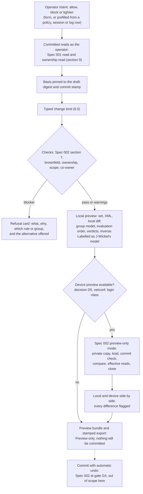
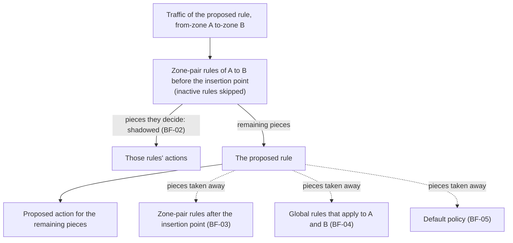
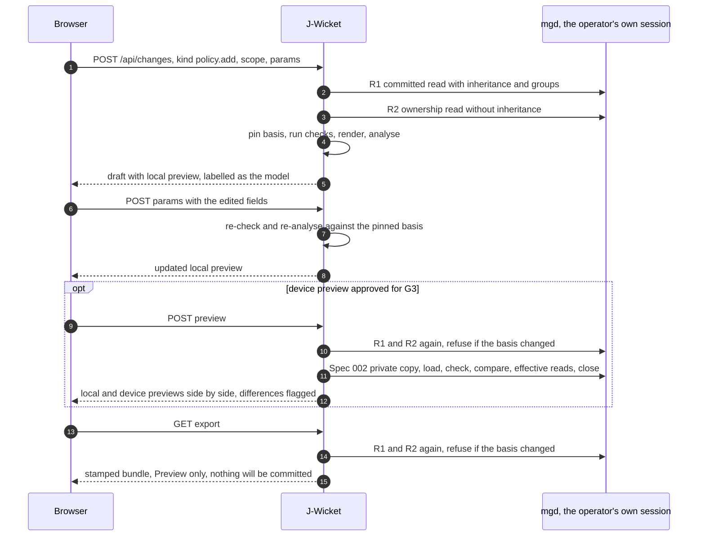
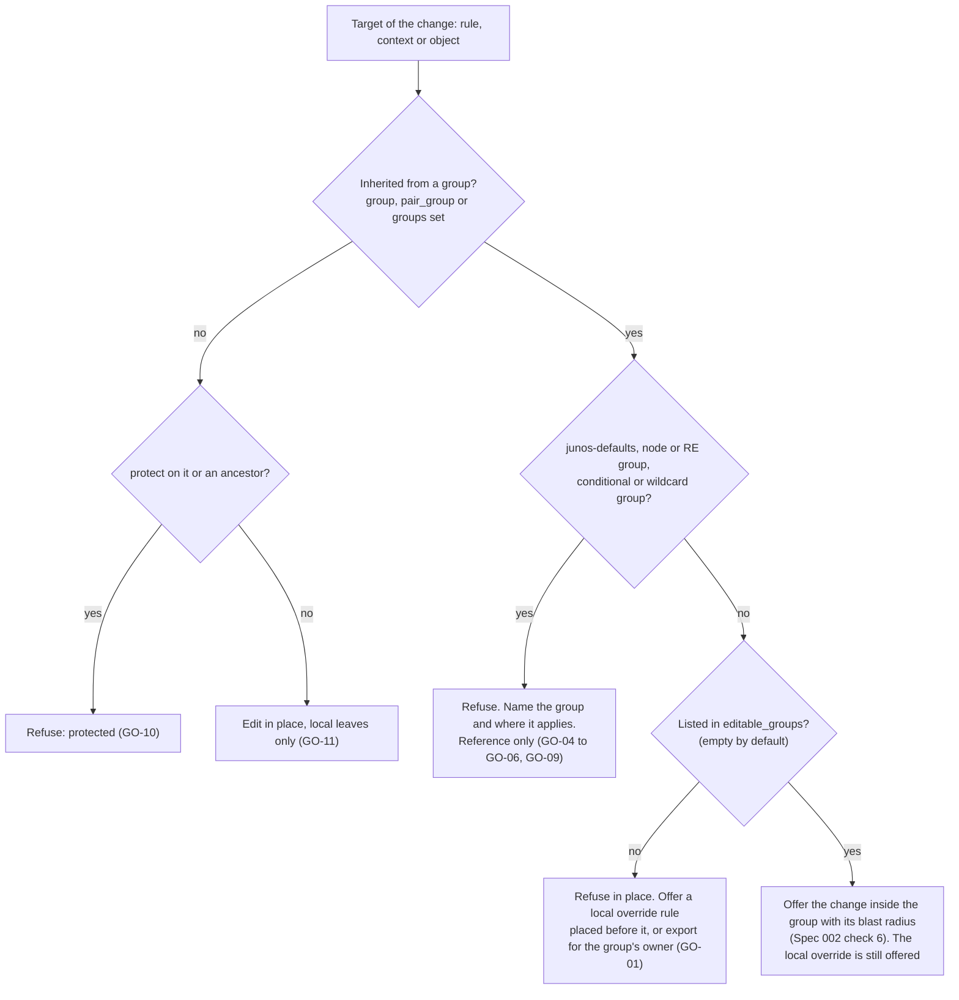

# Spec 003: Firewall Policy Builder (preview-only)

| Field | Value |
| --- | --- |
| Status | **Draft. Nothing is built. Never run on a device. Nothing qualified.** The builder never commits. **Live commit is out of scope until gate G4.** |
| Parity priority | `P2` (change safely) for the preview half of J-Web 24.4's rule add, edit, clone, move and delete (section 4.3). The builder itself goes beyond parity: J-Web 24.4 has no security-policy wizard ([catalog](../catalog.md), key findings) |
| Gate | G3 (preview-only builder shipped, no device writes; [governance](../governance.md#3-gates-g0-to-g5)). Its device preview waits on decision D5 (Spec 002 open question 2). Its ledger rows reach `qualified` only after G3, and their commit half only at G4 through [Spec 002](002-change-protocol.md) |
| Decides scope | Project owner. Whether the device preview may ship at G3: the owner and the named security reviewer (Spec 002 open question 2). G4 sign-off: the security reviewer |
| Code | None. It will build on Spec 001's model ([`junos/inventory.py`](../../src/jwicket/junos/inventory.py)) and on Spec 002's change endpoints. [`junos/session.py`](../../src/jwicket/junos/session.py) `ALLOWED_RPCS` stays read-only |
| Tests | None yet. Acceptance criteria in section 14 |
| Decisions it rests on | [ADR 0002](../adr/0002-junos-delegated-sign-in.md), [0004](../adr/0004-no-sample-data.md), [0005](../adr/0005-committed-config-with-provenance.md), [0006](../adr/0006-device-explains-policy-decisions.md) (a local evaluator only for previews, always labelled), [0007](../adr/0007-offline-capable-meaning.md), [0009](../adr/0009-central-management-coexistence.md); [Spec 001](001-policy-inventory.md); [Spec 002](002-change-protocol.md) section 12 (preview-only mode) |

## 1. Status

The point: the Firewall Policy Builder turns an operator's intent ("allow this application from
these hosts to these servers", "block this", "tighten this rule") into one proposed change to the
security policies of one scope. It shows what the change is and what it would do: the `set`
commands, the Junos XML that would be loaded, the diff against the committed configuration, the
rule as Junos would enforce it after group inheritance, and where it sits in Junos evaluation
order. Then it stops.

**Live commit is out of scope until gate G4.** Before G4 the code holds no RPC that can change the
shared candidate or the active configuration ([Spec 002](002-change-protocol.md) section 17). The
builder hands its change to Spec 002 as a typed change kind, and Spec 002 stops at `previewed`.

Two kinds of preview, always kept apart on screen:

| Preview | What it is | What it sends to the device | When it is available |
| --- | --- | --- | --- |
| **Local preview** | J-Wicket renders the change and analyses it against the committed configuration it read (Spec 001's model plus the ownership read in section 9). Every analysis is labelled as J-Wicket's model, never as the device's answer ([ADR 0006](../adr/0006-device-explains-policy-decisions.md)) | Committed reads only, through allowlisted `get-configuration` calls with constant filters | Always, for an operator who can read the scope |
| **Device preview** | Spec 002 preview-only mode: Junos loads the change into the operator's private copy, runs commit check, returns the diff and the effective view, and discards the copy (Spec 002 sections 6.3 and 12) | A private copy that Junos discards on close or session end (**verified**, [locking][xml-lock]) | Only if the owner and security reviewer rule that it counts as "no device writes" for G3 (Spec 002 open question 2), with the `netconf` backend and a login class that can enter configuration mode |

If the device preview is not approved, G3 ships the local preview alone.

| Part | State |
| --- | --- |
| Intent forms and entry points (6.2, section 12) | Specified, not built |
| Change kinds `policy.add`, `policy.edit`, `policy.move`, `policy.activate`, `policy.deactivate`, `policy.delete` (6.5) | Specified, not built |
| Renderers: `set` commands, Junos XML, local diff, inverse (6.6) | Specified, not built |
| Ownership read and local group model (section 9, 7.2) | Specified, not built. The read's exact filter is **unknown** (Q-REL-01) |
| Local evaluator (6.7) | Specified, not built |
| Brownfield, ownership and recovery checks (7.1 to 7.3) | Specified, not built |
| Device preview | Specified in Spec 002 section 12; not built; G3 status pending decision D5 ([governance](../governance.md) section 2.5) |
| On a device | Not run |

Everything the builder analyses comes from Spec 001's parser, which has only seen synthetic
fixtures. Until Q-REL-01 records real replies, the builder's input is J-Wicket's reading of the
Junos schema, and the builder's output is J-Wicket's reading of what Junos would do with it.

## 2. Problem

### 2.1 What J-Web 24.4 offers

All rows **verified** from the J-Web 24.4 guide ([rules page][jweb-rules-page], [add rule][jweb-add],
[clone][jweb-clone], [edit][jweb-edit], [delete][jweb-delete]; [PDF][jweb-pdf] printed pp. 724 to 751).

| Operation | J-Web 24.4 behaviour |
| --- | --- |
| Add | "+" opens inline fields; tick; then page **Save** or **Discard**: "You must perform Step 3 and Step 4 before performing any further actions in the J-Web UI"; then the banner Commit menu |
| Create Rule Before / After | The new rule "inherits the name, source zone, and destination zone same as parent (selected) rule. Source address and destination address will be any and the action will be Deny." For a global policy, zones are not available |
| Clone | Inline fields; "By default, the name of the cloned rule is in the format: `<rule name>_clone`" |
| Edit | Pencil, then OK |
| Delete | One or more rules, then Yes or No |
| Move | One rule at a time to a new sequence number within its zone context, after clearing any filter. Drag and drop works only within a zone context; dropping outside it gives a warning |
| Global Policy toggle | "the policy defined is a global policy and zones are not required". Global policies use "user-defined addresses or the predefined address 'any'" |
| Inline objects | Create Address (name "must begin with an alphanumeric character and can include colons, periods, dashes, and underscores; no spaces allowed; 63-character maximum"; IPv4 or IPv6), Create Service, Add New Schedule |
| Rule options | Logging (session initiate, session close); count with alarm thresholds; authentication; destination address translation; redirect; TCP session checks; schedule |
| Advanced services | SSL proxy, Content Security, IPS, threat prevention, ICAP redirect, anti-malware, SecIntel, IPsec VPN and pair policy, AppQoS, threat profiling, packet capture |
| Scope limits | URL Category hidden for logical systems and tenants; Dynamic Application hidden for tenants; authentication not supported for logical systems and tenants |
| Commit | Banner menu: "Commit your configurations", "View configuration changes", "Commit the changes with autorollback", "Discard your configuration", "Commit the changes in your preferred way" ([Explore J-Web][jweb-explore]) |

What the guide does not document for these pages: a preview of the resulting CLI, rule shadowing
analysis, import, export, bulk edit, or per-rule change history (**verified** absence across the
24.4 Security Policies & Objects topics). The guide has no policy wizard at all, so a preview-only
builder goes beyond parity ([catalog](../catalog.md), key finding 1 and section 1.0).

### 2.2 What goes wrong on a brownfield SRX

1. A new rule is appended after a broader rule and never matches. Junos appends a new element to an
   ordered list by default (**verified**, [reordering][reorder]).
2. A new permit placed early overrides a later deny, or a global blocklist. Zone-pair rules are
   evaluated before global rules (**inferred**, Spec 001 section 7.1).
3. A second address object is created for a host that already has one, or a new set that is
   identical to an existing one.
4. An edit to a shared address set silently changes every rule that uses it.
5. The rule or object is inherited from a configuration group: a corporate baseline, a cluster
   node group, a wildcard group. An in-place edit fails, is overridden, or drifts from whatever
   maintains the group ([ADR 0005](../adr/0005-committed-config-with-provenance.md); Spec 002 check 6).
6. Changing the action of a rule drops options J-Wicket does not model (**inferred** from the
   YANG `choice` of permit, deny and reject).
7. A central manager overwrites the local change on its next deployment (**verified** for Security
   Director Cloud, [SDC versions][sdc-versions]).
8. The change cuts the operator's own path, or behaves differently for existing sessions than for
   new ones.
9. The scope is wrong: an object from the root system referenced in a logical system, or a rule
   added to a deactivated tenant.

The builder detects each of these before anything is loaded anywhere. Section 7 specifies
how.

## 3. Users and jobs to be done

| Job | Example | What the builder does | Typical result |
| --- | --- | --- | --- |
| **J1 Allow** | "Allow tcp/8443 from the corporate LAN in `trust` to the web servers in `dmz`." | Collects zones, sources, destinations and applications; reuses existing objects; checks whether something already allows it; places the rule where it takes effect; shows what it opens and what it pre-empts | `policy.add`, or "already allowed by rule X" |
| **J2 Block** | "Block 198.51.100.66 from `untrust` to `dmz`." | As J1 with deny or reject; places it before the rules that permit that traffic today; says which rules lose traffic and whether a global blocklist was being pre-empted | `policy.add` placed first or before rule X; or "activate the inactive rule Y"; or "already denied by the default policy" |
| **J3 Tighten** | "Remove `dmz-jump` from `admin-to-dmz`." "Add session-init logging to `publish-web`." "Retire `dmz-updates`." "Move this rule above that one." | Edits only modeled leaves of a local rule; refuses group-owned and protected targets and offers a local override; shows where the removed traffic goes next | `policy.edit`, `policy.move`, `policy.deactivate`, `policy.delete`, or a local override `policy.add` |

| User | What they need from the builder |
| --- | --- |
| SE or lab engineer (first users, while J-Wicket is unqualified) | Show what a change would do on this box without changing it; export it for a change ticket |
| Change reviewer | A stamped proposal: diff, effect, ownership notes, inverse, the committed revision it was built from |
| Operator during an incident | A block with the right placement; what happens to established sessions |
| Auditor | Who proposed what, from which committed revision, with which acknowledgements |
| Owner of a corporate baseline or a central manager | Nothing edited in their groups; local overrides visible as overrides |

J-Web's Clone, Create Rule Before/After, Move and Delete are entry points into J1 and J3 (6.2).

## 4. Scope and non-scope

### 4.1 In scope

- One scope per change: the root system, one logical system or one tenant system, as Spec 001
  lists them (`root`, `lsys:<name>`, `tenant:<name>`).
- Zone-pair and global security policies.
- Match: source and destination addresses (existing address entries and sets, new address
  entries, a new address set on request) and applications (custom applications and sets,
  predefined `junos-*`, `any`, a new TCP or UDP application with a destination port or range).
- Then: permit, deny or reject; `log session-init`, `log session-close`; `count`.
- A reference to an existing scheduler; description; name; placement.
- On existing local rules: edits of modeled leaves, move within a context, deactivate, activate,
  and delete of fully modeled rules.
- The outputs of 6.6, the checks of section 7, the local evaluator of 6.7, and a stamped
  export.

### 4.2 Not in scope

| Not here | Why, and where it goes |
| --- | --- |
| Commit, confirm, roll back | **Live commit is out of scope until gate G4.** Then it is Spec 002 sections 6.4 and 9 |
| Application services, firewall authentication, IPsec tunnel and pair policy, TCP options, destination address translation, redirect, packet capture, threat profiling | Spec 001 models these as tag names at most. A later revision adds them with J-Web's per-scope limits (**verified**, [add rule][jweb-add]). The builder preserves them on edit and refuses changes that would drop them (BF-11) |
| Source identity, dynamic applications, URL categories, IP and identity feeds, end-user profiles, address exclusion | Not offered. Existing rules that use them are analysed as `unknown` (6.7) |
| New zones, zone settings, host-inbound traffic, screens | Zone changes can cut the access path (Spec 002 section 9.2). A separate change kind |
| New schedulers, count alarm thresholds, inactivity timeouts, ALGs, ICMP and other protocols | The builder references existing objects for these |
| Editing an existing address, address set, application or application set | Changes every rule that uses it. Belongs to a later object-page spec (J-Web Zone Addresses, Global Addresses, Services) |
| Default policy, pre-ID default policy, policy rematch, Global Options | Device-wide behaviour. Later spec |
| NAT | [Catalog](../catalog.md) W5: a NAT builder on this pattern, `P4` |
| Changes that span scopes; interconnect logical systems | One scope per change (Spec 002 check 4) |
| More than one rule per change; bulk delete | One rule per change. Spec 002 allows one open change per operator (P7) |
| Hit counts ("is this rule used?") | `get-security-policies-hit-count` is not allowlisted (Spec 001 section 4). Open question 10 |

### 4.3 Parity ledger rows

The rows under **Security Policies & Objects > Security Policies** for Add, Edit, Clone, Delete,
Create Rule Before/After, Move and the Global Policy toggle, and the inline Create Address and
Create Service dialogs, are covered for their **preview half** by this spec. They become
`specified` with the note "preview only (Spec 003, G3); commit through Spec 002 at G4".

Create Rule Before/After is a `replace` row: J-Wicket does not create an any/any Deny placeholder.
Saved as is, that placeholder would shadow every later rule in its context. The operator states the
match instead. Rule Options and Advanced Services beyond logging, count and schedule are not
covered and keep their ledger status.

## 5. Principles

| # | Principle | What it means in practice | Basis |
| --- | --- | --- | --- |
| P1 | **Preview only** | No commit, confirm or rollback path. Device interaction is limited to committed reads and, if approved for G3, Spec 002's preview-only mode. **Live commit is out of scope until gate G4** | [Charter](../charter.md) section 3; [governance](../governance.md) section 3 (G3); Spec 002 section 12 |
| P2 | **The operator's own session, one scope** | Every read runs with the operator's login class. One scope per change; the builder never widens a scope | [ADR 0002](../adr/0002-junos-delegated-sign-in.md); Spec 002 check 4 |
| P3 | **Reuse or create; never edit a shared object** | Existing addresses, sets, applications and application sets are referenced unchanged or a new one is created | **Proposed**: an edit to a shared object changes every rule that uses it |
| P4 | **Merge only what is modeled** | Loads are `merge` of modeled leaves. Never `replace` or `override`. A change that would drop a setting J-Wicket does not model is refused | [ADR 0005](../adr/0005-committed-config-with-provenance.md); load actions **verified** ([load-configuration][load-cfg]) |
| P5 | **Never change a group by default** | Group-owned targets are refused in place; a local override or an export for the group's owner is offered | ADR 0005; Spec 002 check 6; **proposed** default (7.2) |
| P6 | **The model is labelled and conservative** | Every analysis says it is J-Wicket's model. `unknown` is never shown as "no conflict". The device's own answer replaces the model wherever it is available | [ADR 0006](../adr/0006-device-explains-policy-decisions.md) |
| P7 | **Every proposal carries its undo** | The inverse change and the recovery notes are part of every preview and export | Spec 002 open question 11; **proposed** |
| P8 | **Co-owners are told** | Central managers, group owners and logical-system administrators are named where the change touches what they own | [ADR 0009](../adr/0009-central-management-coexistence.md); **proposed** for groups and logical systems |
| P9 | **Nothing persists** | The draft and its basis live in memory only: nothing on the device's disk, nothing in browser storage | [ADR 0007](../adr/0007-offline-capable-meaning.md); [architecture](../architecture.md) section 14 |

## 6. Behaviour

R1 to R5 are the device reads defined in section 9.

### 6.1 Flow



### 6.2 Inputs and how they are collected

The form has four steps: **Where** (scope, rule kind, zones), **What** (sources, destinations,
applications), **Do** (action, logging, count, schedule) and **Name and place**. Entry points
prefill it; the operator confirms every field. Nothing is ever one click from a session or log row
to a proposal.

| Input | How it is collected | Rules | J-Web 24.4 equivalent (**verified**) | Junos statement |
| --- | --- | --- | --- | --- |
| Scope | The Spec 001 scope selector; fixed for the draft | One scope per change (Spec 002 check 4). A deactivated scope is refused (BF-06) | Tenant & LSYS switcher, root context only ([catalog](../catalog.md) O39) | `logical-systems <name>`, `tenants <name>` (**verified**, YANG) |
| Rule kind | Zone pair or global | — | "Global Policy" toggle | `security policies global policy <name>` (**verified**) |
| Zones | From-zone and to-zone picked from the scope's configured security zones. `junos-host` is offered as a to-zone, flagged (RC-04). For a global rule, zero or more from-zones and to-zones | Zones must exist in the scope. An inactive zone is a warning. From-zone may equal to-zone. An empty global zone list means any zone (**inferred**, Spec 001 section 7.2) | Select Sources and Select Destination: Zone | `from-zone-name`, `to-zone-name`; global `match from-zone`, `match to-zone` (**verified**, YANG). `to-zone junos-host` appears in a Juniper example (**verified**, [flow-based session][fbs]) |
| Sources and destinations | Typed values (IPv4 or IPv6 host or prefix, a range `low-high`, a DNS name), picked objects from the books visible from the zone, or `any`, `any-ipv4`, `any-ipv6`. Paste one per line. Prefill from a Spec 004 session or log row | Resolution and reuse in 6.3. At most 64 each (**proposed**). Exclusion is not offered | Addresses Any or Specific; Exclude Selected; IP feeds after ATP Cloud enrollment; inline Create Address | `match source-address`, `match destination-address` (**verified**, YANG) |
| Applications | Picked custom applications and sets in the scope, predefined `junos-*`, `any`; or a new `tcp` or `udp` application with a destination port or range | Reuse in 6.3. At most 32 (**proposed**) | Services Any, Specific or None; inline Create Service | `match application` (**verified**); `applications application <name>` with `protocol` and `destination-port` (**verified**, CLI example on the [flow-based session][fbs] page) |
| Action | Permit, deny or reject. J1 starts at permit, J2 at deny | Reject "Block and drop the packet and send a notice to the source host" (J-Web's text) | Action | `then permit`, `deny`, `reject`: a YANG `choice` (**verified**) |
| Logging | Session init, session close | Starting values (**proposed**, open question 4): permit logs session close; deny and reject log session init. The operator can change both | Rule Options > Logging | `then log session-init`, `session-close` (**verified**) |
| Count | On or off, off to start | Alarm thresholds are not offered | Count with alarm thresholds | `then count` (**verified**) |
| Schedule | An existing scheduler in the scope (R3) | Creating a scheduler is not offered. A scheduled rule is analysed as time-dependent (6.7) | Schedule, Add New Schedule | `scheduler-name` (**verified**) |
| Description | Free text | Printable ASCII without `"` or `\`, at most 255 characters. J-Wicket's limit; Junos's own limit is **unknown** | Rule Description | `description` (**verified**) |
| Name | Free text, with a suggestion from the intent; a clone starts as `<rule>_clone` (J-Web's default) | New names match `[A-Za-z0-9][A-Za-z0-9._:-]{0,62}` (J-Web's Create Address rule, applied by J-Wicket to every new name; Junos's own rule is **unknown**). Unique in its context (BF-08) | Rule Name | Key `name` within the context (**verified**, YANG) |
| Placement | First, last, or before or after a named local rule in the same context (or in `global`) | Starts at last, because Junos appends (**verified**). If the rule would be fully shadowed there, the builder offers the position just before the first shadowing rule (BF-02). Referents must be local rules (GO-02). Detail in 6.4 | Create Rule Before/After; Move to a sequence number; drag and drop within a zone context | `insert="first"`, `insert="before"`, `insert="after"` with `name="<referent>"` (**verified**, [insert][xml-insert]) |
| Keep-path flows (optional) | Source, destination, protocol and port of paths the operator must not lose, such as their own workstation to a jump host | Evaluated before and after (RC-04) | None | — |
| Acknowledgements | Central manager (7.5); "keep shadowed" (BF-02); "local override of a group rule" (GO-01) | Recorded in the draft and the audit trail | None | — |

### 6.3 Reusing objects and creating new ones

The builder reuses an existing object unchanged or creates a new one. **It never edits an existing
address, address set, application or application set**, because that changes every rule that uses
it.

**Addresses.** For each typed value and the zone it belongs to (from-zone for sources, to-zone for
destinations; the `global` book for global rules):

1. Normalise the value: a canonical prefix (a host becomes `/32` or `/128`), a range, or a
   lower-case DNS name.
2. Take the books visible from that zone, in Spec 001's lookup order: the zone's legacy book, then
   the book attached to the zone, then the book named `global` (**inferred**, Spec 001 section 7.4;
   [`AddressResolver`](../../src/jwicket/junos/inventory.py)). A logical or tenant system sees only
   its own books.
3. Candidates are active address entries in those books whose kind and value equal the request.
   Inactive entries, entries in an inactive book and entries of kind `unknown` are never reused.
   (Spec 001 does not yet mark rules that use inactive objects, open question 3; the builder checks
   the entry and its book itself.)
4. Pick the first candidate along the lookup order, then a local entry before a group-owned one,
   then by name. The others are listed as alternatives. Reusing a group-owned entry adds an
   information note (GO-07).
5. For several values, offer an existing active set in one visible book whose expanded leaves are
   exactly those values (not truncated, nothing unresolved). The operator chooses between the set
   and listing the objects. Otherwise the rule lists the objects one by one.
6. No candidate: a new address entry. Where it goes: the zone's attached book if it has one;
   otherwise the zone's legacy book if it has one (matching what is there, with a note that J-Web
   offers an "Upgrade" from zone-based to global address books, **verified**, [Global
   Addresses][jweb-global-addr]); otherwise `global`, created if absent. For a global rule: `global`.
   A scope that has both legacy and attached books gets a warning at G3 and a blocker at G4 until
   Spec 001 open question 2 is settled.
7. A new address set only when the operator asks for one and names it. It goes in the book that
   holds all its members. If the members are in different books it is refused, because a set's
   members are looked up in its own book (**inferred**, Spec 001 section 7.4). The rule can still
   list the members one by one.

**Applications.**

1. `any` is `any`.
2. An existing custom application is reused when it is active, is a single application (not a set),
   has the same protocol and destination port, and has no source port and no terms. Spec 001 does
   not report other application settings (timeouts, ALGs), so until it does, the reuse carries the
   note "J-Wicket cannot see every setting of `<name>`" and the operator must confirm it.
3. A predefined `junos-*` application with the same protocol and port is offered as an alternative
   only when R4 is available. It is never picked over an exact custom match automatically.
4. An application set is reused only when the operator picks it.
5. Otherwise a new application in the scope's `applications`, with `protocol` and
   `destination-port`.

**Names for new objects** (**proposed**, open question 9). Only characters J-Web allows in a name:
`h-<address>` for a host, `n-<address>-<length>` for a prefix, `r-<low>-<high>` for a range,
`d-<dns-name>` for a DNS name, `<protocol>-<port>` or `<protocol>-<low>-<high>` for an application
(the branch fixture already uses `tcp-8443`). A name longer than 63 characters is cut and given a
short hash suffix. If the name exists with a different definition, `-2`, `-3` and so on is added
(BF-08).

### 6.4 Placement

- Positions are counted among the **local** rules of the context, in configuration order. Inherited
  rules are shown in place, greyed, with "position relative to local rules unknown" (GO-02).
- `first`: Junos XML `insert="first"`. It has no CLI equivalent (**verified**, [reordering][reorder]),
  so the `set` rendering uses `insert … before policy <current first local rule>`.
- `before` or `after` a named rule: `insert="before"` or `insert="after"` with `name="<referent>"`
  (**verified** pattern for a list keyed by `name`). That the pattern applies to SRX security
  policies is **inferred**; the device preview and AC-003-30 confirm it.
- `last`: no attribute. Junos appends a new element (**verified**).
- Move (`policy.move`) stays within the same context, as in J-Web. A move across contexts would be a
  delete and an add, and is not offered.
- The placement picker always shows the real, unfiltered order of the context. J-Web asks the
  operator to clear any filter before a Move (**verified**); J-Wicket's picker never shows a
  filtered order.

### 6.5 Change kinds handed to Spec 002

Spec 002 section 12 asks each change kind for its name, hierarchy allowlist, payload builder,
the objects it edits and references, its risk flags and its inverse. Every kind writes only inside
one scope (`<configuration>`, `<configuration><logical-systems><name>X</name>` or
`<configuration><tenants><name>X</name>`), and only these paths there: `security policies`,
`security address-book` (`address`, `address-set`), `security zones security-zone <zone>
address-book` (`address`, `address-set` only), `applications application`,
`applications application-set`.

| Kind | Jobs and entry points | Parameters (summary) | Edits | References | Inverse | Risk flags |
| --- | --- | --- | --- | --- | --- | --- |
| `policy.add` | J1, J2, Clone, Create Rule Before/After, local override (GO-01) | Context (zone pair or global with zone lists), name, sources, destinations, applications, action, log, count, scheduler, description, placement, new objects | The new rule; new objects | Zones, addresses, sets, applications, scheduler, placement referent | `policy.delete` of the new rule, then delete of each new object still unreferenced | `opens_traffic` (permit), `access_path_at_risk`, `overrides_group_rule`, `node_specific` |
| `policy.edit` | J3 | Target rule (Spec 001 `id`), values to add to or remove from each match list, action, log, count, scheduler, description, new objects | Modeled leaves of the target only | As above | The reverse of each leaf change | `opens_traffic` when widened, `access_path_at_risk` when narrowed or denied |
| `policy.move` | J3, Move | Target, placement | Position of the target | Referent | Move back beside the original local neighbour, or `first` | Both, as the verdicts show |
| `policy.deactivate`, `policy.activate` | J3, J2 (activating an equivalent inactive rule) | Target | `inactive` or `active` on the target | — | The other one | `access_path_at_risk` when a permit is deactivated |
| `policy.delete` | J3, Delete | Target | The target | — | Re-create the target from its local form (R2) beside its local neighbour. Refused when the target has `unmodeled` settings or `inactive_parts` (BF-11) | `access_path_at_risk` |

### 6.6 Outputs

Every draft returns these, built from the pinned basis. Worked example: J1 on the `branch`
fixture, "allow tcp/8443 from `10.10.0.0/16` in `trust` to `10.20.0.10/32` and `10.20.0.11/32` in
`dmz`", placed last, named `allow-8443-web`.

**1. Plain summary.** "Permit, in root, from `trust` to `dmz`: sources `corp-lan` (existing, from
group `corp-baseline`), destinations `web-servers` (existing set), application `tcp-8443`
(existing). Log session close. New rule `allow-8443-web` after `admin-to-dmz`."

**2. `set` commands**, for review and for the CLI. Tokens outside `[A-Za-z0-9._:/-]` are quoted. A
token containing `"`, `\` or a control character cannot be rendered, and the `set` view says so
(the XML is unaffected). The command form follows the documented examples
(`set security policies from-zone … to-zone … policy … match source-address …`, **verified**,
[LSYS overview][lsys-overview] and [flow-based session][fbs]).

```
set security policies from-zone trust to-zone dmz policy allow-8443-web match source-address corp-lan
set security policies from-zone trust to-zone dmz policy allow-8443-web match destination-address web-servers
set security policies from-zone trust to-zone dmz policy allow-8443-web match application tcp-8443
set security policies from-zone trust to-zone dmz policy allow-8443-web then permit
set security policies from-zone trust to-zone dmz policy allow-8443-web then log session-close
```

**3. Junos XML load payload.** The `<configuration>` element that Spec 002 places inside
`<load-configuration action="merge" format="xml">`. Built with an XML library from the typed change,
never by string concatenation. Always `merge`; never `replace` or `override`, which would discard
what J-Wicket does not model (**verified** semantics, [load-configuration][load-cfg]).

```xml
<configuration>
  <security>
    <policies>
      <policy>
        <from-zone-name>trust</from-zone-name>
        <to-zone-name>dmz</to-zone-name>
        <policy>
          <name>allow-8443-web</name>
          <match>
            <source-address>corp-lan</source-address>
            <destination-address>web-servers</destination-address>
            <application>tcp-8443</application>
          </match>
          <then>
            <permit/>
            <log>
              <session-close/>
            </log>
          </then>
        </policy>
      </policy>
    </policies>
  </security>
</configuration>
```

Other operations use the documented Junos XML attributes (**verified** patterns: [insert][xml-insert],
[delete][xml-delete], [active][xml-active], [inactive][xml-inactive]; their use on SRX policy
elements is **inferred** until the device preview shows it):

| Operation | Junos XML (inside the zone-pair context element unless stated) | `set` rendering |
| --- | --- | --- |
| Place first | `<policy insert="first"><name>N</name>…</policy>` | `insert security policies from-zone A to-zone B policy N before policy <first local rule>` (CLI form follows the documented `insert … before` and `insert … after` example; **inferred** for policies) |
| Place before or after R | `<policy insert="before" name="R"><name>N</name>…</policy>` | `insert security policies from-zone A to-zone B policy N before policy R` |
| Remove a match value | `<policy><name>N</name><match><destination-address delete="delete">X</destination-address></match></policy>` | `delete security policies from-zone A to-zone B policy N match destination-address X` |
| Add a flag | `<policy><name>N</name><then><log><session-init/></log></then></policy>` | `set security policies from-zone A to-zone B policy N then log session-init` |
| Change action (only on a rule with no `then permit` children, BF-11) | `<then><deny delete="delete"/><permit/></then>` | `delete … then deny` then `set … then permit` |
| Deactivate, activate | `<policy inactive="inactive"><name>N</name></policy>`, `<policy active="active"><name>N</name></policy>` | `deactivate …`, `activate …` (CLI command pages not read: **inferred**) |
| Delete | `<policy delete="delete"><name>N</name></policy>` | `delete security policies from-zone A to-zone B policy N` |
| New address, set, application | Under `<security>`: `<address-book><name>global</name><address><name>h-10.20.0.60</name><ip-prefix>10.20.0.60/32</ip-prefix></address></address-book>`. Under `<configuration>`: `<applications><application><name>tcp-9443</name><protocol>tcp</protocol><destination-port>9443</destination-port></application></applications>` | `set security address-book global address h-10.20.0.60 10.20.0.60/32`; `set applications application tcp-9443 protocol tcp`, `… destination-port 9443` |

In a logical system the same payload sits under `<logical-systems><name>LS-A</name>…` and the
`set` lines start `set logical-systems LS-A` (**verified** form, [LSYS overview][lsys-overview]).
For a tenant system: `<tenants><name>T-1</name>…` and `set tenants T-1 …` (**inferred** from the
YANG and the [tenant systems][tsys-overview] example).

**4. Local diff against the committed configuration**, in the `[edit …]` and `+`/`-` form that Junos
uses for `show | compare` (**verified** format, [comparison][compare]). Labelled "J-Wicket's
rendering; the device's diff may differ in order and layout".

```
[edit security policies from-zone trust to-zone dmz]
+    policy allow-8443-web {
+        match {
+            source-address corp-lan;
+            destination-address web-servers;
+            application tcp-8443;
+        }
+        then {
+            permit;
+            log {
+                session-close;
+            }
+        }
+    }
```

With the device preview, the device's own diff appears beside it, and any difference is listed.

**5. Effective view after inheritance.** Two sources, never merged:

- *Local group model* (labelled). From R2: every statement the touched elements would inherit, the
  group it comes from and the `apply-groups` that brings it, using Junos's documented rules (7.2). In `branch` nothing is inherited by the new rule. In the `builder-brownfield` fixture, a new
  rule shows `then log session-close` from group `log-all`, matched by a wildcard.
- *Device effective view* (device preview only): Spec 002's `inherit="inherit" groups="groups"` and
  `commit-scripts="apply"` reads of the private copy, with every server-side expansion flagged
  (Spec 002 section 6.3).

**6. Evaluation-order view.** The context after the change, in Spec 001's order: the zone-pair rules
with the new rule at its position, then the global rules that apply to the pair, then the default
policy. Inactive rules are shown as skipped, group badges as in Spec 001.

**7. Verdict table** (labelled). The change's traffic split into pieces by the rules that decide
each piece today and after the change (6.7). For the example, with R4 available:

| Piece (J-Wicket's model) | Decided today by | Decided after the change by |
| --- | --- | --- |
| `10.10.0.0/16` to `10.20.0.10/32`, `10.20.0.11/32`, tcp/8443 | Default policy `deny-all` (no zone-pair or global rule matches) | `allow-8443-web` (permit) |

Without R4, the row for today reads "unknown: `admin-to-dmz` may match; its applications
`junos-ssh` and `junos-https` are predefined and not expanded". Each piece carries a sample flow and
the `show security match-policies` command for it, pre-filled under Spec 001's UI-001-07 rule, for
the operator to run on the device after a commit.

**8. Findings and recovery.** Each finding from section 7 with its severity (`blocker`,
`warning`, `info`), the rules and groups involved, and the alternative offered. The inverse change
in `set` and XML, and the recovery notes of 7.3.

### 6.7 The local evaluator

ADR 0006 allows a local evaluator "only to preview proposed, uncommitted rules" and requires its
output to be "always labelled as J-Wicket's model, never as the device's answer". This one answers
only two questions about the proposed change: which existing rules decide the change's traffic
today, and which existing rules lose traffic after it. It does not answer general flow questions;
for those, Spec 001 gives the `show security match-policies` command and a later spec the device
RPC.

**Model.** A rule's match is a product of sets: from-zone, to-zone, source addresses, destination
addresses, applications. Addresses are unions of IPv4 and IPv6 intervals built from Spec 001's
resolved leaves. Applications are unions of (protocol, destination port range, source port range).
`any` is the whole space; `any-ipv4` and `any-ipv6` one family each. Evaluation order is Spec 001's:
the zone-pair rules of the context in order, then global rules that apply to the pair in order,
then the default policy; inactive rules and inactive parts are skipped; the first matching rule
decides (all **inferred**, Spec 001 sections 7.1 to 7.5).

**Relations.** Between the change and an existing rule the evaluator reports `covers`, `covered`,
`overlaps`, `disjoint` or `unknown`, per dimension and overall.

**Soundness rules.**

1. `disjoint` only when at least one dimension is provably disjoint. One such dimension is enough,
   whatever the others are.
2. `covers` and `covered` only when every dimension is provable and the covering rule has nothing
   that narrows it beyond what is modeled.
3. Everything else is `unknown`. An unknown relation is never shown as "no conflict". A preview with
   unknown relations says "N relations unknown" and lists them.
4. Two references to the same object name in the same book are identical, whatever the object's
   value. This is the only reasoning applied to DNS names and to predefined applications when R4 is
   absent.

| Input | Treated as |
| --- | --- |
| Prefixes, ranges, `any`, `any-ipv4`, `any-ipv6` | Modeled |
| DNS-name and wildcard addresses; address `kind: unknown` | `unknown`, except identity by name |
| Expansions with `truncated: true` or `unresolved` names; application sets beyond 512 leaves (Spec 001 has no `truncated` flag for applications, its open question 6) | `unknown` in that dimension |
| Custom applications with protocol and ports; terms (as the union of terms) | Modeled. Settings Spec 001 does not read do not change matching as far as J-Wicket knows (**inferred**) |
| Predefined `junos-*` | Modeled from R4 when available; otherwise `unknown`, except identity by name |
| `source-address-excluded`, `destination-address-excluded`, source identity, dynamic application, URL category, end-user profile, any `unmodeled` match field | A rule with any of them can never `cover`; disjointness can still be proven in another dimension |
| Scheduled rules (`scheduler-name`) | Time-dependent: findings say "while scheduler S is active" |
| A global rule whose zone list contains `any` or a name that is not a configured zone | Applicability `unknown` |
| Rules inherited from conditional or node groups | Marked conditional or node-specific (GO-04, GO-06) |
| Inherited rules in a context with local rules | Evaluated in both orders, inherited first and inherited last; any finding that differs is labelled "depends on Junos ordering of inherited rules (unknown, Q-REL-01)" (GO-02) |

**Pieces and verdicts.** The change's traffic is cut into pieces by the rules that decide it, in
evaluation order, up to 256 pieces (**proposed**). A piece that would exceed the cap ends the
analysis with `incomplete`.

**Budget.** At most 200,000 dimension comparisons or 2 s of CPU per analysis, whichever comes first
(**proposed**; Q-HW-01 sets the numbers for SRX300-class routing engines). On budget, the result is
`incomplete` with counts of what was and was not compared. `incomplete` is a state on screen, never
"no conflicts".

**Where it runs.** On the server, in Python, in the same code that builds the payload, so that one
implementation produces both and the browser never builds configuration. The cost on small routing
engines is measured by Q-HW-01 and Q-LOAD-01.

**Label.** Every analysis object carries `model: "jwicket-local/1"` and the text "J-Wicket's model of
Junos policy lookup, from the committed configuration read at `<time>`. Not the device's answer."

**Agreement with the device.** For committed rules, the evaluator's shadow findings can be checked
against `show security shadow-policies` once its replies are recorded (section 15). That check is
how the model earns trust; until it passes on a qualified platform, the label stays and the UI says
the model is unverified.



### 6.8 Endpoints and draft lifecycle

The builder uses Spec 002's change endpoints (Spec 002 section 6.6), with the `Origin` check, the
`X-CSRF-Token` header, a valid web session and a JSON body within `max_body_bytes`
([`settings.py`](../../src/jwicket/settings.py): 8,192 bytes by default, at most 65,536). A draft
at the limits of 6.2, with long IPv6 values, can exceed 8,192 bytes, so the builder needs the
default raised to 16,384 (**proposed**) or the limits lowered.

| Request | Builder behaviour |
| --- | --- |
| `POST /api/changes` `{kind, scope, params}` | Reads R1 and R2, pins the basis, runs the checks, returns the draft with its local preview. 409 if the operator already has an open change (Spec 002 P7) |
| `POST /api/changes/<id>/params` (**proposed** addition to Spec 002) | Replaces the parameters and returns the updated local preview, against the pinned basis, with no device read. At most four per second per operator (**proposed**) |
| `POST /api/changes/<id>/preview` | Re-reads R1 and R2 (409 `stale` if the basis changed), then runs Spec 002 section 6.3 when the device preview is available; otherwise returns the local preview with the reason |
| `GET /api/changes/<id>/export` | Re-reads R1 and R2 (409 `stale` if changed); returns the stamped bundle (UI-003-11). Requires the central-management acknowledgement where 7.5 says so |
| `POST /api/changes/<id>/abandon` | Discards the draft and its pinned basis |

The pinned basis lives in memory only, for the draft's life: until it is abandoned, or 15 minutes
after the last preview (Spec 002 section 6.1), or the end of the web session. With one open change
per operator and `max_sessions` at 4 by default, at most four bases are held at once. Nothing about a
draft is written to disk or to browser storage.



### 6.9 Audit

The builder emits Spec 002's events (Spec 002 section 11): `change_draft`, `change_refused`,
`change_preview`, `change_export`, `change_ack`, `change_abandoned`. It adds to each: the kind, the
scope, the number of operations, findings counted by severity, the evaluator's state (`complete` or
`incomplete`), and the first 12 characters of `basis_sha256`. As in Spec 002, the audit trail holds
no configuration text.

## 7. Cases the design must handle

Each case names its expected behaviour; section 14 names the acceptance criterion that tests it.

### 7.1 Brownfield

Severities: **blocker** (no exportable proposal until resolved, or acknowledged where the row
allows it), **warning** (shown; export allowed), **info**. Where a row says "G4: blocker", the
severity rises when a commit path exists, until the named test settles the unknown.

| ID | Case | How it is detected | What the builder does | Severity |
| --- | --- | --- | --- | --- |
| BF-01 | **An equivalent rule already exists** | Verdicts: every piece of the requested traffic is already decided with the requested action | No new rule by default: "Already allowed by `admin-to-dmz` (seq 1)". If the existing rule differs only in logging or count, offers a `policy.edit` of it (subject to 7.2). If it is scheduled: "covered only while scheduler `S` is active", and a new rule stays possible. If it carries `then permit` options (application services, authentication, tunnel): "a new rule before it would bypass `<options>`" | info; warning when options would be bypassed |
| BF-02 | **The new rule is shadowed by an earlier one** | Verdicts after the change: no piece is decided by the new rule (full), or some pieces are decided earlier (partial) | Full: refuses to produce a proposal until the rule is moved before the shadowing rules (offered as one action) or the operator acknowledges "keep shadowed", which is recorded. Partial: lists each piece and the rule that takes it. A blocker needs provable coverage (6.7); where the relation is `unknown`, the rule is "possibly shadowed by X" | Full: blocker (acknowledgeable). Partial or possible: warning |
| BF-03 | **The new rule shadows later ones** | Pieces that later rules in the context, applying global rules or the default policy decided before and the new rule decides after | Lists each affected rule with what it loses. "Rule X will never match again" when it loses everything. A permit placed before a deny: "opens traffic that X denies today". A deny before a permit: "closes traffic that X permits today". A group-owned rule that loses traffic is a local override (GO-01) | Full loss: warning. Opening: warning. Closing: info |
| BF-04 | **Global policies** | Applying global rules per pair (empty list means any zone, **inferred**) | (a) A zone-pair rule pre-empts global rules for overlapping traffic, because global rules come after (**verified**, [global policies][global-pol]: "intra-zone ..., inter-zone ..., then global"): "global rule `global-blocklist` no longer sees …". (b) A new global rule is unreachable in pairs whose zone-pair rules decide all its traffic: reported per pair, and as BF-02 if unreachable everywhere. (c) A global zone list with `any` or an unknown zone name: applicability `unknown`. (d) Global rule names are unique within `global` | (a) warning; (b) per pair info, everywhere blocker; (c) warning |
| BF-05 | **Default policy** | Pieces that fall through to the default policy | "Redundant with the default policy `deny-all` for the action; the rule adds logging" when that is the only effect. `default_policy: null` reads "not configured (Junos default: deny-all)" (Spec 001 section 7.3). `permit-all` gets a standing warning: unmatched traffic is permitted. A default policy from a group is named | info; `permit-all` warning |
| BF-06 | **Inactive rules and objects** | `inactive`, `inactive_reason`, `inactive_parts`; objects' and books' `inactive`; scope `inactive` | Inactive rules are skipped by the evaluator and shown in place. An inactive rule whose activation gives the requested result is offered as `policy.activate`, with its own analysis. Placing next to an inactive rule is allowed and noted. Adding to a deactivated zone-pair context or `global` container is refused: activating the container would also activate its other rules, which this builder does not do. A deactivated scope is refused. An inactive zone is a warning. Inactive objects are never reused. Deactivated parts of a rule are preserved by edits; such rules cannot be deleted in v1 | Context or scope: blocker. Others: info or warning |
| BF-07 | **Reuse versus duplicate objects** | 6.3 | Reuse per 6.3; duplicates already present (one value under two names) give a deterministic pick and list the alternatives; shared objects are never edited; a reused group-owned object adds GO-07 | info |
| BF-08 | **Naming collisions** | Names in the basis (R1, inherited view) and in group definitions that apply at that place (R2) | A rule name already in the context: refused. Already used in another context or in `global`: warning, because Spec 004 identifies a session's policy by name and ID ("Policy name: Name and ID", **verified**, Spec 004 section 7.6). A new object name already defined differently: a generated name gets `-2`, an operator-given name is refused. `any`, `any-ipv4`, `any-ipv6` and anything starting `junos-` are refused (the `junos-` prefix is reserved, **verified**, [configuration groups][config-groups]). A name that an applicable group also defines is refused: local values override inherited ones (**verified**, same page), so the two would merge silently | Same context, reserved, group-defined: blocker. Other context: warning |
| BF-09 | **Address-book scoping** | Spec 001's books with `attach`, `legacy_zone`; the lookup order | Sources visible from the from-zone, destinations from the to-zone; global rules use `global` only (**inferred**). A zone may be attached to only one book; otherwise commit fails with "Security zone must be unique in address books" (**verified**, [Global Addresses][jweb-global-addr]); the builder never attaches zones. New objects go where 6.3 says. Legacy and attached books in one scope: Spec 001 open question 2. The builder never creates wildcard addresses; IPv6 wildcard addresses are not supported by Junos (**verified**, [address-book statement][addr-book]) | Mixed book forms: warning (G4: blocker) |
| BF-10 | **Very large rule bases** | Rule counts, expansion caps, evaluator budget | R1 is Spec 001's read, with its cost (Q-LOAD-01, Q-HW-01). Expansion stops at 512 leaves or depth 16 (Spec 001 section 5.6), and a cut is `unknown`. The evaluator's budget and piece cap (6.7) end in `incomplete`, shown as a state. Lists are virtualised; the placement picker shows the true order. J-Wicket does not read the platform's policy limit (J-Web's Security Resources widget shows maximum and configured policies, **verified**; its source is **unknown**), so only the device preview's commit check would catch an exceeded limit (**inferred**) | `incomplete`: warning |
| BF-11 | **Settings J-Wicket does not model** | `unmodeled`, `application_services`, `tunnel`, unmodeled match fields | Edits are merges of modeled leaves only. Changing the action of a rule with any `then permit` child is refused: "would remove `then permit application-services (idp-policy)`" for `publish-web`. Delete is refused, because the inverse could not be built faithfully; deactivate is offered instead. Move is allowed, because `insert` moves the existing element whole (**verified**, [insert][xml-insert]) | blocker |
| BF-12 | **References between rules** | A rule with `then permit tunnel pair-policy` appears in Spec 001 as `unmodeled` (`then permit tunnel pair-policy`) | J-Wicket cannot read the pair-policy target yet, so `policy.delete` and `policy.deactivate` are refused in a scope where any rule has an unmodeled `pair-policy`, until Spec 001 reads it | blocker |
| BF-13 | **Applications** | 6.3; R4 availability | Custom applications whose full settings J-Wicket cannot see need an explicit pick. Without R4, a `junos-*` name is accepted if the scope already references it, or with the warning "not validated: J-Wicket cannot see the predefined catalogue". With R4, an unknown `junos-*` name is refused | warning |
| BF-14 | **Other sessions' uncommitted changes** | Not visible: J-Wicket reads the committed database only ([ADR 0005](../adr/0005-committed-config-with-provenance.md)) | The preview says "pending changes by other sessions are not visible here". At G4, Spec 002's lock refuses while they exist (Spec 002 section 8) | info |
| BF-15 | **Commits after the basis** | `basis_sha256` and R5 re-checked | RC-07 | blocker until rebuilt |

### 7.2 Group ownership

Where a statement is defined decides where it can be changed
([ADR 0005](../adr/0005-committed-config-with-provenance.md)). What Junos documents about groups
(**verified**, [configuration groups][config-groups]):

- Inheritance is dynamic: a change in the group reaches every target.
- With several groups in one `apply-groups`, "the first group takes priority over the data in
  subsequent groups". "Groups listed in nested `apply-groups` statements take priority over groups in
  outer statements." Only one `apply-groups` statement is allowed at each level.
- "Values specified at the specific hierarchy level override values inherited from the configuration
  group."
- Wildcards in a group are written in angle brackets, `<pattern>`, with `*`, `?`, `[…]` and `!`.
  "Wildcard expressions match (and provide configuration data for) existing statements in the
  configuration that match their expression only."
- `apply-groups-except` disables inheritance at any level except the top.
- `re0` and `re1` groups apply per Routing Engine slot. A group can be made conditional with `when`:
  model, chassis, routing engine, virtual-chassis member, cluster node, or time of day.
- `junos-defaults` is hidden and immutable.

What is not documented: where inherited entries of an ordered list (such as the rules of a
context) land relative to local ones; whether `insert` can name an inherited rule as its referent;
what a local leaf-list value next to an inherited one does. Spec 002 refuses in-place edits of
group-owned elements for these reasons (check 6). This spec adds the rule:

**The builder never changes a group by default.** A setting `[builder] editable_groups` (empty by
default, **proposed**, open question 3) may list group names, exactly, that the builder may offer
to change inside the group, through Spec 002 check 6 with its blast radius. Never listable:
`junos-defaults`, node groups and Routing Engine groups, groups with a `when` condition, and groups
whose statements use wildcards. Why: groups carry corporate baselines, cluster node identity and
automation. A change inside one reaches every place the group applies, including places outside
the subtrees J-Wicket reads, and is likely to be overwritten by whatever maintains the group
(**inferred**).



| ID | Case | What the builder does, and why |
| --- | --- | --- |
| GO-01 | **The target rule comes from a group** (`group` set; `baseline-dns` from `corp-baseline` in `branch`) | Refuses the in-place edit and names the group and every `apply-groups` that brings it in (R2). Offers: (a) a local override, a new local rule placed before it that denies or narrows the unwanted traffic, labelled "local override of group `corp-baseline`'s rule `baseline-dns`" in the preview, the export and, at G4, the commit comment summary; (b) a change inside the group only if it is in `editable_groups`; (c) an export to hand to the group's owner. Why: the group's owner, not this box, decides the baseline |
| GO-02 | **The zone pair, or rules within it, come from a group** (`pair_group`, or inherited and local rules mixed in one context) | Local rules can be added to an inherited context; the payload names the context by its two keys. Where they land relative to inherited rules is **unknown**, so placement referents are local rules only, `first` means "first among local rules", and the evaluator runs both orders (6.7). A finding that depends on the order is a warning at G3 and a blocker at G4 until Q-REL-01 and Q-CHG-04 record the order. A local override (GO-01) whose effect depends on the order says so |
| GO-03 | **Corporate baseline groups** | J-Wicket has no reliable way to tell a baseline from any other group, and uses no heuristic (name, size, who committed it). Every group is treated as GO-01. Objects from a baseline can be referenced; nothing in it is edited |
| GO-04 | **`node0`/`node1` groups on a chassis cluster; `re0`/`re1` groups** (`node0-mgmt-out` in `cluster-lsys`) | Editing them is refused, always, and they are never listable in `editable_groups`. Findings that involve such a rule are marked "node-specific: on the other node this rule may be absent or different". R1 shows the serving node's view (**inferred**); which node that is, is **unknown** until Q-HA-02, and the preview says so. The device preview runs on the serving node only |
| GO-05 | **Wildcard groups** (for example a group giving `then log session-close` to every policy through `<*>`) | The local group model applies the documented metacharacters to the touched elements and lists what the new or edited rule would inherit. A new rule inherits once it exists, since wildcards match existing statements (**inferred** from the verified wording; Q-CHG-08). The evaluator uses the effective, post-inheritance rule. If a wildcard group would supply part of the rule's action or match, the result is `unknown`, because how a local `choice` combines with an inherited one is undocumented. Wildcard groups are never edited |
| GO-06 | **Conditional groups (`when`)** | The effective view says "conditional inheritance: J-Wicket shows what applied when it read" (**inferred**; how `inherit` reads reflect conditions is **unknown**, Q-REL-01). Findings that involve them are marked conditional. Never edited |
| GO-07 | **An object that exists only through a group** (`corp-lan` from `corp-baseline`) | May be referenced. Information note: "this rule now depends on group `corp-baseline`; removing the group or its `apply-groups` would break the reference at commit" (**inferred**) |
| GO-08 | **`apply-groups-except` on or above the target** | The local group model honours it. The builder never adds or removes `apply-groups` or `apply-groups-except` |
| GO-09 | **`junos-defaults`** | Reference only. Never edited (**verified** immutable) |
| GO-10 | **`protect` on the target or an ancestor** | Refused (Spec 002 check 7). Spec 001 does not read `protect` yet (its open question 12); until it does, the local preview says "protection not read" and only the device preview's load would reveal it (**inferred**) |
| GO-11 | **A local rule with inherited parts** (`inherited` non-empty) | Local leaves are editable. Inherited parts are not: removing them would need `apply-groups-except` or a change in the group, both out of scope. The effective view shows both, each with its source |

### 7.3 Recovery

The builder never applies a change, but every proposal says how it would be undone and what could
go wrong. These are the operator-facing recovery notes; the mechanics of a live undo are Spec 002's.

| ID | Case | What the preview tells the operator |
| --- | --- | --- |
| RC-01 | **Undo this change** | The inverse change, in `set` and XML, computed from the basis (6.5). It is valid while nothing else has changed the touched elements. It names only local neighbours. The inverse of a delete re-creates the rule from its local, uninherited form (R2), so group-inherited parts are not copied into the local configuration. Objects the change created are deleted by the inverse only if no other rule references them when the inverse is built |
| RC-02 | **Whole-configuration rollback** | Junos keeps the last 50 committed configurations, and `rollback 1` loads the previous one (**verified**, [rollback][rollback]). "Prefer the inverse change. `rollback 1` also undoes every commit made after this one, by anyone." Spec 002 section 9.4 binds rollbacks to revisions for the same reason |
| RC-03 | **How a live version would use commit confirmed (G4)** | Spec 002 section 6.4: a confirmed commit on the shared candidate under an exclusive lock, with a window in minutes (1 to 65,535, default 10, **verified**, [commit confirmed][commit-confirm]), confirmed only by a second request from the operator's browser after the commit (Spec 002 P5). Builder-specific: before Confirm is enabled the page shows the committed re-read of the touched rules (Spec 002 UI-002-04) and, once `match-firewall-policies` is allowlisted, the device's own answer for each sample flow in the verdict table. Where the device disagrees with the model, the disagreement is shown and must be acknowledged before Confirm. Until G4 the export says: apply on the CLI with `commit check`, then `commit confirmed` with a window, and confirm with `commit` before it ends (**verified** behaviour, [commit][commit-cli]) |
| RC-04 | **Changes that would cut the operator's own path** | What J-Wicket can know: through the SSH tunnel every client address is `127.0.0.1`, so it does not see the operator's real address ([architecture](../architecture.md) section 7); through a TLS listener it sees the peer address. The operator's SSH or HTTPS session ends on the device, and is admitted by the zone's host-inbound services, which the builder never changes (**inferred**). What can still cut a path: a rule with `to-zone junos-host` (traffic to the device itself; the form is **verified** by a Juniper example, which traffic it governs is **inferred**, Q-NET-01), and transit paths the operator relies on, such as a jump host behind the device. The builder flags `access_path_at_risk` when the to-zone is `junos-host`, when a declared keep-path flow changes from permit to deny, and when a deny or reject covers `any` to `any`. At G4 Spec 002 section 9.2 then asks for the host name to be typed, and the commit-confirmed timer is the rescue. J-Wicket's own NETCONF session to the loopback: whether a `junos-host` rule can affect it is **unknown**; at G4, changes with `to-zone junos-host` wait for Q-NET-01 and Q-CHG-02 (**proposed**) |
| RC-05 | **Existing sessions** | Spec 001 reports whether `policy-rematch` is configured. Without it, existing sessions are not re-evaluated after a policy change, so a block does not end established sessions (**inferred**; the statement and its `extensive` option are **verified**, [policies statement][policies-stmt]). With it, a block or a tighten may end established sessions, including transit sessions the operator relies on (**inferred**). A delete: "policy delete" is a documented session close reason (**verified**, Spec 004 section 7.11), so sessions of a deleted rule are likely closed (**inferred**). The preview links to Sessions filtered to the rule (Spec 004; Spec 001 UI-001-12) |
| RC-06 | **A central manager undoes it** | On a device where 7.5 detects a manager: "Security Director Cloud overwrites such device configurations with the original configuration" on its next deployment (**verified**, [SDC versions][sdc-versions]). "Make this change in the manager too, or it may be reverted" |
| RC-07 | **The configuration changed since the basis** | Export and device preview re-read R1 and R2. If `basis_sha256` differs: 409 `stale`, "the committed configuration changed since this draft was built (commit by `<user>` at `<time>`, when R5 shows it); rebuild". The inverse and the verdicts are recomputed on rebuild. Spec 002's 15-minute expiry also applies |
| RC-08 | **Applied by hand from an export** | The export says J-Wicket did not apply it, names the committed revision it was built from, and carries RC-01 to RC-03. J-Wicket sees whether it was applied only on its next read |
| RC-09 | **J-Wicket itself is unavailable** | Recovery is the CLI or the console: `rollback` and the rescue configuration (Spec 002 section 9.4). The preview says this rather than implying J-Wicket can always recover |

### 7.4 Tenant and logical-system scope

| Fact | Status | Source |
| --- | --- | --- |
| Logical systems and tenant systems each hold their own `security` (zones, address books, policies), `applications` and `schedulers` | Verified | YANG 24.4R2 ([yang]) |
| CLI form for a root administrator: `set logical-systems LSYS2A security policies from-zone LT to-zone LT policy LT match source-address any` | Verified | [LSYS overview][lsys-overview] |
| The tenant form `set tenants T security …` | Inferred | YANG; [tenant systems][tsys-overview] shows `set tenants TSYS1 routing-instances …` |
| Logical-system administrators "cannot access any global configuration statements", and output is restricted to their context | Verified | [architecture](../architecture.md) section 4 |
| How a bound administrator's replies and loads are rooted | Unknown | Q-AUTH-03, Q-CHG-13 |
| J-Web hides URL Category for logical systems and tenants and Dynamic Application for tenants; authentication is not supported for either | Verified | [add rule][jweb-add] |

What the builder does:

- A draft has exactly one scope. Objects are looked up and created only in that scope's books and
  `applications`; a root object is never referenced from a logical system, and the reverse
  (Spec 001 `test_lsys_resolves_in_its_own_books`). Root rules are never part of a logical
  system's analysis.
- Rendering for a root operator: the scope wrapper (`<logical-systems><name>LS-A</name>` or
  `<tenants><name>T-1</name>`) and the prefixed `set` lines. Rendering for an administrator bound to
  the scope (unprefixed, rooted as if at the top) is shown beside it, labelled "as an administrator
  bound to LS-A would enter it (unverified, Q-CHG-13)", because the scope label itself may be wrong
  for such a user today (Spec 001 open question 7).
- Device preview: refused for operators bound to a logical or tenant system until Q-CHG-13 and
  Q-AUTH-03 pass (Spec 002 check 4). The local preview still works on whatever Junos returned to them.
- A deactivated logical or tenant system is refused (BF-06): `T-1` in `cluster-lsys`.
- A root operator building inside a logical system is warned that the system may have its own
  administrator, who is a co-owner of that configuration (**inferred**).
- Resource limits per logical system (security profiles; J-Web shows "used, reserved, maximum" per
  resource type, **verified**) are not read; a change that exceeds one would fail at commit check
  (**inferred**).
- Features J-Web hides per scope stay out of the builder anyway (section 4.2). When a later revision
  adds them, it must apply J-Web's per-scope limits.

### 7.5 Central management as a co-owner

[ADR 0009](../adr/0009-central-management-coexistence.md): a detected manager is a co-owner of the
configuration. Detection is Spec 001's: `system services outbound-ssh` clients, shown as "also
managed from", never with the secret ([`facts.central_management`](../../src/jwicket/junos/facts.py)).
It is a heuristic; which clients are Security Director, Security Director Cloud or Mist is Q-MGMT-01.

| When | Builder behaviour |
| --- | --- |
| Any draft on a device with a detected client | A banner on every builder step: "This device is also managed from `<client>` (`<targets>`). A local change is an out-of-band change for it: it may be flagged out of sync or overwritten on the next deployment." Security Director Cloud's behaviour is **verified** ([SDC versions][sdc-versions]); on-premises Security Director's is from search results only (Spec 002 section 11) |
| The first option offered | "Make this change in `<client>`". The proposal JSON and summary export serve as the request to the manager's owner |
| Export of the loadable `set` and XML | Requires the acknowledgement, an unticked checkbox naming the client, recorded as `change_ack` and in the bundle. Spec 002 check 10 records the same acknowledgement for writes at G4, and its text goes into the commit comment |
| `[changes] managed_device_writes = block` (Spec 002) | Local preview allowed. Device preview refused (Spec 002 check 10). Loadable `set` and XML not exported; the summary and proposal JSON are (**proposed**, open question 14) |
| A detected client and a group-owned target | Both notes: groups on managed devices are often how the manager's baseline arrives (**inferred**) |
| No client detected | Nothing is said about management. Inbound-NETCONF management leaves no trace, so the builder never says "not managed" |

### 7.6 High availability

Spec 001's HA panel gives the mode (`standalone`, `chassis-cluster`, `mnha` or `unknown`); the
facts below are from [architecture](../architecture.md) section 6.

| Mode | What the builder does |
| --- | --- |
| Standalone | As specified |
| Chassis cluster | One configuration, synchronized between the nodes over the control link on each commit, whichever node it is entered on (**verified**, [active/passive chassis cluster][cc-ap]: "All commands are applied to both nodes regardless of from which device the command is configured"). The preview names the cluster ID and the redundancy groups, and says that the serving node is **unknown** (`local_node` is always `null` until Q-HA-02). Node-group rules are node-specific (GO-04). Device preview: Spec 002 check 11 refuses it unless J-Wicket knows it runs on the RG0 primary, which needs Q-HA-02. The local preview is available |
| Multinode HA | Two firewalls "presenting themselves as independent nodes to the rest of the network"; for logical and tenant systems, "Each node in the high availability setup must have an identical configuration"; Juniper recommends groups with `commit peers-synchronize` (**verified**, [MNHA][mnha]; the identical-configuration sentence is scoped to logical and tenant systems). The preview says "this change applies to this node only, unless peer synchronization is configured", and that J-Wicket does not read `system commit` yet (Spec 002 section 10). Device preview refused until Q-CHG-12 (Spec 002 check 11). The local preview is available |
| `unknown` | The preview says the HA mode could not be read, and gives no node statement |

## 8. What this spec needs from Spec 001 and Spec 002

| From | Need | Why |
| --- | --- | --- |
| Spec 001 | Parse the R5 commit stamp (its open question 9) | Basis and staleness |
| Spec 001 | Read `protect` (its open question 12) | GO-10 |
| Spec 001 | Add `schedulers` to the read filter (R3) | Schedule input |
| Spec 001 | A `truncated` flag for application expansion (its open question 6) | Evaluator soundness |
| Spec 001 | Report application settings it does not display, as it does for policies | Safe reuse of applications (6.3) |
| Spec 001 | Read `then permit tunnel pair-policy` | BF-12 |
| Spec 001 | Propagate inactive objects to the rules that use them (its open question 3) | BF-06 |
| Spec 001 | Parse the YANG `address-range` form (its open question 5) | Reuse and evaluator |
| Spec 001 / `session.py` | The R2 and R4 reads: constant filters and a fixed method without `inherit` | section 9 |
| Spec 002 | Check 1: with `[changes] mode = off`, allow drafts that produce the local preview only | G3 may ship without the device preview |
| Spec 002 | Check 2: apply the `netconf`-only rule to the device preview and the commit phase, not to local drafts. Spec 002 section 12 already expects a local rendering for `lab-token` | First users run `lab-token` until Q-AUTH-01 passes |
| Spec 002 | `POST /api/changes/<id>/params` to update a draft without a device read | Live analysis while editing |
| Spec 002 | The preview bundle and export carry Spec 003's local preview, its comparison with the device preview, the inverse and the acknowledgements | 6.6, 7.5 |
| Spec 002 | Register the six change kinds of 6.5 with their hierarchy allowlist, references, risk flags and inverses | Spec 002 section 12; its open question 11 |
| Spec 002 | The risk flags `opens_traffic`, `overrides_group_rule` and `node_specific`, alongside its `access_path_at_risk` | Review and the G4 approve step |
| Settings ([`settings.py`](../../src/jwicket/settings.py)) | Raise the `max_body_bytes` default to 16,384, or lower the limits of 6.2 | 6.8 |

## 9. Data sources

Every read runs on the signed-in operator's own NETCONF session with fixed options and constant
filters, as Spec 001 reads do ([ADR 0002](../adr/0002-junos-delegated-sign-in.md)). Nothing in a
request selects an RPC, an option or a filter.

| Read | RPC and options | What it gives the builder | Status |
| --- | --- | --- | --- |
| **R1** Spec 001 read | `get-configuration database="committed" inherit="inherit" groups="groups"`, `INVENTORY_FILTER` | Rules in configuration order with `group`, `inherited`, `groups`, `inactive`, `unmodeled`; zones; address books; applications; resolved leaves; central-management clients; HA mode | Implemented on fixtures ([`inventory.py`](../../src/jwicket/junos/inventory.py)). All of Spec 001's limits apply |
| **R2** Ownership read | `get-configuration database="committed"` without `inherit`, a new constant `OWNERSHIP_FILTER` | `apply-groups` and `apply-groups-except` where they appear; group definitions limited to `when`, `security policies`, `security address-book`, `security zones` (address books only), `applications` and `schedulers`, and the same under `logical-systems` and `tenants`; the scope's rules in their local, uninherited form | Not built. That a read without `inherit` returns `<groups>`, `<apply-groups>` and `<apply-groups-except>`: **verified** ([get-configuration][get-cfg]). Whether Junos accepts subtree filters inside `groups`, and so the exact filter: **unknown** (Q-REL-01). Needs a second fixed read method in `session.py` |
| **R3** Schedulers | `schedulers` in the committed read (root, `logical-systems`, `tenants`) | Names of existing schedulers | Not built. `schedulers scheduler <name>` and the policy's `scheduler-name`: **verified** ([schedulers hierarchy][sched-hier], YANG). Spec 001 does not read it |
| **R4** Predefined applications | The `junos-defaults` group's `applications` | Protocol and ports of each `junos-*` name | Not built. `show configuration groups junos-defaults applications` lists them: **verified** ([configuration groups][config-groups]). The XML request, and whether `inherit="defaults"` returns every predefined application or only those in use: **unknown** (Q-REL-01). Optional: without it, more results are `unknown` |
| **R5** Commit stamp | `junos:commit-seconds`, `junos:commit-localtime`, `junos:commit-user` on the `<configuration>` element of R1 | The committed revision the proposal is built from | Attributes **verified** ([request configuration source][commit-meta]). Spec 001 does not parse them yet (Spec 001 open question 9) |
| Later, not allowlisted | `shadow-firewall-policies` (`show security shadow-policies`), `match-firewall-policies` (`show security match-policies`), `get-security-policies-hit-count` | The device's own shadow analysis of committed rules; post-commit verification; hit counts | RPC names and inputs **verified** in the 24.4R2 RPC YANG ([yang-rpc]); replies **unknown** (Q-REL-01). The first two do not start with `get-`, so `test_allowlist_is_read_only` would need an explicit list of read-only RPCs |

A draft makes R1 and R2 (R3 inside R1's filter, R4 when available) once, holding the operator's
session lock (Spec 001 section 5.2) and inside Spec 001's 2 s read throttle. The parsed model, not
the raw XML, is pinned to the draft in memory as its **basis**, with `basis_sha256` over a
canonical form of the scope's parsed model and the R5 stamp. Edits to the draft are analysed
against the pinned basis with no further reads. The device preview and the export re-read R1 and
R2 and refuse with `stale` if the digest changed (RC-07).

R2 reads group subtrees narrowly. It never reads a group's `system`, `security ike` or
`security ipsec`, which can hold secrets. R1 still reads the whole `security` subtree (Spec 001
open question 8).

**Permissions.** Viewing `[edit security policies]` needs the `security` permission bit
(**verified**, [policies statement][policies-stmt]). Which bits show group definitions and
`schedulers` is **unknown** (Q-AUTH-03). Junos hides hierarchies matched by
`deny-configuration-regexps` rather than refusing them (**verified**, [architecture](../architecture.md)
section 7); whether a missing permission bit hides or refuses is **unknown** (Q-AUTH-03). So a
missing group or object may be invisible rather than absent. The builder treats the basis as what
this operator can see, says so in the scope review, and Spec 002 check 5 refuses targets that are
not visible.

**Allowlist impact.** None. This spec adds no RPC to `ALLOWED_RPCS`. It adds two constant filters
(R2, R4), `schedulers` in Spec 001's filter (R3) and one fixed read method without `inherit`, each
a reviewed change ([CONTRIBUTING.md](../../CONTRIBUTING.md)). The later RPCs in the table are not
added by this spec (open question 10).

## 10. Junos semantics this feature depends on

Each table says what the builder assumes and how sure that is. Section 11 lists the inferred and
unknown claims with what breaks if they are wrong.

### 10.1 Order, insertion and load attributes

| Claim | Status | Source, or what settles it |
| --- | --- | --- |
| Both policy lists are `ordered-by user`; a new element is appended by default; `insert="first"`, `"before"`, `"after"` add or move an element, the referent named by an attribute per key | Verified | YANG; [reordering][reorder]; [insert][xml-insert] |
| `insert="first"` has no CLI equivalent; the CLI form is `insert <path> <id> before\|after <referent>`, also accepted in `<configuration-set>` | Verified | [reordering][reorder] |
| The `insert` pattern applies to SRX `policy` elements | Inferred | Device preview; AC-003-30 |
| `delete="delete"` on an object (with its identifier only), on an option, and on one value of a multi-value leaf | Verified | [delete][xml-delete] |
| `active="active"` and `inactive="inactive"` in a load; an inactive element "does not affect the functioning" of the platform | Verified | [active][xml-active], [inactive][xml-inactive] |
| Merge is the default load action; `override` discards the candidate; `replace` substitutes the element | Verified | [load-configuration][load-cfg] |
| The action is a `choice` of permit, deny and reject; switching removes the other branch and its children | Choice verified (YANG); removal inferred | Device preview; AC-003-30 |

### 10.2 Evaluation order and address books

| Claim | Status | Source, or what settles it |
| --- | --- | --- |
| Zone-pair rules before global rules; within a context, configuration order; the first match decides | Verified | [global policies][global-pol], [`show security match-policies`][match-pol]; Spec 001 section 7.1 |
| The default policy comes after both | Inferred | Spec 001 section 7.1 and its open question 1 |
| A global rule applies to a pair when each zone list is empty or contains the zone | Inferred | Spec 001 section 7.2; Q-REL-01 |
| Address-book lookup order; global rules use `global`; set members in the set's own book | Inferred | Spec 001 section 7.4 and its open question 2 |
| A zone can be attached to one address book only | Verified | [Global Addresses][jweb-global-addr] |
| `shadow-firewall-policies` and `match-firewall-policies` exist, with mandatory inputs | Verified (YANG) | [yang-rpc]; replies Q-REL-01 |

### 10.3 Configuration groups

| Claim | Status | Source, or what settles it |
| --- | --- | --- |
| `junos-` names are reserved; `junos-defaults` is hidden and immutable | Verified | [configuration groups][config-groups] |
| Group priority (first listed, nested over outer), local values override inherited ones, wildcard syntax, wildcards match existing statements only, `apply-groups-except`, `when` conditions, `re0`/`re1` | Verified | [configuration groups][config-groups] |
| A new rule inherits from a matching wildcard group once it exists | Inferred | Q-CHG-08 |
| Order of inherited and local entries in one ordered list; `insert` naming an inherited referent | Unknown | Q-REL-01, Q-CHG-04 |
| How `inherit` reads reflect `when` conditions and node groups | Unknown | Q-REL-01, Q-HA-01 |
| `protect="protect"` marks a protected statement | Verified (attribute) | [JSON and XML mapping][json-mapping]; load behaviour inferred (Q-CHG-04) |
| `junos-defaults` applications readable over XML, all or only those in use | Unknown | Q-REL-01 |

### 10.4 Commit metadata, scopes and permissions

| Claim | Status | Source, or what settles it |
| --- | --- | --- |
| A committed read carries `junos:commit-seconds`, `commit-localtime`, `commit-user` | Verified | [request configuration source][commit-meta] |
| Adding statements under `[edit security]` needs `security-control`; viewing them needs `security` | Verified | [policies statement][policies-stmt] |
| Logical and tenant systems hold their own security and applications; the LSYS `set` form | Verified | [yang]; [LSYS overview][lsys-overview] |
| The tenant `set` form | Inferred | [tenant systems][tsys-overview]; Q-CHG-13 |

### 10.5 Sessions, self-traffic and recovery

| Claim | Status | Source, or what settles it |
| --- | --- | --- |
| `to-zone junos-host` is valid in a security policy | Verified (example) | [flow-based session][fbs] |
| Which traffic `junos-host` rules govern, including management access | Inferred | Q-NET-01 |
| `policy-rematch` exists, with `extensive` | Verified | [policies statement][policies-stmt] |
| Without rematch, existing sessions keep their original policy decision | Inferred | Lab check (open question 17) |
| Commit confirmed: window in minutes, rollback on timeout; 50 rollback files | Verified | [commit confirmed][commit-confirm], [rollback][rollback] |

## 11. What is verified, inferred and unknown, in one place

The claims the builder relies on that are not verified, and what goes wrong if each is false.

| Claim | Status | If it is false | Settled by |
| --- | --- | --- | --- |
| The default policy comes after zone-pair and global rules (zone-pair before global, and first match, are verified: 10.2) | Inferred | Default-policy findings (BF-05) are wrong | Spec 001 open question 1; Q-REL-01 (proposed match-policies comparison) |
| Empty global zone list means any zone | Inferred | Global findings apply to the wrong pairs | Q-REL-01 |
| Address-book lookup order and set-member scoping | Inferred | Reuse picks an object the zone cannot see; new objects land in the wrong book | Spec 001 open question 2 |
| `insert` works on SRX policies; action switch removes the other branch | Inferred | Placement or edits load differently from the preview | Device preview; AC-003-30 |
| A new rule inherits from matching wildcard groups | Inferred | The local effective view misses inherited statements | Q-CHG-08 |
| Order of inherited and local rules in one context | Unknown | Local overrides of group rules may not take effect | Q-REL-01, Q-CHG-04 |
| `insert` naming an inherited referent | Unknown | Placement next to inherited rules fails at load | Q-CHG-04 |
| Conditional and node groups in `inherit` reads | Unknown | The effective view shows one node's or one time's result as the whole truth | Q-REL-01, Q-HA-01 |
| `junos-host` rules govern management access | Inferred | `access_path_at_risk` is missing or raised wrongly | Q-NET-01 |
| Existing sessions are not re-evaluated without rematch | Inferred | RC-05 tells the operator the wrong thing about established sessions | Open question 17 |
| The R2 filter form inside `groups` | Unknown | No ownership read; the builder falls back to R1 provenance only and says the group model is unavailable | Q-REL-01 |
| The R4 read form | Unknown | Predefined applications stay `unknown` | Q-REL-01 |

## 12. UI requirements

| ID | Requirement |
| --- | --- |
| UI-003-01 | Entry points: on a policy row, Tighten, Create rule before, Create rule after, Clone, Move, Deactivate or Activate, Delete; on a zone-pair matrix cell, Allow and Block; on a Spec 004 session row and on an RT_FLOW log line, Allow this flow and Block this flow, prefilled from the row's fields. Every prefilled field is shown for confirmation; nothing is one click from a row to a proposal |
| UI-003-02 | The four-step form (Where, What, Do, Name and place) shows the local preview beside it and updates it as fields change, using the pinned basis (6.8) |
| UI-003-03 | Every analysis element carries the model label (6.7) visibly, not only in a tooltip. Device-preview results carry "from the device". The two never share a column without labels |
| UI-003-04 | Findings are grouped by severity, each linking to the rules, groups and objects involved, with the alternative as a button (move before X, activate Y, edit X instead, local override). Blockers name what clears them |
| UI-003-05 | Tabs: Summary, `set`, XML, Diff (local; device when available, with differences marked on both), Effective (local group model; device view when available), Order (evaluation-order view), Verdicts, Recovery (inverse and notes), Checks. Monospace with syntax highlighting for `set`, XML and diff |
| UI-003-06 | On every builder screen: "Preview only. J-Wicket does not apply changes. Live commit is out of scope until gate G4." A G3 build renders no commit control at all, not even a disabled one. Spec 002's UI-002-09 text appears on every preview and export |
| UI-003-07 | Ownership: group badges as in Spec 001; refusal cards name the group and each place it is applied; a local override is labelled as one wherever it appears |
| UI-003-08 | The placement picker shows the context in true, unfiltered evaluation order, inactive rules skipped but visible, inherited rules greyed with "position unknown", the projected position of the new rule, and the shadow result for each candidate position. Drag and drop works within the context only |
| UI-003-09 | The co-manager banner (7.5) on every step; the acknowledgement checkbox next to Export, unticked |
| UI-003-10 | `unknown` and `incomplete` are visible states with counts; the UI never shows "no conflicts" while either is present |
| UI-003-11 | Export shows its stamp (device, scope, user, read time, committed revision, `basis_sha256` prefix) before download. Copy buttons for `set` and XML copy exactly what the export holds |
| UI-003-12 | Large rule bases: virtualised lists with row counts, `role="grid"`; the evaluator's state and budget use are shown |
| UI-003-13 | Optional for G3: for J3 on a rule, a "sessions now on this rule" panel from a Spec 004 read the operator starts, with each session's 5-tuple classified against the tightened match by the model, and the `policy-rematch` note (RC-05) |
| UI-003-14 | As Spec 001: keyboard reachable, AA contrast in both themes, strict CSP, all text through `textContent`, no device data or draft in browser storage |

## 13. Security considerations

- **No write path.** Builder code builds typed operations and renders them. It calls no PyEZ method
  itself. Its only device interaction is the reads in section 9 and, when approved, Spec 002's
  preview-only mode. `ALLOWED_RPCS` stays read-only; tests assert that no builder route reaches a
  write RPC (AC-003-26).
- **New read surface.** R2 and R4 are new constant filters on a new fixed method. They read group
  subtrees narrowly and never a group's `system`, `security ike` or `security ipsec`.
- **New POST routes.** The draft routes add POST surface beyond sign-in and sign-out. Each needs the
  `Origin` check, the CSRF header and a session, and its body is bounded (6.8). Q-SEC-01 reviews
  them before G3.
- **No configuration text from the browser.** Parameters are typed and validated. The XML is built
  with an XML library from constants and validated values; the only attribute value taken from the
  request is a placement referent, and it must name an existing local rule in the basis. The
  hierarchy allowlist (6.5) is checked on the generated XML (Spec 002 check 9).
- **Rendering injection.** New names follow the J-Wicket pattern; descriptions are printable ASCII
  without `"` or `\`; `set` tokens are quoted or refused (6.6). Existing names come from the
  device and are rendered, never interpreted.
- **Exports leave the device.** They hold rule names, addresses and a loadable change, no secrets.
  They are stamped and audited. The loadable block sits between marker lines, with the stamp and
  notes outside it, so a copy of the block holds only commands.
- **Memory, not disk.** The pinned basis lives in memory for the draft's life. Nothing about a draft
  goes to disk on the device (configuration left in temporary files was a J-Web advisory class,
  [architecture](../architecture.md) section 14) or into browser storage
  ([ADR 0007](../adr/0007-offline-capable-meaning.md)).
- **Load on the routing engine.** Bounded inputs, the evaluator budget, one draft per operator, the
  2 s read throttle and the parameter-update rate limit bound the cost (Q-HW-01, Q-LOAD-01).
- **The model is advice.** No decision, permission or refusal in J-Wicket depends on the evaluator
  saying "safe". The checks that refuse are ownership, scope, visibility and the blockers of
  7.1.
- **`lab-token`.** A local preview under the `lab-token` backend reads as the daemon's account and
  is labelled so, as every Spec 001 read is. It never gets a device preview (Spec 002 P1).

## 14. Acceptance tests

Nothing is built, so nothing is met. AC-003-01 to AC-003-28 run in CI against synthetic fixtures and
fake device sessions; AC-003-29 in a browser; AC-003-30 and AC-003-31 on lab equipment.

### 14.1 Fixtures needed

- `branch/` and `cluster-lsys/` as they are, plus for each a `config-raw.xml` shaped like the R2
  reply (group definitions and `apply-groups` for what `config.xml` shows as inherited), and a
  `junos-defaults-applications.xml` for the cases that run with R4.
- A new `builder-brownfield/` fixture, synthetic like the rest
  ([`tests/fixtures/README.md`](../../tests/fixtures/README.md)):

| Trait | For |
| --- | --- |
| Group `corp-baseline` applied at the top level, supplying a whole zone-pair context with two rules, and local rules added to the same context | GO-01, GO-02 |
| Group `log-all` giving `then log session-close` to every policy through wildcards, applied at `security policies` | GO-05 |
| A group with a `when` time condition supplying a rule | GO-06 |
| Zone `guest` with a legacy zone address book, zone `dmz` attached to `dmz-book`, and `global` | BF-09 |
| One prefix under two address names; one inactive address; one inactive address book | BF-07, BF-06 |
| A deactivated zone-pair context | BF-06 |
| A rule with `protect="protect"` | GO-10 |
| A rule with `then permit tunnel ipsec-vpn` and `pair-policy` | BF-12 |
| Scheduler `business-hours` under `schedulers` | Input "Schedule" |
| `default-policy permit-all` | BF-05 |
| A context with `to-zone junos-host` | RC-04 |
| A global rule with `from-zone any` | BF-04 (c) |
| One rule name used in two contexts | BF-08 |
| `junos-defaults-applications.xml`: a small synthetic R4 reply, labelled synthetic, replaced by a recorded one when Q-REL-01 runs | R4 cases |

`FixtureSession` ([`fixtures.py`](../../src/jwicket/fixtures.py)) returns `config.xml` for every
configuration read today, whatever the filter. It gains the new raw-read method, returning
`config-raw.xml`, and returns `junos-defaults-applications.xml` for the R4 read. Golden outputs live in
`tests/fixtures/builder-golden/<case>.{set,xml,diff,json}`.

### 14.2 Criteria

| ID | Criterion | Fixture | Status |
| --- | --- | --- | --- |
| AC-003-01 | J1 "tcp/8443 from `10.10.0.0/16` in `trust` to `10.20.0.10/32` and `10.20.0.11/32` in `dmz`" yields one `policy.add` that reuses `corp-lan` (with the GO-07 note), the set `web-servers` and `tcp-8443`; no `insert` attribute; `set`, XML and local diff equal the golden files of 6.6 | `branch` | Not met |
| AC-003-02 | J1 "`junos-ssh` from `corp-lan` to `dmz-jump`, `trust` to `dmz`" yields no rule and BF-01 naming `admin-to-dmz` (seq 1) | `branch` | Not met |
| AC-003-03 | A deny appended after `inside-out` (any, any, any, permit) in `inside` to `outside` is a full-shadow blocker naming `inside-out`; placing it before `inside-out` clears the blocker; its position relative to `node0-mgmt-out` is reported as order-dependent (GO-02) | `cluster-lsys` | Not met |
| AC-003-04 | J2 "deny `bad-host-1`, any, any, `untrust` to `dmz`, first": XML uses `insert="first"`; `set` uses `insert … before policy publish-web`; findings: closes traffic `publish-web` and `publish-mail` permit (the latter while `business-hours` is active); `global-blocklist` was pre-empted for that traffic; `bad-host-2` is still permitted to `web-servers` by `publish-web` | `branch` | Not met |
| AC-003-05 | J1 permit any to any `junos-https` in `dmz` to `untrust`, first: BF-04 (a) warning that `global-blocklist` no longer sees the overlapping traffic, and BF-03 that `dmz-updates` will never match again, so its firewall authentication is bypassed. A new global deny from `untrust` to `trust` for `junos-telnet` is unreachable there because of `deny-inbound` (BF-04 (b)) | `branch` | Not met |
| AC-003-06 | J2 deny any, any, any with session-init logging from `dmz` to `trust` (no context exists): "redundant in action with global rule `global-blocklist` and the default policy `deny-all`; adds logging"; the payload creates the context | `branch` | Not met |
| AC-003-07 | J2 "deny `junos-telnet` any to any, `trust` to `untrust`" offers `policy.activate` of the inactive `block-telnet` instead of a new rule, with XML `<policy active="active"><name>block-telnet</name></policy>`. With R4, the verdicts also say the traffic is already denied by the default policy (BF-05); without R4, traffic from `corp-lan` is `unknown` because `baseline-dns` and `allow-web` use predefined applications | `branch` | Not met |
| AC-003-08 | J3 on `baseline-dns` is refused in place, naming `corp-baseline` and where it is applied; a local override is offered, labelled, with the GO-02 order warning | `branch` | Not met |
| AC-003-09 | J3 "add session-init logging to `publish-web`": the payload holds only `<log><session-init/></log>` under the rule. J3 "change `publish-web` to deny" is a blocker naming `then permit application-services (idp-policy)` | `branch` | Not met |
| AC-003-10 | Delete of `dmz-updates` (unmodeled firewall authentication) is refused and deactivate offered; delete of `allow-web` is allowed and its inverse re-creates it before `block-telnet`, its nearest local neighbour | `branch` | Not met |
| AC-003-11 | Collisions: a new rule `allow-web` in `trust` to `untrust` is refused; `publish-web` in `trust` to `dmz` is a warning; a new address for `10.20.0.99/32` named `web1` is refused with `h-10.20.0.99` suggested; `any` and `junos-x` as new names are refused; a name a group defines is refused | `branch`, `builder-brownfield` | Not met |
| AC-003-12 | Book placement: a new destination `10.20.0.60/32` from `trust` to `dmz` goes into `dmz-book`; a new source `10.10.9.9/32` in `trust` goes into `global`; a new address for a global rule goes into `global`; a requested set spanning `global` and `dmz-book` is refused and the rule lists both objects; a mixed legacy and attached scope gives the BF-09 warning | `branch`, `builder-brownfield` | Not met |
| AC-003-13 | Reuse: `10.20.0.10/32` reuses `web1`; the two web hosts reuse `web-servers`; `10.20.0.10/32` with `10.20.0.25/32` lists `web1` and `mail` and creates no set; a value under two names gets a deterministic pick with the alternative listed; an inactive address is never reused | `branch`, `builder-brownfield` | Not met |
| AC-003-14 | Applications: tcp/8443 reuses `tcp-8443` with the "cannot see every setting" note; tcp/9443 creates `tcp-9443`; without R4, `junos-https` is accepted because the scope references it and `junos-nonexistent` gets the unvalidated warning; with R4, `junos-nonexistent` is refused | `branch`, `builder-brownfield` | Not met |
| AC-003-15 | Soundness: without R4 the AC-003-01 rule's relation to `admin-to-dmz` is `unknown`; with R4 it is `disjoint`. `partner-portal` (DNS) relates by identity only. Excluded flags, source identity, dynamic applications, truncated or unresolved expansions give `unknown` or "cannot cover". No preview with an unknown relation contains the text "no conflicts" | `branch`, `builder-brownfield` | Not met |
| AC-003-16 | Every analysis object carries `model: "jwicket-local/1"` and the label text | all | Not met |
| AC-003-17 | Logical system: J1 tcp/8443 from `lsys-a-net` in `a-trust` to any in `a-untrust` creates `tcp-8443` in `LS-A`'s `applications`; `set` lines start `set logical-systems LS-A`; XML sits under `<logical-systems><name>LS-A</name>`; no root object is referenced; root rules are not analysed; the bound-administrator rendering is present and labelled | `cluster-lsys` | Not met |
| AC-003-18 | The deactivated tenant `T-1` is refused; adding to a deactivated context is refused; an inactive zone is a warning | `cluster-lsys`, `builder-brownfield` | Not met |
| AC-003-19 | `node0-mgmt-out` cannot be edited; findings involving it are node-specific; the preview says which node served the read is unknown | `cluster-lsys` | Not met |
| AC-003-20 | The local group model shows `then log session-close` from `log-all` on a new rule; a rule from the `when` group is marked conditional | `builder-brownfield` | Not met |
| AC-003-21 | Central management: the banner names `central-mgr` and `192.0.2.10:7804`; export of `set` and XML is refused without the acknowledgement, which is then recorded; with `managed_device_writes = block`, device preview and loadable export are refused and the summary export works | `branch` | Not met |
| AC-003-22 | Recovery: every golden proposal has an inverse; applying the operations and then the inverse to the parsed model returns the original model; inverses name only local neighbours; the recovery notes and the `policy-rematch` state are present | all | Not met |
| AC-003-23 | `access_path_at_risk` is set for a `junos-host` to-zone, for a declared keep-path flow that goes from permit to deny, and for a deny covering any to any | `builder-brownfield` | Not met |
| AC-003-24 | Generated 10,000 zone-pair rules in one context and 2,000 global rules: the evaluator finishes within its budget on CI hardware or returns `incomplete` with counts; the response never says "no conflicts" when incomplete; peak memory is recorded | generated | Not met |
| AC-003-25 | A changed basis between draft and export, or between draft and device preview, returns 409 `stale` | `branch` (fake commit) | Not met |
| AC-003-26 | During every builder test the fake session records only Spec 001's read, R2 and R4 with their constant options; with Spec 002 preview mode off, no preview RPC is sent; `ALLOWED_RPCS` is unchanged and read-only; builder modules import no PyEZ | all | Not met |
| AC-003-27 | Hostile input is refused: names with spaces, quotes, backslashes, newlines, control characters, more than 63 characters or a leading non-alphanumeric; descriptions over 255 characters or with `"` or `\`; over-long lists; an unknown placement referent. XML is produced only through the XML library (static check) and parses back to the same operations | — | Not met |
| AC-003-28 | HTTP: draft routes need a session, `Origin` and the CSRF header; one open change per operator; the read throttle and the parameter-update limit hold; audit events carry the fields of 6.9 and no configuration text | `branch` | Not met |
| AC-003-29 | UI-003-01 to UI-003-14 in a browser against the development server (`branch`, `cluster-lsys`, `builder-brownfield`; `admin` and `auditor`), with no console errors and no CSP violations | development server | Not met |
| AC-003-30 | Lab, once Spec 002 preview-only mode exists and its open question 2 is decided: for every golden case on the lab vSRX, the device diff equals the local diff apart from layout, and the device effective view equals the local group model, or each difference is listed and explained; `insert`, `delete`, action switches and `active`/`inactive` behave as section 10 infers | lab vSRX | Not met |
| AC-003-31 | AC-003-01 to AC-003-28 pass against recorded replies from a qualified platform, and the evaluator's shadow findings on the lab rule base agree with recorded `show security shadow-policies` replies | Q-REL-01 recordings | Not met |

## 15. Qualification needed

Definitions, methods and pass criteria are in [governance.md](../governance.md); Q-CHG tests are
defined in [Spec 002](002-change-protocol.md) section 19.

| Test | What it settles for Spec 003 |
| --- | --- |
| Q-REL-01 | Recorded R2 replies: whether subtree filters work inside `groups`, where `apply-groups` and `apply-groups-except` appear, how wildcard and `when` groups look in XML. The order of inherited and local rules in one context under `inherit`. `protect` and commit-stamp attributes. The R4 reply. Schedulers. **Proposed addition to its method:** record `show security shadow-policies` and `show security match-policies` for the lab rule base, so the evaluator's findings can be compared with the device's (as Spec 001 open question 1 proposes for order) |
| Q-AUTH-03 | Which classes can read group definitions and the uninherited configuration; how replies are rooted for classes bound to a logical or tenant system |
| Q-CHG-04 | Group-owned and protected targets refused; what a local statement next to an inherited one does; whether `insert` can name an inherited referent |
| Q-CHG-07 | How a restricted class's load fails in the device preview |
| Q-CHG-08 | A wildcard group reaching a new policy; commit scripts; whether the device effective view equals the local group model |
| Q-CHG-09 | Private-copy semantics behind the device preview |
| Q-CHG-13 | Payload rooting for bound administrators |
| Q-CHG-15 | Stale detection, which the builder's basis digest mirrors locally |
| Q-CHG-02, Q-CHG-03, Q-CHG-06 | G4 only: path-cut rescue, rollback correctness and central-manager behaviour for the builder's change kinds |
| Q-HA-01, Q-HA-02, Q-HA-03 | What R1 shows of node groups on each node; which node served the read; behaviour on MNHA |
| Q-NET-01 | **Proposed addition to its method:** whether rules with `to-zone junos-host` affect management access through fxp0 or a revenue zone, and J-Wicket's own loopback NETCONF |
| Q-HW-01 | Evaluator time and pinned-basis memory for a large rule base on an SRX300-class routing engine; sets the budget in 6.7 |
| Q-LOAD-01 | mgd cost of R1 plus R2 per draft, export and device preview |
| Q-SEC-01 | The draft routes, parameter validation, rendering injection, export handling |
| Q-MGMT-01 | Which outbound-SSH clients are which manager, for the 7.5 wording |

Governance's G3 row asks for Spec 003's acceptance criteria met on fixtures and recorded replies,
Q-SEC-01 repeated for preview mode and, if decision D5 allows a device preview, Q-CHG-08 and
Q-CHG-09 ([governance](../governance.md#3-gates-g0-to-g5)). For this spec that means AC-003-01 to
AC-003-29 and AC-003-31 met, and AC-003-30 as well if the device preview ships.

## 16. Open questions

| # | Question | Who decides | Settled by |
| --- | --- | --- | --- |
| 1 | Does the device preview (a private-copy load and commit check) count as "no device writes" for G3? If not, G3 ships the local preview alone. (Spec 002 open question 2; governance decision D5) | Owner and security reviewer | Q-CHG-08, Q-CHG-09 |
| 2 | Accept the Spec 002 amendments in section 8 (local-only drafts when `mode = off` and for `lab-token`; the params route)? | Owner; Spec 002 contributors | Spec change |
| 3 | `editable_groups` empty by default (the builder never edits a group), or a different default? | Owner | Q-CHG-04 |
| 4 | Starting logging values: permit logs session close, deny and reject log session init? | Owner | — |
| 5 | Should a G3 build export loadable `set` and XML at all, given that the project does not ask anyone to change a firewall? The alternative is summary and proposal JSON only | Owner | — |
| 6 | A fully shadowed rule: blocker that can be acknowledged (proposed), or a hard refusal? | Owner | — |
| 7 | Where inherited rules sit relative to local rules in one context, and whether `insert` may name an inherited rule | Contributors; lab owner certifies | Q-REL-01, Q-CHG-04 |
| 8 | Which book receives new addresses when legacy and attached books coexist (Spec 001 open question 2) | Contributors | Lab vSRX |
| 9 | Naming convention for generated objects (6.3), and whether sites may configure their own | Owner | — |
| 10 | Allowlist `shadow-firewall-policies`, `match-firewall-policies` and `get-security-policies-hit-count` for the evaluator's agreement check, post-commit verification and "is this rule used?" | Owner | Q-REL-01 |
| 11 | For "retire this rule", is deactivate the right default over delete? | Owner | — |
| 12 | Which policies govern traffic to the device (`junos-host`), and how J-Wicket can learn an operator's real source address when tunnelled | Contributors | Q-NET-01 |
| 13 | More than one rule per change (bulk delete, paired rules) | Owner | After G4 |
| 14 | On a managed device with `managed_device_writes = block`: local preview and summary export only (proposed)? | Owner | Q-MGMT-01, Q-CHG-06 |
| 15 | The predefined application catalogue: read from the device only (proposed), never compiled from documentation? | Owner | Q-REL-01 |
| 16 | Evaluator budget and piece cap (6.7) | Contributors | Q-HW-01 |
| 17 | Confirm on the lab vSRX that existing sessions keep their decision without `policy-rematch` and are re-evaluated with it. No Q test names this; propose adding it to Q-REL-01's method | Owner (governance) | Lab vSRX |
| 18 | The sessions panel of UI-003-13 at G3, or later? | Owner | — |

## Sources

All pages read on 2026-11-24. `juniper.net/documentation` paths now redirect to the same path on
`networkingdocs.hpe.com`. Research notes behind this spec are in the project's research set (J-Web
24.4 Security Policies & Objects inventory, Junos XML reads, change-protocol facts).

[jweb-pdf]: https://networkingdocs.hpe.com/documentation/us/en/software/jweb-srx24.4/jweb-srx/jweb-srx.pdf
[jweb-rules-page]: https://networkingdocs.hpe.com/documentation/us/en/software/jweb-srx24.4/jweb-srx/topics/concept/j-web-security-about-rules-page.html
[jweb-add]: https://networkingdocs.hpe.com/documentation/us/en/software/jweb-srx24.4/jweb-srx/topics/task/j-web-security-polices-rules-adding.html
[jweb-edit]: https://networkingdocs.hpe.com/documentation/us/en/software/jweb-srx24.4/jweb-srx/topics/task/j-web-security-polices-rules-editing.html
[jweb-clone]: https://networkingdocs.hpe.com/documentation/us/en/software/jweb-srx24.4/jweb-srx/topics/task/j-web-security-security-policy-rules-cloning.html
[jweb-delete]: https://networkingdocs.hpe.com/documentation/us/en/software/jweb-srx24.4/jweb-srx/topics/task/j-web-security-polices-rules-deleting.html
[jweb-global-addr]: https://networkingdocs.hpe.com/documentation/us/en/software/jweb-srx24.4/jweb-srx/topics/concept/j-web-security-about-global-addresses-page.html
[jweb-explore]: https://networkingdocs.hpe.com/documentation/us/en/software/jweb-srx24.4/jweb-srx/topics/topic-map/j-web-security-exploring.html
[config-groups]: https://networkingdocs.hpe.com/documentation/us/en/software/junos/cli/topics/topic-map/configuration-groups-usage.html
[get-cfg]: https://networkingdocs.hpe.com/documentation/us/en/software/junos/junos-xml-protocol/topics/ref/tag/junos-xml-protocol-get-configuration.html
[load-cfg]: https://networkingdocs.hpe.com/documentation/us/en/software/junos/junos-xml-protocol/topics/ref/tag/junos-xml-protocol-load-configuration.html
[xml-insert]: https://networkingdocs.hpe.com/documentation/us/en/software/junos/junos-xml-protocol/topics/ref/tag/junos-xml-protocol-insert-attribute.html
[reorder]: https://networkingdocs.hpe.com/documentation/us/en/software/junos/junos-xml-protocol/topics/task/junos-xml-protocol-configuration-data-elements-reordering.html
[xml-delete]: https://networkingdocs.hpe.com/documentation/us/en/software/junos/junos-xml-protocol/topics/task/junos-xml-protocol-configuration-data-elements-deleting.html
[xml-active]: https://networkingdocs.hpe.com/documentation/us/en/software/junos/junos-xml-protocol/topics/ref/tag/junos-xml-protocol-active-attribute.html
[xml-inactive]: https://networkingdocs.hpe.com/documentation/us/en/software/junos/junos-xml-protocol/topics/ref/tag/junos-xml-protocol-inactive-attribute.html
[xml-lock]: https://networkingdocs.hpe.com/documentation/us/en/software/junos/junos-xml-protocol/topics/task/junos-xml-protocol-configuration-locking-unlocking.html
[compare]: https://networkingdocs.hpe.com/documentation/us/en/software/junos/junos-xml-protocol/topics/task/junos-xml-protocol-requesting-configuration-comparison.html
[commit-meta]: https://networkingdocs.hpe.com/documentation/us/en/software/junos/junos-xml-protocol/topics/task/junos-xml-protocol-requesting-configuration-information-source.html
[json-mapping]: https://networkingdocs.hpe.com/documentation/us/en/software/junos/junos-xml-protocol/topics/concept/junos-xml-protocol-configuration-mapping-to-json.html
[commit-confirm]: https://networkingdocs.hpe.com/documentation/us/en/software/junos/junos-xml-protocol/topics/task/junos-xml-protocol-configuration-committing-with-confirmation.html
[commit-cli]: https://networkingdocs.hpe.com/documentation/us/en/software/junos/cli/topics/topic-map/junos-configuration-commit.html
[rollback]: https://networkingdocs.hpe.com/documentation/us/en/software/junos/cli-reference/topics/ref/command/rollback.html
[policies-stmt]: https://networkingdocs.hpe.com/documentation/us/en/software/junos/cli-reference/topics/ref/statement/security-edit-policies.html
[addr-book]: https://networkingdocs.hpe.com/documentation/us/en/software/junos/cli-reference/topics/ref/statement/security-edit-address-book.html
[sched-hier]: https://networkingdocs.hpe.com/documentation/us/en/software/junos/cli-reference/topics/topic-map/hierarchy-edit-schedulers.html
[fbs]: https://networkingdocs.hpe.com/documentation/us/en/software/junos/flow-packet-processing/topics/topic-map/security-flow-based-session-for-srx-series-devices.html
[lsys-overview]: https://networkingdocs.hpe.com/documentation/us/en/software/junos/logical-system-security/topics/topic-map/master-logical-system-overview.html
[tsys-overview]: https://networkingdocs.hpe.com/documentation/us/en/software/junos/logical-system-security/topics/topic-map/tenant-systems-overview.html
[sdc-versions]: https://networkingdocs.hpe.com/documentation/us/en/software/sd-cloud/sd-cloud-user-guide/user-guide/topics/topic-map/configuration-versions.html
[yang]: https://github.com/Juniper/yang/tree/master/24.4/24.4R2/native/conf-and-rpcs/junos-es
[yang-rpc]: https://github.com/Juniper/yang/blob/master/24.4/24.4R2/native/conf-and-rpcs/junos-es/rpc-with-extensions/models/junos-es-rpc-security@2024-01-01.yang
[global-pol]: https://networkingdocs.hpe.com/documentation/us/en/software/junos/security-policies/topics/topic-map/security-global-policies.html
[match-pol]: https://networkingdocs.hpe.com/documentation/us/en/software/junos/cli-reference/topics/ref/command/show-security-match-policies.html
[cc-ap]: https://networkingdocs.hpe.com/documentation/us/en/software/junos/chassis-cluster-security-devices/topics/topic-map/security-chassis-cluster-active-passive-deployments.html
[mnha]: https://networkingdocs.hpe.com/documentation/us/en/software/junos/high-availability/topics/topic-map/mnha-introduction.html
