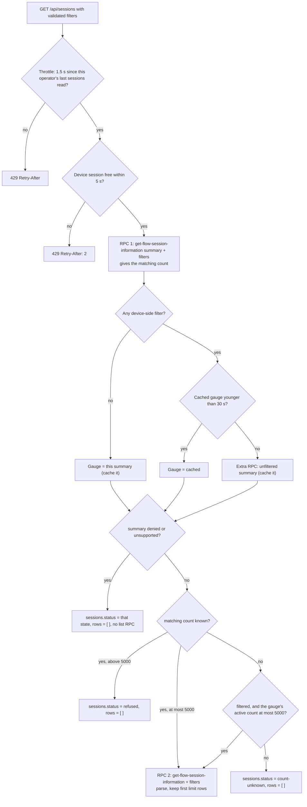
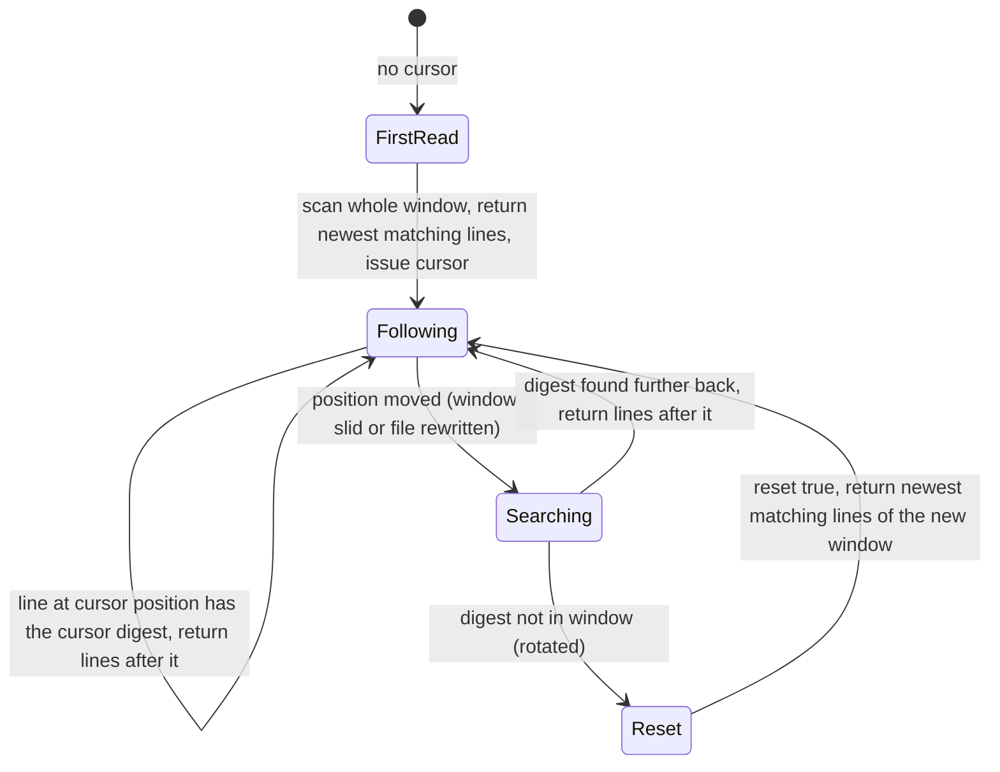
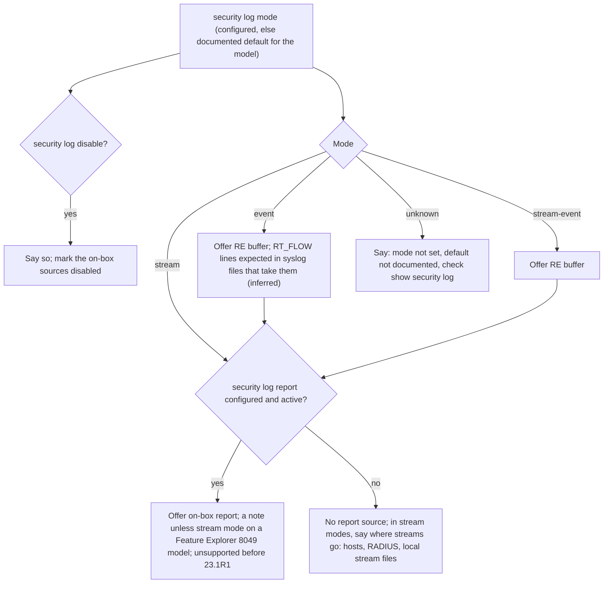

# Spec 004: Live sessions and logs (read-only)

| Field | Value |
| --- | --- |
| Status | **Backend and browser engines implemented on synthetic fixtures. Sessions and Logs views built and committed, exercised by hand on the development server; browser acceptance (AC-004-20) not signed off. The session table and the `messages` syslog file were read once, live, on a lab SRX4100, Junos 25.2R1-S1.4, as a signed-in super-user ([evidence](../evidence/2026-11-24-srx4100-lab/README.md)); no reply recorded. Nothing qualified.** |
| Parity priority | `P0`, with Spec 001 (the owner's binding addition to the first slices; see the [charter](../charter.md)). The J-Web rows it covers are in the [parity ledger](../parity/jweb-24.4.csv) |
| Gate | Part of G1 (foundation exit: Q-LOAD-02, Q-LOAD-03 are G1 tests); qualified at G2 with Q-LOG-01 |
| Decides scope | Project owner. G1 sign-off: the named security reviewer |
| Code | [`live.py`](../../src/jwicket/live.py), [`junos/sessions.py`](../../src/jwicket/junos/sessions.py), [`junos/logs.py`](../../src/jwicket/junos/logs.py), [`junos/session.py`](../../src/jwicket/junos/session.py) (allowlist, `LOGS_FILTER`), browser engines [`static/js/query.js`](../../src/jwicket/static/js/query.js) and [`static/js/logparse.js`](../../src/jwicket/static/js/logparse.js) |
| Tests | [`test_live.py`](../../tests/test_live.py), [`tests/js/query.test.mjs`](../../tests/js/query.test.mjs), [`tests/js/logparse.test.mjs`](../../tests/js/logparse.test.mjs), corpus [`tests/fixtures/log-samples/`](../../tests/fixtures/log-samples/README.md) |
| Decisions it rests on | [ADR 0002](../adr/0002-junos-delegated-sign-in.md), [0004](../adr/0004-no-sample-data.md), [0007](../adr/0007-offline-capable-meaning.md); Spec 001 for policy and zone context |

## 1. Status

The point: J-Wicket can show `show security flow session` output and the device's logs live, with
filters pushed to the device where Junos supports them, and it refuses to pull a session table so
large that listing it would load the routing engine. That is true **on synthetic fixtures
only**. The per-session XML element names are J-Wicket's inference; no recorded reply exists.

| Part | State | Evidence |
| --- | --- | --- |
| `/api/sessions`: validated device-side filters, filtered count, a guard that fails closed, row cap, cluster and SPU locations | Implemented | `test_live.py`: `SessionFilterTests`, `SessionParseTests`, `LiveHttpTests`, `SessionGuardTests`: pass |
| `/api/logs/sources`: syslog files, security log mode, streams, on-box reporting, RE buffer, deactivated statements, a cached failure | Implemented | `LogSourceTests`, `LogSourceStateTests`, `ModeAndExpressionTests`, `LiveHttpTests`, `ReportHttpTests`, `LogSourcesFailureTests`: pass |
| `/api/logs`: parameters checked before any device read, file tail with cursor and rotation, report reads with `expression`, buffer reads | Implemented | `TailTests`, `ReportHttpTests`, `ReportReleaseTests`, `ModeAndExpressionTests`, `LogSourcesFailureTests`, `MalformedReplyTests`: pass |
| Query language and pushdown planner (`query.js`) | Implemented | `tests/js/query.test.mjs`: pass (2026-11-24) |
| Log tokeniser, parser, decoder, self-read detection (`logparse.js`) | Implemented | `tests/js/logparse.test.mjs`: pass (2026-11-24) on 46 verbatim documentation lines and the development-server corpus |
| Sessions view, Logs view, flow diagram, histogram, query bar widget | **Built and committed; exercised by hand on the development server** (AC-004-20 not signed off) | None yet: no browser acceptance check has been signed off |
| On a device | **Not run.** The spike called `get-flow-session-information` with `summary` on one vSRX as the daemon's account; no reply was recorded and the panel was not checked | [Spike report](../evidence/2026-11-23-vsrx-spike/docs/J-Wicket-spike-report-and-product-plan.md) |

In parity-ledger terms the 26 rows this backend covers stay `specified` until AC-004-20 passes:
each is an operation done in the browser, and a row becomes `implemented` only when its criteria
pass, the browser check included ([ledger method, section 5](../parity/README.md#5-statuses)).

The development server's live data (`jwicket/fixtures.py`, `LiveModel`) is generated from the same
inferred element names the parser reads. Session tests therefore prove that the parser and the
fixture agree, not that either matches Junos. Q-REL-01 replaces them with recorded replies.

## 2. Problem

During an incident an operator asks: is this flow up, which policy let it through, is it NATed,
how much is it moving, and why did that other one close or get denied? The CLI answers with
`show security flow session` and `show log`, but:

- **Listing sessions is expensive for the device.** For a list request the data plane sends every
  matching session to the routing engine. A 2015 community-forum reply about an SRX3600 on
  12.1X44 quotes the title of Juniper KB28956, "[SRX] Control Plane CPU is high ("Idle 0 percent")
  after "show security flow session" command is issued"; the KB itself was not read. There is no
  option to cap the number of sessions returned (section 7.4).
- **Logs are in different places depending on configuration.** In stream mode traffic logs leave
  the box and are not stored locally unless on-box reporting or a stream file is configured; in
  event mode they go through the routing engine's syslog (section 7.7). An empty log pane that
  does not say why is a wrong answer.
- **Reading a log file returns the whole file.** `get-log` has no offset, line-count or tail
  parameter (section 7.8).

J-Web 24.4 baseline (**verified**, J-Web 24.4 guide,
[Monitor Session](https://networkingdocs.hpe.com/documentation/us/en/software/jweb-srx24.4/jweb-srx/topics/concept/j-web-security-session-log-monitoring.html),
[System Log](https://networkingdocs.hpe.com/documentation/us/en/software/jweb-srx24.4/jweb-srx/topics/concept/j-web-security-system-log-monitoring.html)):

- Monitor > Logs (Session, Threats, Web Filtering, ATP, VPN, All Events): a time picker, a manual
  Refresh icon (no live tail), Show/Hide Columns, Export to CSV limited to 100 rows, a filter bar
  with `=`, `!=`, `>=`, `<=`, AND and nested and/or with netmask search since 23.1R1, Save Filter
  and Load Filter, and a Detailed Log View. Not available on the SRX5000 line.
- Monitor > Logs > Session is built from session logs, not the live table. That it reads the
  on-box reporting database is **inferred**. In the parity inventory of the 24.4 guide, no Monitor
  page lists the live flow-session table.
- Monitor > Logs > System (from 23.2R1; SRX300 line from 23.4R2): pick a syslog file, last hour by
  default, Refresh, filter on Event and Message with `=` only.

The owner's binding requirement: log viewing with syntax highlighting, and `show security flow
session` output visible with powerful inline, live filtering. Read-only.

## 3. Users and jobs

| User | Job | What Spec 004 gives them |
| --- | --- | --- |
| Operator during an incident | "Is 10.10.3.4 reaching 198.51.100.20:443, through which policy, NATed to what?" | Session list filtered on the device by address, port, protocol, application or interface; per-session wings, NAT, policy name and index |
| Same | "How full is the session table?" | Active of maximum from the summary, on every poll |
| Same | "What just got denied, and by which policy?" | RT_FLOW_SESSION_DENY lines highlighted and decoded |
| Same | "Why did this session close, and how much did it move?" | RT_FLOW_SESSION_CLOSE decoded: reason, counters, elapsed time; session timeline from CREATE to CLOSE |
| Operator or SE | "Where are my traffic logs on this box?" | The sources card: security log mode (configured or documented default), stream hosts, on-box reporting, RE buffer, syslog files with their contents |
| Change reviewer | "Who committed what, when?" | `UI_COMMIT*` and `UI_CMDLINE_*` lines from syslog files the class can read |
| Read-only operator | "Why can't I see logs?" | An explicit `denied` state: reading syslog files needs the Junos `trace` permission |
| SE in a demo | "Show what on-box management can feel like." | Live table and tail with typed filters, highlighting and drill-down, on fixtures today |

## 4. Scope and non-scope

**In scope (implemented in the backend):**

- Root-scope flow sessions with seven device-side filters (source prefix, destination prefix,
  source port, destination port, protocol, application, interface), a filtered count, a
  table-wide gauge, a refusal threshold and a row cap.
- Log sources discovered from `system syslog file` and `security log`, plus the documented default
  mode for the model.
- Reading a syslog file with a cursor-based tail, rotation detection and substring filters.
- Reading the on-box reporting database (`show security log report in-detail <type>`, ten types)
  with time window, count and `expression`.
- Reading the routing-engine security log buffer (`show security log`) since a time.
- Browser-side query language, pushdown planning, tokenising, highlighting and decoding.

**Out of scope:**

| Not here | Why, and where it goes |
| --- | --- |
| Clearing sessions, `monitor security flow` | State-changing. `clear-flow-session*` and `monitor-security-flow-*` (file, filter, start, stop; XML API Explorer catalog) are never allowlisted. `monitor security flow` and flow traceoptions "cannot run in parallel" (**verified**, [flow session monitoring](https://networkingdocs.hpe.com/documentation/us/en/software/junos/flow-packet-processing/topics/topic-map/security-flow-session-and-error-handling.html)) |
| Sessions and logs of logical and tenant systems | `/api/sessions?scope=` other than `root` returns 400; logs take no scope. Needs the `logical-system` / `tenant` RPC options recorded (Q-REL-01). Open question 4 |
| Other session filters: `policy-id`, `zone`, `nat`, `session-state`, `node`, the `*-more-than` / `*-less-than` ranges; `extensive`, `pretty`; single-session `get-flow-session-by-identifier` | Element names and release support unrecorded (section 7.1). Open question 3 |
| `show security log report summary / in-interval / top`, `start-from` paging, the threat-specific `atp-*`, `dns`, `utm-*` sub-types | Later spec; the interval report would feed the histogram from the device |
| Binary or protobuf log files (`get-security-hpl-infile`, `get-security-stream-hpl-infile`), archived `.gz` files, `get-syslog-events` | Reply shapes and permissions unknown; not allowlisted |
| Server push (WebSocket, long poll) | Live means incremental polling; the stdlib server is HTTP/1.0, one request per connection |
| Server-side log export or retention | Export is a client-side download of what the browser holds |

## 5. Behaviour

### 5.1 Endpoints

| Request | Purpose |
| --- | --- |
| `GET /api/sessions?src=&dst=&sport=&dport=&proto=&app=&iface=&limit=&scope=root` | Filtered session list, count and gauge |
| `GET /api/logs/sources` | Where logs are on this device |
| `GET /api/logs?source=file:<name>&cursor=&lines=&contains=&exclude=` | Tail a syslog file (`file=<name>` is accepted as a short form; default `messages`) |
| `GET /api/logs?source=report&type=<t>&start=&stop=&count=&expression=` | Read the on-box reporting database |
| `GET /api/logs?source=buffer&since=` | Read the routing-engine security log buffer |

Common responses:

| Status | When | Body |
| --- | --- | --- |
| 200 | Any completed read, including failed device reads | Payload with explicit states (below) |
| 400 | A parameter failed validation. Every parameter is checked before any device read, so this costs no RPC and no read slot. Only whether a `file:<name>` is configured is checked after the (cached) sources read | `{error}` saying which value or parameter failed |
| 401 | No session; or the device session was lost during the read; or the session was closed because the same user signed in again | `{error}`; `signed_out: true` in the second case |
| 429 | Same operator, same endpoint (for logs: same `source`; while the sources cannot be read, one bucket for all sources) within 1.5 s | `{error, retry_after_s}` and `Retry-After` |
| 429 | Another read on the same operator's device session is still running after 5 s (every Spec 004 endpoint, and Spec 001's) | `{error: "Another read for your session is still running. Try again shortly.", retry_after_s: 2}` and `Retry-After: 2` |

Every response's `meta` has `read_at`, `read_as {user, backend}`, `fixture` and
`suggested_interval_s` (5).

### 5.2 Sessions

**Parameters** (validated in [`sessions.device_filters`](../../src/jwicket/junos/sessions.py); any
other key is ignored):

| Query key | RPC parameter | Accepted value |
| --- | --- | --- |
| `src` | `source-prefix` | IPv4/IPv6 address or prefix; host bits are cleared (`10.10.3.4/16` becomes `10.10.0.0/16`); a bare address becomes /32 or /128 |
| `dst` | `destination-prefix` | Same |
| `sport`, `dport` | `source-port`, `destination-port` | 0 to 65535 |
| `proto` | `protocol` | `ah egp esp gre icmp icmp6 igmp ipip ospf pim rsvp sctp tcp udp` (the keywords the CLI reference lists, any case), or 0 to 255 |
| `app` | `application` | `^[A-Za-z0-9][A-Za-z0-9._:-]{0,63}$` |
| `iface` | `interface` | `^[a-z][a-z0-9-]{1,9}(\d+(/\d+){0,3})?(\.\d{1,5})?$` |
| `limit` | (not sent) | Rows returned to the browser: default 500, clamped to 1..2000 |
| `scope` | (not sent) | Only `root`; anything else is 400 |

**One poll:**



The matching count is the summary's `displayed-session-count` (what a filtered summary returns);
with no filters and no such element, it is the summary's `active-sessions`. Each is summed over the
SPUs of one node; on a chassis cluster the largest node's value is used, because each node holds a
copy of every session (section 7.5).

**The guard fails closed** ([`live._guard`](../../src/jwicket/live.py)). A denied or unsupported
summary gives `sessions` `{status: denied | unsupported, message, rows: []}` and no list RPC: the
list is the same RPC at the same privilege. When the match count is unknown (the summary failed, for
example by timing out, or its reply had no count), the answer is the status `count-unknown` with a
message saying why and no list RPC. The one exception is a filtered request whose gauge active
count is known and at most 5,000: every match is an active session, so the match is bounded too.
This closes open question 1.

**Response:**

```json
{
  "meta": {"read_at": "2026-11-24T06:00:00Z", "read_as": {"user": "alice", "backend": "netconf"},
           "fixture": false, "suggested_interval_s": 5, "device_filters": {"destination-port": "443"},
           "limit": 500, "min_interval_s": 1.5},
  "summary": {"status": "ok", "active": 1342, "max": 65536, "failed": 0, "matching": null},
  "matching": 87,
  "sessions": {"status": "ok", "rows": ["<session row>"], "returned": 87, "truncated": false, "device_count": 87}
}
```

- `summary` is the table-wide gauge (`active`, `max`, `failed`, `matching` from the reply that
  produced it) or a panel error `{status, message}`. On a filtered poll it may be up to 30 s old;
  the response does not say how old (open question 10). `active`, `max` and `matching` are the
  largest node's values; `failed` is summed across nodes. With more than one node it also has
  `nodes: [{node, active, max, failed, matching}]`.
- `matching` is the count used for the refusal decision, or `null`.
- `sessions.status` is `ok`, `refused` (with `message` and the count), `count-unknown` (with
  `message`), `denied`, `unsupported` or `failed` (with `message`). `rows` is always present.
- `returned` counts every `flow-session` in the reply; `truncated` is true when that exceeds
  `limit`; `device_count` is the reply's `displayed-session-count`, summed over one node's SPUs, of
  the largest node, or `null`; with more than one node the list also has
  `nodes: [{node, device_count}]`. Both copies of a cluster session are still returned as rows. The
  full reply is still transferred and parsed before the cap, so `limit` bounds the browser's work,
  not the device's.

**Session row** ([`sessions._session`](../../src/jwicket/junos/sessions.py)):

| Key | Meaning |
| --- | --- |
| `id` | `<location>:<session-id>` when a location is known, else the session id; unique within a reply even when both cluster nodes report the same session |
| `session_id`, `location` | Device session id; `node0`, `node1`, an SPU label such as `on FPC0 PIC1:`, or both |
| `status`, `state` | From `status` and `session-state` |
| `policy`, `policy_index` | `name/index` split on the last `/`; index `null` when absent. The documented `name/n` form (for example `pre-id-default-policy/n`) gives policy `name` and index `null`, since what `n` means is not documented; `N/A` stays whole |
| `timeout`, `configured_timeout`, `start_time`, `duration` | Integers where parseable; `start_time` raw |
| `application` | `application`, else `dynamic-application-name` |
| `in`, `out` | Wings: `{direction, src, sport, dst, dport, proto, iface, packets, bytes, tunnel}`. `in` is the wing whose direction starts "In" (else the first wing); `out` the one starting "Out", or `null` for one-winged sessions |
| `nat` | `{source, destination}` inferred from the wings (section 7.6) |
| `extra` | Up to 24 scalar child elements the model does not name (first 200 characters each), shown, never dropped |

### 5.3 Log sources

`GET /api/logs/sources` reads `get-software-information` (model and release, cached 10 minutes,
a failure too) and the configuration with `LOGS_FILTER` (`system/syslog`, `security/log`), then
caches the result for 60 s per web session. A failed read is cached per web session as well:
`denied` or `unsupported` for 60 s, any other failure for 10 s, a lost device session never. It
has no read floor of its own; the success and failure caches bound it, so a class that cannot read
the log configuration sends one configuration read per minute, not one per request. A
configuration reply with no `<configuration>` element is a failed read ("The device's reply could
not be read."), not an HTTP 500.

```json
{
  "meta": {"read_at": "...", "read_as": {"user": "alice", "backend": "netconf"}, "fixture": false, "suggested_interval_s": 5},
  "sources": {
    "status": "ok",
    "files": [
      {"id": "file:messages", "name": "messages", "contents": ["any notice", "authorization info"], "match": null, "structured_data": false, "group": null, "inactive": false},
      {"id": "file:traffic-log", "name": "traffic-log", "contents": ["any any"], "match": "RT_FLOW_SESSION", "structured_data": true, "group": null, "inactive": false}
    ],
    "traffic": {"mode": "event", "mode_inactive": null, "effective_mode": "event", "mode_basis": "set in the configuration",
                "streams": [], "report": false, "report_inactive": false, "format": null, "disabled": false,
                "where": "Traffic logs are handled by the routing engine: they are expected in the security log buffer and in any syslog file that takes them (for example one matching RT_FLOW). Inferred from the documentation; not yet confirmed on a device."},
    "databases": [{"id": "buffer", "name": "Security log buffer (routing engine)"}],
    "self_noise": "Junos logs every NETCONF request as UI_NETCONF_CMD, ..."
  }
}
```

- `files`: one per `system syslog file` whose name matches `^[A-Za-z0-9][A-Za-z0-9._-]{0,63}$`;
  path-like names are dropped. A deactivated file (or a deactivated `system` or `syslog`) is still
  listed, with `inactive: true`: Junos no longer writes it, but it may still be on disk and
  readable. If none is named `messages`, a `messages` entry is added with `assumed: true`.
  `contents` is `"<facility> <severity>"`. `group` is always `null` today.
- `traffic.mode` is the configured mode, or `null` when it is unset or deactivated; a deactivated
  mode is named in `mode_inactive`. `effective_mode` and `mode_basis` fall back to the documented
  default ([`logs.default_mode`](../../src/jwicket/junos/logs.py)), by exact model name: `event` on
  vSRX (the basis also mentions the conflicting general statement); `event` on SRX100, SRX110,
  SRX210, SRX220, SRX240 and SRX650; `stream` on SRX1400, SRX3400, SRX3600, SRX4100, SRX4200,
  SRX5400, SRX5600 and SRX5800; on SRX300, SRX320, SRX340, SRX345, SRX550 and SRX550M `event`
  before 18.3R3 and in 18.4R1, 18.4R2, 19.1 and 19.2R1, `stream` otherwise; on SRX1500 `event`
  below 15.1X49-D140, `stream` otherwise. Models the reference does not name (SRX380, SRX1600,
  SRX2300, SRX4120, SRX4300, SRX4600, SRX4700 and others), and release-dependent models whose
  release is unknown, get `null` with the reason.
- `traffic.streams[]`: `{name, host, port, file, radius, format, category, inactive}`. `file` is a
  local stream file (the XML tag J-Wicket reads, `localfilename` or `name`, is unverified);
  `radius` a RADIUS destination's primary address.
- `traffic.report_inactive` is true when `security log report` is deactivated; `traffic.disabled`
  when `security log disable` is in effect.
- `traffic.where` is one sentence for the operator. Disabled: "Security logging is disabled in the
  configuration (security log disable), so the device writes no new security logs. Records written
  before it was disabled may still be readable below." Stream: "Traffic logs are streamed off the
  device to `<hosts>`", "sent to the RADIUS server(s) `<addresses>`" and "written to local stream
  file(s) `<files>` on this device (J-Wicket cannot read stream files yet)", joined with "and",
  ending "; they are not stored here." in pure stream mode without a local file (plus "On-box
  reporting keeps a local copy." when `report` is set). Stream-event: the same, ending with a full
  stop. Event: as in the example, marked inferred. Unknown: "The security log mode is not set and
  `<basis>`; check 'show security log' on the device." A deactivated mode adds "The configured mode
  `<mode>` is deactivated, so it is not in effect."
- `databases` holds `report` (with `types`) whenever `security log report` is configured and active,
  in any mode and on any model: hiding a configured database would make "not shown" look like "not
  there". Where Feature Explorer 8049 does not cover the model or the mode (anything but `stream` on
  vSRX, the SRX300 line, SRX380, SRX1500, SRX1600, SRX2300 and the SRX4000 line), it carries a
  `note` that reads may fail. Before 23.1R1 it has `supported: false` and a `note` saying the
  in-detail queries were introduced then. `buffer` is there when the effective mode is `event` or
  `stream-event`. Both carry `disabled: true` under `security log disable`.
- On failure `sources` is `{status: denied | unsupported | failed, message}`.

### 5.4 Reading logs

**Syslog file** (`source=file:<name>`; [`logs.tail`](../../src/jwicket/junos/logs.py)):

| Parameter | Rule |
| --- | --- |
| `<name>` | Must be one of `sources.files` (including the assumed `messages`) |
| `cursor` | `<count>:<12 hex digits>`, from the previous response |
| `lines` | Default 500, clamped to 1..2000 |
| `contains`, `exclude` | Newline-separated, at most 4 terms of at most 120 characters each; case-insensitive substring |

One `get-log` returns the whole file. J-Wicket strips control characters (keeping tab), drops
leading and trailing blank lines, keeps the newest 5000 lines (`MAX_WINDOW`), then applies the
cursor and the substring filters in the daemon before anything is sent to the browser. A regular
expression from the browser never runs on the device.

```json
{"meta": {"...": "...", "source": "file:traffic-log", "min_interval_s": 1.5, "structured_data": true, "self_noise": "..."},
 "log": {"status": "ok", "lines": ["..."], "cursor": "4211:3f9a0c21b7d4", "reset": false, "dropped": 0, "window": 4211, "scanned": 12}}
```



- `dropped` counts matching lines beyond `lines` (oldest dropped first).
- `window` is the number of lines kept; `scanned` the number examined after the cursor.
- The cursor is the line count and a SHA-256 prefix of the last line. When the window slides, the
  search finds the most recent identical line, so repeated identical lines can be skipped. Lines
  that rotated out between two polls are not recovered; `reset` says so.

**On-box report** (`source=report`): `type` is one of `session-all` (default), `session-close`,
`session-create`, `session-deny`, `screen`, `idp-all`, `utm-all`, `ipsec-vpn`, `threat`, `all`, and
selects RPC `get-sec-log-report-detail-<type>`. Parameters: `count` (default 500, 1..2000),
`start` and `stop` (`YYYY-MM-DDTHH:MM:SS`), `expression` (at most 256 bytes of
`A-Z a-z 0-9 _ . : / = ! < > & | ( ) -` and space). They are sent as RPC parameters
`count`, `start_time`, `stop_time`, `expression`, never as CLI text. A first read (no `start`)
also sends `descending`, so that `count` takes the newest records, and puts the lines back in time
order, oldest first; with `start` (live polls) the device's default order is kept. The detail
RPCs have a `descending` leaf ("Sorted in descending order", **verified** for
`get-sec-log-report-detail-session-all` in the 24.4R2 security RPC YANG); that the default order is
oldest first is **inferred** (Q-LOG-01). The response's `log` is `{status, lines (newest 2000),
type, cursor: null, reset: false}`. There is no cursor: the browser moves `start` to the newest
line's time and removes duplicates. `source=report` is accepted even when `sources.databases` does
not offer it; the device's answer then decides the state. When the sources say the release is
before 23.1R1 (`supported: false`), the answer is `{status: "unsupported", message, lines: []}`
without an RPC.

**RE buffer** (`source=buffer`): `since` (`YYYY-MM-DD.HH:MM:SS`) is sent as `newer_than` to
`get-security-log-information`. The response's `log` is `{status, cursor: null, reset: false,
events, lines, disabled}`: `events` are structured (`time, id, message, severity, result, user,
interface, protocol, policy, src, sport, dst, dport, process, pid`), `lines` render each as
`<time> <process>[<pid>]: <id>: <message>`, both capped at the newest 2000. `disabled` is true when
the reply carries `security-logs-disabled`.

**Explicit states for logs:**

| State | Where it shows |
| --- | --- |
| `denied`, `unsupported`, `failed` | `sources.status`, or `log.status` with `lines: []` and `message`. While the sources read fails, every `/api/logs` request answers 200 with that state (one 1.5 s bucket for all sources) |
| `reset: true` | File rotated or rewritten; the browser must say so |
| `dropped > 0` | More lines matched than were returned |
| `assumed: true` | `messages` is not in the configuration; reading it may fail |
| `disabled: true` | Security logging is disabled: in the buffer reply, in `traffic`, and on the `report` and `buffer` sources |
| `inactive: true` on a file or stream; `mode_inactive`, `report_inactive` | Deactivated in the configuration, so not in effect |
| `note` on `report`; `supported: false` | The documentation does not cover this model or mode; the release is before 23.1R1 |
| No `report` / no `buffer` in `databases` | Not configured (report), or not event or stream-event mode (buffer); `traffic.where` explains |
| `effective_mode: null` | Mode not set and the model's default is not documented |
| 400 | Unknown source, bad file name, bad cursor, `lines` or `count`, too many terms, bad report type, time or expression, bad buffer `since`: all before any device read. A well-formed file name that is not configured: after the sources read |

### 5.5 Rate limits and device cost

| Read | Minimum interval (server) | RPCs per poll |
| --- | --- | --- |
| Sessions, unfiltered | 1.5 s per operator | 2 (summary, list); 1 when refused, `count-unknown`, denied or unsupported |
| Sessions, filtered | 1.5 s per operator | 2, plus 1 unfiltered summary at most every 30 s (so up to 3) |
| Log file | 1.5 s per operator per source | 1 `get-log` (whole file), plus the sources refresh: 1 configuration read at most every 60 s and 1 software read at most every 10 min (so up to 3) |
| Report, buffer | 1.5 s per operator per source | 1, plus the sources refresh; 0 for a report on a release before 23.1R1 |
| Logs while the sources read fails | 1.5 s per operator, one bucket for all sources | 0 within the failure cache (60 s denied or unsupported, 10 s otherwise), else 1 configuration read |
| Sources | no floor; success cache 60 s, failure cache 60 s or 10 s | 1 configuration read on a cache miss, plus 1 software read at most every 10 min |

The browser polls at `suggested_interval_s` (5 s) by default, offers 2, 5, 10 and 30 s, and never
goes below `meta.min_interval_s`. Each RPC can add a `UI_NETCONF_CMD` line on the device (7.12). Each
operator's reads are serialised on their session lock; a request that cannot have it within 5 s
gets 429 instead of queuing. The session cap (`max_sessions`, default 4) bounds concurrency.

### 5.6 Audit

- `read_sessions` when the device filters or the sessions status change, not on every poll: user,
  source address, the device filters, row count, status. A Sessions view polling with the same
  filters writes one record, plus one each time the outcome changes (for example `ok` to `refused`).
  This answers open question 9. Before, every poll wrote a record of about 165 bytes (720 an hour
  at 5 s), so a 4 MB audit file kept about 34 hours of history with one operator polling and about
  8 hours with four (review measurement with the fixture backend).
- `read_log` on the first read of a source only (no `cursor`, `start` or `since`): user, source,
  log source, status.
- `session_lost` when the device session ends during a read.
- Retention: with `[log] audit_file` unset (the default) the audit trail goes to the diagnostic
  log; with it set, it is a rotated file of about 4 MB at the defaults. How long that lasts is
  unmeasured ([SECURITY.md, known gap 9](../../SECURITY.md#known-gaps)).

## 6. Data sources

| Read | RPC and parameters | Permission | Status |
| --- | --- | --- | --- |
| Session list | `get-flow-session-information` with `source-prefix`, `destination-prefix`, `source-port`, `destination-port`, `protocol`, `application`, `interface` (PyEZ keywords with underscores) | `view` (**verified**, "Required Privilege Level: view", [show security flow session](https://networkingdocs.hpe.com/documentation/us/en/software/junos/cli-reference/topics/ref/command/show-security-flow-session.html)) | RPC name **verified** (`\| display xml rpc` in a [Juniper community post](https://community.networking.hpe.com/blogs/karel-hendrych/2024/02/07/using-junos-snmp-utility-mib-on-juniper-srx); XML API Explorer 25.4 catalog). CLI options **verified**. XML parameter element names **inferred** (CLI keyword = element name). `protocol` element **verified** |
| Summary and filtered summary | Same RPC with `summary` (plus filters) | `view` | **verified** (`summary=True` in the community post and Juniper's [HealthBot rules](https://github.com/Juniper/healthbot-rules/blob/master/juniper_official/Security/srx-flow-session-summary-netconf.rule)) |
| Syslog file | `get-log` with `filename` | `trace` (**verified**, [show log](https://networkingdocs.hpe.com/documentation/us/en/software/junos/cli-reference/topics/ref/command/show-log.html), [trace permission](https://networkingdocs.hpe.com/documentation/us/en/software/junos/user-access/topics/concept/access-privilege-permission-bits-trace.html)) | RPC, parameter and reply `file-content` **verified** (XML API Explorer 24.4; [24.4R2 RPC YANG](https://raw.githubusercontent.com/Juniper/yang/master/24.4/24.4R2/native/conf-and-rpcs/junos-es/rpc/models/junos-es-rpc-log@2024-01-01.yang)). No offset or tail parameter in any catalogued release: **verified**. Text encoding of the reply (CDATA, leading newline): **unknown** |
| On-box report | `get-sec-log-report-detail-<type>` with `count`, `start-time`, `stop-time`, `expression` | CLI pages say `view` (**verified**, [in-detail](https://networkingdocs.hpe.com/documentation/us/en/software/junos/cli-reference/topics/ref/command/show-security-log-report-in-detail.html)); the RPCs are on no permission-bit page: **unknown** | RPC names and inputs **verified** in the [24.4R2 security RPC YANG](https://github.com/Juniper/yang/blob/master/24.4/24.4R2/native/conf-and-rpcs/junos-es/rpc/models/junos-es-rpc-security@2024-01-01.yang). CLI-to-RPC pairing **inferred**. The YANG has no `output`, so the reply wrapper is **unknown**; J-Wicket reads text from `output` or `file-content` |
| RE buffer | `get-security-log-information` with `newer-than` | Listed under the `security` and `security-control` bits (**verified**, [security permission](https://networkingdocs.hpe.com/documentation/us/en/software/junos/user-access/topics/concept/access-privilege-permission-bits-security.html)); the CLI page says `view` (**verified**, [show security log](https://networkingdocs.hpe.com/documentation/us/en/software/junos/cli-reference/topics/ref/command/show-security-log.html)) | RPC, inputs, output elements (`security-event`, `security-event-*`, `process/{name,pid}`, `security-logs-disabled`) **verified** in YANG |
| Log configuration | `get-configuration` committed with `LOGS_FILTER` | as configuration | `system syslog file` tree **verified**; `security log` leaves (`mode`, `report`, `stream/host`, `format`) **verified** in YANG; the XML form of `stream host` (J-Wicket reads `ipaddr`, `name` or text) **inferred** |
| Model | `get-software-information` | not recorded | as Spec 001 |

Every RPC above except the configuration read is in `ALLOWED_RPCS`
([`session.py`](../../src/jwicket/junos/session.py)), and every entry starts with `get-`. The
configuration read is a separate method (`get_configuration`) that takes only constant filters
(`LOGS_FILTER` here); `get-configuration` is not in `ALLOWED_RPCS`. The report RPC name is the
constant prefix plus a `<type>` from `REPORT_TYPES`, chosen only after the request's value is found
in that list, and the name is checked against `ALLOWED_RPCS` before it is sent.

## 7. Junos semantics this feature depends on

Sources for this section: Juniper CLI references and topics linked inline, Juniper's 24.4R2 YANG,
the Juniper System Log Explorer, Juniper's HealthBot rules, and the corpus in
[`tests/fixtures/log-samples/juniper-docs.txt`](../../tests/fixtures/log-samples/juniper-docs.txt).

### 7.1 Session filters

- The CLI options `source-prefix`, `destination-prefix`, `source-port`, `destination-port`,
  `protocol`, `application` ("Predefined application name"), `interface` ("Name of incoming or
  outgoing interface"), and many more (`policy-id`, `zone`, `nat`, `session-state`, `node`,
  `bytes-more-than`...) exist: **verified** ([show security flow session](https://networkingdocs.hpe.com/documentation/us/en/software/junos/cli-reference/topics/ref/command/show-security-flow-session.html)).
  The release that added the range filters is **unknown**.
- Several filters in one request are ANDed: **inferred**. No page states it.
- There is no count, limit or page option: **verified** by its absence from the current syntax
  block. CLI pipes (`| count`, `| last`) run after the full output is produced and do not reduce
  the transfer: **inferred**.

### 7.2 Summary and filtered summary

- Unfiltered summary: `flow-session-summary-information` with `active-sessions` and
  `max-sessions`, per node in a cluster (`multi-routing-engine-item/re-name`) and per SPU on
  multi-SPU platforms (`flow-fpc-pic-id`): **verified** (Juniper HealthBot tables).
  `failed-sessions` is **inferred** by symmetry.
- Filtered summary: a `flow-session-information` with `displayed-session-valid`, `-pending`,
  `-other` and `displayed-session-count` under `security-flow-information`: **verified** (verbatim
  `| display xml` in the community post). That is why J-Wicket can count before it lists.
- The device reports its own `max-sessions`; J-Wicket does not hard-code platform limits.

### 7.3 Per-session reply elements

`flow-session`, `session-identifier`, `status`, `session-state`, `policy`, `timeout`,
`configured-timeout`, `start-time`, `duration`, `flow-information` with `direction`,
`source-address`, `source-port`, `destination-address`, `destination-port`, `protocol`,
`interface-name`, `pkt-cnt`, `byte-cnt`: all **inferred** from the CLI field names. No Juniper page
or official repository found so far shows a per-session `| display xml`. The XML API Explorer
lists two different `flow-session` definitions, so the shape varies by context. Q-REL-01.

### 7.4 Cost of listing, and the refusal threshold

- For a list request the SPUs send every matching session to the routing engine, which can drive
  RE CPU to idle 0 percent. The source is a 2015
  [community-forum reply](https://community.networking.hpe.com/discussion/info-over-logs) about an
  SRX3600 on 12.1X44-D45, by a user with no Juniper support marking, which explains the mechanism
  and quotes the title of Juniper KB28956, "[SRX] Control Plane CPU is high ("Idle 0 percent")
  after "show security flow session" command is issued". KB28956 itself is behind the support
  portal and was not read. That this applies to current releases and platforms is **inferred**
  (Q-LOAD-02).
- The summary is cheap compared with the list: **inferred** (Juniper's own monitoring polls it).
- `MAX_UNFILTERED = 5000` is J-Wicket's choice, not a Junos number. Despite its name it applies to
  the matching count with or without filters. Q-LOAD-02 measures list cost at 1k, 5k and 20k
  sessions and decides whether 5000 stands.

### 7.5 Clusters, SPUs and Multinode HA

- In a chassis cluster each session appears on both nodes, `Active` on one and `Backup` on the
  other; the backup copy shows zero counters: **verified** (samples on
  [show security flow session extensive node](https://networkingdocs.hpe.com/documentation/us/en/software/junos/cli-reference/topics/ref/command/show-security-flow-session-extensive-node.html)).
  J-Wicket keeps both copies, distinguishes them by `location`, and leaves hiding backup copies to
  the browser. Which XML element carries Active/Backup is **unknown**; it lands in `extra` if it is
  a scalar. J-Wicket does not send `node primary` or `node local`, so cluster lists transfer both
  copies.
- `parse_summary` sums each count over the SPUs of one node and takes the largest node's `active`,
  `max` and `matching` (each node holds a copy of every session), sums `failed` across nodes, and
  lists the nodes in `nodes`. Before, it summed over nodes, which could double the gauge and the
  refusal count. Whether a node's count includes its backup copies is still **unknown** (Q-HA-01).
- On multi-SPU platforms a `flow-fpc-pic-id` label (text starting "on FPC") is **verified** for the
  summary reply. J-Wicket labels only the sessions that follow such a label inside the same
  container. Juniper's HealthBot XPaths pair a summary's SPU label with a following sibling element
  instead, so a list reply laid out that way would lose the label. How per-SPU and per-node results
  are laid out in a session list is **inferred**, and Q-REL-01 records a real per-SPU list reply
  before J-Wicket relies on it.
- Four-node Multinode HA adds `HA State: Warm` and domain/node ids: **verified** in CLI samples,
  not parsed (Q-HA-03).

### 7.6 NAT, policy name and time fields

- The reverse (`Out`) wing carries the translated addresses: **verified** by sample
  ([flow session nat](https://networkingdocs.hpe.com/documentation/us/en/software/junos/cli-reference/topics/ref/command/show-security-flow-session-nat.html)).
  J-Wicket's rule, source NAT when `out.dst/dport` differs from `in.src/sport` and destination NAT
  when `out.src/sport` differs from `in.dst/dport`, is **inferred**.
- "Policy name: Name and ID of the policy that the first packet of the session matched", printed
  `name/id`: **verified**. Pre-ID sessions show `pre-id-default-policy/n`; a stand-alone tunnel
  session shows `Policy name: N/A`: **verified** samples.
- `Start time` is documented as an offset from system start, but newer samples look like epoch
  seconds: the meaning varies (**verified** samples, **unknown** rule). The UI derives age from
  `duration`.

### 7.7 Where traffic logs are, by security log mode

The table is J-Wicket's model, built from the statements below it; what the buffer holds in each
mode is inferred (7.10).

| Effective mode | Traffic logs on the box | J-Wicket sources |
| --- | --- | --- |
| `event` | Through the routing engine: the security log buffer, and any syslog file whose contents take them (**inferred**) | `buffer`; syslog files (for example one with `match RT_FLOW`); `report` with a `note` if configured |
| `stream` | Not on the RE. Sent to the stream hosts or a RADIUS destination. Kept locally only by on-box reporting (`security log report`) or a local stream `file` destination | `report` when configured (with a `note` on models Feature Explorer 8049 does not list, such as SRX5000); otherwise none, and `where` says so |
| `stream-event` | Both | `report` (if configured, with a `note`) and `buffer` |
| unknown | Not stated | none; `where` asks the operator to check `show security log` |

- `mode (event | stream | stream-event)`; stream-event from 20.2R1: **verified**
  ([mode statement](https://networkingdocs.hpe.com/documentation/us/en/software/junos/cli-reference/topics/ref/statement/security-edit-mode-security-logging.html)).
- Documented defaults: event on vSRX; stream on SRX1400, SRX1500 (from 15.1X49-D140), SRX3400,
  SRX3600, SRX4100, SRX4200, SRX5400, SRX5600, SRX5800; stream on SRX300, SRX320, SRX340, SRX345,
  SRX550, SRX550M from 18.3R3 except in 18.4R1, 18.4R2, 19.1 and 19.2R1: **verified** (same page).
  A general statement elsewhere says "The default logging mode is stream mode": **verified**, and
  contradicts the vSRX line. SRX380, SRX1600, SRX2300, SRX4120, SRX4300, SRX4600 and SRX4700 are not
  named, and J-Wicket gives them no default. J-Wicket shows the documented default with its basis
  and never presents it as configured. Q-LOG-01 records the effective behaviour per platform.
- On-box reporting needs `security log mode stream` and `security log report`: **verified**
  ([Feature Explorer 8049](https://apps.juniper.net/feature-explorer/feature/8049),
  [SRX1600 logging](https://networkingdocs.hpe.com/documentation/us/en/software/platform/srx1600-srx4120-srx4300-configuration-essentials/topics/concept/srx1600-srx4120-srx4300-logging-snmp-telemetry.html)).
  SRX5000 is not in its platform list, and J-Web's six log grids (Session, Threats, Web Filtering,
  ATP, VPN, All Events; not the System page) are not available on SRX5000: **verified**. That
  on-box reporting does not work on SRX5000 is **inferred**; J-Wicket still offers a configured
  report there, with a note (Q-LOG-01). Without an SSD the database lives in memory and is lost at reboot; cluster nodes do
  not synchronise it: **verified**
  ([system logging for a security device](https://networkingdocs.hpe.com/documentation/us/en/software/junos/network-mgmt/topics/topic-map/system-logging-for-a-security-device.html)).
  Factory default since 19.3R1 does not include it: **verified** (the same page also says the
  opposite; the release-specific sentence is taken).



### 7.8 System log files and `get-log`

- `<get-log><filename>name</filename></get-log>` returns the whole file in `file-content`, with no
  offset, start, line-count or tail parameter: **verified**. Pipes are not usable over NETCONF
  except `| display xml rpc`: **verified** (PyEZ `Device.cli()` docstring,
  [py-junos-eznc](https://github.com/Juniper/py-junos-eznc/blob/master/lib/jnpr/junos/device.py)).
  So each poll moves the whole file.
- It needs the `trace` permission: **verified**. Predefined classes: `operator` = clear, network,
  reset, trace, view; `read-only` = view: **verified**
  ([login classes](https://networkingdocs.hpe.com/documentation/us/en/software/junos/user-access/topics/topic-map/junos-os-login-class-overview.html)).
  So a `read-only` user is denied: **inferred**. How Junos words that denial is **unknown**
  (Q-AUTH-03). J-Wicket never reads `/var/log` as the daemon's account.
- Whether `get-log` refuses names outside `/var/log`: **unknown**. J-Wicket only sends names from
  the configuration that pass a strict pattern.
- Default rotation is 1 MB and 10 files: **verified**
  ([system logging overview](https://networkingdocs.hpe.com/documentation/us/en/software/junos/network-mgmt/topics/topic-map/system-logging.html)).
  At defaults a poll moves at most about 1 MB; larger configured sizes move more. Q-LOAD-01.
- Line formats J-Wicket must parse in the browser: BSD default, `explicit-priority`
  (`%FACILITY-n-TAG`), `time-format year millisecond`, RFC 5424 `structured-data` with
  `<pri>` (severity = pri & 7): **verified** samples in the corpus.

### 7.9 On-box reporting and its `expression` filter

- `expression` is a leaf-list of type `jt:policy-algebra`, "Expression to handle multiple
  options": **verified** (YANG). Operators `=`, `!=`, `>=`, `<=`, `&&`, `||`, parentheses and
  netmask-aware addresses, from 23.1R1, "The total length of the expression is limited to 256
  bytes including the brackets": **verified**
  ([Feature Explorer 6853](https://apps.juniper.net/feature-explorer/feature/6853)). Example:
  `show security log report in-detail all expression ( source-address=192.0.3.2/24 && ( session-id=785 || session-id=786 ))`
  (**verified**, in-detail page).
- The accepted keys are the structured-data keys (`source-address`, `destination-port`,
  `policy-name`, `session-id`...): **inferred**. The browser planner uses `source-address`,
  `destination-address`, `source-port`, `destination-port`, `protocol-id`, `policy-name`,
  `source-zone-name`, `destination-zone-name`, `session-id`, `application`, `username`, `reason`.
- J-Wicket's character set is its own restriction, stricter than Junos's.
- Feature Explorer documents `expression` for `in-detail all` and `summary all`; another page says
  "the 'all' option does not have any filter except start-time and stop-time". Which types accept
  `expression` is **unknown** (open question 5).
- `count` is 1..65535 and `start-time` / `stop-time` are `YYYY-MM-DDTHH:MM:SS`: **verified** (YANG).
  Which records `count` returns without `start-time` (oldest or newest first) is **inferred** to be
  the oldest, so J-Wicket sends `descending` on a first read (section 5.4); the time zone of
  `start-time` is **unknown** (open question 6).
- Report output is RFC 5424-style text with no SD-ID, values sometimes unquoted, addresses
  sometimes with `/len`: **verified** samples (including the device's `RT_LOG_SELF_TEST` lines with
  fake values).

### 7.10 Security log buffer

`show security log` "Display[s] security event logs": **verified**
([show security log](https://networkingdocs.hpe.com/documentation/us/en/software/junos/cli-reference/topics/ref/command/show-security-log.html)).
`security log limit`, "Limit number of security log entries to keep in memory", defaults to
10000: **verified** (YANG). That `show security log` reads that routing-engine buffer, and that the
buffer holds traffic events only in event or stream-event mode: **inferred**. Whether stream-event
puts RT_FLOW there: **unknown** (Q-LOG-01). The operator-facing `where` text for event mode says
"expected" and "Inferred from the documentation; not yet confirmed on a device".

### 7.11 RT_FLOW fields and close reasons

- `session-id` and `session-id-32` are both used for the session id; `_LS` tags carry
  `logical-system-name`; the CLOSE template grew from 50 attributes in 22.2R1 to 57 in 24.4R1:
  **verified** (System Log Explorer). The browser parses structured data by key and BSD text only
  for its documented prefix.
- Close reasons, verbatim and separated here by semicolons (one value contains a comma): unset;
  TCP CLIENT RST; TCP SERVER RST; TCP FIN; response received; ICMP error; aged out; ALG; HA; idle
  Timeout; auth; IDP; synproxy failure; synproxy limit; parent closed; CLI; CP NACK; CP delete;
  policy delete; fwd session; multicast route change; first path reroute, session recreated;
  source NAT allocation failure; other; error create IKE pass-through template; IKE pass-through
  child session ageout; sess timeout on pending state; unknown: **verified** ([flow session monitoring](https://networkingdocs.hpe.com/documentation/us/en/software/junos/flow-packet-processing/topics/topic-map/security-flow-session-and-error-handling.html),
  Table 2). A policy deny is not a close reason; it is a separate deny event. Newer releases may
  add reasons, so the list is open-ended.
- `session-id-32` in logs is the same number as `Session ID` in the session table: **inferred**.

### 7.12 J-Wicket's own reads in the logs (`UI_NETCONF_CMD`)

- Junos logs `UI_NETCONF_CMD`, "User '`<username>`' used NETCONF client to run command
  '`<command>`'", severity info, facility LOG_AUTH: **verified**
  ([System Log Explorer](https://apps.juniper.net/syslog-explorer/)).
- So every J-Wicket RPC adds a line to any syslog file that takes authorization info:
  **inferred**. Tailing such a file at 5 s means the file always has new lines, many of them
  J-Wicket's own. The server sends `self_noise` text; the browser hides the signed-in user's own
  `UI_NETCONF_CMD` lines by default and counts them. Volume is Q-LOAD-03.

## 8. UI requirements

The Sessions and Logs views are part of UI v2. These are requirements. "Engine" means the
pure-logic module exists and is unit-tested; "open" means not yet confirmed in the view. The views
are built and committed and have been exercised by hand on the development server, but no requirement
has been signed off against AC-004-20 yet.

**Shared**

| ID | Requirement | Status |
| --- | --- | --- |
| UI-004-01 | One query language for Sessions, Logs and Policies: `OR`/`or`/`\|\|`, `AND`/`and`/`&&` or juxtaposition, `NOT`/`not`/`-`/`!`, parentheses, `key op value` with `= != >= <= > < ~` (`~` regex, browser only), `key:value`, bare text, quoted strings, `/regex/flags`, `v1\|v2` alternatives, CIDR-aware addresses, sizes with k/M/G, durations with s/m/h, `*` wildcards. Parse errors inline with position, never thrown | Engine |
| UI-004-02 | Pushdown planner: only positive, top-level AND-ed `=`/`:` terms on device-capable keys go to the device (Sessions: `src dst sport dport proto app iface`; log files: up to 4 plain words to `contains`, negated words to `exclude`; reports: an `expression`). Everything else filters in the browser. Each term is a chip, gold "device" or sky "browser", and one sentence explains the split | Engine; chips open |
| UI-004-03 | Autocomplete for keys, operators and known values (zones, policies, applications, interfaces from the inventory and current data), keyboard navigable | Engine (`suggest`); widget open |
| UI-004-04 | Live is incremental polling: default 5 s, choices 2, 5, 10, 30 s, never faster than `meta.min_interval_s`; pause and resume; polling stops while the tab is hidden; 429 `Retry-After` is honoured; a LIVE/PAUSED pill and the last read time are always visible | Shell API module; views open |
| UI-004-05 | View, filters and selection live in the URL hash, never in storage. Saved queries (query text only) may be kept in `localStorage` after an explicit "Save query"; never device data. Query text can name addresses, policies and users, so this is open question 14 for the security reviewer | Shell (hash routing); saved queries open |
| UI-004-06 | Fixture banner whenever `meta.fixture` is true; read-as chip with the `lab-token` variant | Shell |

**Sessions view** (`/api/sessions`)

| ID | Requirement | Status |
| --- | --- | --- |
| UI-004-10 | Header strip: active-of-max gauge from `summary`; sessions-per-poll sparkline; new and ended since the last poll; "device returned N of M (limit)" when `truncated`; the device filters in force | Open (gauge and sparkline widgets exist) |
| UI-004-11 | `sessions.status == "refused"`: a card with the matching count, why J-Wicket refused (the data-plane-to-RE transfer), and one-click narrowing suggestions; never an empty table | Open |
| UI-004-12 | `summary` or `sessions` in `denied`, `unsupported`, `failed` or `count-unknown`: a state card with the server message; never an empty table | Open |
| UI-004-13 | Virtualised table, smooth at 2,000 rows: status dot, ID, policy (link to the policy in Spec 001's view), zones from to (from the inventory's policy-to-zone map), protocol, source ip:port, destination ip:port, NAT badge (SNAT translated source, DNAT translated destination), application, in and out interfaces, bytes each way, packets, live rate from deltas between polls, duration, remaining timeout. Sortable, with a "hold order" toggle so rows do not jump; column chooser; density toggle | Open |
| UI-004-14 | Click any value to filter by it, Alt/Option-click to exclude; hover shows `=` and `≠` buttons | Open |
| UI-004-15 | Live diff keyed by `id`: new rows flash; rows gone from the latest poll stay one poll as "ended", struck through, then leave. Per-session byte history is kept in memory for this tab only | Open |
| UI-004-16 | Chassis clusters: "hide backup copies" on by default, using `location` and any state in `extra`; the count of hidden copies shown | Open |
| UI-004-17 | Facets: top 8 by source, destination, destination port, application, policy, interface over the current result; click to filter, Alt-click to exclude | Open |
| UI-004-18 | Detail panel: flow diagram client, ingress interface and zone, SRX with policy and NAT translation in both directions, egress interface and zone, server; both wings' counters; timeouts; state; location; `extra` fields; live bytes sparkline; "Open policy"; "Show logs for this session" (Logs with `session:<id>` or the 5-tuple); "Copy as CLI" `show security flow session session-identifier <id>` built from a validated numeric id | Open |
| UI-004-19 | Export the current filtered view as CSV or JSON in the browser, stamped with device, user, read time and the query | Open |

**Logs view** (`/api/logs/sources`, `/api/logs`)

| ID | Requirement | Status |
| --- | --- | --- |
| UI-004-30 | Source picker from `sources.files` (name, contents, match, structured-data, assumed, inactive) and `sources.databases` (with `note`, `supported` and `disabled`) | Open |
| UI-004-31 | A "Where are my traffic logs?" card from `sources.traffic`: mode, whether configured or the documented default and its basis, a deactivated mode or report, `disabled`, streams with hosts, RADIUS servers and local stream files, on-box reporting, and the `where` sentence. Off-box streaming is said plainly with the stream host | Open |
| UI-004-32 | Toolbar: query bar; event family toggles with counts (Flow create, Flow close, Flow deny, Screen, IDP, VPN (KMD), Commit/CLI (UI_*), Auth (sshd/login), SNMP, Chassis, Other); Follow; wrap; pause; lines in window | Engine (`FAMILIES`); view open |
| UI-004-33 | Histogram above the stream, events per time bucket stacked by family, in SVG; brushing adds a `time` filter, double-click clears | Open |
| UI-004-34 | Virtualised monospace stream; every visible line tokenised by `logparse.tokenize` and highlighted by token type (`ts host daemon pid tag sdid key val ip port arrow proto zone policy iface nat num str bad good user text pri`); tokens concatenate back to the exact line | Engine; view open |
| UI-004-35 | Click any token to filter by it, Alt to exclude; search matches marked | Open |
| UI-004-36 | Decoded panel: for RT_FLOW lines (structured data and BSD text) a one-sentence decode, the field table, and a session timeline (CREATE, CLOSE, DENY with the same session id) with a link to the live session if it is in the last Sessions poll; generic lines as a key/value table; "Copy line" | Engine (`decode`); view open |
| UI-004-37 | Close-reason badges from the verified list in 7.11; unknown reasons shown verbatim; deny events styled as denies, not as a close reason | Open (open question 8) |
| UI-004-38 | File tail: when not following, a "N new lines" pill; `reset: true` shows a visible rotation notice; `dropped > 0` says how many matching lines were not returned | Open |
| UI-004-39 | Report and buffer: live by moving `start` (or `since`) to the newest line's time and removing duplicates | Open |
| UI-004-40 | The signed-in user's own `UI_NETCONF_CMD` lines hidden by default with a counter ("N of your own J-Wicket reads hidden · show") and the `self_noise` text; other users' lines are never hidden | Engine (`isSelfRead`); view open |
| UI-004-41 | Log states: `denied` says the Junos `trace` permission is needed for syslog files; `unsupported`, `failed`, `disabled`, `assumed`, `inactive`, a report `note`, `effective_mode: null` each have a card | Open |
| UI-004-42 | Beat the J-Web 24.4 baseline: live tail, highlighting, typed query with autocomplete, no export cap, saved queries, NAT and session drill-down | Open |

**Accessibility and performance** (both views): keyboard everything (`/` focus query, `space`
pause, `j`/`k` move, `Enter` open, `n`/`N` next and previous match, `f` follow); `role="grid"` with
`aria-rowcount` and `aria-rowindex`; a polite live region announcing new sessions at most every
10 s; AA contrast in both themes; animations off under `prefers-reduced-motion`; main-thread work
per poll under about 8 ms for 2,000 rows on a laptop.

## 9. Security considerations

- **Read-only.** Only `get-*` RPCs are allowlisted. Clearing sessions and `monitor security flow`
  are excluded by design.
- **No injection path to the device.** Every filter value is parsed and normalised before it
  becomes an RPC parameter (addresses through `ipaddress`, ports and protocol numbers as integers,
  names through strict patterns). PyEZ sends parameters as XML elements; J-Wicket never builds CLI
  text. Browser regular expressions never reach the device; substring filters run in the daemon.
- **No file paths from requests.** A log file is read only if its name matches a strict pattern and
  is either in the device's own `system syslog file` configuration or is the assumed `messages`
  file (section 5.3) (`test_validate_file_allowlist`, `test_messages_assumed_when_not_configured`,
  `test_log_file_allowlist_and_validation`).
- **Logs are attacker-influenced text.** Hostnames, URLs in web-filter logs and user names from
  failed logins can be chosen by an attacker. Control characters are stripped server-side
  (`test_control_characters_removed`); the browser renders every token with `textContent`, builds
  filters as query text, and builds any URL only from validated values. CSP with Trusted Types
  backs this up.
- **Exposure follows Junos.** With the `netconf` backend an operator sees only what their class
  gets from `show log`, `show security log` and the reports. Logs can hold user names, source
  addresses and commands other administrators typed (`UI_CMDLINE_READ_LINE`). With the
  `lab-token` backend reads run as the daemon's account (in the spike, a super-user class), which
  is why that backend is loopback-only and labelled.
- **Protecting the routing engine.** Refusal above 5,000 matching sessions; row cap 2,000; log
  window 5,000 lines; returned lines capped at 2,000; 1.5 s minimum per endpoint and source per
  operator, also while the log sources cannot be read; a failed sources read cached; every
  parameter checked before any device read; one RPC at a time per operator, waiting at most 5 s;
  session cap. The refusal fails closed when the count is unknown (section 5.2). Known weakness:
  `get-log` moves the whole file every poll with no size cap in J-Wicket (open question 7).
- **Audit volume.** Sessions polling writes one audit record per change of filters or outcome, not
  per poll (section 5.6).
- **Browser storage.** No device data in storage; per-session history lives in memory for the
  tab; exports are explicit downloads ([ADR 0007](../adr/0007-offline-capable-meaning.md)). The one
  thing kept is query text the operator saved (UI-004-05), which can still name addresses,
  policies and users on a shared workstation (open question 14).
- **Hiding is display only.** Hiding the user's own `UI_NETCONF_CMD` lines is a browser filter with
  a visible counter; it never hides another user's lines and never removes anything server-side.
- **Regex in the browser.** `~` and `/regex/` run in the operator's own tab; a pathological
  pattern can stall that tab, not the device.

## 10. Acceptance tests

"Met (fixtures)" means the named tests pass against synthetic fixtures; "Met (unit)" means a pure
browser module passes its unit tests. Nothing is met on a device. Test names are `Class.method`
in [`test_live.py`](../../tests/test_live.py) unless another file is named.

| ID | Criterion | Tests | Status |
| --- | --- | --- | --- |
| AC-004-01 | Filters map to RPC parameters, host bits normalised, bad values refused (400), unknown keys ignored, limit clamped, every documented protocol keyword accepted | `SessionFilterTests.test_valid_filters_map_to_rpc_parameters`, `.test_host_bits_are_normalised_not_rejected`, `.test_bad_values_are_refused`, `.test_limit`, `SessionParseTests.test_documented_protocol_keywords`, `LiveHttpTests.test_sessions_pushdown_filters`, `.test_sessions_bad_filter_is_400` | Met (fixtures). Element names: Q-REL-01 |
| AC-004-02 | Rows are listed only when the matching count is known to be at most `MAX_UNFILTERED` (or, for a filtered request with no count, when the gauge's active count is), refused above it, and allowed when a narrower filter brings it under; a summary that fails or has no count gives `count-unknown` and no list RPC; a denied or unsupported summary gives that state and no list RPC | `LiveHttpTests.test_refusal_follows_the_matching_count`, `SessionGuardTests.test_summary_timeout_sends_no_list`, `.test_summary_without_a_count_sends_no_list`, `.test_filtered_summary_without_a_count_is_bounded_by_the_active_count`, `.test_denied_or_unsupported_summary_is_that_state_without_a_list`, `.test_known_small_count_lists` | Met (fixtures). Threshold: Q-LOAD-02 |
| AC-004-03 | A filtered read keeps the table-wide gauge | `LiveHttpTests.test_filtered_read_keeps_the_table_wide_gauge` | Met (fixtures) |
| AC-004-04 | Wings, policy name and index (the documented `/n` suffix split off), source NAT, cluster and SPU locations with distinct ids, truncation stated, counts summed over one node's SPUs and the largest node used on a cluster | `SessionParseTests.test_wings_policy_and_source_nat`, `.test_cluster_and_spu_locations_keep_ids_distinct`, `.test_limit_truncates_and_says_so`, `.test_policy_without_index`, `.test_documented_n_suffix_is_split_off`, `.test_summary_sums_spus_within_one_node`, `.test_cluster_summary_uses_the_largest_node` | Met (fixtures) on **inferred** element names |
| AC-004-05 | Sign-in required; 1.5 s rate limit with `Retry-After`; non-root scope refused; a read that waits more than 5 s for the operator's device session gets 429 with `Retry-After: 2` and sends no RPC | `LiveHttpTests.test_requires_sign_in`, `.test_sessions_read_and_rate_limit`, `.test_sessions_scope_other_than_root_refused`, `SessionGuardTests.test_busy_device_session_is_429_not_a_queue` | Met (fixtures) |
| AC-004-06 | Denied reads are explicit states: the sources; log lines when the sources read is denied; the session summary and list | `LiveHttpTests.test_denied_log_read_is_an_explicit_state`, `SessionGuardTests.test_denied_or_unsupported_summary_is_that_state_without_a_list`, `LogSourcesFailureTests.test_denied_sources_are_read_once_per_ttl` | Met (fixtures) for those cases. A `get-log`, report or buffer read denied **after** a successful sources read (the common case for a class without `trace`, section 7.8) is not tested: every test device that denies `get-log` also denies the configuration read. Real denial wording: Q-AUTH-03 |
| AC-004-07 | Sources: configured files only, path-like names dropped, deactivated files listed and marked, `messages` assumed, structured-data flag, stream mode explained with its hosts, RADIUS servers and local stream files, deactivated mode, report, stream and `security log` reported as not in effect, `security log disable` reported | `LogSourceTests.test_files_and_stream_mode`, `.test_messages_assumed_when_not_configured`, `.test_validate_file_allowlist`, `LogSourceStateTests.*` (8 tests), `ReportHttpTests.test_sources_explain_stream_mode`, `LiveHttpTests.test_log_sources_and_tail` | Met (fixtures) |
| AC-004-08 | Documented default mode per exact model name and, where it depends on it, the release; `null` where undocumented or where the release is unknown | `ModeAndExpressionTests.test_default_modes`, `.test_release_parsing` | Met (unit). Effective behaviour: Q-LOG-01 |
| AC-004-09 | `report` offered whenever `security log report` is configured and active, with a `note` outside stream mode on a Feature Explorer 8049 model and `supported: false` before 23.1R1, and not offered when report is not configured or is deactivated; `buffer` in event and stream-event mode | `LogSourceStateTests.test_report_is_shown_whenever_configured_with_a_note_where_undocumented`, `.test_report_queries_need_23_1`, `.test_deactivated_mode_report_and_stream`, `LiveHttpTests.test_report_source_is_offered_only_when_configured` (branch fixture: event mode, no report), `.test_event_mode_buffer_source`, `ReportHttpTests.test_sources_explain_stream_mode` | Met (fixtures). The note cases tested are stream-event mode and unlisted models (SRX550, SRX5800); report in plain event mode is not tested on its own |
| AC-004-10 | Tail: last N on first read; only new lines after; window slide found by digest; rotation is a reset; substring filters with drop count; cursor and term validation; control characters removed; reply text shapes | `TailTests.*` (8 tests) | Met (unit) |
| AC-004-11 | Unknown sources and files, bad cursors, bad `lines`, report types, expressions and buffer times refused with 400, all except file membership before any device read and without using up a read slot | `LiveHttpTests.test_log_file_allowlist_and_validation`, `LogSourcesFailureTests.test_bad_parameters_are_400_before_any_device_read`, `.test_a_bad_request_does_not_use_up_the_read_slot` | Met (fixtures) |
| AC-004-12 | `contains` filters on the server side of the wire | `LiveHttpTests.test_log_contains_filter_pushdown` | Met (fixtures) |
| AC-004-13 | Report read; type, expression length and characters, times and count validated; a first read sends `descending` and returns the lines oldest first; on a release before 23.1R1 the answer is `unsupported` without an RPC | `ReportHttpTests.test_report_read_and_validation`, `.test_first_report_read_asks_for_the_newest_records`, `ReportReleaseTests.test_old_release_report_read_is_unsupported_without_an_rpc`, `ModeAndExpressionTests.test_expression_validation` | Met (fixtures). Reply wrapper: Q-REL-01. Default order: Q-LOG-01 |
| AC-004-14 | Buffer events and rendered lines; `since` format enforced; `self_noise` present | `ModeAndExpressionTests.test_buffer_events_shape`, `LiveHttpTests.test_event_mode_buffer_source` | Met (fixtures) |
| AC-004-15 | Query language, typed comparisons, CIDR matching, sessions/logs/policies fields | [`query.test.mjs`](../../tests/js/query.test.mjs): "terms: key:value, key=value, comparisons, bare values", "CIDR-aware address matching (IPv4 and IPv6)", "sizes, durations and integer comparisons", "logs fields over parsed lines: severity order, NAT, time and age", "FIELDS cover each view with typed keys and getters", and the rest of the file | Met (unit) |
| AC-004-16 | Pushdown planner for sessions, log files and reports, with the 256-byte AND-prefix fallback | `query.test.mjs`: "sessions pushdown: positive top-level AND-ed ":"/"=" terms on device keys", "sessions pushdown keeps negations, ORs, alternatives, wildcards, ranges and bad values in the browser", "logs file pushdown: contains / exclude, at most 4 terms of 120 characters", "logs report pushdown: the J-Web expression syntax", "logs report pushdown falls back to the largest AND-prefix within 256 bytes", "time terms set report start/stop and the buffer "since", and stay in the browser" | Met (unit) |
| AC-004-17 | Every corpus line tokenises back to exactly itself | [`logparse.test.mjs`](../../tests/js/logparse.test.mjs): "every corpus line tokenises back to exactly itself", "tokenisation stays lossless on every prefix of every corpus line, and with hints" | Met (unit) on 46 documentation lines and the development-server corpus |
| AC-004-18 | RT_FLOW decoding (structured data, BSD text across releases, buffer), other families, formats | `logparse.test.mjs`: "every documented RT_FLOW line decodes with the right session id, 5-tuple, policy, zones and NAT", "every dev-server RT_FLOW line decodes correctly (structured data, BSD text and buffer)", "RT_FLOW BSD positional bodies across releases (24.4 template, NAT rule types, LSYS)", "RFC 5424: PRI severity and facility, SD-ID, no SD-ID, bracketless, no PRI", "BSD: default, explicit-priority, year and millisecond time formats, year inference", "decode: screen, IDP, commit, configuration mode, login, VPN, link" | Met (unit) |
| AC-004-19 | Own-read detection: `UI_NETCONF_CMD` lines of the signed-in user only | `logparse.test.mjs`: "isSelfRead: UI_NETCONF_CMD lines of the signed-in user only" | Met (unit); hiding in the view open |
| AC-004-20 | UI requirements UI-004-01 to UI-004-42 in a browser against the development server (`branch`: event mode, syslog files, buffer; `cluster-lsys`: cluster, stream mode, on-box report; `auditor`), with no console errors or CSP violations, and smooth at 2,000 rows | Browser check against the development server, by hand or driven by an external, development-only browser tool ([CONTRIBUTING, browser rules](../../CONTRIBUTING.md#browser)), screenshots at desktop and phone widths | **Not met**: the views are built and committed and have been exercised by hand on the development server, but this check has not been run against the requirement list and signed off |
| AC-004-21 | AC-004-01 to -14 pass against recorded replies from a qualified platform, including a cluster and a multi-SPU platform | Q-REL-01 recorded fixtures | **Not met**: no recorded reply exists |
| AC-004-22 | On a qualified platform, listing up to `MAX_UNFILTERED` sessions at the default interval keeps RE CPU and mgd within the Q-LOAD-02 pass criterion | Q-LOAD-02 | **Not met** |
| AC-004-23 | A failed sources read is cached per web session (denied or unsupported 60 s, other failures 10 s); while it fails, `/api/logs` answers 200 with the state and repeats within 1.5 s get 429 | `LogSourcesFailureTests.test_denied_sources_are_read_once_per_ttl`, `.test_other_failures_are_retried_sooner` | Met (fixtures) |
| AC-004-24 | A configuration reply with no `<configuration>` is a `failed` panel on `/api/logs/sources` and `/api/logs` (and on Spec 001's endpoints), not HTTP 500 | `MalformedReplyTests.test_every_configuration_reader_reports_failed` | Met (fixtures) |
| AC-004-25 | Repeated session polls with the same filters and outcome write one `read_sessions` audit record | `SessionGuardTests.test_repeated_polls_are_audited_once` | Met (fixtures) |

## 11. Qualification needed

Definitions, methods and pass criteria are in [governance.md](../governance.md).

| Test | What it settles for Spec 004 |
| --- | --- |
| Q-REL-01 | Recorded `get-flow-session-information` replies: list (brief), summary, filtered summary, on a branch device, a cluster and a multi-SPU platform (where the SPU label sits in a list reply); `\| display xml rpc` for each filter used; `get-log` reply encoding; the `get-sec-log-report-detail-*` reply wrapper; `get-security-log-information` reply; the error each returns when denied or unsupported |
| Q-LOAD-02 | List cost at 1k, 5k and 20k sessions; whether `MAX_UNFILTERED = 5000` stands, per platform class |
| Q-LOAD-01 | Sustained polling of sessions and of `get-log` on a 1 MB and a larger file: RE CPU, memory, mgd |
| Q-LOAD-03 | `UI_NETCONF_CMD` lines per minute per open view at 2, 5, 10, 30 s |
| Q-LOG-01 | Log source matrix per security log mode and platform: effective default mode, what lands in the buffer, report availability (including SRX5000 and event mode), which report types accept `expression`, `count` ordering with and without `descending`, time zone |
| Q-AUTH-03 | `read-only` class on `get-log` (denied, and how) while it can read the log configuration; `view`-only class on the report RPCs and on `get-security-log-information` |
| Q-AUTH-01 | Reads run as the signed-in operator, so the permission results above are the operator's |
| Q-HA-01, Q-HA-02, Q-HA-03 | Active/Backup copies and their XML; summary counts per node; which node serves the page; MNHA session fields |
| Q-HW-01 | Parsing a 2,000-row list and a 1 MB log on an SRX300-class RE |
| Q-SEC-01 | Review of filter validation, log rendering and exposure |

## 12. Open questions

| # | Question | Who decides | Settled by |
| --- | --- | --- | --- |
| 1 | **Answered in the code (2026-11-24):** when the matching count is unknown the list is refused (`count-unknown`), except for a filtered request whose active count is at most 5,000 (section 5.2). The security reviewer confirms at Q-SEC-01 | Security reviewer | `SessionGuardTests`, Q-LOAD-02 |
| 2 | Is 5,000 the right refusal threshold, the same on every platform? The documentation review suggested about 2,000 as an example | Owner | Q-LOAD-02 |
| 3 | Add `node primary` or `node local` on clusters to halve the transfer, and more device filters (`policy-id`, `zone`, `nat`, ranges)? Each needs its `\| display xml rpc` recorded | Owner, then contributors | Q-REL-01, Q-HA-01 |
| 4 | Sessions and logs for logical and tenant systems | Owner | Q-REL-01, Q-AUTH-03 |
| 5 | Which report types accept `expression`? J-Wicket sends it to any of the ten types | Contributors | Q-LOG-01 |
| 6 | Report reads without `start`: J-Wicket now sends `descending` on the inference that the default is oldest first (section 5.4). Is that right? What time zone do `start-time` and `stop-time` use? | Contributors | Q-LOG-01 |
| 7 | `get-log` moves the whole file each poll and J-Wicket does not cap the reply size. Add a cheap change check first, cap the size, or probe `get-syslog-events` (count and time filters in its schema, runtime behaviour unknown)? | Contributors, security reviewer | Q-LOAD-01, Q-REL-01 |
| 8 | The v2 design notes list "policy deny" among the close-reason badges and omit several documented reasons. "policy deny" is not a close reason (a deny is its own event). Use the verified list in 7.11 | UI owner | This spec |
| 9 | **Answered in the code (2026-11-24):** `read_sessions` is recorded only when the filters or the outcome change (section 5.6). The security reviewer confirms at Q-SEC-01 | Security reviewer | Q-SEC-01 |
| 10 | The cached gauge carries no read time of its own; add `summary.read_at` so the UI can show its age | Contributors | Unit test |
| 11 | Log files configured in groups have `group: null`; archived `.gz` files are not offered | Owner | Parity ledger |
| 12 | vSRX default mode: event per the mode page, stream per the general statement. Show which on the lab vSRX | Lab owner | Q-LOG-01 |
| 13 | Single-session drill-down through `get-flow-session-by-identifier` (named in the XML API Explorer 25.4 catalog) instead of the full list | Owner | Q-REL-01 |
| 14 | Saved queries (UI-004-05) keep query text in `localStorage`, and that text can name addresses, policies and users. Acceptable on shared workstations, with Spec 001 open question 13 (query state in the URL hash)? Architecture section 11 and ADR 0007 allow it only as operator-saved query text, never device replies | Security reviewer | Q-SEC-01 |
