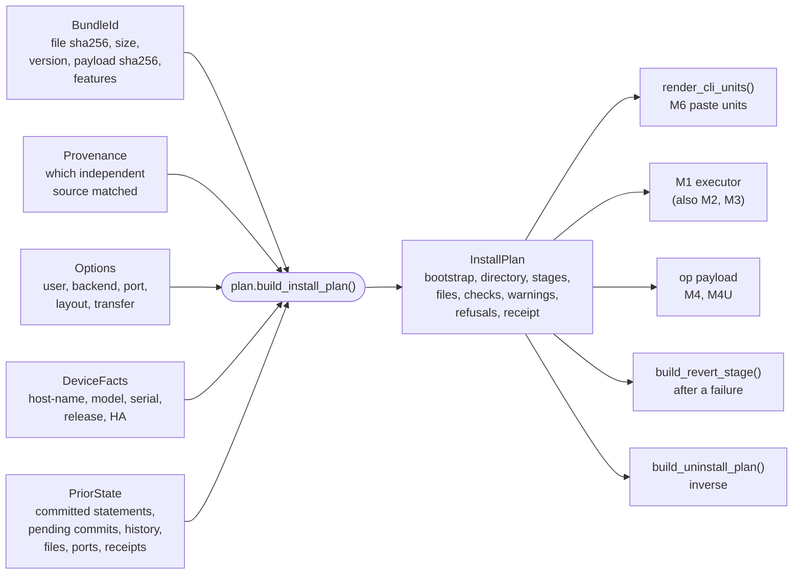
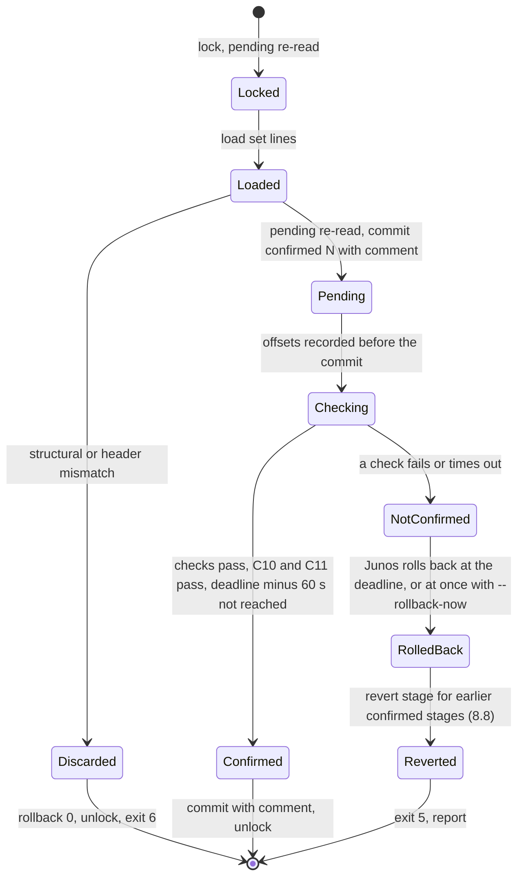
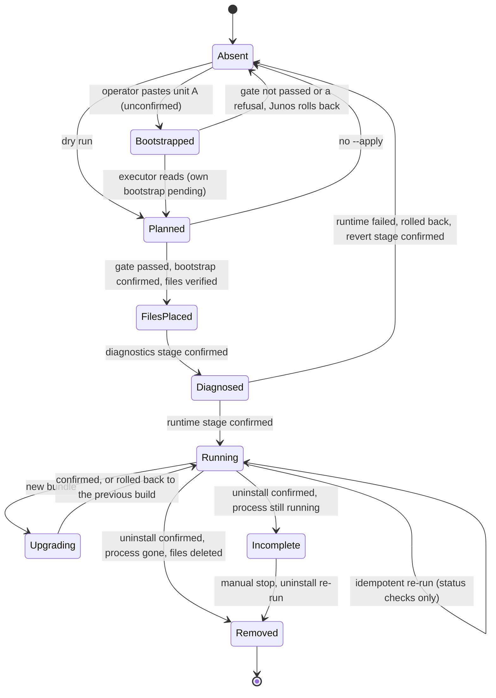

# Spec 006: Installation, upgrade and removal (lab-gated)

| Field | Value |
| --- | --- |
| Status | **Draft.** Built in the same change as this spec (owner decision 4), against fake device sessions and synthetic replies only. No installer has run on a device. Nothing qualified. Every device step is **unverified** until the lab run Q-INST-06 records it, except steps marked "verified (spike)" or "verified on SRX4100", the latter from J-Wicket's own bundle run by hand on a lab SRX4100 ([srx4100]). Every installer prints `DEVICE_STATUS` (8.4) until the lab owner certifies Q-INST-06. Revision 4 (2026-11-25) applies that run's facts (22) |
| Parity priority | Beyond parity. J-Web 24.4 needs no install, and from Junos 25.2R1 J-Web itself is an optional package (6.13, M12). Installing J-Wicket is the precondition for every ledger row: a foundation (`P0`) enabler with no ledger row of its own |
| Gate | Lab tooling for G1. **Every installer is lab-gated until G1 passes** (owner decision, 2026-11-24). Nothing here makes J-Wicket installable on a production SRX: that stays a G5 matter ([governance](../governance.md#3-gates-g0-to-g5)); what lifting the gate at G1 means is open question 1 |
| Proposed release lanes | [Lab/dev, read-only alpha, and production](../governance.md#34-labdev-read-only-alpha-and-production) separate exploratory evidence from release qualification. The proposal does not lift this spec’s lab gate or relax installer refusals. |
| Decides scope | Project owner. The installers change the lab procedure and the device's security posture, so **acceptance also needs the lab owner (D2) and the security reviewer (D1)** ([governance, who decides what](../governance.md#who-decides-what): "Changes to the lab procedure: Lab owner; Security reviewer, when a step changes the device's security posture"). Both roles are unnamed, so this spec cannot be accepted yet |
| Code | [`tools/jwicket_install/`](../../tools/jwicket_install/) (never shipped to a device; the shared plan is [`plan.py`](../../tools/jwicket_install/plan.py), [`state.py`](../../tools/jwicket_install/state.py), [`render.py`](../../tools/jwicket_install/render.py)), `deploy/`, the release tooling of section 11 and bundle changes D2 and D3 (section 10); section 19 lists every file. `ALLOWED_RPCS` in [`junos/session.py`](../../src/jwicket/junos/session.py) is untouched and no installer code goes into `dist/jwicket.py`: the daemon keeps no write path |
| Tests | Section 17 (for example [`test_install_plan.py`](../../tests/test_install_plan.py) and [`tests/fixtures/install/`](../../tests/fixtures/install/README.md)). They run under `PYTHONPATH=src python -m unittest discover -s tests`, on Python 3.7 too, without `junos-eznc`, `paramiko` or `scp` (imported lazily; tests that need them skip unless `JWICKET_REQUIRE_PYEZ=1`, which a dedicated CI job sets) |
| Decisions it rests on | [ADR 0001](../adr/0001-on-box-pure-python-single-file.md), [0003](../adr/0003-tls-off-loopback.md), [0009](../adr/0009-central-management-coexistence.md), [0010](../adr/0010-usable-without-knowing-junos.md). New: [ADR 0011](../adr/0011-owner-decisions-lab-gated-install.md) records the owner's decisions of 2026-11-24 and 2026-11-25 (Accepted); [ADR 0012](../adr/0012-installer-design.md) records this spec's proposals (Proposed, governance D11), three of which the owner accepted on 2026-11-25 (2.2) |

## 1. Status

The point: an SE or administrator with Junos skills installs, upgrades or removes J-Wicket on a lab
vSRX (or attested lab hardware) with one command, from a reproducible pre-release whose origin the tool checks against a
source independent of the release page. Nothing changes until the tool has shown the exact
configuration change, the posture warning and the facts that would betray a production box, and the
operator has typed the host name of the lab device. Every change, the one-time bootstrap included,
is a `commit confirmed` that the tool confirms only after J-Wicket proves on the device that the
build just installed is the one running. This change builds it; none of it has touched a device.
The only proven way to install is still [deploy-lab.md](../deploy-lab.md), run by hand on a lab
SRX4100 on 2026-11-24; revision 4 takes that run's facts as verified and changes the design where
they contradict it: TLS access, no directory creation, Python 3.7, hardware attestation.

| Part | State | Evidence |
| --- | --- | --- |
| Shared plan and renderers | In this change, on synthetic fixtures | AC-006-01 to AC-006-12, AC-006-43 |
| Workstation installer (M1), also the executor of M2 and M3 | In this change, against fake sessions, adversarial timing included | AC-006-13 to AC-006-30, AC-006-44 |
| Ansible (M2), on-box op script (M4, M4U), container (M3), containerlab topology (M8) | In this change; the image is built locally from a pinned Dockerfile (never yet built with Docker; CI's container job builds it and never pushes it) | AC-006-31, AC-006-32, AC-006-34, AC-006-35 |
| Bundle changes D2 and D3 | In this change | AC-006-37, AC-006-38 |
| Release workflow | In this change; no tag pushed (the first, `v0.1.0.dev1`, waits for the owner's go) | AC-006-39 to AC-006-41 |
| Cut (4.1) | Setup mode D1, `serve` mirror, ZTP renderer | AC-006-27 rewritten; AC-006-33, AC-006-36 withdrawn |
| On a device | **No installer has run.** The spike verified `scp -O`, the four extension-service statements, start at commit, respawn and the CLI start of a non-daemonized app, with its own daemon on one vSRX ([spike evidence](../evidence/2026-11-23-vsrx-spike/README.md)). The bundle then ran by hand on a lab SRX4100, 25.2R1-S1.4: the diagnostic and runtime statements, `commit confirmed 5` confirmed after a check, TLS on fxp0 in `mgmt_junos` ([srx4100]; section 14) | Q-INST-06 |

A passing unit test shows what the installer sends and how it reacts to fakes; it proves nothing
about a device. Where a fake encodes a reply shape or an argument name, AC-006-29 ties it to the SRX
YANG and to PyEZ's real signatures.

## 2. Problem

### 2.1 What installing takes today

[deploy-lab.md](../deploy-lab.md) is nine steps typed by hand, several in the Junos shell, which
Juniper does not support ([start shell][start-shell], **verified**: "Juniper Networks does not provide
support for operations in the shell"): copy the bundle three times with `scp -O`; create
`/var/db/jwicket` (as root: the account cannot, **verified on SRX4100**); upload `jwicket.ini`;
commit the diagnostic entries and run the self-test and probe; enable NETCONF; commit the daemon and
check its log before confirming; open the tunnel (refused on SRX4100, so TLS on fxp0); later remove
everything, leaving out what step 0 showed was there. What goes wrong: a missed `chmod` or owner
stops the daemon; a forgotten confirm silently rolls back; a `commit` or even a
`commit check` confirms a pending confirmed commit (**verified**, 8.5), and so, typed while
someone else's is pending, presumably theirs too (that it crosses users and sessions is **inferred**,
13.4); removal deletes a `language python3` something else relied on, or leaves a lab
account reachable (deploy-lab step 9).

### 2.2 Owner decisions (2026-11-24, binding)

The request that started this spec, and the owner's three answers of the same day (ADR 0011):

1. The request: "Make install as seamless as possible and provide as many install methods as are
   available."
2. "Every installer is LAB-GATED until G1: dry run by default, shows the exact configuration diff
   and the posture warning that 'set system scripts language python3' lets unsigned Python run on
   the routing engine, uses 'commit confirmed' with a health check before confirming, and proceeds
   only after the operator confirms the device is a lab box by typing its host name; the gate is
   lifted when G1 passes."
3. "CI publishes the reproducible bundle with its SHA-256 as GitHub PRE-releases (lab only)."
4. "The install spec (Draft) and the installers are built together in one PR, every device step
   marked unverified until a lab run."

Also binding from earlier decisions: never ask anyone to disable J-Web or change a production
firewall; loopback only unless TLS is configured, and TLS is not qualified; device access read-only;
an SE or administrator with Junos skills installs it, once per device ([ADR 0010](../adr/0010-usable-without-knowing-junos.md)).

**Owner decision of 2026-11-25** (ADR 0011, decision 4). Asked to accept or change the three
installer defaults that revision 4 proposed from the SRX4100 lab facts, the owner answered: "go with
those installer defaults". Binding since then:

5. **Access** (open question 30, decided): TLS on the management address by default, port 9443,
   with `[server] routing_instance mgmt_junos` when `system management-instance` is set; a
   self-signed certificate generated on the workstation, whose private key is uploaded with mode 0600
   and never kept, and whose fingerprint is printed (7.5, 8.10). The on-box methods' access mode and
   certificate are not part of it (open question 31).
6. **The state directory** (open question 28, decided): the one-time root step for `/var/db/jwicket`
   is printed and checked by the installers (R-STATEDIR), never run by them (9.3).
7. **Lab hardware** (open question 20, decided): accepted only with `--lab-hardware` and a typed
   `lab only`, after the production signs (8.2).

ADR 0011 records only these. Everything else this spec decides (the release settings, the
R-PENDING exception, the other refusals, the veriexec override, the uninstall rules, the M4 and M4U
access) is a **proposal**, recorded in ADR 0012 and listed in section 21. How this spec reads
decision 2 (open questions 15, 10 and 14):

- "Dry run" means the default run sends reads only. The "exact configuration diff" it shows is the
  plan's diff from the committed configuration, in Junos's patch form. Junos's own `show | compare`
  needs a lock and a candidate load, a write, so it is printed after the gate, before the confirmed
  commit, and journaled; `--device-diff` prints it on demand behind the same gate (8.3).
- "Commit confirmed with a health check" applies to every commit, the bootstrap included (7.7).
- "Typing its host name": the tool never shows the name before the prompt, so the answer comes from
  the operator's intent, not the screen (8.2).

### 2.3 Constraints every method inherits

| Constraint | Status | Source |
| --- | --- | --- |
| Junos passes no `--flag` options to a JET app, so the bundle picks its mode from its file name (`jwicket_selftest.py`, `jwicket_probe.py`) | **Verified** (spike F1, 24.4R2-S3.5) | [charter, section 5](../charter.md#5-spike-evidence) |
| Unsigned Python runs only after `set system scripts language python3`; the file is owned by root or a super-user-class user, writable by its owner only | **Verified** for commit, event, op and SNMP scripts; **inferred** for JET (with it the bundle ran as a JET app, **verified on SRX4100**) | [py-reqs]: "File owner is either root or a user in the Junos OS super-user login class. Only the file owner has write permission for the file." |
| Only super-user-class accounts may access and edit the script directories | **Verified** | [script-storing]: "Only users who belong to the super-user login class can access and edit files in the script directories." |
| Symbolic links there run only for signed scripts, so the alias names must be real copies | **Verified** | [script-storing]: "the device will execute the script at the target location only if it is signed." |
| Incoming SFTP is off by default, so copies use legacy SCP (`scp -O`, or the `scp` 0.16.2 library, which runs `scp -t`) | **Verified** (19.1R1 change; spike for `scp -O`; library source) | [user-access]: "Starting in Junos OS Release 19.1R1, we have globally disabled the incoming SFTP connections by default." |
| With `netconf ssh` set, NETCONF is accepted on the SSH port as well as 830; a user-defined NETCONF port refuses plain SSH | **Verified** (NETCONF guide PDF, 2026-09-14) | [netconf-pdf]: "If you enable NETCONF and you also enable SSH services on the device, the device accepts NETCONF sessions on both the default SSH port and the configured NETCONF port"; "The defined port accepts only NETCONF-over-SSH sessions and rejects regular SSH session requests." |
| Through an SRX zone, `netconf` and `ssh` are separate host-inbound services, all off by default | **Verified** (CLI Reference) | [host-inbound]: "By default, a security zone has all system services disabled."; "`netconf`—NETCONF service", "`ssh`—SSH traffic" |
| The settings path is fixed (`/var/db/jwicket/jwicket.ini`); the daemon refuses to start unless the file and every directory above it are owned by its uid or root and not group- or other-writable (unless sticky) | **Verified** (code) | [`settings.py`](../../src/jwicket/settings.py) `DEFAULT_CONFIG_PATH`, `check_directories`, `read_trusted_text` |
| Veriexec refuses Python run from the shell; unsigned Python runs only through Junos's script runner | **Verified** (spike T0; [veriexec]; on SRX4100 shell `python3` is "Operation not permitted") | [charter, section 7](../charter.md#veriexec-and-unsigned-python) |
| The daemon runs as its `username` account, which must be the installing super-user account | **Verified** (spike: "The app runs as the username account"; SRX4100) | [charter, section 7](../charter.md#veriexec-and-unsigned-python); deploy-lab step 0 |
| A super-user-class account cannot create a directory under `/var/db` (`mkdir` and `file make-directory`: `Permission denied`); root made `/var/db/jwicket` and `chown`ed it | **Verified on SRX4100** | [srx4100] finding 3 |
| On-box Python is 3.7 (3.7.10 on 25.2R1-S1.4, `jnpr.junos`, `lxml`, `ncclient`, `paramiko`, `ssl` importable; the 26.2R1-S2.3 image has only `lib/python3.7`, read, not run) | **Verified on SRX4100** | [srx4100] finding 1 |
| With `system management-instance`, fxp0's address binds only in `mgmt_junos`; the daemon's `[server] routing_instance` moves its listener there, the JET `routing-instance` does not | **Verified on SRX4100** | [srx4100] finding 2 |
| SSH local forwarding refused; `set system services ssh tcp-forwarding` a syntax error (25.2R1-S1.4) | **Verified on SRX4100** | [srx4100], Q-NET-03 |
| The SRX schema at 23.2R1 marks `tcp-forwarding` deprecated and has `system services ssh allow-tcp-forwarding`; whether it enables the tunnel on 25.2 | Schema fact documented; effect **unverified** (not tried) | junos-es YANG 23.2R1 `conf-system`, Q-NET-03 |

## 3. Users and jobs

| User | Job | What this spec gives them |
| --- | --- | --- |
| SE with a vLabs or containerlab vSRX | "Put this pre-release on my lab box and show me the UI." | `jwicket-install install --apply --release <tag>` (M1) from the pre-release's own wheel; one paste unit if NETCONF is off; `jwicket-install open` |
| Lab owner running qualification | "Install the exact build, prove where it came from, record what it did, leave the box as it was." | Immutable pre-releases and a release record on `main`; provenance checks; a receipt keyed to the host key; ownership from Junos's commit history; evidence fetch |
| Administrator with only the Junos CLI | "I cannot install Python tools on this jump host." | The local op script with its checksum pinned (M4), or CLI paste units (M6) |
| Team with Ansible | "Three lab boxes, one at a time, same gate." | `serial: 1` playbooks over M1's executor (M2) |
| Security reviewer | "What can the installer change, and can it be tricked into more?" | A fixed statement set and RPC list, 5.1's invariants, structural checks, refusals, the credential and secret rules (sections 8, 12, 16) |
| Operator on a production SRX | "Can I install this?" | No. Every installer refuses any model but vSRX unless `--lab-hardware` and a typed `lab only` attest lab hardware (8.2), shows the production signs it read first, and makes the operator attest that the box is a lab device |

## 4. Scope and non-scope

**In scope:** one shared plan that every method renders from (section 7); the safety contract and
invariants every built method meets, a method that cannot being left unbuilt before G1 (5.1, 8);
the built methods M1 (also a wheel on each pre-release), M2, M3, M4, M4U (published, usable only
with an independent hash), the M5 pull options from an operator-provided URL, M6 and a containerlab
topology (part of M8); the two access modes (7.5); documented methods M7 and M9 to M26 (section 6); upgrade, repair, revert and
uninstall for every built method; bundle changes D2 and D3 (section 10; D1 deferred); the release
workflow and the repository settings it relies on (section 11).

**Not in scope:**

| Not here | Why, and where it goes |
| --- | --- |
| A production SRX | Not before G5 ([governance](../governance.md#3-gates-g0-to-g5)). The lab gate is an attestation, not a detector |
| Physical SRX without the lab-hardware attestation | R-MODEL (8.2); governance D12's hardware procedure is not written |
| A listener on a revenue interface, zone or filter changes, `junos/zone-access.set`, a CA-issued certificate | Q-NET-01, Q-TLS-01. The installers listen on loopback (`--access tunnel`) or with TLS on the address the operator names (`--access tls`, by default `--host`), meant to be the management address; the installer does not check that it is (SPEC-04: reading the address's interface needs a new read, a lead or owner decision), so `TLS_POSTURE_WARNING` says so and the plan prints the address before the gate. Never off loopback without TLS (7.5) |
| Moving the settings path out of `/var/db` | The owner kept the path (2026-11-25, open question 28, decided): root makes the directory once, and the installers print and check that step (9.3) |
| Touching J-Web (`system services web-management`) | Binding non-goal; its port is read only to avoid a collision (R-PORT) |
| Login accounts or classes, root authentication, host name | They need `system login`, which holds password hashes and is never read or written; the lab owner creates accounts by hand (6.9) |
| SSH TCP forwarding configuration | Q-NET-03; refused on SRX4100 25.2R1-S1.4, so `--access tunnel` warns (7.5) |
| Chassis cluster, MNHA, dual routing engines | Refused until Q-HA-01 and Q-HA-03 (8.11) |
| Any write by the daemon | It stays read-only; installer writes are lab-procedure writes made by an operator's tool ([Spec 002](002-change-protocol.md) owns product writes at G4) |

### 4.1 Scope cuts in this change

The lead engineer fixed these on 2026-11-24; each applies everywhere in this spec, its tests and
documents. C1 to C3 narrow "as many install methods as are available" (open question 29); C5 is
open question 10.

| Cut | What changes | Why | What stands instead |
| --- | --- | --- | --- |
| C1 | Bundle change D1 is **deferred, not built**: no `jwicket_setup.py` setup mode, `--use-setup-alias`, setup stage, check C1 or `SETUP_FILE`. Keys stay S1 to S14, with S6, S7 and C1 "reserved, not used" | The setup mode would run as the daemon's account, which cannot create a directory under `/var/db` (**verified on SRX4100**, 2.3) | No installer creates the directory: root does once (9.3); until then R-STATEDIR refuses before any write (revision 4) |
| C2 | No `serve` lab file server | Lead engineer's cut | Pulls (M5) take an operator-provided URL: a lab web server they run, or the per-tag release asset URL (6.7) |
| C3 | ZTP (M10) documented only: no renderer, module or tests | Lead engineer's cut | 6.11; `Method.ZTP` exists only to be refused |
| C4 | Version `0.1.0.dev1` in `src/jwicket/__init__.py`, `pyproject.toml`, `tools/jwicket_install/__init__.py` | The first pre-release tag would be `v0.1.0.dev1` | 11.1; this change creates no tag |
| C5 | The R-PENDING exception for the installer's own unconfirmed bootstrap is built as designed | An owner decision, open for veto | 7.7: only its own bootstrap, recognised by user, comment `jwicket-bootstrap <method> <nonce>` (no nonce on-box) and exact delta, and only after the gate |

## 5. Principles

| # | Principle | In practice | Basis |
| --- | --- | --- | --- |
| P1 | One plan, many renderings | Every statement, path, mode, check and warning comes from `plan.py`; a test requires the set lines of every rendering to be equal | Owner decisions 1, 4; **proposed** |
| P2 | Read-only by default | Without `--apply` (or its equivalent) only reads are sent: no lock, candidate load, `commit check` or file write | Safety rules; decision 2 |
| P3 | Show, then gate, then write | Plan diff, files, modes, warnings, production signs and blast radius before the gate; the candidate must equal the plan before any commit, the committed delta before any confirm | Decision 2 |
| P4 | The device's own facts decide | The typed name is compared with the `host-name` from `get-software-information`, never an inventory, variable or argument | Decision 2 |
| P5 | Every commit is confirmed by evidence | `commit confirmed N`; health checks; confirm only when all passed and the pending commit is this stage's own | Decision 2; **verified** rollback (13.4) |
| P6 | Own only what you add, as Junos recorded it | Statements present before are never removed; shared ones only when Junos's history and the workstation record agree this installer added them and nothing relies on them | deploy-lab step 9; **proposed** |
| P7 | No shell, except one fixed read | Copies, modes, checksums and reads use Junos file RPCs; the one shell use is the fixed veriexec read. The one-time root step for the state directory (9.3) is printed for the lab owner, never run by a tool | [start-shell] |
| P8 | Trust is checked, never assumed | Host keys on every connection; the daemon's certificate pinned by fingerprint (C8); downloads by TLS, SHA-256 and one source independent of the release page; the SHA-256 checked on the device and pinned in the configuration | Safety rules; 8.9 |
| P9 | Refuse what is not understood | The refusals of 8.11 stop the run before any write | **Proposed** |
| P10 | Installer code never ships in the daemon | No configuration-writing code in the bundle; the op script is a separate artifact with its own SHA-256 | [Spec 002](002-change-protocol.md); **proposed** |

### 5.1 Security invariants

A change that breaks one is a change to the safety contract and needs the security reviewer
(governance, "A setting default or rule that weakens a control").

| ID | Invariant | Enforced by |
| --- | --- | --- |
| INV-01 | Nothing is written before the gate passes: no lock, candidate load, file write or commit; `--device-diff` is behind it too | SC-05; AC-006-13 |
| INV-02 | No path sends `commit check`, `<commit-configuration><check/>` or `<validate>`: any commit or check confirms a pending confirmed commit (**verified**, 8.5), and that it confirms another user's or session's is **inferred** (13.4), so none is ever sent. The only commits are a stage's `commit confirmed`, its confirm, the confirm of the installer's own bootstrap, and an explicit `--rollback-now` | AC-006-21, AC-006-09 |
| INV-03 | The pending state is re-read on the locked session immediately before every commit and confirm. Before a confirmed commit nothing may be pending but the own unconfirmed bootstrap (7.7); before a confirm the newest entry must be this stage's, by this user, with this comment | SC-08; AC-006-15, AC-006-16 |
| INV-04 | Every write is a confirmed commit, confirmed only after its checks pass at least 60 s before the deadline; every paste unit ends at its `commit confirmed` line, the confirm being a separate unit | SC-09; AC-006-09, AC-006-17 |
| INV-05 | The compared host name comes from the device's `get-software-information`, read by the executor; no option, environment variable, inventory, extra variable or file can supply it | SC-04; AC-006-07, AC-006-31 |
| INV-06 | No file step writes in place, renames over or deletes a path the committed configuration names, except the copy-into-place of verified bytes immediately before the confirmed commit that changes that file's checksum; on failure the old bytes are restored; a configured file is never deleted while its stanza exists | `check_invariants`; AC-006-04, AC-006-19 |
| INV-07 | A bundle or op script is accepted for `--apply` only with one provenance source independent of the release page (8.9), or `--trust-release-page-only`, which stamps the receipt "not evidence" | SC-13; AC-006-24 |
| INV-08 | Credentials, and the TLS private key, never appear in argv, logs, receipt, journal, plan JSON or rendered files, and the key never on the workstation's disk; device secrets are never read (select-only filters; parsed state keeps no URL, secret or hash text) | SC-11; AC-006-22 |
| INV-09 | Every SSH connection (NETCONF, SCP, veriexec read) verifies the host key against the same trusted entry; two ports must present the same key; C8 trusts only a certificate this installer made and recorded for this device (this run's, or the kept pair named in the workstation record for the same address, 7.5), by SHA-256 fingerprint | SC-12; AC-006-23 |
| INV-10 | J-Wicket listens on `127.0.0.1` without TLS (`--access tunnel`), or with TLS on one operator-named unicast IPv4 address of the device (`--access tls`; R-BIND refuses an IPv6 one), which the installer does not check is the management address (review finding SPEC-04: by default `--host`; the posture warning says so and the plan prints the address before the gate); never off loopback without TLS, never `0.0.0.0`; no zone or filter changes | SC-20; AC-006-08 |
| INV-11 | Ownership of shared statements comes from Junos's history and the workstation record; the device receipt is advisory, because the daemon's account can write it | SC-15; AC-006-05 |
| INV-12 | Device text never becomes a template, path, command or configuration line; rendered values are validated tokens and constants | SC-19; AC-006-06, AC-006-31 |

## 6. Install methods

### 6.1 Ranking

Ranked by how seamless each is for one SE on one lab vSRX; built methods first within a tier.
"Actions" counts a first install after the one-time workstation set-up. Every built method is
**unverified** on a device until Q-INST-06.

| ID | Method | Tier | Actions (NETCONF on / off) | Built here |
| --- | --- | --- | --- | --- |
| M1 | Workstation installer `jwicket-install` (PyEZ over NETCONF on the SSH port; own SSH client for SCP) | One command | 1 command + typed name / + 4 paste units | **Yes**, also a wheel on each pre-release |
| M3 | Container image wrapping M1 | One command | As M1 | **Yes** (local build) |
| M2 | Ansible playbooks handing each host to M1's executor | One command | 1 run + typed name per host / + 4 paste units per host | **Yes** |
| M17 | SSH-CLI driver, no NETCONF | One command | 1 command + typed name | No: deferred (Q-INST-05) |
| M14 | ncclient-only installer | One command | As M1 | No: deferred |
| M26 | Ansible NETCONF bootstrap play | One command | — | No: no diff before the commit |
| M15 | Ansible `juniper.device` modules | One command | — | No: rejected, no host-key check |
| M19 | Ansible role or collection tarball | One command | As M2 | No: documented |
| M20 | NAPALM, Nornir, SaltStack, Terraform | One command | — | No: not researched |
| M13 | SLAX on-box installer via `op url` | One command on the device | 1 command + typed name | No: documented |
| M4 | On-box Python op script, run locally, checksum pinned | A few steps | Unit 0 + 4 paste units + `op` + typed name | **Yes** |
| M4U | The same op script with `op url ... key sha-256` | A few steps | 4 paste units + `op url` + typed name | **Yes** (same file), only with an independent hash |
| M5 | Device pull from an operator-provided URL (`file copy`, `refresh-from`), an option of M1, M4, M6 | A few steps | As its host method | **Yes** (options) |
| M18 | Offline kit | A few steps | Copy the kit, then M1 | No: documented |
| M22 | Lab golden image | A few steps | Boot the image | No: documented |
| M21 | Dev container or Codespaces | A few steps | Open it, then M1 | No: documented |
| M16 | Configuration-driven pull (`source`, `set refresh`) | After the file exists | — | No: documented |
| M6 | CLI paste units (`jwicket-install render --method cli`) | Manual | 20 units with `tls` (16 on the device), 19 with `tunnel` (15 on the device), each checked by eye | **Yes** (renderer) |
| M23 | J-Web CLI terminal for M6's units | Manual | As M6 | No: documented |
| M8 | Lab platforms (containerlab, ISO or cloud-init, vLabs, EVE-NG, console) | Manual | Provision, then M1 | **Partly**: containerlab topology |
| M7 | Manual shell procedure (deploy-lab) | Manual | 9 steps | Exists; partly verified (spike, SRX4100) |
| M9 | Central managers | Not buildable here | — | No |
| M10 | ZTP and phone-home | Not buildable here | — | No: documented only (cut C3) |
| M11 | Signed JET package | Not buildable here | — | No: needs a Juniper certificate |
| M12 | Juniper-shipped optional package | Not buildable here | — | No: HPE engineering only |
| M24 | Junos REST API as transport | Not buildable here | — | No: rejected, a posture change |
| M25 | Unsigned JET package | Not buildable here | — | No: likely refused by veriexec |

M1 comes first: it automates every step, enforces every rule mechanically, and needs only SSH and
`netconf ssh`, which its gated bootstrap adds. The reference is deploy-lab's verified steps
(`scp -O`, the four statements, start at commit; on SRX4100 also the diagnostic statements and TLS
on fxp0): every automated method must reproduce their effect
(AC-006-02), and M6 renders them as its primary path.

### 6.2 M1: workstation installer (`jwicket-install`)

Invariants: all of 5.1. For an SE or administrator who reaches a lab vSRX over SSH (vLabs,
containerlab, EVE-NG, KVM, cloud), or lab hardware with `--lab-hardware` (8.2). The workstation's
floor is the pinned PyEZ's: `junos-eznc` 2.8.3 declares `Requires-Python >=3.8` (PyPI metadata,
**verified**; [pyez-install]: "Junos PyEZ supports Python 3.8 through Python 3.15"), and
`requirements-install.txt` names the interpreters its hash pins were checked on (CPython 3.9.2 to
3.13 when written: cryptography refuses 3.9.0 and 3.9.1). The plan and renderers run on 3.7 (7.1).

- **One-time set-up from the pre-release** (no clone): download the wheel,
  `requirements-install.txt` and `SHA256SUMS` from the per-tag URL; check provenance (8.9) and
  `sha256sum -c SHA256SUMS`; in a venv, `pip install --require-hashes -r requirements-install.txt`,
  then the wheel `--no-deps` (`make install-tool` from a checkout). `pipx` and `uv tool install`
  cannot apply `--require-hashes` the same way (**inferred**), so they are not recommended.
- **Steps:**
  1. Optional dry run: `jwicket-install install --release v0.1.0.dev1 --host <device> --user <u>`
     fetches the per-tag `jwicket.py` and `SHA256SUMS`, checks them, reads the device, prints the
     plan (8.3) and stops.
  2. Only if NETCONF is off: the run reads nothing and prints the NETCONF bootstrap units (7.7) with
     a fresh nonce and the command for step 3; the operator pastes units A to D on the device, unit C
     being `commit confirmed 10 comment "jwicket-bootstrap netconf <nonce>"`, unconfirmed.
  3. `jwicket-install install --apply --release v0.1.0.dev1 --host <device> --user <u> [--bootstrap-nonce <nonce>]`
     within the bootstrap's window (10 minutes by default; connecting is its health check): the
     plan, warnings and production signs, the typed host name (8.2), then the bootstrap confirm and
     the install (9.2). If a refusal (R-STATEDIR among them) or the operator stops the run, the
     bootstrap rolls back by itself.
  4. With `--access tls` (the default) the summary prints `https://<listen address>:<port>/` and the
     certificate's SHA-256 fingerprint for the browser. `jwicket-install open --host <device> --user <u>`
     forwards nothing (R3): with `tls` it prints that URL and fingerprint and runs C8; with
     `--access tunnel` it prints the line to run by hand,
     `ssh -L 127.0.0.1:8443:127.0.0.1:8443 <u>@<device>`, the explicit bind keeping it off the LAN
     ([ssh1], **verified**: "By default, the local port is bound in accordance with the GatewayPorts
     setting."). 25.2R1-S1.4 refuses the forward (2.3).
- **Developer path:** `make lab-install HOST=<device> USER=<u>` builds the bundle and runs `install`
  (a dry run unless `APPLY=1`) with `--bundle`, its SHA-256 as provenance (`--expect-sha256`,
  `--expect-source local-build`; 8.9).
- **Lifecycle:** `install --apply --release <new tag>` upgrades (9.4); `uninstall`, then
  `uninstall --apply` (9.5); `status` is read-only; `install --apply` again repairs (9.6).
- **Prerequisites:** SSH; `netconf ssh` (from the bootstrap); `/var/db/jwicket`, made once by root
  (9.3); with `tls`, a path from the workstation to the listen address and port; a super-user-class
  account other than `root`, which becomes the daemon's `username` (7.5); the host key in `~/.ssh/known_hosts` from one
  `ssh <u>@<device>` on the same port (8.10); an agent, a key or a password at a prompt; `gh` for P-A
  and P-B, optionally.
- **Transport:** NETCONF on the SSH port (`--port`, default 22) needs no zone change, unlike 830
  through a zone (`host-inbound-traffic system-services netconf`; **inferred**, 13.7);
  `--netconf-port 830` is the fallback (fxp0, vrnetlab). PyEZ `Device(host, user, port,
  hostkey_verify=True, ssh_config=<path>, conn_open_timeout=30, gather_facts=False)` carries NETCONF
  only; files and the veriexec read use the own `paramiko.SSHClient` (`RejectPolicy`, timeouts) with
  `scp.SCPClient` on the same host and port, because PyEZ's `SCP` and `StartShell` load only the
  system `known_hosts` and use port 22 whenever the NETCONF port is 830 (**verified**, PyEZ 2.8.3
  `utils/ssh_client.py`).
- **Risks:** the bootstrap opens NETCONF on fxp0 and every zone admitting `ssh` or `netconf`
  (`NETCONF_WARNING`) for its window (10 minutes by default, up to 30) before the gate, and another
  administrator's commit then would confirm it (**inferred** from [commit-cmd]); `--access tls`
  opens an HTTPS listener on the management address (8.4).

### 6.3 M2: Ansible playbooks over M1's executor

Invariants: all of 5.1; INV-05 and INV-12 have Ansible tests (AC-006-31). The playbooks orchestrate
and never talk to the device: each host goes to M1's executor (installed on the controller from the
same wheel) by `ansible.builtin.command` with an argument list, `connection: local`, `serial: 1`; no
`juniper.device` or `ansible.netcommon` module, no collection.

- **Why not `juniper.device.junos_config`** (**verified**, juniper.device 2.0.8 source): it loads,
  diffs and commits in one task inside `locked_config`, which unlocks in `finally`: no diff
  comparison first (SC-06), no lock across the confirm window (INV-03), and `confirm_commit` sends no
  comment, which fails under `force-commit-log` ([commit-guide], **verified**). A `junos_rpc`-only
  play needs one session and lock across tasks (**unknown**), and an idle persistent connection is
  destroyed after 30 s (**verified**, ansible-core 2.20.0 `PERSISTENT_CONNECT_TIMEOUT`).
- **Steps:** a Python 3.12 venv with `pip install --require-hashes -r
  deploy/ansible/requirements-ansible.txt` (`ansible-core==2.20.0` and the installer's dependencies)
  and the wheel `--no-deps`; copy `inventory.example.ini`; `ansible-playbook -i inventory.ini
  deploy/ansible/install.yml -e jwicket_release=v0.1.0.dev1` is the dry run, `-e jwicket_apply=true`
  installs with a typed name per host; `uninstall.yml` and `status.yml` alike; `upgrade.yml` imports
  `install.yml` and stops a host whose plan is not an upgrade.
- **Per host:** (1) assert `jwicket_gate_typed`, `jwicket_lab_typed` and `jwicket_device_hostname`
  **not defined**, because extra variables "always win precedence" ([ansible-vars], **verified**);
  (2) two dry runs,
  text (printed whole: the plan JSON holds warning IDs, not texts), then `--json`, registered and
  parsed with `from_json`, never `-e @file`, `include_vars` or `vars_files` (they yield trusted
  templates, [ansible-219], **verified**); (3) the plan summary;
  (4) `ansible.builtin.pause` with `LAB_GATE_PROMPT`, registered as `jwicket_gate_typed`, and, only
  with `jwicket_lab_hardware=true`, a second `pause` with `LAB_HARDWARE_PROMPT`, registered as
  `jwicket_lab_typed` (the attestation is never a variable); (5)
  `jwicket-install install --apply --host {{ ansible_host }} --user {{ jwicket_user }} --release {{ jwicket_release }} --method ansible --gate-from-stdin --json`,
  plus `--access`, `--listen-address`, `--daemon-port` and `--lab-hardware` from `jwicket_access`,
  `jwicket_listen_address`, `jwicket_daemon_port` and `jwicket_lab_hardware` when set, with the typed
  answers on `stdin`, one per line (the host name, then `lab only`); the executor compares the host
  name with the one it reads (INV-05), then the attestation, and an empty answer never matches.
- **Credentials:** agent or keys only; the contract test fails on `ansible_password`,
  `ansible_ssh_pass` or `ANSIBLE_NET_PASSWORD`; no `--accept-new-host-key`, `--remove-shared`,
  `--device-diff` or M5 (use M1). **Bootstrap:** a host with NETCONF off fails with its units; paste
  units A to D, rerun with `-e jwicket_bootstrap_nonce=<nonce> --limit <host>`. With
  `jwicket_lab_hardware=true` the plays pass `--lab-hardware` and ask the second `pause` (above);
  with `--access tls`, a host whose `ansible_host` is not an IP literal needs `jwicket_listen_address`.
- **Labels and risks:** `pause` registers `user_input` ([ansible-pause], **verified**); without a
  terminal it returns an empty answer at once (**verified**, ansible-core 2.20.0 source and a test),
  and an empty answer fails. `--gate-from-stdin` exists only for this play, fed from a `pause` result
  (contract test), and is refused (exit 2) without the `--method ansible` every call of the plays
  passes, so receipts record M2. `--method ansible` is a label, not a check (review finding SEC-R2):
  any script that passes it with `--gate-from-stdin` can pipe both the host name and, with
  `--lab-hardware`, `lab only` with no person at a terminal (also through M3 with `docker run -i`).
  The play's `pause` is the only route that asks a person; both answers are deterrents, not proofs
  (SECURITY.md known gap 11).

### 6.4 M3: container image

Invariants: as M1; for operators who cannot install Python packages. `make container-context
TAG=<tag> REPO=<owner>/<repo>` fetches the wheel and `requirements-install.txt` from the
pre-release, checks provenance and SHA-256, and puts them in `deploy/container/build/` (git-ignored;
`LOCAL=1` builds them from the checkout). `docker build -t jwicket-install:<version>
deploy/container` uses only that context: `.dockerignore` allowlists the Dockerfile, the entry point
and `build/`, so no `jwicket.ini`, token or evidence enters a layer; the base image is pinned by
digest
(`python:3.12.16-slim-trixie@sha256:191083cdf6c7bda8c76158983163ead5d5cf7b77cf3033e805bb0f5296f51b4b`,
2026-11-24); `--require-hashes`; uid 10001. Run as in `deploy/container/README.md`: `docker run --rm
-it --user "$(id -u):$(id -g)" --cap-drop ALL --security-opt no-new-privileges --read-only --tmpfs
/tmp`, mounting `/state`, `known_hosts` (read-only) and the agent socket, then M1's arguments. The
entry point refuses uid 0, and refuses every command but `bootstrap`, `--help` and `--version`
(dry runs included: they keep state there, and the image's own `/state` belongs to uid 10001), and
`--apply`, `--rollback-now`, `--device-diff` and `--accept-new-host-key` even with `--help` (exit
2), unless `/state` is a private mount that outlives `--rm` (not read-only, tmpfs or an anonymous
volume; `/proc/self/mountinfo`, **inferred**); `JWICKET_INSTALL_STATE_DIR=/state` also holds
`uninstall`'s evidence unless `--evidence-dir` is given. The entry point refuses `open` (exit 2): it
forwards nothing, and its C8 read would test the container's network, not the browser's path;
`--network none` (8.9) cannot be applied from inside, and a containerlab vSRX needs
`--network clab`. Use a dedicated agent holding only the lab key (`ssh-add -c`): a mounted socket
signs with every key it holds (Docker Desktop on macOS **unknown**). Juniper's images are not used:
the newest `juniper/pyez` tag is 2.7.2 (**verified**, Docker Hub API), and `:latest` is banned.
Upgrade and uninstall as M1; CI builds the image.

### 6.5 M4: on-box op-script installer, run locally

Invariants: all of 5.1; for INV-07 the pinned hash comes from the release record on `main` or a
verified attestation, never only the release page. For administrators with only the Junos CLI. Local,
not `op url`: a local op script with a configured `checksum sha-256` fails to run if its bytes
change ([op-checksum-local], **verified**), and no `allow-url-for-python` is needed.

- **Steps** (units in `docs/install.md` and each pre-release's notes):
  1. Unit 0, operational mode: `file copy https://github.com/<owner>/<repo>/releases/download/<tag>/jwicket-install-op.py /var/db/scripts/op/jwicket-install-op.py`
     (or `scp -O`), then `file checksum sha-256` of it. STOP unless it equals the value in
     `docs/releases/<tag>.sha256sums` on `main` or a verified attestation; the release page alone is
     not enough.
  2. Units A to D, the op bootstrap (7.7): S1 (left out when set) and S14, ending at `commit
     confirmed 10 comment "jwicket-bootstrap op"`. Not confirmed.
  3. `op jwicket-install-op.py` checks its Python (3.7 or later) and the on-box PyEZ import, reads
     the local device (`Device()` with no host, [op-py-config], **verified**: "The script does not supply a host
     parameter when creating the Device instance, which causes the open() method to establish a
     connection with the local device."), prints the plan, warnings and production signs, and asks
     for the host name with `jcs.get_input` (**verified**, same example). Enter, a wrong name or a
     refusal confirms nothing and prints the bootstrap's deadline. It takes no arguments (`netconf`,
     direct, 5 and 10 minutes, diagnostics kept; never S8's removal); an override flag
     (`--lab-hardware`, then `lab only`, among them) or the veriexec state is typed at a prompt,
     recorded; provenance is recorded as `operator-hash`. Its access mode and an on-box certificate
     are ONBOX's design, **unverified** (the standard library makes no RSA key; open question 31).
  4. On a match (R-STATEDIR, 9.3, was decided before the prompt): the bootstrap confirm, then M1's
     stages and checks through on-box PyEZ (`Config(dev, mode="exclusive")`). The bundle comes by
     the `file-copy` RPC from the per-tag URL to the staging name (7.5) and is checked with
     `get-sha256-checksum-information` against the hash the op script embeds. A `jwicket.py` the
     operator put in their home directory is opened with `O_NOFOLLOW`, required by `fstat` to be a
     regular file of the running uid, not group- or other-writable, read and hashed once, and those
     bytes written `O_CREAT | O_EXCL` to the staging name. Never a fixed name in `/var/tmp`.
  5. It writes `/var/db/jwicket/uninstall-cli.txt` (0600), so removal needs neither a workstation
     nor the bootstrap.
- **Failure:** after the bootstrap confirm everything runs in `try`/`finally`: the revert stage
  (8.8) and, when the history shows this run added the bootstrap's statements (7.9), their removal by
  confirmed commit; if that cannot run, it prints the units.
- **Upgrade:** designed as the next op script (unit 0, bootstrap units re-pinning S14, `op`), but the
  plan recognises only a bootstrap that adds statements, so the re-pin is R-PENDING: uninstall, then
  install. **Uninstall:** the same `op` (type `uninstall`), or `uninstall-cli.txt`; shared statements
  stay (no workstation receipt, 7.9).
- **Veriexec:** `/sbin/sysctl security.mac.veriexec.state` by argument list, 5 s timeout (that an op
  script may, and the path, **inferred**; Q-INST-05); otherwise typed by the operator, recorded as
  "veriexec read by hand".
- **Labels:** op scripts run "with the access privileges of the user who invokes the command"
  ([op-cmd], **verified**). **Unknown:** whether `file copy https://` checks the certificate on
  Junos OS and follows GitHub's redirect (Q-INST-05; the SHA-256 check is the control either way).
  `op` taking the name with
  `.py` is **inferred** (research EXT-11).
- **Risks:** in the bootstrap's window before the gate, `language python3` and the op stanza are
  active but unconfirmed, and another administrator's commit would confirm them (**inferred**); the
  script detects that and offers the revert. It runs with the operator's full rights.

### 6.6 M4U: the same op script run with `op url`

Bootstrap units A to D add `set system scripts op allow-url-for-python` (and `language python3` if
absent), unit C `commit confirmed 10 comment "jwicket-bootstrap op-url"`, unconfirmed; then `op url
https://github.com/<owner>/<repo>/releases/download/<tag>/jwicket-install-op.py key sha-256 <hash>`
with the hash from `docs/releases/<tag>.sha256sums` on `main`. The rest is M4; the runtime stage
removes `allow-url-for-python` when the history shows this run's bootstrap added it. Remote Python
op scripts need that statement ([allow-url-py], **verified**), and `op url ... key sha-256` checks
the hash ([op-cmd], **verified**). It ranks below M4: while the statement is set any user with the
maintenance permission can run Python from a URL (`ALLOW_URL_WARNING`); its safety rests on the
typed hash; HTTPS validation and redirects are **unknown** (Q-INST-05).

### 6.7 M5: device-pull transfer

An option of M1 (`--transfer file-copy --url <u>`, or `--transfer refresh-from --url <u> --cert-file
<pem>`, the PEM placed under `/var/db/jwicket/` beforehand), M4 and M6 instead of SCP. The URL is
the operator's (cut C2): a lab web server they run, or the per-tag asset URL (redirects on the
device **unknown**, Q-INST-05); the installer serves no files. Every pull lands on the staging name
(7.5), which nothing configures or starts, is checked with `get-sha256-checksum-information`, and is
copied into place inside the stage (INV-06), so a respawn never runs unverified bytes.

- `file copy <url> <dest>` takes HTTP, HTTPS, FTP and SCP sources and stages the download before
  moving it ([file-copy], **verified**); whether Junos OS checks the certificate is **unknown**
  (`no-check-certificate` exists only for Evolved), so the SHA-256 check is the control and
  `no-stage` is never used.
- `request system scripts refresh-from extension-service file <f> url <u> cert-file <pem>` checks
  HTTPS against the PEM ([refresh-from-cmd], **verified**: "If you specify an HTTPS URL, you must also
  include the cert-file option in supported releases."); releases before the CVE-2022-22156 fixes did
  not ([cve-2022-22156], **verified**), hence R-RELEASE. Whether it accepts an unconfigured name,
  creates an absent file or follows redirects is **unknown** (Q-INST-05): exit 7 if the staging file
  does not appear.
- Plain HTTP or FTP only with `--allow-plain-http`, the lab owner's recorded consent
  (`PLAIN_HTTP_WARNING`). The device needs an outbound path; a pull leaves no configuration (unlike
  M16).
- **The management instance** (review finding JFR-05). With `system management-instance`, fxp0 and
  its default route are in `mgmt_junos` (**verified on SRX4100**, finding 2), and default-instance
  traffic goes through `inet.0`, so a download from a server on the management network, or from the
  internet through it, is expected to time out or leave through a revenue port (**inferred**). The
  plan's `pull_routing_instance` is then `mgmt_junos`: M1 sends `<routing-instance>` with
  `file-copy` (PyEZ 2.8.3 `FS.cp`'s `routing_instance`, the RPC argument **inferred**) and with
  `request-script-refresh-from` (a leaf of its YANG input, **verified**); M4 does the same for its
  release URL; M6 renders `file copy <url> <dest> routing-instance mgmt_junos` (the option documented,
  [file-copy]) and `... refresh-from ... routing-instance mgmt_junos` (its CLI position **inferred**),
  and offline it tells the operator to add it when `show configuration system management-instance`
  prints the statement. That the option routes the download through fxp0 is **inferred** (Q-INST-05).

### 6.8 M6: rendered CLI paste units

Invariants: INV-02, INV-03 (by the operator, prompted), INV-04, INV-10, INV-12.

- `jwicket-install render --method cli --release <tag> --user <u> [--host <device>]` prints numbered
  **paste units** (7.8), each safe to paste whole: nothing commits after a `commit confirmed` in its
  unit, and the confirm is a unit of its own after the expected output and the deadline (AC-006-09).
  Configuration units open with `configure exclusive`, `run show system commit | no-more` and a STOP
  line (`run` **verified**: [run-cmd], "Run a top-level CLI command without exiting from
  configuration mode."); set lines are typed at `[edit]`, never `load set terminal`; then `show |
  compare | no-more`; never `commit check`.
- The primary path is deploy-lab's verified one (`scp -O` to each name). The state directory is
  9.3's root step, rendered first for the lab owner (**verified on SRX4100**) and checked with `file
  list /var/db detail`; `file make-directory` is never rendered. With `--access tls` the certificate
  is deploy-lab's TLS-on-fxp0 step 1, `openssl req` in the shell as `<u>` (**verified on SRX4100**),
  so the key never leaves the box or appears in a unit. Other Junos file commands (`file checksum
  sha-256`, on-device `file copy`) are marked alternatives, each line labelled; deploy-lab's shell
  steps are the fallback, labelled "outside Juniper support".
- `--set-files` writes each stage to `jwicket-<stage>.set`, copied by `scp -O` to the home directory
  and loaded with `load set jwicket-<stage>.set` (a file name in place of `terminal`, [load-guide],
  **verified**; a relative name loading from the home directory **inferred**).
- With `--host` the renderer reads the device, applies the refusals, shows the production signs and
  requires the typed name before printing, stamping the units with it; offline they carry
  `OFFLINE_STAMP` (that the prompt shows the host name is **inferred**). Expected outputs are
  illustrative until Q-INST-01. `--upgrade` and `--method cli-uninstall` render the other paths.
- `commit confirmed 5 comment "..."` (minutes and comment together) is **inferred** from the syntax;
  the documented example is `commit confirmed comment "..."` ([commit-guide]); `commit confirmed 5`
  alone is **verified on SRX4100**.

### 6.9 M7 and M8: manual procedure and lab platforms

**M7** is [deploy-lab.md](../deploy-lab.md): `scp -O`, `start shell`, `chmod`, root's one-time
directory step (9.3) and the TLS-on-fxp0 variant, outside Juniper support ([start-shell]); run end
to end on SRX4100. It stays the reference and the fallback when a non-shell step is refused; no tool
takes the root password; its changes are the lab owner's (section 20).

**M8**, lab platforms. Nothing J-Wicket-specific is pre-loaded: a configuration committed at boot
would bypass the gate, the diff and `commit confirmed`.

| Platform | What it gives M1 | Built here | Source |
| --- | --- | --- | --- |
| containerlab `juniper_vsrx` (srl-labs vrnetlab; containerlab 0.41.0+) | A disposable vSRX with `host-name`, `netconf ssh`, `management-instance` and a super-user `admin` (**verified**, vrnetlab `init.conf`); `--netconf-port 830` or the SSH port; `exec` runs in the launcher container, so files go by SCP. With `management-instance`, `tls` renders `routing_instance = mgmt_junos`; NETCONF to `127.0.0.1:830` then worked on SRX4100 (**verified**), on vrnetlab **unverified** | **Yes**: `deploy/containerlab/jwicket-lab.clab.yml` (node `lab-vsrx1`; image tag a variable, `image-pull-policy: Never`, no startup configuration; vrnetlab pinned to `5af59cf917659e3a1b905ea3ffb404c000f83683`); `make lab-up VSRX_IMAGE=<image>`, `make lab-down` | [clab-vsrx], [vrnetlab-vsrx], [vrnetlab-init] |
| Factory-default vSRX (KVM, EVE-NG) | Nothing: no host name, no non-root account, root without a password (**verified**, vSRX VMware guide, 2020: "Log in as the root user. There is no password."). `docs/install.md` gives the lab owner a console block, unverified for 24.4 (root authentication, host name, a super-user account with an SSH key, SSH); R-NOHOST names the reason | Docs only | [vsrx-vmware] |
| vSRX bootstrap ISO (`juniper.conf`) or OpenStack cloud-init (`#junos-config`) | Prerequisites only: host name, account, NETCONF | Docs only | [vsrx-iso], [vsrx-cloudinit] |
| Juniper vLabs | "Add Allowed Network Prefixes"; SSH on a per-device IP and port (`--port <vLabs port>`, NETCONF on the same port); nothing saved between sessions | Docs only | [vlabs-ug] (2021) |
| EVE-NG | Image install only; no vSRX startup configuration documented | Docs only | [eve] |

### 6.10 M9: central managers

Security Director Cloud and On-Prem templates (CLI or XML, Juniper-SRX, `{{ }}` parameters:
[sd-cloud], [sd-onprem], **verified**), Mist's WAN Edge CLI Configuration ([mist], **verified**) and
Junos Space (commit, op and event scripts only, [space], **verified**) push statements; no file
transfer appears on the pages read (**unknown**, likely absent), and none can run `set refresh`. A
template deploy bypasses the typed gate, the structural check and the health check. **Not built
before G1** ([ADR 0009](../adr/0009-central-management-coexistence.md)).

### 6.11 M10: ZTP and phone-home

DHCP-option ZTP serves SRX300, SRX320, SRX340, SRX345, SRX550M and SRX1500 from 20.2R1; the
configuration file may be a script starting `#!/bin/sh` or `#!/usr/libexec/ui/cscript`; Python ZTP
scripts need Junos OS with Enhanced Automation or Evolved ([ztp], **verified**). vSRX has no DHCP
ZTP; phone-home from 21.1R1 ([phc-vsrx], **verified**). A ZTP script runs with no operator, so it
cannot meet the typed gate, and its shell environment is **unknown**. **Documented only** (cut C3):
no installer and no renderer before G1; `Method.ZTP` exists only so a request for it is refused.

### 6.12 M11: signed JET package

Needs a JET partner provider prefix and a commercial signing certificate from Juniper
([jet-on-device], **verified**), a JET VM build (`jet-pkg-gen.py`, [jet-pkg], **verified**),
`set system extensions providers <id> license-type juniper deployment-scope commercial` and
`request system software add <pkg>.tgz` ([sw-add], **verified**). It would remove `language
python3` from the install (**inferred**). A G4 and G5 matter.

### 6.13 M12: Juniper-shipped optional package

From 25.2R1, J-Web on SRX is an optional package: `request system software add
optional://jweb-srx-app`, a reboot and an enable script ([jweb-254], **verified**, J-Web SRX 25.4
guide). Shipping J-Wicket so is an HPE engineering and product decision (ADR 0010 decision 3).

### 6.14 Documented alternatives (M13 to M26)

| ID | Method | Status and reason | What would build it |
| --- | --- | --- | --- |
| M13 | SLAX installer, `op url <url>.slax key sha-256 <h>`, for CLI-only administrators with no bootstrap | SLAX and XSLT remote op scripts run by default ([op-remote], **verified**), so no `language python3` or `allow-url-for-python`. But a second language to review; `jcs:load-configuration` has no confirmed commit, so the script must send `<commit-configuration><confirmed/>` ([slax-load], [xml-confirm], **verified**); prompting under `op url` **unknown** | Open question 7; Q-INST-05 |
| M14 | ncclient-only installer | Duplicates M1; ncclient's Junos `commit(timeout=)` takes seconds, rounded up to minutes ([ncclient], **verified**) | Demand |
| M15 | `juniper.device` `config`, `file_copy`, `rpc`, `facts` | **Rejected:** its PyEZ paths pass no `hostkey_verify`, and PyEZ's default is off (**verified**, 2.0.8 source) | A release that verifies host keys |
| M16 | `source <url>`, `cert-file`, `checksum sha-256`, then `set refresh` | `set refresh` is an action, not stored ([refresh], **verified**); without `optional` the commit fails while the file is absent (13.2), so it only changes where later updates come from; anyone with configure rights can repoint `source` | Q-INST-05; a decision on `optional` |
| M17 | SSH-CLI driver: `scp -O` and one interactive session for `configure exclusive`, `load set <file>`, `show \| compare`, `commit confirmed`, the checks and the confirm | **Deferred:** needs 24.4's exact prompts, pager and error texts, which nothing has recorded; guessing would be a safety risk | Q-INST-05 |
| M18 | Offline kit | Documented: `pip download --require-hashes -r requirements-install.txt -d kit/wheels` for the target platform, plus the wheel, `jwicket.py`, `SHA256SUMS` and the release record; offline `pip install --no-index --find-links kit/wheels --require-hashes -r requirements-install.txt`; wheels are per platform (lxml, cryptography; **inferred**) | `docs/install.md` |
| M19 | Ansible role or collection tarball | Documented: the playbooks hold no device logic, so a role adds only packaging | Demand |
| M20 | NAPALM, Nornir (`nornir_pyez`), SaltStack junos proxy, Terraform junos provider | **Not researched:** host keys, confirmed commits and the plan's checks **unknown** for each | A research pass |
| M21 | Dev container or Codespaces | Documented; whether a cloud workspace reaches a lab is **unknown** | Demand |
| M22 | Lab golden image | Documented: snapshot the qcow2 after one M1 install; not on vLabs, which keeps nothing | `docs/install.md` |
| M23 | J-Web's CLI tools for M6's units | **Unverified** that J-Web 24.4 offers a configuration-mode terminal; no J-Web change | Q-INST-05 |
| M24 | Junos REST API (`system services rest`) | **Rejected:** a posture change, and no file transfer | — |
| M25 | Unsigned JET package (`"sign": "no"`) | **Unknown**, likely refused: veriexec verifies packages, and "Software packages from unidentified providers cannot be loaded." ([veriexec], [sw-add], **verified**) | A dead end unless Q-INST-05 shows otherwise |
| M26 | `juniper.device.junos_config` over `ansible.netcommon.network_cli`, for NETCONF off | **Not built:** commits in the loading task; over `network_cli` the confirm minutes are dropped (Junos's 10-minute default applies, **verified**, 2.0.8 cliconf source). `junos_netconf` is banned: it commits unconfirmed and `state: absent` deletes the whole `netconf` hierarchy (**verified**, 2.0.8 source) | M17 |

### 6.15 Upgrade, uninstall and revert, per method

| Method | Upgrade | Uninstall | Revert after a failed install |
| --- | --- | --- | --- |
| M1, M3 | `install --apply --release <new tag>` (9.4) | `uninstall --apply` (9.5) | Automatic (8.8); `--keep-partial` skips it |
| M2 | `upgrade.yml -e jwicket_apply=true` | `uninstall.yml -e jwicket_apply=true` | As M1 |
| M4, M4U | Uninstall, then install (the re-pin is R-PENDING, 6.5) | `op jwicket-install-op.py`, or `uninstall-cli.txt` | Automatic (`finally`) |
| M5 | As its host method, with the new URL | As its host method | As its host method |
| M6 | `render --method cli --upgrade` | `render --method cli-uninstall` | Units printed with each stage |
| M7 | deploy-lab steps 2, 4 and 6 again | deploy-lab step 9 | By hand |
| M8, M9 to M26 | Not built | Not built | — |

## 7. The shared plan

### 7.1 Why one plan

Every method needs the same answers: which statements in which stages, which files with which modes
and hashes, which checks before confirming, which warnings, what the bootstrap is and what to remove
later. Copies would drift, so `tools/jwicket_install/plan.py` computes a frozen `InstallPlan` from
five inputs, and every method renders or executes that object:



`plan.py`, `state.py` and `render.py` use the standard library only, are typed (mypy strict), do no
I/O, import nothing from `jnpr` and run on Python 3.7, as the op script that embeds them with
`op_template.py` must (3.7.10 on 25.2R1-S1.4, **verified on SRX4100**): no syntax or library call
newer than 3.7. The grammar is checked, best effort, by `ast.parse(..., feature_version=(3, 7))` on
every `tools/jwicket_install/*.py` and the generated op script and by `build_op.py`'s `MIN_PYTHON`
`(3, 7)` parse; a fixed list of 3.8+ names (typing and functools names, `str.removeprefix` and the
like) by `py37_problems` in `test_install_plan.py`; library behaviour only by CI's unit tests on 3.7,
which execute what they reach (`ast.parse` cannot see a library call) (AC-006-43). There is one executor for M1, M2 and M3, and one for M4 and M4U.

### 7.2 Inputs

| Input | Fields | Validation (before anything is rendered) |
| --- | --- | --- |
| `BundleId` | `file_sha256` (as in `SHA256SUMS`), `size`, `version`, `source_ref`, `payload_sha256`, `features` (which of `result-files`, D2, and `build-line`, D3, the header lists) | 64 lowercase hex; header fields matching `tools/bundle.py`'s patterns; at most 16 MB |
| `Provenance` | `kind` (`immutable-release`, `attestation`, `release-record`, `reproduced`, `operator-hash`, `release-page-only`, `none`), `detail` (tokens), `evidence` (false only for the last two) | 8.9 |
| `Options` | `user`; `backend` (`netconf`, `lab-token`); `access` (`tls`, the default, or `tunnel`); `listen_address` (`tls` only; `--listen-address`, defaulting to `--host` when that is an IP literal, else required); `lab_hardware` (false); `port` (9443 with `tls`, the lab run's; 8443 with `tunnel`); `ssh_port` (22, for NETCONF and SCP); `netconf_port` (`None` or 830); `layout` (`direct`, or `group`, 7.4); `jet_checksum` (true); `confirm_minutes` (5; 3 to 30); `bootstrap_minutes` (10; 5 to 30); `transfer` (`scp`, `file-copy`, `refresh-from`), `pull_url`, `cert_file`, `allow_plain_http`; `keep_diagnostics` (true); `remove_netconf_after` (`None` = 7.6's default; true only with `lab-token`); `keep_partial` (false). No setup-alias option (cut C1) | `user` matches `^[A-Za-z][A-Za-z0-9._-]{0,31}\Z` (a conservative subset; Junos's rule not researched), not `root`; daemon port 1024 to 65535, SSH 1 to 65535; the listen address an IPv4 literal, not loopback, unspecified, multicast, link-local or reserved (R-BIND, which also refuses an IPv6 literal; IPv6 is unverified, Q-NET-01); `tls` only with `netconf` (the daemon refuses `lab-token` off loopback); URLs `https` (`http` only with `allow_plain_http`), no user info or query, a fixed character set, at most 512 characters; `cert_file` a plain name under `/var/db/jwicket/`, required for `refresh-from` over HTTPS |
| `DeviceFacts` | `hostname`, `model`, `junos_version`, `serial`, `srx_cluster`, `mnha`, `routing_engines`, `fips_configured` | From `get-software-information` (`host-name`, `product-model`, `junos-version`), the cluster read, `get-chassis-inventory` (serial; **inferred** source of PyEZ's `serialnumber`) and the configuration; a string failing its strict pattern is `None`, and `None` where a value is needed refuses |
| `PriorState` | Effective and direct statements with leaf values; `language`; `load_scripts_from_flash`; other Python scripts and JET files; commit scripts; outbound-SSH client **names**; `jwicket*` stanzas; `groups jwicket` paths (never values); `apply-groups`; `system fips`; `system management-instance`; `web-management` and `rest` ports; the commit state (`Pending`: none, own bootstrap, other, unreadable; `prepared-commit`, `pending-commit`) and history (sequence, user, client, comment, log, commit-confirmed); listings of the seven directories of 8.3 (owner, mode, size, link); device SHA-256 of listed J-Wicket files and of `tls.crt`; receipts; veriexec | `state.py`'s explicit rules (8.3): a standalone box's cluster error is "not a cluster", an absent path "absent"; only an unexpected shape is unreadable (R-UNREADABLE) |

### 7.3 The statement set

`<u>` is `Options.user`, `<H>` `BundleId.file_sha256`, `<O>` the op script's SHA-256. "Shared"
statements may serve other software; "jwicket" ones sit under names that are J-Wicket's alone.

| Key | Set line (direct layout) | Stage | Owner class | Status |
| --- | --- | --- | --- | --- |
| S1 | `set system scripts language python3` | diagnostics (or the op bootstrap) | shared, **posture** | **Verified** (spike; SRX4100) |
| S2 | `set system extensions extension-service application file jwicket_selftest.py username <u>` | diagnostics | jwicket | **Verified on SRX4100** (spike: other file name) |
| S3 | `set system extensions extension-service application file jwicket_selftest.py checksum sha-256 <H>` | diagnostics | jwicket | In the SRX schema at 23.2R1 ([yang-conf], grouping `jet_scripts_file_type`, `container checksum`, `leaf sha-256`, **verified**), **inferred** for 24.4; enforcement **unknown** (Q-INST-02); not used on SRX4100 |
| S4, S5 | The same two for `jwicket_probe.py` | diagnostics | jwicket | As S2, S3 |
| S6, S7 | **Reserved, not used** (cut C1: the setup alias's statements; never planned or rendered) | — | — | — |
| S8 | `set system services netconf ssh` | NETCONF bootstrap (M1, M2, M3), or diagnostics for an on-box `netconf` install | shared, **wide reach** | Documented ([netconf-stmt], **verified**); added by neither run |
| S9 | `set system scripts op allow-url-for-python` | op-url bootstrap (M4U); removed by its runtime stage | shared, **posture** | Documented ([allow-url-py], **verified**) |
| S10 | `set system extensions extension-service application file jwicket.py daemonize` | runtime | jwicket | **Verified** (spike; SRX4100) |
| S11 | `... file jwicket.py respawn-on-normal-exit` | runtime | jwicket | **Verified** (spike; SRX4100) |
| S12 | `... file jwicket.py username <u>` | runtime | jwicket | **Verified** (spike; SRX4100) |
| S13 | `... file jwicket.py checksum sha-256 <H>` | runtime | jwicket | As S3 |
| S14 | `set system scripts op file jwicket-install-op.py checksum sha-256 <O>` | op bootstrap (M4) | jwicket | In the SRX schema at 23.2R1 (`system scripts op file <name>`, `container checksum`, `leaf sha-256`, [yang-conf], **verified**; documented, [checksum-scripts]); 24.4 **inferred** |

Never rendered: `optional` (a missing file must fail the commit, 13.2), `arguments`,
`routing-instance` (it did not move the listener, **verified on SRX4100**; 7.5), `source`, `refresh`, `traceoptions`, `system management-instance`, anything under
`system login`, `security` or `web-management`, and any `netconf ssh port`.

### 7.4 Layout: direct statements now, a configuration group after Q-INST-04

The owner asked for a configuration group where research shows inheritance works for the hierarchy.
It does not show that yet, so the default is direct statements.

- **Verified:** "The individual software processes that perform the actions directed by the
  configuration receive the expanded form of the configuration; they have no knowledge of
  configuration groups" ([groups-usage]); `apply-groups` is allowed at "All hierarchy levels"
  ([apply-groups]); "Values specified at the specific hierarchy level override values inherited from
  the configuration group" ([groups-usage]); `junos-` names are reserved.
- **Inferred:** that `[edit system scripts]`, `[edit system extensions]` and `[edit system services
  netconf]` inherit from a user group on SRX with no exception, and that jlaunchd treats an inherited
  application exactly as a direct one.

| | Direct (default) | Group (`--layout group`, after Q-INST-04) |
| --- | --- | --- |
| Rendering | The set lines of 7.3 | `set groups jwicket <same path>` each, plus `set apply-groups jwicket` (`GROUP_LAYOUT_WARNING`) |
| Uninstall | Each owned statement (7.9) | `delete apply-groups jwicket`, `delete groups jwicket` |
| Pre-existing direct statement | Not added, owned or removed | Overrides the group; a direct `language python` would override `python3`, so it is refused in both (R-LANG) |
| Verification | Committed and candidate reads of the touched subtrees | The inherited view (`<get-configuration inherit="inherit">`, [xml-groups], **verified**) |
| Risk | Ownership bookkeeping (7.9) | Inheritance unverified; `apply-groups` ordering and appending **inferred** |

Both are rendered from the same `Statement` objects, and a test requires their expanded
configurations to be equal. A failed inheritance fails the runtime checks, so Junos rolls back. The
default flips to `group` when the lab owner certifies Q-INST-04, by a spec amendment that changes no
safety rule.

### 7.5 Files, the directory and the daemon's account

| Path | Content | Mode | Verified on the device by |
| --- | --- | --- | --- |
| `/var/db/scripts/jet/jwicket-next.py` | Staging: the bundle as transferred | 0644 | SHA-256 equals `<H>`; deleted once the copies are verified |
| `/var/db/scripts/jet/jwicket.py`, `jwicket_selftest.py`, `jwicket_probe.py` | Copies made on the device from the staging file with `file-copy` (one upload, not three), never links | 0644 | Each SHA-256 equals `<H>`; `file-list detail` shows `-rw-r--r--` and `<u>`. An on-box copy's owner is **unknown** (Q-INST-01); one not owned by `<u>` is deleted and sent by SCP (`root`: R-ROOT) |
| `/var/db/scripts/jet/jwicket-prev.py` | Upgrade only: the old bytes until the new runtime stage is confirmed | 0644 | SHA-256 equals the previous `<H>` |
| `/var/db/scripts/op/jwicket-install-op.py` | M4 and M4U | 0644 | Pinned by S14 (M4) |
| `/var/db/jwicket/` | Made once by root (9.3); never created, changed or deleted by a tool | 0700 | `file-list /var/db detail`: a directory, not a link, `drwx------`, `<u>` |
| `/var/db/jwicket/jwicket.ini` | `render_settings(options)`; the old one kept as `jwicket.ini.prev` in an upgrade | 0600 | SHA-256, mode, owner |
| `/var/db/jwicket/lab-token` | 48 hex from `secrets.token_hex(24)`, `lab-token` only | 0600 | Mode and owner only; never read back, logged or printed |
| `/var/db/jwicket/tls.key`, `tls.crt` | `tls` only: the key and self-signed certificate (8.10) | 0600, 0644 | Mode and owner; the certificate file's SHA-256; the key never read back |
| `/var/db/jwicket/install-receipt.json`, `uninstall-cli.txt` | The advisory device receipt (7.10); M4's uninstall units | 0600 | SHA-256 |

Every file is owned by `<u>`. **Access** (revision 4). `render_settings` writes the backend, `file =
/var/db/jwicket/jwicket.log` and `audit_file = /var/db/jwicket/audit.jsonl`, every other key at its
default but these, and a test parses both forms with `jwicket.settings.parse_settings` (AC-006-08):

| | `--access tls` (default) | `--access tunnel` |
| --- | --- | --- |
| `[server]` | `bind = <listen address>`, `port = <port>`, `tls_cert` and `tls_key` under `/var/db/jwicket/`, `allowed_hosts = <listen address>:<port>`; `routing_instance = mgmt_junos` when the configuration has the empty leaf `system management-instance` | `bind = 127.0.0.1`, `port = <port>`, `allowed_hosts = 127.0.0.1:<port>, localhost:<port>` |
| Certificate | Self-signed RSA-2048, 90 days, subjectAltName the listen address, made in memory with `cryptography` by M1 to M3 (M6: on the box, 6.8; a `paramiko` dependency, hash-pinned in `requirements-install.txt`); only its SHA-256 fingerprint is printed and recorded | None |
| Reached at | `https://<listen address>:<port>/`, by anything that reaches that address; the operator compares the fingerprint in the browser | `render_tunnel`'s `ssh -L`, with `TUNNEL_WARNING`: forwarding refused on SRX4100 25.2R1-S1.4 (2.3) |
| C8 | The pinned HTTPS read (7.6) | Recorded "not available" |
| Status | The lab run's settings (**verified on SRX4100**, with a key made on the box); the installer's certificate and upload **unverified** | deploy-lab's form |

R-PORT still refuses a `web-management` or `rest` port; the JET `routing-instance` is never rendered.

**Keeping and renewing the pair** (review findings SEC-R1, OPX-04, OPX-05). The receipt records the
certificate's fingerprint, its notAfter and the SHA-256 of the `tls.crt` file as uploaded. A rerun
keeps the pair only when the workstation's record names the same listen address, both files keep
their owner and mode, `get-sha256-checksum-information` of `tls.crt` (the certificate is public; the
key's checksum is never read) equals the recorded file SHA-256, and notAfter is more than
`TLS_RENEW_DAYS` (14) days away. Otherwise the plan writes a new pair and warns why
(`TLS_RENEW_EXPIRY`, `TLS_RENEW_CHANGED`). The daemon reads its settings, key and certificate only
when it starts, so a run that rewrites any of them with no runtime commit warns `RESTART_NEEDED`, runs
the read checks (C4 to C8 as for an idempotent rerun; C8 pins the new certificate, so it fails until
the operator restarts J-Wicket with `kill <pid>`, the restart after SIGTERM **verified on SRX4100**)
and exits 1 when one fails. `status` and `open` warn within 14 days of notAfter; `status` counts an
expired certificate as unhealthy (C8 compares the fingerprint, not the dates). A pair made on the
device (M4, M6) is the operator's to renew; the op script reads only its fingerprint. Renewal by the
installer itself, and the restart, are **unverified** on a device (Q-INST-06).

**The daemon's account.** `settings.py` trusts only files owned by the daemon's uid or root, the JET
file must belong to root or a super-user account, and the installer cannot change owners (`file
change-owner` by a non-root account is **unknown** and never sent). So the installing account is the
daemon's `username`, super-user class, as deploy-lab step 0 requires, and every plan and receipt
says so (`plan.ROOT_BLAST_RADIUS`). `--user root`, or files coming back owned by `root`, is R-ROOT.
A dedicated minimal-class account needs a settings-trust change and an ADR (open question 13): a G1
least-privilege gap.

### 7.6 Stages and checks

| Stage | Adds | Removes | Checks before the confirming commit |
| --- | --- | --- | --- |
| bootstrap (7.7) | S8 (NETCONF); or S1 and S14 (op); or S1 and S9 (op-url) | — | None before the gate (it stays unconfirmed). After the gate: K1 the pending commit is exactly the bootstrap; K2 the executor is connected through it (its health check); C10, C11 |
| diagnostics | S1 (unless the bootstrap added it), S2 to S5, S8 for an on-box `netconf` install | — | C2 self-test `ok: true` with this `version` and `payload_sha256`; C3 every module of `REQUIRED_MODULES[backend]` `ok` (`netconf`: `http.server`, `json`, `hmac`, `threading`, `jnpr.junos`, `lxml`, `ncclient`, `paramiko`; `ssl` too with `tls`, else recorded only; all `ok` on SRX4100, **verified**); C10, C11 |
| runtime | S10 to S13 | S9 when this run's op-url bootstrap added it | C4 to C11 |
| netconf-removal (lab-token installs whose bootstrap added S8; default on) | — | S8 | C12 (NETCONF absent); C10, C11; confirm on the same session if still open |
| revert (8.8) | — | What this run's confirmed stages added (journal, checked against the history) | C12; C10, C11 |
| uninstall | — | Owned statements (7.9) | C12 (no `jwicket*` stanza committed); C10, C11; then C13 (no J-Wicket process, 9.5) |

C1 is **reserved, not used** (cut C1) and C9 **retired** (revision 4); their numbers stay. The
runtime checks:

| ID | Check | Required |
| --- | --- | --- |
| C4 | Exactly one new `jwicket.log` line after the offset recorded before the commit, matching `listening on <bind>:<port> tls=<True or False> backend=<backend> routing_instance=<instance or default>` (the form seen on SRX4100) and, with D3, ` version=<version> payload=<first 16 hex>`; a file shorter than the offset (rotated) is read from its start, and only lines stamped after the commit count; two or more mean a restart loop | Yes |
| C5 | Exactly one new audit record `"event": "start"` with this `version` (and, with D3, `payload_sha256`) | Yes |
| C6 | No `startup-refused.txt` (a stale one is deleted before the commit, so one present is new) | Yes |
| C7 | `show extension-service status jwicket.py` (candidate tag `jet-application-status`, [yang-ext], **verified** to exist with a string `output`; this use **inferred**, Q-INST-01) gives the same `Process-id` at two reads 30 s apart, and C4 still one new line | Yes |
| C8 | `tls`: an HTTPS `GET /api/session` from the workstation to `<listen address>:<port>`, `Host: <listen address>:<port>`, trusting only the certificate this run made (its SHA-256 fingerprint compared in place of a CA store and host-name check; SC-17's timeout), answers 200 with this `version` and, with D3, `build` = the payload's first 16 hex; the endpoint is unauthenticated ([SECURITY.md](../../SECURITY.md) known gap 10) | With `tls`; with `tunnel` "not available", printed with a warning and kept in the run's journal (each check's id and status per stage; the receipt holds no check results): no check opens an SSH `direct-tcpip` channel (refused on SRX4100) |
| C9 | **Retired.** It read NETCONF's banner through an SSH channel. The `netconf` backend's readiness rests on C3's probe and is "not checked end to end": the plan's `NETCONF_NOT_CHECKED` warning, printed before the gate | — |
| C10 | The committed touched subtrees equal the plan structurally, and the committed delta (`<get-configuration compare="rollback" rollback="1" format="text"/>` on the still-locked, unchanged candidate, **inferred** to give it) has `[edit ...]` headers only under the stage's hierarchies, catching a commit script's persistent change | Yes, every stage |
| C11 | `get-commit-information`: this stage's confirmed commit is the newest entry, by `<u>`, with its comment; no `pending-commit` or `prepared-commit` | Yes, every stage |

Every check must pass at least 60 s before the deadline, or there is no confirm. In the default 5
minutes C4 polls every 5 s for up to 90 s, C7 needs 30 s more, C8 to C11 seconds each.

**Older bundles.** Without D2, C2 and C3 read the `output` leaf of the `extension-service-start`
reply ([yang-request], **verified** leaf; whether it carries standard output over NETCONF is
**unknown**, Q-INST-05, though the CLI printed it on SRX4100); if it is empty they are "not checked" and the run continues
only with `--accept-unchecked-diagnostics`, recorded. Without D3, C4 matches the line up to `backend` (and
`routing_instance` where present) and C8 checks `version` only. AC-006-37 tests both generations.

### 7.7 The bootstrap

What a method needs before its executor can run: `netconf ssh` for M1, M2 and M3 when NETCONF is
off; `language python3` and the op stanza for M4; `language python3` and `allow-url-for-python` for
M4U. The executor cannot add it, so decision 2 is kept this way:

1. **Rendered with its warnings** by `render_bootstrap_units`: `DEVICE_STATUS`; `POSTURE_WARNING`
   (M4, M4U), `NETCONF_WARNING` (M1) or `ALLOW_URL_WARNING` (M4U); the prompt check ("your CLI prompt
   shows `<u>@<the lab device you intend>`"); `KEEP_SESSION_OPEN` after.
2. **Units A to D end at the confirmed commit, which the operator never confirms.** Unit A:

   ```
   configure exclusive
   run show system commit | no-more
   ```

   STOP if the newest entry (`0`) ends with `commit confirmed, rollback in <n>mins`, or the output
   starts with `commit requested by` (Juniper's sample output, [show-system-commit], **verified**;
   `<rollback pending>` is only the field's name; the wording on 24.4 Q-INST-01): type `exit`.
   Otherwise unit B:

   ```
   set system services netconf ssh
   show | compare | no-more
   ```

   STOP unless the comparison shows this statement and nothing else (illustrative, Q-INST-01):
   `[edit system services netconf]` then `+    ssh;`, or, where `netconf` is new, `[edit system
   services]` then `+    netconf {`, `+        ssh;`, `+    }`: Junos prints a new level as a braced
   block under the deepest level that exists (review finding JFR-02; `render.COMPARE_UNKNOWN`, since
   the bootstrap is printed before any read). Otherwise unit C, then `exit` as unit D:

   ```
   commit confirmed 10 comment "jwicket-bootstrap netconf k3v9qt"
   ```

   The nonce is six characters from `secrets`; the on-box bootstraps carry none (`jwicket-bootstrap
   op`, `jwicket-bootstrap op-url`). Keep the CLI session open until the installer reports the
   confirm: whether closing it rolls the commit back early is **unknown** (Q-INST-03).
3. **Recognised before the gate, read-only:** `get-commit-information` shows the newest entry with
   `commit-confirmed` set, by `<u>`, comment `jwicket-bootstrap <method> <nonce>` (M1 takes
   `--bootstrap-nonce`; on-box the method and the running user suffice), no `pending-commit` or
   `prepared-commit`, and that entry's committed delta (`show system rollback 1 compare 0`, `+`
   being what entry 0 added, 12) holds exactly the bootstrap's lines. Anything else pending is
   R-PENDING.
4. **Health check, then confirm, after the gate:** the NETCONF connection (M1) or the running op
   script (M4, M4U) is the proof (K2). After the gate the executor locks, re-reads the history (K1, INV-03) and confirms with an empty
   candidate, comment `jwicket-bootstrap <method> [<nonce>] confirmed`; then the stages start.
5. **Not confirmed when the run stops:** Enter, a wrong name, a refusal (R-STATEDIR among them) or
   a crash leaves it to Junos, which removes it at the printed
   deadline, or earlier when the committing session ends (documented for NETCONF, 13.4; **unknown**
   for the CLI).

That is one narrow exception to R-PENDING (SC-08): proceeding with a pending confirmed commit only
when it is the installer's own bootstrap as step 3 identifies it. Built as designed (cut C5), it is
an owner decision open for veto (open question 10, ADR 0012); without it the units would end with a
hand-typed confirm after a manual check, which the design review found unsafe. The pattern is **unverified** on any device.

### 7.8 Renderers and paste units

A **paste unit** is a block the operator may paste whole; prose with the expected output and the
STOP rule sits between units, never inside one. Rules, each tested (AC-006-09): nothing after a
`commit confirmed` in its unit; a confirming commit is alone with `exit`; every configuration unit
starts with `configure exclusive` and `run show system commit | no-more`; no `commit check`,
`load ... terminal` or `^D`; `show` carries `| no-more`, so the pager cannot swallow pasted lines
(**inferred**). The diagnostics stage for a box with none of the statements, direct layout (offline,
`netconf` backend: `set system services netconf ssh` joins it):

Unit 8A: `configure exclusive` and `run show system commit | no-more`; STOP if the newest entry
(`0`) ends with `commit confirmed, rollback in <n>mins`, or the output starts with `commit requested
by` (`plan.PENDING_SIGNS`; Juniper's sample output, [show-system-commit], **verified**; `<rollback
pending>` is only the field's name; the wording on 24.4 Q-INST-01). Unit 8B: the set lines of S1 to S5 (7.3), then `show | compare | no-more`; STOP unless the
comparison adds those five statements and nothing else (illustrative output; real samples from
Q-INST-01), otherwise `rollback 0` and `exit`. With `--host` the expected comparison is rendered
from the configuration read, grouped as Junos prints a new level (each change under the deepest
level that exists, a new one as a braced block; `plan.compare_text`, `render.COMPARE_KNOWN`; the
read is select-only, so `system` and `system services` are taken to exist and a level it cannot see
may give a deeper header). It prints in configuration order, never alphabetically or leaves first:
siblings, and headers by their first change, in the SRX schema's order (junos-es-conf-system 23.2R1
YANG: `system` lists `scripts`, then `services`, then `extensions`; `scripts` lists `op` before
`language`; an extension-service `file` lists `checksum` before `daemonize`, `respawn-on-normal-exit`
and `username`; **verified** as the schema's order), then the plan's render order where the schema
says nothing (the J-Wicket files as 7.3 lists them; `groups` before `apply-groups`), a removed value
just before its replacement. That Junos prints `show | compare` in schema order is **inferred**,
which is one more reason the block is illustrative; offline, and in units printed before any read, the leaf-level form is
shown and the rule asks for the same statements in either grouping (`render.COMPARE_UNKNOWN`)
(review finding JFR-02). Unit 8C:

```
run file delete /var/db/jwicket/selftest-result.json
run file delete /var/db/jwicket/probe-result.json
commit confirmed 5 comment "jwicket 0.1.0.dev1 sha256:<12 hex> diagnostics lab-install"
```

Unit 8D: `run request extension-service start` for both copies, `run file show` of both result
files, `show | compare rollback 1` and `run show system commit`, each `| no-more`. Expected: `"ok":
true`, this `version` and `payload_sha256`, every required module `ok`, only 8B's change, the
newest commit yours; deadline five minutes after 8C. **Only if all of that matches**, unit 8E:
`commit comment "jwicket 0.1.0.dev1 sha256:<12 hex> diagnostics confirmed"` and `exit`. Otherwise
`exit` (answer `yes` if asked) and let Junos roll back. Every comment is ASCII, at most 100
characters, with no quote or backslash, because 24.2R1 and later can require one on every commit
(`force-commit-log`, [commit-guide], **verified**).

| Renderer | Output | Used by |
| --- | --- | --- |
| `render_cli_units(plan, *, prior, set_files, stamp_host, stamp_time)`, `render_cli_uninstall_units(uplan)` | The units and prose of 6.8 | M6 |
| `render_bootstrap_units(bootstrap, *, follow_up)` | The units of 7.7 | M1 to M4U, release notes, `docs/install.md` |
| `render_set(stage, layout)`, `render_set_file(stage, layout)` | One stage's set or delete lines; the `.set` file | All |
| `render_plan_diff(plan, prior)`, `render_plan_text(plan, prior)` | The plan's diff in patch form (`[edit ...]`, `+`/`-`); the whole dry-run printout in UI-006-04's order | M1 to M4, M6 |
| `plan_to_json(plan)` | `schema: 2`, validated tokens and constants only (stages, keys, lines, paths, modes, hashes, check, refusal and warning IDs); no device text | M1 `--json`, M2 |
| `op_payload(bundle, urls, *, plan)` | What the op script embeds: `BundleId`, per-tag URLs, `REQUIRED_MODULES`, warning texts, the statement table | M4, M4U (`build_op.py`) |
| `render_tunnel(user, port, *, host, ssh_port)` | `ssh -L 127.0.0.1:<port>:127.0.0.1:<port> <u>@<device>` | `--access tunnel` |

### 7.9 Uninstall inverse and ownership

`build_uninstall_plan(evidence, facts, prior, *, method, remove_shared=False)`:

- **Ownership** (INV-11), in order: (1) Junos's history: the installer's commits, by comment
  (`jwicket ... lab-install`, `jwicket-bootstrap ...`) and user, and what each added, from its
  committed delta (`show system rollback <n+1> compare <n>`, 12); (2) the workstation receipt, keyed
  by host-key fingerprint, host name and serial (another fingerprint is refused); (3) the device receipt, advisory. History is finite
  (**inferred**), so old installs may have rotated out of (1).
- **jwicket statements** (S2 to S5, S10 to S14): each `jwicket*.py` stanza and the op stanza is
  deleted whole (`delete system extensions extension-service application file <name>`); unknown
  leaves are listed in the preview.
- **Shared statements** (S1, S8, S9) only when (1) and (2) agree this installer added them (or,
  without (1), (2) and (3) agree), the committed configuration holds exactly what was added, and:
  S1 only while no other Python script is configured (commit, op and SNMP `*.py` under `system
  scripts`, event `*.py` under `event-options event-script file`, 8.3; a non-J-Wicket JET file) or
  listed in `/var/db/scripts/{commit,op,event,snmp,jet}`
  (every preflight lists all five script directories, 8.3; one that cannot be listed keeps S1), otherwise kept and what relies
  on it named; S8 kept by default, removed only with `--remove-shared` and its own typed
  confirmation after `REMOVE_NETCONF_WARNING`, refused with outbound-SSH clients; S9 removed at the
  end of an M4U install and at uninstall, by provenance. When sources disagree the statement stays
  and the output says who said what.
- **Present before install:** never removed, even with `--remove-shared`. M4, M4U and M6 write no
  workstation receipt, so the tools never remove their shared statements.
- **Files:** the fixed names of 7.5 by exact path, after their stanzas are gone and C13 is clean; in
  `/var/db/jwicket/` only `jwicket.ini`, `jwicket.ini.prev`, `jwicket.log` and `.1` to `.20`,
  `audit.jsonl` and `.1` to `.20`, `startup-refused.txt`, `selftest-result.json`,
  `probe-result.json`, `setup-result.json`, `install-receipt.json`, `uninstall-cli.txt`, `lab-token`, `tls.key`, `tls.crt`,
  `lab-ca.pem`, and any staging path the journal or receipt records. The directory stays: root made
  it, and removing an entry of `/var/db` needs the write permission the account lacks (**inferred**
  from the refused `mkdir`); leftovers are named and root's `rmdir /var/db/jwicket` printed. No
  recursive delete; no `delete-directory`.
- **Group layout:** `delete apply-groups jwicket` (that entry only, **inferred**; Q-INST-04) and
  `delete groups jwicket`, refused if the group holds anything the sources did not add.
- **Not removed** (`NOT_REMOVED_BY_TOOL`): the state directory, hand-made lab accounts or classes, `allow-tcp-forwarding`
  or `tcp-forwarding` added for Q-AUTH-01 or Q-NET-03 (deploy-lab step 7), and the rollback history (**inferred** to keep the old
  stanzas).

Every `delete` is **unverified** on a device (the spike ran only `delete system services rest`); a
test applies install then uninstall to a configuration model for every fixture and requires the
original back (AC-006-03).

### 7.10 Receipt and journal

Written after each confirmed stage to `<state>/<sha256 of the host-key fingerprint>.json`, `<state>`
being `$JWICKET_INSTALL_STATE_DIR`, `$XDG_STATE_HOME/jwicket-install` or
`~/.local/state/jwicket-install` (directory 0700, file 0600; the host name never becomes a path),
and at the end, advisory, to `/var/db/jwicket/install-receipt.json` (0600). A journal of the same
shape is updated after each step, so a half-way run can be repaired, reverted or removed. Receipt
schema 3 (`plan.Receipt`) holds validated tokens and constant texts only, never a secret: `schema`,
`installer`, `method`, `layout`; `device` (`host_name`, `model`, `serial`, `junos_version`,
`host_key_sha256` per port); `user` and its `blast_radius`; `backend`; `bundle` (`version`,
`source_ref`, `file_sha256`, `payload_sha256`, `features`); `provenance` (`kind`, `detail`,
`evidence`); `statements_added` and `statements_present_before` (keys such as `S1`, `S10`);
`bootstrap` (`method`, `nonce`, `added`, `confirmed_by_installer`); `files_created`; `access`,
`listen_address`, `port`, `routing_instance`, `tls_cert_sha256` (the fingerprint, never the key),
`tls_cert_not_after` and `tls_cert_file_sha256` (7.5); `lab_hardware_attested`; `veriexec` (`state`, `source`); `overrides`; `commits` (`stage`, `comment`,
`confirmed`); `time`; `not_evidence`.

`--trust-release-page-only`, `--veriexec-not-enforcing-ok`, `--no-jet-checksum`,
`--allow-plain-http`, `--accept-unchecked-diagnostics`, `--adopt`, `--lab-hardware`, `--ack-managed`,
`--ack-commit-scripts` and `--accept-new-host-key` are recorded in `overrides`; the first two also
set `not_evidence` ("not qualification evidence").

### 7.11 API

The contract between the packages is the "FROZEN PUBLIC API" docstring at the top of `plan.py`,
`state.py` and `render.py`: the paths (`STATE_DIR` equals
`jwicket.settings.DEFAULT_CONFIG_PATH.parent`), `FEATURES`, `WARNINGS`, `REFUSALS`,
`STATEMENT_TABLE` (S6, S7 reserved), `CHECKS` (C1 reserved, C9 retired), the exit codes, the enums (`Method.ZTP`
exists only to be refused), the frozen dataclasses and the functions, among them `lab_gate_matches`
(strip, exact; empty and `None` never match) and `confirm_allowed` (the 60 s margin). `state.py`
turns reply XML text into `DeviceFacts` and `PriorState`; the renderers are in 7.8. The op script
embeds the three with `health.py` and `transport.py` (the check judges and `INSTALL_RPCS`).

`state.py` uses `xml.etree.ElementTree` on semi-trusted replies: input is capped at 4 MB and a reply
with a DTD or entity declaration is refused before parsing (expat's expansion limits depend on its
version, **inferred**, so those are the controls). Parsed state keeps only strict-pattern keys, names, users, ports and hashes (AC-006-22).

## 8. The safety contract

### 8.1 Rules

Every built method meets every rule; one that cannot is not built before G1.

| # | Rule | How | Test |
| --- | --- | --- | --- |
| SC-01 | Dry run by default | Without `--apply`, `jwicket_apply=true` (M2) or a matching typed name (M4, M4U), only the reads of 8.3 | AC-006-13 |
| SC-02 | The exact change shown first | The plan's diff, set lines, files with modes and SHA-256, the state directory and what stays, before the gate; Junos's diff after the load, journaled | AC-006-14 |
| SC-03 | The warnings shown first | 8.4's constants, the same in every method and bootstrap unit | AC-006-10 |
| SC-04 | Lab gate on the device's facts | 8.2 | AC-006-07, AC-006-31 |
| SC-05 | Nothing written before the gate | INV-01; the fakes record every call | AC-006-13 |
| SC-06 | The device's change equals the plan before the commit and the confirm | 8.7; C10 | AC-006-14, AC-006-17 |
| SC-07 | Exclusive candidate | Junos XML `<lock-configuration/>` (PyEZ `mode="exclusive"` sends it, **verified**, PyEZ 2.8.3 `utils/config.py`) from the load through the confirm; never private or ephemeral, where a confirmed commit is impossible ([xml-confirm], **verified**); a failed lock stops the run | AC-006-15 |
| SC-08 | No one else's pending commit confirmed | 8.5 | AC-006-15, AC-006-16 |
| SC-09 | `commit confirmed N` with health checks | N = `confirm_minutes` (5); 7.6; confirm only when all pass 60 s before the deadline | AC-006-17 |
| SC-10 | No confirm on failure; the box returned | The deadline printed, then the revert stage (8.8) unless `--keep-partial` | AC-006-18 |
| SC-11 | No credentials in argv, logs or files; no device secret read | 8.10, INV-08 | AC-006-22 |
| SC-12 | Host keys, download TLS and the daemon's pinned certificate verified | 8.10, INV-09 | AC-006-23 |
| SC-13 | Integrity and provenance before activation | 8.9, INV-07 | AC-006-24, AC-006-19 |
| SC-14 | Idempotent | 8.12 | AC-006-20 |
| SC-15 | Uninstall removes only what was added | 7.9, 7.10, INV-11 | AC-006-03, -05, -26 |
| SC-16 | Refusals before writes | 8.11 | AC-006-06 |
| SC-17 | Timeouts everywhere, retries only on reads | SSH connect 30 s, NETCONF open 30 s, RPC 60 s (commit 120 s), SCP socket 30 s, HTTP 30 s, health polling 90 s; reads retried up to three times after 1, 2 and 4 s; writes never | AC-006-25 |
| SC-18 | No shell but the fixed veriexec read | No `start shell` for files, the directory or configuration; never PyEZ `FS.mkdir`, `FS.rmdir`, `FS.symlink` (shell, unquoted path, [pyez-fs-doc], **verified**), `SW.safe_copy` (runs `request system storage cleanup` by default, **verified**, PyEZ source), `request-shell-execute` or `kill-session` | AC-006-21 |
| SC-19 | Inputs validated; device text never rendered | 7.2; no quote, newline, semicolon, backslash or brace from input or the device reaches a rendered line or the plan JSON (INV-12) | AC-006-06 |
| SC-20 | Listener confined | INV-10: `render_settings` binds `127.0.0.1` (`tunnel`) or the validated listen address with TLS (`tls`); the tunnel binds `127.0.0.1` explicitly | AC-006-08 |
| SC-21 | Configured files never written in place or deleted | INV-06; `check_invariants` raises | AC-006-04, AC-006-19 |
| SC-22 | Every bootstrap confirmed by the tool after the gate | 7.7 | AC-006-11 |

### 8.2 Lab gate

- The executor reads `host-name`, `product-model` and `junos-version` from
  `get-software-information` (as PyEZ's facts do, **verified**, PyEZ 2.8.3
  `facts/get_software_information.py`: `findtext("./host-name")`), the serial from
  `get-chassis-inventory`, and the production signs; the compared name never comes from an option,
  environment variable, inventory, extra variable or file (INV-05).
- **R-NOHOST:** a device with no host name (a factory-default vSRX, 6.9) is refused before the gate:
  "set `system host-name` first".
- **R-MODEL:** refused unless `product-model` is a vSRX value or `--lab-hardware` is given
  (owner decision, 2026-11-25, open question 20). The fixtures use `vsrx`; the real 24.4 string is **inferred**
  (Q-INST-01). A cloud vSRX can be production too: necessary, not sufficient.
- **Lab hardware** (`--lab-hardware`): after the host name matches, `LAB_HARDWARE_WARNING` and
  `LAB_HARDWARE_PROMPT`; the operator types `lab only` exactly (stripped, case-sensitive);
  anything else stops (exit 3). The production signs are shown before both prompts; the receipt
  records the attestation; R-MANAGED (`--ack-managed`) still applies, and R-CLUSTER, R-MNHA and
  R-DUAL-RE stay. The reference case is the SRX4100 run: standalone, with Security Director Cloud
  over `outbound-ssh` ([srx4100]).
- **Shown before the prompt:** model, release, serial, and the **production signs**: active flow
  sessions (`get-flow-session-information` summary, **inferred** form, best effort), outbound-SSH
  client names (a manager is likely), the number of distinct committing users and the last commit's
  time. Shown, not judged. The host name is **not** shown before or in the prompt.
- **`LAB_GATE_PROMPT`:** "This installer is for lab devices only. J-Wicket has not passed gate G1.
  Type the host name of the lab device you intend to change (the name set with 'set system
  host-name'). Typing it confirms that this device is a disposable lab device you are allowed to
  change; it does not prove it. Press Enter to stop:".
- `lab_gate_matches(typed, facts)`: both stripped, compared exactly (case-sensitive); empty or
  `None` never matches. On a match the name is printed for the first time.
- No terminal on standard input: M1 refuses (exit 3); `--gate-from-stdin` is for M2's play only,
  refused (exit 2) without `--method ansible`, which is a label the caller sets, not a check: a script
  can pipe the host name and `lab only` with it (SEC-R2, 6.3).
  One gate per run, before the first write.
- **Proposed** (open question 14): an optional lab marker only the lab owner sets, such as an
  `apply-macro` (syntax **inferred**, not researched), only ever read.

### 8.3 Dry run and reads

The default run sends only reads:

| Read | Filter or argument | Why |
| --- | --- | --- |
| NETCONF hello | — | NETCONF answers (the bootstrap's health check) |
| `get-software-information` | — | Host name, model, release |
| `get-chassis-cluster-status` | — | A standalone SRX answers with an `<error>` element, which PyEZ treats as "not a cluster" (**verified**, PyEZ 2.8.3 `facts/get_chassis_cluster_status.py`), and so does `state.py`; an `RpcError` means "not an SRX" (R-MODEL) |
| `get-chassis-inventory` | — | Serial (**inferred** source) |
| `<get-configuration>`, raw and `inherit="inherit"` | Select-only: `system scripts` (`language`, `load-scripts-from-flash`, file names under `commit`, `op`, `snmp`, `op allow-url-for-python`); `event-options event-script file` names (event scripts; `system scripts` has no `event` container, junos-es-conf-event-options 23.2R1, **verified**); `system extensions extension-service application file` (names; `username`, `checksum`, `daemonize`, `respawn-on-normal-exit`); `system services netconf`; `outbound-ssh client` names only (never `secret`, typed `jt:unreadable`, [yang-conf], **verified**); `web-management` `https` `port` ([yang-conf], **verified**; no `http` container at 23.2R1; 24.4 Q-INST-01); `rest` `http`/`https` `port` ([rest-stmt], **verified**); `system fips` presence ([yang-conf], **verified** `container fips`); `system management-instance` presence (an empty leaf, [yang-conf], **verified**; it decides `routing_instance`, 7.5); `chassis high-availability` presence; `groups jwicket` paths; top-level `apply-groups` | Prior state, refusals, ports |
| `get-commit-information` | — | Pending, prepared and scheduled commits, history (8.5) |
| `show system rollback 1 compare 0` (base 1, the older; XML form [netconf-pdf], reply shape Q-INST-01) | Only when the newest entry may be the own bootstrap, or for ownership | 7.7, 7.9 |
| `file-list detail` | `/var/db/scripts/jet`, `/var/db/scripts/op`, `/var/db`, `/var/db/jwicket` (`plan.READ_DIRS`) | Owners and modes; `/var/db` and `/var/db/jwicket` decide R-STATEDIR (9.3); an absent path answers an error meaning "absent" (**inferred**; Q-INST-01) |
| `file-list detail` | `/var/db/scripts/commit`, `/var/db/scripts/event`, `/var/db/scripts/snmp` (`plan.S1_SCRIPT_DIRS`) | Only for S1's rule (7.9): a listed `*.py` keeps `language python3`; an absent directory is fine; an unreadable one keeps S1 and blocks nothing else |
| `get-sha256-checksum-information` | Each listed J-Wicket file, `jwicket.ini` and `tls.crt` (never `tls.key`) | Idempotency, R-MISMATCH; a kept TLS pair (7.5) |
| `file-show` | `install-receipt.json`, if listed | Advisory receipt |
| `get-flow-session-information` summary | — | Production signs |
| Veriexec | The fixed shell read (8.11) | R-VERIEXEC |

Never read: `system login` (password hashes), any `secret`, any `source` URL (it may carry user
information), the whole configuration. Raw replies are never stored or logged; DEBUG logs record RPC
names and sizes only. The run prints the plan and exits 0, or 1 when a refusal blocks it.

`--device-diff` prints Junos's own `show | compare` per stage. It needs the lock and a candidate
load, so it runs **after the gate**: lock, re-read the pending state, load, read the diff,
`rollback 0`, unlock; never a check or a commit (INV-02), and it says it touched the candidate.
Leaving a session also discards its uncommitted changes ([nc-sessions], **verified**).

### 8.4 Warnings (exact text, one constant each)

`plan.WARNINGS` maps each identifier to its text; the constants in `plan.py` are the authoritative
wording, and each names the Junos command it concerns (UI-006-03).

- `DEVICE_STATUS`: "This installer has not yet run on any device. Every device step is unverified
  until lab test Q-INST-06 is certified." The lab owner changes it when Q-INST-06 is certified.
- `POSTURE_WARNING`: "LAB ONLY. This adds 'set system scripts language python3'. That lets any
  unsigned Python script owned by a super-user-class account run on this device's routing engine,
  not only J-Wicket: a change to the device's security posture. J-Wicket is not qualified for
  production (gate G1 has not passed). Continue only on a disposable lab device you are allowed to
  change." `POSTURE_ALREADY_SET` says the same when S1 is present. Then the access mode's text:
  `TLS_POSTURE_WARNING` says plainly that the runtime commit opens a new HTTPS listener on the
  management address, reachable by anything that reaches it, with a self-signed certificate to
  compare by fingerprint, and that J-Wicket has passed neither G1 nor a security review (Q-SEC-01);
  `TUNNEL_WARNING` that SSH forwarding was refused on SRX4100 25.2R1-S1.4, so C8 is not available.
- `NETCONF_WARNING`: "This adds 'set system services netconf ssh': NETCONF over SSH on TCP 830 and on
  the SSH port, reachable on fxp0 and on any interface whose security zone admits netconf (830) or
  ssh (22), not only J-Wicket's loopback session." ([nc-ssh], [netconf-pdf], [host-inbound]:
  **verified** reach rules, **inferred** combination.)
- `ALLOW_URL_WARNING`: "This adds 'set system scripts op allow-url-for-python': while it is set, any
  user with the maintenance permission can run Python op scripts fetched from a URL. The installer
  removes it at the end."
- `REMOVE_LANGUAGE_WARNING`: "Removing 'language python3' ('delete system scripts language') stops
  every unsigned Python script on this device from running, not only J-Wicket."
  `REMOVE_NETCONF_WARNING` (7.9).
- `ROOT_BLAST_RADIUS` (7.5), `LAB_HARDWARE_WARNING` and `LAB_HARDWARE_PROMPT` (8.2),
  `DIRECTORY_FALLBACK` (R-STATEDIR with root's step) and `STATE_DIR_LEFT` (9.3), `MANAGED_WARNING`,
  `COMMIT_SCRIPTS_WARNING`, `VERIEXEC_WARNING` (8.11), `PLAIN_HTTP_WARNING` (6.7),
  `GROUP_LAYOUT_WARNING` (7.4), `OFFLINE_STAMP` (6.8), `KEEP_SESSION_OPEN` (7.7),
  `NOT_REMOVED_BY_TOOL` (7.9); and on uninstall a "stays" line per kept shared statement.

### 8.5 Pending commits (INV-02, INV-03)

The facts: a `commit` or `commit check` confirms a pending confirmed commit ([commit-cmd],
**verified**: "To confirm a commit, enter either a commit or commit check command."); over Junos XML
so does `<commit-configuration><check/>` ([xml-confirm], **verified**: "The rollback is canceled and
the candidate configuration is committed immediately."); the `<rollback pending>` field "is removed
once commit or commit check is issued or commit confirmed is rolled back after rollback timeout"
([show-system-commit], **verified**). Any commit sent while someone else's is pending presumably
throws away their safety net (that a commit crosses users and sessions is **inferred**, 13.4;
Q-INST-03). So:

1. Never `commit check`, `<check/>` or `<validate>` (INV-02); a confirmed commit validates anyway,
   committing nothing when validation fails (**inferred**).
2. The state comes from `get-commit-information` ([yang-system-rpc], **verified** at 23.2R1:
   `container pending-commit`, `container prepared-commit` and `list commit-history` with `user`,
   `client`, `comment`, `log` and `commit-confirmed`; **inferred** for 24.4). The literal `commit-confirmed` values, and whether a comment lands
   in `comment` or `log`, are **unknown** (Q-INST-01): the parser accepts both and refuses anything
   else.
3. R-PENDING (exit 1): a newest entry with a non-empty `commit-confirmed` that is not the own
   bootstrap (7.7); any `pending-commit` (`commit at`) or `prepared-commit`; a reply that does not
   parse.
4. Re-read on the locked session immediately before every confirmed commit (nothing pending; the
   bootstrap confirm cleared the own one) and before every confirm (the newest entry is this
   stage's, by `<u>`, with this comment; otherwise no confirm, exit 5).
5. The lock is released between stages. A confirmed commit someone leaves pending there stops the
   next stage (exit 1) and blocks the revert too, whose commit would confirm theirs; the installer
   prints what is installed and how to finish (`install --apply`) or remove (`uninstall --apply`)
   once theirs is settled.

### 8.6 Confirmed commit and health check



- One NETCONF session holding the lock carries the confirmed commit, the checks and the confirm.
  Junos XML `<commit-configuration><confirmed/><confirm-timeout>` takes minutes ([xml-confirm],
  **verified**); the standard NETCONF `<commit>` takes seconds ([nc-confirm], **verified**) and is
  never sent; the unit is a type (`Minutes`). The confirm is `<commit-configuration><log>...</log>`
  (CLI `commit comment "..."`), which satisfies `force-commit-log`.
- **Session loss:** Junos rolls back at the deadline, or earlier when the issuing session ends: "If
  a confirmed commit is pending (changes have been committed but not yet confirmed), the NETCONF
  server restores the configuration to its state before the confirmed commit instruction was
  issued." ([netconf-pdf], kill-session section, **verified**); for a plain close or a TCP drop
  **inferred** (Q-INST-03). After a drop the
  installer reconnects only to read (configuration, files, process) before any file action, and
  never confirms from a new session.
- **`--rollback-now`:** after a failed check it asks "type rollback to restore the previous
  configuration now, or press Enter to wait for the deadline"; on `rollback` it loads `rollback 1`
  and commits it (comment `jwicket ... rolled back by installer`) on the same locked session after
  the INV-03 re-read, a write printed on its own line. The default is to wait.

### 8.7 The structural check (SC-06)

Junos returns the text diff "using a patch format" ([xml-compare], **verified**), but its exact
rendering (headers, nested blocks, one-line or block `checksum`, quoting, order) is documented
nowhere and every fixture is synthetic; a text comparison would fail on the first real run or,
relaxed, stop protecting. So:

1. After the load, the touched subtrees are read from the candidate and the committed configuration
   (`database="candidate"`, `database="committed"`, the same select-only filters, raw and inherited;
   `candidate` as the default database **inferred**) as `StatementSet`s; candidate minus committed
   must be exactly the stage's additions and committed minus candidate its removals, values included
   (`structural_unexpected`).
2. The text diff (`<get-configuration compare="rollback" rollback="0" format="text"/>`) must have
   every `[edit ...]` header under the stage's allowed hierarchies (`headers_outside`); it is printed
   and journaled, never compared line by line.
3. A mismatch discards the candidate (`rollback 0`, unlock) and stops (exit 6).
4. C10 repeats both on the committed result before the confirm, catching a commit script's persistent
   change while Junos can still roll it back. Transient commit-time changes are invisible
   (**inferred**), so R-COMMIT-SCRIPTS still asks for an acknowledgement.

### 8.8 Failure handling and the revert stage

| Failure | What the installer does | Device afterwards |
| --- | --- | --- |
| A refusal (8.11) | Prints it and its override; exit 1 | Unchanged (an own bootstrap rolls back) |
| Gate not passed | Exit 3; prints a pending bootstrap's deadline | Unchanged |
| Provenance or integrity (8.9) | Exit 7, before any device write | Unchanged |
| Transfer, checksum, owner or mode mismatch | Deletes the staging file it wrote (never a configured name, INV-06); exit 7 | No configuration change; leftover J-Wicket files listed |
| Device change differs from the plan | Discards, unlocks, prints the unexpected statements and headers; exit 6 | Unchanged by this stage |
| The device refuses the lock, load or confirmed commit | Discards; prints Junos's message; adds the `--no-jet-checksum` hint only when that message names the `checksum` statement as unknown or unsupported (a fixed pattern from Q-INST-02), never on a mismatch; exit 4 | Unchanged by this stage |
| A health check fails | No confirm; an upgrade restores the old bytes (9.4); waits for the rollback (or `--rollback-now`); then the revert stage | As before the install |
| Killed or link lost after `commit confirmed` | Nothing more | Junos rolls back (8.6); files stay; a re-run repairs, `uninstall` removes |

**Revert stage.** Otherwise a runtime failure after a confirmed diagnostics stage would leave
`language python3` and the diagnostic stanzas: a posture change left by a failed install. So after
the failed stage rolls back, the installer re-reads the pending state (INV-03) and, on the same
session, removes exactly what this run's confirmed stages added (journal, checked against the
history) with `commit confirmed`, C12, C10, C11 and the confirm, then deletes this run's files after
their stanzas. The bootstrap's statements go too when this run added them (M4, M4U; for M1's NETCONF
only with `--remove-shared`). `--keep-partial` skips it. The exit message states the device state in
one sentence.

### 8.9 Provenance and bundle integrity (INV-07)

`SHA256SUMS` on the release page guards against corruption, not replacement: whoever has `contents:
write` could replace the assets and `SHA256SUMS` together, and the device checksums would pin the
attacker's hash. So `--apply` (and `fetch`) needs **one** source independent of the release page:

| ID | Source | Check | Status |
| --- | --- | --- | --- |
| P-A | The immutable release's attestation | `gh release verify-asset <tag> <file> --repo <owner>/<repo>` (argument list, 60 s). Immutable releases lock tag and assets and generate a release attestation ([gh-immutable], **verified**: "creating an immutable release automatically generates a release attestation"); `gh release verify` checks "that the specified release ... has a valid attestation" ([gh-release-verify], **verified**) | Needs `gh`; private repositories **unknown** |
| P-B | The build-provenance attestation | `gh attestation verify <file> --repo <owner>/<repo> --signer-workflow <owner>/<repo>/.github/workflows/release.yml --source-ref refs/tags/<tag> --source-digest <commit>`, where `<commit>` is the bundle header's source ref, so the attested source commit must be that commit ([gh-att-verify], **verified** flags, gh 2.89.0; that `--source-digest` is the commit SHA **inferred**); then that attested commit an ancestor of `main` (`git merge-base --is-ancestor <commit> origin/main`; without a checkout the compare API, **inferred**). The header's commit alone is never trusted: the workflow run that built the bundle wrote it, and `--signer-workflow` checks the workflow's path, not its content at the tag | Public repository or GitHub Enterprise Cloud ([gh-attest-docs], **verified**) |
| P-C | The release record on `main` | `docs/releases/<tag>.sha256sums`, merged by reviewed pull request after publication (11.5), read with `git show origin/main:docs/releases/<tag>.sha256sums` or from `https://raw.githubusercontent.com/<owner>/<repo>/main/docs/releases/<tag>.sha256sums`; owner-signed in a private repository (11.5; `release_record.py` checks the signature, the installer does not) | Once merged |
| P-D | A local reproduction | `tools/bundle.py --source-ref <commit> --check` (and `python -m jwicket_install.build_op`, `tools/build_wheel.py`) at the tagged commit give the same SHA-256 | Needs a checkout |
| P-E | An operator-supplied hash | `--expect-sha256 <hex>` with `--expect-source <text>`, recorded as operator-supplied | Weakest; own records, the developer path (6.2) |

With none, `--apply`, `--device-diff` and `fetch` exit 7 before any device contact (a dry run shows
R-PROVENANCE, exit 1), unless `--trust-release-page-only` stamps the receipt "not qualification
evidence". Also:

1. Downloads use per-tag URLs only (`/releases/download/<tag>/...`; never `/releases/latest`, which
   cannot point at a pre-release, [gh-latest], **verified**), the default verified TLS context and a
   16 MB cap; redirects only to `https`, `github.com` and the configured asset hosts (the asset host's
   name **inferred**; a setting with a tested default), at most 3 hops, because CPython's default
   handler follows `https` to `http` (**verified**, CPython 3.13 `HTTPRedirectHandler`).
2. Files are checked against `SHA256SUMS`, the header's version against the tag, then one source.
3. `--local-self-test` (off by default) runs `python3 -I jwicket.py --bundle-self-test` only after
   provenance, with a scrubbed environment (no `SSH_AUTH_SOCK`, a fresh `HOME`), 60 s and an argument
   list; in M3 also `--network none` (**inferred** available).
4. On the device, `get-sha256-checksum-information` per file (in full, case-insensitive; PyEZ's
   `FS.checksum` returns `None` on any error, a mismatch, **verified** source) before the commit that
   names it, and `checksum sha-256` in the configuration (schema **verified** at 23.2R1; enforcement
   **unknown**, Q-INST-02).

### 8.10 Credentials and transport trust

- SSH agent, key, or a password at a `getpass` prompt; no `--password` option or password variable;
  M2 agent and keys only. `logging` goes to standard error, program output to standard output;
  neither ever holds a password, the lab token, a session secret or a raw reply (`ncclient`,
  `paramiko` and `jnpr` loggers at WARNING; a log-capture test checks it).
- NETCONF: `Device(..., hostkey_verify=True, ssh_config=<path>)`, because PyEZ disables host-key
  checking by default ([pyez-conn], **verified**: "By default, Junos PyEZ disables SSH host key
  verification"). The installer parses `~/.ssh/known_hosts` and its own file itself; ncclient, which
  checks the `host` and `[host]:port` entries of a `UserKnownHostsFile` (**verified**, ncclient 0.7.1
  `transport/ssh.py`), gets a per-run SSH configuration naming a file with only the verified key, so
  `~/.ssh/config` is not used
  (`--identity-file` names a key; IPv6 hosts are refused). One `ssh <u>@<device>` on the same port
  records the key. SCP and the veriexec read use the own `paramiko.SSHClient`
  with a reject policy ([paramiko-client], **verified**: "The default policy is to reject the key and
  raise an SSHException") that accepts only that key.
- **One device, one key (INV-09):** before the first write, every port used must present the same key
  (a bare `paramiko.Transport`, no authentication); the fingerprints go in the receipt, so a wrong
  `--port` cannot gate device A while files land on device B.
- **Unknown keys** are refused; `--accept-new-host-key` prints the SHA-256 fingerprint for comparison
  with the lab console or platform UI (reading it in the Junos CLI is **unknown**, Q-INST-05) and
  writes `<state>/known_hosts` (0600, 7.10); recorded as an override.
- The lab token is made in memory, sent by SCP 0600 and never stored, printed or logged on the
  workstation; the operator reads it on the device (`file show /var/db/jwicket/lab-token`). So is
  the TLS key (`tls`): RSA-2048 from `cryptography`, held in memory, sent by SCP 0600, never written
  to the workstation's disk; only the certificate's SHA-256 fingerprint is printed and recorded (with
  its notAfter and the file's SHA-256, 7.5), and C8 trusts only a certificate this installer made and
  recorded for this device: this run's, or the kept pair the workstation record names for the same
  address.
- Workstation paths never hold device text: state files are named by the SHA-256 of the host-key
  fingerprint, evidence directories by its first 12 hex and the UTC time; directories 0700, files
  0600.

### 8.11 Refusals

Each is decided from the reads, before any write, and is a **proposal** (ADR 0012); `plan.REFUSALS`
holds the operator's message per code.

| Code | Condition | Override | Basis |
| --- | --- | --- | --- |
| R-MODEL | `product-model` not vSRX without `--lab-hardware`, or the cluster read raises "not an SRX" | `--lab-hardware` and the typed `lab only` (8.2), recorded | Owner decision, 2026-11-25 (open question 20); D12's hardware procedure is not written; the SRX4100 run is the reference |
| R-NOHOST | No host name | None | 8.2 |
| R-ROOT | `--user root`, or files come back owned by `root` | None | 7.5 |
| R-CLUSTER | `srx_cluster` true | None before Q-HA-01 | The configuration is shared (**verified**, charter section 7): one commit would start J-Wicket on both nodes while only one has the files; `request system scripts synchronize jet` exists ([sync-cmd], **verified**), its reach to the peer **unknown**; refusing is the reversible choice |
| R-MNHA | `chassis high-availability` configured | None before Q-HA-03 | Each node commits on its own (**inferred**, charter section 7) |
| R-DUAL-RE | Two routing engines (an unread count does not refuse: R-MODEL limits to vSRX) | None before a dual-RE test | Scripts go on each RE; automatic sync excludes JET ([sync-stmt], **verified**) |
| R-FLASH | `load-scripts-from-flash` configured | None | Where JET files go then is **unknown** |
| R-LANG | `system scripts language` other than `python3` | None | Changing it changes how other scripts run |
| R-PENDING | A pending confirmed commit not the own bootstrap; any `pending-commit` or `prepared-commit`; an unreadable state | None | 8.5; the own-bootstrap exception is cut C5 (open question 10) |
| R-FOREIGN | A `jwicket*` stanza or `groups jwicket` the ownership sources do not show this installer added | `--adopt`, recorded | 8.12 |
| R-USER | A stanza's `username` or a J-Wicket file's owner differs from `--user`, or a configured file's mode is wrong | None | 7.5 |
| R-PORT | `--daemon-port` equals a `web-management` or `rest` port | None; another `--daemon-port` | Never J-Web's or REST's port (Q-NET-02) |
| R-FIPS | `system fips` configured | None | `container fips`, `leaf level` in the schema ([yang-conf], **verified**); a committed `level` meaning FIPS now or after reboot **inferred**; D6 proposes Junos-FIPS as a non-goal for the unsigned app |
| R-VERIEXEC | Veriexec not `loaded active enforce`, or unreadable | `--veriexec-not-enforcing-ok`, stamped "not qualification evidence" | deploy-lab step 0 (`loaded active enforce` on SRX4100); M1 to M3 send the spike's exact `sysctl security.mac.veriexec.state` through a `start shell sh` channel; M4 as 6.5; M6 a manual step. An override: veriexec off spoils the evidence, not the box (open question 4) |
| R-MANAGED | Outbound-SSH clients configured (a manager is likely, [ADR 0009](../adr/0009-central-management-coexistence.md)) | `--ack-managed`, recorded | Out of band to the manager |
| R-COMMIT-SCRIPTS | Commit scripts configured | `--ack-commit-scripts`, recorded; C10 still applies | A commit script can change the result ([Spec 002](002-change-protocol.md) Q-CHG-08); transient changes are invisible (8.7) |
| R-RELEASE | Junos before 21.2R1 (or unread) with `refresh-from` over HTTPS | None | `cert-file` exists from 21.2R1; releases without the CVE-2022-22156 fix do not validate (some fixed releases are older, e.g. 20.4R2, so the refusal is conservative) |
| R-UPGRADE-NOCHECKSUM | An upgrade with `--no-jet-checksum` | None until Q-INST-02 and Q-INST-03 | It would commit nothing: no safety net, no restart (9.4) |
| R-PROVENANCE | No independent provenance | `--trust-release-page-only`, stamped | INV-07 |
| R-HOSTKEY | Unknown host key, or two ports with different keys | `--accept-new-host-key` (first case only) | INV-09 |
| R-BIND | `--access tls` with a listen address that is a wildcard, loopback, multicast, link-local, reserved or IPv6 address (the detail names which); a bind off loopback without TLS is never rendered (no option renders one; the daemon refuses it), and `--access tunnel` always binds `127.0.0.1` | None | ADR 0003; INV-10 |
| R-STATEDIR | `/var/db/jwicket` absent, not a directory, a link, not owned by `<u>`, not 0700, or group- or other-writable | None: the message gives root's one-time step (9.3) | The account cannot create it (**verified on SRX4100**); `settings.py` refuses an untrusted one |
| R-UNREADABLE | A needed read failed or had an unexpected shape | None | 8.3 |
| R-MISMATCH | A configured J-Wicket file's SHA-256 differs from this bundle while its stanza pins this bundle's | None; uninstall, then install | Something else changed it; INV-06 |

### 8.12 Idempotency and prior state

A statement already effective is not added (and is recorded as present-before unless the ownership
sources say this installer added it); a file whose device SHA-256, owner and mode match is kept; a
trusted state directory is kept; a stage with nothing to add is skipped. A matching re-run commits
nothing, needs no gate and runs C6 to C8 (C7 one read) against the running daemon, exit 1 if one
fails; `status` shows the log tail in place of C4 and C5. Any existing `jwicket*` stanza (or
`groups jwicket`) that the ownership sources do not show this installer added is R-FOREIGN (8.11),
whether or not it matches the plan; `--adopt` takes it over, recorded.

### 8.13 When G1 passes

The owner decided the lab gate lifts at G1; governance keeps production installs out until G5. So
SC-04, R-MODEL, the production signs and the "LAB ONLY" wording are the lab gate, and every other
rule and every invariant but INV-05 are the change-safety contract, which stays after G1. What
replaces the lab gate between G1 and G5 is open question 1.

## 9. Lifecycle

### 9.1 States



### 9.2 Install (M1), step by step

The RPCs are those of section 12; every step is unverified on a device unless marked.

| Step | What | Status |
| --- | --- | --- |
| P0 | Fetch (or `--bundle`); SHA-256 and provenance (8.9), `gh` by argument list | n/a |
| P1 | Each port's host key, compared (INV-09); a `netconf` subsystem request on the SSH port through the own client, then PyEZ; if refused, print the bootstrap units with a nonce, exit 1 | NETCONF on the SSH port documented ([netconf-pdf], **verified**) |
| P2 to P6 | The reads of 8.3: facts and production signs; configuration; commit state, history and the bootstrap's delta when the newest entry may be it; listings (R-STATEDIR, 9.3), device checksums and receipts; veriexec | `get-software-information` and the cluster read are J-Wicket reads today (fixtures); the RPCs are in SRX YANG 23.2R1 (**verified**), their values Q-INST-01; the veriexec command verified (spike; `loaded active enforce` on SRX4100) |
| P7 | Plan; `check_invariants`; print diff, warnings, signs; stop unless `--apply` | n/a |
| A1 | Gate (8.2) | n/a |
| A2 | **Retired** (revision 4): no directory step; R-STATEDIR refuses at P7 (9.3) | — |
| A3 | Own bootstrap pending: lock, re-read (K1), confirm with its comment (`<commit-configuration><log>`), unlock | — |
| A4 | One SCP (`scp -t`) to the staging name, 0644; checksum; owner and mode (`root` is R-ROOT); `file-copy` to the three names, each checked (a wrong-owner copy replaced by SCP); the staging file deleted | SCP verified with OpenSSH (spike); the library and every owner and mode **unknown** (Q-INST-01) |
| A5 | Settings, and the token (`tunnel`) or the TLS key and certificate (`tls`): SCP (0600; the certificate 0644), owner and mode, the checksum of all but the key | As A4 |
| A6 | Diagnostics (8.6, 8.7): lock; re-read; `<load-configuration action="set">`; structural check (candidate and committed reads); Junos's diff; re-read; `<confirmed/><confirm-timeout>N</confirm-timeout><log>`; old result files deleted; `extension-service-start` for the self-test and probe ([yang-request], **verified** tag with an `output` leaf); C2, C3, C10, C11; confirm | Statements and the CLI start verified (spike; SRX4100); the RPC not |
| A7 | Runtime: log and audit sizes recorded; a stale `startup-refused.txt` deleted; as A6 with C4 to C11 (the status read; C8's pinned HTTPS read with `tls`) | Start at commit verified (spike; the bundle on SRX4100, Q-RT-02 partial) |
| A8 | Netconf-removal stage when 7.6 calls for it | — |
| A9 | Receipts (the workstation's also after each stage; the device's by SCP, 0600); summary, `render_tunnel`, the uninstall command | — |

### 9.3 The state directory (cut C1)

The daemon needs `/var/db/jwicket` owned by its account, mode 0700, before the settings file goes
in (2.3). A super-user-class account cannot create it: on SRX4100 25.2R1-S1.4 `mkdir` and `file
make-directory` were both refused (`Permission denied`), and root made it and gave it to the account
(**verified on SRX4100**). So no installer creates, changes or deletes it, and none sends
`make-directory`:

1. **The dry run reads** `file-list /var/db detail` and `file-list /var/db/jwicket detail` (P5) and
   applies the daemon's trust rule: a directory, not a symbolic link, owned by `<u>`, mode 0700, not
   group- or other-writable.
2. **Absent or untrusted: R-STATEDIR** (8.11). Its message names what fails and gives the lab run's
   one-time step, for the lab owner in the shell, as root (outside Juniper support; root making the
   directory and `chown` **verified on SRX4100**, the `-m 700` mode **inferred**):

   ```
   mkdir -m 700 /var/db/jwicket && chown <u> /var/db/jwicket
   ```

   `--apply` refuses (exit 1) before any write while R-STATEDIR holds; an own pending bootstrap rolls
   back by itself. No installer logs in as root, runs the shell for this or asks for the root
   password.
3. **Trusted:** kept as it is (8.12).

M4 and M4U read the same through on-box PyEZ before their prompt; M6 renders the step as its first
unit (6.8). Moving the settings path out of `/var/db` is an owner decision, not made (open question
28).

### 9.4 Upgrade

When the ownership sources show an earlier build, and with `jet_checksum` on (otherwise
R-UPGRADE-NOCHECKSUM):

1. Plan `replace` for the three copies and new S3, S5 and S13 values; the settings file only if
   `render_settings` changed (the old one copied on the device to `jwicket.ini.prev` first); the
   TLS pair only if the listen address changed or `tls.crt` no longer matches the receipt.
2. Gate; the new bytes to the staging name; verify.
3. **Diagnostics:** lock; re-read; copy the staging file onto `jwicket_selftest.py` and
   `jwicket_probe.py` (not running), verify; load the new S3, S5; structural check; `commit
   confirmed`; the new self-test and probe; checks; confirm. On failure the old bytes are copied back
   from `jwicket.py` (still the old build) before the deadline, and Junos rolls the checksums back.
4. **Runtime:** lock; re-read; copy `jwicket.py` to `jwicket-prev.py`, verify the old hash; copy the
   staging file onto `jwicket.py`, verify; load the new S13; structural check; `commit confirmed` at
   once (a change to the app's statements restarts it, **verified**, spike T6); C4 to C11 against the
   new version and payload; confirm; delete `jwicket-prev.py` and the staging file.
5. **A failed check:** `jwicket-prev.py` copied back and verified before the deadline; no confirm;
   after the rollback the old S13 value is required (the old start line is not yet checked; that a
   rollback restarts the app is **inferred**, Q-INST-03). After a session drop, the committed checksum
   is read before the matching bytes are restored.
6. Whether `file-copy` or `file-rename` onto an existing file overwrites, refuses or prompts is
   **unknown**: [file-rename] and [file-copy] are silent (Q-INST-01). If the device refuses, the
   upgrade stops before its commit (exit 4) with the box consistent (the old daemon; at worst new
   diagnostic copies with confirmed checksums) and says to uninstall and install. `jwicket.py` is
   never deleted to make room (INV-06).

`request extension-service restart-daemonize-app` (23.2R1, [ext-restart], **verified** to exist;
behaviour unverified) is not used: the checksum commit restarts the app under `commit confirmed`.

### 9.5 Uninstall

1. Preflight as P1 to P6 with the ownership evidence of 7.9 (a workstation receipt with another
   fingerprint is refused); print what goes, what stays and why, the warnings and each removal's
   blast radius; the gate.
2. Unless `--no-evidence`, fetch `jwicket.log*`, `audit.jsonl*`, the result files and the receipt by
   SCP to `./evidence-<12 hex of the fingerprint>-<UTC time>/` (0700, files 0600), as deploy-lab step
   8 asks.
3. **Uninstall stage:** delete the `jwicket*` and op stanzas and the owned S1 and S9; structural
   check; `commit confirmed N`; C12, C10, C11; confirm.
4. **Process (C13):** a J-Wicket process still listed gets `request extension-service stop
   jwicket.py` (`extension-service-stop`; effect on a daemonized app **unknown**, Q-INST-03) and a
   second read after 10 s; still listed: files kept, exit 8 ("incomplete"), the manual stop printed
   (`kill <pid>` in the shell, **verified on SRX4100**); a rerun finishes. The installer never kills
   processes.
5. **Files**, right after the uninstall stage's confirm and C13, while the NETCONF session that
   confirmed it is still open (so a NETCONF removal in the next step cannot strand them):
   `file-delete` each J-Wicket path (7.9); the directory stays.
6. **Netconf stage**, only for an owned S8 with `--remove-shared` and its own typed confirmation:
   delete S8; `commit confirmed N`; C12; confirm on the same session if still open. If the removal
   ends the session (**unknown**, Q-INST-05), Junos restores NETCONF (8.6) and the installer prints
   units A to D for an SSH or console session, the same removal by hand.
7. **Verify:** no J-Wicket file listed in `/var/db/scripts/jet` (a file still listed is named); that
   the removed statements are gone is C12 of each stage, checked before its confirm; the result and
   `NOT_REMOVED_BY_TOOL` printed.

### 9.6 Repair, status and partial runs

`install --apply` on a half-way device does only the missing pieces. `status` (read-only) reports
files, checksums, stanzas, the process, the last log lines and the receipts against the history. A
run that failed before any commit leaves only J-Wicket-named files, which `uninstall` removes.

### 9.7 Exit codes

| Code | Meaning |
| --- | --- |
| 0 | Done, dry run printed, or nothing to change |
| 1 | Refused (8.11; R-STATEDIR among them, 9.3), the device could not be read, or NETCONF off (bootstrap units printed) |
| 2 | Bad arguments or inputs (7.2) |
| 3 | Gate not passed, or no terminal for it |
| 4 | The device refused a step before that stage's commit (lock, load, commit, a mode or delete file RPC), or the session was lost before it (also during the file steps) |
| 5 | A health check, C10 or C11 failed after `commit confirmed`; the stage rolled back (and the revert stage ran unless `--keep-partial`) |
| 6 | The device's change differed from the plan; nothing committed in that stage |
| 7 | Transfer, integrity or provenance failure (a refused SCP, on-device copy or pull of the files phase; a SHA-256, owner or mode mismatch) |
| 8 | Uninstall incomplete: configuration removed, a J-Wicket process still runs, files kept |

## 10. Changes to the daemon and the bundle

Two changes make the install verifiable without the shell; D1 is deferred. None relaxes a rule of
`settings.py`; the installers read them from the header's `features:` line (`features:
result-files,build-line`) and degrade without them (7.6).

| # | Change | Files | Why | Security analysis |
| --- | --- | --- | --- | --- |
| D1 | **Deferred, not built** (cut C1): a `jwicket_setup.py` mode creating the state directory | — | 4.1, 9.3 | — |
| D2 | The self-test and probe modes also write their JSON to `/var/db/jwicket/selftest-result.json` and `probe-result.json` when that directory is trusted (owned by the running uid, not group- or other-writable, not a link): `O_WRONLY \| O_CREAT \| O_TRUNC \| O_NOFOLLOW`, mode 0600, like `record_startup_refusal` | [`tools/bundle.py`](../../tools/bundle.py) | Whether `extension-service-start`'s `output` carries standard output over NETCONF is **unknown**; a file can always be read with `file show` | Versions, modules, digests and paths only; `O_NOFOLLOW` and the directory check stop a redirected write; best effort, never changes the exit status; an absent directory creates nothing; written by the bundle runtime, so `python -m jwicket --probe` writes none |
| D3 | The start line gains ` version=<v> payload=<first 16 hex>` after the current prefix; the audit `start` record gains `payload_sha256`; `GET /api/session` gains `build` (from `src/`: `payload=none`, `null`, `null`); the header gains `features:`. The importer sets `PAYLOAD_SHA256` on `jwicket._embedded`, read by `api.bundle_payload_sha256()` | [`tools/bundle.py`](../../tools/bundle.py), [`app.py`](../../src/jwicket/app.py), [`api.py`](../../src/jwicket/api.py) | C4, C5 and C8 must prove the new build is the one listening | The digest names public code; `/api/session` already returns the version unauthenticated ([SECURITY.md](../../SECURITY.md) known gap 10): to loopback clients with `tunnel`, to whatever reaches the listen address with `tls` |

Not made, each weakening fail-closed behaviour, moving a trust decision or adding surface (owner
decisions): **built-in defaults when `jwicket.ini` is absent** (an empty `allowed_hosts` is the
DNS-rebinding gap of [SECURITY.md](../../SECURITY.md) known gap 8, and logs would go to standard
error, known gap 9, so a deleted or tampered file would start a weaker daemon silently; the
installers always write the file; open question 27); **the daemon creating its directory at start**
(it would still lack a settings file, and its account cannot, **verified on SRX4100**); **moving
the settings path** out of `/var/db` (a code change; the owner kept the path, open question 28); **the probe reading veriexec** (process execution in the daemon; the op script does it, 6.5);
**the installer in the bundle** (configuration-writing code in the read-only daemon, P10).

## 11. Release workflow

[`release.yml`](../../.github/workflows/release.yml) publishes lab pre-releases (owner decision 3).
This change pushes no tag.

### 11.1 Tags and version

The version is in `src/jwicket/__init__.py` (read by `tools/bundle.py` with `ast`), `pyproject.toml`
and `tools/jwicket_install/__init__.py`: `0.1.0.dev1` (cut C4), PEP 440, kept equal by a test. A tag
is exactly `v` plus it, so the first pre-release would be `v0.1.0.dev1`, pushed only after the
owner's go. Trigger `tags: ['v*.*.*.dev*']`; `tools/release_check.py` requires
`^v\d+\.\d+\.\d+\.dev\d+\Z`. Not `v*-dev.*`: PEP 440 normalises `0.1.0-dev.1` to `0.1.0.dev1`, so
such a tag never string-equals the version, which the header records verbatim. Only `.devN` is
accepted until the owner changes the rule, so the workflow cannot make a non-pre-release.

### 11.2 Repository settings required before the first pre-release

A run uses `release.yml` as it is in the tagged commit ([gh-workflows], **verified**), so whoever
can push a `v*` tag on an unreviewed commit controls the workflow;
`release_check.py` is defence in depth. The controls are outside the tree, and this spec
**proposes** them as preconditions the owner sets before `v0.1.0.dev1` (ADR 0012, open question 8):

| Setting | Why |
| --- | --- |
| Immutable releases | Locks each release's tag and assets and creates a release attestation (P-A; [gh-immutable], **verified**) |
| A tag ruleset letting only the owner create `v*` tags | The tag decides which workflow code runs |
| Branch protection on `main` with review | The release record (11.5) and P-B's ancestry check rely on it |
| Environment `lab-prerelease`: deployment tag rule `v*.*.*.dev*`, a required reviewer where the plan allows, "Allow administrators to bypass" off | "If you are on a GitHub Free, GitHub Pro, or GitHub Team plan, required reviewers are only available for public repositories"; "By default, administrators can bypass the protection rules" ([gh-envs], **verified**). Without reviewers the tag ruleset is the only gate |
| Variable `JWICKET_IMMUTABLE_RELEASES=true` (enforced by `verify`) | The owner's assertion: the API that reads the setting (`GET /repos/{owner}/{repo}/immutable-releases`) needs admin read access ([gh-immutable-api], **verified**), which `GITHUB_TOKEN` cannot get (**inferred**); the real check is `gh release verify` after publication |
| Variable `JWICKET_ATTEST=true` (optional) | A private repository on GitHub Enterprise Cloud only; a public one always attests |

The repository's visibility was not checked for this spec.

### 11.3 Jobs

`on: push: tags: ['v*.*.*.dev*']` and `workflow_dispatch` (a dry run, the tag `v` plus the version:
`publish` requires `github.event_name == 'push'`). Workflow `permissions: {}`, per-job grants;
`persist-credentials: false` on every checkout; no cache; `concurrency: {group: release-${{
github.ref }}, cancel-in-progress: false}`; `timeout-minutes` on every job.

| Job | Needs | Permissions | Steps |
| --- | --- | --- | --- |
| `verify` | | `contents: read` | Checkout (`fetch-depth: 0`); `tools/release_check.py --tag "$GITHUB_REF_NAME" --sha "$GITHUB_SHA"`: tag pattern, three versions equal to the tag, commit reachable from `origin/main`, `vars.JWICKET_IMMUTABLE_RELEASES == 'true'` |
| `test` | `verify` | `contents: read` | Python 3.7 (the SRX's; on ubuntu-22.04, as setup-python has no 3.7 for ubuntu-24.04), 3.9 and 3.13: unit tests and the isolated bundle self-test |
| `build` | `test` | `contents: read` | Python 3.12: `tools/bundle.py --out dist/jwicket.py --source-ref "$GITHUB_SHA"`, again with `--check`; the isolated self-test and a `jwicket_selftest.py` copy run with no arguments; `PYTHONPATH=tools python -m jwicket_install.build_op` to `dist/jwicket-install-op.py`; `tools/build_wheel.py --out dist --source-date-epoch <commit time>` (no `Requires-Dist`, no build backend); `requirements-install.txt`; `SHA256SUMS` of the four assets; `RELEASE-NOTES.md` by `tools/release_record.py notes`; the SHA-256 values as outputs; one artifact (7 days, `if-no-files-found: error`) |
| `rebuild` | `build` | `contents: read` | Python 3.7 (ubuntu-22.04), 3.9 and 3.13: the three builds again, same `--source-ref`; `build`'s SHA-256 values required |
| `attest` | `build`, `rebuild` | `contents: read`, `id-token: write`, `attestations: write` | `if: ${{ !github.event.repository.private \|\| vars.JWICKET_ATTEST == 'true' }}` (the field's presence in the push payload **inferred**); `sha256sum -c SHA256SUMS`; `actions/attest` with `subject-checksums: dist/SHA256SUMS` ([gh-attest], **verified** input) |
| `publish` | `build`, `rebuild`, `attest` | `contents: write` | `environment: lab-prerelease`; `if: ${{ !cancelled() && github.event_name == 'push' && needs.build.result == 'success' && needs.rebuild.result == 'success' && (needs.attest.result == 'success' \|\| (needs.attest.result == 'skipped' && github.event.repository.private)) }}`, written out because "If a job fails or is skipped, all jobs that need it are skipped unless the jobs use a conditional expression that causes the job to continue" ([gh-syntax], **verified**). No checkout; `sha256sum -c SHA256SUMS` and `build`'s outputs; `gh release create "$GITHUB_REF_NAME" <assets> --repo "$GITHUB_REPOSITORY" --prerelease --verify-tag --latest=false --draft --title "J-Wicket $GITHUB_REF_NAME (lab only, pre-release)" --notes-file dist/RELEASE-NOTES.md`; after `attest`, `gh release edit "$GITHUB_REF_NAME" --draft=false`, `gh release verify` and `gh release verify-asset` per asset (reads retried at 5, 10, 20 and 40 s), and on failure (immutable releases off) `gh release delete "$GITHUB_REF_NAME" --yes` (the tag stays) and the job fails; when `attest` was skipped the draft waits for the owner's signature (11.5). `GH_TOKEN: ${{ github.token }}` ([gh-release-create], [gh-cli-actions], **verified**) |

`release.yml` and `ci.yml` pass actionlint 1.7.12 (CI's pin, tarball SHA-256 checked) and 1.7.7.
`gh` is preinstalled on GitHub-hosted runners (**verified**), so no third-party action gets a
`contents: write` token; with assets, `gh release create` makes a draft, uploads, then publishes
(**verified**), which suits immutable releases.

### 11.4 Pins

Full commit SHAs with the version as a comment, resolved with `git ls-remote` and dated by a shallow
fetch on 2026-11-24; all lightweight tags. `ci.yml` is pinned the same way in this change and gains
the install, autospec, reproduce, Ansible, actionlint and container jobs. The node24 actions need runner
2.327.1 or later ([gh-checkout], **verified**), which GitHub-hosted runners meet.

| Action | Version | Commit | Commit date |
| --- | --- | --- | --- |
| `actions/checkout` | v7.0.1 | `3d3c42e5aac5ba805825da76410c181273ba90b1` | 2026-07-17 |
| `actions/setup-python` | v7.1.0 | `6d4fd22b20465ccc0f7354476588e8df7c9ca0e0` | 2026-10-21 |
| `actions/upload-artifact` | v7.0.2 | `cf430e030ddbb5b0abf93d22962f4752f3646cd9` | 2026-10-07 |
| `actions/download-artifact` | v8.0.2 | `9000827ccba6bdab643e8b6fd33ac0654aef8333` | 2026-10-07 |
| `actions/attest` | v4.2.2 | `1e69f48acb82d1966a394da916b4c1698aa569d6` | 2026-08-04 |

### 11.5 Release record on `main`, and the private-repository path

After publication the owner (or anyone, reviewed by the owner) runs `make release-record TAG=<tag>
REPO=<owner>/<repo>` (`tools/release_record.py record`): it downloads the per-tag assets, verifies
them with `gh release verify-asset` (or the owner's signature in a private repository without
attestations) and writes `docs/releases/<tag>.sha256sums`, byte-identical to `SHA256SUMS`
([format](../releases/README.md)); a reviewed pull request puts it on `main`, where P-C and M4's
operators read it.

In a private repository without Enterprise Cloud the release stays a draft. The owner checks it by
local reproduction (P-D), signs `SHA256SUMS` with a key held outside GitHub (`ssh-keygen -Y sign -f
<key> -n jwicket-release@<domain> SHA256SUMS`, [ssh-keygen], **verified**), uploads `SHA256SUMS.sig`, publishes and runs `gh release
verify` (whether a private repository gets the attestation is **unknown**).
`docs/releases/allowed_signers` on `main` holds the public key.

### 11.6 Release notes

From `.github/release-notes-lab-only.md`: "LAB ONLY, pre-release, unsupported"; `DEVICE_STATUS`; the
SHA-256 of every asset and the `payload_sha256`; the source commit; the reproduce command; how to
check provenance (8.9), and that `SHA256SUMS` on the same page is not enough; the M4 bootstrap units
(7.7), which `release_record.py notes` requires to equal `plan.py`'s rendering, the op script's hash
marked "compare with `docs/releases/<tag>.sha256sums` on `main`".

### 11.7 Operator side

`jwicket-install fetch --release <tag>` (or `install --release <tag>`), or by hand `gh release
download <tag> --repo <owner>/<repo> --pattern jwicket.py --pattern SHA256SUMS` (gh 2.89.0), `sha256sum -c SHA256SUMS` and one provenance source.
Reproduce: `git checkout <commit>`, `python3 tools/bundle.py --source-ref <commit>`, `sha256sum
dist/jwicket.py`.

## 12. RPCs and commands the installers send

The installers' own fixed list is `INSTALL_RPCS` in `tools/jwicket_install/transport.py`; the
daemon's `ALLOWED_RPCS` is untouched. Nothing is built from device text or from input beyond 7.2's
validated values; AC-006-29 checks every argument name against the SRX YANG at 23.2R1, kept as a
fixture.

| Purpose | RPC or command | Status |
| --- | --- | --- |
| Facts | `get-software-information`, `get-chassis-cluster-status`, `get-chassis-inventory` | The first two used by J-Wicket (fixtures); the last two in the SRX YANG at 23.2R1 (`junos-es-rpc-chassis`, **verified**); the serial field **inferred** |
| Production signs | `get-flow-session-information`, summary | In `ALLOWED_RPCS`; the summary form **inferred** |
| Configuration | `<get-configuration>`, fixed select-only filters, `inherit="inherit"` and raw, `database="candidate"` and `"committed"` | **Verified** ([xml-groups]); `database` used by J-Wicket |
| Diff | `<get-configuration compare="rollback" rollback="0" format="text"/>`; `rollback="1"` for C10 | `rollback="0"` **verified** ([xml-compare]); `rollback="1"` on an unchanged candidate **inferred** |
| Commit state | `get-commit-information` | **Verified**, SRX YANG 23.2R1 ([yang-system-rpc]); values Q-INST-01 |
| An entry's delta | `show system rollback <n+1> compare <n>`: `<get-rollback-information>` with `<rollback>` the older index (the base) and `<compare>` the newer, so `+` is what entry `<n>` added | **Verified** ([show-rollback]; [netconf-pdf] "Compare Two Previous (Rollback) Configurations Using NETCONF": "The plus sign indicates that adding the statement to the base configuration results in the second configuration"); reply shape Q-INST-01 |
| Lock, load, unlock, discard | `<lock-configuration/>` and `<unlock-configuration/>` (the Junos XML operations PyEZ's `Config.lock` and `Config.unlock` send, **verified** PyEZ 2.8.3 source), `<load-configuration action="set" format="text">`, rollback 0 | **Verified** ([load-guide], [nc-sessions]; [netconf-pdf]: "A client application obtains the lock by emitting the <lock-configuration/> tag element", the equivalent of `configure exclusive`) |
| Commit | `<commit-configuration>` with `<confirmed/>`, `<confirm-timeout>` and `<log>`, or `<log>` alone | **Verified** ([xml-confirm]); never `<check/>` |
| Files | `file-list`, `file-show`, `file-change-permission` (files only), `file-delete`, `get-sha256-checksum-information` | SRX YANG 23.2R1 ([yang-file], **verified**); 24.4 **inferred**; behaviour Q-INST-01 |
| Copy, pull | `file-copy` (PyEZ `FS.cp`), `request-script-refresh-from` | `file-copy` from PyEZ (**verified** source); refresh-from **verified** ([refresh-from-cmd]) |
| Diagnostics | `extension-service-start` (`application-name`) | **Verified** (YANG), with an `output` leaf |
| Process status | `show extension-service status <app>`; candidate tag `jet-application-status` | **Verified** command ([show-ext]) and tag ([yang-ext]); this use **inferred** |
| Stop (uninstall) | `extension-service-stop` | Documented (research EXT-13); effect on a daemonized app **unknown** |
| SCP | `scp -t <path>` over the own client (`scp` 0.16.2) | **Verified** (source); `scp -O` by the spike |
| Shell | `sysctl security.mac.veriexec.state` only | The spike's exact command; `loaded active enforce` on SRX4100 |
| Health (C8, `tls`) | HTTPS `GET /api/session` to the listen address, the certificate pinned | Not a Junos RPC; **unverified** |

Never sent: `commit check` or `<check/>`, `<validate>`, `request-shell-execute` (an undocumented
shell over NETCONF), `kill-session`, `request system storage cleanup`, `request system software add`,
`file-put` (not in the SRX YANG), `file-change-owner`, `make-directory` (refused on SRX4100),
`delete-directory`, anything with `recurse`, any SSH `direct-tcpip` channel.


## 13. Junos semantics this depends on

### 13.1 Who may write where

The script directories are for super-user-class accounts only ([script-storing], **verified**);
such an account cannot create a directory under `/var/db` (**verified on SRX4100**), so root makes
`/var/db/jwicket` once (9.3). The settings directory cannot live under `/var/db/scripts`:
`check_directories` refuses a group-writable directory.

### 13.2 A configured JET file that is absent

The SRX schema says `optional` will "Allow commit to succeed if the script is missing" ([yang-conf],
**verified**, 23.2R1; [file-jet] likewise, from 23.2R1), so without it a commit fails while the file
is absent (**inferred**; Q-INST-03). The plan never renders `optional`: a missing or misnamed copy
fails the stage's confirmed commit, which commits nothing.

### 13.3 Checksums

Only `sha-256` is listed for JET files in the SRX schema at 23.2R1 ([yang-conf], **verified**); "the
system verifies the integrity of the script by using the configured checksum hash"
([checksum-scripts], **verified**); an op script with a mismatch fails to run (6.5). For JET on SRX,
enforcement at start and respawn is **unknown** (Q-INST-02). Unsigned Python without a checksum logs
`CSCRIPT_SECURITY_WARNING` ([py-reqs], **verified**). The value is the file's SHA-256, not
`payload_sha256`. The SRX4100 run set no checksum: **unverified** on any device.

### 13.4 Confirmed commits

`commit confirmed <minutes>`: 1 to 65,535, default 10; a `commit` or `commit check` confirms it;
otherwise it rolls back ([commit-cmd], **verified**, 8.5); `<check/>` also confirms, and neither a
private copy nor the ephemeral database allows it ([xml-confirm], **verified**). A terminated NETCONF
session's pending confirmed commit is undone ([netconf-pdf], **verified** for `kill-session`;
**inferred** for a plain close, 8.6). That a rollback of the app's statements restarts or stops the
app is **inferred** from spike T6 (a committed change restarted it); Q-INST-03 settles it. On
SRX4100 every change was a `commit confirmed 5` confirmed only after a check, and an unconfirmed one
rolled back by itself (`UI_COMMIT_NOT_CONFIRMED ... automatic rollback complete`, **verified**).

Two more dependencies are not documented, and Q-INST-03 records them:

- **Who can confirm.** [commit-cmd] says "To confirm a commit, enter either a commit or commit check
  command" and names no user or session; that a commit by another user, or on another session,
  confirms someone else's pending commit is **inferred**. The bootstrap confirm depends on it (the
  installer's NETCONF session, or the op script, confirms a commit typed in the operator's CLI
  session), so after that confirm the installer reads `get-commit-information` again and counts the
  bootstrap as confirmed only once it no longer shows as pending.
- **Rollback under the lock.** After a failed check the installer keeps the exclusive lock while it
  waits for Junos's automatic rollback, so no other user's commit can confirm the failed stage.
  Whether that rollback runs while the issuing session holds the lock is **unknown** ([commit-guide]
  documents only that a commit fails then). Until the lab test settles it, a wait that ends without
  the rollback is reported as "not rolled back by its deadline" and the revert stage does not run.
  The CLI units `exit`, releasing the lock, before the deadline.

### 13.5 Daemon start and identity

A daemonized app starts at commit and, with no `username`, runs as `nobody` ([file-jet],
**verified**); the spike's daemon and the bundle on SRX4100 ran as their `username` (**verified**);
it cannot be started by hand (spike F5). On SRX4100 it restarted after `kill`, and Junos stopped
restarting a refused start ("thrashing, not restarted"; **verified**).

### 13.6 Configuration groups

7.4: expansion to processes **verified**; inheritance for these hierarchies **inferred**; Q-INST-04.

### 13.7 Where NETCONF is reachable

With `netconf ssh` and SSH on, NETCONF is accepted on the SSH port and on 830 (2.3, [netconf-pdf],
**verified**); through a zone, `netconf` and `ssh` are separate services, off by default
([host-inbound], **verified**). So NETCONF on the SSH port reaches the device wherever SSH does, with
no zone change (**inferred** combination).

## 14. What is verified, inferred and unknown, in one place

Every claim is labelled where it is made; these are the ones a lab run must settle.

| Claim the design relies on | Status | Settled by |
| --- | --- | --- |
| The `scp` library speaks `scp -O`'s legacy protocol on Junos, no SFTP | **Verified** (source, and `scp -O` by the spike); on Junos **inferred** | Q-INST-06 |
| NETCONF on the SSH port once `netconf ssh` is set | **Verified** ([netconf-pdf]) | Q-INST-05 on 24.4 |
| S1, S2, S4 and S10 to S12 start the bundle and its two copies; `request extension-service start` prints the self-test and probe JSON on the CLI | **Verified** (spike; SRX4100 by hand) | Q-RT-02 (partial) |
| `commit confirmed 5`, a check, then the confirm; an unconfirmed commit rolls back by itself | **Verified on SRX4100** (CLI) | 13.4 |
| Python 3.7.10 with `jnpr.junos`, `lxml`, `ncclient`, `paramiko`, `ssl`; veriexec `loaded active enforce` | **Verified on SRX4100** | Q-RT-01 (passed there) |
| TLS on fxp0 in `mgmt_junos` by `routing_instance`; the JET `routing-instance` ineffective; SSH forwarding refused | **Verified on SRX4100** | Q-NET-01, Q-NET-03, Q-TLS-01 |
| The installer's certificate, upload and C8; `checksum sha-256` on JET files; every installer RPC; the bootstrap | **Unverified** | Q-INST-01, Q-INST-02, Q-INST-06 |
| The file and commit-information RPCs behave as the YANG says | **Verified** to exist (YANG 23.2R1) | Q-INST-01 for 24.4 |
| `checksum sha-256` accepted at the JET hierarchy; enforced at start and respawn | **Verified** (schema 23.2R1), **inferred** for 24.4 / **unknown** | Q-INST-02 |
| A super-user account cannot create `/var/db/jwicket`; root can make it and `chown` it to the account | **Verified on SRX4100** | 9.3 |
| Root's exact `mkdir -m 700 ... && chown` gives `drwx------` | **Inferred** (deploy-lab step 3; the run recorded the chown, not the command line) | 9.3 |
| Owner and mode after SCP, `file copy`, refresh-from; overwriting by `file-copy` or `file-rename` | **Unknown** | Q-INST-01 |
| A missing JET file fails the commit | **Inferred** (YANG `optional`) | Q-INST-03 |
| Rollback restarts the old daemon / deleting the stanza stops it / `extension-service-stop` stops it | **Inferred** / **unknown** / **unknown** | Q-INST-03 |
| A plain session close rolls a pending confirmed commit back early | **Inferred** (documented for termination) | Q-INST-03 |
| Group inheritance for these hierarchies | **Inferred** | Q-INST-04 |
| `extension-service-start`'s `output` carries standard output over NETCONF | **Unknown** (a YANG leaf exists; the CLI printed the JSON on SRX4100, **verified**; the NETCONF reply was not recorded) | Q-INST-05 |
| `op url` and `file copy https://`: redirects, certificate checks; `jcs.get_input` under `op url` | **Unknown** | Q-INST-05 |
| Removing `netconf ssh` closes the installer's session | **Unknown** | Q-INST-05 |
| `get-commit-information` values (`commit-confirmed` text; `comment` or `log`) | **Unknown** | Q-INST-01 |
| A standalone SRX's cluster reply is an `<error>` meaning "not a cluster"; the vSRX `product-model` is `vsrx` | **Inferred** (PyEZ source; fixtures) | Q-INST-01 |
| Veriexec readable only through the shell / an op script may run `sysctl` | **Inferred** / **unknown** | Q-INST-05 |

## 15. Output requirements

The installers are terminal programs; these are their "UI" requirements, all open.

| ID | Requirement |
| --- | --- |
| UI-006-01 | Program output (plans, diffs, prompts, results) to standard output; diagnostics to standard error through `logging`; `--json` prints one document and nothing else |
| UI-006-02 | Every refusal and failure says what failed, why and what to do next, naming the setting, file or statement; Junos's own error text follows, stripped of control characters |
| UI-006-03 | Each step shows the Junos command it equals ("listing `/var/db` (same as `file list /var/db detail`)"), so the operator learns Junos ([ADR 0010](../adr/0010-usable-without-knowing-junos.md)) |
| UI-006-04 | Every run starts with `DEVICE_STATUS`. The plan lists in order: model, release, serial (never the host name before the gate); warnings; production signs; the plan diff per stage; the state directory's state; the access mode; files with modes and SHA-256; what is present and stays; the blast radius (posture, NETCONF reach, the daemon's account); the confirm windows |
| UI-006-05 | In a confirm window the remaining time is printed with each check; on failure the deadline, what Junos will roll back and what the revert stage will remove |
| UI-006-06 | The summary gives the host name, the URL with the certificate's fingerprint (`tls`) or `render_tunnel` and `open` (`tunnel`), the backend, the receipt path and the uninstall command |
| UI-006-07 | No colour or terminal feature is needed; paste units are fenced and separated by prose, so a terminal's copy keeps them whole |

## 16. Security considerations

- **Configuration writes** are confined to the statements of 7.3, the paths of 7.5 and the RPCs of
  12, compared structurally with the plan before each commit and confirm; the daemon stays read-only
  and holds no installer code (P10).
- **Posture:** `language python3` and `allow-url-for-python` change the whole routing engine; the
  warnings say so, a failed install reverts them, uninstall removes them only by ownership (7.9).
- **The daemon's account** is super-user class (7.5): a J-Wicket compromise is a device compromise,
  printed in every plan and receipt; open question 13, a G1 least-privilege gap.
- **The state directory** is never created, changed or deleted by a tool; root makes it once by
  hand, and no tool logs in as root or asks for its password (9.3).
- **The listener** (`tls`, the default): a new HTTPS listener on the management address, reachable
  by anything that reaches it, before G1 and Q-SEC-01; a self-signed key that passes through the
  workstation's memory and SCP (the lab run made its key on the box); `/api/session` unauthenticated
  on that network (known gap 10). `tunnel` keeps loopback, but 25.2R1-S1.4 refuses its forwarding.
- **Credentials, secrets, host identity, supply chain, Ansible, injection and device replies:**
  INV-07 to INV-09, INV-12, 6.3, 7.11, 8.9, 8.10, SC-18 and SC-19: agent, key or prompt only;
  select-only reads; host keys on every connection; immutable, attested, reproducible pre-releases
  with SHA-pinned actions and hash-pinned dependencies; no `shell=True`, `eval` or `exec`; size caps
  and no DTDs on replies; device text never a path, template or command.
- **Residual risks.** The gate is an attestation; R-MODEL and the production signs cannot detect a
  production cloud vSRX, or lab hardware attested falsely. In its window the bootstrap is active
  before the gate, and another administrator's commit would confirm it. Whoever can write
  `/var/db/scripts/jet` can replace the bundle (SECURITY.md known gap 7); an enforced JET checksum
  narrows that to whoever can also commit. 11.2's settings are as strong as the owner's account.
- **For Q-SEC-01:** D2 and D3; the TLS default and the certificate's handling; the parsing of device replies; the op script's trust chain (the pinned
  hash, the embedded bundle hash, the release record on `main`); the R-PENDING exception (7.7).

## 17. Acceptance tests

AC-006-01 to AC-006-41, AC-006-43 and AC-006-44 run in CI against fakes, synthetic replies and
static checks; AC-006-42 needs a lab. Every criterion is **open** until its tests pass in CI on this change, and one met on fakes
shows what the installer sends, not what a device does. AC-006-33 and AC-006-36 are withdrawn with
the scope cuts; their numbers stay so the others are stable.

### 17.1 Fixtures needed

`tests/fixtures/install/` (synthetic, so labelled in its `README.md`): a fresh vSRX; `language
python3` and `netconf ssh` already set; a deploy-lab manual install (stanzas, no receipt); a foreign
`groups jwicket`; a chassis cluster; a standalone SRX's `<error>` cluster reply; MNHA; a physical
model (`srx345`); no host name; another user's pending confirmed commit; the own pending bootstrap
and its near misses (another user, nonce, or an extra delta line); a `prepared-commit`; `language
python`; `load-scripts-from-flash`; `system fips level 2`; outbound-SSH clients (with a `secret` leaf
that must not survive parsing); commit scripts; other Python op and event scripts; `web-management`
and `rest` on 8443; absent-path errors for `file-list` and `file-show`; an absent or untrusted
`/var/db/jwicket` (owner, mode, link); `system management-instance`; a running install with history and receipts; a device receipt
that disagrees with the history; a half-finished install; commit comments with `{{ lookup('pipe',
'id') }}`, quotes and newlines. Golden renderings in `tests/fixtures/install/golden/`;
`tests/fixtures/install_rpc/` holds every `INSTALL_RPCS` input leaf from the junos-es YANG at
23.2R1, with its source file and `Junos:` line.

### 17.2 Criteria

| ID | Criterion | Tests |
| --- | --- | --- |
| AC-006-01 | `build_install_plan` yields exactly 7.3's statements for each method, backend, layout and prior state, never S6 or S7; golden set lines match | `test_install_plan.py`: `StatementSetTests` |
| AC-006-02 | `render_cli_units`, `render_set_file`, `plan_to_json` and the op payload give identical set lines for every fixture; the group layout expands to the direct one; M6's primary path has the effect of deploy-lab's spike-verified steps | `test_install_render.py`: `NoDriftTests` |
| AC-006-03 | Install then uninstall on a configuration model gives the original back, every fixture | `test_install_plan.py`: `InverseTests` |
| AC-006-04 | `check_invariants` rejects writing in place, renaming over or deleting a configured path outside the copy-before-checksum-commit step; upgrades restore by copy, never delete | `test_install_plan.py`: `ConfiguredPathTests` |
| AC-006-05 | Shared statements go only when the history and the workstation receipt agree (or, without history, both receipts) and are unchanged; an inflated device receipt removes nothing; S1 stays while other Python is configured or listed; S8 stays without `--remove-shared` and is refused with outbound-SSH clients; present-before statements never appear | `test_install_plan.py`: `OwnershipTests` |
| AC-006-06 | Hostile inputs (user names with spaces, quotes, `;`, newlines, `root`; URLs with user info; non-hex hashes; bad ports; a foreign `cert_file`) refused before rendering; device text with braces, quotes or `{{ ... }}` never reaches a rendered line or the plan JSON, whose strings match a strict set without `{` or `}`; each refusal of 8.11 fires on its fixture with its code and override; an unreadable commit state refuses | `test_install_plan.py`: `ValidationTests`, `RefusalTests`; `test_install_render.py`: `JsonTokenTests` |
| AC-006-07 | `lab_gate_matches` is exact after stripping, never matching empty or `None`; no name printed before the prompt; the executors take it only from device facts; nothing bypasses it; no terminal is exit 3; R-NOHOST without a host name | `test_install_plan.py`: `GateTests`; `test_install_workstation.py`: `GateTests` |
| AC-006-08 | `render_settings` passes `parse_settings` in both forms: `tunnel` binds `127.0.0.1`; `tls` binds the listen address with `tls_cert`, `tls_key`, `allowed_hosts = <address>:<port>` and `routing_instance = mgmt_junos` exactly when `management-instance` is set; no JET `routing-instance`; `tls` with `lab-token` or a bad address refused; the certificate is RSA-2048 with the address as subjectAltName, its key never on disk or in a log; `render_tunnel` binds `127.0.0.1` | `test_install_plan.py`: `SettingsTests`; `test_install_render.py`: `TunnelTests` |
| AC-006-09 | Paste units: nothing commits after `commit confirmed`; a confirm alone with `exit`; configuration units open with `configure exclusive` and `run show system commit \| no-more`; no `commit check`, `load ... terminal` or `^D`; `show` carries `\| no-more` | `test_install_render.py`: `PasteUnitTests` |
| AC-006-10 | Each warning and `DEVICE_STATUS` is one constant, verbatim in every rendering, executor output, bootstrap unit and the release-notes template | `test_install_render.py`: `WarningTests`; `test_release_check.py`: `ReleaseNotesTests` |
| AC-006-11 | Bootstrap units never confirm; `own_bootstrap_pending` matches only the exact comment, nonce, user and delta, every near miss R-PENDING; the executor confirms only after the gate, never after a refusal | `test_install_plan.py`: `BootstrapTests`; `test_install_workstation.py`: `BootstrapTests` |
| AC-006-12 | `STATE_DIR` and `SETTINGS_PATH` match `DEFAULT_CONFIG_PATH`; `DIAGNOSTIC_FILES` the bundle's `ALIASES` keys; `FEATURES` the header's | `test_install_plan.py`: `ConstantsTests`; `test_bundle.py`: `BundleFeatureTests` |
| AC-006-13 | A dry run sends only 8.3's reads: no lock, load, commit, check, SCP or file write; `--device-diff` only after the gate, never checking or committing | `test_install_workstation.py`: `DryRunTests` |
| AC-006-14 | Order: gate, bootstrap confirm, files verified, load; a candidate unlike the plan or a header outside the stage's hierarchies is discarded uncommitted (exit 6); Junos's diff printed and journaled | `test_install_workstation.py`: `ApplyOrderTests` |
| AC-006-15 | Another user's confirmed commit appearing between preflight and lock, or between stages, stops the run before any commit, with no revert commit; a `prepared-commit` or `pending-commit` refuses | `test_install_adversarial.py`: `ForeignPendingTests` |
| AC-006-16 | A newest entry not this stage's before the confirm, or a lost lock or session in the health window: no confirm, none from a new session, exit 5 | `test_install_adversarial.py`: `ConfirmGuardTests` |
| AC-006-17 | `commit confirmed` carries N `Minutes` and a comment; the confirm only when every required check, C10 and C11 pass 60 s before the deadline; a missed deadline never reports success | `test_install_workstation.py`: `ConfirmTests` |
| AC-006-18 | After a failed stage, the revert removes exactly what this run's confirmed stages added, then this run's files; `--keep-partial` skips it; `--rollback-now` acts only on a typed `rollback` | `test_install_plan.py`: `RevertTests`; `test_install_workstation.py`: `RevertTests` |
| AC-006-19 | Upgrade: new bytes to the staging name; diagnostic copies replaced only right before their checksum commit; `jwicket-prev.py` kept; a failed check restores by copy before the deadline; a refused overwrite stops before the commit, nothing deleted; after a drop the committed checksum is read before any restore | `test_install_workstation.py`: `UpgradeTests` |
| AC-006-20 | A re-run on the installed state plans no stage or write, only the read checks | `test_install_workstation.py`: `IdempotencyTests` |
| AC-006-21 | Static: no `shell=True`, `eval`, `exec`, `os.system` in `tools/jwicket_install/`; no `FS.mkdir`, `FS.rmdir`, `FS.symlink`, `SW.safe_copy`, `request_shell_execute`, `kill_session`, `commit_check`, `make-directory`, `direct-tcpip`; no reachable `<check`, `<validate` or `commit check`; ruff `S` clean | `test_install_cli.py`: `StaticTests`; `ruff check tools` |
| AC-006-22 | No password option; `getpass`; no password or token in logs, standard output, receipt, journal or plan JSON; `secret`, `$9$`, `encrypted-password` and URLs with user info never reach parsed state or outputs; no filter asks for `secret` | `test_install_cli.py`: `CredentialTests`; `test_install_state.py`: `SecretTests` |
| AC-006-23 | `hostkey_verify=True`; a reject policy; an unknown key stops the run unless `--accept-new-host-key` (fingerprint printed, private file written); two ports with different keys refuse before any write; SCP and NETCONF share host and port by default | `test_install_hostkeys.py` |
| AC-006-24 | No provenance source: exit 7; P-A to P-E each accepted through fakes, `gh` and `git` by argument lists; `--trust-release-page-only` stamps the receipt; the local self-test only after provenance, scrubbed | `test_install_provenance.py` |
| AC-006-25 | `fetch` refuses a SHA-256 or version mismatch, an oversize file, an `http` URL, a redirect to `http` or an unlisted host, a fourth redirect (local HTTP fixture, `127.0.0.1` port 0); reads retry with back-off, writes never; every network call has a timeout | `test_install_provenance.py`: `FetchTests` |
| AC-006-26 | Uninstall deletes only owned statements and known names, never recursively, keeps a directory with unknown files, fetches evidence by default (0700/0600); a still-listed process is exit 8, files kept; S8 needs its typed confirmation | `test_install_workstation.py`: `UninstallTests` |
| AC-006-27 | State directory (revision 4): no path sends `make-directory` or `delete-directory`; an absent, wrong-owner, wrong-mode or linked `/var/db/jwicket` is R-STATEDIR in the dry run, with root's step, and `--apply` exits 1 before any write, never confirming a pending bootstrap; a trusted one is kept without a write | `test_install_plan.py`: `RefusalTests`, `StateDirectoryTests`; `test_install_workstation.py`: `StateDirTests`; `test_install_op.py`: `DirectoryTests` |
| AC-006-28 | A stale result file fails C2; two new `listening` lines fail C4; a changed Process-id fails C7; a rotated log is read from its start; C8 accepts only the pinned certificate (another certificate, a wrong `version` or `build`, or a timeout fails it; a local HTTPS fixture on `127.0.0.1` port 0); with `tunnel` C8 is "not available" and no SSH channel opens; C9 never runs; a bundle without D2 and D3 takes the degraded path | `test_install_adversarial.py`: `HealthTests` |
| AC-006-29 | Every `INSTALL_RPCS` argument is an input leaf of the YANG fixture; with `JWICKET_REQUIRE_PYEZ=1` and hash-pinned `junos-eznc==2.8.3`, fakes of `Device`, `Config`, `FS`, `paramiko.SSHClient` and `scp.SCPClient` come from `create_autospec`, so a wrong keyword fails; otherwise these tests skip | `test_install_autospec.py`; CI `install-autospec` |
| AC-006-30 | Exit codes of 9.7; `--json` prints one document; `DEVICE_STATUS` opens every human-readable run | `test_install_cli.py`: `SurfaceTests` |
| AC-006-31 | Every playbook passes `--syntax-check`; each asserts `jwicket_gate_typed` and `jwicket_device_hostname` undefined before its `pause`; the `--apply` input comes from the `pause`; the plan only by `from_json` of a registered result, never `-e @`, `include_vars` or `vars_files`; no `juniper.device` or `ansible.netcommon` module; `serial: 1`; no `ansible_password`, `ansible_ssh_pass`, `ANSIBLE_NET_PASSWORD` or `:latest`; without PyYAML the CI test fails, not skips (`JWICKET_REQUIRE_YAML=1`) | `test_ansible_contract.py`; CI `ansible` |
| AC-006-32 | `build_op.py` is reproducible and embeds the bundle's SHA-256; the op script checks Python and the PyEZ import first; with fake `jcs` and device it dry-runs by default, recognises only its own bootstrap, refuses R-STATEDIR before its prompt, gates, runs the stages, reverts in `finally`, removes bootstrap statements only by history, reads a home-directory file with `O_NOFOLLOW` and `fstat` checks, never uses `/var/tmp`, writes `uninstall-cli.txt` 0600, falls back to the typed veriexec attestation | `test_install_op.py` |
| AC-006-33 | **Withdrawn** (cut C3): ZTP is documented only | — |
| AC-006-34 | The Dockerfile pins its base by digest, uses `--require-hashes` and a non-root user; `.dockerignore` allowlists the Dockerfile, the entry point and `build/`; the entry point refuses `--apply` without a `/state` mount (fake `mountinfo`) | `test_container_contract.py`; CI image build |
| AC-006-35 | One `juniper_vsrx` node, the image tag a variable, no J-Wicket statement pre-loaded | `test_lab_contract.py` |
| AC-006-36 | **Withdrawn** (cut C1): no setup mode | — |
| AC-006-37 | Result files only into a trusted directory (the running uid's, not group- or other-writable, not a link), `O_NOFOLLOW`, 0600, never through a planted link or into a FIFO; no secret; the exit status unchanged; an absent directory creates nothing; the installer's degraded path runs against a bundle without D2 and D3 | `test_result_files.py`: `ResultFileTests`, `UntrustedDirectoryTests`; `test_bundle.py`: `BundleFeatureTests`; `test_install_adversarial.py` |
| AC-006-38 | The start line, audit record and `/api/session` carry the build; the header carries `features:`; a missing settings file still refuses (exit 2, `startup-refused.txt`) from the bundle and the source tree | `test_bundle.py`: `BundleFeatureTests`; `test_api_build.py`; `test_result_files.py`: `FailClosedTests` |
| AC-006-39 | `release.yml` passes actionlint; every `uses:` a 40-hex SHA with a version comment; `permissions: {}` and 11.3's grants; no cache; `persist-credentials: false`; `publish`'s condition exactly 11.3's; `attest` whenever public; `publish` deletes and fails when `gh release verify` fails; `workflow_dispatch` never publishes | `test_workflows.py`; CI `actionlint` |
| AC-006-40 | `release_check.py` refuses non-dev tags, unequal versions, commits off `main` and a missing `JWICKET_IMMUTABLE_RELEASES`; `build_wheel.py` is byte-identical over two runs and interpreters; the three versions are `0.1.0.dev1` | `test_release_check.py`; `test_build_wheel.py`; `test_version.py` |
| AC-006-41 | `docs/install.md`, `docs/releases/README.md` and Spec 006 exist and are linked from the README; every Q-ID used is defined in governance; `docs/install.md` opens with the `DEVICE_STATUS` banner, quotes the warnings verbatim, marks every built method's section "Unverified on a device", and its commands parse with the built CLI | `test_docs.py` |
| AC-006-42 | Q-INST-06 on a lab vSRX (and attested lab hardware): each built method installs, passes its checks, re-runs unchanged, upgrades, reverts after an induced failure and uninstalls, leaving configuration and listings as before (**not met**) | Lab |
| AC-006-43 | Every `tools/jwicket_install/*.py` and the generated op script parse with `ast.parse(..., feature_version=(3, 7))`; `build_op.py`'s `MIN_PYTHON` is `(3, 7)`; the unit tests pass on Python 3.7 | `test_install_op.py`; CI on 3.7 |
| AC-006-44 | A non-vSRX model is R-MODEL without `--lab-hardware`; with it the run asks for `lab only` after the host name, the production signs shown first, stops on anything else (exit 3), records the attestation, and still applies R-MANAGED, R-CLUSTER, R-MNHA and R-DUAL-RE | `test_install_plan.py`: `HardwareTests`; `test_install_workstation.py`: `LabHardwareTests`; `test_install_op.py`: `LabHardwareTests`; `test_install_cli.py`: `LabHardwareCliTests` |


## 18. Qualification needed

| Test | What it settles here |
| --- | --- |
| Q-RT-01 | The probe output C3 judges (passed on SRX4100: 3.7.10, every module, `ssl` included) |
| Q-TLS-01, Q-NET-01 | The `tls` listener and its certificate (partial and fxp0-met on SRX4100, with an on-box key) |
| Q-RT-02 | Unchanged until Q-INST-06 is certified; then, with the lab owner's approval, **proposed**: run it through M1 and keep the installer's transcript, so installer faults cannot mix with runtime results in G1 evidence |
| Q-RT-04, Q-RT-05 | Whether receipts, JET checksum and files survive reboot and upgrade (`status` checks) |
| Q-NET-02 | The 8443 or 9443 collision R-PORT refuses; J-Web's or REST's port after a reboot |
| Q-NET-03 | Whether `tunnel` can work anywhere (refused on SRX4100 25.2R1-S1.4) |
| Q-HA-01, Q-HA-03 | Lift or keep R-CLUSTER and R-MNHA |
| Q-MGMT-01 | What R-MANAGED should say per manager |

**Proposed** new tests, defined with their method and pass rule in
[governance, section 4.12](../governance.md#412-proposed-additions) (D10):

| Test | What it settles here |
| --- | --- |
| Q-INST-01 Install RPCs, file semantics and reply shapes | The XML form of every command of section 12; the commit-information values; owner and mode after each transfer; `file-copy` and `file-rename` overwriting; the reply shapes and compare samples behind every fixture |
| Q-INST-02 JET checksum enforcement on SRX | `checksum sha-256` at start and respawn; the `jet_checksum` default and R-UPGRADE-NOCHECKSUM |
| Q-INST-03 Confirmed-commit lifecycle of a JET app | Rollback, stanza deletion and `extension-service stop` against a running daemon; an absent file; a CLI or NETCONF session that ends with a confirmed commit pending; a commit by another user or session confirming a pending one; the deadline rollback while the issuing session holds the exclusive lock (9.4, 9.5, 13.4) |
| Q-INST-04 Group layout | Whether `--layout group` behaves as direct statements; `apply-groups` appending and deleting |
| Q-INST-05 Transports and outputs | `extension-service-start`'s `output`; NETCONF on port 22; `op url`, `file copy https://` and refresh-from against GitHub URLs; `jcs.get_input` and `sysctl` in op scripts; removing `netconf ssh` under a session; the CLI host-key fingerprint; M17's prompts; M23 |
| Q-INST-06 End-to-end per method | AC-006-42 for M1, M2, M3, M4, M4U, the M5 options and M6 (the paste units with `--host` and offline), with R-STATEDIR and root's step, both access modes and attested lab hardware; then `DEVICE_STATUS` changes |

Once Q-INST-06 passes and the lab owner approves, G1's own tests could run through these
installers.


## 19. Build packages

One change, split by file ownership; the plan's API (7.11) is the contract, and PLAN's came first.
All tests run here without a device, under `PYTHONPATH=src python -m unittest discover -s tests`,
mypy strict and ruff; installer tests reach `tools/` through `tests/install_support.py` and import
PyEZ, paramiko and `scp` lazily.

| Package | Files (owned) | Work |
| --- | --- | --- |
| PLAN | `tools/jwicket_install/{__init__,plan,state,render}.py`; `tests/install_support.py`, `tests/test_install_{plan,render,state}.py`, `tests/fixtures/install/**` | 5.1, 7, the pure rules of 8 and 9.3, golden renderings |
| INSTALLER | `tools/jwicket_install/{__main__,cli,workstation,transport,hostkeys,health,provenance,receipt,tunnel}.py`; `requirements-install.txt`; `tests/test_install_{cli,workstation,adversarial,provenance,hostkeys,autospec}.py`, `tests/fakes_junos.py`, `tests/fixtures/install_rpc/**` | M1 (both access modes, the certificate, C8), M5, `render`, `fetch`, `status`, `open`; adversarial fakes; local HTTP and HTTPS fixtures |
| ONBOX | `tools/jwicket_install/{op_template,build_op}.py`; `tests/test_install_op.py`, `tests/fakes_onbox.py` | M4, M4U |
| ANSIBLE, CONTAINER, LAB | `deploy/{ansible,container,containerlab}/**`; `tests/test_{ansible,container,lab}_contract.py` | M2, M3, the M8 topology |
| RELEASE | `.github/workflows/{release,ci}.yml`, `.github/release-notes-lab-only.md`, `tools/{release_check,build_wheel,release_record}.py`, `src/jwicket/__init__.py`, `pyproject.toml`, `Makefile`, `.gitignore`; `tests/test_{release_check,version,build_wheel,workflows}.py` | Section 11, cut C4, the CI jobs and Makefile targets |
| DAEMON | `tools/bundle.py`, `src/jwicket/{app,api}.py`; `tests/test_{bundle,result_files,api_build}.py` | D2, D3 (section 10) |
| SPEC | `docs/specs/006-installation.md`, `docs/adr/0012-installer-design.md` | This document and its ADR |
| DOCS | `docs/install.md`, `docs/releases/README.md`, `docs/deploy-lab.md`, `README.md`, `docs/governance.md`, `docs/adr/{0011-owner-decisions-lab-gated-install,README}.md`, `SECURITY.md`, `CONTRIBUTING.md`, `docs/charter.md`, `docs/architecture.md`, `tests/test_docs.py` | Section 20 |

Not built (4.1): a setup mode (C1), a `serve` command (C2), a ZTP module or its tests (C3).

## 20. What this spec needs from other documents

| Document | Change | Who approves | Exists |
| --- | --- | --- | --- |
| [governance.md](../governance.md) | Q-INST-01 to Q-INST-06 in section 4.12 as proposals; a G1 least-privilege gap row for the super-user daemon account; decision rows for section 21 | Owner (D10) | Yes |
| [ADR 0011](../adr/0011-owner-decisions-lab-gated-install.md) | The owner's request and three answers of 2026-11-24, and the owner's acceptance of three installer defaults on 2026-11-25 (2.2), quoted with provenance, and nothing else. Accepted | Owner | Yes |
| [ADR 0012](../adr/0012-installer-design.md) | This spec's proposals, revision 4's included. Proposed (D11), except the three defaults the owner accepted on 2026-11-25 | Owner, security reviewer | Yes |
| [deploy-lab.md](../deploy-lab.md) | Point to the installers; keep the verified steps primary (step 3's root step, never `file make-directory`); `show system commit` and the stop rule in step 0; every confirm as `commit comment "..."`; the explicit `127.0.0.1` tunnel bind; step 9's ownership rule and "not removed" list | Lab owner; security reviewer for posture steps (D2, D1) | Yes |
| [SECURITY.md](../../SECURITY.md) | Pre-releases lab-only and unsupported; installer properties; known gap 7 and the JET checksum; D2, D3 and the `tls` listener as new surface for Q-SEC-01 | Owner, security reviewer | Yes |
| [charter.md](../charter.md) | HA note: `request system scripts synchronize jet` exists; automatic synchronization excludes JET | Owner | Yes |

## 21. Open questions (owner decisions)

Every row is a proposal recorded in ADR 0012 unless it says otherwise; ADR 0011 holds only 2.2. Rows 20, 28 and 30 were decided by the owner on 2026-11-25 (ADR 0011, decision 4) and are no longer open; they keep their numbers.

| # | Question (proposed answer) | Who decides | Settled by |
| --- | --- | --- | --- |
| 1 | Between G1 (gate lifted) and G5 (production allowed), what replaces SC-04, R-MODEL and "LAB ONLY"? (The typed name as a neutral change confirmation; production refused in words until G5) | Owner | ADR 0011 amendment |
| 2 | Direct layout until Q-INST-04, then group? | Owner; lab owner certifies | Q-INST-04 |
| 3 | Accept D2 and D3 (D1 deferred, cut C1)? | Owner, security reviewer | Q-SEC-01 |
| 4 | Veriexec not enforcing: an override stamped "not evidence" (proposed) or a refusal? The fixed shell read, and M4's typed attestation? | Owner | — |
| 5 | Refuse cluster, MNHA and dual routing engines until Q-HA-01 and Q-HA-03? | Owner | Q-HA-01, Q-HA-03 |
| 6 | Managed devices and commit scripts only with `--ack-managed` and `--ack-commit-scripts`? | Owner | Q-MGMT-01 |
| 7 | M4 the on-box default, M4U published but secondary, SLAX (M13) not built? | Owner, security reviewer | Q-INST-05 |
| 8 | Release: 11.2's settings as preconditions; PEP 440 `vX.Y.Z.devN` tags; attestation mandatory when public; the owner's SSH signature and a draft when private; records by reviewed pull request | Owner | — |
| 9 | Must the security reviewer review the installers before their first lab run (D1 is unnamed)? The lab owner's approval of the deploy-lab changes (D2)? | Owner | D1, D2 |
| 10 | The R-PENDING exception for the own unconfirmed bootstrap (7.7): built as designed (cut C5), open for the owner's veto | Owner, security reviewer | Q-INST-06 |
| 11 | Keep the diagnostic copies after install (proposed), or delete them to save about 3.6 MB on small routing engines? | Owner | Q-HW-01 |
| 12 | Publish the M3 image (GHCR, by digest), or local builds only (proposed)? | Owner | — |
| 13 | The daemon as the installing super-user account (a G1 least-privilege gap), or a minimal-class account (a settings-trust change and an ADR)? | Owner, security reviewer | ADR; Q-AUTH tests |
| 14 | No host name before the prompt, production signs shown (proposed); a lab marker only the lab owner sets? | Owner | — |
| 15 | The plan's diff in the dry run, Junos's after the gate, `--device-diff` behind it (proposed reading of decision 2) | Owner | — |
| 16 | Shared statements kept unless the sources agree and nothing relies on them; S8 only with `--remove-shared` and its own confirmation | Owner | — |
| 17 | Keep the recorded `--adopt` and `--accept-new-host-key` overrides, or drop them? | Owner | — |
| 18 | NETCONF kept for `netconf`, removed by default for `lab-token` installs whose bootstrap added it | Owner | — |
| 19 | Revert by default after a failed install, `--keep-partial` to skip | Owner | — |
| 20 | **Decided** (owner, 2026-11-25, ADR 0011 decision 4): R-MODEL refuses anything but a vSRX; lab hardware only with `--lab-hardware` and a typed `lab only`, after the production signs (8.2; the SRX4100 run as the reference). D12's hardware procedure stays open (governance) | Owner (decided) | — |
| 21 | Refuse upgrades under `--no-jet-checksum` until Q-INST-02 and Q-INST-03? | Owner | Q-INST-02, Q-INST-03 |
| 22 | Keep `--trust-release-page-only` (stamped), or make provenance mandatory? | Owner | — |
| 23 | Plain HTTP pulls only with `--allow-plain-http`, as the lab owner's consent? | Owner, lab owner | — |
| 24 | ZTP, central managers and lab pre-loads documented-only until G1 (ZTP is also cut C3)? | Owner | — |
| 25 | Two records: ADR 0011 (owner decisions, Accepted), ADR 0012 (proposals, Proposed) | Owner | D11 |
| 26 | Build the SSH-CLI driver (M17) once Q-INST-05 records the CLI's prompts? | Owner | Q-INST-05 |
| 27 | Built-in defaults when `jwicket.ini` is absent? (Not recommended, section 10) | Owner, security reviewer | ADR |
| 28 | **Decided** (owner, 2026-11-25, ADR 0011 decision 4): the path stays under `/var/db`; root's one-time step for `/var/db/jwicket` is printed and checked by the installers, never run by them (R-STATEDIR, 9.3). A super-user account cannot create the directory (verified on SRX4100) | Owner (decided) | — |
| 29 | Confirm the lead engineer's cuts C1 to C3 (4.1)? Each narrows "as many install methods as are available" and can be built later without changing the safety contract | Owner | — |
| 30 | **Decided** (owner, 2026-11-25, ADR 0011 decision 4): `--access tls` by default on the management address, port 9443, with `[server] routing_instance mgmt_junos` when `system management-instance` is set; a self-signed certificate generated on the workstation, its key uploaded 0600 and never kept, its fingerprint printed; `tunnel` kept with its warning. Q-TLS-01 and Q-SEC-01 still test the listener | Owner (decided) | — |
| 31 | M4 and M4U (no workstation): their access mode, and how an on-box certificate is made (the standard library makes no RSA key; 6.5) | Owner, security reviewer | Q-INST-05, Q-TLS-01 |


## 22. Revision history

| Date | Change |
| --- | --- |
| 2026-11-24 | Revision 1 drafted from the research and the owner's request; reviewed for security, operator safety and testability, and Junos facts |
| 2026-11-24 | Revision 2 applied every high and medium finding: no `commit check` anywhere, paste units, the unconfirmed bootstrap confirmed by the tool after the gate, provenance independent of the release page, M2 over M1's executor, structural checks |
| 2026-11-24 | Moved into `docs/specs/` as Draft, built in the same change; scope cuts C1 to C5 applied (4.1); duplicated method facts merged; ADR 0011 limited to the owner's decisions, every other choice a proposal in ADR 0012 |
| 2026-11-25 | Revision 4, decided by the lead engineer from the lab SRX4100 run ([srx4100]): Python 3.7 for everything the op script embeds; `--access tls` by default on 9443 with an installer-made certificate, `tunnel` with a warning; C8 a pinned HTTPS read, C9 retired, no SSH channels; no directory creation, R-STATEDIR with root's step; `--lab-hardware` with a typed `lab only`; the run's facts marked verified; review findings applied |
| 2026-11-25 | Owner decision ("go with those installer defaults", ADR 0011 decision 4): the TLS default, root's directory step and the lab-hardware attestation accepted, so open questions 20, 28 and 30 are decided; the on-box methods' access split out as open question 31. The merge of `main`'s SRX4100 qualification (#11) applied: 8.5's cross-user effect labelled inferred, and the illustrative `show \| compare` blocks ordered by the configuration schema (7.8) |

## Sources

All pages were read on 2026-11-24 in the research and review rounds for this spec, unless marked
"run here". `juniper.net/documentation` paths redirect (HTTP 301) to `networkingdocs.hpe.com`. Junos
user guides exist only unversioned (canonical 26.2), and CLI Reference pages are release-independent
with per-option notes; no 24.4-specific page exists for these topics, so 24.4 behaviour is inferred
from release notes and the SRX YANG at 22.4R1 and 23.2R1. "Research EXT-11" and "EXT-13" name
findings of that research, each resting on sources below. "Verified on
SRX4100" cites the lab run of 2026-11-24 ([srx4100]), which outranks any inference here.

Run here on 2026-11-24: ansible-core 2.20.0 on Python 3.12; juniper.device 2.0.8 from the Galaxy
tarball (sha256 `7d4f0a36df2f950ba5ff542a4f9c61ad50175fa07b45e1a5e1aab82d7c6f643a`); PyEZ 2.8.3 and
ncclient 0.7.1 from their sdists; CPython 3.13.18's `urllib.request`; the junos-es YANG at "Junos:
23.2R1.14" searched for the leaves quoted; actionlint 1.7.7; a probe playbook with 6.3's structure
through `ansible-playbook --syntax-check`; `git ls-remote` and shallow fetches for 11.4.

[srx4100]: ../evidence/2026-11-24-srx4100-lab/README.md
[start-shell]: https://networkingdocs.hpe.com/documentation/us/en/software/junos/cli-reference/topics/ref/command/start-shell.html
[py-reqs]: https://networkingdocs.hpe.com/documentation/us/en/software/junos/automation-scripting/topics/concept/junos-script-automation-python-scripts-requirements-for-executing.html
[script-storing]: https://networkingdocs.hpe.com/documentation/us/en/software/junos/automation-scripting/topics/task/junos-script-automation-script-storing-enabling.html
[user-access]: https://networkingdocs.hpe.com/documentation/us/en/software/junos/user-access/topics/topic-map/junos-software-remote-access-overview.html
[veriexec]: https://networkingdocs.hpe.com/documentation/us/en/software/junos/junos-install-upgrade/topics/concept/veriexec.html
[host-inbound]: https://networkingdocs.hpe.com/documentation/us/en/software/junos/cli-reference/topics/ref/statement/security-edit-system-service-zone-host-inbound-traffic.html
[file-jet]: https://networkingdocs.hpe.com/documentation/us/en/software/junos/cli-reference/topics/ref/statement/file-edit-system-jet.html
[checksum-scripts]: https://networkingdocs.hpe.com/documentation/us/en/software/junos/cli-reference/topics/ref/statement/checksum-edit-system-scripts.html
[op-checksum-local]: https://networkingdocs.hpe.com/documentation/us/en/software/junos/automation-scripting/topics/task/automation-op-script-checksum-local.html
[file-copy]: https://networkingdocs.hpe.com/documentation/us/en/software/junos/cli-reference/topics/ref/command/file-copy.html
[file-rename]: https://networkingdocs.hpe.com/documentation/us/en/software/junos/cli-reference/topics/ref/command/file-rename.html
[run-cmd]: https://networkingdocs.hpe.com/documentation/us/en/software/junos/cli-reference/topics/ref/command/run.html
[refresh-from-cmd]: https://networkingdocs.hpe.com/documentation/us/en/software/junos/cli-reference/topics/ref/command/request-system-scripts-refresh-from.html
[refresh]: https://networkingdocs.hpe.com/documentation/us/en/software/junos/cli-reference/topics/ref/statement/refresh-edit-system-extensions.html
[cve-2022-22156]: https://services.nvd.nist.gov/rest/json/cves/2.0?cveId=CVE-2022-22156
[op-cmd]: https://networkingdocs.hpe.com/documentation/us/en/software/junos/cli-reference/topics/ref/command/op.html
[allow-url-py]: https://networkingdocs.hpe.com/documentation/us/en/software/junos/cli-reference/topics/ref/statement/allow-url-for-python-edit-system-scripts-op.html
[op-remote]: https://networkingdocs.hpe.com/documentation/us/en/software/junos/automation-scripting/topics/task/automation-op-script-checksum.html
[op-py-config]: https://networkingdocs.hpe.com/documentation/us/en/software/junos/automation-scripting/topics/example/junos-script-automation-op-script-changing-configuration-python.html
[slax-load]: https://networkingdocs.hpe.com/documentation/us/en/software/junos/automation-scripting/topics/ref/script/junos-script-automation-template-jcs-load-configuration.html
[ext-restart]: https://networkingdocs.hpe.com/documentation/us/en/software/junos/cli-reference/topics/ref/command/request-extension-service-restart-daemonize-app.html
[show-ext]: https://networkingdocs.hpe.com/documentation/us/en/software/junos/cli-reference/topics/ref/command/show-extension-service.html
[commit-cmd]: https://networkingdocs.hpe.com/documentation/us/en/software/junos/cli-reference/topics/ref/command/commit.html
[commit-guide]: https://networkingdocs.hpe.com/documentation/us/en/software/junos/cli/topics/topic-map/junos-configuration-commit.html
[show-system-commit]: https://networkingdocs.hpe.com/documentation/us/en/software/junos/cli-reference/topics/ref/command/show-system-commit.html
[show-rollback]: https://networkingdocs.hpe.com/documentation/us/en/software/junos/cli-reference/topics/ref/command/show-system-rollback.html
[rest-stmt]: https://networkingdocs.hpe.com/documentation/us/en/software/junos/cli-reference/topics/ref/statement/rest-edit-system-services.html
[xml-confirm]: https://networkingdocs.hpe.com/documentation/us/en/software/junos/junos-xml-protocol/topics/task/junos-xml-protocol-configuration-committing-with-confirmation.html
[nc-confirm]: https://networkingdocs.hpe.com/documentation/us/en/software/junos/netconf/topics/task/netconf-configuration-committing-with-confirmation.html
[nc-sessions]: https://networkingdocs.hpe.com/documentation/us/en/software/junos/netconf/topics/topic-map/netconf-sessions.html
[load-guide]: https://networkingdocs.hpe.com/documentation/us/en/software/junos/cli/topics/topic-map/junos-config-files-loading.html
[xml-compare]: https://networkingdocs.hpe.com/documentation/us/en/software/junos/junos-xml-protocol/topics/task/junos-xml-protocol-requesting-configuration-comparison.html
[xml-groups]: https://networkingdocs.hpe.com/documentation/us/en/software/junos/junos-xml-protocol/topics/task/junos-xml-protocol-requesting-configuration-information-output-format-groups-ranges.html
[netconf-stmt]: https://networkingdocs.hpe.com/documentation/us/en/software/junos/cli-reference/topics/ref/statement/netconf-edit-system-services.html
[nc-ssh]: https://networkingdocs.hpe.com/documentation/us/en/software/junos/netconf/topics/topic-map/netconf-ssh-connection.html
[netconf-pdf]: https://networkingdocs.hpe.com/documentation/us/en/software/junos/netconf/netconf.pdf
[groups-usage]: https://networkingdocs.hpe.com/documentation/us/en/software/junos/cli/topics/topic-map/configuration-groups-usage.html
[apply-groups]: https://networkingdocs.hpe.com/documentation/us/en/software/junos/cli-reference/topics/ref/statement/apply-groups.html
[sync-cmd]: https://networkingdocs.hpe.com/documentation/us/en/software/junos/cli-reference/topics/ref/command/request-system-scripts-synchronize-command.html
[sync-stmt]: https://networkingdocs.hpe.com/documentation/us/en/software/junos/cli-reference/topics/ref/statement/synchronize-edit-system-scripts.html
[yang-conf]: https://raw.githubusercontent.com/Juniper/yang/master/23.2/23.2R1/junos-es/conf/junos-es-conf-system@2023-01-01.yang
[yang-system-rpc]: https://raw.githubusercontent.com/Juniper/yang/master/23.2/23.2R1/junos-es/rpc/junos-es-rpc-system@2023-01-01.yang
[yang-file]: https://raw.githubusercontent.com/Juniper/yang/master/23.2/23.2R1/junos-es/rpc/junos-es-rpc-file@2023-01-01.yang
[yang-request]: https://raw.githubusercontent.com/Juniper/yang/master/23.2/23.2R1/junos-es/rpc/junos-es-rpc-request@2023-01-01.yang
[yang-ext]: https://raw.githubusercontent.com/Juniper/yang/master/23.2/23.2R1/junos-es/rpc/junos-es-rpc-extension-service@2023-01-01.yang
[jet-on-device]: https://networkingdocs.hpe.com/documentation/us/en/software/junos/jet-developer/topics/topic-map/jet-on-device-applications.html
[jet-pkg]: https://networkingdocs.hpe.com/documentation/us/en/software/junos/jet-developer/topics/concept/jet-app-packaging.html
[sw-add]: https://networkingdocs.hpe.com/documentation/us/en/software/junos/cli-reference/topics/ref/command/request-system-software-add.html
[jweb-254]: https://networkingdocs.hpe.com/documentation/us/en/software/jweb-srx25.4/jweb-srx/topics/topic-map/j-web-security-starting.html
[ztp]: https://networkingdocs.hpe.com/documentation/us/en/software/junos/junos-install-upgrade/topics/topic-map/zero-touch-provision.html
[phc-vsrx]: https://networkingdocs.hpe.com/documentation/us/en/software/junos/junos-install-upgrade/topics/task/phone-home-client-deploying-vsrx.html
[sd-cloud]: https://networkingdocs.hpe.com/documentation/us/en/software/sd-cloud/sd-cloud/topics/concept/sd-cloud-ems-overview-config-temp.html
[sd-onprem]: https://networkingdocs.hpe.com/documentation/us/en/software/sd-on-prem25.4.1/sd-on-prem-user-guide/Other/ems-add-config-temp.html
[space]: https://networkingdocs.hpe.com/documentation/us/en/software/junos-space24.1/junos-space-workspaces/topics/concept/junos-space-network-application-platform-scripts-overview.html
[mist]: https://networkingdocs.hpe.com/documentation/us/en/software/guided-setup/wan-assurance/topics/topic-map/task5-configure-wan-edge-cli.html
[clab-vsrx]: https://containerlab.dev/manual/kinds/vr-vsrx/
[vrnetlab-vsrx]: https://raw.githubusercontent.com/srl-labs/vrnetlab/master/juniper/vsrx/README.md
[vrnetlab-init]: https://raw.githubusercontent.com/srl-labs/vrnetlab/master/juniper/vsrx/docker/init.conf
[vsrx-vmware]: https://networkingdocs.hpe.com/documentation/us/en/software/vsrx/vsrx-vmware/vsrx-vmware.pdf
[vsrx-iso]: https://networkingdocs.hpe.com/documentation/us/en/software/vsrx/vsrx-consolidated-deployment-guide/vsrx-kvm/topics/task/security-vsrx-kvm-bootstrap-config.html
[vsrx-cloudinit]: https://networkingdocs.hpe.com/documentation/us/en/software/vsrx/vsrx-consolidated-deployment-guide/vsrx-contrail/topics/task/security-vsrx-cloud-init-support.html
[vlabs-ug]: https://jlabs.juniper.net/assets/pdf/vlabs/vlabs-ug.pdf
[eve]: https://www.eve-ng.net/index.php/documentation/howtos/howto-add-juniper-vsrx-ng-15-x-and-later/
[pyez-install]: https://networkingdocs.hpe.com/documentation/us/en/software/junos-pyez/junos-pyez-developer/topics/task/junos-pyez-server-installing.html
[pyez-conn]: https://networkingdocs.hpe.com/documentation/us/en/software/junos-pyez/junos-pyez-developer/topics/topic-map/junos-pyez-connection-methods.html
[pyez-fs-doc]: https://junos-pyez.readthedocs.io/en/latest/jnpr.junos.utils.html
[paramiko-client]: https://docs.paramiko.org/en/stable/api/client.html
[ncclient]: https://files.pythonhosted.org/packages/ef/92/e36995ee7ce151814335583571bed95f1a5a491b7ea4d5487cb67377800a/ncclient-0.7.1.tar.gz
[ssh1]: https://man.openbsd.org/ssh.1
[ssh-keygen]: https://man.openbsd.org/ssh-keygen.1
[ansible-vars]: https://docs.ansible.com/projects/ansible/latest/playbook_guide/playbooks_variables.html
[ansible-219]: https://docs.ansible.com/projects/ansible/latest/porting_guides/porting_guide_core_2.19.html
[ansible-pause]: https://docs.ansible.com/ansible/latest/collections/ansible/builtin/pause_module.html
[gh-checkout]: https://raw.githubusercontent.com/actions/checkout/main/README.md
[gh-attest]: https://raw.githubusercontent.com/actions/attest/main/README.md
[gh-attest-docs]: https://docs.github.com/en/actions/how-tos/secure-your-work/use-artifact-attestations/use-artifact-attestations
[gh-release-create]: https://cli.github.com/manual/gh_release_create
[gh-release-verify]: https://cli.github.com/manual/gh_release_verify
[gh-cli-actions]: https://docs.github.com/en/actions/how-tos/write-workflows/choose-what-workflows-do/use-github-cli
[gh-att-verify]: https://cli.github.com/manual/gh_attestation_verify
[gh-immutable]: https://docs.github.com/en/code-security/concepts/supply-chain-security/immutable-releases
[gh-immutable-api]: https://docs.github.com/en/rest/repos/repos?apiVersion=2022-11-28
[gh-latest]: https://docs.github.com/en/repositories/releasing-projects-on-github/linking-to-releases
[gh-workflows]: https://docs.github.com/en/actions/concepts/workflows-and-actions/workflows
[gh-envs]: https://docs.github.com/en/actions/reference/workflows-and-actions/deployments-and-environments
[gh-syntax]: https://docs.github.com/en/actions/reference/workflows-and-actions/workflow-syntax

Other sources read in the research, cited by name above: the PyEZ 2.8.3 wheel and sdist
(`https://files.pythonhosted.org/packages/10/47/dd428f4306c29af4685de5f238ae5a4695ef24e0eda1a1db0af8ab4635a1/junos_eznc-2.8.3-py2.py3-none-any.whl`),
the `scp` 0.16.2 wheel, the juniper.device 2.0.8, ansible.netcommon 8.8.0 and junipernetworks.junos
11.1.1 collection tarballs on Galaxy, the PyPI metadata of `junos-eznc` and `ansible-core`, the
Docker Hub tag listing of `juniper/pyez`, and the J-Web SRX 25.4 guide.
